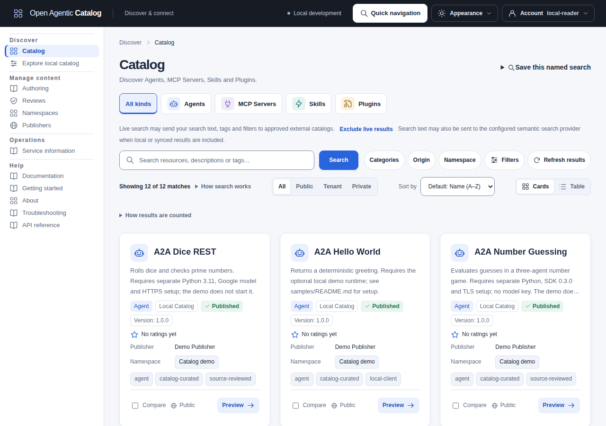

# Open Agentic Catalog

Open Agentic Catalog is a standalone Go service for managing, reviewing, publishing and discovering Agents, MCP Servers, Skills and Plugins. It implements [Agentic Resource Discovery (ARD)](documentation/src/content/docs/reference/standards.mdx) and provides a REST API and optional browser UI, with PostgreSQL 18 for persistence.

The Catalog validates resource descriptions and package metadata; it does not install or execute agents, tools, skills or plugins.

[](documentation/assets/catalog-ui/catalog-browse.png)

The Catalog UI with sample data. Read the [online manual](https://open-agentic-catalog.github.io/open-agentic-catalog/) for setup, tutorials and operations.

## Features

- Author and version resources, import and export [JSON drafts](documentation/src/content/docs/guides/draft-transfer.mdx), then review and approve listings for publication.
- Search published resources with filters and facets, with [optional hybrid keyword/semantic retrieval](documentation/src/content/docs/operations/hybrid-search.mdx).
- Discover and synchronize metadata from [administrator-configured Catalogs](documentation/src/content/docs/guides/two-catalog-federation.mdx).
- Connect assistants and IDEs through the read-only [Catalog MCP server](documentation/src/content/docs/guides/mcp-server.mdx).
- Browse and inspect releases with the optional [VS Code client](extensions/vscode/README.md).
- Build API clients with the [Go, Python, TypeScript and Rust SDKs](sdk/README.md), or try the optional [local LangGraph discovery assistant](examples/langgraph/README.md).
- Manage tenant and namespace access, with audit records for changes.
- Save resources and searches, submit version-specific ratings and send private feedback through the [Catalog UI](documentation/src/content/docs/guides/catalog-ui.mdx).
- Observe the service with built-in Prometheus metrics; optionally enable OpenTelemetry tracing and signed webhooks.

See [concepts and lifecycle](documentation/src/content/docs/guides/concepts.md) and [supported standards and formats](documentation/src/content/docs/reference/standards.mdx) for details.

## Quick start

Use Compose to run PostgreSQL, the API, worker and browser UI together. Install GNU Make, Python 3.12-3.14, Git, curl and Docker with Compose v2 and BuildKit. Host Go and Node.js installations are not required for this startup path.

Run these commands from the repository root:

```sh
make compose-up LOCAL_UI=on
make compose-ps LOCAL_UI=on
curl -fsS http://127.0.0.1:8080/readyz
```

The first build downloads its image and package dependencies. Open:

- [Catalog UI](http://127.0.0.1:4180/catalog)
- [Bundled manual](http://127.0.0.1:4180/docs/)
- API at `http://127.0.0.1:8080`

Choose **Reader and discovery (development bundle)** to browse, or **Tenant administrator (development bundle)** for administration. These local shortcuts have no passwords. For username/password login, follow the [local Keycloak tutorial](documentation/src/content/docs/operations/oidc-keycloak.md#run-the-interactive-local-tutorial). Configure [OIDC sign-in](documentation/src/content/docs/operations/sign-in.md) for deployments.

Compose runs migrations and provisions development identities before starting the API and worker. It does not load resources; a new database starts with an empty Catalog. Follow [Create an Agent from fields](documentation/src/content/docs/guides/resource-authoring.mdx#create-an-agent-from-fields) to author an item, or load the optional samples below.

Stop the stack without deleting its data:

```sh
make compose-stop LOCAL_UI=on
```

Rerun `make compose-up LOCAL_UI=on` to restart. `make compose-down LOCAL_UI=on` removes containers and networks but retains PostgreSQL data. **`make compose-reset LOCAL_UI=on` deletes the selected project's data volumes.**

The default ports are 4180 for the UI, 8080 for the API and 55432 for PostgreSQL, all on loopback. Set `CATALOG_UI_PORT`, `CATALOG_COMPOSE_HTTP_PORT` or `CATALOG_COMPOSE_POSTGRES_PORT` to use different host ports. See [workflow settings](documentation/src/content/docs/reference/configuration.mdx#workflow-only-variables) for the full list. Make reads an optional `.env`; the default setup needs no `.env` file. Preserve the same project, port and optional-service settings on subsequent commands.

Local Compose enables webhooks. Add `LOCAL_WEBHOOKS=off` to disable them, or `LOCAL_MONITORING=on` to start Prometheus and Grafana. Follow the [webhook guide](documentation/src/content/docs/operations/webhooks.mdx) and [monitoring guide](documentation/src/content/docs/guides/performance-and-monitoring.md) for configuration.

### Optional: load sample data

With Go 1.27.3 installed, populate a new development Catalog through its API:

```sh
make demo-seed DEMO_SAMPLE_SET=minimal DEMO_STATE_FILE=output/demo/quick-start.json
```

This creates three published examples (Agent, MCP Server and Skill), one draft and one pending review. No archive server is needed. The receipt at `DEMO_STATE_FILE` records the created items; reuse it when rerunning against the same Catalog. The [sample Catalog guide](documentation/src/content/docs/guides/sample-catalog.mdx) covers twelve published examples across all four kinds, archive setup and extending an existing sample.

## Run without containers

Install GNU Make, Go 1.27.3, Python 3.12-3.14, Git and curl. Stop Compose or choose different ports before starting this alternative:

```sh
make run
```

The API listens on `http://127.0.0.1:8080`. This development mode uses in-memory storage; stopping it clears the data.

In another terminal, check the authenticated API:

```sh
curl -fsS -H 'Authorization: Bearer local-admin' http://127.0.0.1:8080/api/v1/capabilities
```

The `local-admin` token is for development only. The optional sample command above also works here. After restarting an empty in-memory process, choose a new receipt file. See the [API walkthrough](documentation/src/content/docs/guides/local-development.mdx) for authoring commands and cleanup.

### Browse with the UI

With the in-memory backend still running, install Node.js 22.23.4 and its bundled npm 10.9.9, then run:

```sh
make ui-install
make ui-dev
```

Open `http://127.0.0.1:4180`. The [UI guide](documentation/src/content/docs/guides/catalog-ui.mdx) covers authoring, review, publication and administration workflows.

## Containers and Kubernetes

Container images support Linux AMD64 and ARM64 and can be built locally:

```sh
make container-build CONTAINER_PLATFORM=linux/amd64 IMAGE=open-agentic-catalog:amd64
make container-build CONTAINER_PLATFORM=linux/arm64 IMAGE=open-agentic-catalog:arm64
```

For your own PostgreSQL without Compose or Kubernetes, follow [Run with Docker and PostgreSQL](documentation/src/content/docs/operations/docker.mdx). It uses separate API/worker containers, scoped credentials and explicit owner commands.

The [application Helm chart](deployments/helm/open-agentic-catalog/README.md) supports Kubernetes 1.34+ and deploys the API, worker, migration job and optional UI. A separate [monitoring chart](deployments/helm/open-agentic-catalog-monitoring/README.md) provides optional Prometheus, Grafana and dashboards.

Follow the [deployment guide](documentation/src/content/docs/operations/deployment.mdx) to configure PostgreSQL, authentication and secrets for your installation. See [build and release](documentation/src/content/docs/contributing/build-and-release.md) for image prerequisites, verification, SBOMs and chart packaging.

## Documentation

Read [CONTEXT.md](CONTEXT.md) for a self-contained overview of the application's purpose, architecture, domain model, security, development, testing, operations and current work.

The full manual lives in [documentation/](documentation/README.md):

- [Connect to an existing Catalog](documentation/src/content/docs/guides/reader-quickstart.mdx), [local quickstart](documentation/src/content/docs/guides/local-development.mdx) and [Catalog UI](documentation/src/content/docs/guides/catalog-ui.mdx)
- [Client integration](documentation/src/content/docs/guides/integrating.mdx), [OpenAPI](api/openapi/control-v1.yaml), [request examples](api/examples) and [CLI reads](documentation/src/content/docs/reference/commands.md#remote-catalog-reads)
- [Configuration](documentation/src/content/docs/reference/configuration.mdx) and [deployment](documentation/src/content/docs/operations/deployment.mdx)
- [Monitoring and tracing](documentation/src/content/docs/operations/observability.mdx), [webhooks](documentation/src/content/docs/operations/webhooks.mdx) and [backup and recovery](documentation/src/content/docs/operations/backup-restore.mdx)
- [Architecture and diagrams](documentation/src/content/docs/architecture/overview.mdx) and [standards](documentation/src/content/docs/reference/standards.mdx)

To browse the rendered manual locally, use Node.js 22.23.4 and npm 10.9.9:

```sh
make docs-install
make docs-build
make docs-preview
```

Open `http://127.0.0.1:4321/`. See the [documentation guide](documentation/src/content/docs/contributing/documentation.mdx) for editing and build options.

## Development

Start with [Developing locally](DEVELOPING.md) for setup, test selection and the repository map. `make test-unit` runs isolated Go tests; `make coverage-unit` reports their application coverage. `make test` adds local functional tests, while database, browser and deployed-environment checks retain explicit targets.

[Contributing](CONTRIBUTING.md) describes code conventions and change-specific verification. Run `make help` to list available commands.

Report vulnerabilities through the [security policy](SECURITY.md).

For the optional local code-quality dashboard, see [SonarQube setup, login and coverage imports](documentation/src/content/docs/contributing/testing.md#optional-local-sonarqube-dashboard).

## License

License: [Apache License 2.0](LICENSE)

Author: Mihai Criveti
