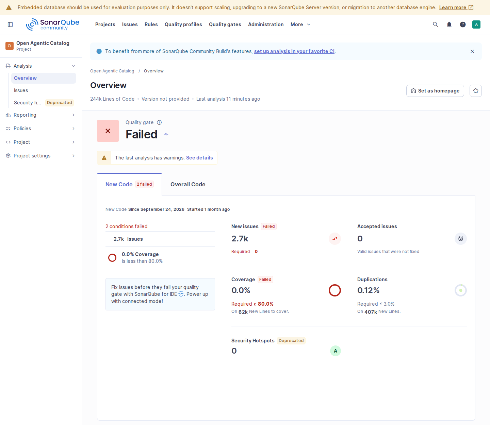

The Catalog uses source checks, isolated units, local functional tests, real PostgreSQL tests, browser journeys and deployment fixtures to verify different boundaries. Schema validation, standards conformance, security scans and performance measurements add evidence for their specific contracts. Choose checks according to what a change can affect.

This guide explains the test types, Make targets, prerequisites and reports. [Design principles](../architecture/design.mdx) explain the invariants they protect. The [performance guide](../guides/performance-and-monitoring.md) owns workload controls and measurement interpretation.

Start with the [testing pyramid and quality map](testing-map.mdx) for a visual overview of the execution layers, source checks and focused assurance techniques, plus guidance on when to run each during a change.

## Authorization qualification

[ADR-0022](../architecture/decisions/0022-local-postgresql-authorization.md) defines finite actions, tenant/exact-namespace scopes, direct-member groups and current retained PostgreSQL policy. The [fixture guide](../../../../../test/authorization/README.md) separates early design trials from the implemented enforcement tests. Prototype success alone does not qualify production authorization.

Isolated units check the complete operation/domain inventory, finite templates, role/group lifecycle, evidence rollback, bounded capability projections, signed continuation, command admission and private replay. They start no database, listener or subprocess. Local functional tests separately validate administration responses against OpenAPI and exercise current-authority HTTP replay. UI component units test effective permission hints, scope ceilings, denied actions and response consumption. Hints never replace backend admission.

`make test-integration` qualifies forward migrations, exact API/worker privileges, forced RLS, immutable built-ins, same-realm relations, permission composition and edits, collection predicates before paging/counts/facets, audit/replay atomicity and restore refusal. Concurrency tests observe the blocked database session and prove fresh decisions after waiting for revocation, not just an eventual successful response. Diagnostic matched samples exercise compact principal resolution, dense/sparse group populations, bounded self-access/directory/Search reads, administration churn and admission locks. Timing samples are neither routine latency gates nor production capacity claims.

`make test-process-postgres` uses two actual API processes sharing PostgreSQL: edits through either process immediately change both processes' decisions. Process replacement preserves exact durable replay, while revocation denies private response disclosure without executing again. `make test-ui-compose` and `make test-ui-oidc` own packaged root/subpath browser scenarios. Compose adds two-session custom role/group/assignment changes, namespace-only authoring, denied deep links, provisioning and seeding that can be repeated safely and PostgreSQL outage recovery with retained cookies. A policy-store outage returns a safe 503, not an invalid-token rejection. OIDC separately qualifies real login, membership refusal, scope ceilings and issuer outage.

`make test-backup-restore` and `make test-postgres-failover` reuse the owned recovery environments and verify retained custom roles, group paths, revoked direct access, exact namespace decisions and byte-for-byte command replay. Restore verifies policy before restarting the worker. `make test-minikube-replicas` adds a Helm scenario with three replicas. It tests commands, revocation, process replacement and a short load run. It does not introduce a policy service or HA controller. Review restored policy and changes since the selected backup before reopening ingress.

Run `make coverage-full` alone to produce fresh unit, local, PostgreSQL and process profiles and their weighted union. Do not add overlapping percentages. `make client-go-check` checks generated Go-client compatibility. `make ui-check` checks UI declarations and operation dispositions. Select the applicable lint, race, conformance, security and dead-code gates described below.

## Start here

Run commands from the repository root. `make help` lists the maintained targets in workflow groups. Start with the [build prerequisites](build-and-release.md#prerequisites-and-identities). Install the tools for the selected checks explicitly. Backend, API-tooling, UI and documentation dependencies have separate installation paths.

For backend development, run isolated units while editing, then the source and broad local verification gates:

```sh
make test-unit
make check verify CATALOG_ENV_FILE=/dev/null
```

The second invocation needs the installed source linters, [Ruff](#python-linting), [API validation tools](#api-validation) and actionlint from `make workflow-tools-install`. For complete upstream ARD schema checking, also verify the [Python JSON Schema prerequisite](#schema-validation-and-ard-conformance). `CATALOG_ENV_FILE=/dev/null` omits local Make workflow settings. Run unit targets separately: they already bypass env files and reject mixed goals.

`check` covers source and repository checks. `verify` is an alias for `test-all`: it adds the broad Go suite with race detection and coverage, pinned-profile and conformance checks, and binary checks. They share lint prerequisites when invoked together. Neither command runs a real PostgreSQL fixture, browser journeys, the built documentation site, performance workloads or every deployment scenario. Some source checks execute focused contract tests. A lint aggregate is not a unit-test selection.

Add the boundary-specific checks below. Use [coverage accounting](#coverage-accounting) when measuring coverage, [writing tests](#writing-tests) when adding assertions, and [selecting evidence](#selecting-evidence) before handing off a change. Keep current measurements under ignored `output/`, rather than in this procedure.

## GitHub Actions

The workflows under `.github/workflows/` call existing Make targets. Contribution checks run on pull requests and pushes to `main`. Pushes to `main` also build AMD64 images and charts. Release checks run on exact version tags or manual selection. Other verification selections remain manual. Pages also prepares the manual on `main`; external delivery requires maintainer activation.

Local act commands use disposable source copies and exclude developer credentials. Run `make workflow-local-tools-install`, then `make workflow-local-list`. The [local runner guide](../../../../../test/ci/README.md#local-workflow-commands) lists prerequisites, fixed selections and current qualification limits. Setup and parser checks do not establish that full application jobs pass locally. Agents do not dispatch hosted workflows or upload project data.

Local results remain under ignored `output/artifacts/workflows/<run-id>/`. `run.json` records the source, inputs, selected files, execution outcome and wrapper cleanup. Required reports must exist before the wrapper can pass. Timeout and interruption return nonzero, while retaining available selected reports. The [result guide](../../../../../test/ci/README.md#read-local-results) explains missing reports and cleanup failures. The owned Docker controls qualify report export, nested mounts, loopback access and cancellation; full application jobs remain a separate check.

The release helper units cover event admission, current source/package receipts, public checksums and delivery retries with intercepted commands. Functional fixtures use disposable Git tags and local files. They never publish. Run the selected installed-editor and archive-consumer tests before treating package tests as complete. 

### Choose and run a workflow

The workflow files must exist on the repository's default branch. Open **Actions**, choose a workflow, then select **Run workflow**. Choose the source branch and input values before starting the run.

| Workflow | Inputs | Checks |
| --- | --- | --- |
| **Contribution checks** (`contributions.yml`) | Automatic changed-path selection, or manual full selection. | Always run lint and isolated units. Select UI, docs and SDKs conservatively. Require `Contribution checks complete` in branch protection. |
| **Manual website and PDF** (`pages.yml`) | `deploy`: false. Optional `PAGES_ENABLED` repository variable for `main`. | Build the final Pages base and export the same completed manual. Deploy only from `main` through `github-pages`. |
| **Qualified release candidates** (`release.yml`) | Tag checks supply required handoff uploads. Manual runs require `upload_artifacts=true`; `publish` defaults to false. | Qualify retained images, source, clients and charts before protected delivery. See the [candidate procedure](build-and-release.md#run-checks-for-a-release-candidate). |
| **Source quality** (`quality.yml`) | `suite`: `all` (default), `unit`, `source`, `lint`, `ui` or `docs`. | Separate jobs run `coverage-unit` and Python tooling units; `check verify` and API validator tests; lint-only `check`; `test-ui`; or `docs-check` followed by `docs-site-check`. |
| **SDK and editor checks** (`clients.yml`) | `language`: `all` (default), `go`, `python`, `typescript` or `rust`. | Go runs `webhook-report-check`, which includes its SDK gate, and separate `client-go-check`. Other languages run `sdk-check`; TypeScript adds editor units and VSIX packaging. `release_checks=true` also runs Linux installed-editor tests. |
| **Images and charts** (`images.yml`) | `scan` and `release_candidate`, both false by default. | AMD64 builds on `main`, both architectures manually, image inspection, SBOMs, a native CLI archive and both Helm packages. See [artifact and release checks](build-and-release.md#github-actions). |
| **Disposable functional qualification** (`functional.yml`) | `suite`: `coverage-postgres-check` (default), `test-process-postgres`, `test-functional`, `test-ui-compose`, `test-ui-oidc`, `test-backup-restore`, `test-federation-peers` or `test-webhook-report`. | Exactly the selected existing target, with its disposable services and cleanup. Federation peers include locked UI and Chromium setup for browser pagination. |
| **Extended coverage or source security** (`extended.yml`) | `suite`: `full-coverage` (default) or `source-security`. | `coverage-full` alone, or `security` and `ui-deps-check`. These scans use downloaded advisory data without npm registry audit submission. |
| **Focused assertion assurance** (`assurance.yml`) | `suite`: `go-properties` (default), `go-fuzz`, `go-mutation`, `formal`, `ui-properties` or `ui-mutation`. | The selected existing property, fuzz, mutation or formal target. `mutation_package` selects one reviewed package for Go mutation. |
| **Runtime metrics microbenchmarks** (`benchmarks.yml`) | No test selection. | `bench` records ten samples of each of the two maintained runtime metrics benchmarks. |

Choose `docs` for a manual-only change or one language for an SDK change. Use `all` when a change affects several jobs. A focused selection does not establish results for skipped jobs. Select additional [boundary-specific checks](#test-boundaries) for the changed behavior.

With an authenticated GitHub CLI, the equivalent docs-only dispatch is:

```sh
gh workflow run quality.yml --ref "<branch>" -f suite=docs
```

Replace `<branch>` with the source branch. Use the [release procedure](build-and-release.md#run-checks-for-a-release-candidate) for a tagged candidate.

### Runner and tool requirements

Jobs use Linux AMD64 `ubuntu-24.04` runners. They select installed Python 3.12, check capacity, install the selected tools, then run Make. Python SDK generation and formal checks also require Java 21. Docker is required by image and disposable service jobs; browser selections install Chromium and its system libraries.

The Rust job requires at least 20 GiB of free disk and 4 GiB of available memory. Select a runner with sufficient capacity in `clients.yml`. The preflight refuses insufficient capacity; it does not prune files or alter the host.

Tool and dependency acquisition needs registry and release-download access. Security scans also need fresh advisory data. Tests use owned local fixtures, including local Keycloak; hosted discovery, resource and identity services are not test targets.

Jobs use `CATALOG_ENV_FILE=/dev/null` and do not load deployment credentials. The built-in read-only GitHub token supports checkout and selected tool downloads. No personal access token or registry login is required. Existing tool manifests and lockfiles own versions; workflows do not update them automatically.

### Read results and artifacts

Open the run to inspect each selected job, its logs and summary. Manual report workflows default `upload_artifacts` to false. Automatic contribution checks do not upload artifacts. Pages uses its separate opt-in deployment controls. Ordinary hosted report uploads require the maintainer to select true; act always skips them. When enabled, uploads use explicit paths and seven-day retention. They exclude credentials, raw fixture directories and the complete `output/` tree.

| Selection | Available evidence and limits |
| --- | --- |
| Units and coverage | Selected Go profiles and UI component coverage. `coverage-full` produces a fresh weighted union of unit, local, PostgreSQL and process coverage. Do not add or average overlapping percentages. |
| Clients | Job summaries and available package manifests; Rust also retains its coverage summary. SDK HTTP/TLS and installed-consumer checks are functional tests. `vscode-check` does not run an installed editor. |
| Images and charts | Image/chart summaries and SPDX JSON inventories. Ordinary checks upload neither image nor chart archives. |
| Assurance | Property/proof reports and reduced mutation counts. Raw mutants, source diffs and verifier logs are excluded. Failed fuzzing can retain bounded synthetic counterexamples. |
| Benchmarks | Source/environment information and measured samples. There is no timing threshold, application load test or comparison against another runner. |

Package uploads belong to release qualification only. Ordinary client checks build SDK packages and the VSIX, then discard the runner without uploading them. Manual `release_checks=true` runs installed-editor tests; it does not enable package uploads. The release workflow alone passes the internal `retain_packages` input at a version tag. Pages delivery keeps its separate opt-in controls.

Go properties use a fixed seed and 1,000 checks. Go fuzzing runs each maintained target for ten seconds with two workers. Mutation completion does not imply zero survivors; inspect survivors and timeouts before drawing conclusions. The formal selection proves the maintained Job retry helper, not the whole service. See [assertion-strength checks](#mutation-testing-and-assertion-strength) and [formal verification](#focused-formal-verification) for interpretation.

Use the final job status as the outcome. A summary records status before artifact upload, which can still fail. Missing reports, cancelled jobs and skipped checks are not passes. Known dependency findings remain scan failures.

Rerun a failed job to check the same source after a transient failure. Start a new workflow run after changing source. Fixture harnesses own cleanup, but forced cancellation can interrupt it. Do not use global Docker prune or retained-stack teardown to clean up after an interrupted test run.

### Change workflow files

Install the workflow validator explicitly, then run the checks separately:

```sh
make workflow-tools-install CATALOG_ENV_FILE=/dev/null
make workflow-check CATALOG_ENV_FILE=/dev/null
make yaml-check CATALOG_ENV_FILE=/dev/null
make docs-check CATALOG_ENV_FILE=/dev/null
```

`workflow-check` requires installed Go, actionlint and ShellCheck; it does not acquire tools. It joins `make check`. The separate `make test-tooling-unit` target includes isolated CI helper tests. Keep workflow logic limited to tool setup, existing Make targets and safe reports.

## Test layers at a glance

| Layer | What it proves | Start with |
| --- | --- | --- |
| Isolated units | Code behavior with in-memory inputs and fakes; no listeners, fixture subprocesses, real database or provider calls. Normal test compilation is allowed. | `make test-unit`; `make test-tooling-unit` for Python; `make ui-test-unit` for UI components, Node helpers and the Go host. Run each separately. |
| Local functional tests | Real local HTTP exchanges, subprocess/tooling behavior and composed service workflows using owned fixtures. No deployed Catalog or real PostgreSQL is needed. | `make test` or `make test-functional-local`; `make test-e2e` selects the composed in-memory journey. |
| PostgreSQL integration | Actual SQL, migrations, transactions, role privileges, row-level security, locking and persistence. | `make test-integration`; `make test-process-postgres` additionally exercises actual CLI/API/worker processes. Both own disposable PostgreSQL fixtures. |
| Packaged end-to-end tests | Built API/worker/operator behavior with PostgreSQL, configuration, dependency failures, recovery and cleanup. | `make test-functional` runs separate default-off, webhook and OIDC Compose profiles. |
| Browser and UI tests | Client behavior, accessibility assertions, navigation and authenticated browser workflows. | `make test-ui` includes client checks, units, local host/tooling tests and Playwright journeys. Packaged login and Compose checks have separate targets. |
| UI performance | Production asset/work regression budgets and report-only browser timings. | Opt-in `make ui-performance`; see [UI performance budgets](../guides/performance-and-monitoring.md#ui-performance-budgets) for scope, reports and slow-runner timeout controls. |
| Deployment tests | Image properties, Helm rendering, Kubernetes schemas and actual deployed behavior. | `make container-verify`, `make helm-check`, `make deploy-check`, then the applicable `test-minikube*` scenario. |
| Performance tests | Correctness under bounded workloads, latency/resource observations, SQL plans and focused code costs. | [Performance test selection](#performance-tests-and-benchmarks); these commands have separate fixtures and reports. |

Unit and functional describe the execution boundary. Generated properties, mutation testing, race detection, fuzzing, schema assertions and coverage are techniques that can apply within a boundary. They are not additional isolation levels. A fake database test can validate error handling but cannot establish that SQL or RLS works. The [complete target matrix](#test-boundaries) describes prerequisites and specialized gates.

## Live tenant settings

Use `make test-process-postgres` to qualify settings across two actual APIs and two worker consumers. The fixture checks committed policy, current-authority replay, concurrent saves, dependency failure/recovery and planned process replacement. Settings edits must not restart a process or rewrite an admitted Job budget.

`make test-integration` owns exact-role RLS, audit rollback, shared/exclusive locking and selection fairness. Its bounded plan check excludes 35 paused sources before a 32-source limit. Timing diagnostics have no host-sensitive threshold.

`make test-ui-compose` checks the packaged Settings page, inheritance and reset. It also checks recovery with the original idempotency key after a settings save commits but its response is lost. `make test-backup-restore` saves distinct overrides in both tenants and requires exact policy/validator readback after restore. These are selected functional checks. Isolated parser, service and browser units remain in their existing packages; their coverage does not include the real environments.

## Native import and export

The reusable draft format has isolated Go codec tests and browser guards that read the same [file fixtures](../../../../../api/testdata/catalog-draft/README.md). These check closed controls, incomplete authored fields, exact native text, package modes, artwork projection and separate byte budgets. `FuzzDecode` participates in `make test-fuzz`. These checks make no network requests and need no compiled Catalog binary or database.

API and CLI export units use injected repositories and transports. They check current permissions, exact parent bindings, required audits, opaque native text, package references, limits and refusal before attachment disclosure. The compiled CLI functional test exports all four kinds from an owned local Catalog. It also checks blocked multi-representation drafts, package-only Skills, scoped access without history permission, revoked access and cross-tenant refusal. CLI import tests cover destination plans, retained readback and interrupted-response recovery. Browser tests cover staged file replacement, incomplete drafts, exact downloads and protected partial saves. These cases use the existing unit, local functional and browser targets. The selected `make test-federation-peers` campaign also checks four-kind UI/CLI transfer between independent PostgreSQL Catalogs.

Use the authoring guide for [local preview](../guides/resource-authoring.mdx#preview-a-native-draft-locally), [apply and resume](../guides/resource-authoring.mdx#apply-and-resume-a-native-draft), and [native export](../guides/resource-authoring.mdx#export-an-existing-native-document). Select tests according to the boundary affected by the change:

| Target | Boundary |
| --- | --- |
| `make test-unit` | Local input preparation, request encoding, private receipt files, retained bindings and export validation use files and injected transports. No listener, fixture subprocess or database runs. |
| `make test-functional-local` | Compiled CLI commands use owned HTTP/TLS fixtures and a memory-backed Catalog. Four-kind import/export, interrupted batches, original-key resume and transport refusals use real exchanges. |
| `make test-process-postgres` | Compiled CLI/API/worker binaries use owned PostgreSQL 18. SQL and HTTP verify durable replay across APIs, draft/evidence effects, inline JSON serialization and export-to-draft re-import. |
| `make coverage-process-postgres-profile` | The same PostgreSQL process assertions run with instrumented application binaries and write `coverage/process-postgres.out`. This profile supplements repository coverage; it is not unit coverage. |

The process targets require Docker Compose, Go and a C compiler for race instrumentation. Coverage collection also requires Python. The [process fixture guide](../../../../../test/functional/README.md#native-postgresql-process-tests) owns detailed assertions, fixture isolation and cleanup. Import must leave drafts without review or publication. Export tests perform separate governance before exporting a release.

## Portable artifacts, local fixtures and operator acceptance

The deployment coordinator has isolated tests for target selection, ownership, operation order and failure handling in `test/deployment`. `test-unit` includes these tests. `helm-check` owns actual package and render checks.

The basic `test-minikube` scenario invokes the compiled coordinator for a failed first installation and upgrades with two retained replicas. It checks preflight refusal before mutation and observes the migration-hook ledger barrier with no old runtime Pods. It also checks migration failure, startup failure after migration, corrected retry from zero replicas and repeated governed-state reads. These checks add no cluster coverage percentage and do not qualify a predecessor release.

Native Compose launcher tests check build and configuration validation before drain, then bounded healthy startup. Packaged profiles check real API, worker and database behavior. See the [deployment tool](../../../../../test/deployment/README.md) and [maintenance procedure](../operations/maintenance.mdx#coordinated-release-deployment).

Compose tests the image/process contract without Kubernetes; Minikube tests the chart through standard Kubernetes behavior. Their owned clusters, fixed test database/identity, CNI, subnets, DNS and resource budgets are reproducibility inputs, not production prerequisites. Both charts support Kubernetes 1.34+. The schema gate checks 1.34.0 and the maintained runtime fixture uses 1.37.1. Linux AMD64 and ARM64 image builds and static inspection complement the functional tests without an engine or architecture certification matrix.

Retain fixture isolation and cleanup safeguards without requiring production cluster ownership. Validate namespace/release scoping and standard chart contracts with existing render tests and a focused owned fixture only if a concrete shared-cluster compatibility gap is found. Never adapt the destructive local launcher to discover or reset shared infrastructure.

An operator may modify chart manifests or use another container launcher while preserving [runtime and security invariants](../operations/deployment.mdx#artifact-and-deployment-ownership). Upstream test results identify the source/image/chart actually tested. The operator records changed manifests and validates affected boundaries separately. Non-Kubernetes portability is grounded in the packaged process tests, not a new platform-specific installer or test matrix. Managed/self-operated PostgreSQL must meet the same version, extension, role and migration contract. Fixture image pins are not required production images.

Application tests cover readiness, transactions, replay, drain and lease recovery. Deployment operators validate their database HA/backup, ingress, issuer and network configuration.

## Principles

- `make test-unit` runs isolated Go tests without listening servers, child-process fixtures or real database/provider calls. Normal Go compilation and temporary input files are allowed.
- The broad default suite (`make test`, an alias for `test-functional-local`) uses unit tests, in-memory component/workflow tests and local tooling regressions. In-memory Catalog instances, fake database transactions, test-owned loopback HTTP servers and temporary files are allowed. It never starts or connects to real PostgreSQL, an existing Catalog deployment or an external provider.
- Full-stack functional tests build the service image and exercise its public HTTP contracts against an isolated local Compose environment. Their workflow and API-operation reports are separate from instrumented Go statement coverage.
- Minikube tests build local images and exercise the Helm deployment in invocation-owned clusters; they are deployment evidence, not unit coverage or a production-availability claim.
- SQL, migrations, PostgreSQL roles, row-level security, constraints, locks, leases, and transaction behavior are tested against the supported PostgreSQL major rather than a fake database.
- Stopping and restarting one PostgreSQL process proves dependency recovery, not replication, failover, backup, or point-in-time restore. Portable writer failover and selected-deployment backup restoration are separate exercises with different loss and safety claims.
- Fakes remain appropriate for deterministic clocks, identifiers, fetchers, senders, stores owned by a domain port, and narrow failure injection. A supported external protocol also needs a real implementation where shared assumptions could hide interoperability defects; one provider run is evidence for that exact provider and configuration, not universal certification.
- Application unit, broad local, PostgreSQL integration and frontend coverage have separate reports. `make coverage-full` combines compatible Go application profiles by source block; never add or average percentages. Frontend and API-operation measurements retain separate denominators.
- Coverage is a regression signal, not proof that behavior, failure handling, authorization, isolation, or recovery is sufficient.
- A platform or provider name appears in release evidence only when the recorded build ran there. Standard API use and static policy checks support a portability claim but do not certify every conformant distribution, database operator, ingress, identity provider, storage class, or CPU architecture.

Tests that need no running services can still require other tools, network access or host dependencies. Default tests also use Python, Make and temporary Git repositories. Actual Helm packaging/rendering, browser workflows and deployed stacks have explicit gates.

Version-qualified Go tool commands may contact the module proxy for metadata even with a warm build cache. A proxy timeout is an incomplete gate, not a test result. Do not change pinned versions or bypass analyzers to report success.

Only explicitly offline targets such as `make vulncheck-offline` promise their documented local-input behavior.

## Linting and source checks

`make check` is the main source gate. Use the focused targets while editing. Run the aggregate after resolving findings. The tools and their scope are explicit:

Install the `shellcheck`, `markdownlint`, `yamllint`, `hadolint` and Docker Compose CLIs, the pinned [Ruff executable](#python-linting), and the separate [API validation tools](#api-validation). Compose model validation parses configuration without starting containers. The Go analyzer commands select their versions from the Makefile and may acquire pinned modules through the Go toolchain. UI and documentation-site checks use their own locked npm installations.

| Scope | Targets | Checks |
| --- | --- | --- |
| Go formatting | `fmt-check`; `fmt` applies changes | `gofmt` checks maintained Go sources, excluding generated and vendored inputs. |
| Go static analysis | `lint` | Go vet, pinned Staticcheck and golangci-lint; compiles supported test variants and includes architecture, module, license, shell and dead-code prerequisites. Compilation alone does not execute tagged database or deployment tests. |
| Go dependencies | `module-check`, `license-check` | Module integrity and tidy drift; dependency licenses against the maintained allowlist and exact test-only Rapid exception. Both are included in `lint`. |
| Package boundaries | `architecture-check` | Domain ownership and permitted outbound HTTP construction. Included in `lint`. |
| Shell and Python | `shell-check`, `python-lint` | ShellCheck for maintained shell workflows; pinned Ruff for Python under `test/`, `extensions/vscode/tooling/`, the LangGraph and MCP Scanner examples, and local OIDC tutorial helpers. Both run through `check`; Python lint is separate from `verify`. Packaging tests compare tracked and new non-ignored shell, Python and Containerfile sources with the Make selections and the optional hook lists. A file outside a list, or a list that differs from the other, fails the test. Immutable upstream trees and generated or SDK-owned Python have named owners. |
| Markdown and documentation contracts | `docs-check` | Markdown/MDX lint plus repository documentation and workflow-default contracts. Included in `check`; site builds use `docs-site-check` separately. |
| JSON, YAML, containers and Compose | `json-check`, `yaml-check`, `container-check`, `compose-check` | Strict JSON/JSON-LD syntax checks, YAML lint, Hadolint on every Containerfile (a packaging test compares the list with tracked files), and Compose model parsing. Included in `check`; model parsing does not start containers. Helm templates use the Helm gates. |
| OpenAPI and API-tooling JavaScript | `api-check` | Specification/example checks, YAML checks, installed Redocly rules and ESLint for the validation tooling. Included in `check`; see [API validation](#api-validation). |
| Documentation JavaScript and Astro/TypeScript | `docs-site-check` | Installed ESLint and Astro diagnostics before native tests and root/subpath builds; separate from `check`/`verify`. |
| UI TypeScript and JavaScript | `ui-lint`, `ui-check` | ESLint and Prettier; `ui-check` also checks TypeScript, generated API type drift and full/production Knip reachability. Included in `test-ui`, separately from backend `check`/`verify`. |

Go unreachable-function checks run through `lint`, `check` and `verify`. See the next section for exception review and limitations. UI lint/type checks catch unused bindings. The separate [UI reachability checks](#ui-dead-code-analysis) inspect unused files, exports and dependencies.

Security scanning is a separate check: `make security` runs the pinned Go vulnerability analyzer plus Trivy dependency, secret and deployment-misconfiguration scans. Ignored tool inputs under `.tools/` and research checkouts under `specs/` are excluded from the source scan. Owned dependency manifests, deployment inputs and retained profiles under `schemas/upstream/` remain in scope. Separate checks scan the locked Python development dependencies and exact application images.

The filesystem scan excludes installed npm dependencies, tool caches and virtual environments. Lockfiles and maintained container recipes remain in scope. Use `make ui-deps-check` for the full UI lockfile, including development dependencies. The separate `make ui-deps-audit` sends dependency metadata externally and remains maintainer-only.

These scans need their documented tools and advisory data. A clean source lint result does not replace them. See [dependency maintenance](../reference/dependencies.md).

## Optional local SonarQube dashboard

Run the digest-pinned [SonarQube Community Build](https://docs.sonarsource.com/sonarqube-community-build) to review source findings and imported coverage locally. It requires Linux AMD64, a local Unix-socket Docker engine with Compose, Python 3, Git and the locked UI dependencies installed through `make ui-install`. Allow at least 12 GiB of available container memory plus host headroom. Run the following commands separately from the repository root:

```sh
make sonarqube-tools-install
make sonarqube-up
make sonarqube-scan
```

Installation acquires the pinned images. Subsequent startup and scans use those installed images. The targets bypass Catalog workflow env files and require a single Make goal. Sonar is independent of the Catalog Compose stack and does not require a running Catalog or application database. See the [harness guide](../../../../../test/sonarqube/README.md) for exact pins, source exclusions, resource limits and cleanup behavior.

### Log in to SonarQube

1. Run `make sonarqube-status` to check readiness and print the dashboard URL.
2. Open [the local dashboard](http://127.0.0.1:19000/dashboard?id=open-agentic-catalog) on the machine running Docker and select **Log in** if prompted.
3. Use username `admin` and the generated password in the `password` field of `output/sonarqube/credentials.json`.

To display the dashboard URL, username and password in your own local terminal, run this from the repository root:

```sh
make sonarqube-credentials
```

`sonarqube-credentials` only reads initialized local credentials and also works while Sonar is stopped. It requires no Docker engine, network or analysis run. It intentionally displays the password, so use a private terminal rather than a shared log.

The runner replaces the initial default password during first startup. This is a separate Sonar account; Catalog development tokens and OIDC identities do not sign in here. Keep the credentials file private (mode 600) and out of commits, shared logs and screenshots.

The scan target uses it to create and revoke temporary analysis tokens, so no manual token setup is required. If you change the admin password in Sonar, update only the matching `password` field locally, preserving the other fields and permissions. Otherwise startup and scans cannot authenticate.

Retain the file with the analysis volumes across shutdowns.

`SONAR_PORT=19001 make sonarqube-up` selects another unprivileged loopback port and remembers it in the credentials file. Use the URL printed by `make sonarqube-status` after a port change. For a remote development machine, forward its loopback port to your browser machine. Do not expose the dashboard publicly to obtain access.

### Scan and import coverage

Each scan configures project-specific Go, Python, JavaScript and TypeScript profiles that inherit `Sonar way`. The [checked-in policy](../../../../../test/sonarqube/quality-profiles.json) permits cognitive complexity up to 40 (`S3776`) and up to 15 function parameters (`S107`). Both maintainability rules remain active.

Other rules and their severities, security/reliability checks, source exclusions and the report-only quality gate are unchanged. These settings apply only to the Catalog project, not the server's default profiles. Edit the policy and rerun `make sonarqube-scan` to reproduce a threshold change.

Editing these parameters only in the dashboard is temporary. The scan report records the profiles and overrides used.

`make sonarqube-scan` analyzes current source without running tests or importing coverage. To include Go unit and frontend coverage, generate the reports first and select them explicitly:

```sh
make coverage-unit
make ui-coverage CATALOG_ENV_FILE=/dev/null
make sonarqube-scan SONAR_GO_COVERAGE=coverage/unit.out SONAR_JS_COVERAGE=output/coverage/catalog-ui/lcov.info
```

For full Go functional/PostgreSQL coverage, generate `coverage/full.out` with `make coverage-full` separately, using its documented prerequisites, then select that file instead of `coverage/unit.out`. Import reports only after their generating gates pass against the same source. Those raw inputs record hashes but do not independently prove freshness.

Native tooling coverage is also explicit:

```sh
make coverage-tooling-python
make coverage-tooling-node TOOLING_NODE_PROFILE=docs-unit
make coverage-tooling-node TOOLING_NODE_PROFILE=ui-unit
```

The Python target needs the locked shared development tools. It instruments the existing owner-isolated units and emits conventional XML, including native zero-hit analysis for unexecuted modules. Node uses its installed native test runner and LCOV reporter. Its unit profiles preserve the owning native file selections; they do not replace Vitest. `TOOLING_NODE_PROFILE=compose` instead runs the complete existing disposable packaged browser gate and measures its Node scripts, including manual layout. Browser-evaluated callbacks remain browser execution.

Each producer prints a successful receipt path. Select those exact paths through the space-separated `SONAR_TOOLING_REPORTS` variable on `sonarqube-scan`. Receipts bind source/test inventories and report hashes; stale, incomplete or contradictory inputs fail before scanner execution. Select one Python receipt and disjoint observed Node files. Native UI unit and Compose profiles can overlap with different branch identities; import them in separate scans. See [native tooling imports](../../../../../test/sonarqube/README.md#native-tooling-reports) for commands and limits. Omitting all coverage variables imports no coverage, even when older reports exist.

After successful ingestion, open the project's issues and measures to review source locations, rule explanations, duplication and coverage. Sonar's line/condition denominator includes tooling without imported coverage, so its percentage differs from Go weighted statement coverage and frontend-only coverage. Keep each test scope identified and never add percentages.

Reports and token-redacted scanner output are retained in the printed `output/sonarqube/scan-*/` directory. Each JSON report distinguishes analysis/cleanup status from quality-gate status. A completed scan may report quality gate `ERROR` while exiting successfully because that policy is report-only.

Tool or ingestion failures return nonzero. Review findings against actual behavior. Existing lint, security, coverage and test gates remain authoritative.



This analysis imported no coverage. The failed report-only gate is an observation; it does not replace the repository tests. [Open the full-size screenshot](../../../../assets/sonarqube/project-overview.png).

### Stop, restart and troubleshoot SonarQube

`make sonarqube-down` stops the owned server/network while preserving credentials, named volumes and analysis history. `make sonarqube-up` restarts it with the same login. There is no destructive reset target.

| Symptom | Action |
| --- | --- |
| Dashboard unavailable | Run `make sonarqube-up`, then `make sonarqube-status`; use its printed port. First startup waits for readiness. |
| Login rejected | Use `admin` and the matching local password field. Check whether the password was changed in the dashboard. |
| Credentials missing while data is retained | Restore the original matching credentials file. Do not delete analysis volumes or create a fresh file to bypass ownership/authentication checks. |
| Credentials permissions rejected | Restore mode 600 with `chmod 600 output/sonarqube/credentials.json`. |
| Project missing | Run `make sonarqube-scan`; startup alone does not create or analyze the private project. |
| Images or UI declarations missing | Run `make sonarqube-tools-install` or `make ui-install`, respectively, then retry the selected workflow. |
| Another workflow is running | Let the current Sonar command finish; the checkout lock prevents conflicting startup, scan and shutdown operations. |
| Scan failed | Inspect the printed report and `scanner.log` when present. An incomplete run is not a successful analysis; preserve private credentials while collecting diagnostics. |

The developer H2 setup binds only to loopback. Its Docker bridge is not an air gap. Telemetry and update checks are disabled, and scan uploads target the local server. The complete Community Build bundle includes source-available analyzers, so it is not entirely OSI open source. See the [tooling/license policy](../reference/dependencies.md#optional-local-sonarqube-tooling) before changing or redistributing tool images.

## Unreachable-function analysis

Run `make dead-code-report` to review complete Go function-reachability findings and `make dead-code-check` to enforce their dispositions. The check is included in `lint`, `check`, `test-all` and `verify`. Unit targets do not run it. It complements the Staticcheck and golangci-lint rules rather than measuring coverage or detecting every impossible branch. The optional UI's Go host is included. Frontend and Python unused-code analysis are outside this gate.

`lint` also runs Staticcheck's `U1000` unused-symbol rule against application packages without tests and the complete unit selection on the host, followed by the full combined-tag analysis. These checks catch unused constants, fields and helpers that a function-only report or combined test selection can miss. Move package-local test support into `_test.go`. Retain shared support imported by other packages' tests with a documented caller.

The launcher builds `golang.org/x/tools/cmd/deadcode` at the Makefile's exact pin with the repository Go toolchain into a private temporary directory under ignored `output/`, then removes it. First use can download the toolchain and Go modules through normal configured Go proxies. Subsequent builds reuse the Go caches.

No global install, runtime-module requirement or `PATH` analyzer is used. Offline operation requires the selected toolchain, all tool and application dependencies, module metadata and checksum records already cached. Use the local file proxy below: version-qualified `go install` can still need cached deprecation metadata that `GOPROXY=off` refuses to look up.

Preserve checksum verification; `GOSUMDB=off` can prevent Go from selecting a downloaded toolchain. Missing prerequisites fail explicitly. Host acquisition has a five-minute timeout.

Each discovery/analysis subprocess has a three-minute timeout.

```sh
GOPROXY="file://$(go env GOMODCACHE)/cache/download" make dead-code-check
```

The host binary analyzes five fixed Linux selections with CGO disabled: the full application roots for AMD64 and ARM64 with shipping `netgo,osusergo` tags, and all owned source roots with tests for `minikube` (complete units), `functional` (broad local) and `functional,integration,helm,minikube` (combined contracts). Production loading includes unimported application packages while requiring exactly the daemon, operator and UI main packages. Only test-inclusive scans include example/harness executables. Static analysis executes no Catalog binaries or tests and requires no database, Compose environment or ARM execution support. Explicit toolchain, workspace, package-driver and Go flags keep ambient build settings from changing selection.

The report shows every finding, including retained exceptions, in stable scope/symbol order. Findings do not fail the report, but tool, discovery, loading and malformed/missing-output errors do. The upstream analyzer exits with status 0 when it reports findings. It emits JSON `null` when it finds none.

The launcher validates the exit status and JSON output. Exit status alone does not establish a clean scan. The check also rejects unreviewed findings and duplicate, unknown-scope or stale exceptions. Edit `test/packaging/dead_code_exceptions.json` only for a reviewed exact package/symbol and scope with a concrete reason.

Line numbers are diagnostic and no wildcard baseline is accepted.

Trace real callers and preserved behavioral assertions before removing a function. Shared fake clocks and contract inventories are legitimate test support, and separate database migration/grant fixtures may protect different phases from the combined operator command. A clean test-inclusive report cannot waive a production finding.

Test reachability is not executed coverage. Generated functions and marker interface methods are omitted by the analyzer, and `//go:linkname` aliases need manual review. Retain interface, reflection and build-variant requirements.

Use the pinned tool's `-whylive` diagnostic when a call path is unclear. Rerun analysis after removals because further unreachable functions can emerge.

Keep defensive JSON encoding checks. The `errchkjson` linter remains enabled with `check-error-free-encoding` off. Warning on infallible current types is a separate policy from function reachability. Dynamic values, unsupported floats and custom marshalers can fail and still require checked errors. Do not add failing test inputs for an impossible encoding branch or broadly exclude JSON functions from `errcheck` to raise coverage.

The [packaging harness](../../../../../test/packaging/README.md) owns isolated parser/policy units, bounded functional process/Make regressions and explicit actual-analyzer qualification. Run `make dead-code-check` manually before committing or pushing along with the applicable verification gates. The optional staged hook stays small and performs no whole-tree analyzer execution, downloads or automatic installation.

## UI dead-code analysis

Install the locked frontend tools with `make ui-install`, then run `make ui-dead-code-report` to investigate or `make ui-dead-code-check` to enforce. Both invoke local [Knip](https://knip.dev/) 6.43.0 through Node, with one maintained `catalog-ui/knip.json` configuration. There is no global executable fallback, automatic download, fixer, application build, database or browser fixture. The check also runs once through `npm run check`, `make ui-check` and `make test-ui`. Backend `check`/`verify` and isolated unit targets remain independent of it.

Each command analyzes two scopes: the full application/test/tooling graph and the shipped browser graph without tests or developer launchers. A module imported only by a test can pass the full scan and fail production analysis. The full selection includes visual browser specs, Node tests, Vitest setup and scripts invoked by Make or the UI Containerfile.

Helpers must be reached through imports, not listed individually as entries. Literal lazy imports and named exports remain visible. The Playwright plugin does not dynamically load its guarded configuration.

That file's imports and all browser specs are inspected statically without starting fixture processes.

Report mode uses native `--no-exit-code` in both scopes: findings are displayed with success, but missing tools, invalid configuration and analyzer failures still fail. Check mode fails on either scope's findings and may stop after the first failing scope. A successful check requires both. Neither writes a findings baseline or changes source. Redirect stdout/stderr into ignored `output/` when retaining evidence.

Review actual application, test, interface and framework consumers before removing reported code. Same-file uses count, preserving production helpers exported for focused unit tests. Reporting exceptions cover generated `src/api/schema.d.ts` exports/types, compiler-consumed `src/react-runtime.ts` exports and the framework-consumed `playwright.config.ts` default export. The React module is a production compiler entry. Its isolated test checks all sixteen exports against React's original bindings. Actual-tool fixtures require those exports to be reported when their exception is removed.

These files remain analyzed and imports must resolve. Do not add broad path/dependency exclusions or manufactured callers. Generated declarations stay generator-owned.

CSS selector, asset and arbitrary runtime-property reachability are not established by this gate. Keep browser and visual checks.

The actual-tool regressions in `catalog-ui/scripts/dead-code.functional.test.mjs` run in `npm test`/`make ui-test`, with owned temporary projects and bounded child processes. They verify both graphs, unused code/dependencies, missing imports, narrow exceptions, source preservation, Make/npm routing and operational failures. They are functional tooling tests, not application units. After analyzer/configuration updates, run these fixtures, both dedicated targets and the applicable UI, dependency, packaging and documentation gates in [dependency maintenance](../reference/dependencies.md#ui-dependency-maintenance).

## Make workflow behavior

Run targets from the repository root and use `make help` for the command inventory. Normal targets may read the selected Make-compatible `CATALOG_ENV_FILE`. Use `/dev/null` to omit local workflow settings. Treat these files as trusted Make input, not portable dotenv files. Isolated measurement, hook and cleanup targets ignore env files before parsing and must run as a single Make goal.

`make demo-seed` loads or verifies a retained development dataset. Run it on a fresh owned local instance and retain its receipt. The [demo walkthrough](../guides/local-development.mdx#populated-development-catalog) describes twelve published examples and two lifecycle examples. It also explains explicit dataset extension and recovery of an interrupted load with a private receipt.

Isolated units use controlled transports and local files. Memory-backed functional tests use real HTTP/TLS to check governance and recovery after a command response is lost. Recovery does not replay the command. The [demo harness](../../../../../test/demo/README.md) has an explicit Compose qualification for real PostgreSQL. It skips by default. A rerun of completed loading preserves authoring and review state and sends no authoring commands.

## Build-identity tooling tests

The Python unit gate includes isolated version, pin and environment-policy checks. Broad local tooling tests use disposable Git repositories. They check paths with spaces, shallow/tagged/dirty/Git-less inputs, Make overrides and actual pinned version bumps.

Install bump tooling with `make dev-tools-install`. For locked-installer qualification, set `CATALOG_TEST_UV=/path/to/uv-0.13.6` when selecting `test/packaging/test_functional_versioning.py`. For complete development-lock scanning and a known vulnerable metadata-only control, set `CATALOG_TEST_TRIVY=/path/to/trivy-0.76.1`.

Run these actual-tool selections with `go test -tags=functional -race -count=1 ./test/packaging`. `-count=1` prevents cached subprocess tests from hiding changed Python inputs. A skipped qualification is not a pass. Tests create no tag in the application repository. Cleanup fixtures remove only the owned shared environment and preserve `VERSION`, `pyproject.toml`, `uv.lock`, personal environments and retained data.

API/host units assert fixed build fields without network access. CLI process, real browser and packaged tests verify consumed metadata separately from statement coverage. Generated UI/Go clients and strict OpenAPI checks include sourceState. Build information does not measure uptime or attest release provenance. See [version policy](build-and-release.md#application-version-and-release-checks).

The security target separately scans every root uv.lock package plus the pinned uv installer. Trivy's dependency-only uv parser is unsupported at the qualified version, so a temporary exact requirements projection is generated from the lock and deleted afterward. The scan requires the full matching inventory and rejects High/Critical findings. It never installs those packages. The source scan still includes pyproject/uv.lock and excludes installed .tools/dev third-party files. A parser warning or an empty report alone is not clean dependency evidence.

## Python linting

`make python-lint` runs read-only [Ruff](https://docs.astral.sh/ruff/) 0.17.3 checks on maintained Python under `test/`, `extensions/vscode/tooling/`, `examples/langgraph/`, `examples/tutorials/local-oidc/` and `examples/mcp-scanner/`. It is included in `make check`, not `make verify`, Go builds or the default test suite. Install the shared pinned dev group with `make dev-tools-install`. The [build guide](build-and-release.md#shared-development-tools) documents uv 0.13.6 bootstrap, supported installed Python and exact environment/lock boundaries. Make prefers the owned `.tools/dev` executables automatically:

```sh
make dev-tools-install
make python-lint
make check
```

Explicit PYTHON/RUFF executable overrides remain supported. A missing executable gives installation guidance and a wrong Ruff version fails through ruff.toml. API-validation npm tools remain separately installed. Checks never install or upgrade tools.

The explicit stable `E4,E7,E9,F` rules cover undefined names, unused imports/locals, invalid constructs and selected import/statement conventions. Invalid Python syntax also fails. Six additional correctness rules reject mutable defaults (`B006`), exception-suppressing control flow in `finally` (`B012`), unused expressions (`B018`), implicit exception translation (`B904`), unspecified zip strictness (`B905`) and unretained asyncio tasks (`RUF006`). Use `strict=True` for collections that must match in length and explicit `strict=False` for deliberately unequal inputs such as adjacent-pair scans. Choose an explicit exception cause or `from None` according to the error contract. Preserve safe diagnostics.

This is not a formatter, type checker, security scanner or replacement for tests. Fixes and preview are disabled. The target supplies the root configuration explicitly and disables cache writes.

It does not import or execute the checked scripts. New files are included before staging. Personal Git ignore rules cannot hide source.

Dependency/cache defaults plus explicit `.tools` and generated-client exclusions keep installed/generated files out. The gate scans neither vendored standards nor notebook/Markdown/shell snippets. Optional direct editor/CLI use may create `.ruff_cache/`, which Git ignores.

After a pin or rule change, inspect the file inventory with the installed Ruff executable:

```sh
.tools/dev/bin/ruff check --config ruff.toml --no-cache --show-files \
  test extensions/vscode/tooling examples/langgraph examples/tutorials/local-oidc examples/mcp-scanner
```

Substitute your explicit `RUFF` override if you use another executable. Compare this list with the maintained Python inventory. Test temporary valid code and invalid cases with the selected executable. Include syntax errors, undefined names, unused imports and the selected correctness rules. Verify exclusions, nested configuration isolation, version mismatch rejection and unchanged source.

Make recipe tests use a stub executable. They cover executable paths with spaces and nonzero exits. Go tests do not require Ruff. Run the affected harness tests and source gates after reviewing findings. Do not apply automatic fixes or suppressions. See [Ruff configuration](https://docs.astral.sh/ruff/configuration/) and the [dependency inventory](../reference/dependencies.md#python-lint-tool).

## JavaScript tooling lint

After `make docs-install` and, separately, `make validation-tools-install`, run:

```sh
npm --prefix documentation run lint
npm --prefix test/validation run lint
```

Each project owns exact ESLint 10.13.0, `@eslint/js` 10.0.1 and globals 17.13.0 development pins and an independent lockfile. Both commands check maintained `.mjs` files, including configuration, tests and new files, using recommended correctness rules and Node ES-module globals. Undefined names, unused bindings and syntax errors fail.

Dependencies, generated output and tool artifacts are excluded. These commands do not format, write caches, permit inline rule overrides or install anything. Missing local tools fail.

There is no global executable fallback or UI dependency. API-tooling lint runs through `api-lint`, `api-check` and `make check`. Documentation lint runs through `docs-site-check`.

Both stay outside `make verify`, `docs-check` and native unit tests. See the [documentation workflow](documentation.mdx#verify-a-documentation-change) and [API tooling guide](../../../../../test/validation/README.md) for scope and functional qualification. These commands do not type-check Astro or TypeScript.

## Optional PDF export tests

Documentation units include inventory, link, anchor, SVG and print-content transformations. They need no browser or PDF tool. Run `make test-docs-pdf` explicitly for real Chromium exports and native PDF inspection. Install the [PDF prerequisites](documentation.mdx#export-the-complete-manual-to-pdf) first.

Functional fixtures exercise root and nested bases, closed navigation groups, all tab alternatives, disclosures, long code, tables, images and SVGs. They inspect searchable text, bookmarks and destinations. Negative controls cover incomplete inputs, missing assets/browser, timeout, cancellation, input changes and preservation of the previous PDF. Tests check owned browser and listener cleanup.

After renderer or layout changes, export the full current manual and inspect representative printed pages. A fixture pass does not replace full chapter coverage or visual review. Chromium structure tags do not establish accessibility certification. Ordinary site checks do not run this explicit browser selection.

## Astro source diagnostics

After `make docs-install`, run `npm --prefix documentation run check:astro`. The installed Astro CLI syncs generated types and checks authored Astro components and TypeScript using the strict scoped `documentation/tsconfig.json`. Errors and warnings fail.

Hints are reported. Missing local tools or configuration fail without installation, prompts or broader fallback discovery. The command may regenerate `.astro/`.

It does not format authored source or build HTML. ESLint continues to own `.mjs` tooling, while site checks own rendered pages, links, assets and navigation.

The separate `astro-check.functional.test.mjs` tests run actual subprocesses against disposable fixtures: clean-cache type generation, valid source, Astro frontmatter and TypeScript failures, generated-output exclusions, missing prerequisites and missing configuration. They run through `make docs-site-check`, not native unit selection. The site gate runs diagnostics before its tests and builds; `make check`, `make verify`, `docs-check` and unit targets do not invoke them. See the [documentation workflow](documentation.mdx#verify-a-documentation-change).

## Checked-in JSON and YAML

`make json-check` validates current `.json` and `.jsonld` files using Python's standard library. It rejects invalid UTF-8, malformed/trailing values, duplicate object keys and non-standard numeric constants. Numeric tokens are checked without rounding or converting large integers. It imposes no formatting rules or schema interpretation. Configuration, API, event, Helm and standards checks retain semantic/schema ownership.

`make yaml-check` retains `api-yaml-check` and discovers the remaining standalone YAML. First-party YAML uses `.yamllint.yml`, including duplicate-key rejection. Immutable upstream YAML receives syntax/duplicate-key checks only. The two chart template directories are excluded until Helm renders them. Use the Helm lint/schema targets for those inputs. No JSON exclusions are currently needed: checked-in examples and corpora are syntactically valid, even when their semantic values deliberately fail a contract.

Both targets run through `make check`, without editing files or installing tools. The Git inventory reads current worktree bytes, including staged/unstaged edits and non-ignored new files. Deleted files are absent and symlinked inputs are rejected. Ignored outputs and dependencies are excluded. The [optional commit hook](#optional-pre-commit-checks) applies data checks to changed index blobs instead. See [tooling tests](../../../../../test/packaging/README.md) for inventory, filename and failure-path regressions.

## Validation diagnostic limits

Diagnostic regression tests cover encoded JSON count/byte boundaries, multibyte and escaped paths, nested A2A/MCP/Plugin producers, aggregate exhaustion and errors following warnings. Authoring HTTP fixtures cover one A2A Agent Card with 50,000 invalid entries in its `skills` array, exact replay, retained raw data and blocked submission. The PostgreSQL diagnostic fixture covers creation/revision/revalidation, immutable digests, reads after lowering budgets, historical large reports, exact replay, atomic rollback and cross-tenant denial. Large valid documents remain positive controls. Run these through the `test-unit`, `api-contract-check` and `test-integration` targets. See [configuration and read-limit scope](../reference/configuration.mdx#validation-diagnostic-limits).

## Bounded Job read projections

Job result/read tests cover compact source/publication references and public metadata separately from retained execution data. Isolated tests check dispatch, decoder and scan behavior plus independent payload/result/lease storage in returned memory Jobs; `make test-integration` exercises large retained JSONB results, bounded SQL result projections, malformed fields, ordering and tenant denial against PostgreSQL. Local HTTP tests check small paged/detail responses without rewriting stored payloads/results. The worker and packaged suites retain cancellation, explicit retry, replay, partial-source and snapshot-recovery assertions. SQL transfer bounds are not measurements of PostgreSQL inspection cost.

## API validation

Install the pinned local tools with `make validation-tools-install` using Node.js 22.13+ within major 22, npm 10+ and the repository Go toolchain. Installation is explicit. Ordinary checks never install them. No service, database, browser or container is required.

| Command | Checks |
| --- | --- |
| `make api-check` | API-tooling ESLint, existing Go API specification/examples tests, yamllint and configured Redocly structural, reference, example and convention rules. Included in `make check`. |
| `make api-contract-check` | HTTP routing/behavior and event schema component tests; not a live API scanner. |
| `make api-validation-test` | Positive/negative real-tool fixtures and launcher safety tests. Run when changing validation tools, rules or pins. |
| `make api-diff API_BASE=/absolute/path/to/baseline.yaml` | Semantic report against an explicitly selected local contract; no default baseline or Git/network acquisition. |
| `make api-breaking-check API_BASE=/absolute/path/to/baseline.yaml` | The same comparison, failing on error-level breaking changes. |

`api-validate`, `api-yaml-check` and `api-lint` are focused subsets. API-only Make goals ignore environment files and cannot be mixed with unrelated workflows. Installation runs alone. Normal `make check` retains Make's environment-file behavior, so use `CATALOG_ENV_FILE=/dev/null` to omit local settings. `make verify` and Go builds remain independent of these npm tools.

Checks consume the original OpenAPI 3.1.0 document without fixes or generated replacements. oasdiff normalizes inherited parameters only in memory. It preserves operation overrides and does not flatten `allOf`. Tool input is restricted to bounded local files and local JSON Pointer references. Example values are data, not URLs to fetch. See the [validation harness](../../../../../test/validation/README.md) for exact limits, environment isolation and rule selection.

Static lint does not prove runtime authorization, tenant isolation, all JSON Schema semantics or client compatibility. The pinned Redocly has explicit test reproductions for referenced boolean-schema rejection and large-integer example rounding. Structural rules remain enabled. These limitations are not hidden by rewriting the contract. Go contracts, UI type generation, functional tests and consumer compatibility checks retain their distinct scopes.

## Schema validation and ARD conformance

Public license/topic filter changes use isolated IRI, literal-value, publication and facet tests plus composed sparse-peer HTTP contracts. The [two-Catalog fixture](../../../../../test/functional/README.md#two-catalog-federation) checks reviewed declarations for all four kinds, filtered local facets and preservation of reviewed license and topic declarations in live results. It also retains its audience, withdrawal, generation, outage and continuation controls.

Control Search tests check exact licenses and normalized category conjunction across selected origins. Isolated and real HTTPS cases test each filter alone, so an unused missing or malformed declaration cannot suppress a match. Live cases also verify forwarded fields, later-page admission, unchanged raw evidence and partial diagnostics for missing required declarations. The packaged browser and CLI workflows exercise the same API contracts through owned PostgreSQL fixtures.

The existing `test-fuzz` campaign includes `FuzzNativeFields`. Native-card units cover the nine public A2A/MCP paths, exact types, boolean omission, root mode arrays, skill tag arrays, repeated values, independent interface/skill constraints and query bounds. Card-default tests reject skill-specific modes as default values. The attributed corpus retains synthetic A2A declaration and malformed-array cases.

Hybrid tests assert native filters before comparison and full-set facets. The existing embedding HTTP fixture checks native facets through provider outage and recovery. Composed HTTP tests check each A2A mode/tag predicate in combined filters and distinguish card defaults from skill overrides. They preserve sparse peer responses and healthy local results on disclosed contradictions. `make test-federation-peers` checks skill IDs, streaming, interface bindings/versions and MCP remote transports/versions through owned PostgreSQL peers. Neither units nor peer queries fetch or invoke declared artifact endpoints.

Schema checks cover several different inputs. Select the target for the contract being changed:

| Contract | Targets | Evidence |
| --- | --- | --- |
| Control OpenAPI and examples | `api-check`, `api-contract-check` | Static specification/example checks and local HTTP/event contract tests. The functional harness also validates observed requests and responses against the embedded contract. |
| Pinned standards bundles | `profiles` | Checksums and selected profile identities. This checks retained bytes, not whether upstream has a newer version or whether a running service conforms. |
| ARD manifests and protocol | `conformance-fixture`, `conformance-live` | Independent Catalog checks plus the unchanged official conformance CLI, as described below. |
| Runtime configuration | `config-check` | Strict decoding and cross-field validation for the selected configuration and role, without opening runtime dependencies. `env-check` is its alias. |
| Kubernetes resources | `helm-schema-check`, `deploy-check` | Strict schema validation of rendered Kubernetes resources. Requires the container engine and schema source, not a running cluster; see [test boundaries](#test-boundaries). |

`conformance-fixture` independently validates the service fixture and all four checksummed official v0.91 examples. It passes each official example through federation ingestion. It checks mandatory-path and Link resolution with generic JSON, and rejects profile confusion.

The target then runs the unchanged official CLI over all five documents. The official basic example must produce two warnings. The other four documents must produce none. It also runs the source-pinned reference corpus and service handler contracts. `verify` and `test-all` include this target. Unit targets run selected Go schema and corpus tests but do not invoke the upstream CLI.

The reference corpus validates attributed wire examples, not whole reference deployments. Preserve each case's source, exact revision, source path, license, evidence class and disposition. `TestARDReferenceCompatibilityCorpus` checks those revisions against an explicit allowlist. New source revisions belong to new, distinctly useful cases rather than replacements for historical attribution. Unchanged upstream behavior and assertions already covered at another boundary do not require duplicate fixtures. See the [compatibility overview](../reference/standards.mdx#compatibility-with-other-catalogs-and-clients) and [ARD validation rules](../reference/standards.mdx#ard-validation-and-compatibility-rules).

Independent Search tests check valid media types and matching node identifiers when those optional fields are present. They preserve sparse omissions, unfamiliar parameterized types, exact source evidence and structural query-context checks. Federation units and public HTTP tests reject invalid entries while retaining healthy local and peer results, sanitized partial signals and eligible trust declarations. These assertions supplement the official checker; schema success alone does not prove the required behavior.

The official CLI comes from the immutable profile recorded in [pinned profiles](../../../../../schemas/PROFILES.md). Test runs do not fetch upstream `main` or use an ignored `specs/` checkout. It exposes three modes:

| Mode | Checks performed |
| --- | --- |
| Manifest | JSON parsing, `ArdManifest` and per-entry `ArdEntry` schema validation (required by the maintained wrapper), identifiers, required fields, value-or-reference delivery and semantic warnings. |
| Publisher | Well-known publisher resolution followed by manifest validation. |
| Registry | `GET /agents`, `POST /search` and `POST /explore`, with response-shape and per-search-result checks. The upstream checker permits unsupported optional endpoints. |

The maintained targets run the unchanged pinned CLI through `test/packaging/ard_conformance.py`. `conformance-prerequisite` fails early unless the selected Python has `jsonschema` 4.26.0 and a valid Draft 2020-12 ARD schema with both required definitions. Install the development-only prerequisite explicitly. Checks never install it:

```sh
make dev-tools-install
make profiles conformance-fixture CATALOG_ENV_FILE=/dev/null
```

The fixture, live and packaged functional Make paths share this prerequisite. The wrapper uses that same interpreter for the official CLI, preserves its exit failures and output, bounds each invocation to 60 seconds, and additionally requires both `Manifest validates against ArdManifest.` and `All N entries validate against ArdEntry.` for manifest/publisher success. Missing dependencies, missing/invalid schemas, schema-invalid documents and validator execution failures cannot silently pass.

The five fixture warning-count assertions remain in place. Registry mode runs the upstream protocol assertions. It does not use manifest JSON Schema validation.

The upstream validator does not enable optional JSON Schema `format` assertions. Independent Go and protocol checks retain their existing scope.

After explicit tool installation, run `.tools/dev/bin/python -B test/packaging/ard_conformance_qualification.py` when changing this wrapper, prerequisite or upstream pin. An alternative interpreter must have the pinned `jsonschema` version installed. The qualification exercises the actual CLI against valid/invalid local documents, schema/validator failures and an owned loopback publisher/registry, without a Catalog build, database or Compose environment. Native isolated units and stub/process regressions remain in the normal tooling selections.

Use `make conformance-live` after creating an active publication in a deliberately selected disposable local Catalog. Set `ARD_MANIFEST_URL`, `ARD_PUBLISHER_URL` and `ARD_REGISTRY_URL` for that instance. The target reads it and does not seed or start it. The default-off profile within `make test-functional` creates its own publication and runs all three modes against the packaged service. The separate webhook and OIDC profiles qualify their respective boundaries.

The default-off ARD phase publishes one independently reviewed weather MCP under a dedicated publisher domain. It activates a temporary snapshot without changing the shared smoke samples. The fixed checker query must return that MCP's exact identifier and type. All three Registry routes must return HTTP 200, and native Search must report exactly one result. Manifest and publisher checks must validate every snapshot entry. All native runs require successful exits and zero warnings.

The phase checks that public bytes, ETag and active snapshot identity stay unchanged during testing. It then retires its release and restores the original snapshot before later workflows continue. The report retains exact fixture references, query, snapshot and native output digests. Native logs remain beside the report, and complete evidence survives a later phase failure. Empty or wrong-identity responses and zero native results cannot qualify. The declared MCP endpoint is never invoked.

For live evidence, confirm that the implemented Registry endpoints return HTTP 200 and that the Search probe has a matching published MCP entry. An empty search result bypasses the checker's per-result assertions. Its fixed query is `weather forecast tools` with the MCP Server Card media-type filter. The official runner has limited Registry coverage. The Catalog's positive, negative, authorization, pagination and federation contract tests provide additional evidence.

Run `.tools/dev/bin/python -B test/packaging/ard_conformance_qualification.py` for the separate actual-tool controls. Its owned loopback fixture serves one schema-valid MCP entry and checks the exact query, filter, `federation: none` and page size two. All three Registry routes return HTTP 200; the native count and served identity must match the expected MCP. Removing score, source or identifier must produce the corresponding native failure. A valid empty result passes the protocol check but fails the assertion that requires nonempty result evidence.

These controls qualify the checker workflow, not a deployed Catalog or the declared MCP endpoint. They do not establish every sparse shape, URI/type rule, authentication flow or continuation case.

Reference-implementation compatibility evidence is static and local. The maintained corpus distinguishes source-derived shapes, documented examples and synthetic boundary regressions, retaining source locations, revisions, license notes and explicit expected accept, predecessor-profile compatibility, or reject results. Synthetic cases do not describe observed peer behavior. Separate manager/HTTP tests exercise compatible requests, raw-result preservation, sparse-result scope and failure isolation; List recovery checks retain exact identities, digests and the last complete snapshot, not merely an unchanged item count. Normal development and release gates do not clone, build, or execute those repositories and do not call their hosted Search, List, Explore, MCP, installation, or execution endpoints. Hosted claims remain distinct from tested local exchanges.

## Generated API testing

Run `make schemathesis-tools-install`, then `make test-api-generated`, each alone. The isolated, hash-locked [Schemathesis](https://schemathesis.readthedocs.io/en/stable/) 4.32.5 tool uses the unchanged Control OpenAPI against the owned PostgreSQL/API/worker Compose fixture and smoke seed. It requires Python 3.12 on Linux amd64 plus the [packaged-functional prerequisites](#full-stack-functional-environment). Execution checks installed versions without acquiring Python dependencies. Ordinary units and runtime images remain independent.

The pilot first checks eight operations: namespace list/create/get/update, Catalog Search/Browse, Resource List and Version List. It generates 20 positive and 20 negative examples for each of seven operations with variable body or query inputs. Namespace GET uses a known-ID control without generated input. Resource List checks exact seeded identities, kind filters and descending update-time/ID order; Version List binds a real parent and checks ascending immutable IDs independently of labels.

Both have Reader success, valid no-Reader denial and other-tenant controls. Three exact Resource GETs and one later version creation are separately bounded setup requests within the 1,000-request cap. Four negative query generators must remain invalid after Requests serialization.

Successful Resource/version pages use independent fixture inventories and serialized query values. The tests define expected domain outcomes for bound cursors, audit reasons, no-change updates, strict integer spellings and namespace conflicts.

Invalid bodies must reach validation, and rejected namespace mutations must preserve readback state. Every response receives schema checks. Success requires the exact operation status, and the `default` Problem response does not make arbitrary statuses acceptable.

The Go contract driver supplies an independent inventory from the original OpenAPI before generated traffic. Schemathesis must load the same IDs. Selected and omitted IDs form an exact disjoint partition, checked again during report finalization. Omitted operations can still appear in separately disclosed setup and readback traffic.

Nine calibration cases and native JUnit completeness checks guard against false passes. The supervisor bounds requests, records, bytes, time and cleanup. It restricts traffic to the selected owned origin and methods.

The same command then tests Resource and Version creation in a separate bounded selection. Each operation generates twenty positive and twenty negative examples. Successful controls and exact readbacks precede generated traffic. Readbacks verify the bound tenant, identity, kind, parent, version label, immutable revision references and native content digests.

Invalid control bodies must remain invalid after fixture binding and serialization. Rejections require `400`/`INVALID_ARGUMENT` and unchanged PostgreSQL state across nine projections. These include Resources, Versions, revisions, representations, evidence sets, validation runs, document blobs and selected audit/outbox events. Queries cover the entire owned database, including orphan and wrong-tenant rows.

SQL checks row and combined encoded-byte limits before hash aggregation. Valid creation controls verify exact table changes and bind audit/outbox evidence to the creating request. A valid Skill Markdown control qualifies blob retention. Four SQL controls detect injected side-table writes and permit legal outbox bookkeeping. These deliberate fixture writes do not describe product defects. Six additional real-tool cases qualify response checks, writes after rejection, serialized binding and transport limits. The authoring selection retains the pilot's request, byte and time limits. Native documents stay fixed; their parser fuzz tests remain separate.

Reports under `output/functional/run-<id>/` retain source/schema/image/tool identity, counts, omitted operations and sanitized synthetic diagnostics. Replay with `SCHEMATHESIS_SEED=<recorded-seed> make test-api-generated`. Fresh fixture identities and ETags are supplied automatically.

Generated counts do not add to Go statement coverage or replace curated functional tests. See the [pilot harness](../../../../../test/apigenerated/README.md) for exact scope, bounds, dependency licenses and remaining limitations.

## Independent Skill package consumption

Run `make skill-tools-install`, then `make test-interoperability-skills`, each alone. This explicit functional target uses pinned upstream skills-ref with ten direct calibration cases, one real Catalog-governed immutable Git handoff and nine materialization/inventory/authority refusals. Real CLI Search/detail selects the published release. Every retained file digest, size and executable mode must agree before unchanged native validation, metadata reading and prompt projection. A later branch/draft cannot substitute published files. It is independent package consumption, not model execution or installation.

Installation acquires complete pinned source and hash-locked dependencies into a separate test image. Execution builds current Catalog commands offline and uses owned memory state, local Git and network-none containers. It needs Python, Git, local Linux Docker and the installed Go/tool caches.

It needs no Compose restart, database, public Git service or prebuilt application binary. The consumer receives no Catalog token and never runs package code. Package-only releases remain authenticated Control handoffs, without a public archive URL.

See the [Skill harness](../../../../../test/interoperability/skills/README.md) for prerequisites, limits, exact tool differences and report layout.

Ordinary isolated tests cover the selector, inventory, native-output and complete-report assertions. Local functional helpers cover real Git/Make and interruption cleanup without installing the tool. Native runs remain explicit and retain source/tool identities, actual outputs and cleanup under `output/interoperability/skills/`. Reports distinguish the tool's leniency and rejection of valid embedded delimiters from Catalog conformance failures. Preserve the separate `client-skill-check` discovery-instruction checks and existing hostile-archive tests. These scenario outcomes are not Go coverage percentages.

## Independent portable Plugin loading

Run `make plugin-tools-install`, then `make test-interoperability-plugins`, each alone. This opt-in Linux amd64 qualification uses unchanged pinned OpenHands SDK `Plugin.load` on six direct controls and one Catalog-governed package. Real CLI discovery and public snapshot assertions bind the selected archive URL, size and SHA-256. Bounded consumer extraction must match all retained files, directories and component documents before native loading. A later draft cannot replace published evidence. Corruption, truncation and denied required reads cannot reach consumption.

The loader has read-only fixture mounts, private temporary state, no credentials and no external network. An owned observer confirms no MCP request. Script sentinels remain unexecuted.

This is independent loading, not a model session, installation or permission to invoke components. The development-only archive policy is reused without changing production fetching. Pure helper checks belong to unit targets; Make/process controls belong to local functional tests.

Only the explicit install/check pair acquires and uses the independent tool. Reports are scenario evidence, not statement coverage.

See the [Plugin harness](../../../../../test/interoperability/plugins/README.md) for installation, the 900-second installation limit, 90-second native execution limit and 600-second scenario limit, exact dependency pins, native outcomes and cleanup. The local test image includes a proprietary transitive dependency with internal-use/redistribution limits. It is not part of the shipped Catalog or an all-open-source image for redistribution.

## Local Pi session preparation

Contributors can prepare a real Pi session with the unchanged pi-ard extension:

```sh
make pi-ard-tools-install
make test-interoperability-pi-ard-prepare
```

Run these targets separately on non-root Linux AMD64. Setup requires the pinned Node/npm tools, Trivy, bubblewrap and permission for invocation-owned transient systemd services. The [harness guide](../../../../../test/interoperability/pi-ard/README.md) describes acquisition, source identities, dependency checks and resource limits. The first-party runtime lock selects Pi 1.5.0 without changing pi-ard 0.2.1 or its upstream development lock. Pi's public extension loader supplies its supported compatibility view for older imports.

The native session uses a scripted local provider with model networking disabled. Only three ARD tools are active. Separate namespaces prevent external traffic and access to developer configuration. The preparation check verifies startup, native transport identity, tool/page budgets, failure controls and cleanup.

Run `make test-interoperability-pi-ard` separately for the full local client campaign. It builds current commands offline, publishes six Resources through governed workflows, then dispatches 18 native Pi tool calls. The campaign checks public HTTP, exact continuation, private-read rejection, error handling and declined installation. It compares raw HTTP, server counters, retained records and snapshot bytes. No retained Catalog is contacted, and no resource is installed.

## Native ADK MCP qualification

Run `make adk-tools-install`, then `make test-interoperability-adk`, as separate commands. The [ADK harness](../../../../../test/interoperability/adk/README.md) qualifies native tool discovery, schema adaptation, exact metadata and refusals through the actual local Catalog. Predetermined calls use no LLM, model credentials, embeddings or discovered-resource execution.

Use a non-root Linux account, Python 3.12-3.14, the repository Go compiler and a local Linux Docker engine through a Unix socket. Host and engine architectures must match. Prepare the Go module cache explicitly with `GOTELEMETRY=off go mod download`. Installation also needs the `gh` CLI and package/image registry access. Tests do not acquire missing tools.

The owned private-HTTPS fixture uses an in-memory Catalog and publishes synthetic data through normal governance. A single live native toolset spans reader-grant revocation. Independent HTTP observations bind negotiated protocol and calls, including authentication and certificate failures. All thirteen native groups, process completion and scoped cleanup are required. Source/binary/tool identities and partial failures remain under ignored `output/interoperability/adk/`.

Run `make test-interoperability-adk-cleanup` separately to reproduce the full valid campaign, an intentional expected-metadata mismatch and actual SIGTERM cleanup. The controller pauses at the existing revocation checkpoint, checks precise partial outcomes and independently confirms owned container/private-state absence. No manual scripts or signal timing are needed. Its summary is under `output/interoperability/adk/cleanup-*/report.json`; missing evidence, wrong failures, source/image drift or cleanup uncertainty fail the target.

The cleanup target includes the normal campaign. Expected negative controls have nonzero child exits with `verified=true`, `childSuccess=false` and `cleanup=true`. Require the aggregate command to exit 0 with all three controls verified. The harness documents [report interpretation and cleanup](../../../../../test/interoperability/adk/README.md#reports-and-cleanup), [expected outcomes](../../../../../test/interoperability/adk/README.md#reproduce-failure-and-interruption-cleanup) and [troubleshooting](../../../../../test/interoperability/adk/README.md#troubleshooting). Keep sources unchanged while the campaigns run.

Ordinary Go/Python units and local functional wrappers do not import or execute ADK. The explicit native target remains separate from broader MCP replica/protocol qualification, cloud deployment and LLM reasoning tests. See the harness for installation, dependency review, confinement and current limits.

## Local A2A interoperability control

Run `make a2a-tools-install`, then `make test-interoperability-a2a`, each alone. This explicit functional qualification uses official Python A2A SDK 1.2.3 with the unchanged upstream Hello World executor, a single-interface HTTPS deployment card and an actual SDK client. It needs a local Linux Docker engine, a non-root developer, Python 3.10+, Make, OpenSSL, the repository Go toolchain and cached modules; `gh` is needed for installation. Installation downloads hash-locked test tools. Execution builds current Catalog commands offline, uses an owned in-memory Catalog and Docker loopback, ignores deployment environment files and needs no prebuilt binaries, database or model.

Five direct-control outcomes cover the emitted card, completed task and exact request-derived artifact. They also cover four preconnection selection refusals and the exact three-request wire inventory. Task readback must retain only the newest of two history messages and preserve all other fields. The client explicitly selects `JSONRPC` 1.0, disables streaming/polling and supplies the retained protobuf Card to the SDK. Strict private-CA verification remains enabled.

The same target governs, reviews, publishes and activates one Agent Card. Real CLI Search and exact-release readback bind the selected document to its profile, digest, evidence and immutable identities. Its public ARD projection agrees.

A later unpublished version/listing draft cannot replace that evidence. Metadata operations and missing/invalid/wrong-tenant selection denials produce no runtime traffic. A separate client consumes only the CLI-selected card and completes one fresh task/readback without fetching the card again or forwarding Catalog credentials.

Actual untrusted-CA and stopped-listener controls require specific native failures while Catalog remains live/ready with unchanged records and publication. No runtime invocation feature is added to Catalog.

Reports under ignored `output/interoperability/a2a/<run-id>/` retain source/tool/binary identities, exact traffic, native results, case completeness and owned cleanup. The Catalog owns the isolated network namespace so runtime outage leaves readback possible. No ports are published.

Clients receive no private keys or Catalog credentials. A 600-second scenario alarm and separate bounded diagnostics/cleanup protect execution. These assertions qualify one governed handoff, not Go statement coverage, OAuth, streaming, gRPC, models, cancellation or general A2A conformance.

See the [A2A harness](../../../../../test/interoperability/a2a/README.md) for pins, scope, reports and test-layer separation.

## Local ContextForge controls

Run `make contextforge-tools-install` after installing the separate MCP and Python client tools. Then run `make test-interoperability-contextforge` alone.

This opt-in target starts an isolated Compose project with PostgreSQL, the Catalog API and worker, ContextForge and Everything. It builds current test images.

Native checks cover private TLS, OIDC, scoped readers, MCP discovery, echo, a resource and a prompt. ContextForge uses authenticated teams and server-scoped tokens.

Both supported MCP client protocols exercise the six Catalog tools through stateless ContextForge servers. Checks cover pagination, filters, immutable references and indexed provenance.

Two tenants test separate identities, namespace grant revocation, credential overrides and accepted credential replacement. Negative controls verify HTTP admission and tool refusals separately.

The runner stops only its Catalog API, checks a bounded forwarded-call failure, then restarts it and verifies recovery.

Private counters record fixed fields and synthetic credential labels. Metadata checks require zero resource invocation and zero unexpected peer contact.

Helper units check cursor progress, duplicate tools, safe diagnostics, credential output, cleanup retries and complete reports. Diagnostic failures preserve the original error.

A real invalid-token response verifies that diagnostics preserve the HTTP failure.

The check uses installed peer tools. Missing or stale installations fail without automatic acquisition. The latest stable ContextForge image has no release-age wait.

The project uses an internal network and generated private inputs. Success, failure and handled interruption remove its owned services, state and credentials.

Require both result and cleanup success. Read the [harness guide](../../../../../test/interoperability/contextforge/README.md) for prerequisites, reports and exact cleanup recovery.

The second flow publishes an MCP Server Card through independent author, reviewer and publisher identities. It uses `catalogctl` Search and exact readback before runtime setup.

The same flow executes the setup guide's Python example verbatim in the owned client. Failed execution, unexpected output or reflected credentials fail qualification.

The independent MCP client supplies a separate ContextForge token. Echo and static resource bytes pass through the selected virtual server.

A fresh prompt-first call reproduces the peer's private-CA verification failure. The report preserves that limitation without weakening TLS checks.

The prompt's own log entry must identify the certificate error. Unrelated TLS errors cannot explain that failure.

Separate Everything and ContextForge outages leave the Catalog ready and its sealed release unchanged. Both runtime paths recover after restart.

Outage checks reject successful tool results, HTTP client refusals and unrelated background errors. Isolated units verify these distinctions without an MCP SDK or services.

These checks do not use the retained development environment. The [ContextForge guide](../guides/contextforge.mdx) exercises the same fixture through separate setup stages.

The optional `browser` stage uses installed UI tools and the pinned Node version. It verifies private-certificate refusal, native sign-in, registrations, virtual servers and sign-out.

The first successful proxied tool response writes a fixed progress marker. Interruption tests wait for that marker before sending SIGTERM and checking scoped cleanup.

## Local MCP interoperability control

Run `make mcp-tools-install`, then `make test-interoperability-mcp`, separately. This opt-in control uses pinned, unmodified MCP Inspector and Everything with a test-only HTTPS/key wrapper on an owned Docker loopback namespace without external egress. It requires local Linux Docker, a non-root user, Python 3.10+, Make, `gh`, the installed repository Go toolchain and cached application modules for offline builds. The install target downloads locked tools. The test target fails if they are missing/stale and never downloads. Both bypass deployment environment files and preserve existing environments.

MCP and A2A qualification resolve the compiler matching root `go.mod` before building. A Go launcher must be on `PATH`. If it is older, the exact host compiler must already exist in its Go module cache.

The runner inspects the launcher locally and verifies the selected compiler directly, with `GOTOOLCHAIN=local`, `GOPROXY=off`, `GOSUMDB=off` and inherited Go flags excluded. Missing or mismatched compilers fail without downloads. Wrapper and Catalog builds preserve explicitly selected `GOMODCACHE`/`GOCACHE` paths consistently.

Explicit tool installation remains separate from qualification.

Five required cases verify protocol/server identity, tools/schema listing, exact echo, missing-key rejection and real invalid-argument tool failure. Native exits, structured results, per-case forwarding counts, independent upstream POST/session counts and cleanup must agree. Inspector has empty roots, sampling/elicitation disabled, a memory-only credential store and a trusted private CA without TLS bypass. Only `echo` is invoked. The wrapper consumes its synthetic key before forwarding. This qualifies wrapper admission, not native Everything auth or OAuth.

The same target adds five governed assertions and three metadata-derived MCP exchanges. Normal authoring, validation, independent review, publication and snapshot activation retain a primary Server Card and separate Registry representation. Real CLI discovery selects the exact release.

A later unpublished draft leaves its IDs, canonical digests and public snapshot unchanged. Catalog setup/discovery and denial controls produce no MCP traffic. Inspector receives its endpoint/header descriptor from that exact readback and its runtime key separately, then initializes, lists and echoes.

Selector units reject unsupported metadata without client execution.

Three Catalog-denial groups exercise missing/invalid API credentials (401), the CLI's local missing-token refusal and a valid wrong-tenant Reader's exact-release 404. They produce no handoff. Five further real Inspector controls reject a wrong runtime key, Catalog-token substitution, deliberate bearer forwarding, untrusted private CA and stopped MCP wrapper.

Observations for each phase distinguish the deliberate bearer-forwarding failure case from successful traffic. Inspector must launch and report the expected native error; Docker failure cannot substitute. The Catalog record and active public snapshot remain readable and unchanged after the wrapper stops.

All 22 enumerated outcomes (thirteen MCP exchanges, five governed assertions, three Catalog denials and final integrity), source identity and owned cleanup must pass. Reports under `output/interoperability/mcp/` are separate from line coverage. Units use recorders/injected dependencies.

Local functional tests exercise real wrapper TLS/streaming and Make/process behavior without MCP tools. Real external-tool qualification remains separate from ordinary unit/local gates. See the [MCP harness](../../../../../test/interoperability/mcp/README.md) for pins, limits, license inventory and cleanup.

### Catalog Control tools over stdio

Follow the [Catalog MCP server guide](../guides/mcp-server.mdx) for host setup, tool examples and operational limits.

The six shared tools use isolated reader tests for closed arguments, schemas, private-field exclusion, whole-result limits and caller-specific credential checks. Real stdio tests add local facets, authorization-bound self-access continuation and permission changes. Control handlers and the in-process reader use the same domain reads; HTTP MCP transport remains a separate qualification.

Run `make mcp-catalog-tools-install`, then `make test-interoperability-mcp-catalog`, each alone. The dedicated hash-locked client uses official Python MCP SDK 2.3.0. It verifies stdio and HTTP with `2025-11-25` and `2026-07-28`. The existing Inspector/Everything handoff and its npm installer remain unchanged.

The fixture publishes twelve native samples through API governance, then inspects and synchronizes an owned HTTPS source with the real worker. It checks all four resource kinds, exact local references, indexed version identity and two-item local/indexed continuation. Identities, representation digests and handoff references must match direct API reads. Invalid credentials, tenant boundaries, revoked assignments and stale cursors retain current API behavior. Local reads after revocation return an empty authorized collection; explicit indexed reads refuse access.

Separate HTTPS fault controls check malformed JSON and fields, API/output limits, escaped credential reflection and private CA rejection. They also verify call cancellation, concurrency refusal, continued session use, EOF during active work and SIGTERM shutdown. Successful controls distinguish an intended refusal from a broken fixture.

The memory stage uses an invocation-owned internal Docker bridge without external egress or published ports. It preserves retained services and requires native client exit, peer isolation and complete container/network/private-file cleanup. Reports live under `output/interoperability/mcp/stdio-*/`. All seventeen assertion groups in the memory stage must pass.

A second, PostgreSQL-backed stage requires thirteen groups for each of the four transport/protocol combinations. Two APIs share configuration and cursor keys. The same client alternates between them and continues a valid cursor after one API restarts. All four restart checkpoints and cleanup must pass.

The matrix also covers explicit four-kind live Search, positive/contradictory filters, partial peers, empty results and stale cursors. Its reports use `output/interoperability/mcp/matrix-*/`. This behavioral result is separate from Go statement coverage; the compiled child commands are not instrumented.

Select the test layer that matches the change. Run each isolated or interoperability target alone.

| Layer | Make target | Scope |
| --- | --- | --- |
| Go application units | `make coverage-unit` | Complete isolated selection, including MCP argument validation, projections, limits, current API refusals and cancellation through injected transports. |
| Python harness units | `make test-tooling-unit` | Report admission, source binding and cleanup failures. Docker and process calls are mocked. |
| Local functional tests | `make test-functional-local` | Compiled stdio commands, SDK exchanges, private HTTPS, token-file rotation, frame refusal and fixture shutdown. No installed independent MCP tools or deployed stack is needed. |
| Independent-client qualification | `make test-interoperability-mcp-catalog` | The pinned Python SDK, both transports/protocols, governed releases, source synchronization and PostgreSQL replica/restart fixtures. Install tools separately first. |

Go units use `testing/synctest` to check active-call deadlines without real waits or network calls. The local HTTPS test also checks that the configured timeout cancels an actual request. A subsequent valid call must succeed, without retries or a retained concurrency slot.

The [command reference](../reference/commands.md#use-the-catalog-from-an-mcp-host) describes host configuration, credentials, tool inputs and adjustable limits. The [harness guide](../../../../../test/interoperability/mcp/README.md#catalog-control-stdio-qualification) documents prerequisites, fixtures and failure interpretation. The command exposes Control metadata over stdio. The optional API `/mcp` route supplies stateless HTTP. Neither interface executes resources or wraps ARD entries.

## ARD Explorer qualification

The optional [Explorer harness](../../../../../test/interoperability/ard-explorer/README.md) runs unchanged pinned source against an owned in-memory Catalog. Run `make ard-explorer-tools-install`, then `make test-interoperability-ard-explorer`, separately. Installation downloads explicit inputs; execution uses installed tools and cached Go modules. The native browser checks public Search, filters, three pages, Explore counts and one List page. Separate HTTP fixtures characterize malformed responses, status errors and client limits. The proxy and disposable browser share isolated loopback networking with verified resource limits. Native failure, timeout and interruption controls check cleanup.

The selected client cannot authenticate to a private Catalog, supply `queryContext`, continue List pages or connect correctly to full Search-referral URLs. These are client limits, not Catalog defects or supported features. Independent Catalog counters and synthetic-server observations must match actual native exchanges. Artifact, trust-evidence and control-API requests during browsing fail the check. Snapshot bytes and ETag remain unchanged. Use `make test-interoperability-ard-explorer-startup` for the smaller startup-only selection.

## Independent Hugging Face interoperability

Run `make interoperability-tools-install`, then `make test-interoperability`, each separately. Installation requires `gh`, local Linux Docker, Python 3.10+ and Go. It acquires the pinned HF client image and Go build prerequisites. Checks use installed tools without downloads and build a disposable in-memory Catalog from current source. No PostgreSQL, HF account, existing app or published host port is needed. These targets ignore deployment environment files and remain outside default unit tests and `make verify`.

The 35-case matrix includes thirteen CLI Search cases, nine navigation cases, four full/sparse HTTP decoder controls, one credential/source control and eight native-library cases. CLI Search covers three published resource kinds, combined/empty/limited search, an explicit Search endpoint, MCP filtering, private-reader authentication, 401/403 rejection and human output. Navigation verifies exact current/predecessor discovery, filtering, result metadata and diagnostics, with each publication supplying its own expected media types.

The native cases call the unchanged HF `search_registry` function with its `SearchRequest` model. They check license/topic, A2A declarations and MCP declarations with matching and contradictory filters. Each contradictory request changes one condition. They also follow all three results with page size one and verify order, complete metadata, scores, source and final token absence. A token reused with a changed filter must produce HTTP 400 with the expected ARD error. These checks cover public snapshot continuation, not federated live-result windows.

Registry results must score above the static fallback score of 50. Navigation must retain their Registry scores and source. The client shares the disposable Catalog's private network namespace, with no internet access or inherited proxy credentials. Invocation-owned listeners, containers, network and fixture image are cleaned.

Bounded reports remain in ignored `output/interoperability/`.

Run isolated harness assertions through `make test-tooling-unit`. Local functional helpers run through `go test -tags=functional ./test/interoperability -shuffle=on -count=1`. They test real local HTTP and subprocess report handling without importing or executing HF. The explicit interoperability targets own actual HF execution.

Assertion failures return nonzero, and remaining cases continue within the overall deadline. Incomplete runs also fail. Repeat the target to verify isolation and repeatability.

Reports separate assertion status from capability disposition. HF private navigation exits 0 while reporting HTTP 401 because manifest reads omit its token. Direct authenticated Search passes.

Both selected HF decoders reject valid current-profile sparse results, and navigation forwards synthetic credentials to another owned Registry origin while rewriting result source. These expected limitations are characterized, not fixed by weakening Catalog behavior. `--kind skill` uses a different media type from native Catalog Skills.

Unfiltered Search/navigation preserve the Skill without relabeling it. The CLI has no continuation-token input; the native library can follow tokens and is tested separately within this matrix. Independent Registry servers and production OIDC/TLS remain outside that client-only matrix.

The separately selected `make test-interoperability-hf PYTHON=python3` runs 26 local peer cases using the same pinned image. Install the shared dev group with `make dev-tools-install` and use the owned interpreter or an explicitly qualified PYTHON override and provide OpenSSL. The unchanged Uvicorn factories for the challenge and primary peers run with owned HTTPS certificates on an internal bridge. The Catalog uses exact private origin/address/tenant trust with public egress disabled. Actual API approval and worker Jobs produce ten challenge observations and two primary descriptors, with three supported challenge projections. Tests check filters, schema/context behavior, exact Search selection, approved-only referral traffic, preserved local results, private-route rejection and the same Job's outage/recovery without false membership changes.

The peer target runs all six official manifest/publisher/Registry checker modes, requiring schema validation of every manifest entry. Challenge modes pass. Primary Registry fails specifically because its offline backend returns HTTP 500, alongside healthy/valid-empty controls.

Reports keep native status, full warning evidence and capability disposition distinct. Independent pinned EntryFields and HTTP-envelope checks supplement the protocol-only Registry checker. HF's old discovery path, context rejection, challenge source/base/referral limits and unavailable primary backend remain characterized limits.

No HF patch, account, artifact invocation or hosted backend is involved.

Both targets own and remove their fixtures. The peer report additionally binds checker/profile inputs and records scoped cleanup of private keys, certificates, containers and its image. Repeat the peer target to compare source identity and fixed outcomes.

Ephemeral IDs and addresses can differ. Helper failure controls reject incomplete reports, unexpected checker failures and unapproved route contacts. A real interruption control qualifies cleanup during active peer execution.

Neither target measures Go statement coverage or certifies every ARD requirement.

Offline capability preflight runs even for existing installed images. Pure helper tests use the unit selection. Service-free local HTTP/process and Make checks use the functional selection, whose Go wrapper runs both. Neither launches HF except through the explicitly selected interoperability targets. Source linters cover maintained Python and the Containerfile. Follow the [harness guide](../../../../../test/interoperability/README.md) for report interpretation and cleanup, and [standards compatibility](../reference/standards.mdx) for the distinction between interoperability and conformance.

## Local MCP Gateway Registry controls

Run `make gateway-tools-install`, then `make test-interoperability-gateway`, separately. Follow the [Gateway harness guide](../../../../../test/interoperability/gateway/README.md) for Linux AMD64 prerequisites, exact inputs, resource budgets and license limits.

This functional selection deploys native Gateway nginx/auth and MongoDB beside the current Helm Catalog API/worker with separate PostgreSQL 18. It checks synthetic static-key scopes, public/private/disabled membership, complete paging, filters, model-free lexical Search, private TLS and enforced network isolation. Independent pinned schemas and unchanged official checkers report peer conformance failures. The harness can pass when those failures match its expectations. Reports keep these outcomes separate. Listed MCP recipes are never executed.

The supervisor verifies managed Catalog build identities, served OpenAPI and governed smoke before peer assertions. Eight additional phases qualify indexed source enrollment, exact bytes and occurrence provenance, native add/disable/restore, and recovery of the same Job after an outage. Owner read-only PostgreSQL checks bind source revision, snapshots, Job attempts and audit evidence. The advertised Registry interface uses separate inspection and enrollment; invalid native Search remains rejected.

Reverse import uses a healthy HTTPS control that serves the actual Catalog manifest. The peer refuses its private address before manifest HTTP traffic. The test preserves native zero-import success status as a peer limitation, not successful federation. No translator, public routing or guard bypass is used.

Reports under `output/interoperability/minikube-gateway-*/` retain original responses, schema errors, checker outputs, phase results, SQL assertions and owned cleanup. Pure helper tests remain isolated; actual tools, databases and Kubernetes run only through the selected target.

## Local AGNTCY interoperability

Run `make test-interoperability-agntcy AGNTCY_LAB_DIR=/path/to/lab PYTHON=python3` alone against an explicitly selected, already running local Directory research lab. Follow the [AGNTCY harness prerequisites](../../../../../test/interoperability/agntcy/README.md): the pinned Linux AMD64 source/CLI/chart/images, private loopback kubeconfig, reviewed isolation policies, native HTTP/gRPC listeners and verified TLS gateway must be available. Install the repository Go toolchain/modules and the shared dev group with `make dev-tools-install` first and use the owned interpreter or an explicitly qualified PYTHON override. This target ignores deployment environment files, builds Catalog offline and fails on missing prerequisites. It does not install tools, provision a cluster or contact a hosted Registry/model.

The AGNTCY target checks four groups:

- A current A2A Card through native push, pull and export, then Catalog API creation, validation and readback.
- Worker synchronization of an empty predecessor manifest.
- Explicit Search rejection.
- Official checker and raw-entry schema outcomes.

The temporary Catalog admits only the exact tenant-bound lab TLS origin. Public egress is disabled. The Card's Agent endpoint is metadata and is not invoked.

A passing report characterizes partial compatibility. Manifest/publisher checks pass with warnings and zero entries; Registry conformance fails on missing List `items` and nested Search HTTP 400. The selected native entry independently fails its legacy identifier and two object-valued metadata constraints. Native scalar Search returns 503 because the optional extractor is absent. Search checks require the expected native codes and diagnostic messages, not status codes alone. These results do not establish nonempty or bidirectional ARD federation, and the harness neither translates responses nor weakens Catalog validation.

Reports under `output/interoperability/agntcy-*/` bind source/build/lab identities, exact checker evidence and cleanup. Repeat the target sequentially to compare fixed outcomes with fresh Catalog IDs and unchanged fixture content. Setup errors, missing cases/schema checks, changed conformance failures and cleanup errors fail the target.

Each invocation removes its Catalog process, binaries, synthetic configuration and client caches. The selected lab and identical deterministic seed remain. The harness guide describes interruption checks during AGNTCY qualification. It also explains scoped cleanup when a host failure prevents the harness from cleaning up.

Ordinary unit/functional helper selections never execute Directory or Kubernetes. This qualification is separate from Go statement coverage and the HF targets.

### Fresh Directory deployment

Use `make agntcy-tools-install` to acquire the pinned [AGNTCY Directory](https://github.com/agntcy/dir) source, released CLI, chart and five images. This command checks archive checksums, source contents and the Linux AMD64 image identities. Fresh deployment selects v1.8.0 through `test/interoperability/agntcy/deployment.json`. It stores external test inputs under the ignored `.tools/agntcy/v1.8.0/` directory. The retained lab keeps its separate v1.7.1 pins and admission checks. The installer does not create a cluster or update the retained research lab.

Run `make test-minikube-agntcy` after the [Minikube prerequisites](../operations/deployment.mdx#maintained-local-minikube-verification). Install the Apache `htpasswd` tool for synthetic Zot credentials. Prepare the canonical container build cache first. The Containerfile separates dependency acquisition from offline compilation. Set `MINIKUBE_PRELOAD_ARCHIVE` explicitly if the Kubernetes preload archive is available.

This target creates one private single-node Calico profile with separate Catalog and Directory namespaces. It deploys the current Catalog chart, API, worker and dedicated PostgreSQL 18. Directory uses its unchanged pinned chart and a separate database. Fresh credentials and certificates belong to that invocation.

The target checks the migration/API/worker images, managed version fields, served OpenAPI, normal publication smoke and all seven Directory workloads. It also checks local OASF schema access, HTTPS byte preservation, issuer rejection and enforced network controls. Public bootstrap peers, scanners, remote models and chart hooks are disabled. The local schema router admits only the selected version; it does not change records or responses.

Native checks push and read six exact records, then traverse all five projected entries with one-item pages. They check unknown records, server validation refusals and filter syntax. Native filters select underlying modules: an A2A filter can return a nested catalog containing an A2A module. The test preserves that behavior without rewriting the peer grammar.

Catalog checks accept and retain the manually exported current A2A card. The projected current-A2A wrapper fails native validation and remains unchanged in retained blocked evidence. Older A2A and MCP examples also retain blocked evidence. The selected Skill fails the peer schema; a native Plugin projection is unavailable. The API selects the current ARD profile at the predecessor manifest URL, and the worker completes a zero-member snapshot. Direct PostgreSQL reads verify the tenant, source, inspection, Job, snapshot, retrieved-body digest, current pointer and zero current observations.

The fresh target also tests actual local-file A2A, MCP and Skill imports with static enrichment and a one-record limit. It checks translated artifacts, first and repeated admission, malformed input and unchanged native inventory. The pinned peer rejects its translator's `modules[0].artifact` field. Skill checks also require both missing-field diagnostics for `source_locator` and `validation`. These are peer limitations, separate from the passing manual A2A round trip.

The CLI can exit zero after failures, so the test checks summaries, diagnostics and returned CID files. Dry-run translation does not establish successful storage or export.

MCP checks distinguish a valid Registry definition from native IDE connection settings. All schema checks use local pinned profiles. The selected v1.8.0 Publisher manifest has no entries. Its four collection links use Directory's incompatible native List envelope, so this target does not claim nonempty federation. Reports mark transfer, native changes, withdrawal and outage recovery as unrun. The [two-Catalog qualification](../../../../../test/functional/README.md#two-catalog-federation) separately tests real transfer, updates and outage recovery between compatible Catalog instances.

All three pinned official conformance modes run with mandatory JSON Schema tooling. The harness also validates each of the five raw entries. Expected Registry and entry-schema failures remain visible as peer incompatibilities. Native Search checks inspect the query-type refusal and missing-extractor diagnostic separately; HTTP status codes alone cannot pass. Passing the harness confirms that results match its expectations. It does not establish that the peer passes every conformance check or transfers its nonempty native inventory through ARD.

The HTTPS gateway forwards the optional Explore probe to Directory. A direct HTTP control compares its native 404 status, content type and response bytes with the HTTPS result. The gateway does not supply a substitute unsupported response.

Reports reside in `output/interoperability/minikube-agntcy-*/result.json`. They retain ownership and progress before setup, plus assertion and cleanup results after success or failure. SIGTERM uses the same bounded cleanup. Check `passed` and `cleanupPassed` separately. Peer response bytes, checker output and the four compatibility groups remain available beside the main report. The test sends no hosted peer requests and never executes the listed artifacts. Follow the [Directory harness guide](../../../../../test/interoperability/agntcy/README.md#fresh-owned-deployment) for commands, limits and interruption checks.

## Generated Go-client compatibility

Use the repository's Go 1.27.3 toolchain, Python 3.10+, GNU Make and a C compiler for the race detector.

Run `make client-go-tools-install` explicitly, then `make client-go-check` when changing the API contract, generator/runtime pins or compatibility tests. The check regenerates all operations twice and compiles them. It runs race-enabled, shuffled consumer tests against an authenticated in-memory Catalog. It also verifies codec and transport boundaries and checks that source files and module locks remain unchanged. No database, Compose stack or existing server is used.

`make client-go-generate` creates an ignored inspection copy, not a required prerequisite. Each target runs alone and ignores deployment environment files.

The nested modules exclude generated code from backend coverage and release dependencies. Governed Browse tests check filtered continuation, exact release/revision references, summary metadata and retained digest readback. Prepared Job List/Get tests check created-time/ID ordering, snapshot references, explicit false flags and private-field omission.

Foreign-tenant reads, wrong-purpose cursors and undeclared Browse parameters retain negative controls. Raw-response assertions and independent OpenAPI validation supplement typed decoding. These are representative client codec/transport and component tests, not a second all-operation functional suite.

They qualify raw-response and raw-body methods for arbitrary evidence JSON. Typed maps can round large integers, and generated response parsers need a size-limited transport. Authentication checks verify explicit private-CA trust, certificate and hostname rejection before authenticated HTTP transmission, per-request credential refresh and failure before transmission when a credential editor fails.

The [compatibility harness](../../../../../test/clientcompat/README.md) owns setup, examples, limits, cleanup and upgrade instructions. CLI and UI transports are unchanged.

## Combined SDK qualification

The [SDK overview](../../../../../sdk/README.md) links to the Go, Python, JavaScript/TypeScript and Rust consumer guides. The independent harness in `test/sdk/` owns package generation and qualification. Install its prerequisites, then run each command separately:

```sh
make sdk-tools-install UV=/path/to/uv-0.13.6
make sdk-check
make sdk-package
```

`SDK_LANGUAGE=go|python|typescript|rust|all` selects a language; `all` is the default. Missing prerequisites fail without skipping a selection. Only installation acquires tools. `sdk-check` regenerates twice, rejects drift, runs language checks and tests the installed packages. `sdk-generate` deliberately updates checked-in source. `sdk-package` builds artifacts without tests, generation or publication.

The same gate checks actual examples from the published language guides. Go compiles selected complete README helpers in its external consumer and exercises them against owned loopback controls. Python and TypeScript execute selected helpers with injected transports; these remain isolated units. TypeScript also compiles its complete marked examples with strict types. Rust compiles README fences through doctests on both supported compilers. Placeholder origins are not test targets. See [example verification](../../../../../test/sdk/README.md#verify-documentation-examples) for selection and limits.

Python tests a direct wheel and another wheel rebuilt independently from a source distribution (sdist). Both install offline with the exact locked set of runtime dependencies. The npm tarball installs offline without development packages or lifecycle scripts. These consumers run outside the checkout and call an owned Catalog API.

Python and JavaScript create, review and publish two Agent releases before checking nonempty Search and Browse continuation. They also retain four-kind draft, exact-evidence, replay, denial and private-Job controls. Python checks audit continuation; Chromium uses the installed JavaScript package for actual Catalog reads and a denied write. Go uses an external module with only a local SDK replacement. Rust extracts its `.crate` and runs consumers and the discovery example on both supported compilers. No retained service, database or public Catalog is required.

Artifacts and per-language manifests use `output/artifacts/sdk/`. The all-language package command writes a combined manifest only after all four builds succeed. It removes a previous combined manifest before work starts. Individual artifacts can remain from earlier runs; require command success and matching input hashes before reuse. Packaging does not establish test success.

Capture check output for native test and coverage summaries. SDK coverage excludes generated code and uses separate language denominators; do not add it to application coverage. `make clean` removes default artifacts and tools while preserving sources, locks and reports elsewhere in `output/`.

`make test-tooling-unit` runs isolated SDK launcher units with injected tools. These check package cleanup, partial build failures, archive rejection and input identities. Separate Make/process tests check target selection, environment isolation, missing-tool refusal and removal of stale combined manifests. They also verify that a failure stops later selections without acquiring tools or changing source files.

After `make dev-tools-install`, run these process tests without installing SDK tools:

```sh
(cd test/sdk && ../../.tools/dev/bin/python -B -m unittest discover \
  -s . -p 'test_functional_*.py')
```

This selection needs Make and Python. It uses temporary files and subprocesses, with no server, database or network access. The complete `sdk-check` gate includes these launcher controls as well as each language's package tests.

## Go SDK verification

The separately importable [Go SDK](../../../../../sdk/go/README.md) has its own module, runtime dependencies and generated source. Root application checks do not cover that nested module. Run each SDK target alone:

```sh
make sdk-tools-install SDK_LANGUAGE=go
make sdk-check SDK_LANGUAGE=go
```

Only installation acquires tools and dependencies. Use `make sdk-generate SDK_LANGUAGE=go` after an intentional contract or template change. The check generates twice and rejects drift without changing source. It also checks formatting, module tidiness, vet, the existing Staticcheck/golangci-lint rules and the licenses of all imported dependencies.

Untagged SDK units use injected HTTP Doers without listeners or application imports. Tagged functional tests use owned HTTP/TLS servers for trust, deadlines, response limits and lost-command outcomes. A composed case drops a response after a real Catalog command commits. It verifies one revision change, current replay permissions, changed-body refusal and exact original-key replay. The check reuses the existing compatibility suite against the SDK's types and an authenticated memory-backed Catalog. An external consumer also compiles and calls the SDK without an application-module replacement or generator. No Compose stack or database is required.

The check reports handwritten SDK coverage for isolated units and for units plus local HTTP/TLS functional tests. Both exclude generated operations and show covered/total statements. The second selection includes units; do not add the totals or percentages. Temporary compatibility and external consumers provide additional assertions outside these profiles. Root application coverage excludes this nested module.

Launcher units run through `make test-tooling-unit`; actual Make/process tests remain functional. See [the SDK harness](../../../../../test/sdk/README.md) for prerequisites, controls, cleanup and dependency review. The independent `client-go-*` targets remain available.

## Python SDK verification

The [Python SDK](../../../../../sdk/python/README.md) has independent runtime requirements and locked maintainer tools. Root application tests do not execute its tests. Install uv 0.13.6 explicitly, then run each target alone:

```sh
make sdk-tools-install SDK_LANGUAGE=python UV=/path/to/uv-0.13.6
make sdk-check SDK_LANGUAGE=python
```

Use `make sdk-generate SDK_LANGUAGE=python` after an intentional contract or template change. Checks use installed tools and locked runtime wheels offline. Maintainers need Python 3.12-3.14, Java 21, OpenSSL and the repository Go toolchain. Consumers need only Python and the package's runtime requirements.

The check verifies deterministic generation, every operation and response alternative, named object fields, Ruff, compilation and maintained-source types. Each selection has a separate boundary:

| Selection | Assertions |
| --- | --- |
| Isolated SDK units | Injected transports/codecs, credential binding, package-version headers, deadline accounting, safe provider failures, cancellation, stream closure, typed/raw results, bodyless responses and independent schema controls. No listeners, subprocesses, DNS or databases. |
| Local HTTP/TLS functional tests | Private CA/hostname checks, redirects/proxies/cookies, known/unknown-length limits, active-stream deadlines, observed cancellation, lost commands, safe malformed responses and 429/503 metadata without automatic retries. |
| Installed wheel and sdist Catalog workflows | Real authenticated API calls for four resource kinds, reviewed releases, nonempty Search/Browse and audit continuation, extension readback, native evidence, replay/ETag/key conflicts, denial, tenant isolation and private Jobs. The reused Catalog fixture uses memory stores. |
| Tooling units | Mocked installer/generator/process boundaries, stale tools/locks, environment isolation and offline fixture execution. Run through `make test-tooling-unit`. |

No Compose environment, real database or public service is used. Negative unit cases assert both the classified error and absence of transport calls; a swallowed fixture exception cannot stand in for input rejection.

To run only the SDK units after tool installation, use:

```sh
PYTHONPATH="$PWD/sdk/python/src" test/sdk/.tools/python/bin/python -B -m unittest discover \
  -s test/sdk/python/tests -p 'test_unit_*.py'
```

Use `test_functional_*.py` for the separate HTTP/TLS selection. These focused commands supplement the complete SDK gate.

The check builds a direct wheel and rebuilds another wheel from an independent sdist. It requires identical wheel contents, then installs each wheel offline into a separate runtime-only environment outside the checkout. Both installed packages call a real local Catalog API. No generator runs in the consumer build or installation. The [maintainer guide](../../../../../test/sdk/README.md#python-sdk) records the selected generator, supported generation adjustments and four conditional JSON-object types. Those containers preserve input and response fields; they do not perform complete JSON Schema validation. Independent tests validate their alternatives against the original contract.

Six open metadata models preserve additional constructor values, including nulls and literal keys such as `additional_properties`. ARD entries also preserve unknown keys and distinguish an absent `@context` from an explicit null. Codec and HTTP tests cover these values; closed models retain their existing behavior.

The installed workflows verify publication, complete Search/Browse pages, audit continuation, private Jobs and command bindings. Reader credentials cannot replay an administrator's completed command. Readback confirms that refused commands leave state unchanged.

Coverage reports show handwritten Python SDK statements for units and, separately, units plus local HTTP/TLS tests. Both omit generated code. The latter includes units; do not add percentages. Composed Catalog and package consumers supplement those profiles. Neither profile is Go application coverage.

## JavaScript/TypeScript SDK verification

The independent [SDK package](../../../../../sdk/typescript/README.md) owns its npm lock and transport tests. Install tools explicitly, then run each target alone:

```sh
make sdk-tools-install SDK_LANGUAGE=typescript
make sdk-check SDK_LANGUAGE=typescript
```

The explicit SDK installer acquires pinned Node 24.22.1/npm 12.2.2 without changing your default Node. It also acquires Node 22.23.4 and 24.20.0. Existing unit, HTTP/TLS and installed-package workflows run under each runtime. Maintainers need OpenSSL and the repository Go toolchain. Installation also acquires the SDK's Chromium fixture. Use `make sdk-generate SDK_LANGUAGE=typescript` for intentional contract updates. Checks regenerate twice, compare the full OpenAPI declaration graph and use installed packages offline. Strict TypeScript, ESLint and Prettier checks cover maintained source and helpers.

Injected Fetch units run without listeners, subprocesses or databases. They check credentials, limits, raw bytes, provider time, cancellation, safe failures, metadata and explicit one-page behavior. Invalid provider values fail before transmission; subsequent valid calls still work. Both success and error statuses have malformed/null/empty JSON controls. Error decoding stays strict under every `parseAs` mode.

Separate functional tests use real owned HTTP/TLS. They verify private CA/hostname checks, lost writes without retry, body limits, deadlines and connection closure after cancellation. Actual 429/503 fixtures retain error bodies, request IDs and Retry-After without retries. Malformed JSON preserves safe failure metadata and allows later recovery. A real gzip response is refused when the server ignores the requested identity encoding. These transport fixtures do not establish a Catalog rate-limit policy.

The check packs the actual JavaScript/declaration artifact. A clean offline project outside the checkout installs only its runtime dependencies, imports plain JavaScript and compiles the installed declarations. The installed package then calls a disposable memory-backed Catalog. Assertions cover all four resource kinds, publication, complete Search/Browse pages, exact native numbers, replay/conflicts, tenant isolation and private Jobs. Reader credentials cannot replay an administrator's completed command. Readback confirms that refused commands leave state unchanged.

Owned Chromium fixtures verify independent ARD responses and real Catalog Search, detail reads and a denied write. They check ESM imports, same-origin requests, bearer headers and response metadata. Each fixture confirms a cookie exists before checking its omission from SDK requests. These fixtures do not run the full UI campaign or contact a hosted Catalog.

Native checks and the Go-launched installed-package workflow remove inherited Node, npm and Playwright overrides. They use the selected tools and owned browser paths. Launcher units check this isolation.

Node reports handwritten compiled JavaScript line, branch and function coverage for the isolated unit selection. Generated declarations are excluded. This percentage is neither Go statement coverage nor browser/UI coverage. The complete contract inventory and compiler checks add assertions outside that metric. See [the harness](../../../../../test/sdk/README.md#javascripttypescript-sdk) for input locks, package paths, cleanup and runtime limitations.

## Rust SDK verification

The independent [Rust SDK](../../../../../sdk/rust/README.md) uses a Tokio/reqwest client and checked-in OpenAPI bindings. Its generated bindings include reusable draft export. Cargo-deny is a separate audit tool and is not a prerequisite for generation, builds, tests or packaging. See [Rust dependencies](../reference/dependencies.md#rust-sdk-dependencies) for the selected tools and policy. Consumers need Rust 1.88+; maintainer qualification uses pinned Rust 1.88.0 and 1.99.1 on Linux AMD64.

```sh
make sdk-tools-install SDK_LANGUAGE=rust
make sdk-check SDK_LANGUAGE=rust
make sdk-package SDK_LANGUAGE=rust
```

Installation alone acquires dependencies. Maintainers need rustup, Python 3.12+, Git, `gh`, a native C toolchain and the repository Go toolchain. Checks use owned compilers and frozen offline locks. Rustfmt, Clippy, deterministic generation, package notices and source checks remain enforced. Dependency inventories include checksums, release ages and license metadata. They do not replace a license or advisory audit.

See the [harness](../../../../../test/sdk/README.md#rust-sdk) for exact tools, scoped exceptions and cleanup.

Run `make sdk-rust-audit-tools-install` to acquire the analyzer and refresh RustSec data. Then run `make sdk-rust-audit` for separate offline license, source and advisory checks. Missing or changed audit inputs and advisory data older than seven days cause refusal. An audit result applies only to its selected inputs and advisory snapshot. The [Rust dependency policy](../reference/dependencies.md#rust-sdk-dependencies) defines its scope and the generator-only informational exception. Normal Rust qualification remains independent and records `dependencyAudit: not_run`.

Native units inject transports and credential providers. They start no servers or processes. They check concurrent-call isolation, shared deadlines and malformed JSON bytes alongside request, codec and diagnostic contracts. Separate Go-owned functional fixtures run actual HTTP/TLS and composed in-memory Catalog workflows. These include anonymous ARD reads and recovery after incomplete response bodies.

The same gate qualifies the [standalone Rust report](../../../../../examples/rust-catalog-report/README.md) and its independent lock. Both compilers build the example and run its isolated units. Actual executable tests check local paging, scoped access, safe partial/error output, private CA delivery and cancellation. A fresh curated in-memory Catalog supplies twelve exact report rows across all four kinds. These tests own and clean their local processes, listeners, credentials and archive inputs.

Extracted-package consumers run outside the checkout on both compilers. They check current authorization, exact-key replay and recovery after a committed command loses its response. The README examples compile; the maintained discovery program executes against an owned Catalog.

Native LLVM measures handwritten source lines for units and, separately, units plus local functional tests. Generated bindings and drivers are excluded. The combined percentage includes units; it is not PostgreSQL, deployment or all-operation coverage. The report at `output/sdk/rust-coverage.json` binds counts to source and tool hashes. Generated operation completeness is checked independently.

## Optional LangGraph discovery example

The [LangGraph example](../../../../../examples/langgraph/README.md) uses the maintained Python SDK for two read-only tools: Search local releases and inspect a selected exact release. Its framework packages live in a separate optional environment. They are not Python SDK requirements or Catalog image inputs.

Install prerequisites explicitly with `make langgraph-tools-install UV=/path/to/uv-0.13.6`. Use installed Python 3.12-3.14 and the repository Go toolchain. Installation synchronizes `examples/langgraph/uv.lock`, checks the installed license inventory and records the compiler used by the HTTP fixture. It does not acquire a model or start services. Run each target separately:

| Target | Execution boundary |
| --- | --- |
| `make test-langgraph-unit` | Actual graph orchestration with a scripted in-memory model and injected SDK responses. No listener, fixture subprocess, database or inference request. The report measures handwritten example source only. |
| `make test-langgraph` | Units plus the actual Python SDK against an owned memory-backed Catalog over HTTP. A scripted model exercises tool selection, continuation, exact record reads and current authentication. It is a functional client test, not a real-model result. |
| `make test-langgraph-model LANGGRAPH_MODEL_ORIGIN=http://127.0.0.1:11434` | The real local model calls the tools against an owned Catalog. Prepare the explicit local model first. Require an inspected governed release and successful cleanup. |

The deterministic tests cover empty and partial Search results, unchanged-query continuation, forged recommendations, bounded work, cancellation and safe failures. The HTTP fixture separately checks two Search pages, exact record identity, invalid credentials and a tenant change after selection. A previously returned identifier does not authorize the later read.

Real-model qualification is separate because model output can vary. A scripted model passing does not establish that the selected model follows the tool protocol. Likewise, one successful model run does not establish recommendation quality for every task. Root unit and verification targets do not acquire or execute this optional environment. Follow the example guide for model identity, explicit credentials, local execution and cleanup. Its [dependency policy](../reference/dependencies.md#optional-langgraph-example-dependencies) is separate from SDK runtime licensing.

## Plugin validation coverage

Plugin tests use different fixtures for different boundaries. None executes package components, and positive archive tests must not introduce a private-network exception into production downloads.

| Command | Plugin assertions |
| --- | --- |
| `make test-functional-local` | Bounded archive, component and encoded-storage admission, decoded-metadata rejection, retained-evidence integrity, checksum drift, owned-TLS HTTP retrieval and independent memory-backed discovery/adoption. The TLS fixture admits only its owned origin in test composition. |
| `make test-integration` | Real PostgreSQL roles, RLS, large escaped-inspection persistence, rejected-input cleanup, independent review and search; drift/recovery keeps historical review evidence immutable; sealed and stale writes fail; new draft content does not replace the published revision. Archive responses are injected so this layer tests persistence and lifecycle, not network policy. |
| `make test-functional-default-off` | Built-container Plugin creation/readback/replay, tenant isolation, invalid checksum and private-URL rejection without partial versions, four-kind observation filters and draft cleanup. |
| `make test-ui` | Default-policy private-download denial, plus selected owned development TLS archive authoring, wrong-digest 422 with unchanged history, exact retained read/reload, independent review/publication and Reader discovery against the real in-memory backend. Separate response fixtures cover inspection rendering. |

The packaged smoke retains Agents, MCP Servers and Skills. The independent-Catalog peer gate publishes all four native kinds in both deployments using invocation-owned development-only HTTPS archives. It does not qualify production public archive delivery.

Separately, positive archive retrieval is covered by owned-TLS backend tests and the narrowly selected local browser fixture, with no external hosting dependency. The browser fixture uses existing development-only exact demo archive admission and Python 3 standard-library ZIP inspection. Production public-fetch policy stays separate.

It stops its listener after publication and verifies retained reads/reloads and Reader detail without a live archive. This is memory-state qualification, not PostgreSQL durability or production public archive delivery. For a focused service-free iteration, run `go test -tags=functional ./internal/catalog ./internal/adapter ./internal/platform/httpserver ./internal/publication -run Plugin -shuffle=on -count=1`, then the applicable complete gates above.

## Optional offline MCP Scanner example

The [MCP Scanner example](../../../../../examples/mcp-scanner/README.md) checks saved tool definitions with YARA. It runs outside the Catalog in a network-disabled container. It does not contact listed servers, invoke tools or change Catalog records.

Run `make mcp-scanner-tools-install` for explicit acquisition. Run `make mcp-scanner-check` separately to qualify validation, subprocess handling and the pinned scanner. Missing or stale tools fail the check. Setup remains subject to the dependency policy and any recorded exact exceptions.

Isolated tests run through `make test-tooling-unit PYTHON_UNIT_DIRS=mcp-scanner`. They use no compiled binary, database, container or independent scanner import. Tagged functional tests cover owned subprocesses. The explicit check also selects real benign, finding, analyzer-failure, invalid-rule and timeout controls.

The optional [signed-webhook receiver](../../../../../examples/mcp-scanner/receiver/README.md) collects definitions only from explicitly mapped local HTTPS endpoints. Run `make mcp-scanner-receiver-check` for isolated units, SDK checks, local MCP/TLS tests, analyzers and licenses. Run `make test-mcp-scanner-receiver` separately for an owned PostgreSQL/process fixture.

The receiver fixture uses controlled Catalog responses, a real MCP SDK peer and a scanner executable double. It tests durable receipt, reconciliation, report binding, interruption and restart. It does not qualify native YARA or full Catalog/worker delivery. Native qualification requires the installed scanner. The [MCP Scanner guide](../guides/mcp-scanner.mdx) documents the separate `make test-mcp-scanner-compose` campaign and its owned cleanup.

See the [harness guide](../../../../../test/mcp-scanner/README.md) for exact pins, prerequisites, dependency findings and cleanup. All reports stay local and private.

## Optional browser client

Packaged Compose and OIDC checks open the real bundled manual at root and non-root UI paths. They cover Help navigation, separate CSP, Pagefind results, themes, mobile navigation, command tabs/copy, screenshots, diagrams, generated API pages and exact downloads. The Compose gate also checks an owned HTTPS documentation override and its outage. No hosted documentation endpoint is contacted. Source browser fixtures remain independent of the manual build; simulated navigation checks cover presentation separately from real bundle qualification.

### Client response and identity units

Runtime/authentication boundary units exercise the real client with inert HTTP replies, including malformed settings, identity/grants, login locations, expiry and rejected body reads. Selected client-to-shell cases verify current refusal clears private state while superseded responses cannot affect a newer identity. Keep the isolated shell mocks for interaction permutations and valid host-shaped controls for decoders.

Do not weaken decoding to accommodate incomplete fixtures. These units require no server or browser binary. The local browser, packaged Compose and OIDC gates qualify real host responses separately.

Product-response units cover consumed fields and nested variants against Control OpenAPI, plus malformed read recovery, stale body failures and uncertain writes retried with unchanged target/body/ETag/key. Keep fixture fields and lifecycle states consistent with the contract. A decoder failure is not a reason to weaken a guard.

Preserve separate raw-byte/digest, opaque-evidence and bodyless-response assertions. The colocated `catalog-ui/src/api/README.md` inventory distinguishes checked controls from deliberately opaque projections.

### Install and check the UI toolchain

Dependency checks are separate from tests. `make ui-deps-check` uses installed Trivy. The maintainer-only `make ui-deps-audit` submits dependency metadata to npm's configured registry. Agents leave that submission unrun. Both assess the full lockfile, including development tools, without installing packages.

`make ui-test` includes deterministic Node tests of their command scope, reports, failures and manifest preservation. It never runs a live advisory scan. Follow [dependency maintenance](../reference/dependencies.md#ui-dependency-maintenance) for reviewed updates and report interpretation.

`make ui-lint` runs ESLint JavaScript/TypeScript, React hook, typed promise and five unsafe-value checks, selected Playwright/Testing Library rules and Prettier formatting checks without editing files. It covers application code, tests, Node scripts and tool configuration, and fails on warnings. The shared TypeScript profile enables `noUncheckedIndexedAccess` and `exactOptionalPropertyTypes` for source, build and browser code.

The typed lint scopes include Vite configuration and reject unsafe assignments, arguments, calls, member access and returns. Native unit controls qualify both compiler options and all five rules with accepted/rejected examples. `make ui-check` includes these npm checks alongside TypeScript and generated API drift checks; `make test-ui` adds unit and browser tests.

Install the lockfile with `make ui-install` first, using the [selected UI Node/npm toolchain](build-and-release.md#build-and-run-the-ui-locally). The documentation build has a separate toolchain. These tools are not shipped in the UI runtime.

See the [selected rules and boundaries](../../../../../catalog-ui/tests/README.md#targeted-lint-and-accessibility-checks).

The UI has a separate npm lockfile under `catalog-ui/`. Set up with `make ui-install` and `make ui-browser-install`, then run `make test-ui` for the complete local UI gate: client/browser TypeScript, formatting, generated OpenAPI type drift, client unit tests, fixture lifecycle tests, Go host tests, an isolated build and [Playwright](https://playwright.dev/docs/intro) regressions. Use `make ui-check` or `make ui-test` for faster iteration without a browser.

`make ui-build` produces persistent browser assets and the static Go host for local use. It is not required before `test-ui`. Ordinary `make check` and `make verify` include Go host code, but do not run the npm client checks or build the UI.

Backend builds need no UI npm installation. The complete `make check` gate still needs Node/npm for its separate API validation tools.

### Discovery and permission checks

Discovery controls use separate Reader, Source Administrator and Publisher identities. Units and browser cases cover four resource kinds, sparse indexed/live projections, bounded source choices, exact version presence, partial paging, identity changes, keyboard use and narrow/light/dark layouts. Private investigation admission and explicit publication-host selection have negative request-count controls. Fixed browser responses qualify rendering and recovery. The owned Compose workflow separately qualifies real PostgreSQL, publication and HTTPS peer traffic. Inspect the [workflow matrix](../../../../../catalog-ui/tests/README.md#workflow-matrix) before adding a case, and extend the relevant assertion rather than duplicating a full journey.

### Component coverage

Vitest runs at most two isolated workers. Logic-only tests have 5 seconds to complete; DOM workflows have 15 seconds. Asynchronous DOM queries and assertions have 5 seconds. The [unit setup](../../../../../catalog-ui/tests/unit/setup.ts) applies these bounds to accommodate jsdom and V8 coverage on slow runners. UI performance uses separate measurements and budgets. Investigate failed assertions before changing deadlines.

`make ui-coverage` runs Vitest unit/component tests and writes source-mapped HTML, LCOV and JSON reports to `output/coverage/catalog-ui/`. The same coverage floors run in `ui-test-unit`, `ui-test` and `test-ui`. All application TS/TSX files, including unimported screens, count.

Only test files and declaration-only types are excluded. Normal runs enforce 99% lines, statements and branches and 100% functions, with per-file 100% thresholds for selected modules. `make ui-coverage-100` is a separate exact-100% diagnostic.

Its small remaining gaps are defensive guards and fallback handling constrained by enabled controls, validated inputs or current callers. Detached-opener focus cleanup is covered. The [unit coverage guide](../../../../../catalog-ui/tests/README.md#unit-and-component-coverage) describes measurement scope and exclusions. jsdom tests cover DOM interactions with controlled transports/timers.

Real browser layout, modal behavior and provider interoperability remain separate. Neither Go host nor Node fixture coverage is merged into the frontend percentage.

### Check browser behavior

`make test-ui` builds one private fixture and runs the complete ordinary browser selection in two serial Playwright shards. Each shard uses two workers and the existing ten-minute suite limit. Tests run once, without retries. Each shard retains separate artifacts under `output/playwright/ui-tests/`. Explicit filters or shard arguments run as requested through `npm run test:browser -- ...`. Visual, performance and source-coverage runs keep their existing exclusive selection.

After a browser change, test the built client through its Go host against an owned Catalog with the [populated demo](../guides/local-development.mdx#populated-development-catalog). Follow the [UI startup guide](../guides/catalog-ui.mdx), using separate ports when another development session must remain running. Stop a UI host before rebuilding the assets it serves. Leave unrelated backend data and processes intact. Do not use the standalone Vite server as evidence for authentication or API forwarding.

Check development sign-in, permitted/denied identities, Search and filter reset, cards/table parity, local preview/full-record reload, My access, sign-out, empty/error states, keyboard focus and narrow layouts. Check light/dark/system themes, density and reduced motion after styling changes. The maintained accessibility journeys also double computed text sizes at a 320px viewport and check header containment, horizontal reflow, keyboard refresh and Catalog layout switching without another Search request.

This automated control complements native browser zoom and assistive-technology review. It does not qualify them. Browser diagnostics and failure screenshots belong in ignored `output/playwright/`.

Use synthetic identities. Do not retain real tokens or session cookies. Reviewed visual reference PNGs are versioned separately under `catalog-ui/tests/browser/snapshots/`. The [baseline inventory](../../../../../catalog-ui/tests/browser/snapshots/README.md) lists every expected image and its view. Unit/host tests and browser checks are separate evidence, not a combined coverage percentage.

The default browser suite includes rendered axe checks on representative login, browsing, authoring, review and administration screens, with preview/filter/confirmation dialogs and keyboard completion.

Every maintained Axe scan rejects violations and unreviewed incomplete results. This includes ordinary browser journeys, visual checks and the packaged Publisher DNS journey. Scan tags and selected page surfaces remain unchanged. Existing local reviews require their exact rule, target, reason and independent observable checks. They do not create a shared exception for other pages.

Enlarged authoring scans return to the reading origin after their keyboard and focus assertions. This prevents sticky-header clipping from making color measurements indeterminate. Active table sort indicators use decorative SVGs; labels and `aria-sort` still convey the direction. No color-contrast rule or page is excluded.

The accessibility calibration first reaches a real incomplete result from pinned Axe in a temporary owned DOM fixture. Altered reports then verify rejection of unknown rules, unknown targets and violations. A failed independent state check also rejects a reviewed Filters target. The test restores its fixture. These controls test review logic; they do not certify product accessibility.

These scans do not establish WCAG certification. The selected real Plugin archive journey qualifies successful browser ingestion, exact retained documents and governed release discovery. A separate rendering test uses fixed responses to check hostile inert markup and safe handoff formats. This rendering test does not verify persisted state.

Selected discovery and namespace journeys reach controls with actual Tab/Shift+Tab navigation and assert painted focus, nonmodal desktop Filters exit, native modal background-focus exclusion, Escape/return, native required-field validation, cancel/confirm and saved readback. A failed-sign-out journey verifies alert semantics and a named keyboard-reachable retry. These assertions qualify DOM behavior, not spoken announcements.

The dark keyboard preview at 390 x 844 and the touch preview at 390 x 740 run whole-page scans. The touch preview rejects every incomplete result. Axe can report an apparent overlap for `.preview-actions > .muted` in the dark preview. For that exact target, the test independently checks painted text and opaque foreground/background colors. It requires at least 4.5:1 contrast and rejects clipped or covered text. Unsupported composition, other incomplete results and all violations still fail. Comparison tests verify this shared check with passing, poor-contrast and covered-text controls.

Modal scans preserve the hidden page's scroll position. Escape must return focus to a visible opener. Desktop preview and dark narrow Filters scans remain strict. These bounded checks do not qualify screen readers, native zoom or complete WCAG compliance.

See the [browser qualification and limitations](../../../../../catalog-ui/tests/README.md#targeted-lint-and-accessibility-checks).

Discovery assessment/provenance units check exact consumed evidence states, bounded unique source UUIDs, both conflict flags, scope-gated routes and absent-versus-empty version identity. The matching external browser projection is an explicit static rendering control, not source synchronization or health evidence. It checks exact clipboard data and no source-directory reads. Genuine local record and retained-download journeys remain independent. The UI withholds the handoff when a local assessment is malformed. A valid explicit reread is required.

The UI lint gate includes the semantic browser/coverage scripts under `test/embeddings/`, using the ESLint, Playwright rules and Prettier tools. Generated API types are checked by fresh-generation comparison and TypeScript. Build and coverage artifacts remain outside maintained-source linting.

### Browser source coverage

`make ui-coverage-e2e UI_E2E_PROFILE=local` measures source execution from the complete Chromium browser suite. The local profile uses four independent workers and retains the ten-minute deadline for the complete selection. Every case must pass without skipped or repeated execution. Select `compose` or `oidc` explicitly for the owned packaged workflows, or `semantic` for the complete real-model supervisor. Run them serially.

The semantic selection also requires the pinned offline model/images from `embeddings-install` and retains its 1,000-release qualification. Install dependencies and Chromium through `ui-install` and `ui-browser-install` first. Each profile runs real collector calibration, including automatically navigating new tabs and rejection of missing document checkpoints, and writes weighted Istanbul statements, branches, functions and lines plus execution status, source/build/browser identities, per-file JSON, LCOV and local HTML under a unique `output/coverage/e2e/<profile>/run-*/` directory.

Untouched application TS/TSX remains in the denominator. Skipped required cases, incomplete capture, incompatible maps/builds or cleanup failure invalidate the measurement. See [browser coverage collection and limits](../../../../../catalog-ui/tests/README.md#browser-driven-source-coverage).

Combine explicit successful run directories with `make ui-coverage-e2e-report UI_E2E_REPORTS='output/coverage/e2e/local/run-... output/coverage/e2e/compose/run-... output/coverage/e2e/oidc/run-... output/coverage/e2e/semantic/run-...'`. The report validates execution, cleanup, raw counters and matching original-source/build/browser identities, rejects duplicate or incomplete evidence, preserves constituent reports and names the included profiles. `files.txt` lists lowest coverage first; `gaps.json` lists uncovered source locations for review. A labelled partial union is useful for investigation, but all-profile qualification requires all four profiles. Percentages are recomputed from merged counters, never added or averaged. Ordinary image and semantic gates still qualify uninstrumented assets.

Instrumentation stays in private test builds. Packaged measurement mounts temporary assets without modifying normal images. Keep normal `test-ui-compose` and `test-ui-oidc` qualification for shipped assets. Source percentages are separate from Vitest component, Go and API-operation coverage, and do not prove every workflow or input combination. No new floor or automatic installation is introduced. Visual and real-model selections remain separate.

Browser regressions check navigation with unsaved editor changes and exact command retry after the user dismisses a reload. They also check revocation of a prepared command's only namespace grant and real OIDC UI-cookie loss. They check explicit recovery after the packaged API stops. They retain saved-state, authorization-denial and no-unintended-write assertions. Browser timer expiry, cookie loss and server token expiry are distinct boundaries.

### Select local and packaged browser gates

Run `make test-local-auth` to test the [local password setup](../operations/oidc-keycloak.md#start-one-local-catalog-with-passwords). It builds owned images and runs the documented launcher. Install the UI browser tools and acquire the pinned PostgreSQL and Keycloak images first. Reserve the documented ports and subnet. The test refuses conflicts; it does not stop another deployment.

The workflow checks administrator login, exact Reader grants, an additional user, password resets, provider disablement and Catalog suspension. It also checks development-login refusal, provider outages, UI logout, human CLI PKCE, retained restart and certificate renewal. Reports and empty-field screenshots stay under ignored `output/playwright/local-passwords/`. The runner removes only its own containers, volumes, network, image tags and private inputs. These are functional checks, separate from unit coverage.

An interrupted run exits with a failure. Cleanup continues after browser shutdown errors or further signals. Check the command's exit status if cancellation follows a completed report.

Run `make ui-test-unit` for existing Vitest coverage, isolated `scripts/*.unit.test.mjs` and untagged UI Go tests, each once. It bypasses environment files and runs alone. `make ui-test` retains all Node unit/functional tests and Go host tests with `functional`; `make test-ui` adds its existing browser phase. Node `*.functional.test.mjs` covers actual port allocation, child processes and Playwright configuration discovery.

Use `make ui-visual` for optional screenshot comparisons, separate from `make test-ui` because OS, browser and fonts affect pixels. Missing or changed baselines fail normal runs. Use `make ui-visual-update` only for intentional changes, inspect every image/diff, then repeat normal comparison twice in the [reference environment](#visual-comparison-environment). Both targets build isolated assets and clean their own fixtures without replacing a running development UI. Dependency upgrades require renewed baseline review.

The `make test-ui` Playwright stage starts only after the static and unit checks pass. Its Skill-upload fixture also requires GNU tar. Each test uses a fresh seeded in-memory Catalog and Go UI host on random loopback ports, with isolated browser state. Temporary builds and session keys are cleaned without replacing a running UI's assets. The suite covers browsing, responsive controls, role/tenant isolation, cross-tab sign-out, listing saves, independent review, lost-response replay and stale edits. For selective or repeated runs, use the [focused browser commands](#repeat-a-browser-case) below.

The [UI workflow coverage matrix](../../../../../catalog-ui/tests/README.md) identifies the maintained local browser journeys, packaged assertions and shared lower-layer boundaries. Complete workflow coverage means performing the UI action and checking its outcome, not counting reachable pages or API operations. Keep local, service-free browser workflows in `make test-ui` and exhaustive edge cases in unit/API tests.

Network-dependent federation, Job and successful webhook journeys belong in `make test-ui-compose`, together with a small PostgreSQL-backed authoring/publication selection. Do not duplicate those journeys in the memory-backed suite. The five-item default fixture has bounded per-case expansion for pagination.

It is not a scale-test dataset.

UI permission tests separate navigation availability from exact-namespace write authority. Maintained browser cases use custom grants beyond the first self-context page, a real policy change invalidating continuation and own-feedback withdrawal after resource-read revocation. Component units isolate minimal moderator, listing action, discovery-origin and Job-link permissions, including OAuth ceilings. Failed reads retain First page and cursor-free Reload without replaying writes. Keyboard focus and discard cancellation remain explicit assertions.

Retry guidance is covered at separate boundaries: client units validate bounded 429/503 `Retry-After` parsing and header-receipt timing, workspace units prove time advancement sends nothing, and the namespace browser journeys require explicit reload and exact replay after a committed update. The stale editor must still receive 412, and a fresh read must retain the committed ETag. Timing advice never authorizes an automatic command retry. The packaged Job wait helpers reject unexpected terminal states and late success. Their closed failure evidence is documented in the [functional harness](../../../../../test/functional/README.md#bounded-job-wait-evidence).

For [retry telemetry](../operations/observability.mdx#retry-signals), unit tests bind observations to successful persistence of waiting transitions, exact retained timestamps and fixed labels. Preserve negative assertions for failed persistence, terminal/exhausted attempts, cancellation, idle polling and one-shot API tests. The local functional embedding fixture exercises real HTTP hints through indexing and Job scheduling, while `make test-functional-webhooks` checks persisted retries and recovery in the packaged PostgreSQL worker.

`make test-monitoring` evaluates the shipped dashboard expressions with the pinned Prometheus tool, including missing/idle series, counter resets and observation-weighted means across healthy replicas. Python fixture units validate inventory and extraction. They do not execute PromQL.

Add `MONITORING_BROWSER=on` to check native Grafana controls after the workload, using its recorded absolute time range. The browser imports and updates only an invocation-owned dashboard. Optional `TRACING_VIEWER=on TRACING_BROWSER=on` adds exact Jaeger filter and causal-link navigation to `test-tracing`; start and stop the separate owned viewer explicitly. These checks require installed Playwright/Chromium and preserve independent application readiness. See the [monitoring](../../../../../test/monitoring/README.md) and [tracing](../../../../../test/tracing/README.md) harnesses.

These boundary and query assertions supplement statement coverage. A fully covered metrics helper does not establish correct emission or dashboard semantics by itself.

The Compose discovery journey compares a reader's real UI results with `catalogctl remote search` over the same approved source, including provenance, missing versions, indexed continuation and partial upstream failure. A composed HTTP test reuses the pinned connector request against published Catalog output. Component tests cover sparse inline/URL metadata without automatic retrieval. These checks qualify Catalog HTTP and client behavior, not execution of external assistant instructions or MCP transport.

Run `make test-ui-compose` for owned built-image/PostgreSQL login, source/adoption, Job, webhook and independent publication workflows and `make test-ui-oidc` for real human code/PKCE login, missing membership, scope ceilings, provider outage and root/subpath cookies. Its CLI journey also tests explicit login files for export preview, single/batch downloads, draft apply and completed resume. It forces real issuer refresh for export and import, then verifies exact content readback. The OIDC scope test first reads an exact saved namespace successfully, then requires a safe, correlated `403 FORBIDDEN` for that same protected route through the UI host after scope enforcement and fresh login as the same human. It verifies actual API denial as well as hidden controls.

It does not claim continuity of the original session across reauthentication. Both require Docker Compose, OpenSSL and the installed browser tools, and clean up their private image tags, containers, volumes and credentials. Follow [packaged OIDC qualification](#packaged-oidc-qualification) for provider prerequisites and [full-stack fixtures](#full-stack-functional-environment) for Compose ownership and reports.

`make test-minikube-ui` retains HTTP-level default-off/two-replica/subpath and disable-cleanup checks, not JavaScript execution. Do not duplicate the full workflow suite across Compose and Kubernetes. `make test-functional-oidc` remains the separate backend verifier gate.

### Repeat a browser case

After `make ui-install` and `make ui-browser-install`, run focused cases from `catalog-ui/`:

```sh
npm run test:browser -- --repeat-each=2
npm run test:browser -- --grep 'independent review'
```

The launcher builds private temporary binaries/assets and gives each test fresh memory state, loopback ports, keys and a browser context. It does not select an existing server or replace a development bundle. Mutations use the real owned API; deliberate response interception covers declared failures and recovery. Unexpected transport failures or unused failure declarations fail the test.

Retries, traces, videos and saved sessions are disabled. Assertions wait for observable state. After a handled browser-test failure or interruption, the launcher cleans up its processes and temporary files; synthetic failure evidence remains under `output/playwright/ui-tests/run-*`. SIGKILL cannot perform cleanup. These checks do not qualify PostgreSQL or human OIDC; use the separately selected packaged gates for those boundaries.

### Visual comparison environment

The reference environment is Linux AMD64 on Ubuntu 24.04.3, Node 22.23.4, Playwright 1.64.1 and its Chromium headless shell 156.0.8078.4 (revision 1248). The browser resolves the system sans-serif text to Arimo from `fonts-croscore` 20201225-2 in this environment. Use matching browser, OS/font inputs and device scale 1 for comparable pixels. The application itself does not require this OS or font. No external fonts are downloaded by the tests. Browser/toolchain updates require renewed image review, not automatic replacement of expected results.

Visual comparisons cover Catalog results, Account, filters, Namespaces, Roles and authoring dialogs. They also cover resource assessments, consumer handoff, Reviews and the API reference. Reference images also cover Explore, Jobs, Settings, About and Getting started. The [baseline inventory](../../../../../catalog-ui/tests/browser/snapshots/README.md) lists each image and its view.

The suite uses selected desktop and narrow views in light and dark themes. It does not cover every screen in both themes. Review affected text contrast separately after styling changes.

The suite fixes locale, timezone and viewports, disables screenshot animations, hides the caret and allows no differing pixels beyond a 0.05 perceptual-color threshold for native-control rasterization. It uses no dynamic masks or frozen service clocks. Compare without updates first, inspect any actual/diff images under `output/playwright/ui-tests/`, and regenerate only intentional differences.

## Optional pre-commit checks

The optional hook checks staged secrets, JSON/YAML, Go formatting, Python, shell, Markdown, Containerfiles, workflows and whitespace. It never formats, stages or stashes files. Partial staging is preserved. Unstaged source edits do not change the result. Complete analysis, test and security gates remain separate.

In a POSIX development environment, install Git, Python 3.12+ and the standalone MIT-licensed [Gitleaks 8.30.1 binary](https://github.com/gitleaks/gitleaks/releases/tag/v8.30.1). Use your normal package manager or the upstream distribution for your OS and architecture. For a manual upstream download, verify the matching archive checksum before extraction. The owned Linux example below uses the repository's retained digest. Place the selected binary on `PATH`; `gitleaks version` must print `8.30.1`.

`make clean` removes a binary stored in the checkout-local `.tools/gitleaks/` directory. Repeat this installation procedure afterward. A scanner installed elsewhere on `PATH` remains in place.

The shared `make dev-tools-install` environment supplies yamllint for staged YAML checks. It is not required when no relevant YAML is staged. Installation remains explicit.

Install the tools required by the staged file types:

| Staged files | Required tool | Pin or policy |
| --- | --- | --- |
| Maintained Go, including `samples/` and the UI host | `gofmt` from the repository Go toolchain | [Makefile](../../../../../Makefile) |
| Maintained Python | Ruff | [ruff.toml](../../../../../ruff.toml), [pyproject.toml](../../../../../pyproject.toml) and [uv.lock](../../../../../uv.lock) |
| Maintained shell scripts | ShellCheck | [test/ci/pins.json](../../../../../test/ci/pins.json) |
| First-party Markdown and MDX | Markdownlint | The shared CLI pin and [.markdownlint.json](../../../../../.markdownlint.json) |
| Maintained Containerfiles | Hadolint | The shared CLI pins |
| `.github/workflows/*.yml` and `*.yaml` | actionlint and ShellCheck | The shared CLI pins |

The hook prefers explicit `RUFF`, `SHELLCHECK`, `MARKDOWNLINT`, `HADOLINT` and `ACTIONLINT` commands, then owned `.tools/` installations, then `PATH`. File linters must match their pins. Unrelated file types do not require these tools. Hook installation never acquires tools.

File linters use private copies of staged content and explicit policy snapshots. Used pin and policy files must match the Git index. The hook disables tool caches and excludes inherited configuration variables. Workflow ShellCheck does not follow external sources. Diagnostics show filenames, rules and lines, without source snippets.

Hooks never download tools, start containers or access the network. The scanner is not a Go module dependency.

### Install hook tools

Use GNU Make and an explicitly selected Python 3.12-3.14 interpreter. Select the Node/npm versions recorded by `documentation/.nvmrc` and `documentation/package.json` with your normal toolchain manager. Intel and ARM Macs use native Darwin tools; Linux x64/ARM64 uses compatible native tools. The hosted CI profile installer remains Linux AMD64 only.

Install the required uv version with the [shared development setup](build-and-release.md#shared-development-tools), then run these commands from the repository root. Install matching native ShellCheck and Hadolint binaries only when the staged file types require them. Their exact versions are in `test/ci/pins.json`; use your normal package manager or verified upstream distributions. The standalone scanner has its separate setup below.

```sh
# catalog-hook-tools
make dev-tools-install
python3 -B - <<'PY'
import sys
sys.path.insert(0, "test/ci")
import tools

tools.markdown_install()
PY
export PATH="$PWD/.tools/dev/bin:$PWD/.tools/ci/markdown/node_modules/.bin:$PWD/.tools/ci/bin:$PATH"
# Go is required only for actionlint and Go source checks.
make workflow-tools-install
```

The Markdownlint installer uses the maintained native lock, with lifecycle scripts, audit submissions and funding requests disabled. It does not install the documentation site. `make dev-tools-install` repeats the existing locked sync; it does not replace personal environments. Hooks and ordinary checks do not install these tools implicitly.

### Optional owned Gitleaks download on Linux AMD64

Acquire Gitleaks only when the selected binary is absent:

```sh
# catalog-hook-scanner
hook_scanner_dir="$PWD/.tools/gitleaks/8.30.1"
hook_scanner_pins="$PWD/test/ci/pins.json"
if (
  if [ ! -x "$hook_scanner_dir/gitleaks" ]; then
    mkdir -p "$hook_scanner_dir" || exit 1
    hook_scanner_stage=$(mktemp -d "$hook_scanner_dir/.install.XXXXXXXX") || exit 1
    trap 'rm -rf -- "$hook_scanner_stage"' 0
    cd "$hook_scanner_stage" || exit 1
    curl --fail --location --max-time 120 --max-filesize 67108864 \
      --output gitleaks_8.30.1_linux_x64.tar.gz \
      https://github.com/gitleaks/gitleaks/releases/download/v8.30.1/gitleaks_8.30.1_linux_x64.tar.gz &&
    python3 -I - "$hook_scanner_pins" <<'PY' &&
import hashlib
import json
from pathlib import Path
import sys

pin = json.loads(Path(sys.argv[1]).read_text())["archives"]["gitleaks"]
archive = Path("gitleaks_8.30.1_linux_x64.tar.gz")
if (pin["version"], pin["filename"]) != ("8.30.1", archive.name):
    raise SystemExit("Gitleaks archive pin differs from this recipe")
with archive.open("rb") as downloaded:
    actual = hashlib.file_digest(downloaded, "sha256").hexdigest()
if actual != pin["sha256"]:
    raise SystemExit("Gitleaks archive checksum mismatch")
PY
    tar -xzf gitleaks_8.30.1_linux_x64.tar.gz gitleaks &&
    hook_scanner_version=$(./gitleaks version) &&
    [ "$hook_scanner_version" = "8.30.1" ] &&
    mv ./gitleaks "$hook_scanner_dir/gitleaks" || exit 1
  fi
  hook_scanner_version=$("$hook_scanner_dir/gitleaks" version) &&
    [ "$hook_scanner_version" = "8.30.1" ]
); then
  export PATH="$hook_scanner_dir:$PATH"
else
  printf '%s\n' 'Gitleaks installation failed; PATH was not changed.' >&2
  false
fi
```

The Linux recipe verifies the retained archive hash in `test/ci/pins.json`, rather than downloading its expected checksum during installation. It stages downloads in its own temporary directory and removes that directory on exit. It selects `PATH` only after installation and version checks succeed. An existing executable must report the pinned version; otherwise the recipe refuses it without downloading a replacement.

Check the installed versions against the pins listed above:

```sh
gitleaks version
.tools/dev/bin/ruff --version
.tools/dev/bin/yamllint --version
shellcheck --version
.tools/ci/markdown/node_modules/.bin/markdownlint --version
hadolint --version
.tools/ci/bin/actionlint -version
```

### Enable and use the hook

From the repository root, enable the hook with:

```sh
make hooks-install
```

Use `make pre-commit-check` to check staged changes without committing or installing a hook. Use `make hooks-uninstall` to remove the hook.

Run each target separately. Installation refuses existing unmanaged hooks, symlinked hook directories and custom `core.hooksPath`. It does not change Git configuration or shadow other hooks.

If you already manage hooks, call `python3 -B test/hooks/runner.py check` from your existing hook at the repository root instead. Linked worktrees share their repository's hook directory, so installing or removing the hook affects those worktrees. Uninstall requires no scanner and removes only an unchanged Catalog hook.

To bypass once, use `git commit --no-verify`.

Use explicit executable paths when a different version appears on `PATH`:

```sh
RUFF="$PWD/.tools/dev/bin/ruff" \
ACTIONLINT="$PWD/.tools/ci/bin/actionlint" \
make pre-commit-check
```

Replace these paths to select binaries stored elsewhere. `SHELLCHECK`, `MARKDOWNLINT` and `HADOLINT` accept the same form.

| Message | Action |
| --- | --- |
| `required tool unavailable` | Install the tool required by the staged file type. Check `PATH` and any explicit command variable. |
| `install the pinned ...` | Check the version against its owning manifest. Select the matching executable. |
| A policy `has unstaged edits` | Stage intended policy changes, or restore the working copy to match the index. |
| A policy must be a regular file | Replace the policy symlink with the intended regular file. Keep parent directories free of symlinks. |
| Pins are `invalid or inconsistent` | Keep Ruff's pins in `ruff.toml`, `pyproject.toml` and `uv.lock` consistent. Check the shared CLI pins. |
| A linter rejects staged files | Fix the reported file and stage only the intended changes. An unstaged fix does not change the result. |
| A check exceeds its deadline | Split the staged change, or retry after checking local system load. Preserve the shared deadline. |
| Tool output exceeds 8 MiB | Inspect tool behavior locally. Reduce staged input; do not increase the limit to hide an error. |

The check uses one 30-second deadline and rejects tool output or staged blobs exceeding 8 MiB. Fix reported formatting and stage only the intended changes. A possible secret blocks the commit with escaped file/rule/location information, not the matched source.

Scanner, data-validator, formatter and Git errors fail without printing raw tool output. Missing or incompatible tools give setup instructions. Empty staged changes need no tools beyond Git/Python.

Tool and policy updates are deliberate source changes, not automatic upgrades.

Data checks validate Git index blobs, never working-tree document bytes. The shared `test/packaging/data_checks.py` validator and any used `.yamllint.yml` policy must match their staged regular-file bytes. Unstaged policy changes fail.

Verified snapshots isolate execution from later working-file edits. JSON rejects malformed UTF-8, duplicate keys, trailing values and non-standard numeric constants without rounding numbers. YAML includes Control OpenAPI syntax, applies syntax/duplicate-key checks only to immutable upstream files and leaves raw Helm templates to rendered validation.

Staged data symlinks and submodules fail. Deletions are omitted. These syntax checks do not replace OpenAPI, JSON Schema or Helm validation.

Go formatting skips npm packages as well as generated bindings and immutable upstream inputs.

`test/hooks/gitleaks.toml` retains default scanner rules. `test/hooks/gitleaksignore` accepts exact reviewed finding fingerprints for demonstrably synthetic fixtures. Document each exception and never exempt a whole test/vendor directory.

Both files must be regular files matching the index, so resolve unstaged policy edits before checking. Gitleaks reads private copies of the verified staged policies. Later working-file edits cannot change the scan. Inline `gitleaks:allow` comments are not accepted.

Git whitespace checks exclude `internal/a2apb/` and `schemas/upstream/`. Go formatting also excludes `samples/upstream/` and npm dependencies. Secret scanning retains these paths.

This checks staged text changes, not historical commits or every binary/archive; `make security` still scans the working tree with Trivy. No raw scan report is retained. If a real credential was exposed, revoke it rather than allowlisting it.

The [hook tests](../../../../../test/hooks/README.md) cover disposable Git/index and installation behavior in normal verification and provide a separate explicit real-tool qualification command. Ordinary commits run neither test suite.

### Formatting and local cleanup

`make fmt` and `make fmt-check` traverse maintained Go sources under `api/`, `cmd/`, `examples/`, `internal/`, `migrations/`, `schemas/`, `samples/`, `test/`, `catalog-ui/cmd/` and `catalog-ui/internal/`. They exclude generated `internal/a2apb/` bindings and immutable `schemas/upstream/` inputs, and never traverse documentation dependencies, local output, coverage reports or object data. Add a new source root to the Makefile's formatting selection when introducing one. `fmt-check` is read-only and fails on unformatted files, parser errors or traversal failures. Regenerate bindings through their documented toolchain instead of formatting them by hand.

Coverage summary and HTML targets regenerate their prerequisite profiles. They are not viewers of a previously retained run. `make clean` removes standard coverage outputs along with known binaries, build output and local dependencies, including npm packages.

Preview with `make clean-dry-run` and see [cleanup scope and reinstall commands](build-and-release.md#clean-local-builds-and-dependencies). Retained performance/functional reports, configuration, containers and database volumes are preserved. Use the owning harness's cleanup procedure for abandoned disposable runs.

Never use a development database reset to remove test reports.

## Test boundaries

Functional profile reports include measured API operation observations. Use `make functional-coverage FUNCTIONAL_REPORTS='output/functional/run-<id>/report.json ...'` to summarize explicit compatible reports without starting services. Counts distinguish observed operations, expected-positive responses and expected rejections over the full OpenAPI denominator.

Lower-level and capability-disabled dispositions remain visible. A passing run, a schema-valid response and a completed business workflow are different evidence. See the [report format and limits](../../../../../test/functional/README.md#api-operation-reports).

These counts do not measure UI/source coverage or require load testing every administrative command.

Install the tools for the selected gate even when no running services are required. The default suite uses Go, Make and Python. Source verification adds its lint tools. First-time module/tool acquisition can require network access.

| Boundary | Maintained command | Tools and services | Purpose |
| --- | --- | --- | --- |
| Isolated Go units | `make test-unit` | Go toolchain; no running services | Exercise all owned roots, including UI Go host and Minikube helpers, with no server, subprocess fixture or database access. |
| Broad local suite | `make test`, `make test-functional-local` | No pre-existing services | Exercise untagged and `functional`-tagged package tests, tooling regressions and composed in-memory workflows. Local listeners and subprocess fixtures are allowed. |
| In-process end-to-end | `make test-e2e` | No running services | Select `TestEndToEnd` in `internal/integration` for the memory-backed author-to-discovery workflow, not the entire package or packaged product. |
| Concurrency and order | `make test-race`, `make test-shuffle` | No running services | Detect data races, order dependence, and intermittent state leakage. Shuffle repeats each package ten times. Other packages run first with twenty-minute deadlines. The CLI then runs separately with a twenty-five-minute aggregate deadline. The package allowance covers all ten repetitions. Individual fixture deadlines remain unchanged. |
| Service-free Go verification | `make test-all`, `make verify` | No running services | Equivalent targets: Go and shell lint, the default suite with race detection and separately with coverage, standards profiles/conformance fixtures, and binary checks. Includes in-memory workflows and the UI Go host, not every repository test. Tagged source is compiled/analyzed, not run as a deployment suite. |
| Source and repository checks | `make check` | Installed source/API lint tools, including Ruff and Redocly; Compose CLI, no stack | Run Go/static checks plus Python, Markdown, YAML, API and container/Compose source checks. Separate from `verify`; does not run the frontend, built documentation site or deployed workflows. See [Python linting](#python-linting) and [API validation](#api-validation) for their explicit installations. |
| Integration source compile | `make test-integration-compile` | No running services | Compile every integration-tagged variant without executing provider tests. |
| Deployment harness compile | `make test-deployment-compile` | No running services | Independently compile Helm, Minikube and Minikube-with-functional variants without invoking Helm or creating a cluster. The main lint gate compiles untagged and functional roots separately and applies Vet, Staticcheck and golangci-lint with `functional,integration,helm,minikube`. |
| Compose model validation | `make compose-check` | Compose CLI only | Parse the development, disposable PostgreSQL, and merged functional models with fixed check projects and no automatic `.env` loading, without starting containers or opening dependencies. |
| Runtime image contract | `make container-verify` | Local Docker or Podman engine | Build the explicit scratch runtime stage, inspect its platform and fixed metadata, copy and verify the actual image binaries, and execute both version commands with network disabled. |
| local artifacts | `make container-inspect`, `make ui-container-inspect`, `make licenses`, `make sbom`, `make ui-sbom`, `make container-scan`, `make ui-container-scan`, `make helm-package` | Selected local engine; Go/Python; Trivy for SBOM, Helm for charts | Inspect without rebuilding or target execution, extract shipped notices, generate local-image SPDX JSON, scan exact artifacts with private evidence and validate versioned chart archives. See [build and release](build-and-release.md). |
| Helm chart contract | `make helm-lint`, `make helm-test`, `make helm-check` | Helm, Go and Python CLIs; no cluster | Lint every representative values profile strictly. Parse rendered resources structurally. Validate their environment with the service's role-specific configuration loader. Check labels, selectors, identities, probes, security, storage, Secrets, hooks and port isolation. Reject unsafe values. Lint and render a package that excludes test-only inputs. `helm-test` includes `make helm-package-test` for the versioned packaging script's metadata, image selection, validation and output safety. The focused packaging target honors `HELM` and fails rather than skips if it is unavailable. `helm-check` combines lint and all Helm tests. |
| Kubernetes schema preflight | `make helm-schema-check`, `make deploy-check` | Local container engine and the current Kubeconform schema source; no cluster | Validate the default, every representative values profile, and the upgrade render strictly. `deploy-check` combines this with the complete Helm and container-source contracts. Network-retrieved Kubernetes 1.34.0 schemas match the charts' declared minimum; version-constraint tests cover source and packaged charts. |
| Minikube harness contract | `make test-minikube-contract` | Go and owned local fixtures; no cluster | Execute the `minikube,functional` helper selection, including units and local HTTP fixtures. `test-unit` already includes the isolated `minikube` helpers. The broad default suite and `verify` omit this package's tests; `verify` compiles/analyzes the tagged source separately. Covers option validation, version parsing, digests, bounded output, fixture tokens, reports, private CIDR selection and local harness behavior. |
| Single-node Helm deployment | `make test-minikube` | Invocation-owned Minikube cluster | Prove migration-hook failure before mutation and safe retry, fresh Helm installation, restricted admission, distinct identities, probes, served contract, governed smoke, Pod recreation, retained state, checksum rollout, and no-op reapplication. |
| Cross-node coordinated upgrades | `make test-minikube-upgrade` | Invocation-owned three-node Minikube cluster with Calico | Reuse the topology fixture to prove complete pre-migration drain, invalid-input preservation, failed-hook/startup recovery, distinct-node replicas and retained-state reapplication. The report sets `upgradeOnly: true`; separate network-policy/federation/disruption checks are not selected. |
| Multi-node Helm topology | `make test-minikube-topology` | Invocation-owned three-node Minikube cluster with Calico | Prove replica spread, cross-replica replay, worker lease takeover, PDB eviction, bounded drain, direct Pod loss, exact CNI identity, allowed and denied application traffic under NetworkPolicy, rolling spread, and survivor continuity after one worker-node loss. |
| Optional Helm monitoring | `make test-minikube-monitoring` | Invocation-owned single-node Minikube cluster | Install the independent chart, check four Pod targets and excluded release/migration-shaped Pods, evaluate all dashboard queries, exercise Pod replacement, failed Secret isolation and external-PVC history retention across removal/reinstallation. |
| Optional Helm UI | `make test-minikube-ui` | Invocation-owned single-node Minikube cluster | Check default-off deployment, two-replica shared sessions and authenticated API requests, subpath routing/probes and disable cleanup. HTTP-level qualification, not browser JavaScript or human OIDC login. |
| Three-replica integrity and short load | `make test-minikube-replicas` | Invocation-owned single-node Minikube cluster | Three UI/API/worker replicas; concurrent duplicate commands and stale updates; exact state/audit/replay; session continuity after process replacement; four 600-request mixed batches and kubelet resource observations. Local timings include port-forward overhead, not production capacity. See [replica integrity and short load](#replica-integrity-and-short-load). |
| Optional Helm tracing | `make test-minikube-tracing` | Invocation-owned single-node Minikube cluster | Check two-API trace parentage/replay, linked worker lease takeover, export credentials/private trust, collector rejection, fresh process identities after rollout and disablement. |
| PostgreSQL integration | `make test-integration` | Disposable PostgreSQL 18 | Exercise fresh and upgrade migrations including unknown-ledger rejection, repositories, exact role manifests, RLS, immutable history, lifecycle and parent constraints, locks, transactions, leases, outbox, bounded housekeeping eligibility and contention, audit export, runtime read/write connection admission and readiness recovery, generic read-only operator access, audit restore comparison, and tenant-scoped logical restore verification. |
| PostgreSQL integration with owned DSN | `make test-integration-dsn` | Caller-owned disposable PostgreSQL 18 | Run the same suite when CI or a controlled environment owns dependency lifecycle. |
| PostgreSQL writer recovery | `make test-postgres-failover` | Two fresh owned Compose stacks, each with a primary and standby | Planned and abrupt physical promotion, unchanged API/worker processes, exact retained replay/public bytes and ETags, interrupted-command repair and leased-Job recovery. Polling rejects observations finishing at or after their deadlines. See the [fixture workflow](../../../../../test/functional/README.md#postgresql-writer-recovery). |
| Logical backup recovery | `make test-backup-restore` | One owned Compose stack with separate source and restored PostgreSQL instances | Full logical backup/restore and all-tenant integrity/audit comparison. Retained reads include Plugin inspection and owner-private saved searches and resource references. The original database and Plugin archive server stay stopped during readback. The worker then recovers queued work and signed webhook delivery. Run separately from `make test-functional`; see the [backup test and runbook](../operations/backup-restore.mdx#test-backup-and-restore-locally). |
| Helm backup recovery | `make test-minikube-backup-restore` | One owned Minikube profile with two PostgreSQL instances and distinct persistent volumes | Full logical restore, unchanged migration plan, exact grants, all table digests and both tenants' verification chains. The source stays stopped during restored reads, public bytes/ETag, local Search, exact replay and tenant denial. See the [Minikube backup procedure](../operations/backup-restore.mdx#minikube). |
| PostgreSQL coverage | `make coverage-postgres-summary`, `make coverage-postgres-check` | Disposable PostgreSQL 18 | Report and enforce the database implementation profile independently. |
| Independent Catalog federation | `make test-federation-peers` | One owned Compose stack, two separate API/worker/database deployments | Four-kind local/indexed/live results, scope/tenant/audience isolation, referrals, reciprocal sources, private adoption, automatic refresh, pause/removal and recovery. The consumer uses an explicit three-page limit. API and browser traversal cover core, live-only and PostgreSQL hybrid results; the packaged CLI traverses live-only pages. Real peer outages verify identical-token browser retry. Exact source scopes require later peer pages through authenticated ARD, Catalog Search and administrator diagnostics. Continuation-only outages preserve earlier peer entries and local results; fresh queries recover. Anonymous reads make no private-peer request. Later client pages preserve durable totals and replay one bounded unchanged live window, and diagnostic replay creates no second audit or peer contact. Investigation mode retains failed read-only Search contract observations and still fails the run. Separate from `make test-functional`; see the [peer harness](../../../../../test/functional/README.md#two-catalog-federation). |
| Full-stack functional | `make test-functional` | Three separate owned Compose profiles; independent OIDC additionally uses an exact upstream test-only provider | Exercise automatic Registry synchronization and recovery, automatic bounded housekeeping over disposable and protected fixtures, build identity, embedded API contract, audit investigation and export replay, all three official ARD running modes, migration, provisioning, API and worker startup, multi-page restore verification and selective repair while runtimes are stopped, forced read-only-role and PostgreSQL-outage liveness and readiness behavior, governed HTTP behavior, dependency recovery, complete-stack re-creation, durable replay, clean idle role restart, and scoped OIDC private-HTTPS discovery with missing-bundle rejection as one isolated black-box boundary. The expanded default-off core/operator/credential journeys, method-aware contracts, enabled-webhook matrix and independent OIDC profile are described in the [coverage reference](testing.md#functional-coverage-inventory). |
| Existing-stack smoke | `make compose-up`, then `make smoke` | Persistent development Compose stack | Exercise the governed HTTP workflow against a developer-owned running stack. |
| Packaged performance | `make test-load-smoke`, `make test-load`, `make test-scale`, `make test-soak` | Separate invocation-owned Docker Compose stack per command | Measure short reads, mixed writes, 1k/10k/100k searchable fixtures or a fixed-hour profile with correctness checks, resource observations and automatic cleanup. Run commands separately and serially for timing comparisons; see [controls and disk budgets](../guides/performance-and-monitoring.md#scale-trials). These runs do not contribute to unit coverage or establish production capacity. |
| Security parsers | `make test-fuzz` | No running services | Exercise maintained fuzz targets for exact control JSON, [compact JWT encoding](#compact-jwt-checks), remote CLI origins and safe JSON output, hostile audit export files, identifiers, cursors, private trace context, URLs, documents, Skill and Plugin archives, discovery input, and Registry List pages. Plugin archive checks also verify retained-evidence integrity and repeatable revalidation. |
| Static security review | `make security` | Installed scanners and their available advisory data; no running service | Analyze reachable Go vulnerability symbols, module dependencies, repository secrets, and deployment misconfiguration. Results are time-bound and must use current data for a release. |
| Current ARD running check | `make conformance-live` | Deliberately selected disposable local Catalog | Run the unchanged pinned official CLI in manifest, publisher, and Registry modes. |

The separate `make test-functional-webhooks` target includes the [Go publication-report example](../../../../../examples/publication-report/README.md). The worker sends real activation and unpublish notifications over HTTPS. The receiver uses its own database and a restricted API identity. The test checks completed receipts and matching reports in the database and output file. Startup refresh and periodic reconciliation cannot satisfy these checks. The focused `make test-webhook-report` target retains the receiver failure and recovery cases.

The in-process workflow under `internal/integration` composes real service packages with memory-backed ports. It is part of the default service-free suite, not a PostgreSQL integration test.

Run the [ARD fixture and live conformance checks](#schema-validation-and-ard-conformance) when changing emitted discovery behavior, preserving the independent schema, ingestion and protocol assertions.

The PostgreSQL coverage targets run the same disposable integration suite with instrumentation. Use an additional uninstrumented run only for a distinct diagnostic or release question.

## Writing tests

For a lifecycle timestamp refusal, capture the request-bound state, revision and rejected comparison. An idempotency reservation time can differ from the attempted domain time. A host clock probe does not establish container or process time, or explain an earlier failure.

Use injected clocks for rejection and equality-boundary controls. Respect retained microsecond precision. Use real PostgreSQL to check atomic retained state. Keep diagnostic experiments separate from qualification and restore temporary source changes. Preserve failed attempts. Do not clamp timestamps, rewrite history, automatically retry mutations or weaken status assertions.

Set fixture-specific environment values inside the test fixture. Typed lint probes set `TSESTREE_SINGLE_RUN=false` in their test process so inherited single-run hints cannot replace in-memory examples with disk contents. Normal source lint keeps its configured behavior.

A temporary directory may be beneath another Git repository, so Git failure controls must deliberately invalidate their own repository discovery. The local archive shell fixture requires writable `/tmp` and allocates a private random root there to model the container path grammar. Preserve restrictive permissions, checked cleanup and runtime guards.

When a tested boundary refuses symlinks, resolve the trusted, newly allocated temporary root before creating valid fixture files. Use `filepath.EvalSymlinks` in Go or `Path.resolve()` in Python. Construct explicit linked inputs separately for refusal cases so each assertion reaches its intended guard. This accommodates operating-system temporary-directory aliases without changing the application's path policy.

Do not clear the entire launcher environment to hide a fixture dependency.

When changing observability, assert final HTTP classification, committed versus interrupted Job results, tracing-disabled and sampled/unsampled logging, private-data exclusion and independent metric counts under filtering/suppression. Use isolated clocks and span recorders for decisions, local transports for wire behavior, `make test-tracing` for exported cross-process causality and `make test-monitoring` for the shipped PromQL, including absent/stale scrapes and counter resets. Inspect changed dashboard panels in a browser. Completion logs belong to the operation owner, not the tracing provider.

Choose the test layer from its executed dependencies, including imports, initializers, `TestMain`, shared helpers and cleanup. A package name, test directory or use of an in-memory store does not establish isolation. These are repository conventions; Go build constraints select the layers but do not enforce their runtime behavior.

| Behavior under test | Layer and fixture |
| --- | --- |
| Parsing, domain decisions, direct handlers or repository error mapping | Unit: use local inputs, `httptest.NewRecorder`, injected transports, fake repositories or scripted transactions. |
| Real HTTP/TLS exchanges, issuer discovery, subprocess exit behavior or a Go wrapper launching Python/Node | Local functional: use owned loopback servers or bounded subprocess fixtures. `httptest.NewServer` starts a real server. |
| Composed authoring, publication or discovery workflows | Functional, including cross-package workflows that use in-memory stores. |
| SQL, migrations, RLS, privileges, locking or persisted recovery | PostgreSQL integration against an explicit disposable database. Fakes cannot qualify these properties. |
| Rendered React behavior in jsdom with controlled dependencies | Frontend unit; actual Playwright browsers and packaged login flows use browser/functional gates. |
| Helm rendering, executable tools, Compose or cluster behavior | The explicit tool, packaged or deployment gate for that boundary. |

Unit tests must not start listeners or servers, make real network or DNS requests, spawn subprocesses, execute application binaries, or access real databases, browsers or inference providers. Temporary files and inert command construction are allowed. Normal compilation of Go tests and test-runner workers are allowed. A test that builds or launches the application as its fixture is functional. Audit indirect calls too: the direct-call source guard is not a sandbox.

Read the owning API/domain contract or pinned standards profile and inspect existing tests before adding a case. Assert externally meaningful output, classified errors, state transitions or absence of unintended work. Use table-driven cases when they clarify the behavior, and include a valid neighboring input for rejection cases. Reuse fixtures without importing discoverable test methods. Prefer existing dependency injection and narrow fakes. Do not invent production abstractions solely to reach a coverage number, duplicate complete workflows or encode an implementation defect as expected behavior.

Before writing a case, identify a plausible failure and the requirement it would violate. Trace callers and relevant boundaries, including equality limits, malformed inputs, partial failures, cancellation, retries, state ordering and authorization changes where applicable. Derive expectations from the owning contract, an independent model or an independently constructed fixture. Copying production logic or a round trip alone can preserve the same mistake on both sides. Validate the unchanged fixture before altering one condition, and assert the intended error or state so another rejection cannot mask a broken check. When sensitivity is uncertain, use a small disposable fault injection or an existing mutation to confirm the assertion detects that behavior.

Investigate failures before revising expectations: distinguish an implementation defect, an incorrect requirement assumption, a bad fixture or generator, and an environment/tool failure. For a confirmed product defect, preserve a minimized regression that fails before the fix and passes afterward, then run the affected gates. Record unresolved contract ambiguity rather than choosing whatever makes the test green. Report production bugs, test/tooling fixes and added assertions separately. Mutation catches are deliberately introduced faults, not discovered product bugs. State the scope of a no-defect result without claiming proof of correctness or requiring a bug quota.

Use injected clocks and identifiers where supported. Coordinate concurrent work with channels or explicit signals. Bound waits and register cleanup for every owned resource. Avoid timing sleeps as readiness assertions and do not change shared development data. Functional fixtures must retain real boundary checks, including relevant failure and authorization paths, rather than replacing them with mocks to move them into the unit suite.

For isolated timer-driven goroutines, use standard-library [`testing/synctest`](https://pkg.go.dev/testing/synctest) as demonstrated by the worker lifecycle tests in `internal/jobs/jobs_test.go`. Create contexts, channels and workers inside `synctest.Test`. For table tests, call `t.Run` outside `synctest.Test`. Create a separate `synctest.Test` bubble inside each subtest.

Use `synctest.Wait` to establish timer startup and quiescence before assertions. A bounded `time.Sleep` inside the bubble advances virtual time to exercise a timer. It is not a readiness delay.

The housekeeping tests in `internal/housekeeping/housekeeping_test.go` verify one immediate seven-class cycle and no work at `interval - 1ns`. At the interval, one scheduled cycle completes in the same class order. A failed class preserves its error identity without skipping later classes. Idle cancellation joins the runner and prevents later work. Explicit virtual-time bounds distinguish missing completion from quiescence. Test-store locks protect shared observations and injected failures.

The injected `clock.Fake` does not advance with bubble time, so advance it explicitly when testing lease timestamps. Quiescence does not mean completion: check worker results and retained state, and defer cancellation/release inside the bubble so assertion failures cannot strand handlers. Bubble completion accounts for its goroutines, but does not explore every interleaving or make real I/O deterministic.

Preserve the functional tests for sockets, processes and PostgreSQL.

For diagnostic safety, use synthetic private sentinels and capture actual command stdout/stderr or listener output. Check successful controls, useful reviewed guidance, nonzero exits and absence of private values; JSON escaping alone does not prove redaction. Owned-goroutine panic tests must also verify sibling cancellation, joined heartbeats, lease recovery, transaction rollback and failure observations under simultaneous cancellation or another error. Keep compiled commands and real listeners functional, and PostgreSQL rollback tests integration-tagged. Reuse the command, Job and webhook fixtures behind existing Make targets.

Include dependency fallback output in those checks: the UI executable fixture sends valid API JSON followed by unsolicited private HTTP/1 bytes and verifies successful login plus safe standard-logger output in both formats. Subprocess harnesses must parse stdout alone while draining both streams under their combined byte limit and deadline. Stderr diagnostics must neither corrupt JSON results nor be silently disabled to make a fixture pass.

When splitting a mixed file, preserve each assertion, fixture, fuzz seed, benchmark and explicit opt-in selection. Verify discovery and execute the affected unit and functional gates. A matching test count or successful tagged compilation alone does not prove preservation. Keep missing prerequisites and skipped or unrun scopes visible. Add the test to the owning gate rather than introducing another framework or target without a concrete need. See [test placement and selection](#test-placement-and-selection) for commands and [coverage accounting](#coverage-accounting) for report boundaries.

## Test placement and selection

Keep Go unit and component tests beside the code they exercise, with local fixtures normally in `testdata/`. Both same-package tests and external `package_name_test` tests are valid. Neither spelling selects a unit or functional layer.

Fake stores, scripted database transactions, controlled transports and temporary files belong in unit tests. Real loopback servers, subprocess fixtures and composed application workflows belong in the additive local functional suite. These tests check application behavior.

Fake transactions do not prove PostgreSQL SQL, locking, constraints or RLS behavior.

Use `//go:build functional` for local server, subprocess and composed application tests and keep those tests colocated with their source. Keep isolated cases untagged and split shared inert helpers only when necessary. `make test` delegates to `make test-functional-local`, enabling both untagged and functional files. Broad race, shuffle, coverage and focused contract commands also enable the functional tag. External database, Helm and cluster selections remain explicit.

`make test-unit` runs one Go invocation across the owned roots with `-tags=minikube`, shuffle and uncached execution. This includes isolated Minikube helpers without a binary or cluster, while its socket tests require `minikube && functional`. The target enables neither `functional`, `integration` nor `helm`.

It bypasses `.env` before inclusion and must run alone. Maintained Go test commands replace inherited and persisted `GOFLAGS` with `-mod=readonly`, set `GOWORK=off` and `PYTHONOPTIMIZE=0`, and withhold `CATALOG_CLIENT_SKILL_SESSION_DIR`. Use the direct Go invocation under [Assistant discovery Skill](#assistant-discovery-skill) for that session.

`make coverage-unit` measures this isolated selection with an application-only denominator. Default/core coverage continues to measure the broad local suite with its existing denominator and floors.

Authentication, configuration, embedding, fetcher, webhook-sender, tracing, product HTTP, CLI, daemon, runtime and UI Go host package tests have separate unit and functional selections. Their untagged tests use local inputs and controlled dependencies without server/process fixtures. Add `-tags=functional` to focused Go commands for issuer/JWKS, TLS, inference, credential routing, webhook, collector, composed HTTP/runtime, CLI remote/demo/smoke and Make subprocess workflows; `make test`, `make embeddings-check` and broad race/coverage gates already include the appropriate tag. Trust-file parsing tests generate certificate bytes directly and remain unit tests. UI command tests retain injected listener operations. Real host API/OIDC/probe and membership exchanges require `functional`.

Native helper tests stay in their owning directories. Python uses `test_unit_*.py` and `test_functional_*.py`; `make test-tooling-unit` runs units separately in each directory selected by `PYTHON_UNIT_DIRS`, rejects empty discovery, bypasses env files and runs alone. Broad Go functional wrappers retain each owner's `test_*.py` discovery. Hooks use actual Git and remain functional. Real Gitleaks qualification and Helm packaging retain their explicit gates. Shared fixture modules expose no test methods, so imports cannot duplicate test discovery.

Node projects use `*.unit.test.mjs` and `*.functional.test.mjs`. Run `npm --prefix documentation run test:unit` or `npm --prefix test/validation run test:unit` after installing that project's dependencies. Documentation checks and `make api-validation-test` still run both layers, including actual preparation and pinned-tool qualification. The generated Go consumer remains a separate module: `make client-go-check` generates twice and compares output, then runs default units, additive functional tests and functional-tagged vet. Its generated code does not enter application coverage.

Real database tests remain colocated in `internal/platform/database/*_integration_test.go` with `//go:build integration`. Run them through `make test-integration`, or the explicit disposable-DSN target below. Cross-package in-memory workflows use `functional` in `internal/integration`: `make test` includes the whole package, `make test-unit` excludes it, and `make test-e2e` selects its author-to-discovery workflow. Composed in-memory behavior also requires `functional` in other packages. Directory names alone do not define the test layer.

Tests of deployment harness code can run without deploying anything. The Go wrappers in `test/functional`, `test/packaging` and other tooling directories include their local Python regressions in the default suite. Actual Helm render and packaging tests live in `test/helm` and run through `make helm-check` with an installed Helm CLI, without a cluster.

Isolated Minikube helpers run through `test-unit`; `make test-minikube-contract` selects both those units and the local functional helpers without creating a cluster. The `integration`, `helm` and `minikube` tags control source selection, not whether every selected test starts infrastructure. Compile-only gates and static analysis do not execute these test bodies.

Inspect both `TestGoFiles` and `XTestGoFiles` in `go list` when checking selections, since Helm uses an external test package.

The default Go scope includes `catalog-ui/cmd` and `catalog-ui/internal`, but not frontend unit/browser tests or documentation-site checks. Nested Go-client consumer and tool modules under `test/clientcompat` and `test/validation` are not traversed by root `go test ./...`. Use their explicit [client](#generated-go-client-compatibility) and [validation](#api-validation) gates. Prefer the Make targets' owned source roots over an unrestricted root scan that can include local generated artifacts. Real Compose, browser and Minikube workflows remain separate selections. No mirrored unit/functional source tree is needed.

### Reviewed upstream resource fixtures

The [upstream resource corpus](../../../../../internal/adapter/testdata/upstream/README.md) provides six reviewed cases across Agents, MCP Servers, Skills and Plugins. It includes complete Jupyter Skill and Context7 Plugin trees, standalone Hugging Face Skill metadata, two MCP Registry documents and a source-derived Agent Card. Find the fixtures and their guide in `internal/adapter/testdata/upstream/` within the source checkout. The guide records immutable source links, licenses, checksums, file modes and the Card derivation. These fixtures remain separate from demo samples and application assets.

| Selection | Corpus checks |
| --- | --- |
| `make test-unit` | Adapter units check exact source bytes, complete inventories, native fields, profile admission and assessment boundaries. |
| `make test` or `make test-functional-local` | Run the units and the composed authoring, revalidation, immutable readback, review/release and publication scenario. |
| `make check verify` | Add source checks and run both test layers through the broad local race and coverage gates. |
| `make sdk-check` | Read all six governed cases through Go, Python, TypeScript and Rust typed clients and their maintained package-consumer selections. |
| `make vscode-check`, then `make test-vscode` | Check extension units, then browse the corpus and inspect native evidence through the installed VSIX. Run these targets separately. |

Run `test-unit` separately. For focused iteration, run these commands from the repository root:

```sh
go test ./internal/adapter -run '^TestReviewedUpstream' -shuffle=on -count=1
go test -tags=functional ./internal/integration -run '^TestReviewedUpstreamGovernanceAndPublication$' -shuffle=on -count=1
```

`make test-e2e` selects the existing `TestEndToEnd` journey; it does not select this corpus scenario. The corpus tests need the Go toolchain and module dependencies, but no deployed Catalog, PostgreSQL or source runtime. They neither execute retained scripts nor contact declared resource endpoints. The functional scenario uses an owned memory repository and an injected Plugin archive fetcher.

The [SDK](#combined-sdk-qualification) and [VS Code](#optional-vs-code-extension) gates require their separately installed tools. Their corpus checks use a second disposable memory Catalog. They add actual HTTP decoding, retained content, package inventories and tenant denials; the VSIX also checks paging and native evidence editors. Source package installation and runtime invocation remain separate from these metadata checks.

Schema success and reviewed source attribution do not qualify independent consumers, native handoff execution or software trust. The Agent Card is a documented static derivation, not captured .NET wire output.

Review the immutable source, licenses, notices, complete membership, modes and independent expected fields before refreshing a fixture. Update bytes, checksums and assertions together. Follow the update procedure in `internal/adapter/testdata/upstream/README.md`. Preserve original formatting and retain synthetic negative tests alongside these source cases.

### Compact JWT checks

The [encoding fuzzer](../../../../../internal/platform/authn/jwt_encoding_fuzz_test.go) checks compact JSON Web Token (JWT) framing and the encoded header and payload. It tests the 32 KiB token limit and the 16 KiB limit for each decoded part. Cases include duplicate names, trailing JSON, invalid base64url and malformed Unicode. Valid JSON isolates each byte limit from syntax errors. The guard does not decode signatures or authenticate tokens.

The [refusal units](../../../../../internal/platform/authn/oidc_unit_test.go) use valid signed tokens before and after malformed inputs. Encoding failures must return an error and an empty Actor without verifier entry, issuer requests or membership lookup. An injected clock observes verifier entry, including when keys are cached. Unchanged HTTP counts alone do not prove that verification was skipped.

`make test-unit` executes the seed corpus without an issuer service, server or database. `make test-fuzz` runs generated inputs for `FUZZ_TIME`, defaulting to ten seconds per target. The [functional tests](../../../../../internal/platform/authn/authn_functional_test.go) cover real local issuer/JWKS exchanges, key rotation and outages. Separate [private-TLS tests](../../../../../internal/platform/authn/trust_functional_test.go) check the issuer's HTTPS trust. Signature and claim validation remain with the OIDC verifier.

Run the focused checks from the repository root:

```sh
go test ./internal/platform/authn ./internal/jsondoc -race -shuffle=on -count=1
go test ./internal/platform/authn -run '^$' -fuzz '^FuzzValidateJWTEncoding$' -fuzztime=10s -parallel=2
go test -tags=functional -race ./internal/platform/authn -shuffle=on -count=1
```

Run `make test-mutation MUTATION_PACKAGE=./internal/platform/authn` separately after authentication assertion changes. Follow the [mutation review procedure](#mutation-testing-and-assertion-strength) for source stability, complete reports and survivor assessment.

## Local search relevance evaluation

Use `make search-relevance-check` for service-free fixture, metric, baseline and launcher regressions. It requires Python 3.12+ and the repository Go toolchain. Default unit and lint gates do not download weights or start inference/PostgreSQL. From the repository root, select the original BGE experiment or the separate two-profile comparison:

| Purpose | Original BGE experiment | BGE/MiniLM comparison |
| --- | --- | --- |
| Explicitly acquire pinned models and images | `make search-relevance-install` | `make search-relevance-compare-install` |
| Run offline inference and exact SQL checks | `make search-relevance-evaluate` | `make search-relevance-compare` |
| Reports and vectors | `output/search-relevance/run-*/` | `output/search-relevance/comparison-v2-*/` |

The real experiments require curl for acquisition, a local Linux AMD64 Docker engine with a host-reachable internal bridge, and installed images/model files. Each model container is limited to four CPUs and 4 GiB. The disposable PostgreSQL container is limited to two CPUs and 1 GiB.

Only one model runs at a time. Installation checks immutable model revisions and SHA-256 file hashes, reuses matching cache files and refuses changed files. It pulls digest-pinned TEI/pgvector images without installing Python packages.

The original inputs live in `test/search-relevance/`. Comparison judgments live in its `comparison-v2/` directory and model profiles in `deployments/embeddings/profiles/`.

The experiment compares the actual Control and public lexical scorers with exact embeddings and hybrid rank fusion over a small four-kind corpus. A separate disposable pgvector check verifies numeric agreement, filtered membership and full-set facet counts. Reports distinguish successful execution from a useful quality result. A completed experiment may recommend retaining lexical search. Do not interpret this harness as semantic runtime support, production isolation testing or a substitute for application-scale performance testing.

Model inference runs offline on an internal Docker network with no published port. PostgreSQL has no network connection or published port; SQL runs inside that owned container. No existing Catalog endpoint, development database or cluster is used. BGE weights are cached under `output/search-relevance/model/`; MiniLM weights under `output/search-relevance/models/minilm-l6-v1/`. Reports and caches are ignored and deliberately retained for review/reuse.

The comparison reuses the original 80-record corpus with 86 queries. It divides the queries into two sets of 43 by task family. It tunes pinned BGE/MiniLM profiles independently, selects using tuning results alone, writes `frozen.json` with the selected model and cutoff, then evaluates only that candidate on held-out queries. Selection minimizes added no-answer errors before maximizing relevance.

Read `report.json` for `acceptance`, per-query/per-kind results and `recommendation`: exit status zero means the experiment completed, not that retrieval quality passed. Infrastructure, input-integrity, numeric-parity and cleanup errors fail the command. Do not retune using an inspected held-out report.

Normal completion, startup failure, SIGINT and SIGTERM remove only invocation-owned containers and networks. An uncatchable process or host failure can interrupt the relevance experiment or comparison before cleanup finishes. For the original experiment, inspect the exact resource names in `resources.json` before removing resources. For the comparison, inspect the per-stage `*-resources.json` files before removing resources. Do not prune Docker or reset Compose volumes. No automatic deletion of reports or model caches occurs.

Similarity can match a resource whose stated capabilities exclude the requested action. Review per-query failures as well as aggregate relevance scores. Preserve each experiment's original criteria and recommendation. Do not retune against inspected held-out questions.

Runtime correctness tests separately enforce authorization, explicit filters, exact matches, facets, numerical consistency and safe continuation. The small synthetic English corpus does not qualify general model ranking, multilingual search or production capacity.

The separate `make embeddings-check` target exercises the Go provider client, configuration, outbound policy and metadata/ranking primitives with isolated tests and local functional fixtures, without a model or database. Use `make embeddings-install` to acquire the single pinned MiniLM fixture, then `make test-embeddings` to test the actual Go client against owned offline TEI. That check verifies dimensions, normalization, batch ordering, repeated-query stability and real overlength rejection.

Local qualifier controls verify observed HTTP requests and reject a configuration whose byte ceiling would prevent the long query reaching the provider. Incomplete success reports also fail. Maximum-batch rejection accounting and resume remain isolated indexer tests.

The real-provider check needs the same Linux AMD64 Docker/bridge prerequisites as the relevance harness, but no PostgreSQL. `EMBEDDING_PROFILE=bge-small-v1` selects the other existing test profile without changing Catalog configuration. Caches remain for reuse.

The fixture removes its container, private network and temporary binary. Acquisition is explicit and separate from tests. See the [embedding harness](../../../../../test/embeddings/README.md) for the byte/context distinction and qualified limits.

`make test-semantic` qualifies the actual enabled application in an owned Compose stack: indexing, semantic-only matches, exact small-corpus Search/Explore membership and facets, public discovery, CLI, real Chromium reader/admin journeys, provider outage/recovery and a short four-reader load during reindexing. It requires preserved keyword results during outage, restored semantic results after recovery and unchanged publication evidence across rebuilds. Its 1,000-release pilot checks a 997-match total and two disjoint 20-item pages, not every result identity.

Deadline and process-continuity controls guard acceptance. Source, configuration, model and tool identities accompany the report. It requires installed UI tools and Chromium as well as the explicitly acquired model cache.

Real database profile-replacement assertions run separately through `make test-integration` with a deterministic provider. `make test-minikube-semantic` qualifies Helm with three API/worker/UI replicas and two identical model replicas, cross-replica continuations and enforced provider egress. Both clean only owned resources.

Neither accepts a retained Catalog target. See [runtime qualification](../../../../../test/embeddings/README.md#runtime-qualification). Hosted checks need explicit disclosure/cost authorization; TEI identity APIs are fixture checks, not required of portable providers.

## Focused formal verification

`make test-formal` uses Gobra, Viper/Silicon and Z3 to verify one pure production helper: the Job retry ceiling in `internal/jobs/jobs.go`. It proves five-second/one-hour bounds, overflow safety, loop termination and a strictly positive random-selection bound for all signed 64-bit attempts. Expired-lease reclaims can exceed the configured retry limit, so the proof has no attempt-limit precondition. Ordinary tests retain the exact retry schedule, jitter and worker/store assertions.

Install and run separately:

```sh
make formal-tools-install
make test-formal
```

The qualified host requires Linux amd64, Java 21 and `gh` for explicit installation. The installer downloads the pinned GobraIDE tool bundle and verifies archive/member checksums. It installs the unchanged JAR and Z3 in ignored `test/formal/.tools/`, without an IDE, Go dependency or runtime-image change.

`test-formal` requires those installed tools and performs no acquisition. Both targets run alone and bypass workflow env files. Ordinary unit, `check` and `verify` targets do not invoke Java.

`make clean` includes this disposable installation, preserving formal evidence under `output/`.

The launcher copies the current helper body unchanged, adding only a named result and proof comments. Reviewed hashes bind the contract, concrete duration declarations and safe caller. Mandatory overflow checking uses signed 64-bit integers, matching the shipped application architectures.

A pass requires the actual proof, three expected semantic failures and four tool calibrations. The calibrations demonstrate weak-contract success and exercise unsupported syntax and machine overflow. Missing or contradictory application contracts are rejected independently.

An arbitrary nonzero exit never counts as a successful negative control.

Each verifier process has a fixed heap, deadline and output bound. Reports identify source, contract, tools, flags, case results and elapsed time in a unique `output/formal/run-*/` directory. Timeout, interruption, incomplete output, drift and corrupt/missing tools fail closed. Local native harness regressions run through `make test-tooling-unit` and the ordinary Go functional wrapper using synthetic processes. These do not substitute for the real verifier target. Run `make test-formal` after changing the helper, caller, contract or toolchain.

This is a deductive proof of explicit arithmetic obligations under the documented verifier, solver, extraction and time-model assumptions. It neither establishes the exact exponential schedule nor proves randomness, PostgreSQL, lease fencing, eventual Job completion or whole-service correctness. It contributes no statement-coverage percentage. See the [formal harness](../../../../../test/formal/README.md) for controls, failure handling and maintenance, and its [license review](../../../../../test/formal/licenses.md) for the execution-only third-party boundary.

## Structured Go properties

[Rapid v1.3.0](https://pkg.go.dev/pgregory.net/rapid@v1.3.0) generates bounded structured inputs and shrinks failures. The maintained properties check:

| Source | Assertions |
| --- | --- |
| `internal/jsondoc/property_test.go` | JSON trees, duplicate names, trailing values, lossless raw text and exact typed control envelopes. |
| `internal/identity/property_test.go`, `retained_property_test.go` | Projection equivalence and current retained direct/group policy decisions against an independent model. |
| `internal/catalog/cursor_property_test.go`, `search_traversal_property_test.go` | Lexical/hybrid cursor binding and expiry, typed identity precedence and complete generated lexical traversal. |
| `internal/jobs/property_test.go` | Bounded lease histories, tenant and owner fences, expiry, cancellation evidence and terminal state. |
| `internal/platform/demodata/manifest_property_test.go` | Selected execution identities, authoring-order/comment invariance and selected versus unselected changes. |
| `internal/platform/config/federation_policy_property_test.go` | Policy canonicalization and duplicate rejection. |
| `internal/audit/export_property_test.go` | Export model agreement, deterministic bytes and invalid selections. |
| `internal/platform/idempotency/property_test.go` | Short memory-store sequences: scope isolation, ownership, conflicts and defensive response copies. |

These are untagged isolated units. Complete unit, local functional, race and coverage targets select them. Preserve ordinary examples and the native fuzz targets selected by the Makefile's `test-fuzz` recipe, including bounded raw control-envelope input. Properties specify relationships. Fuzzing guides input exploration through coverage. Mutation checks assertion sensitivity.

After changing behavior covered by these properties, their assertions or their generators, run the focused selection alongside the complete owning suite and affected mutation profile. The focused run verifies generated counts. It does not replace ordinary examples, fuzzing or coverage gates.

Run the focused deeper selection alone:

```sh
make test-property
make test-property PROPERTY_CHECKS=1000 PROPERTY_SEED=123
```

The target bypasses workflow env files and uses the pinned Go toolchain, read-only modules, the `minikube` unit tag, `-count=1` and a two-minute package timeout. Defaults are 1,000 checks per property and seed 1. Counts must be 1..10,000.

Seeds must be nonzero unsigned 64-bit integers. The launcher discovers the properties in each reviewed package, checks the Rapid pin, freezes the corpus and requires the requested completion count for every test. Missing/skipped/cached tests, ignored replay files, invalid generators, passes with fewer cases because of a deadline and child failures fail verification.

The child has a 180-second outer bound and 8 MiB combined output limit. Structured events, stderr and a complete report or failure marker are retained under `output/property/run-*`. The report identifies package source/module files, corpus hashes, pin, toolchain, seed and count.

That package digest is not a whole-repository source snapshot.

Maintained Go test targets sanitize inherited `RAPID_*` settings and use 100 checks, seed 1, one-second shrinking, disabled debug output and disabled fail-file writes. The focused launcher supplies its validated deeper settings. Direct `go test` retains Rapid's own defaults unless you set them explicitly. Fixed seeds improve reproducibility but do not make wall-clock or concurrent behavior deterministic. A successful ordinary Go test exit is not an exact case-count measurement. Use `test-property` when reporting generated counts.

To save generated failures during exploration, run a direct Go invocation with synthetic inputs and explicit controls:

```sh
RAPID_FAILFILE= RAPID_CHECKS=1000 RAPID_SEED=123 RAPID_SHRINKTIME=1s RAPID_NOFAILFILE=0 \
  go test -count=1 -timeout=2m ./internal/jsondoc -run '^TestPropertyDuplicateJSONNames$'
```

Rapid prints the failing seed and may create `testdata/rapid/<TestName>/<TestName>-*.fail` in the package. Review these artifacts. Prefer a minimized, human-readable ordinary regression for a real defect.

Never automatically commit generated files or copy private inputs into them. `RAPID_NOFAILFILE=1` prevents writes but still replays matching corpus files. Preserve the matching filename when retaining an automatic corpus entry.

To replay one explicit artifact, first check it exists, then set `RAPID_FAILFILE` to its absolute path in a direct uncached invocation of that test. Check the output: Rapid can ignore missing, malformed, version-incompatible or no-longer-valid files and still pass random checks. Prove the intended failure before a fix and the corrected regression afterward.

Unrelated random success is not replay evidence.

Write one `rapid.Check` per top-level `TestProperty...` function. Generate valid bounded structures directly. Introduce a single deliberate violation for a rejection property.

Keep clocks/keys stable, reset state per case, and use `rapid.T` for assertions and cleanup. Preserve exact-limit examples. A random sample does not guarantee coverage of every boundary case.

Do not add listeners, subprocesses or database fixtures to a unit property. Resolve genuine defects with ordinary regressions. Correct bad generators or expectations separately.

`test/packaging/property.py` shares completion/corpus validation with mutation testing. Mutation baseline and mutants use identical 100-check/seed-1/shrink settings, property inventory and corpus identity, recorded in `properties.json` and the final report. Passing properties must finish all checks.

Generator or replay failures are errors. They do not count as detected mutations. An actual assertion failure can stop earlier. Mutation limits and complete-package selection remain unchanged. After runner or Rapid changes, run the explicit [tool qualification](../../../../../test/packaging/README.md#property-testing).

Ordinary tooling fixtures do not download or execute Rapid.

## Performance tests and benchmarks

Choose a workload that answers the performance question. The [performance guide](../guides/performance-and-monitoring.md) defines exact controls, resource budgets, report fields and troubleshooting. The targets below are the entry points.

| Question | Target | Environment |
| --- | --- | --- |
| Does a short Search workload remain correct under concurrent reads? | `make test-load-smoke` | Owned Compose stack, real PostgreSQL and a freshly built application. |
| How do local, indexed and public reads behave alongside bounded writes? | `make test-load` | Separate owned Compose stack with read and mixed-work phases. |
| What changes at 1k, 10k or 100k searchable items? | `make test-scale PERF_ITEMS=1000` | Owned Compose scale fixture; select a supported size and check disk/resource budgets first. |
| Does a finite sustained workload accumulate failures or resource growth? | `make test-soak` | Owned Compose stack with a fixed one-hour workload. |
| What do Search hydration and query plans cost? | `make bench-search`, `make bench-search-plans` | Disposable PostgreSQL with exact runtime roles. Explicit `*-dsn` variants require a caller-owned disposable database. |
| What does runtime metric collection/exposition cost? | `make bench` | Focused Go benchmarks on the host, without a running Catalog or database. |
| Does optional monitoring collect and query the expected signals? | `make test-monitoring` | Owned Compose application, PostgreSQL, Prometheus and Grafana. |
| Has the production UI acquired oversized assets or unnecessary requests? | `make ui-performance` | Private production assets, real API/UI processes, Chromium and disposable memory storage; no Compose or PostgreSQL. |

Run each measurement target alone and run comparable trials serially. Setup, seeding and compilation are outside the timed load interval. Workload correctness, completed measurement, source identity and cleanup must pass before comparing timings. Retain the source/build identity, workload size, duration and resource settings with each result. Elapsed time without those inputs is not comparable evidence.

The supervised workloads and `bench` retain reports under `coverage/performance/<run-id>/`. Focused database benchmark/plan commands print their diagnostics. Reports are ignored artifacts, not unit coverage or universal capacity promises.

Use `perf-clean PERF_RUN_ID=<id>` only for an identified abandoned owned trial. The supervisor normally cleans up automatically. Do not reset retained developer stacks to obtain a clean run.

Search relevance experiments measure ranking quality and are described [separately](#local-search-relevance-evaluation).

For UI measurements, install the locked dependencies and Chromium with `make ui-install` and `make ui-browser-install`, then run:

```sh
make ui-performance
# More execution time on a slow or overloaded runner:
make ui-performance UI_PERFORMANCE_TIMEOUT_SCALE=6
```

`UI_PERFORMANCE_TIMEOUT_SCALE` defaults to `3` and accepts integers `1` through `10`. A value of `6` doubles the default execution deadlines, including fixture readiness and test setup. It does not change asset/work budgets, sample counts, application timeouts or cleanup bounds.

Browser durations are report-only. A timeout is incomplete execution, not a measured latency regression. The [UI performance guide](../guides/performance-and-monitoring.md#ui-performance-budgets) lists every effective deadline and budget.

UI reports use separate ignored `output/performance/ui/run-*` directories. Only a completed `report.json` with passed execution and cleanup establishes success.

Logging regressions capture actual command, HTTP fallback and host output with synthetic private sentinels and healthy controls. UI host units check filtering, fixed fields, suppression/recovery and correlation. Real OIDC fixtures distinguish expected rejection from issuer outages.

The backend logging/audit functional matrix exercises both formats, every level and an enabled/disabled recording trace port, retaining exact replay, required-audit failure and notification assertions. Real PostgreSQL integration tests own transaction rollback and durable evidence. The packaged tracing gate separately owns actual SDK/export behavior.

Logging tests must not replace those boundaries or copy private evidence into diagnostics.

## Core live Search regression checks

The existing Go suites cover bounded live continuation. Unit tests check flat signed cursors, exact 4,096/4,097-byte bounds, fixed expiry, complete result order, whole-set identity precedence and replay evidence. They distinguish retryable dependency failures from revoked access and stale generations. Local functional tests compose public Search and use owned HTTPS peers. They verify unchanged-token recovery after an actual HTTPS outage and reject changed query or page-size bindings before peer contact. PostgreSQL tests exercise bounded exact identity projections, matching filters, generation fences and tenant isolation.

Run `make coverage-unit`, then `make check verify`. Run `make coverage-postgres-check` for real SQL and `make test-ui` for client validation and browser regression. These targets create only their documented owned fixtures. No new Search-specific runner or external peer service is required.

Hybrid and live-only tests cover complete traversal, fixed expiry, ranking drift and same-token failure recovery. The two-Catalog fixture checks API and CLI traversal with small pages and traversal with the normal browser page size. It repeats with PostgreSQL hybrid ranking and a fixed-vector provider. The provider tests continuation and ordering; the separate MiniLM gate tests relevance.

## Coverage accounting

Choose the report for the execution boundary you want to measure:

| Measurement | Targets | Output |
| --- | --- | --- |
| Isolated Go application units | `coverage-unit`, run alone | `coverage/unit.out` and statement-weighted package/file summaries. |
| Broad local Go selection | `coverage-profile`; `test-cover` for a function summary; `coverage-summary` for package totals; `coverage-check` for its floor | `coverage/default.out`. Includes units and local functional tests. |
| Local selection excluding database-package source | `coverage-core-profile`, `coverage-core-summary`, `coverage-core-check` | `coverage/core.out`; the check also enforces critical-package floors. This is a filtered local profile, not another unit selection. |
| Real PostgreSQL repository tests | `coverage-postgres-profile`, `coverage-postgres-summary`, `coverage-postgres-check` | `coverage/postgres.out`, using an owned disposable database. |
| Real CLI/API/worker processes with PostgreSQL | `coverage-process-postgres-profile` | `coverage/process-postgres.out`, supplementing repository coverage. |
| Combined Go application coverage | `coverage-full`, run alone | `coverage/full.out` and `coverage/full.txt`, with separate totals and the deduplicated per-file union. |
| Frontend unit/component coverage | `ui-coverage` | HTML, LCOV and JSON reports under `output/coverage/catalog-ui/`; a separate JavaScript denominator. |
| Packaged API operation coverage | `functional-coverage FUNCTIONAL_REPORTS='...'` | Summary of explicitly selected existing functional reports; counts API operations rather than source statements. |

The Go summary, check and rich-HTML Make targets depend on profile generation and rerun their selected tests. To inspect an existing profile without a new run, use `go tool cover -func=coverage/unit.out` or `go tool cover -html=coverage/unit.out -o coverage/unit.html`, substituting another valid Go profile as needed. `make coverage-html` produces the optional richer dashboard in `coverage/index.html`; `make coverage-tools-install` explicitly acquires the [locked coverage reporters](../reference/dependencies.md#coverage-reporters-and-trivy). Rendering checks their Go build metadata and preserves the last successful HTML report if conversion or rendering fails. Neither helper is needed for the ordinary coverage targets or Go's own HTML report.

Run `make coverage-unit` alone to execute the same isolated Go selection as `make test-unit` and report application coverage. It bypasses workflow env files, fixes `GOFLAGS=-mod=readonly`, `GOWORK=off` and `PYTHONOPTIMIZE=0`, and uses the same owned roots, `minikube` tag, shuffle and uncached execution. Python 3 summarizes the profile. No application binary, database or deployed environment is required.

The application denominator includes backend commands, domain/platform code, API/schema helpers and the UI Go host/command, including zero-hit files and database implementation. Generated A2A bindings, examples, test harnesses and nested generated-client/tool modules are excluded from that denominator. Their selected unit tests still run through their owning gates. The embed-only migrations and samples packages have no executable statements and are reported as such. Their explicit zero-statement allowance rejects either package gaining executable code. Frontend and native tooling results remain separate.

The target writes `coverage/unit.out` only after tests, package completeness, block consistency and the 90 percent aggregate floor and each selected critical package's independent 90 percent unit floor pass. Discovery, test, report or floor failures preserve the last successful profile. Its report prints weighted covered/total statements and sorted package/file summaries, counting each source block once across contributing test packages.

`UNIT_COVERAGE_MIN` and `UNIT_CRITICAL_PACKAGE_COVERAGE_MIN` control these floors. The latter reuses the same `CRITICAL_COVERAGE_PACKAGES` selection as the broad-local gate. The Makefile owns that checkout-specific inventory. Empty, missing or non-executable critical packages fail the check.

There is no per-file unit minimum. This single target owns execution, validation and reporting. Existing default/core targets retain their broader scope and floors.

The source-selection contract checks both ordinary and Minikube unit build contexts, including external test packages, shared helpers, initializers and cleanup bodies. It rejects common direct server, network, database and subprocess calls while allowing recorders, fakes and inert command construction. It does not follow arbitrary interface calls or prove isolation. Fixture review and focused runtime audits remain necessary.

The core profile, `coverage/core.out`, filters database-package source rows out of the default-suite profile and enforces a 93 percent aggregate regression floor. It uses the same test run, including in-memory workflows. It does not measure a separate pure-unit suite. Use the maintained coverage targets and current Makefile accounting. Do not merge that percentage with the PostgreSQL profile or treat a floor as completeness evidence.

The default-suite profile, `coverage/default.out`, is a broad regression signal with a 90 percent floor. It includes database adapter code exercised through fake transactions and deterministic helpers, but no real PostgreSQL execution. It is not PostgreSQL integration coverage. Keep dated measurements and exact run identity in repository-only verification evidence.

PostgreSQL integration coverage has its own `coverage/postgres.out` profile, summary and 95 percent floor. Measure it through the dedicated disposable PostgreSQL target. Do not substitute service-free coverage or a packaged HTTP pass.

`make coverage-profile` also captures its existing daemon/UI test-binary children and the UI executable's missing-configuration case. Test helpers forward Go's selected coverage directory without inheriting runtime credentials. The UI test builds an instrumented temporary executable only for this coverage run. Native `covdata` conversion adds its counters to `coverage/default.out` after all assertions pass. Ordinary functional runs exercise the same case without instrumentation.

Run `make coverage-full` alone for fresh combined Go application coverage with a 95 percent aggregate minimum (`FULL_COVERAGE_MIN`) and an unchanged 80 percent minimum for every executable application file. It bypasses workflow env files and sequentially runs isolated unit coverage, local/default and core coverage checks, database coverage checks and the PostgreSQL process profile. It preserves each constituent profile and its existing floor, verifies the source tree did not change during execution, then writes `coverage/full.out` and the separate totals plus sorted file report in `coverage/full.txt`. Do not run other coverage writers concurrently. Failed suites, cleanup, incompatible source blocks, incomplete inventories, a combined total below its floor or an unrounded per-file result below 80 percent prevent publication of the combined result. The last successful combined report remains on disk after failure and must not be described as the failed invocation's result.

`make coverage-process-postgres-profile` runs instrumented CLI/API/worker binaries against an owned PostgreSQL 18 fixture and writes `coverage/process-postgres.out`; `make test-process-postgres` runs the same assertions without application instrumentation. Both reuse the integration Compose launcher and clean their project and volume. These profiles supplement the database-package tests with real operator command reports, stale-revision rejection, role admission, startup/shutdown and persistence across API process replacement. They require Docker Compose and the Go toolchain, and are separate from the default local and unit selections. See the [process fixture](../../../../../test/functional/README.md#native-postgresql-process-tests) for exact scope.

All Go floor comparisons use exact weighted covered/total statement counts. Rounded display values are informational: 93.69887% cannot pass a 93.7% floor. Thresholds accept plain decimal percentages from 0 through 100.

Empty, negative, exponent-form, nonfinite and over-100 values fail. `coverage-unit` and `coverage-full` bypass workflow env files. Set overrides on the Make command line; `coverage-full` forwards them to its recursive gates, for example `make coverage-full FULL_COVERAGE_MIN=96 UNIT_CRITICAL_PACKAGE_COVERAGE_MIN=91`.

These are explicit review controls, not an automatic baseline update. Review existing workflow `.env` overrides when adopting new defaults. Explicit settings continue to take precedence in targets that load that file.

Run one complete target instead of repeating its constituent suites. A deliberately excessive floor can be checked with the maintained helpers against the same compatible profiles without another database run.

The combined report uses the complete unit application inventory and counts each compatible source block once if any contributing suite covers it. It does not average percentages or add overlapping statement totals. Frontend JavaScript, API-operation reports, generated code and test harnesses remain separate. A per-file statement threshold is not branch or workflow completeness.

The broad local gate also enforces a 90 percent floor independently for every package selected by `CRITICAL_COVERAGE_PACKAGES` in the Makefile: adapters, audit records and export verification, Catalog domain behavior, public events, federation, identity, Jobs, tenant operational settings (`internal/tenantsettings`), duplicate-key-safe JSON, authentication, configuration, hardened fetching, HTTP handling, idempotency, publication, standards processing and bundle verification, and webhook administration and delivery. A missing selected package also fails the gate. `CRITICAL_PACKAGE_COVERAGE_MIN` may evaluate a proposed threshold without changing the aggregate floor. This package-level guard prevents a high aggregate from hiding a regression in a smaller security or domain boundary. It does not make every package equally risky or turn entry-point coverage into a goal.

Generated protocol bindings and the test-only functional fixture and response-contract executables remain outside service-owned coverage. Both test tools still run their unit tests in the normal gate. The fixture is exercised as a real TLS dependency by `make test-functional`. It is not shipped as service code. Command entry points and defensive impossible-state branches are not excluded merely to raise a percentage. Any exclusion requires an explicit generated-code, test-harness, or external-provider boundary.

### Mutation testing and assertion strength

Statement coverage shows which code ran. Mutation testing checks whether tests notice selected changes to that code. A mutation changes one condition or operator in a disposable source snapshot. A test detects it only when the original suite passes and the mutated run produces attributable test failure. Build errors, missing executors, interrupted runs and timeouts are separate outcomes, not detected mutations.

Run the maintained target explicitly after relevant changes to the reviewed source or its unit assertions. Each invocation measures one fixed selection and runs alone, bypassing workflow env files before Make includes them:

```sh
make test-mutation MUTATION_PACKAGE=./internal/jsondoc
make test-mutation MUTATION_PACKAGE=./internal/identity
make test-mutation MUTATION_PACKAGE=./internal/platform/idempotency
make test-mutation MUTATION_PACKAGE=./internal/platform/fetcher
make test-mutation MUTATION_PACKAGE=./internal/platform/authn
make test-mutation MUTATION_PACKAGE=./internal/catalog
make test-mutation MUTATION_PACKAGE=./internal/platform/httpserver
make test-mutation MUTATION_PACKAGE=./internal/audit
make test-mutation MUTATION_PACKAGE=./internal/adapter
make test-mutation MUTATION_PACKAGE=./catalog-ui/internal/web
make test-mutation MUTATION_PACKAGE=./internal/webhook
make test-mutation MUTATION_PACKAGE=./internal/publication
make test-mutation MUTATION_PACKAGE=./internal/platform/config
```

Each mutation command runs its complete package unit suite with the following source selection:

| Package | Selected sources |
| --- | --- |
| `internal/jsondoc` | `jsondoc.go` |
| `internal/identity` | `identity.go`, `access.go` |
| `internal/platform/idempotency` | `store.go` |
| `internal/platform/fetcher` | `fetcher.go` |
| `internal/platform/authn` | `authn.go` |
| `internal/catalog` | `urn.go`, `search_cursor.go`, `semantic_cursor.go` |
| `internal/platform/httpserver` | `admin_pagination.go` |
| `internal/audit` | `export.go` |
| `internal/adapter` | `skill_package.go` |
| `catalog-ui/internal/web` | `session.go`, `transport.go` |
| `internal/webhook` | `retry.go`, `signing.go` |
| `internal/publication` | `limits.go` |
| `internal/platform/config` | `federation_policy.go`, `webhook_policy.go` |

Keep outbound and authentication denial fixtures isolated when mutations change their guards. Use controlled transports and already-cancelled dial contexts. Do not rely on a failed real network call. UI transport units explicitly deny sockets. Readiness probes remain functional tests.

Missing, recursive, multiple and unreviewed package selections fail. The tool generates comparison-boundary, comparison-negation and logical-operator mutations only. It excludes other source files, generated code, child packages and functional/integration/Helm tests. Filename-based test filtering is disabled because tests can have different names from their source files.

Prerequisites are a Linux amd64 host, Git, POSIX shell/process groups, Python 3.10+, GNU diff and the repository Go toolchain. The target acquires the exact module version/checksum in `test/packaging/mutation-tool.json` into a temporary owned directory. Normal Go module/toolchain downloads and caches are used. No global mutation installation, prototype artifact, service binary or deployed environment is required. The [dependency policy](../reference/dependencies.md#mutation-tool) records the execution-only license/security decision and qualified host boundary.

The runner snapshots tracked edits and non-ignored new files, validates selected source files with Go, and checks source identity before and after execution. It runs one uncached baseline with structured output and requires a named test to pass. It then matches the upstream inventory against every completed mutation and hook record. Go overlays leave source bytes intact.

Snapshot builds disable VCS stamping. The report binds the source digest separately. Baseline and mutants use fixed `minikube` tags.

Ambient Go/Python/Git selection and runtime credentials are excluded. Native coverage filtering and per-test narrowing are disabled. This measurement does not read or replace normal coverage profiles.

The command prints counts and the fresh `output/mutation/run-<id>/report.json` path. Completed JSON records source/test identity, tool and configuration identity, Go/Python versions, mutation IDs, positions, statuses and failed test names. Bounded raw events and native reports remain beside it for review.

Generated tools and staged sources are removed. A failed run returns nonzero, retains diagnostic evidence when available, and never publishes a completed report. Previous run directories remain separate.

Do not mistake an older report for current success.

Survivors and fully observed test timeouts are findings and do not fail the command. Failed/skipped-only baselines, build/executor errors, malformed or incomplete reports, changed source, output overflow and infrastructure deadlines do. There is no mutation-score floor or automatic suppression list.

Limits are one worker, a 10-second Go test deadline, a 60-second hook/build deadline and a 90-second native executor bound. Acquisition has a separate 300-second limit. Discovery, the baseline, the inventory and all mutants share one 600-second deadline. Captured child output and each report/input are bounded to 8 MiB. Counts are primary: any derived detection ratio is caught / (caught + survived), with timeouts separately disclosed.

Zero assessed mutations fail.

The target remains separate from `check`, `verify`, `test-unit` and coverage aggregates because it reruns tests for each mutation. Its helper units and local functional regressions run through existing native selections. Follow the [packaging harness](../../../../../test/packaging/README.md#mutation-testing) for actual-tool qualification after tool/runner changes. Unit, functional and coverage gates remain required. Package-local mutation results exclude tests in other packages and do not establish whole-application mutation coverage.

For a mutation review, use the complete isolated package suite with a passing, uncached baseline that includes executed, passing tests. Verify every selected source file and reconcile individual mutations with completed execution evidence. A successful tool exit or matching aggregate counts is insufficient. Keep application unit tests free of servers, subprocess fixtures, databases and deployed environments. The tooling fixtures that qualify the mutation runner itself are functional tests because they launch tools and Go test processes.

Review each survivor against the intended contract and existing assertions. Add a test only for a meaningful behavior gap, and confirm it passes the original code and detects the same mutation. Document equivalent behavior and tool limitations rather than invent impossible inputs or change correct production behavior to raise a score. Report counts and scope first. Any detection percentage must state its denominator and separately disclose excluded outcomes. Mutation findings do not change statement-coverage denominators or justify deleting code.

## PostgreSQL integration environment

`make compose-check` uses Docker Compose v2 by default to parse the development, disposable PostgreSQL, and merged functional models without starting them. It supplies fixed check projects and disables Compose's automatic `.env` loading. The workflow-only `COMPOSE` variable may select a compatible command or wrapper. It does not change the container engine used by image targets.

`make test-integration` creates a unique test-only Compose project from `compose.integration.yaml`. It starts digest-pinned PostgreSQL 18 with a disposable volume and waits for database health. It discovers a dynamically selected loopback port and constructs the test DSN. It then runs the race-enabled integration-tagged Go suite on the host. It removes the project and volume even if the suite or coverage floor fails. Concurrent invocations do not share a fixed project, port, container, network, or volume.

The suite creates isolated schemas plus restricted API and worker roles, runs the combined migration-and-reconciliation path, verifies safe future-object defaults and drift rejection, proves positive repository workflows through those exact roles, and issues direct schema-owner adversarial writes to prove database-enforced immutable history, legal lifecycle transitions, exact parent relationships, and cross-tenant denial. It also creates one disposable login to prove runtime pool startup and later physical connections reject forced read-only sessions, the generic operator opener still permits deliberate read-only inspection, UTC and SQL observation hooks remain intact, canceled readiness fails safely, and normal runtime readiness recovers after write capability returns.

The test-only Compose definition contains only PostgreSQL, not the Catalog API or worker. Repository integration tests call the PostgreSQL adapters directly. Starting the complete service would mix this boundary with full-stack functional testing. The harness never uses the named volume or fixed host port from `compose.yaml`.

`make coverage-postgres-summary` and `make coverage-postgres-check` use the same lifecycle but instrument only the PostgreSQL implementation boundary. `POSTGRES_COVERAGE_MIN` changes that independent floor for threshold evaluation without changing service-free or full-module coverage.

`CATALOG_TEST_DATABASE_DSN=... make test-integration-dsn` is the advanced path for CI or a controlled database environment that already owns an empty disposable PostgreSQL 18 database whose schemas, roles, and contents may be changed by the suite. A DSN does not prove that the database is disposable. Never point it at a development database containing useful data, a shared database, or production. Supplying a DSN never redirects the ordinary unit, `make verify`, or default Compose-managed integration paths to PostgreSQL.

The normal development Compose stack is persistent by design and belongs to HTTP smoke, conformance, restart, and operational walkthroughs. It is not the database fixture for repository integration coverage.

## Full-stack functional environment

The [shipped-surface inventory](testing.md#functional-coverage-inventory) classifies every API operation, worker route, process role and operator command with named evidence and success, rejection and recovery obligations. `make docs-check` rejects source/contract drift and invalid classifications. The inventory is not a per-run coverage report. The supervisor binds each of the three implemented profiles to selected units, source/build/images and results. These are ordinary local/CI container end-to-end tests, not a separate release phase.

`make test-functional` is the automated packaged-service boundary. The aggregate invokes separate default-off, enabled-webhook and independent-OIDC profiles. Each uses the canonical `compose.yaml` with a narrow test-only fixture overlay rather than duplicating the application topology, generates a random project suffix and temporary application and fixture image tags, selects transient loopback API and fixture ports plus a Docker-assigned PostgreSQL port, and assigns a randomized narrow `/28` test subnet.

It generates a short-lived CA, server certificate, exact private-network policy, and trust mount for that invocation. Make may still load workflow command settings such as `COMPOSE` from its selected env file, but the target forces the service fixture, disables Compose's automatic `.env` interpolation, and supplies the selected profile's fixed configuration explicitly. Default-off and webhooks use development identities.

The independent provider uses production OIDC with generated credentials. Developer ports, provider settings, credentials or feature flags cannot alter these owned fixtures.

Observation metadata tests preserve full evidence reads separately from collection responses. Units check decoding, tenant/ID bindings, missing-evidence failures, memory projection isolation and partial-summary rejection. The real PostgreSQL fixture ingests large entries through the source manager, checks fixed group-query counts at one and 100 contributions, preserves conflicts and explicit truncation, and traverses occurrence history beyond one page. These are projection/query-count assertions, not latency or constant-cost counting guarantees.

The suite covers administration, governance/publication, search/discovery, source/observation/Job, credential and operator journeys alongside smoke, replay and recovery. It validates scenario-owned HTTP responses by actual method, path, status and media type without retaining private bodies. The combined profiles cover core API operations, including paginated authoring histories, retained submission evidence, current access and reader-visible indexed bookmarks.

Optional semantic reindexing needs its separate real-model gate. Check both the successful operation count and `packagedGaps`. A passing report-summary command alone is not full coverage.

Raw JSON rejection tests verify no domain mutation and successful valid creation/replay. Detailed parser and authorization permutations remain at lower layers, without repeating every operation, role and kind combination in containers. See the [journey map](testing.md#r-02-scope-review-and-next-slices) and [harness maintainer guide](../../../../../test/functional/README.md).

The default-off profile also stops the worker, creates exact eligible and protected housekeeping fixtures in the invocation-owned database, restarts the worker, and proves its immediate automatic cycle reclaims only disposable state, assigns prospective Job and outbox markers, adds no audit or outbox event for those fixtures, and returns ready without a manual cleanup command. Other worker loops may append their own required domain evidence after restart, so the scenario checks the cleanup fixtures rather than assuming a static tenant-wide audit count. The housekeeping fixture locks its selected source and uses a nondecreasing retained transition time so host and database clock differences cannot violate the database lifecycle guard. PostgreSQL tests separately prove concurrent two-store `SKIP LOCKED` progress. No duplicate packaged housekeeping topology is required.

Add a container assertion when behavior depends on process, persistence, transport, configuration or recovery. Reuse the fixed scenarios and shared HTTP/OpenAPI helpers. Runs build a unique Catalog image and may download pinned dependencies. Tests verify the image and served build identities and remove only invocation-created resources. The test image uses `version=functional` and `sourceState=unknown`. Release builds must follow the [clean tagged-source procedure](build-and-release.md#application-version-and-release-checks).

### Packaged governance and dependency recovery

The Skill archive journey covers correction as well as initial success: invalid frontmatter produces retained blocked evidence, revalidation preserves the failed inspection, and a listing bound to that revision remains ineligible for review. New version and listing revisions recover through normal review and publication without rewriting history. Stale appends and repeated blocked submissions must leave the candidate and review history unchanged. These checks run against the packaged API and PostgreSQL, with contract-validated HTTP responses. Parser permutations remain in unit tests.

The default-off sequence builds the scratch runtime image and the isolated TLS fixture. It waits for API, worker and fixture readiness, then confirms all four long-running processes, including PostgreSQL. Worker status and version checks use its separate operations listener on a temporary loopback port. API `/version` must match the injected image identity. The served OpenAPI document must exactly match the checked-in bytes.

The sequence creates a Registry source through the API and checks automatic two-page List synchronization. It retains the last complete view after partial page failure. It also checks classified retry, stale replacement, conditional single-page reuse and prevention of duplicate Jobs. The fixture must observe no concurrent List execution.

The sequence runs the shipped `/usr/local/bin/catalogctl smoke` inside the API container against `http://127.0.0.1:8080`. Smoke checks health, metrics, capabilities, development authentication, tenant denial and exact replay. It also checks Agent, MCP Server and Skill authoring, renewable validation, independent review, publication, bounded reads and governed Search. Discovery checks include ARD and AI Catalog documents plus ARD Search, Explore and List. A separate audit client checks filters, export bounds, exact replay, role and tenant isolation, and offline verification.

The Go functional fixture serves invocation-owned HTTPS federation and credential endpoints under an exact private-network policy. It does not retrieve external artifacts or issue identity tokens. The default-off private-trust phase reuses it for controlled private-HTTPS OIDC discovery only. The enabled-webhook profile adds owned receivers, while the independent-OIDC profile uses the separately reviewed Keycloak container for genuine tokens. These fixtures qualify their selected packaged boundaries, not the persistent development policy, an external Registry or an adopter's identity provider.

After the default-off workflow succeeds, that profile stops PostgreSQL while leaving API and worker containers running. It requires both readiness endpoints to become unavailable while both liveness endpoints remain healthy, starts PostgreSQL, and waits for both roles to recover without process restart. It then recreates every Compose service over the same database volume with image building disabled.

Changed container identities prove that PostgreSQL, migration, provisioning, API, and worker were all recreated. Dependency ordering and both readiness checks prove that the one-shot jobs and long-running roles succeeded again. The target reruns the same complete smoke workflow with the same run identifier and requires the normalized report, including membership lifecycle, metadata updates, draft deletion, resource, listing, release, document, validation, and snapshot evidence, to remain identical.

This proves that persisted command responses replay across process replacement rather than creating a second lifecycle.

### Stopped-runtime verification and repair

With both product runtimes stopped, the target checks that migration planning rejects an unknown applied version before mutation. It then runs profile verification and traverses valid retained state over multiple bounded restore-verification pages. It compares the separately prepared audit manifest, which is bound to the recovery point. It creates exact drift in the derived search data, repairs it and verifies that the drift is gone.

It then inserts one structurally invalid inactive publication candidate through test-owner SQL, requires the verifier to report it without altering the valid active snapshot, removes the fixture corruption, and proves a final valid traversal. Fixture request state must remain unchanged, which proves the no-network verifier did not contact even the local approved source. This qualifies the packaged logical preflight and safe repair order, not an actual backup, point-in-time recovery, external provenance system, or permission to enable traffic.

The target then sends SIGTERM to the idle API and worker with a Compose stop allowance longer than the configured shutdown bound, requires both containers to exit with status zero, and starts those exact containers without their dependencies. Both readiness checks plus final manifest and immutable Skill-document reads prove clean role restart over the retained state. This is an idle termination baseline, not evidence for in-flight HTTP drain timing, leased-job recovery, physical database backup or restoration, PostgreSQL HA, or queued-work recovery. Those remain separate operational or tracked boundaries.

### Engines that run in a virtual machine

Packaged functional runs are qualified on Linux hosts. On macOS with a VM-based engine such as Colima, three host differences can stop a run. Check them before you start:

- The engine must share the fixture directory. The supervisor creates it beside the run report under ignored `output/functional/`, not under `TMPDIR`. Keep the checkout in a location shared by the selected VM; Colima normally shares the home directory, subject to its mount configuration. A network-disabled probe uses the cached pinned PostgreSQL image and stops with `fixture-directory-not-shared` if the marker is absent. It does not pull an image. An unavailable probe is inconclusive; the full workflow must still pass. The probe has the invocation's ownership label and exact name so cleanup can remove it after a client timeout.
- The selected `CURL` must support Ed25519 fixture certificates. The workflow refuses an active SecureTransport backend with `curl-tls-unsupported`; inactive backends listed in parentheses do not trigger that refusal. On macOS, install Homebrew curl and select it with `make test-functional CURL="$(brew --prefix curl)/bin/curl"`. This works with Intel and Apple Silicon Homebrew prefixes and retains certificate and hostname verification.
- Mounted credential changes can propagate later with VM filesystems. The credential scenario allows a 15-second polling budget for successful reads of the previous binding, then runs the strict revocation check. Unexpected results and request failures stop the scenario immediately. Existing bounded HTTP request timeouts, backend credential validation, readiness and retained-state assertions remain in force.

### Reports and owned cleanup

One Python supervisor removes the exact invocation-owned containers, network, PostgreSQL volume, temporary image tags and generated certificate/policy/state directory on success, failure or interruption. The run has a 20-minute deadline, an 8 MiB child-output cap, a 1 MiB JSON limit and an independent 90-second cleanup allowance. Raw child output is discarded, not printed or copied into evidence.

The private atomic report at `output/functional/run-<id>/report.json` records required units, source/build/configuration/image identities, safe smoke counts, inventory family dispositions and cleanup. Missing work, source drift, assertion failure, timeout, report failure or cleanup failure returns nonzero. Only completed selected work plus successful cleanup can pass.

The report identifies its selected default-off, enabled-webhook or independent-OIDC qualification. No single profile is the complete aggregate. The target never addresses the normal Compose project or its named development volume.

Docker build cache and the already-pulled digest-pinned PostgreSQL base image remain ordinary shared local engine cache.

Because this boundary starts Docker, builds an image, and opens transient loopback ports, it remains separate from `make verify`. Run it when HTTP workflows, Compose wiring, process roles, PostgreSQL-backed behavior, container packaging, startup ordering, or restart handling changes. Use `make smoke` alone when deliberately inspecting an already running local stack.

### Functional coverage inventory

`test/functional/coverage.json` is the canonical surface classification. It assigns each API operation, private worker route and canonical command to one family with success, rejection and recovery obligations. This classification is not execution evidence. Measured compatible `report.json` files supply actual run results. Use [operation reporting](#read-functional-operation-reports) to interpret those results. The [harness maintainer guide](../../../../../test/functional/README.md#api-operation-reports) describes collection internals.

| Field | Meaning |
| --- | --- |
| `id`, `surfaces` | Stable family and exact HTTP operation, worker route or canonical command identifiers. |
| `disposition` | Primary `compose`, `minikube`, `conditional`, `development-only` or justified `lower-level-only` boundary. |
| `status` | `covered` for the stated narrow obligations, `partial` or `missing` for gaps, and `not-applicable` only for a conditional capability. |
| `evidence`, `reason` | files/functions and why their assertions satisfy the boundary. A reference alone is not execution evidence. |
| `success`, `rejection`, `recovery` | Review obligations; an inapplicable recovery obligation explains why. |
| `gaps` | Concrete missing work; covered entries must have no gaps. |

#### Read functional operation reports

Each functional run retains `operationCoverage` in its private `output/functional/run-<id>/report.json`. To summarize runs, substitute their actual report paths:

```sh
make functional-coverage FUNCTIONAL_REPORTS='output/functional/run-<first-id>/report.json output/functional/run-<second-id>/report.json'
```

This read-only target neither runs tests nor chooses the latest reports. Inputs must have compatible source/worktree, contract/inventory and application build identities, and match the current contract/inventory. Run the three-profile `make test-functional` aggregate without changing source between profiles when collecting its combined evidence. Failed or incomplete runs, cleanup failures, malformed reports and incompatible identities fail the summary.

| Result | Interpretation |
| --- | --- |
| `status` and each run's `eligible` | Check these first. Failed or incomplete runs contribute no passing evidence. |
| `totalOperations` | All implemented API-listener operations from OpenAPI, including disabled and lower-level-only operations. Worker routes, operator commands and fixture traffic have separate evidence. |
| `observedOperations` | Unique operations observed by the selected clients; an expected rejection is still an observation. |
| `expectedPositiveOperations` | Unique operations with an expected, contract-valid 2xx/3xx response. Repetition and replay do not increase this count. |
| `packagedGaps` | Applicable packaged operations with no measured positive response in the selected runs. A focused profile may need another profile's evidence; a gap does not itself establish missing implementation. |

The default-off, webhook and OIDC profiles cover the core API operations. Optional `reindexCatalog` needs separate real-model evidence from `make test-semantic`. With semantic search disabled, the three-profile summary has fewer expected-positive operations than `totalOperations`; `packagedGaps` includes `reindexCatalog`. The semantic report is separate evidence and is not an input to this summary.

Check expected-positive counts and every gap against the selected scope. The summary's successful exit validates runs, not full operation coverage. Disabled webhooks remain in the denominator but are excluded from gaps when every selected profile disables them.

Inventory references do not add counters for CLI-internal requests, direct probes or other unobserved traffic. A `202` proves acceptance. The owning journey must also verify persisted outcomes and recovery.

Operation coverage does not cover every input, role, kind or workflow combination.

#### How the inventory limits coverage claims

The inventory prevents a representative smoke pass from silently becoming an all-operation claim. It also avoids duplicating parser, authorization, RLS, cursor, transition and fault matrices in every container scenario. Worker operations retain their own fixed contract, not the product OpenAPI. Static help/configuration/file commands retain named lower-level dispositions. Image verification separately proves binary packaging.

<!-- markdownlint-disable MD033 -->

<a id="r-02-scope-review-and-next-slices"></a>
<!-- markdownlint-enable MD033 -->

#### Scenario coverage

The container tests use the following shared journeys to exercise composed Catalog, webhook, monitoring and Kubernetes behavior:

| Journey | Implemented evidence |
| --- | --- |
| Method-aware contracts | The Go OpenAPI validator accepts bounded stdin exchanges, selects actual method/path/status/media type, rejects unknown operations and external schema fetches, and checks problem/empty/cache headers. Raw JSON/media-type rejections preserve namespace state; valid creation and replay are verified. Python clients bind scenario-owned Control and ARD exchanges without retaining private bodies. The shipped smoke binary remains independently asserted, not falsely described as recording every internal exchange. |
| History, access and indexed reads | Known history IDs/digests, one-record pagination, review filters and retained submission evidence after revalidation; current access through grant/revocation and OIDC scope changes; ordinary Reader indexed bookmarks through source pause/resume/removal. These supplement existing HTTP/domain and exact-role PostgreSQL tests. |
| Namespace and administration | Create/update/exact readback, current ETag, stale rejection, changed-body/precondition key-reuse rejection, retained exact replay and one mutation audit; scoped grant revocation blocks cached success, restoration replays without recreating the Resource. Publisher reads, fresh denied authority after recreation and safe unused-Resource deletion remain covered. |
| Governance and publication | Three-kind smoke, inert Skill ZIP and Git/OCI handoff, changed immutable revision and retained old bytes; review request-changes/rejection; release deprecation/supersession/retirement/revocation; domain safety withdrawal; history/rollback/unpublish and persisted public absence, including requests carrying the withdrawn snapshot's ETag. Explicit publication restores conditional reads. |
| Search and discovery | One-record browse pages, exact releases, facets, filters and tampered cursors; local/indexed/live merge and partial recovery; authenticated ARD none/referrals/auto with a first live-only page and local continuation; independent-token host/audience/cache isolation. |
| Federation and Jobs | automatic multi-page/conditional/retry preservation plus source test/preview/update/pause/resume/remove, raw/group/occurrence evidence, Registry List adoption and retained provenance; queued Job cancellation and successful manual retry after a real upstream refusal. |
| Credential transport | The same owned HTTPS fixture proves API inspection and worker synchronization with mounted bearer, API-key and mTLS bindings, two revisions, rotation, missing-binding refusal, retained successful snapshot and recovery. Missing optional credentials do not make the API unready. |
| Packaged operators | Shipped remote capabilities, paginated Search, published-record and retained Job reads with tenant denial; production identity provisioning and realm administration; exact current-protocol orphan list/plan/apply with wrong/stale digest refusal and original-command retry/replay; fixed API/worker diagnostics and private status/version through dependency recovery. |
| Logical backup recovery | `make test-backup-restore` loads a full dump into fresh PostgreSQL, compares every fixture table and both tenants' bounded audit ranges, then verifies retained reads/replay and Job/webhook recovery with the source database stopped. |
| Independent Catalog federation | `make test-federation-peers` runs two independent API/worker/database deployments using the same image. It checks populated four-kind inventories, exact indexed provenance, mixed pagination/filters, scope and authority, sealed updates/Plugin withdrawal, failed-snapshot recovery, all-kind live/referrals, reciprocal sources, private adoption/replay, automatic refresh, pause/resume/removal and no implicit adoption or re-export. Nineteen phases include exact later-page admission with an explicit three-page limit, continuation-only outage/recovery, complete client traversal, PostgreSQL hybrid ordering, browser same-token retry and administrator replay without another audit or peer contact. Private-network sources remain unavailable anonymously. Opt-in investigation mode records any read-only Search schema failures and still exits unsuccessfully. It is an opt-in profile, not part of the three-profile aggregate. |
| Webhook delivery and recovery | The enabled profile validates thirteen webhook cases. These include PostgreSQL outage, dispatcher recovery and fresh delivery without API or worker replacement. The real Go example checks activation and unpublish receipts against its saved reports. Preserve unresolved delivery-loss observations when recording new results. Helm tests cover replicas, lease takeover and NetworkPolicy separately. |

The enabled-webhook crash check binds receiver acceptance to one exact endpoint, tenant source and event. A bounded response barrier establishes that the selected signed request is still awaiting a response before SIGKILL. The stopped worker must leave the parent unacknowledged with no persisted delivery outcome.

It restarts only after observed lease expiry. The same payload must be accepted again, followed by successful delivery evidence and cleared parent lease. Two receiver observations with only persisted attempt one are expected when the first send's outcome was lost.

Namespace state, one originating audit/event and a known other-tenant control must remain unchanged. The supervisor requires the bounded `webhookCrash` evidence, not an aggregate duplicate count. Isolated barrier/report tests and local HTTP controls supplement the real Compose run.

They do not claim exactly-once delivery or replace the PostgreSQL stale-owner fencing tests.

Publication lookup preserves a legitimate absence inside a shared transaction, command completion refuses success after a failed transaction, and adoption accepts only canonical current entries/items indexes, including Registry List `/items/N` locations. Exact-role PostgreSQL regressions assert durable state, cross-tenant absence and no false completed response.

The public-HTTPS representation boundary deliberately remains strict. `TestGovernedLifecycleForAllSupportedKinds` joins external-byte drift to automatic publication withdrawal; `TestHTTPSRepresentationsBindExactBytesRenewAndRequireRevisionOnDrift` covers renewal and revised bytes; `TestPostgresDurabilityRLSLeasesAndStores` covers retained retrieval/evidence, tenant isolation and immutable history. Real-TLS fetcher tests own hostile transport permutations. Allowing private fixture IPs on the anonymous-public fetch path merely to add a container test would weaken the contract. No public proxy, Git server, OCI registry or executable Skill is needed.

Controlled verifier tests cover malformed, duplicate and oversized documents, redirects, algorithms, claims, key rotation and injected-clock cache expiry. Controlled human subjects establish Catalog-owned human membership. The independent backend profile uses real service-account tokens. Browser authorization-code/PKCE login is tested separately by `make test-ui-oidc`. The backend verifier tests require no password grant, administrative fault simulator or 15-minute sleep.

These scenarios are ordinary container end-to-end tests for local/CI builds, not a separate release-candidate phase. Developer profiles do not implement publishing, attestations, infrastructure recovery or an adopter's identity/cluster operations.

### Troubleshoot failed functional runs and clean up

Start with the printed invocation ID and `output/functional/run-<id>/report.json`. The report's `steps` are the fixed required units, not every shell command or HTTP exchange. A passed prefix followed by `not-run` entries narrows the unfinished phase but does not establish its cause. `status: passed` requires every required unit and successful cleanup. An absent, unfinished or unfinalizable report is incomplete evidence. Reports are private local artifacts, not release certification.

| Signal | Interpretation and next check |
| --- | --- |
| `child-failed` | A supervised command returned nonzero. Check the completed unit prefix and the corresponding maintained Make assertions; raw child logs are deliberately discarded. Core, credential, federation, peer, webhook and backup/restore scenarios can retain `failureLocation`, identifying the scenario and up to three source line numbers; inspect those lines at the report's source identity. An optional `httpFailure` retains only the last recognized unexpected HTTP `status` and allowlisted `category` (`DEPENDENCY_UNAVAILABLE`, `REQUEST_DEADLINE_EXCEEDED`, `INTERNAL` or `unclassified`) from an uncaught client assertion. Webhook polling failures additionally retain `webhookFailure`, described below. These are diagnostic clues, not proof of the underlying cause; their absence does not prove HTTP succeeded. Do not assume a product defect or disable assertions merely to obtain a pass. |
| `source-changed-during-run` | Tracked or non-ignored source changed during execution. Finish edits, then rerun against a stable worktree; do not relabel the failed report. |
| `deadline` or `child-output-limit` | The bounded command exceeded its work or output allowance. Check host resources and the selected phase; do not remove the bounds or retain unrestricted logs. |
| `cleanup: failed` | At least one owned cleanup operation failed, even if a different primary `failureCode` is reported. Resolve exact leftovers before treating the environment as clean. |
| Initialization or report-finalization failure | No complete result is available. Check the local tool prerequisites, writable ignored output directory and available disk space, then rerun. |

Worker transition failures retain `failureLocation.phase` and, when available, `failureLocation.workerStatus`. The snapshot shows the last valid component states, readiness, separately observed Job/outbox degradation, sample count and monotonic elapsed milliseconds. It excludes raw responses, worker identities, timestamps, URLs and credentials. A passing repeat does not establish the cause of an earlier timeout.

For a failed webhook wait, `webhookFailure` identifies the case, wait, expected and last observed delivery state, attempt count, unexpected observation HTTP status and a closed error category. `missing` means a valid read found no matching delivery; `unobserved` means no valid delivery observation was obtained. Null fields are unavailable or inapplicable.

Delivery polls fail promptly on observation errors or an incompatible terminal state. Only startup/restart API readiness retries known unavailability. Most waits have a 45-second polling budget.

The delivery-retention check allows 125 seconds for two supported one-minute housekeeping cycles plus a margin. It does not require a single startup sweep to delete every eligible row. Each wait rejects late success, although an in-flight bounded request, validation or command may finish after its polling budget.

Use the [harness report reference](../../../../../test/functional/README.md#safe-execution-and-maintenance) for exact field semantics. No credentials, IDs, bodies or arbitrary exception messages are retained.

The run ID `functional-<id>` maps to the exact Compose project `open-agentic-catalog-functional-<id>` and temporary image tags `open-agentic-catalog:functional-<id>` and `open-agentic-catalog:functional-<id>-fixture`. First confirm that the owner process has exited. Before manual cleanup, inspect those exact names and Compose labels with read-only engine commands. The temporary secret-bearing directory has a separately randomized name and is not retained in the report.

Never guess it from the run ID or delete matching directories with a wildcard. If ownership cannot be established, stop and investigate rather than removing ambiguous state. Preserve the report, unrelated projects, shared base-image caches and development data.

Do not use `make compose-reset` or an engine-wide prune to recover a functional test.

### Implemented OIDC private trust

The private-issuer trust phase of `make test-functional` reuses the fixture's private TLS listener through `test/functional/oidc-trust.compose.yaml`, with a test-only API trust mount and environment-only OIDC configuration. It rejects a missing bundle, completes private HTTPS discovery from the scratch image, and leaves the worker unchanged and ready. This controlled fixture has no token-issuance service and its packaged JWK Set is empty: token verification, different-origin HTTPS signing keys, hostname mismatch, unconfigured or unrelated trust, strict PEM bounds, and retained public roots are covered by local authentication tests. The separate independent OIDC profile qualifies real tokens and dedicated/shared production configurations. It does not replace these controlled faults or qualify a selected deployment's issuer.

### Packaged OIDC qualification

Run `make test-functional-oidc` to check the backend against an independent identity provider. Its results apply to the selected provider configuration. Controlled verifier tests and operator checks have separate scopes:

| Layer | Implemented mechanism | Evidence and limit |
| --- | --- | --- |
| Independent provider | Official Keycloak image pinned by exact release and multi-architecture OCI index digest in a test-only Compose overlay, subject to the external-test-tool license rule below | Proves real HTTPS discovery, JWKS, `kid`, issuer, audience, client-credentials access token, and Catalog membership mapping for that exact provider configuration only. |
| Controlled provider | Go verifier tests plus a minimal HTTPS packaged fixture only where a process boundary matters | Proves malformed and oversized provider documents, redirect and downgrade rejection, exact rotation, cached-key expiry, and outage timing deterministically; it is not independent interoperability evidence. |
| Selected environment | Operator-run checks with the deployment's actual issuer and owning client | Proves the chosen certificates, claim mapping, token acquisition, ingress, and operational integration; it does not alter the portable Catalog contract. |

The overlay selects [Keycloak](https://www.keycloak.org/server/containers) 26.8.1 at an exact OCI index digest. `test/functional/compose.oidc.yaml` owns this pin. Do not substitute `latest`. Review release notes, source identity, source and image licenses, supported image architectures and the resolved digest before changing the pin.

Keycloak images include operating-system and Java dependencies with mixed licenses, including GPL, LGPL and MPL components. The source project's Apache-2.0 license does not describe the complete image. Record full license inventories and image identities when reviewing an update. The [container guide](https://www.keycloak.org/server/containers) also explains memory sizing. The fixture has finite startup, total-run, CPU and memory limits and runs separately from `check` and `verify`.

#### Provider license boundary

The Go license allowlist covers the imported service and test dependency closure. It does not cover external test-container contents. The Keycloak image is accepted under ADR-0003 only as an exact upstream, execution-only test tool that is not linked, vendored, bundled, mirrored, published, or included in the Catalog release SBOM or artifact set. This is not a claim that copyleft components are permissively licensed and is not legal advice. If an adopter applies a permissive-only policy to execution tools as well, this target is ineligible there until a completely reviewed independent replacement is selected under ADR-0003. Building a custom Keycloak image is not an automatic solution because its operating-system, Java, and application dependency closure would still require review.

#### Private issuer and secret inputs

The overlay uses Keycloak's documented `start-dev --import-realm` command with fresh ephemeral storage. It adds no custom providers, themes, image layer, external database or administrative API automation. The harness renders the non-secret realm template into a private invocation directory. It mounts `<realm>-realm.json` read-only at `/opt/keycloak/data/import`. The client secret does not enter the provider environment or a committed fixture.

Use fresh state and the required filename. Keycloak [skips existing realms and requires specific import filenames](https://www.keycloak.org/server/importExport). An invocation-generated CA and certificate cover one fixed test hostname. The harness selects one unprivileged port for both internal HTTPS and the published loopback listener. Compose provides the hostname as a network alias. Host token acquisition resolves it explicitly to `127.0.0.1` for each request.

Provider output, Catalog configuration and host requests therefore use the same issuer URL. The harness changes no host DNS and trusts no forwarded headers. Keycloak's [TLS](https://www.keycloak.org/server/enabletls) and [hostname](https://www.keycloak.org/server/hostname) settings are explicit.

Its HTTP listener is disabled. The Catalog uses `environment=production` and `auth.mode=oidc`. Its optional CA file applies only to the OIDC transport.

Do not substitute `SSL_CERT_FILE`, insecure verification or a globally trusted test CA.

`test/functional/compose.oidc.yaml` owns the provider's `version@OCI-index-digest` reference. Make resolves that service image instead of repeating the pin. Review source and image licenses and security findings before updating it.

The harness creates a client secret without shell metacharacters and renders realm JSON with a structured tool. It writes the realm, CA, certificate, key and separate secret file into a restricted invocation directory. Mounts expose only required inputs, read-only. Secrets never enter command arguments, Compose environment values, retained reports or unredacted diagnostics. Cleanup removes the temporary inputs and owned containers, network, volume and Catalog image. The acquired provider image remains in the shared engine cache.

Four confidential service-account clients use client credentials, an exact Catalog audience, and controlled organization and scope claims. Direct Access Grants and browser flows are disabled. The fixture uses no dynamic registration or administrative bootstrap. See Keycloak's [client-credentials guidance](https://www.keycloak.org/securing-apps/oidc-layers). [OAuth 2.0 Security Best Current Practice](https://www.rfc-editor.org/info/rfc9700/) prohibits the resource-owner password grant.

The host runner waits with the generated CA and explicit hostname resolution. Curl reads the client secret from a file. Shell tracing is disabled.

Tokens remain in memory. The runner parses the `sub` in its fixture token only to provision matching service membership. That parse supplies no authorization authority.

Controlled signed tokens test human-membership classification. `make test-ui-oidc` separately checks real human authorization-code/PKCE login. The UI retains no refresh token, and expired sessions require sign-in.

#### Tenancy scenarios and bounded execution

The scenario checks dedicated and shared Catalog configurations against one fresh provider. It tests service-membership resolution, exact audience and issuer binding, organization mapping and optional scope ceilings. Unknown subjects or organizations, suspended memberships and terminal offboarding must be rejected. Authenticated Control and ARD requests provide successful controls. Dedicated clients supply wrong-audience, wrong-organization and limited-scope tokens.

Stopping the provider checks known-key outage behavior. Verifier tests retain deterministic malformed-document, key-rotation and injected-clock expiry matrices. They need no Admin API simulator or 15-minute wait.

The target runs this bounded sequence:

1. Generate the port, hostname, CA, certificate, client secret and realm file.
2. Start the exact Keycloak and PostgreSQL dependencies.
3. Wait for realm discovery and token endpoints at the configured issuer URL.
4. Obtain a service token without logging it and parse its owned subject.
5. Run migrations and provision the exact realm, tenant mapping, membership and roles.
6. Start the production-profile Catalog and run the first tenancy scenario.
7. Recreate only Catalog configuration for the other tenancy mode. Obtain a fresh token if needed.
8. Check observable state and evidence, then remove invocation-owned state.

Each wait and scenario has its own bound within the total deadline. Failure diagnostics exclude the realm, provider environment, secrets, tokens, private keys and unrestricted logs. The supervisor discards raw child logs and retains closed failure categories. Do not dump provider logs, container inspection or rendered Compose configuration to investigate a failure.

Use `make test-functional-oidc` for focused iteration. `make test-functional` includes this profile with the default-off and webhook profiles. `make compose-check` parses the OIDC overlay without starting or pulling Keycloak.

The provider network belongs to the invocation. Only the random loopback TLS port for bounded token acquisition is published. Readiness checks use the exact realm discovery and token endpoints. The harness does not rebuild the image to add health tools.

Keycloak is a test dependency. It is excluded from the developer Compose stack, Minikube dependencies, product chart, runtime readiness graph, shipped images, Go modules and release artifacts. ARD conformance and timed load measurements do not use it.

## Kubernetes developer gates and release boundaries

`make test-minikube` qualifies the chart in an invocation-owned single-node cluster; `make test-minikube-topology` exercises its cross-node coordinated upgrades, multi-replica, disruption, NetworkPolicy and lease/replay boundaries. `make test-minikube-upgrade` selects only the shared cross-node upgrade phase, with the same prerequisite checks and cleanup. A focused upgrade pass is not a full topology pass. These are developer-built fixtures, not an operator's shared cluster or a certification of every Kubernetes distribution. The Helm and container contract gates validate portable artifact invariants and the Kubernetes 1.34 minimum. Recorded runtime results identify the exact tested environment.

`make test-postgres-failover` separately exercises a physical writer change. Ordinary outage/restart tests do not substitute for it. Deployment operators separately test their writer route, issuer and backup/PITR configuration.

### Replica integrity and short load

Run the replica and node-loss scenarios separately, from the repository root:

```sh
make CATALOG_ENV_FILE=/dev/null test-minikube-replicas
make CATALOG_ENV_FILE=/dev/null test-minikube-topology
```

Use the [Minikube prerequisites](../operations/deployment.mdx#maintained-local-minikube-verification), including cached dependency images and the optional preload archive. The replica scenario uses one node with three UI, three API and three worker replicas sharing one PostgreSQL fixture. Its default overall timeout is 40 minutes; `MINIKUBE_TIMEOUT` accepts bounds from `5m` to `1h`. Chart defaults do not change. The separate topology scenario uses three nodes, two APIs and two workers to test placement, disruption budgets, network isolation and node loss. Run these targets sequentially and avoid competing builds or tests during load measurements.

Requests explicitly reach each UI/API Pod rather than assuming Service load balancing visits every replica; UI proxies use the real backend Service. Concurrent copies of a namespace creation must retain one effect, exact replay responses and one creation audit event. A duplicate may initially return a `DEPENDENCY_UNAVAILABLE` problem with status 503 and `Retry-After: 1`, without a replay marker.

It must then replay the committed response successfully. Other errors and malformed replay markers fail the test. Three updates with the same ETag must produce one winner and two 412 responses.

The test checks the requested winning state through every API/UI, tenant isolation on every API, unauthenticated UI denial, shared UI sessions and retained writes after nine distinct replacement Pod UIDs appear. Federation synchronization, worker lease takeover, UI disablement and no-op Helm reapplication are also checked. These are packaged HTTP checks.

Browser JavaScript and human OIDC login remain in the separate [UI suites](#optional-browser-client).

Before the next mutation, a completed creation key with a changed body must return `409 IDEMPOTENCY_KEY_REUSED` through a different replica. The winning PATCH key rejects changed body and changed `If-Match` the same way. Its original request still replays with the original precondition even though the record has advanced to revision 2.

Exact replay is checked on all three replicas. Creation and update ETags must independently be `"rev-1"` and `"rev-2"`. Equality between absent headers cannot pass.

Rejections must have the expected problem status/code and no replay marker, and must preserve readback and one originating mutation audit.

A separate direct-API check uses the ordinary reader with a namespace-scoped contributor grant. It creates one draft Resource, revokes the grant, requires all three API Pods to deny replay without cached success, then restores equivalent authority on the same membership and requires exact retained replay/readback and one Resource-creation audit. The temporary grant is revoked again and the draft deleted before load. The fixture administrator and global reader grant remain unchanged. Grant-management audit is separate from Resource mutation evidence. These checks use synthetic OIDC identities already owned by the harness, not a new identity provider or browser-login scenario.

The same scenario adds one bounded pressure phase after its load and process-replacement checks. Twelve distinct manual sources create nine primary-tenant Jobs and three other-tenant Jobs. This scenario assigns its private fixture profile to both tenants. Three workers have one Job slot each.

Pools remain eight per process, with 48 steady-state runtime slots. The phase first requires nine non-terminating Pods and at least 50 ordinary writer slots. That allocation includes two direct SQL observers. A four-second source-response barrier stays below the five-second fetch deadline.

Product Job pages and SQL must show three running and nine queued Jobs before explicit release.

The phase also runs 96 API/UI reads through 16 clients while responses remain held.

All twelve accepted Jobs must complete on attempt one after their command connections close. Exact replay, tenant denial, singular completion audits and released leases are required.

A separate namespace read must enter an observed SQL lock wait. Start the three-second deadline before cancelling the client. Include the client return, SQL wait removal and pool release in that deadline. Keep the database lock held during these checks. A fresh read then proves recovery through the original API process.

The recovery phase has a 120-second bound; owned setup, resource samples and cluster cleanup retain their independent bounds.

The `replicaPressure` report retains Job identities, observed queue counts/age, runtime connection count, ordinary writer capacity, selected API pool counters and cancellation/recovery durations. Kubelet samples surround the phase. These observations do not establish production capacity, an optimal pool size or a fairness guarantee for unlimited arrivals. The original four mixed batches and process-replacement checks remain separate.

The success report includes four `replicaBatches`, each with 600 requests at concurrency six: 90% Search and 10% namespace creation, through direct APIs and UI proxies before and after replacement. Phase suffix `0` means API and `1` means UI. Batches report elapsed time, requests/second and nearest-rank p50/p95/p99 latency.

Each Search response must match the unchanged three-kind governed seed. Every created namespace is read and replayed through all three replicas and checked for one creation audit event outside the timing window. Pre-replacement writes are checked again using the original UI session after replacement.

The test uses kubelet summaries for all nine workloads. It records point-in-time container working sets, cumulative CPU nanoseconds and verified zero unexpected restarts in `replicaResources`. No monitoring installation is required. These small-fixture timings include host port-forward overhead.

They do not establish sustained throughput, peak memory, leak freedom, database HA or performance at 100k items. Use the [scale and soak profiles](../guides/performance-and-monitoring.md) for larger workloads.

Each invocation owns its cluster, data, images, credentials and port forwards and cleans them up on success or failure. A nonzero exit, including cleanup failure, means the run did not pass. Rerun against a fresh owned fixture. Do not reset your development database to repeat the test. Keep measured results and diagnostic logs in test evidence, not in deployment defaults.

## Current-process information

Isolated units test execution IDs, UTC timestamps, clock corrections and monotonic uptime without a database or server. Handler units check that compact API/UI reads do not call readiness or upstream providers. Controlled middleware tests verify API scope admission and UI origin, admission and drain controls. Worker status units preserve its existing readiness checks. Composed application and runtime-role checks remain local functional tests.

`make test-ui` checks separate API/UI cards, required response fields, replica changes, session clearing and manual Refresh. Component tests verify independent receipt ages, unchanged captured uptime and retries of a failed card. `make test-ui-compose` uses packaged processes to check independent API/UI restarts and API outages at root and subpath deployments. These checks preserve the static version endpoints and existing governance journeys.

`make test-functional-default-off` validates the authenticated API response against OpenAPI and checks private worker status during PostgreSQL outage and recovery. `make test-tracing` compares status execution IDs with actual exported `service.instance.id` values. The [observability guide](../operations/observability.mdx#current-process-startup-information) defines these fields and their limits: current responses do not provide startup history or a node inventory.

## Optional OTLP tracing

`make test-tracing` uses the functional supervisor and disposable Compose stack. It covers the default-off boundary, enabled authentication/private TLS, wire-decoded request and Job context, replay, collector rejection held until the original API reports a failed export, fresh trace acceptance after recovery without restart, a separate restart with another fresh trace, and disablement. Container/start identity and decoded service-instance identity distinguish recovery from replacement. Stale captures and submission counters alone cannot satisfy it. `make test-minikube-tracing` uses the owned Minikube harness with explicit two-API routing and the controlled database-barrier worker replacement scenario. It asserts fresh process identities and linked attempts rather than relying on random load-balancer distribution.

SDK tests cover hostile context, local versus trusted ingress sampling, panic/error redaction, ambient environment rejection, malformed/partial/retryable responses, redirect containment, transport trust, bounded queues and shutdown. PostgreSQL integration covers causal immutability, tenant isolation, exact grants, deduplication, rollback and JSON exclusion. No shared collector or optional monitoring installation is used. [Local trace viewing](../../../../../test/tracing/README.md#local-viewing) is a separate opt-in fixture, not proof of protocol correctness by itself.

## Fakes and provider behavior

Use a fake when the test owns a narrow port and the fake makes an observable state or failure deterministic. Examples include a fixed clock, deterministic identifier generator, controlled DNS resolver, bounded hostile HTTP server, failed sender, or a transaction seam that returns a begin, commit, rollback, or cancellation error.

Do not introduce a fake PostgreSQL implementation or assert long SQL strings as a substitute for executing them. Such tests cannot prove migration syntax, PostgreSQL types, constraints, RLS, role attributes, advisory locks, isolation levels, or concurrent transaction behavior.

Memory repositories remain useful for domain and HTTP tests because they implement Catalog-owned repository contracts and keep those tests focused on service behavior. Every PostgreSQL implementation of those contracts still requires the separate real-database integration suite.

## Assistant discovery Skill

Run `make client-skill-check` for the [portable discovery package](../guides/assistant-discovery.md). It needs Go and cached project dependencies, not an assistant, model, database, Compose or a built binary. The colocated command tests validate pinned frontmatter, copied relative files and license bytes.

The tests exercise a real in-memory Reader workflow, including retirement and revoked or namespace-only access. They preserve Plugin, conflicting external and large-output evidence, and check safe failures.

They also check the model-session fixture's read-only guard, strict structural admission, synthetic scenario refusal, valid distinct kinds and limits, unchanged ordinary-body forwarding, compact local Search and exact selected-record evidence without starting a long-lived session. `TestRemoteAgainstCatalog` tests real continuation. `TestRemoteLargeGovernedRecord` tests compact Search for large records, exact bytes and CLI budget failure. Remote transport and Plugin lifecycle tests remain their owning regression coverage. These tests also run in ordinary Go gates.

Model-backed checks are explicit and separate. Use two installed clients, fresh temporary workspaces, unchanged package copies, synthetic data and narrow command permissions. Compare discovery, external/conflicting results and hostile metadata with and without the Skill, using identical tools and connection setup. Check large-output handling, explicit/automatic activation and one unrelated request. Record actual client/model/build identities and allowed actions, not exact answer prose. Format validation is not proof of client compatibility or resistance to prompt injection.

For an owned local session fixture, create an empty temporary directory and run:

```sh
make build
CATALOG_CLIENT_SKILL_SESSION_DIR=/absolute/empty/temporary-directory go test -tags=functional ./cmd/catalogctl -run '^TestClientSkillSessionFixture$' -v -count=1 -timeout 20m
```

The opt-in test writes `origin` and a synthetic `reader-token` file into the selected empty directory. It serves a loopback-only read fixture for at most 15 minutes. Set `CATALOG_REMOTE_BASE_URL` from `origin`. Set `CATALOG_REMOTE_TOKEN_FILE` to the token file and add the built CLI to `PATH`. Do not show the token contents to the model.

Query `order` for the real three-kind governed demo. Exact text selectors `plugin`, `triage` and `large` select synthetic Plugin, conflicting external and large-record scenarios. Empty text with only `kinds: ["plugin"]` also selects the Plugin scenario. Ordinary phrases, such as `plugin tools`, and genuine continuation pass unchanged to the demo.

Reserved scenarios accept only text, distinct valid kinds and an omitted or explicit limit from 1 through 100. The triage limit must cover its kind-filtered results: two when unfiltered. No reserved scenario simulates pagination. Supplied `origins`, `namespaceId`, `tags`, `publisher`, `visibility` or `cursor` fields receive HTTP 400, including empty values. Invalid fields, typed nulls, wrong case and invalid kinds or limits also receive 400 without reaching the demo. Use the governed demo and API tests for general filters and continuation.

The `large` exact record retains about 648 KiB of inline evidence. It checks display and evidence handling, not the 8 MiB CLI overflow boundary. The separate real large-record test checks overflow, compact Search and the record-only override up to 64 MiB. These response fixtures add no federation or publication tests.

Create an empty `stop` file in the selected directory to stop early. Fixture state is in memory. Remove the temporary session files after use. Untagged units exclude this session. Automatic functional gates clear its activation variable and retain its opt-in skip. They never call a model.

## Selecting evidence

Code and tooling changes run focused tests for the affected boundary followed by `make check verify`, plus the applicable gates below. Documentation-only changes run `make check`. Authored manual or site-tooling changes also run `make docs-site-check`. These checks cover source contracts and the built root/base-path site without requiring unrelated application or deployment runs. Changes to parsing, URLs, cursors, archives, discovery input, or Registry List ingestion also run the applicable fuzz targets.

Changes to SQL, migrations, repositories, RLS, roles, transactions, jobs, outbox behavior, or database recovery also run the disposable PostgreSQL integration suite. Changes to the built HTTP workflow, Compose wiring, process roles, container packaging, or restart behavior run `make test-functional` in addition to the lower layers. Chart changes also run `make helm-check`. Changes to Helm runtime behavior, probes, role identities, scheduling, disruption, or network-isolation selectors run the applicable maintained Minikube scenarios. The external-schema limitation of `make deploy-check` remains documented separately.

No one percentage replaces the applicable behavioral, adversarial, integration, smoke, security, conformance, upgrade, or recovery evidence.

For a multi-tool acceptance run, finish source edits before starting source-bound coverage, mutation or packaged supervisors. Their identity includes tracked documentation and non-ignored new files, so even a tracker update during execution invalidates the evidence. Record results and update closure documentation after those runs finish. Keep unit/combined statement coverage, expected API operations, generated examples and scanner findings as separate measurements. Preserve failed attempts and record an explicit decision or unresolved status for each observation.

## Scoped dynamic security scans

Run `make zap-tools-install` explicitly, then run `make test-security-passive` or `make test-security-active` alone. The [ZAP harness](../../../../../test/security/README.md) owns prerequisites, exact rule/operation selection, reviewed findings and limits. It reuses disposable PostgreSQL/API fixtures and the real UI with Playwright. Passive traffic covers six API controls and an authenticated reader journey. Active testing imports the unchanged OpenAPI for catalog search/browse and enables only reflected-XSS and SQL-injection rules. Calibrations must detect deliberately insecure local controls and clear corrected controls.

The scanner and applications have no Internet route. Native completion, observed routes, authentication, findings and cleanup are required. Unknown findings fail at every risk level.

Reports retain safe route/status and alert summaries, not cookies or raw sessions. This development-login/plain-HTTP scope does not qualify OIDC, TLS, all endpoints or tenant isolation. Use existing curated tests for those boundaries.

Scanner request counts are not Go coverage.

## Real transport and recovery assertions

The ordinary functional-tagged suites include raw HTTP framing, configured API/worker/UI header limits and incomplete-header timeouts, chunked body ceilings, incomplete/slow body rejection, disconnect cancellation and replay after a committed response is lost. These tests bind owned listeners once, use bounded sockets and distinguish Go parser rejection from service Problem responses. Raw sockets preserve field lines and framing that higher-level clients normalize. Lost-response tests compare the exact committed body and ETag on retry and verify that domain and audit effects are not duplicated. The Control header tests reject ambiguous authentication, media type, command keys and revision preconditions while retaining valid repeated list-valued fields.

The UI fixed-upstream tests observe partial-response timeout, upstream disconnect and chunked response limits, then a successful exact-limit read through the same client. Concurrent near-limit upstream reads exercise UI admission, liveness while busy, cancellation propagation and released capacity. The PostgreSQL integration suite exhausts a four-connection pool, checks four canceled repository waiters and verifies the repository recovers.

Its lock, statement, transaction, lease and replay assertions remain separate. Run `make test-functional-local`, `make test-race` and `make test-integration` for these boundaries. No new tool or separate adversarial target is required.

These bounded controls do not establish a universal latency or capacity guarantee.

## Frontend properties and mutation

`make ui-test-property` runs the isolated generated JSON grammar with an independent literal/token/formatting model. The same bounded property runs in ordinary UI units. `UI_PROPERTY_RUNS` (1-10,000), `UI_PROPERTY_SEED` (0-2147483647) and the failure's optional `UI_PROPERTY_PATH` support stress and replay. Install through `ui-install` and run the target alone.

`make ui-test-mutation` explicitly measures the command and JSON-display helpers using pinned Stryker and their complete owning Vitest files. It rejects incomplete tests, tool errors, source drift and unreviewed survivors, retaining source-bound reports in `output/ui-mutation/`. Reviewed equivalent mutants and residual limitations remain separate from mutations detected by assertions. It does not run browsers or join aggregate unit prerequisites. The repository's `catalog-ui/tests/assertion-strength.md` documents the exact inventory and maintenance rules.

The generated API pilot also adds 20 bounded namespace histories to its 280 generated request examples (14 exact cases times 20). Exact replay, key reuse, stale revision and authorization outcomes include state readback after every action. Sequence counts are reported separately from HTTP requests and source coverage. The `test-api-generated` target owns setup, PostgreSQL and cleanup.

## Benchmark comparison

`make bench` records ten samples per selected runtime benchmark and matching-environment metadata. Install the pinned tool with `make benchstat-tools-install`, then run `make bench-compare BENCH_BASELINE=... BENCH_CANDIDATE=...` using two successful report paths. Each target runs alone. Comparison rejects incomplete or incompatible inputs and reports statistics without a timing pass/fail threshold. See [performance and monitoring](../guides/performance-and-monitoring.md) and repository `test/performance/README.md` for scope and limitations.

### Catalog collection payload regression

The Catalog summary unit test measures 100 maximum-size local summaries with worst-case JSON escaping, including Search's common envelope. PostgreSQL search-cost tests exercise a valid 16 MiB Card, constant metadata query counts, full canonical inline JSON/digests and exact artifact bytes, sentinel removal, tenant denial and continuation. The composed Search fixture retains generation-race and indexed-result checks. Collection queries exclude documents, findings, normalized facts, package inventory and listing extensions. Exact readers retain their integrity checks.

The real remote-CLI fixture admits, reviews and publishes a large Card before lowering the request-admission budget and following its Search reference to an exact record with a configured response budget. A new oversized command must fail with the Control problem contract while the retained Card and its digest remain unchanged. UI transport fixtures check default rejection and complete configured retrieval. The Playwright pagination journey includes a 1 MiB Card, checks that Search omits its bytes, and observes exactly one selected preview request. Run the unit, local functional, integration, generated-client, Helm and UI gates. No separate payload runner is required.

Focused local/packaged browser and real-model semantic fixtures explicitly select the minimal native seed (`catalogctl seed-demo --sample-set minimal`). The developer default is the curated four-kind catalog. The explicit `minimal` and `expanded` selections preserve the original fixtures. The [demo fixture qualification](../../../../../test/demo/README.md#expanded-seed-qualification) exercises real PostgreSQL expanded population/readback. Its exact Plugin archive and governance assertions remain separate from ordinary browser fixtures. This preserves small independently owned test datasets without turning on the development archive route in every test.

## Configurable sample qualification

`make demo-check` runs local YAML, profile, native asset and adapter validation without API writes, servers or runtime invocation. Its receipt-key additions are unverified hints, not live state or adoption authority. `make demo-archives-prepare` uses the same decoder to write deterministic objects. It writes the exact allowlist atomically.

The source contract in `samples/README.md` documents contributor budgets and inputs. The [sample guide](../guides/sample-catalog.mdx#what-the-sample-contains) explains the maintained datasets. Isolated tests in `internal/platform/demodata` cover byte and metadata equivalence for the original sample fixture, strict YAML, profile references, path/link/special-file and encoded request bounds, immutable preparation, interruption/concurrency and local preview. `internal/platform/demoarchive` tests the backend input contract.

Tagged runtime tests exercise real local TLS, tampered/missing/oversized/redirected archives and independently prepared custom paths. Seed functional cases retain uncertain-outcome recovery, collisions, read-only reruns and unrelated release preservation. None of these checks contacts hosted MCP/Agent endpoints. Use the [owned Compose qualification](../../../../../test/demo/README.md) for PostgreSQL inspection/loading.

Do not reset the retained developer Catalog.

### Curated samples and persistent local peer qualification

`make demo-check DEMO_SAMPLE_SET=curated` validates the shared YAML selection, exact complete Skill/Plugin packages and native profiles without network requests. Curation units check the three-per-kind published inventory, immutable upstream hashes/handoffs, original-profile preservation and truthful local/upstream qualification. Vendored `samples/upstream/` bytes retain their licences and typography. Authored Markdown style/ASCII rules exclude only that immutable tree, while checksums, package completeness and native validators remain mandatory. Pure Python peer admission/preparation units are owned by `test/demo/` and run in `test-tooling-unit`; Go preparation units run in `test-unit`. They start no server, SDK client, Docker container or subprocess.

The explicitly selected `make demo-runtimes-test` uses the installed immutable A2A/MCP tool images and prepared private inputs to exercise two **running** development peers through host-loopback HTTPS. It asserts the expected served Card, completed task/exact artifact/GetTask readback, Everything protocol/runtime identity, tools/echo and missing-key denial. It cleans only its ephemeral clients/temporary client files. The selected persistent peers remain. Its JSON output identifies tool images/trust and outcomes without key values or private responses. Follow the [sample guide](../guides/sample-catalog.mdx#start-and-test-the-two-local-peers) for explicit installation, preparation, startup and stop/down.

For fresh reproducible lifecycle qualification, `make test-demo-runtimes` runs alone with the same explicitly installed tools. It owns a unique project/private directory/unused ports, starts only the two peers and loopback Everything upstream, exercises both native clients and credential/cookie/tool/body/TLS refusals, proves stop/restart and stable identity, checks log privacy and cleans its own containers/network/temporary inputs. A bounded outcome/cleanup report is written under `output/demo/qualification/`. It does not start or mutate a Catalog and leaves existing selected peers untouched.

This boundary differs from `make test-interoperability-a2a` and `make test-interoperability-mcp`, which preserve their full governed/denial/outage controls inside disposable network-none namespaces. No general runtime is shipped, no arbitrary YAML-selected image/command executes, and hosted Context7/AWS, model-backed/source-only Agents and independent Skill/Plugin clients are not silently invoked or claimed qualified. The separate `make test-demo-catalog` qualifies the complete YAML-to-Catalog/browser/real-client workflow. These scenario outcomes are not statement coverage percentages.

### Configured API loading and retained policy transition

The unit selection checks receipt/input bindings, canonical execution identity, exact original-receipt adoption, native wire digests and package-only public exclusions without a running service. Tagged `TestConfiguredDemo` cases use owned HTTP/private-TLS fixtures for fresh/adopted loading, arbitrary copied YAML and new parents/domains, comments/order/no-write reruns, frozen source inputs, missing trust/archive drift/outage, uncertain committed command recovery, changed-intent refusal, collisions/concurrent locking and complete-journal cleanup. They also verify exact-key recovery after an uncommitted request, refusal of ambiguous or differing retained Versions, unmatched-journal preservation and readback-only recovery after committed activation.

Response-validation units bind publisher-domain approval, ListingRevision creation, publication and snapshot activation to their addressed command IDs. A real activation-response mismatch must fail before a foreign-ID lookup or completed receipt, then recover the committed snapshot without another mutation. They preserve owned immutable history and the blocked revalidation/snapshot-withdrawal boundary.

These are functional tests, even with memory persistence. Original minimal/expanded recovery, expired replay and unrelated-release tests remain.

Use the [explicit owned PostgreSQL procedure](../../../../../test/demo/README.md#configured-seed-and-old-policy-qualification) to retain an original expanded seed over a prepared-allowlist policy change, then qualify exact curated adoption, paginated Reader discovery, package-only exclusions and read-only archive-off reruns. This opt-in test requires literal loopback, explicit ownership and absolute receipt/public trust paths. Normal gates skip it. Actual `demo-up` qualification uses a disposable project and matching API/UI/archive inputs, retaining its data across repeat startup and comparing authoring audit counts separately from required evidence-read events before cleanup. Complete real-client Catalog handoff and browser qualification use the separately selected `make test-demo-catalog`. No hosted endpoint or model is invoked by these loader gates.

Verification of a completed sample load sends no authoring commands. Authenticated evidence reads still append the service's required `evidence.version_revision.read` audit events. Read-only does not mean zero audit records. Earlier audit/history remains immutable. Compose startup also emits required `identity.membership_provisioned` bootstrap audits. Compare seeder authoring actions separately from both access and startup audit classes.

### Complete curated sample workflow

Run `make test-demo-catalog` alone after explicitly installing the UI/A2A/MCP tools. This functional gate bypasses workflow env files, owns a copied YAML dataset and disposable PostgreSQL/API/UI/archive/peer project, and uses existing launchers and pinned clients. It covers twelve real/adapted published samples, four-kind browser handoff and two namespaces, Catalog-selected native calls, two-item pagination, complete package/evidence readback and truthful public-delivery exclusions.

A YAML-only addition must preserve previous immutable identities/evidence and unrelated releases. Completed loading must issue no new authoring commands, including with the archive stopped. Peer outage/restart must preserve metadata and TLS/key identities.

Loading/browsing never authorizes runtime invocation. Only explicit local client phases invoke Hello World/Everything. Hosted Context7/AWS and independent Skill/Plugin execution remain outside this gate.

Inspect both execution and exact-project cleanup in `output/demo/qualification/oac-demo-catalog-*.json`. Browser reports/screenshot candidates are under `output/playwright/oac-demo-catalog-*/`. Failed/interrupted reports are not passes. [The owning guide](../../../../../test/demo/README.md#complete-curated-developer-workflow) explains prerequisites and retention. Native admission/YAML-edit units run in `test-tooling-unit`; Make/environment isolation is tested by the packaging functional suite. Keep the ordinary minimal browser/model fixtures and the complete existing A2A/MCP denial gates. This target reports workflow outcomes, not Go/JavaScript coverage, and remains separately selected from aggregate checks.

### Selected drain and disruption evidence

`make test-minikube-topology` binds API drain to an observed namespace request blocked by an exact fixture database lock on a selected Pod. The selected Pod must be a ready Service member before eviction. Endpoint removal, a ready survivor, second-eviction denial and a bounded safe response follow.

Successful reads preserve retained content. Deadline responses require the exact correlated `REQUEST_DEADLINE_EXCEEDED` problem. Independent abort cleanup releases the lock and joins the request.

Forced Pod loss additionally requires a new ready UID and absence of the old Pod. After worker-node loss, hard `DoNotSchedule` spread leaves one ready replica per role on the sole surviving worker. One replacement per role remains Pending. Authenticated reads, command replay, new writes and audit checks verify recovery with reduced capacity. These are disposable cluster assertions, separate from unit coverage and production availability guarantees.

The deployment runbook describes the owned cluster prerequisites and cleanup.

## PgBouncer qualification

Direct PostgreSQL remains the baseline. Separately run `make test-pgbouncer` to qualify the actual compiled Catalog through the digest-pinned PgBouncer 1.26.0 image and owned PostgreSQL 18. It requires Docker Compose, Go and OpenSSL.

The gate creates private TLS/auth inputs, distinct owner/runtime routes and an isolated project with loopback ports. It never redirects the general integration DSN or touches retained Compose data. Pure admission/configuration decisions remain unit tests, while SQL/protocol/process/cancellation/outage/writer-change assertions retain the `integration` selection.

The default selection reuses the compiled-process governance, scoped/group authority and replay assertions. It uses two API and two worker processes and checks Plugin isolation.

Select abrupt loss with `make test-pgbouncer PGBOUNCER_WRITER_LOSS=abrupt`. This selection holds an incomplete command, a live leased Job and one pending event. It checks the exact records after standby WAL replay, then kills and fences the old writer before promotion. The fixture records original process identities and checks fresh API and worker SQL through the recovered pooler.

The same selection checks direct-owner repair after the original request ends, exact replay and denial after permission revocation. It requires the other original worker to retry the same Job and rejects stale completion. It also checks exact event acknowledgement and unchanged public snapshot bytes/ETag.

The fixture briefly pauses the first worker to make takeover deterministic. A Unix-socket owner session holds snapshot writes across the Docker network change. All four original processes must recover without restart. The reported duration includes this pause and is not an availability objective. The [harness guide](../../../../../test/pgbouncer/README.md) describes the barriers, bounds and required evidence.

The selected controls cover effective mode rejection, writer/exact-role/UTC/search-path admission, pgx prepared statements, session lock exclusion/reset, transaction-local tenant context, bounded capacity/cancellation, invalid credentials and both TLS hops. The stable writer endpoint is updated only by the owned infrastructure fixture after a replicated barrier and fenced promotion using the maintained recovery helper. API liveness/readiness, retained state and current replay authority must recover through original processes.

A pooler's certificate refusal may reach clients as `query_wait_timeout`. The assertion also requires the actual TLS diagnostic rather than accepting an arbitrary transport failure. Private reports live under `output/pgbouncer/` and require successful assertions plus independently inspected project cleanup.

No throughput improvement or production-capacity guarantee is claimed.

`make test-minikube-pgbouncer` selects the owned Helm harness with enforcing Calico, two API/worker replicas, one pooler and private TLS. It qualifies direct migration ordering, actual role routing, allowed/denied traffic, concurrent command exclusion, pooler replacement without API restart, retained replay/configuration/no-op reapplication and an explicit return to direct DSNs before disabling. It uses the maintained Minikube prerequisites and cleanup. Run cluster/container scenarios serially and leave unrelated workloads/host settings alone. Reports preserve image identities and executed checks. Ordinary `helm-check`/`deploy-check` cover enabled/disabled resources, unsafe values, private mounts, policies and actual package renders without starting a cluster.

The default selection also reuses the performance client for three alternating direct/pooled Search pairs, with two readers, one-second warm-up and three-second measurement per trial. Both routes use the same retained three-resource public-local fixture, exact runtime identity/settings and verified database TLS. Complete phases, zero errors and identical response digests are required.

Timings are report-only. The bounded `tests.jsonl` output labels all six workload reports by route and trial. These short closed-loop observations establish neither production capacity nor connection reduction.

See the [pooler harness](../../../../../test/pgbouncer/README.md) for bounds and interpretation. No separate load framework or new timing gate is added.

The [database pooling runbook](../operations/database-roles.mdx#connection-pooling-boundary) owns enablement, client/upstream TLS, supported settings, capacities, Secret/CA content rollout and operator maintenance. These selected gates supplement `test-integration` and `test-process-postgres`; they do not replace the dynamic repository fault matrix or establish pooler HA, transparent maintenance, older external poolers or ARM64 execution.

## Listing artwork verification

Artwork units cover strict descriptors, rights inputs, PNG/JPEG decoding, byte and pixel ceilings, cancellation, digest drift and receipt fences. Unit tests use in-memory image bytes and fake outbound ports. They do not start servers or contact image hosts.

The existing local functional selection adds real authenticated HTTP authoring, replay without repeated image retrieval, indexed/live overrides, suppression/reset and paged history. The integration fixture exchanges actual immutable ARD and AI Catalog snapshots between two independent owned Catalogs over trusted local TLS. A separate TLS delivery fixture proves credential-free routing and current image limits. These tests never contact hosted catalogs or image servers.

Run `make test-functional-local` for these local flows and `make test-integration` for real PostgreSQL overlay, RLS, immutable-history and exact-grant assertions. `make test-ui` includes browser artwork and component regressions. `make check verify` retains the shared lint, dead-code, race, schema and conformance checks. Default packaged profiles do not enable image origins; the operation inventory records this qualification separately from packaged API operation counts.

## Rating verification

Use the existing targets to verify the [rating workflow](../guides/ratings.mdx):

| Target | Rating assertions |
| --- | --- |
| `make test-unit` | Exact target identity, lifecycle decisions, arithmetic, strict summary decoding and purpose-bound live proofs. No server, subprocess or database is required. |
| `make test-functional-local` | Authenticated HTTP commands, local peer exchange, consent suppression and immutable ARD/AI Catalog snapshots. Peers are owned local fixtures; hosted catalogs are not contacted. |
| `make test-integration` | Real PostgreSQL lifecycle and rollups, concurrent writers, RLS, exact grants, publication consent and replay across two API instances. |
| `make test-process-postgres` | Compiled API processes share retained ratings and choices. Successful replay survives a process restart; the worker listener rejects product rating routes. |
| `make test-ui` | Component cases and browser journeys for scoring, keyboard controls, private consent, editing, withdrawal, moderator removal and fresh submission. |

Use `make coverage-unit`, `make coverage-profile` and `make coverage-full` for their documented scopes. Run `coverage-unit` and `coverage-full` alone. A browser journey count is not source coverage. See [coverage accounting](#coverage-accounting) before comparing results.

These gates do not imply packaged-image or third-party qualification. Run applicable maintained deployment and interoperability gates separately. The [screenshot procedure](../../../../assets/catalog-ui/README.md) reuses the successful human-rating browser journey.

## Indexed declaration filters

The shared `internal/federation/testdata/control-filters.json` corpus defines isolated Go and real PostgreSQL expectations for indexed license/category declarations. It covers exact string types, raw Unicode/count limits, independent unavailable fields and known-empty topics. PostgreSQL integration also checks every simple lowercase mapping and Unicode whitespace character against Go.

The ingestion fixture checks aliases, counts, lexical and semantic paging, conflicts, source attribution, local precedence, exact roles and tenant isolation. Unfiltered reads must retain observations with missing or invalid optional declarations. Current source exclusions must still apply when declaration filters are selected. Upgrade tests preserve retained evidence and check bounded owner repair, generation invalidation and restore findings. Use `coverage-unit`, `coverage-postgres-check` and applicable process or packaged gates.

## Local ANS registration and Catalog live discovery

Run `make ans-tools-install` and `make test-interoperability-ans` separately. The [ANS harness guide](../../../../../test/interoperability/ans/README.md) owns exact inputs, Minikube prerequisites and cleanup.

The test deploys unchanged registration authority (RA), transparency log (TL) and Finder binaries. It also deploys the current Helm Catalog API/worker and PostgreSQL 18. It registers synthetic MCP/A2A resources through native APIs, checks acknowledged events, and compares exact Search results, filters, all pages and Explore counts. It also verifies private HTTPS, blocked network paths, JSON Schema results and the unchanged official Registry checker. No resource endpoint or hosted peer is invoked.

The same fixture approves a live-only source through normal Catalog APIs. It checks private trust, publisher scope and authenticated discovery. Administrator and reader Search must preserve exact native entries, including trust metadata. Authenticated ARD must preserve the native identity and receipt declaration as lowercase `trustManifest`. Local results must contain no peer trust declaration. Tests require exact local/live membership and reject missing, duplicate or unexpected entries. Anonymous discovery remains local-only.

The original pinned Search schema and official checker run unchanged. A separate validation copy checks lowercase trust fields against the pinned entry-field schema. Reports retain these results separately, including the number of declarations checked. Neither check verifies signatures, retrieves receipts or establishes current registration.

Separate [composed HTTP contracts](../../../../../internal/platform/httpserver/ard_live_validation_functional_test.go) check public `trustManifest` disclosure, exact framework values and both input spellings. They cover authenticated-only disclosure, source exclusions, unchanged Control evidence, local precedence and core/hybrid continuation. These checks use an injected peer transport. The deployed ANS harness checks its actual identity and receipt payload; neither suite verifies signatures.

Actual peer requests prove three-page traversal. SQL reads bind the source, inspection, approved revision, audience and audits without indexed Jobs or snapshots.

Native revocation must remove the selected entry from fresh Catalog results. An old cursor then requires a restart. Separate RA and Finder outages preserve the exact local inventory. After recovery, exact live membership returns and a temporarily unavailable cursor returns the expected remaining identity. The fixture uses a five-second feed-staleness bound and 12-second HTTP client deadlines. Finder's `staleSince` extension fails the original response schema and is safely refused.

Self-signed certificates and no-op DNS/identity checks qualify development activation only. Receipt metadata does not prove cryptographic verification. Finder has no manifest or List endpoint. The reviewed ANS Finder implementation does not support query `@context`. Native error responses omit the ARD-required `errorCode` and `message` fields.

Private administrator live Search preserves exact MCP/A2A variants for assessment selection. Ordinary reader Search merges their shared identity unless a kind filter selects one format. These scenario results are separate from statement coverage.

## Offline ANS verification tests

The isolated Go units check authentic pinned V1/V2 receipts, detached signatures, checkpoints, inclusion and current status with injected time. They also test tampering, wrong entries, malformed encodings, authority policy, freshness and certificate limits. `make test-unit` includes them without a server or database.

`make test-functional-local` includes actual `catalogctl trust verify-bundle` process tests. These check stdout, safe stderr and exit status. `make test-fuzz` includes separate bounded campaigns for signed JSON canonicalization and the bundle and receipt decoders.

Use `make capture-ans-trust-fixtures` only for an explicit native fixture refresh. It reuses the owned Minikube ANS supervisor and cleanup, without Catalog enrollment or assessment. Follow the [ANS prerequisites and capture instructions](../../../../../test/interoperability/ans/README.md#authentic-registration-evidence-capture). The maintained fixtures are public synthetic evidence. Their historical timestamps do not establish current registration validity.

These offline tests establish the fixed profile. They do not qualify retained assessments, global log consistency or publisher ownership. Separate acquisition tests follow.

### ANS acquisition and authority tests

The [configuration units](../../../../../internal/platform/config/trust_verification_test.go) exercise strict settings, authority admission, role budgets and startup-loaded public keys.
They use local files and make no network requests.
The [acquisition units](../../../../../internal/platform/trustevidence/acquire_test.go) inject the hardened-fetch port and use authentic public evidence.
They check forbidden contacts, credential isolation, cumulative JSON/base64 limits and permanent negative results.
[History units](../../../../../internal/platform/trustevidence/history_test.go) verify one exact-size lookup, signed key overlap, missing evidence and malformed history.

The tagged [functional tests](../../../../../internal/platform/trustevidence/acquire_functional_test.go) use owned HTTPS servers.
They check TLS and address refusal, redirects, response limits, cancellation and ambient proxy isolation.
Run these tests through `make test-functional-local`; run isolated tests through `make coverage-unit` or `make test-unit`.
`make helm-check` verifies optional key mounts and runtime-only rollout behavior.
`make compose-check` renders delivery without starting services.

### ANS assessment Jobs and private results

[Selection units](../../../../../internal/federation/trust_test.go) check original bytes, native variants, source fences and historical interpretation. [Job units](../../../../../internal/jobs/trust_test.go) reject malformed payloads, mismatched completion evidence and over-limit bundles. [Runtime units](../../../../../internal/platform/runtime/trust_test.go) exercise acquisition outcomes and mounted credential generations without network access.

Tagged functional tests compose the [worker](../../../../../internal/platform/runtime/trust_functional_test.go) and the [HTTP API](../../../../../internal/platform/httpserver/trust_functional_test.go). They verify same-Job outage recovery, permanent negative results, cancellation, lease takeover, private disclosure audit and denied replay. [CLI functional tests](../../../../../cmd/catalogctl/remote_functional_test.go) use an owned local API fixture.

Run `make test-integration` for [PostgreSQL assessment tests](../../../../../internal/platform/database/trust_integration_test.go). They check exact runtime privileges, tenant isolation, source fences, atomic result/audit completion, collection authorization and retention. A command-coordinator assertion checks that live selection holds no interactive transaction. Its replay control requires zero additional peer requests.

These tests use retained native evidence and controlled transports. Use the separate target below to qualify newly deployed ANS services.

### Real local ANS assessment qualification

Run `make ans-tools-install` once, then select `make test-trust-verification` separately. Follow the [ANS guide](../../../../../test/interoperability/ans/README.md#real-local-assessment-qualification) for Minikube, cached images, capacity and the preload archive.

The target deploys current API/worker images, the application chart and PostgreSQL beside pinned, unchanged local RA/TL/Finder services. It runs the eight metadata lifecycle phases, then 30 explicit-assessment phases. Private HTTPS and enforced network controls confine evidence retrieval. It uses no retained Compose stack or public verification service.

The phases verify real V1/V2 signatures, exported-key fingerprints, private API results, idempotent replay, worker replacement, cancellation and source changes. Separate TL/Finder outages test recovery. Loaded-key overlap/removal, freshness expiry, native revocation and disablement retain historical evidence. Faults injected through named test controls check unsupported frameworks, invalid signatures, fake roots, wrong checkpoints and missing or terminal status. The actual image's offline command checks captured bundles and negative controls.

Three checkpoint phases advance the native log between receipt and checkpoint retrieval through a bounded test gate. The positive case requires one exact-size signed history lookup and matching worker/CLI assessments. Missing or corrupted history must complete as non-current evidence without retries or a status request. The [ANS guide](../../../../../test/interoperability/ans/README.md#real-local-assessment-qualification) describes the gate, deadlines and retained hashes.

Six signer phases restart the native RA, then TL, with new file-key IDs on retained state. Old and new registrations pass with accepted-key overlap. Removing the old RA or TL key rejects dependent signatures while new registrations still pass. Independent checks authenticate new-TL checkpoint and status signatures for both old and new registrations. Earlier private evidence stays unchanged, and offline results match worker assessments. These cases do not qualify hot rotation or automatic key discovery.

Owner SQL assertions bind Job counts, exact source/entry/policy identities and completion audit records. Generic Job reads must omit evidence. Ordinary discovery and disabled requests must create no verification Jobs or evidence requests. Result and cleanup status must both pass. Reports remain ignored under `output/interoperability/minikube-ans-*/`; these are workflow results, not statement coverage.

`test-interoperability-ans` remains the metadata-only control. Neither target runs implicitly through unit or normal local verification. The [verifier benchmark](../../../../../internal/standards/anstrust/README.md#tests-and-fixture-refresh) measures bounded offline checks separately from deployed latency. Development identity fixtures do not qualify public-domain ownership, global log consistency or software trust.

### Enabled verification with other local peers

Run these selections separately:

```sh
make test-interoperability-hf INTEROPERABILITY_TRUST_VERIFICATION=on
make test-interoperability-gateway INTEROPERABILITY_TRUST_VERIFICATION=on
make test-minikube-agntcy INTEROPERABILITY_TRUST_VERIFICATION=on
```

Install each target's pinned tools first. Use the existing [HF](../../../../../test/interoperability/README.md), [Gateway](../../../../../test/interoperability/gateway/README.md) or [Directory](../../../../../test/interoperability/agntcy/README.md) prerequisites.
The selection defaults to `off` and rejects other values. It changes only the owned test Catalog configuration.
No ANS service is required. The tests load public fixture keys and run each peer's complete ordinary journey.
Discovery must create no trust Jobs or evidence requests.
HF and Gateway then assess an unchanged indexed entry through an explicitly selected source policy.
The worker must report missing ANS evidence without fetching a receipt or granting trust.
Directory's empty manifest has no admitted entry, so assessment is not applicable.
Native conformance failures and peer limitations remain separate from passing regression assertions.

## Optional VS Code extension

The [VS Code client](../../../../../extensions/vscode/README.md) provides connections, authentication and read-only Catalog browsing through the TypeScript SDK. Explicit MCP selections use the native editor provider. Complete Skill installation and separately activated Agent Plugins are implemented. Explicit A2A text conversations use a separate target client. The [harness](../../../../../test/vscode/README.md) owns its separate npm lock and pinned real host.

### Run the extension checks

Follow [extension development setup](build-and-release.md#set-up-the-extension-tools) before the first run or after cleanup. Build checks need the verified SDK archive and explicit local `tools-install`; the full selection also needs `test-tools-install` and SDK test tools. The installed-host workflow needs Linux amd64, Xvfb, OpenSSL and the Go toolchain with race-test support. It uses disposable local fixtures, without a real database or a deployed Catalog.

| Target | Selection |
| --- | --- |
| `make vscode-check` | TypeScript, ESLint, formatting and isolated extension units. It does not launch VS Code or fixture servers. |
| `make test-tooling-unit` | Isolated Python tooling units, including extension launcher and package/report guards. It does not launch VS Code. |
| `make vscode-package` | Reproducible validated VSIX and input manifest, without compiling or running tests. |
| `make -C extensions/vscode verify` | Current artifact/source/tool digest agreement; no new editor qualification. |
| `make test-vscode` | Fresh VSIX, actual Make/watch/failure controls in an owned checkout, local HTTP/TLS/OIDC fixtures, installed-editor/debug/lifecycle workflows and cleanup. |
| `python3 -B test/vscode/runner.py test --scope runtime` | Fresh VSIX, all local transport and installed-editor workflows with owned fixture cleanup; excludes the Make/tooling fixtures. |
| `make -C extensions/vscode screenshots` | Separate benign guide capture in a fresh installed Linux editor, disposable Catalog and local A2A executor; no automatic source-image replacement. |

Run each target separately. Conflicting extension writers refuse concurrent invocations. Run them sequentially, and stop watch before build/check/package/test or cleanup. Only explicit tool installation acquires dependencies. Root Go, product-UI and SDK test targets do not select the complete extension suite. Run the affected SDK checks separately when changing the shared client.

The runtime selection uses the same prerequisite, source and artifact checks as the full aggregate. It writes `output/vscode/runtime-qualification.json` with its explicit scope and unselected tooling phase. It leaves the full aggregate's historical report separate; require current matching inputs for either report. The [connection and credential test map](../../../../../test/vscode/README.md#connection-and-credential-test-ownership) identifies isolated and real-boundary coverage for setup, settings, expiry, renewal, removal and diagnostics.

Extension report admission checks executed file selection, skips/todos and the declared core source inventory. Actual editor checks include scoped asynchronous renderer-error observation, real artwork and conversation actions, and remote Skill installation/removal. See the [additional controls and limits](../../../../../test/vscode/README.md#additional-assertion-and-native-controls).

The [inspection and local-tool map](../../../../../test/vscode/README.md#inspection-references-and-local-tools) covers exact references, large native document collections, sixteen-tab accounting, source/VSIX Help, per-request consumer replay consent and real MCP preparation cancellation. It also distinguishes private-filesystem units from actual editor removal/recovery, a valid concurrent store writer and read-only inventory comparison. The native progress token is cancellable; VS Code 1.143.1's provider token is not. Keep that limit distinct from native ownership of running processes.

### Put tests at the correct boundary

Use `extensions/vscode/test/*.unit.test.mjs` for isolated extension behavior. Inject editor, transport, credential and clock boundaries. Private temporary files are permitted. Do not start listeners, spawn Git/ORAS, launch VS Code or connect to a database in these tests. Command units also prove that stale prompts cannot retarget credentials or remove another session.

Use `extensions/vscode/test/*.functional.test.mjs` for real local transport and subprocess cases. Use the existing `test/vscode/*host-tests.cjs` fixtures for native commands, consent, SecretStorage, views and installed resource discovery.

The host supervisor runs the packaged extension against an owned Catalog process. Its five existing phases cover ordinary consumption, official host tests, an empty window, multi-root workspaces and Restricted Mode. The ordinary phase checks guidance when no connection is selected, sign-in after connection selection and loading the first page. It also checks a real TypeScript source-map breakpoint. Separate persistent-profile stages cover same-version replacement, update, rollback and uninstall/reinstall using current-format fixture packages.

Add assertions to the existing owning workflow rather than duplicate a complete journey. Confirm expected behavior from the API or native resource contract before writing a test. Observe results and forbidden side effects, including credential forwarding, unsolicited requests and writes after refused consent. Use owned synthetic data and bounded waits; preserve failures rather than increase timeouts or retry unsafe operations.

### Core coverage and tooling controls

`vscode-check` enforces core floors of 85% lines, 80% branches and 90% functions. Local functional tests separately require 60%, 60% and 70%. Each scope writes `tests.xml`, `lcov.info` and a source/input-bound status manifest under `output/vscode/unit-coverage/` or `functional-coverage/`. Each report measures its loaded core modules; fixed Help-topic admission is covered by units and the native editor, not local transport tests. Native adapters, the entrypoint, renderer, dependencies and generated SDK code are excluded. Installed-editor assertions and Python tooling cases do not have a Node coverage percentage.

`test/vscode/test_functional_tooling.py` owns real Make/compiler/VSCE/watch tests. It copies the required inputs and installed build tools into a disposable checkout with spaces, without editor binaries or SDK maintainer fixtures. Controls cover root/local commands, poisoned workflow/npm/Node inputs, repeat/relocated builds, source changes, archive refusals, failed/interrupted builds, concurrent writers and scoped cleanup. It runs through `test-vscode`, independently of isolated Python units.

### What the packaged workflows check

The packaged fixture installs the actual VSIX in an owned profile. It checks the Help command, embedded Node, four resource kinds, scoped access, filters, facets, paging, exact document reads and bookmarks. It also verifies identity switching, SecretStorage, the private host identifier, sign-out, anonymous/authenticated publication and local OIDC. The installed webview tests hostile text, keyboard focus, high contrast and layout. External editor services are disabled or routed to an owned refusing proxy. Test issuers and Catalog peers stay local; retained deployments are not changed.

Contextual Help tests navigate every fixed section in source and packaged hosts, including signed-out and Restricted Mode. They check local links, both images and the topic picker. Native setup and Agent checks preserve their live drafts while Help opens. The separate [normal screenshot capture](../../../../../test/vscode/README.md#normal-guide-screenshots) retains source/tool/VSIX identity and owned cleanup without sanitizing the hostile fixtures. CDP discovery tolerates only an exactly identified vanished target before attachment; direct actions and possibly delivered clicks are never replayed.

The MCP journey starts owned HTTPS and stdio servers through native editor controls, then invokes harmless tools through `vscode.lm`. It checks certificate refusal before test-process trust, separate target credentials and an inherited-secret sentinel. The stdio case uses the pinned real `npx` against a private offline package. A separate Restricted Mode journey preserves browsing while refusing consumption. These journeys use an ordinary development host because the official test runner disables workspace trust and refuses modal dialogs.

Existing browsing tests retain the official test entrypoint. All profiles, shared editor storage, packages and peers are invocation-owned. No public model, package download or system trust change is required.

The VS Code qualification also installs complete Skills from owned HTTPS Git and OCI peers. It checks immutable content, read-only inventory previews, redaction after sign-out, native discovery, supporting files, local edits, offline removal and Restricted Mode. Pure archive and filesystem units remain separate from real child-process and editor tests. See the [extension harness](../../../../../test/vscode/README.md#complete-skill-package-qualification) for prerequisites, bounds and cleanup.

Plugin qualification uses two exact owned HTTPS archives and a real governed Catalog release. It checks disabled installation, cancelled consent, native policy refusal, harmless native Skill loading, disabled updates, local edits and offline removal. Hook/MCP sentinels must remain absent, and archive requests must carry no Catalog credentials. Separate units check package integrity, unsupported native semantics, configuration conflicts and recovery after interrupted Plugin replacement. Shared package-store units also check recovery after interrupted first installation and removal. See [Agent Plugin qualification](../../../../../test/vscode/README.md#agent-plugin-qualification) for limits and native-host evidence.

A2A conversation tests use the pinned official JavaScript SDK and its unchanged local Hello World executor. Isolated cases cover Card/auth validation, state, artifact merging, bounded SSE and native consent/session fences. Renderer units verify that controls wait for the first current state, then preserve drafts, caret, transcript nodes and snapshot order through stream, read and cancellation updates. They also check UTF-8 field errors and outcome guidance; their minimal DOM does not measure layout. Local HTTP tests verify direct Message replies, context-only follow-up prompts and no task-read traffic when no task exists. Separate TLS fixtures check streaming, task readback, actual cancellation, interrupted tasks, malformed responses, deadlines and response closure. The installed VSIX exchanges a streamed greeting through its rendered conversation view and proves that opening or declining a prompt sends nothing. Anonymous agent traffic must carry no Catalog token or cookie. The installed-editor cases separately exercise hidden/restored drafts, real scrolling and caret retention, light/dark/high-contrast themes, font-token changes and workbench zoom, plus guarded replacement and return controls. See [A2A conversation qualification](../../../../../test/vscode/README.md#a2a-conversation-qualification) for the source pin, limits and cleanup.

The final VS Code selection also opens empty and multi-root windows. It checks native folder selection, workspace-setting refusal and immediate same-key SecretStorage replacement. OIDC callbacks pass through the real editor URI dispatcher; the test does not change OS URL associations. The [desktop qualification guide](../../../../../test/vscode/README.md#final-desktop-qualification) defines the source-bound report and reviewed screenshots. Automated desktop coverage uses the pinned Linux amd64 host. Actual Remote SSH checks use an owned loopback server on the same machine. Other remote providers, cross-machine placement, native Windows/macOS and operating-system browser dispatch remain unqualified.

The installed renderer checks actual workbench zoom above 200%, narrow layouts, native light/dark/high-contrast themes and font-token changes. A fixture-local product-icon theme must change the native tree glyphs while preserving resource labels. Accessibility-tree assertions cover named controls, field descriptions, error alerts, visible keyboard focus and bounded polite status text; they are not an actual screen-reader run. Fixture listener admission and a real HTTPS calibration prevent this host's broad ephemeral range from accidentally selecting a Fetch-reserved port. See the [discovery checks](../../../../../test/vscode/README.md#discovery-and-navigation-checks) for owners and exclusions.

### Read coverage and qualification reports

`vscode-check` prints unit coverage for handwritten core modules. `test-vscode` prints separate coverage from the local functional groups. These figures exclude generated SDK code, dependencies, native editor adapters and the renderer. Command units and real installed-editor assertions test those native boundaries separately. Do not add unit and functional percentages or report either as coverage of the whole VS Code application.

| Output | Use |
| --- | --- |
| Target stdout/stderr | Test outcomes and separate native Node coverage tables. Redirect to an ignored log when retaining evidence. |
| `output/artifacts/vscode/open-agentic-catalog-<version>.vsix` | Exact package built and installed during qualification. |
| `output/artifacts/vscode/manifest.json` | Package digest plus source, SDK, tool and release bindings. |
| `output/vscode/qualification.json` | Overall status and aggregate local-functional, packaged-desktop and cleanup phases. |
| `output/vscode/runtime-qualification.json` | Explicit runtime-only scope, unselected tooling phase and required local-functional, packaged-desktop, cleanup and input-binding results. |
| `output/vscode/screenshots/` | Regression evidence with malicious metadata and stress cases; not guide illustrations. |
| `output/vscode/guide-screenshots/` | Separately captured benign guide images and their source/tool/package/cleanup manifest. Review before deliberate copying. |

Each `test-vscode` invocation replaces the status report before prerequisite checks. Require a successful command, passing phases, confirmed cleanup and package/source identity that matches the current checkout. A stale passing report does not qualify a later failed run. Keep the original log when a repeat passes; investigate intermittent failures separately. Do not edit source-bound inputs while qualification runs.

Editor tests use a private `XDG_RUNTIME_DIR` with mode `0700` for IPC sockets, then remove it. They do not require a writable desktop runtime directory or change host services. Renewal failures retain bounded progress reports under `output/vscode/renewal-*-failure.json`. These reports exclude credentials and raw native logs.

The consumer guide and screenshots are also published in the manual. Run `make docs-check` and `make docs-site-check` after changing them. Review generated screenshots before replacing source images. See [documentation build ownership](documentation.mdx#one-editable-source-per-topic) for the shared source rules.

The extension runtime selection also checks personal opinions against the composed Catalog, private package acquisition, and real Linux Remote SSH/browser and offline MCP runner workflows. See [the capability and Linux owners](../../../../../test/vscode/README.md#additional-client-capabilities-and-linux-qualification) for prerequisites, source/artifact bindings and limitations. Native Windows/macOS execution remains explicitly untested; portable policy cases run on Linux.

## Catalog MCP over HTTP

The default local functional selection includes `internal/platform/httpserver/mcp_functional_test.go`. Its owned loopback fixtures check the actual composed Catalog reads and finite HTTP boundary for `2026-07-28` and `2025-11-25`. They cover protocol discovery, six tools, legacy negotiation, resource metadata, exact scope refusal, current membership revocation, chunked size limits, mirrored headers, overload, cancellation, deadline and panic isolation.

Admission, Origin/preflight, response-size and diagnostic helpers have isolated tests. OIDC units verify that key retrieval outages retain a dependency classification through the verifier and do not contaminate later requests. Functional tests retain actual transport, cryptographic and cleanup assertions. Run `make test-mcp-http` for real packaged OAuth and TLS. It reuses installed UI tooling and Chromium, Docker/Compose, OpenSSL and Python. Its owned PostgreSQL/API/worker and digest-pinned Keycloak fixture register a separate public MCP client. The client discovers metadata, uses Authorization Code/S256 PKCE, and sends the MCP resource URL in both authorization and token requests. Access-token audience mapping is explicit.

The fixture checks both protocols through a verified private-CA TLS proxy with a public Host. It covers canonical metadata/challenges, CORS/preflight, mirrored headers, wrong issuer/audience, ID-token substitution, expiry, scope denial and current policy/membership changes. A real browser also performs an authenticated cross-origin read and reads the unauthenticated challenge. The fixture verifies all four environment inputs and disabled routes before enablement and after a restart. Reports under `output/mcp-http/` contain exact image/build identity, named checks and cleanup status. They contain no tokens, OAuth state, provider screenshots or response bodies. This is a functional workflow report, not statement coverage.

The basic `make test-minikube` scenario separately checks Helm enablement, exact Ingress paths, existing API Service routing and removal on disablement. It has no ingress controller; it makes no cluster-ingress TLS claim. The packaged proxy owns that TLS assertion. Existing `test-ui-compose` and `test-ui-oidc` still cover root/subpath UI and bundled documentation. Run container/cluster campaigns serially.

These selections complement `make test-interoperability-mcp-catalog`, which requires independent clients across both transports and protocols with PostgreSQL replica/restart checks. See [MCP setup](../guides/mcp-server.mdx#connect-over-http).

## Human CLI authentication tests

`make test-unit` covers local credential storage, safe status/logout, callback admission and credential-source conflicts. `make test-functional-local` adds real local HTTPS issuer exchanges, signed tokens, Catalog membership resolution and concurrent refresh. Valid refresh controls permit an omitted ID token or optional claims. Invalid supplied values must fail before API contact and preserve credentials without retry. The selection also tests the compiled CLI's output and refusal to replay a mutation after `401`. `make test-ui-oidc` reuses the owned Keycloak deployment to test public-client CLI login, remote access, real refresh and local logout. The browser opens only the local issuer and the invocation-owned callback. No hosted identities are used. `make test-fuzz` includes `FuzzLoginCallback`, which checks state admission and fixed, credential-free responses.
