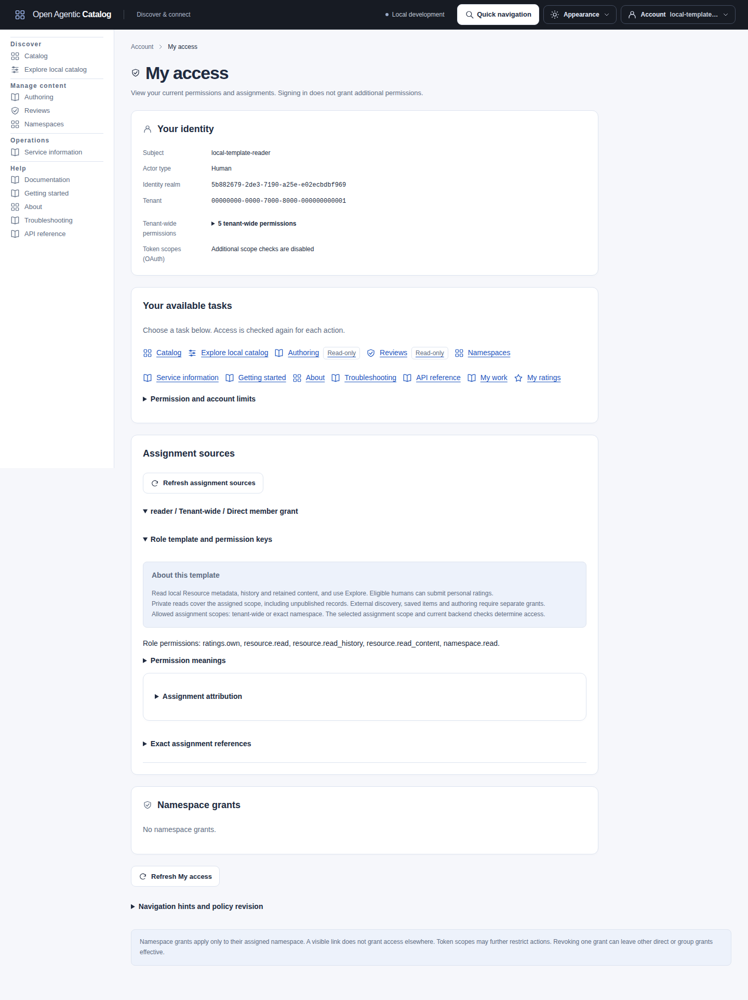
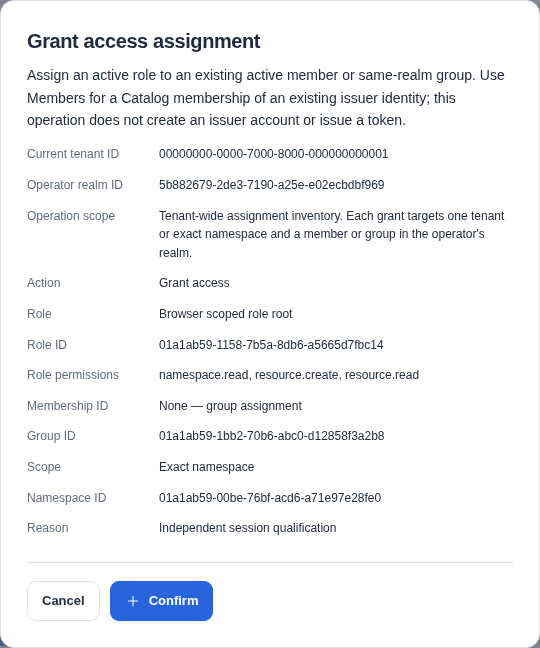
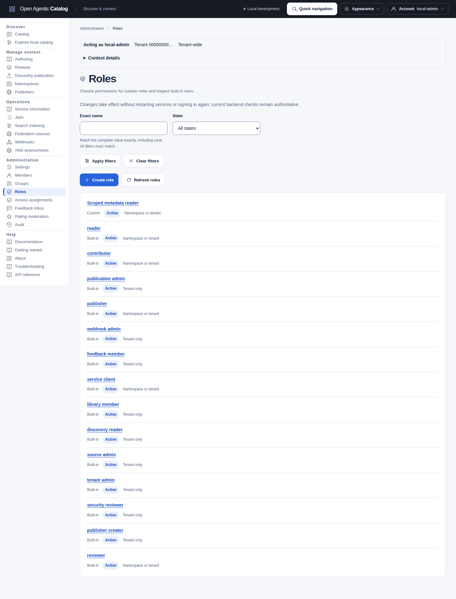
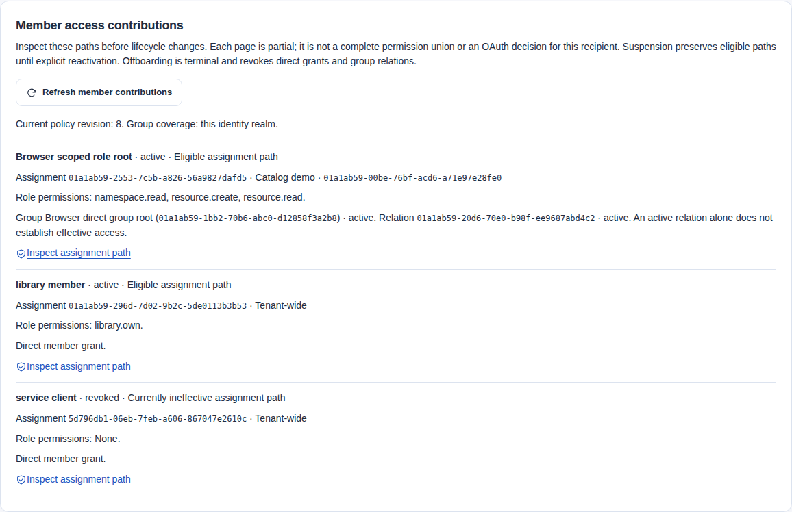
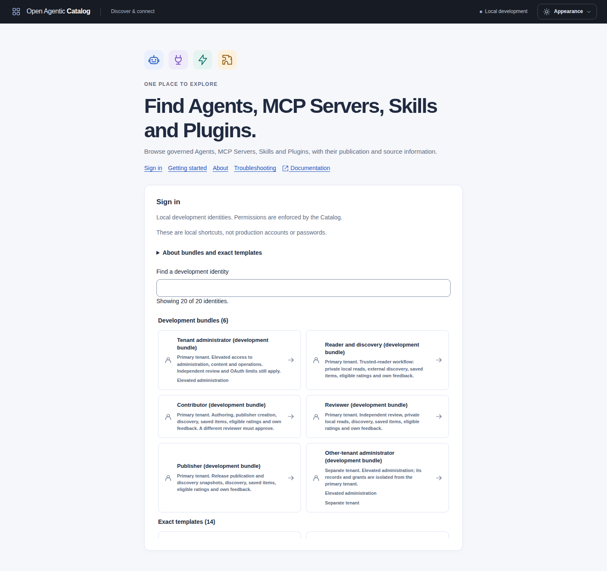

import ScopedAccess from "../../../components/architecture/ScopedAccess.astro";

Use Catalog roles, groups and assignments to give an existing identity the permissions required for its tasks. The Catalog stores this policy. Issuer role and group claims do not grant access.

Start with an active Catalog membership bound to the correct tenant, issuer realm and subject. For initial provisioning, follow [schema-owner identity bootstrap](../operations/database-roles.md#initial-catalog-identity-provisioning). Browser sign-in and Catalog access are separate; see [sign-in configuration](../operations/sign-in.md).

## Choose the role and scope

<ScopedAccess />

Check every active assignment path at the requested scope. Removing one path does not revoke an independent grant. OAuth scopes can limit the resulting permission; they cannot add permission.

A role defines permissions. An assignment gives that role to one membership or group, either tenant-wide or in one exact namespace. Group membership connects an existing Catalog membership directly to a group. Groups do not nest or synchronize from issuer claims.

Permissions from active direct and group paths add together. A tenant-wide assignment covers all namespaces for its namespace-capable actions. An exact-namespace assignment covers only the selected namespace. There is no deny assignment or namespace hierarchy that cancels a wider grant.

Only roles whose complete permission set supports namespace scope can receive a namespace assignment. Reader, Contributor, Reviewer and Publisher support it. A role containing a tenant-only action, such as `publisher.read`, requires tenant-wide scope.

Built-in templates are immutable. An ordinary grant gives exactly the selected template. Use the [UI role matrix](#development-identities-and-role-handoffs) or **Administration > Roles** to inspect the permissions before granting them.

Roles, grant previews and My access show shared help for all fourteen verified built-in keys: the task, supported assignment scope and permissions you may need separately. A custom role with a similar name does not inherit that help or any template permissions. Check its returned permission list. Names, descriptions and help text never authorize an action.

| Task | Template and explicit companions |
| --- | --- |
| Read local Resources, history, retained content and namespaces | Reader (`reader`). |
| Search external records or use authenticated discovery | Discovery reader (`discovery_reader`), separately from Reader. |
| Author, validate and submit local content | Contributor (`contributor`). Add Publisher creator (`publisher_creator`) if the author must read or create publishers. |
| Make independent review decisions | Reviewer (`reviewer`). The contributor cannot approve their own submission. |
| Publish approved Listing releases | Publisher (`publisher`). Add Publication administrator (`publication_admin`) for discovery snapshot generation and activation. |
| Submit private item feedback | Feedback member (`feedback_member`), plus current readable item context for a new submission. |
| Rate a readable local version | Reader, Contributor, Reviewer or Publisher includes `ratings.own`. The caller must be human. Foreign results need tenant `ratings.own` and discovery authority, as provided by Discovery reader. |
| Moderate ratings or manage aggregate sharing | Tenant administrator includes `ratings.moderate` and `ratings.sharing.manage`. Delegate either action through a tenant-scoped custom role if needed. Publication authority remains separate. |
| Read or change tenant operational settings | Tenant administrator includes `settings.read` and `settings.manage`. A tenant-scoped custom role can delegate read-only or management access. Management also requires read permission. |
| Manage access policy | Direct tenant-wide Tenant administrator (`tenant_admin`). |
| Read Publisher DNS status | Tenant-wide `publisher.read`. `publishers.read` OAuth scope when enforced. |
| Issue, inspect, check or clear DNS challenges | Tenant-wide `publisher.manage` with `publisher.read`. `publishers.manage` OAuth scope when enforced. |
| Approve or revoke a Publisher's publication domain | Tenant-wide `publisher.approve_domain` with `publisher.read`. `publishers.manage` OAuth scope when enforced. |

DNS management and publication approval are separate permissions. Neither permission grants the other.
The Publisher browser page also needs `publishers.read` for its status and metadata reads.
An OAuth management scope does not imply the read scope. API clients can prepare verification commands through the management challenge GET.
Publisher creator does not include DNS management or approval. Delegate those tasks through explicit custom roles or Tenant administrator.
See [Publisher DNS verification](publishing.mdx#publisher-approval-and-dns-evidence) for the setup, commands and recovery steps.

The [Settings guide](../reference/configuration.mdx#manage-settings-in-the-ui) explains live source scheduling and new-Job defaults. Settings actions require tenant-wide scope and the `tenant.admin` OAuth ceiling when enforced. They do not grant protected access-policy administration.

Other specialist templates cover sources, audit and webhooks. Service client (`service_client`) supplies no product permissions. Human-only and lifecycle checks still apply to an identity with permission.

The [ratings guide](ratings.mdx#before-you-start) lists exact target checks and OAuth scopes. Rating permissions do not grant resource reads, publication or trust.

Development and bootstrap bundles retain their companion assignments explicitly. For example, `local-reader` has broader access than the exact Reader template. See [development identity configuration](../reference/configuration.mdx#authentication-and-catalog-identity) before choosing a test identity. Do not reprovision development identities to undo a policy change; provisioning can regrant configured assignments.

## Set up minimum access for a workflow

For guided browser authoring, prepare the Namespace and Publisher before handing work to the Author. Use the [Namespace and Publisher controls](resource-authoring.mdx#manage-namespaces-and-publishers). Public release requires approval of the exact Publisher domain in the AIR identifier. Optional DNS proof has its own [verification mode](publishing.mdx#publisher-approval-and-dns-evidence).

Give the Author Contributor access and its companion reads in the selected Namespace. Add Publisher reads only when that person needs directory selection. Otherwise supply the exact Publisher ID. Publisher creation or administration is not required to author content.

Assign Reviewer access to another retained principal. Assign Publisher access to the person who releases approved content. Discovery snapshot management uses separate tenant-wide Publication administrator permissions. The [browser tutorial](publishing.mdx#prepare-the-accounts-and-exact-inputs) shows each handoff, including local development identities.

Use a separate Tenant administrator session to grant access. For trusted local readers, the development Reader/discovery bundle provides private local reads, external discovery and personal features. Production grants remain explicit. For a reader restricted to namespace A, assign Reader to A and add Library member, Feedback member or Discovery reader separately at tenant scope when needed. Those templates contain tenant-only actions; the combined development bundle cannot be assigned to one namespace.

The following custom sets describe API tasks by exact target ID. Each set includes its required role-definition companions. Add permissions for other steps only when needed; a readable directory, navigation link or validation result does not supply them.

| Workflow | Permission set and assignment scope | Separate prerequisites |
| --- | --- | --- |
| Inspect local metadata without history/content | `resource.read` in namespace A. | `catalog.read` OAuth scope when enforced. Add `namespace.read` to list/resolve namespace names. |
| Create, edit, validate and submit local content | `namespace.read`, `resource.read`, `resource.read_history`, `resource.read_content`, `resource.create`, `resource.edit`, `resource.validate`, `review.submit` in A. | An existing eligible Publisher ID and representation inputs. `catalog.write` when enforced. Contributor is a convenient broader template; Publisher creation requires a separate tenant grant. |
| Decide a review by submission ID | `resource.read_history`, `resource.read_content`, `review.decide` in A. | A different eligible reviewer and current validation. `catalog.read` for evidence reads and `catalog.review` for decisions. Add metadata reads for canonical labels. |
| Publish an approved release | `resource.read_history`, `resource.read_content`, `release.publish` in A. | Approved immutable evidence and eligible Publisher/domain. `catalog.read` for evidence reads and `catalog.publish` for publication. Snapshot administration is separate. |
| Change release lifecycle | `resource.read`, `release.transition` in A. | An eligible current release and `catalog.publish`. This does not grant publication of new releases. |
| Adopt one source observation into A | Tenant-wide `source.read`, `source.read_evidence`, plus `namespace.read`, `resource.create` in A. | Current source/evidence and adoption eligibility. `sources.read` for source inspection, `catalog.write` for adoption. Source administration and later editing/review are separate. |
| Inspect a source-sync Job | Tenant-wide `job.read` and `source.read`. | A retained eligible source target and `catalog.read`. `job.read` alone is insufficient. |
| Cancel/retry an eligible source-sync Job | Tenant-wide `job.read`, `job.cancel` and/or `job.retry`, plus `source.read`, `source.inspect`, `source.manage`. | Current Job/source eligibility and `catalog.write`. ANS verification Jobs additionally require evidence/discovery authority. Other Job families use their own target authority; there is no general Job-management bypass. |

For example, create this custom role through `POST /api/v1/access/roles` with an administrator token and a new `Idempotency-Key`:

```json
{
  "name": "Metadata inspection",
  "permissions": ["resource.read"],
  "reason": "Inspect metadata without history or retained content"
}
```

Use its returned ID in a separate `POST /api/v1/access/assignments` command. Replace these example IDs with the exact role, membership and namespace IDs from your deployment:

```json
{
  "roleDefinitionId": "00000000-0000-7000-8000-000000000020",
  "membershipId": "00000000-0000-7000-8000-000000000002",
  "namespaceId": "00000000-0000-7000-8000-000000000010",
  "reason": "Restrict metadata inspection to namespace A"
}
```

Omit `namespaceId` only for an intended tenant-wide assignment. For a group path, replace `membershipId` with `groupId` and add the membership to that group separately. Inspect every page of **Member access contributions**. Include direct specialist and custom grants that `GET /api/v1/role-assignments` does not show. For example, Reader in A, a metadata group in B and global Library member remain three independent paths. Revoking the Reader path removes its A reads; the group path in B and library permission remain.

An empty authorized collection means no visible match. It does not establish that private records are absent. An exact forbidden read can return 403 without disclosing the target; use the current permissions and target scope to diagnose it.

## Bootstrap production access

Create issuer users, passwords and groups at the identity provider. Catalog does not manage those credentials or import issuer role/group claims. Apply migrations with the schema owner, then run the explicit [first-administrator bootstrap](../operations/database-roles.md#initial-catalog-identity-provisioning) for the exact issuer, tenant mapping and token subject. That owner command must grant `tenant_admin` to the initial subject; it is not the ordinary user-registration workflow.

After bootstrap, open **Members > Add Catalog member** with **Membership only - no role permissions** and the explicit Human or Service identity type. Then grant the required specialist/custom role separately through **Access assignments**. No temporary Reader assignment is needed. Only human memberships can open browser OIDC sessions or use eligible personal actions. An active human with no product permissions retains eligible My work and own-rating reads; existing own-rating withdrawal retains its ownership and OAuth checks.

`auth.enforceScopes` defaults to `false`; this guide does not change that default. To enable the additional ceiling, configure the API, issuer and login client together. These are partial configuration examples, to merge into the complete operator-owned files:

```json
{
  "auth": {
    "mode": "oidc",
    "issuer": "https://identity.example.com/realms/catalog",
    "audience": "catalog-api",
    "tenancyMode": "dedicated",
    "dedicatedTenantId": "00000000-0000-7000-8000-000000000001",
    "enforceScopes": true
  }
}
```

For a human reader's UI host, use the same issuer and configure `scopes: ["profile", "catalog.read", "ratings.write", "personal.write"]`. The host adds `openid` automatically and rejects it in this list. The issuer must allow those scopes for that client and emit the access token's whitespace-separated `scope` string. An administrator session additionally needs `tenant.admin`; authoring, review and release workflows need the corresponding scopes in the table. Adding a requested scope does not add Catalog permission. See [browser client configuration](../reference/ui-host-configuration.md) and [provider setup](../operations/sign-in.md) for the complete host fields, PKCE, audience and subject checks.

Keep the PostgreSQL API, worker and schema-owner logins separate from Catalog user roles. A Catalog Tenant administrator receives no SQL login or schema-owner authority. Revoking a private role does not withdraw metadata already included in an active public snapshot; change or withdraw the publication separately.

## Use published-only discovery

For consumers who must not read unpublished local Resources, use the existing active publication snapshot on an operator-configured discovery host. This is separate from the web Catalog's Control API search. Reader and the Reader/discovery development bundle include private local metadata, history and content; neither is a published-only identity. Giving Discovery reader a Resource-read companion would expand its authority rather than restrict the consumer path.

| Need | Existing publication contract |
| --- | --- |
| Read the active manifest | `GET /.well-known/ard.json`, with its snapshot ETag. |
| Search local published entries | `POST /ard/v1/search` with `federation: "none"`. The default federation mode can add approved upstream results. |
| Browse snapshot facets | `POST /ard/v1/explore`. |
| Page local snapshot entries | `GET /ard/v1/agents`, preserving the returned opaque continuation and filters. The collection includes supported resource kinds, not only Agents. |
| Read a published retained document | Follow its publication-authorized bounded-document link. A private Resource API route is a separate permission boundary. |

For example, send this Search body to the configured host:

```json
{
  "query": {"text": "order processing"},
  "pageSize": 10,
  "federation": "none"
}
```

Keep the query and filters unchanged when continuing. Restart after a rejected continuation or snapshot change. See [discovery interfaces and request examples](integrating.mdx#choose-a-discovery-interface) and the [publication tutorial](publishing.mdx) for publication setup, audience selection and response handling.

An anonymous host serves only its public audience; a token does not expand that snapshot. An authenticated host requires an active same-tenant membership, tenant-wide `discovery.read`, and `catalog.read` when OAuth scopes are enforced. Its snapshot can include public and tenant-visible releases, never private drafts. An administrator can use an existing custom role containing only `discovery.read` when that is the required task. The built-in Discovery reader is broader: it also includes external discovery and personal/Publisher permissions. No new permission or built-in consumer template is needed for this path.

The current web Catalog, `catalogctl remote` and Control MCP tools use their existing Control API contracts; they have no separate published-only browsing mode. Use a compatible ARD/manifest client against the configured discovery host. This documents the supported consumer boundary; it does not add a web UI workflow, installation, invocation or execution authority.

## Prepare an administrator session

Ordinary policy reads and writes require current `access.manage` through a direct tenant-wide Tenant administrator assignment. A group grant or custom role cannot provide this protected admission. Custom roles cannot include `access.manage`.

When OAuth scope enforcement is enabled, the administrator's access token also needs `tenant.admin`. A scope narrows Catalog authority; it never supplies a missing permission. The same ceiling applies to Tenant administrators. See the [permission and scope matrix](../reference/api-conventions.md#authentication-and-authorization).

In the UI, open **My access** and check the subject, tenant, issuer realm, direct assignment and scope ceiling. Use **Administration > Members**, **Roles**, **Groups** and **Access assignments** for policy management. The API equivalents are listed below.

Membership inventory, suspension, reactivation and offboarding are tenant-wide. Assignment grants and revocations and group-member writes stay in the administrator's authenticated identity realm. Both assignment inventories include retained same-tenant grants across realms; the UI marks other-realm revocation as read-only. Use exact retained IDs from the current tenant. A manual UI ID marked **unverified ID** still requires server validation.

Policy changes take effect without a process restart. Use **Refresh My access** to reload browser hints after a change.

For API commands, send the administrator's bearer token, `Content-Type: application/json` and a distinct `Idempotency-Key` for each new mutation. Supply the audit reason shown in each body. Retain the returned IDs, revisions and ETags. Follow [safe command retries](../reference/api-conventions.md#request-rules) if the outcome is uncertain.

The older `/api/v1/role-assignments` API projects only direct assignments to its eight exact built-in templates, including grants created through `/api/v1/access/assignments`. It retains active/revoked history and membership filters across realms. Custom roles, group assignments and the six newer templates use the general API; a named-role revocation of those targets returns `NOT_FOUND` without changing them.

Final-administrator protection counts active direct tenant administrators across the tenant. It does not guarantee an administrator in each realm. If a realm has no usable administrator, use the explicit schema-owner [identity provisioning procedure](../operations/database-roles.md#initial-catalog-identity-provisioning); another realm's session cannot revoke its assignments.

An archived group's retained member relations are historical and grant no access. New archival requires active members and assignments to be explicitly revoked first. Existing archived history is preserved, and the UI prevents revoking those historical relations. If you already selected a member or assignment and entered a revocation reason, archiving the group keeps that editor visible with its actions disabled. Close the editor deliberately to discard its input; a newly opened archived group has no revocation editor.

## Read your current access

[](../../../../assets/catalog-ui/my-access-reader.png)

My access labels Authoring and Reviews **Read-only** when your current permissions and OAuth scopes allow inspection without the corresponding write actions. A namespace-scoped write can be available for one target while unavailable for another; the task checks that target independently. An active human with only Library member, or no product permissions, can still use eligible My work and own-rating reads. Withdrawal of an existing own rating survives target-read or `ratings.own` loss, but still checks human identity, ownership and `ratings.write` when enforced. This permits no new score or target disclosure. A nonhuman identity has authenticated self/service-information reads, without human-only personal tasks.

**Assignment sources** includes the current caption of each eligible group path beside its exact group ID. This comes from your bounded self-access response; it does not grant access to the protected group directory or reveal its members. **Refresh assignment sources** rereads cosmetic names as well as policy. Namespace captions require your own `namespace.read` and OAuth access; unavailable captions retain the exact ID. Permission and assignment-source pages remain independent. A caption describes current presentation, while **Assignment attribution** retains the original grant evidence.

Expand **Permission meanings** to read each action beside its exact key, including separate metadata, history and retained-content reads. The same labels appear in role administration and grant previews. Empty templates show their membership-only explanation instead of an empty permission list.

## Manage access in the UI

Built-in and archived roles show **Role permissions** with selected permissions first. Clear **Show selected permissions only** to inspect the complete vocabulary. **Copy to custom role** stages a separate definition. Group pages separate **Overview**, **Members** and **Assignments**. Expand the metadata, lifecycle, member or grant section only when needed. Foreign-realm assignments remain read-only.

**Members**, **Access roles**, **Access groups** and **Access assignments** require protected `access.manage` and `tenant.admin` when scopes are enforced. Members provisions an existing identity's Catalog membership and retains the convenient built-in role grant workflow. It does not create an identity-provider account or issue a token. Role grants target the administrator's current realm.

Namespace grants apply only to their exact namespace. The backend protects the final active administrator and rejects stale revisions or prohibited self-changes.

Use Roles to create a custom role with a defined permission set. Inspect built-in roles or edit custom roles there. Check every required companion permission listed beside each action. Editing changes every assignment using that role. Built-ins are immutable; `access.manage` cannot be delegated.

A role containing tenant-only permissions cannot have a namespace assignment, and incompatible edits conflict while such bindings remain active. Role details show assignments filtered to that definition using the existing bounded assignment inventory. This provides role-impact inspection without calling the separate role-impact alias. Choose a named role in the assignment form or supply its exact visible ID.

Use Groups to create a same-realm direct-member group. Copy an existing member ID from Members, add it with a reason, then assign a role to the group. Suspension disables this group's paths. Reactivation restores eligible paths.

Other direct/group paths may still grant access. Archive requires active relations and assignments to be revoked first. Archived policy and attribution remain retained.

On **Access assignments**, expand **Filter assignments** to stage exact **Role ID filter**, **Member ID filter** or **Group ID filter** values. Select **Apply filters** to read their intersection, or **Clear filters** to return to all assignments. A member filter selects direct grants; group paths remain separate. Applied labels retain exact IDs when names are unavailable. These filters do not change the grant draft. Role, member and group detail inventories remain bound to their inspected owner.

Expand **Grant access** to grant an active role to an existing member or group, optionally restricted to one namespace. The form accepts the visible role, member/group and namespace IDs. Its paginated inventory links back to role definitions. Expand Assignment attribution on active or revoked rows to inspect the returned grant and revocation evidence. Direct assignments in Members have the same disclosure. Only active assignments offer revocation controls. Revocation removes that assignment only.

Every write uses a confirmed, fixed body, reason and idempotency key. Revision changes also use the current ETag. Reload after a conflict. Do not automatically replay an uncertain write with a new key.

Members filters by exact subject, state, identity type and optional realm ID. Roles and Groups filter by exact display name and state. Filters intersect with AND before paging. Names and subjects remain case-sensitive; duplicate names and equal subjects in different realms remain separate rows. Verify the exact ID before choosing a target. The pickers use the same server filters and retain your selection while paging. Refresh an inventory to reload cosmetic names, even when the policy revision stays unchanged. Unavailable names retain their exact ID; a name never establishes authority.

Both grant forms start without a selected scope. Choose **Tenant-wide** or **Specific namespace** deliberately. Changing scope preserves the selected role. An incompatible combination stays invalid until you change it explicitly. Review **Proposed grant** for readable actions, exact permission keys and scope. Manual role references can remain unverified until the API checks them. Namespace names also require `namespace.read` and, when enforced, `catalog.read`; an exact-ID fallback remains available.



This synthetic custom-role grant is prepared but not confirmed. The same scope controls apply to the Reader example. [Open the full-size screenshot](../../../../assets/catalog-ui/access-assignment-confirmation.png).

Open a member's **Member access contributions** before suspension or offboarding. The paged view includes direct grants, current-realm group paths, role permissions, relation IDs and lifecycle eligibility. Other-realm group coverage is explicitly unavailable. A page is not a complete permission union, a distinct-person count or the recipient's OAuth decision. The direct-assignment inventory uses the general API and includes specialist templates and custom roles. Its membership filter excludes group grants. See the [offboarding example](#suspend-or-offboard-a-membership) below.

An acknowledged lifecycle command keeps its receipt and returned counts visible. Its old lifecycle editor stays disabled until **Reload membership** or **Reload group** obtains a fresh revision. Offboarding prevents new grants and revocations; separate unfinished grant or revocation drafts remain visible and disabled until deliberately discarded. Archival disables group editing, member additions and grants. Related inventories refresh independently, so a failed readback does not erase the committed outcome or unrelated drafts.

Use **Copy to custom role** on an inspected definition to stage a separate role. Enter a new name and reason. The copy retains the source ID/revision for context and copies no assignments. A protected `access.manage` permission is excluded; acknowledge that omission before preparing the copy. Required companions still need explicit selection. Canceling discards only the private draft after confirmation; no payload enters browser storage or URL parameters.

Role updates show added and removed permissions and scope eligibility beside confirmation. Inspect the bounded assignment inventory and follow its cleanup links before a scope-changing edit or archival. A tenant-global definition can affect every realm, including suspended groups' retained active bindings. A preview neither reserves authority nor revokes assignments. Lifecycle commands recheck current policy and revisions. Membership receipts report revoked direct assignments, namespace memberships and group relations; these are separate counts.

Administration pagers have separate accessible names: **Assignment inventory pagination**, **Role choices pagination**, **Member choices pagination**, **Namespace choices pagination**, **Group members pagination** and **Add-member choices pagination**. Use the group's Next page or First page control for that list. Each keeps its own cursor. Paging a choice retains an off-page selection and the grant's unsaved reason; the selected ID remains the command value. An unavailable or stale choice page can restart independently. It does not submit the grant or change another list's page. Follow the [Namespace and Publisher lookup procedure](resource-authoring.mdx#manage-namespaces-and-publishers) for exact directory filters and their independent read permissions.

## Add a membership before specialist grants

1. Prepare the account with the identity-provider administrator. Obtain its exact `sub` value and verify the intended Catalog issuer realm. Email works only when it is the actual subject.
2. Sign in as a Catalog administrator. Check the tenant and realm in **My access**.
3. Open **Members > Add Catalog member**. Enter the subject and select **Human** or **Service** explicitly.
4. Keep **Membership only - no role permissions** selected. Choose **Tenant-wide**, enter a reason and confirm.
5. Open the returned membership. Inspect the empty assignment and fixed identity type. Existing memberships retain their other grants and actor type.
6. Prepare a separate specialist assignment, or add the membership to a same-realm group before granting the group's role. Use the exact-subject picker and verify IDs.
7. Choose the required role and scope, provide a separate reason, review the captured command and confirm. Retain each command's own receipt and key.
8. Ask the recipient to sign in and refresh **My access**. Verify a permitted task and an out-of-scope refusal in that recipient's session.

Membership-only setup retains one zero-permission `service_client` assignment. It does not create a grant-free identity, erase existing authority or remove baseline human ownership access. The selected identity type controls Human or Service classification. The empty template grants no product actions and does not make a human nonhuman. This named-role operation is tenant-wide; general assignments use the selected definition's returned scope eligibility.

For a local human, add this entry under `auth.developmentTokens` in the selected profile:

```json
{
  "new-human": {
    "subject": "new-human",
    "tenantId": "00000000-0000-7000-8000-000000000001",
    "actorType": "human",
    "roleTemplates": ["service_client"]
  }
}
```

An otherwise grant-free development declaration also becomes a Human membership with this empty template by default. Explicit `actorType` keeps memory and owner provisioning consistent. It also permits a Service membership without changing its selected grants. An omitted type retains the existing inference for explicitly configured `service_client` roles/templates. Namespace-only declarations receive no added tenant-wide template.

Follow the [profile restart and provisioning procedure](../reference/configuration.mdx#authentication-and-catalog-identity). Regenerate the UI host's user inputs before advertising the new choice. The host authenticates the selected token; the backend's retained membership supplies the identity type and authority. The 32-choice development limit is a chooser limit, not a Catalog membership limit. Production accounts, passwords and issuer group administration remain with the identity provider. Catalog groups have direct local members; they do not synchronize issuer groups or send invitations.

## Grant only the companions a task needs

| Task | Explicit Catalog grants and additional checks |
| --- | --- |
| Let a local Reader save items | Add tenant-wide `library_member`; keep Reader in the exact required namespace. External discovery is unnecessary for local bookmarks. |
| Save a new local Resource reference | A human needs tenant `library.own` and exact-scope `resource.read` for the referenced governed release. The save uses `personal.write` when scopes are enforced. |
| Save a named search | A human needs `library.own` and `personal.write` when enforced. Saving criteria does not run them or grant access to their eventual results. |
| Resolve an existing saved reference | The human needs library access, `catalog.read` when enforced and current target authority. Loss of target access does not delete the private saved reference. |
| Submit a new private feedback report | A human needs `feedback.own`, a currently readable target and `feedback.write` when enforced. Existing own reports have separate ownership rules. |
| Author under an existing Publisher | Give exact-namespace Contributor access and supply the existing Publisher's ID. Add `publisher_creator` only if Publisher reads or creation are part of the task. |
| Review and release | Give Reviewer and Publisher to the appropriate independent memberships and namespace. A contributor cannot approve their own submission. Snapshot administration remains separate. |
| Adopt a source observation | Combine tenant-wide source evidence authority with Contributor authority in the destination namespace. Source administration alone does not grant local authoring. |

New saved references and reference replacement recheck their target. Renaming an existing private saved item does not acquire new target access. Foreign references also need current source/discovery authority. See [saved items](catalog-ui.mdx#save-resources-and-searches), [feedback](feedback.mdx) and [source adoption](../operations/federation.mdx#adopt-one-observation-as-a-local-draft) for exact target and lifecycle checks. Token scopes limit these grants; they never provide a missing Catalog permission.

Use a tenant-wide custom role for these narrower administration tasks. None requires a new built-in template:

```json
{
  "name": "Read tenant settings",
  "permissions": ["settings.read"],
  "reason": "Delegate inspection without settings changes"
}
```

For feedback moderation, select exactly `feedback.moderate`. For rating moderation, select exactly `ratings.moderate`. Each custom role needs its own name and reason. Assign it separately after membership creation. Their operations require `tenant.admin` when scopes are enforced; moderation does not supply Resource reads or protected access administration. For settings changes, explicitly add the required `settings.read` companion to `settings.manage`. Do not change immutable templates or silently add companions.

My access shows the permissions supplied by each current role and its direct or group assignment. Expand Assignment attribution for the returned grant evidence. Namespace assignments apply only to the displayed namespace. OAuth scopes remain a separate ceiling, and this page does not list revoked assignment history.

Policy is PostgreSQL data, not an environment variable or Helm value. Changes apply to subsequent backend requests without a service restart; UI hints refresh separately. Cursor continuation tied to old policy must restart from the first page. Operational configuration still selects authentication, issuer/tenant mapping and scope enforcement.

Development token seed templates do not replace retained custom policy on every startup. Operator bootstrap remains an explicit command. Production authentication does not infer Catalog permissions from token roles/groups. No deployment flag is needed for these administration screens.

Use **Manage access** on an existing member to fill their immutable identity automatically. Expand **Grant a built-in role** to prepare a separate assignment. For a new identity, Subject is the exact `sub` identifier supplied by the identity provider, not a display name or an arbitrary email address. Local test identities use their configured subjects, such as `local-reader`. Choose Human for a person or Service for automation, then select a role.

Its description explains what it permits. Roles are independent, and a namespace grant does not provide tenant-wide discovery access. Never paste an access token into Subject or a credential-reference field.

[](../../../../assets/catalog-ui/access-roles.png)

The example uses built-in definitions and a disposable custom role. State and scope remain separate from the role name.

### Edit access policy deliberately

Role permissions are compact rows grouped by family. Each retains the exact key, readable action, scope eligibility, delegation restriction and any required companions. The selected count and eligibility summary explain the current choice. Missing returned companion requirements block preparation until explicitly selected.

Use **Find permissions** to find an action or its exact key. **Show selected permissions only** narrows the display without changing your selections. Pressing Enter in the search field does not prepare a role command. Missing companion requirements remain visible even when filtered.

Removing a required permission blocks preparation again. Built-in templates and archived definitions are read-only. Their values remain selectable for copying. Create a custom role for another set.

Assignment and group-member forms show bounded named choices alongside manual exact-ID inputs. Pagination keeps the selected ID and previously known label. A manually supplied or preset reference absent from loaded choices is marked **unverified ID**. The Catalog checks tenant, realm, state and scope on confirmation.

**Tenant-wide** and **Specific namespace** are explicit assignment scopes. Known tenant-only/protected roles explain incompatible choices. Without namespace inventory permission, the exact namespace-ID input remains available. Picker failures do not change an already captured command.

Role and group inventories separate the linked name from state and scope metadata. Assignment/group-member inventory rows show target references, scope/state and authorized navigation. Full assignment identifiers remain visible in each row with the shorter Manage action. Its accessible name still includes the exact identifier.

Select **Manage assignment** or **Manage membership** to open one revocation editor, instead of a reason form on every row. Keyboard focus moves to the selected editor. Closing it returns focus to its trigger when that trigger remains on the page. Add and selected-revocation reasons are independent. Confirmed list replacement clears the selected editor. Declining discard preserves it.

Revocation removes only that path and can leave overlapping direct/group grants effective. Member detail labels its filtered list **Direct role assignments**. Inspect group policy or the member's own My access for group paths. A Catalog membership binds an existing issuer identity.

These controls do not create an issuer account or issue tokens.

Offboarding is permanent. An offboarded membership cannot be reactivated or granted access again. Contact your identity and Catalog administrators if access is needed again. Creating another membership for the same issuer identity is not a supported recovery procedure.

## Give a group Reader access to one namespace

This example creates **Documentation readers** and gives its members Reader access to one existing namespace. Use an existing active membership in the administrator's realm. Choose a subject without other Resource-read grants when testing the removal of access.

Use an existing human membership for the browser procedure. The exact Feedback member development identity, `local-template-feedback-member`, has no Resource-read permissions unless an administrator added other grants. Keep the administrator and recipient sessions separate.

### Find the existing references

1. Open **Members** and select the intended subject. Record its membership ID, actor type, realm and state.
2. Open **Namespaces** and record the destination namespace ID.
3. Open **Roles** and select the active built-in Reader role. Record its role definition ID.
4. Ask the recipient to inspect **My access** before the grant. Record any existing direct or group paths.

For API reads, use `GET /api/v1/memberships`, `GET /api/v1/namespaces` and `GET /api/v1/access/roles`. Follow `nextCursor` until you find the intended item. Select the Reader role by `builtin: true` and `key: "reader"`; its ID is a UUID, not the template key.

### Create the group and grant

In **Groups**, create **Documentation readers** with a reason. Open the group and add the selected Catalog membership. In **Access assignments**, select the Reader role, the group and **Specific namespace**. Select the exact namespace and confirm the captured references and reason.

The equivalent API requests are:

```http
POST /api/v1/access/groups
```

```json
{
  "name": "Documentation readers",
  "description": "Read access to the documentation namespace",
  "reason": "Create the documentation reading group"
}
```

Save the returned group `id`. Then send:

```http
POST /api/v1/access/groups/{groupId}/members
```

```json
{
  "membershipId": "00000000-0000-7000-8000-000000000101",
  "reason": "Add the existing documentation reader"
}
```

Replace the illustrative membership UUID with the selected membership ID. Save the returned group-member `id` and ETag separately from the group ID. Then send:

```http
POST /api/v1/access/assignments
```

```json
{
  "roleDefinitionId": "00000000-0000-7000-8000-000000000102",
  "groupId": "00000000-0000-7000-8000-000000000103",
  "namespaceId": "00000000-0000-7000-8000-000000000104",
  "reason": "Allow the group to read the documentation namespace"
}
```

Replace all three illustrative UUIDs with the retained Reader, group and namespace IDs. Supply exactly one assignment target: `groupId` or `membershipId`. Omitting `namespaceId` grants tenant-wide scope, so retain it for this example.

Each creation returns `201`. Save the assignment `id` and its ETag for revocation. Adding a group member does not require the group's ETag; it creates a separate membership record.

See the [prepared scoped grant](#manage-access-in-the-ui) for the shared confirmation controls.

### Check the recipient's access

In the recipient session, select **Refresh My access**. Under **Assignment sources**, check the Reader role, exact namespace and group ID. Expand **Exact assignment references** to verify the assignment ID. Browse the permitted namespace through **Explore local catalog** or **Authoring**.

The recipient can use `GET /api/v1/me?namespaceId={namespaceId}` to inspect the exact namespace projection. Reader supplies `resource.read`, `resource.read_history`, `resource.read_content` and `namespace.read`. Inspect `GET /api/v1/access/self` for the effective assignment paths and their roles. Follow every `nextCursor`; the first page may omit an overlapping path.

`permissions` in `/me` describes tenant-wide authority. `availablePermissions` means an action is available somewhere. It does not authorize that action in another namespace. When scopes are enforced, local content and namespace directory reads also need `catalog.read`. Namespace mutations need `tenant.admin` and their Catalog action permission.

My access and `POST /api/v1/access/capabilities` provide advisory projections. The API rechecks current authority and lifecycle conditions for each actual operation. An empty collection alone does not prove that a grant failed.

### Revoke this path and check for overlap

Return to the administrator session. In **Access assignments**, select **Manage assignment** for the saved group Reader assignment. Enter the reason and confirm revocation of that exact path.

For the API, send `POST /api/v1/access/assignments/{assignmentId}:revoke` with a new `Idempotency-Key`, the assignment's current ETag in `If-Match`, and:

```json
{
  "reason": "End documentation namespace access for this group"
}
```

This removes the group's Reader assignment for every member. To remove only one person from all of this group's grants, revoke their group-member record instead: `POST /api/v1/access/groups/{groupId}/members/{memberId}:revoke`. Use that record's current ETag and a reason. Here, `memberId` means the group-member record ID, not the Catalog membership ID.

Ask the recipient to refresh My access again. Restart assignment pagination after the policy change. Check the exact namespace projection and all assignment sources.

If Reader permissions remain, find the overlapping direct assignment, another group grant or a tenant-wide grant. Inspect `GET /api/v1/memberships/{membershipId}/access` for bounded direct and current-realm group contributions. Continue its pages before treating the inventory as complete, and retain its other-realm coverage limit. Use `GET /api/v1/access/assignments?membershipId={membershipId}` for direct paths and `?groupId={groupId}` for one group's assignments. **Members** keeps these direct assignments separate from the contribution view; neither page infers the recipient's OAuth ceiling.

Revoke an additional path only after confirming its intended scope and recipients. Removing the group grant does not change a separate `local-reader` tenant-wide grant.

## Create a custom role with explicit read companions

Create **Draft maintainer** for users who edit and validate existing drafts without creating Resources or submitting reviews. Open **Roles > Create role** and select these exact permissions. The API equivalent is `POST /api/v1/access/roles` with:

```json
{
  "name": "Draft maintainer",
  "description": "Read, edit and validate existing drafts",
  "permissions": [
    "namespace.read",
    "resource.read",
    "resource.read_history",
    "resource.read_content",
    "resource.edit",
    "resource.validate"
  ],
  "reason": "Create the reviewed draft maintenance role"
}
```

`resource.edit` requires all three Resource read companions. `resource.validate` requires `resource.read_content`. `namespace.read` also lets the user identify the namespace. Required companions must be in this role's own permission set, even if the recipient has them elsewhere. The Catalog rejects a missing companion; the editor does not add it automatically.

Inspect `GET /api/v1/access/permissions` for each permission's `requires`, `namespaceScoped` and `delegable` fields. This custom role is namespace-capable. Assign its returned role definition ID using the same exact-namespace procedure as Reader.

To change the role, first read `GET /api/v1/access/roles/{roleId}`. Review its current permission set and page `GET /api/v1/access/roles/{roleId}/assignments` to inspect affected assignments. Role edits affect all active assignments of that role.

Send `PATCH /api/v1/access/roles/{roleId}` with the current ETag in `If-Match`, a new idempotency key, metadata, a reason and the complete replacement permission set. For example, remove `resource.validate` while retaining the other five permissions to end validation authority. The request replaces the set; it does not merge additions or removals.

A stale revision returns `412`. Reload and review the concurrent change before preparing another command. Do not replace the ETag and blindly resend an outdated policy. The UI confirmation captures the current revision, inputs and reason.

Revoke incompatible active namespace assignments before adding tenant-only permissions. Revoke active assignments before archiving a role. Built-in roles cannot be edited or archived.

## Suspend or offboard a membership

Use **Members** to select the exact Catalog membership. Read its current state and ETag before a lifecycle command. Each command requires a reason, `Idempotency-Key` and `If-Match`.



This example shows a group grant and a direct grant for different permissions. More grants can appear on other pages. Current access also depends on token scopes. [Open the full-size screenshot](../../../../assets/catalog-ui/member-access-contributions.png).

| Action | API command and effect |
| --- | --- |
| Suspend | `POST /api/v1/memberships/{membershipId}:suspend` prevents authentication through this membership while retaining its grants. |
| Reactivate | `POST /api/v1/memberships/{membershipId}:reactivate` restores a suspended membership only while its realm is active. Retained grants become effective again. |
| Offboard | `POST /api/v1/memberships/{membershipId}:offboard` permanently ends the membership and revokes its active direct assignments and group memberships. History remains retained. |

Offboarding cannot be reversed. The Catalog rejects commands that remove the final active direct Tenant administrator. Confirm another active direct administrator before offboarding an administrator.

Suspension and offboarding block the member's own reads and commands. They do not clear these records:

| Retained data | Effect and available management |
| --- | --- |
| Private saved items and searches | Labels, references and search criteria remain. Only the owner can [remove saved items](catalog-ui.mdx#save-resources-and-searches) while authorized. Administrators cannot read or remove another member's library. |
| Private feedback | Current text and state remain. An authorized moderator can still [remove feedback](feedback.mdx#moderation-inbox) after the submitter is offboarded. |
| Active ratings | Opinions remain active and contribute to totals. An authorized moderator can [remove a rating](ratings.mdx#edit-withdraw-and-moderate). |
| Rating sharing consent | Consent remains saved. Eligible consenting ratings can contribute to future summaries under the [existing sharing rules](ratings.mdx#share-aggregate-summaries). |

Before planned offboarding, let an authorized member remove unwanted saved items or withdraw feedback and ratings. Do not delay urgent suspension for cleanup. These records have no automatic age-based cleanup. Removing current data does not erase backups or required audit evidence.

These commands change Catalog authority, not the issuer account or issued tokens. Coordinate issuer account disablement and token/session revocation with the identity administrator. UI sign-out clears this UI's session; it does not revoke an issuer token. A retained browser session cannot bypass a suspended or offboarded Catalog membership.

Group suspension temporarily disables that group's access paths while preserving its policy. It does not suspend individual memberships or remove other direct/group paths. Manage realm suspension through the separate [schema-owner realm procedure](../operations/database-roles.md#identity-realm-administration).

## Development identities and role handoffs

The local and PostgreSQL profiles offer twenty development identities. Six are task bundles, including the administrator in the other tenant. Fourteen start with exactly one built-in template. The chooser groups these using explicit host presentation metadata and marks elevated administration and the separate tenant. Search by label, description or alias; the visible/total counts and **Clear identity search** keep every choice discoverable. Use the keyboard or scroll to reach each choice. No choice signs you in automatically.

These labels describe configured seed intent, not a snapshot of current authority. Retained direct/group grants can differ after administration. Check My access after signing in. Reader and discovery is useful for trusted local users who need its private reads, saved items and eligible personal actions. Choose a separate administrator session for management. Neither Reader nor the Reader/discovery bundle is restricted to published records.

Open **About bundles and exact templates** in the chooser for those distinctions without leaving sign-in. Choice descriptions, elevated/separate-tenant captions, search and counts remain visible while that explanation is closed.

Production sign-in uses the configured OIDC provider; development choices are not available in that mode.

[](../../../../assets/catalog-ui/development-sign-in.png)

| Exact template | Useful task | Important distinction |
| --- | --- | --- |
| Reader | Local metadata/history/content, Explore and read-only review inspection | No external discovery or authoring; eligible human ratings are included. |
| Contributor | Create/edit resources, versions and listings; validate and submit | Supply an existing publisher ID when publisher inventory is unavailable. Cannot approve their own submission. |
| Reviewer | Independent review decisions and submitted evidence | Read-only history and decisions are different permissions; review does not release content. |
| Publisher | Publish approved reviews and manage releases | Discovery snapshot generation/activation needs Publication administrator. |
| Tenant administrator | Access administration and other enabled tasks | Does not bypass tenant isolation, independent review or OAuth ceilings. |
| Discovery reader | External discovery, eligible published snapshots, Publisher reads and human saved items/ratings | No local Resource reads. `job.read` alone gives no operational Job visibility. |
| Publisher creator | Read/create publishers | Creating a publisher does not grant general updates or domain approval. |
| Publication administrator | Eligible audience snapshots and their Jobs | No release-publication or private Resource API grant. Snapshot metadata still follows its audience. |
| Source administrator | Sources, external discovery and eligible Jobs | Discovery is metadata, not adoption, trust or execution. |
| Security reviewer | Private tenant audit investigation/export | No prerequisite Reader or Resource API access; the audit context remains private. |
| Webhook administrator | Enabled webhooks and delivery evidence | Disabled capability is explained; receiver/delivery success is separate. |
| Feedback member | Own private feedback | New submission also needs a readable resource/release context. |
| Library member | Own saved resource references and named searches | No resource reads or administration. Saving requires `personal.write` when scopes are enforced; target checks remain separate. |
| Service client (empty) | Membership-only setup, My access and service information | Identity type is independent. The shipped exact choice is nonhuman and has no product grants or human-only tasks. |

Exact aliases are `local-template-` followed by the template key with underscores replaced by hyphens, for example `local-template-publication-admin`. The six bundles also use explicit `roleTemplates`. Reader, Contributor, Reviewer and Publisher include Discovery reader and Feedback member. Contributor adds Publisher creator; Publisher adds Publication administrator. Each administrator selects only Tenant administrator, which already contains its complete permission set. Ordinary grants never add these companions.

Use an exact-template identity to test a template without its development companions. **Other-tenant administrator** uses a separate tenant and must not see the primary tenant's records or drafts.

Use separate actors for the governed handoff: **Contributor -> independent Reviewer -> Publisher -> Publication administrator**. Submission, review, release publication and public discovery activation are separate operations. Missing companion permissions require an explicit administrator grant. The browser never adds them automatically.

Disabled features and lifecycle refusals remain separate from permission denial.

**My access** clearly identifies the subject, actor type, tenant and issuer realm. Its prominent **Your available tasks** links use your current permissions and token restrictions. Each destination still checks the exact scope, inputs and capability. This provides a useful entry even without local Catalog reads.

Tenant/namespace permissions and exact assignment references can be expanded. Direct and group paths stay distinct. Pages remain bounded and do not reconstruct other members' full effective access.

For configuration, provisioning, repeat-run behavior and restart requirements, see [development identity configuration](../reference/configuration.mdx#authentication-and-catalog-identity).

Choose **Reader and discovery (development bundle)** (`local-reader`) to browse the populated demo and read Namespaces and Publishers. Job history requires additional family access. Choose **Tenant administrator (development bundle)** (`local-admin`) to exercise management actions. Scripts can continue to use the token aliases. The displayed names describe their configured permission bundles.

Each built-in template also has a separate exact-template identity. **My access** shows the current principal, policy revision, tenant permissions, permissions available somewhere, paginated exact-namespace permissions and direct/group assignment sources, plus any OAuth scope ceiling. Use **Refresh My access** after an administrator changes policy. It reloads current hints without signing out.

Signing in does not add permissions, and direct URLs cannot bypass the API's checks.

After an explicit demo load, the curated profile has twelve published resources visible in Search, three per kind. The explicitly selected minimal fixture has three native published resources. Use a contributor identity to open its draft in Authoring. Use a reviewer identity to open its pending submission in Reviews.

Unpublished items are not discovery results. Choose **Other-tenant administrator** to test isolation. Its token alias is `other-tenant-admin`, and its subject is `other-admin`. It cannot see the primary tenant's demo resources.

## Development provisioning and retained grants

The shipped profiles define twenty development identities, including their aliases, subjects, tenant bindings, actor types and combined permissions. Fresh provisioning creates the following exact tenant-wide assignments. Fourteen single-template choices remain unchanged.

| Alias | Explicit tenant-wide templates | Useful workflow |
| --- | --- | --- |
| `local-admin` | `tenant_admin` | Primary-tenant administration. Use a separate session from ordinary reading. |
| `local-reader` | `reader`, `discovery_reader`, `feedback_member` | Trusted private local reading, external discovery, saved items and eligible personal actions. |
| `local-contributor` | `contributor`, `discovery_reader`, `feedback_member`, `publisher_creator` | Authoring with explicit Publisher creation and discovery/personal companions. |
| `local-reviewer` | `reviewer`, `discovery_reader`, `feedback_member` | Independent review with discovery and personal companions; release publication remains separate. |
| `local-publisher` | `publisher`, `discovery_reader`, `feedback_member`, `publication_admin` | Release publication plus explicit snapshot administration and discovery/personal companions. |
| `other-tenant-admin` | `tenant_admin` | Administration of the separate tenant; no primary-tenant authority. |

PostgreSQL provisioning adds configured grants; it does not reconcile the complete retained policy. Editing a profile or removing an entry does not revoke existing assignments. Unlisted retained grants remain active until explicitly revoked. Repeating provisioning reuses active assignments and can regrant a configured role that an administrator previously revoked. Revoked history remains; the replacement assignment has a new ID. A fresh memory process instead reconstructs its fixture policy from configuration.

Before changing retained access, open **My access** and inspect direct/group assignment sources. With an administrator session, open **Access assignments**, filter by the exact membership and review every returned page. That filter shows direct grants; inspect group grants separately. Use the general assignment API for custom roles, groups and specialist templates; the eight-role projection omits those targets.

Revoke only deliberately selected assignments with their current revisions and reasons, then refresh the recipient's access. Removing a Reader path does not remove reads still supplied by Contributor, Reviewer, Publisher, Tenant administrator or another grant. Do not use `compose-up` as policy reconciliation or reset stored memberships to obtain fresh-profile counts.

For restricted reads, configure an exact existing namespace instead of a tenant-wide Reader. This example also supplies the separate global Library member permission:

```json
{
  "local-team-reader": {
    "subject": "local-team-reader",
    "tenantId": "00000000-0000-7000-8000-000000000001",
    "roleTemplates": ["library_member"],
    "namespaces": {
      "00000000-0000-7000-8000-000000000010": ["reader"]
    }
  }
}
```

Replace the namespace UUID with one already created in that tenant. Omit `roleTemplates` for a namespace-only Reader. Neither form grants tenant-wide Resource reads, external discovery or bootstrap companions. Owner provisioning refuses unknown or foreign namespaces and rolls back that principal's membership, assignments and success evidence. Other principals use separate transactions. The result reports namespace references in `assignments`, including `namespaceId`, and exact global references in `templateAssignments`.

Aliases with the same tenant, issuer realm and exact subject identify one principal. Their assignments form one deterministic union, including explicit legacy bootstrap companions. Every alias receives that union; aliases are not token-specific permission ceilings. Conflicting Human/Service declarations fail before any principal is provisioned. Different tenants, realms and subjects remain separate. See [configuration and restart requirements](../reference/configuration.mdx#authentication-and-catalog-identity) before advertising a new choice.

## Personal library permission

The tenant-wide `library.own` permission allows human members to manage their own saved items and named searches. Discovery reader and Tenant administrator include it. The global `library_member` template contains only this permission. Grant it explicitly alongside a namespace-capable Reader or Contributor when needed. Ordinary grants do not add companions. No grant permits selecting another owner's library. OAuth `personal.write` is an additional ceiling for mutations, while reads use `catalog.read`. See [saved items](catalog-ui.mdx#save-resources-and-searches).

## Inspect access counts

Overview checks current authority for each summary. Content counts include authorized Namespaces from direct and Group assignments, including grants beyond the first `/me` page. Source, webhook and moderation panels use their own permissions. They do not require local Resource reads. Refresh or reopen Overview after access changes. Permission denial clears the affected private panel.

Open **Overview > Administration** with `access.manage` and enforced `tenant.admin`. The [Administration overview](catalog-ui.mdx#read-the-administration-overview) separates memberships, active Groups, active Roles and retained active assignments. These are stored records, not effective grants or identity-provider accounts.
