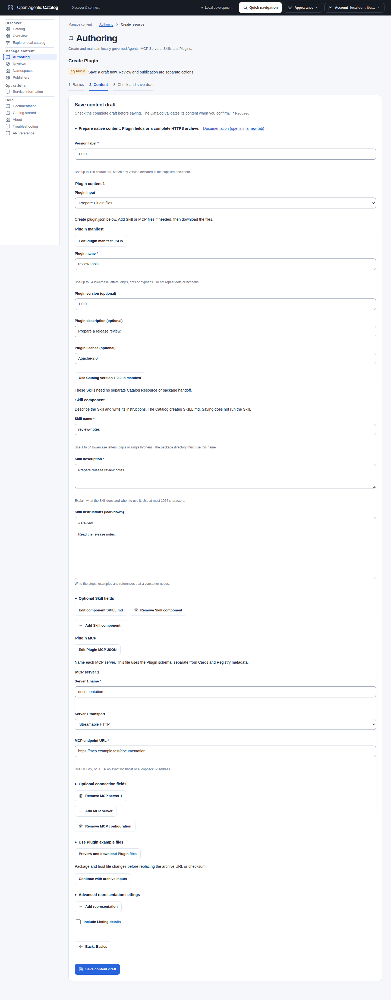

import PluginDelivery from "../../../components/architecture/PluginDelivery.astro";
import { FileTree } from "@astrojs/starlight/components";

A Plugin packages related Skills and MCP server configuration under one root `plugin.json`. Catalog inspects the complete package and retains its validation evidence. Plugins use the same authoring, independent review and publication workflow as other resources. The Catalog does not install Plugins, start servers or execute Skills.

## Prepare a complete package

Use the published [Agent Plugins 1.0.0](https://agent-plugins.org/specification) directory contract. The root manifest must declare `$schema` as `https://agent-plugins.org/schemas/1.0.0/plugin.schema.json`. Catalog pins that schema rather than fetching a schema URL from the package. A minimal manifest is:

```json title="plugin.json"
{
  "$schema": "https://agent-plugins.org/schemas/1.0.0/plugin.schema.json",
  "name": "example.tools"
}
```

Add optional Skills at `skills/<name>/SKILL.md` and MCP configuration at root `mcp.json`. Skill frontmatter names must match their immediate directory. MCP configuration uses the Plugin schema, not a Registry `server.json` or a Server Card. Client extensions remain inert; they do not create Catalog resources or additional approvals.

For example, the maintained `samples/packages/release-workflow/` directory contains root `plugin.json`, root `mcp.json` and `skills/prepare-release/SKILL.md`. This sample is inert development data; do not install or execute it.

<FileTree>

- release-workflow
  - plugin.json
  - mcp.json
  - skills
    - prepare-release
      - SKILL.md

</FileTree>

Create a ZIP or a single-member gzipped tar archive. Put the manifest at the archive root or inside one wrapper directory. The wrapper name need not match the manifest name.

Publish the complete archive at a stable HTTPS URL that permits anonymous downloads. Do not use embedded credentials or expiring signatures. Git repository pages and manifest-only URLs are not complete package downloads. The deployment's public outbound policy must permit the origin. This authoring request cannot select private-network profiles or source credentials.

The archive server must return HTTP 200. Its response media type must be the declared Plugin type, the matching archive type, or `application/octet-stream`:

| Declared type | Matching archive type |
| --- | --- |
| `application/agent-plugins+zip` | `application/zip` |
| `application/agent-plugins+gzip` | `application/gzip` |

Redirects must stay on the same HTTPS origin. Catalog requests identity HTTP encoding and rejects additional HTTP compression. The checksum therefore identifies the original downloadable archive bytes.

A denied URL returns a validation error; correct the URL in the authoring form. A network outage during initial retrieval remains a retryable dependency failure.

## Create a review-tools Plugin in the browser

Use a Catalog account with Contributor access in an existing Namespace. Ask its administrator for a Publisher you can use. You also need a ZIP utility and an approved, credential-free HTTPS archive host. The Catalog supplies neither archive hosting nor a local Plugin upload.

1. Open **Authoring > Create resource** and select your Namespace.
2. Choose **Plugin** and enter `urn:air:demo.catalog.example.com:plugins:review-tools-tutorial` as the canonical identifier.
3. Select **Next: Content** and enter `1.0.0` as **Version label**.
4. Choose **Prepare Plugin files** under **Plugin input**.
5. Complete the fields below.

Use your Publisher's domain instead of `demo.catalog.example.com` when preparing a public release.

A star (`*`) marks required fields. Use **Add** and **Remove** to edit unsaved components. Host the complete Plugin archive at an anonymous HTTPS URL.

| Field | Exact example value |
| --- | --- |
| Plugin name | `review-tools` |
| Manifest version | Select **Use Catalog version 1.0.0 in manifest**. |
| Plugin description (optional) | `Prepare a release review.` |
| Plugin license (optional) | `Apache-2.0` |
| Skill name, after **Add Skill component** | `review-notes` |
| Skill description | `Prepare release review notes.` |
| Skill instructions (Markdown) | Enter `# Review`, a blank line, then `Read the release notes.` |
| Server 1 name, after **Add MCP server** | `documentation` |
| Server 1 transport | **Streamable HTTP** |
| MCP endpoint URL | `https://mcp.example.test/documentation` |

The Skill and MCP components are optional. This example includes both. The endpoint is metadata and is not contacted during preparation or inspection.

Confirm the transport replacement when selecting **Streamable HTTP**. This replaces the new server's unused stdio fields.

1. Select **Preview and download Plugin files**.
2. Expand and download `plugin.json`, `mcp.json` and `skills/review-notes/SKILL.md`.
3. Save each file under its displayed path in one directory.
4. Add any other files that your components require.
5. Run `zip -r ../review-tools.zip plugin.json mcp.json skills` from that directory.
6. Give the complete archive to your approved HTTPS host.
7. Obtain its stable download URL and optional SHA-256 checksum.
8. Select **Continue with archive inputs**.
9. Keep **ZIP** selected and enter the **Plugin archive URL**.
10. Enter the checksum as `sha256:` followed by 64 lowercase hexadecimal digits, when known.
11. Select **Include Listing details**, then **Next: Listing details**.
12. Choose your Publisher and keep private visibility for this draft.
13. Select **Save content draft**, check its target and archive reference, then select **Confirm**.

Expect complete validation and a Listing linked to the exact inspected revision. The validated manifest supplies `review-tools` as the default Listing name. You can edit that name before saving. Open the saved Listing to begin [independent review](publishing.mdx#publish-an-agent-in-the-browser). Saving alone does not release the Plugin.

[](../../../../assets/catalog-ui/plugin-field-authoring.png)

The prepared files use the paths shown in the preview. Open the image for full-size details.

Inspection retains the three validation documents and an inventory. It does not retain the ZIP or reconstruct missing scripts and assets. Keep your original package files. For an update, [prepare a replacement from retained documents](#prepare-a-replacement-from-retained-documents) and host the complete new archive.

## Author and review

In the UI, open **Manage content > Authoring**. Choose **Plugin** in a namespace where you have Contributor access. Select **Prepare Plugin files** to create a manifest and optional components from fields. Follow [Prepare Plugin files from fields](resource-authoring.mdx#prepare-plugin-files-from-fields) to download and package them. Supply your own HTTPS archive host.

Select **Use an existing archive** when you already have a package. Choose **ZIP** or **Gzipped tar** under **Plugin archive format**. Enter the archive URL and optional expected SHA-256 checksum. The selector sets the matching media type. It does not infer the format from the URL. Changes to prepared files, URL or format never clear a retained checksum.

For an API client, first send `POST /api/v1/resources` with an existing namespace ID:

```json
{
  "namespaceId": "<namespace-id>",
  "canonicalIdentifier": "urn:air:catalog.example.com:tools:example-tools",
  "kind": "plugin"
}
```

Use the returned Resource `id` in `POST /api/v1/resources/{resourceId}/versions` with this body:

```json
{
  "version": "1.0.0",
  "representations": [{
    "role": "primary",
    "mediaType": "application/agent-plugins+zip",
    "url": "https://packages.example.com/example-tools-1.0.0.zip"
  }]
}
```

Both commands require a Catalog Bearer token, `Content-Type: application/json` and a distinct `Idempotency-Key`. Replace the example namespace, identifier and archive URL with your own values. On a lost response, retry the same command with the same key and identical body; use a new key for a corrected request. See [request conventions](../reference/api-conventions.md) for authentication, replay and concurrency rules.

The optional representation field `expectedDigest` uses `sha256:` followed by 64 lowercase hexadecimal characters. Omit the field when no checksum is known; null and empty values are invalid. Catalog always computes the checksum over the original archive bytes. A supplied checksum must match. A nonempty version in `plugin.json` must match the Catalog version label; the native manifest may omit it.

The version response contains `version`, `revision` and `evidence`. HTTP 201 means the revision was retained; it does not establish publication eligibility. Check `evidence.state` and `evidence.findings`.

Inspect `revision.representations[].plugin` for the file inventory, exact manifest/component previews and component findings. The representation's `contentDigest` and `size` identify the archive. Read this information again with `GET /api/v1/version-revisions/{versionRevisionId}`.

Bounded schema or component errors produce blocked evidence; unsafe or oversized archives are rejected without retaining inspection. Catalog deliberately blocks the whole package rather than approving only components a runtime client could load. This admission rule is stricter than the specification's client-side ignore/skip behavior.

Create a ListingRevision referring to the inspected version revision and submit it for an independent Reviewer to approve. Approval seals the version label; a Publisher then publishes the approved listing. Build and activate a discovery snapshot to expose it through ARD or AI Catalog. Follow the [listing and publication workflow](publishing.mdx) and [UI authoring guide](catalog-ui.mdx). Components share their Plugin's review and lifecycle; they are not automatically published as individual Skills or MCP Servers. Browse, search, facets and federation scopes accept `plugin` alongside the other kinds.

## Correct or replace a package

For an unsealed draft, submit another immutable revision through `POST /api/v1/resource-versions/{versionId}/revisions`. Supply the current version ETag in `If-Match` and a new idempotency key. The body contains `representations`, as above, but no `version` field. Get the current ETag from `GET /api/v1/resource-versions/{versionId}`.

After review approval seals the version, create a new version label. If the manifest declares `version`, update it to match the new label. Changing bytes at the same archive URL does not update retained content or a published listing. Prefer a new immutable archive URL for each release.

Point a new ListingRevision at the corrected content, obtain independent approval and publish it. Existing version revisions and the evidence bound to earlier reviews remain unchanged. A new draft alone never replaces the published revision.

## Verify package bytes and revalidate a Plugin

<PluginDelivery />

Published ARD entries carry the complete archive URL, archive media type and the scalar metadata fields `packageDigest` (SHA-256) and `packageSize` (compressed bytes). AI Catalog carries the same metadata through its existing `https://ai-catalog.org/extensions/metadata` extension. These fields identify bytes; they do not assert publisher trust, malware clearance or runtime authorization. A consuming client must retrieve the archive and verify its checksum before deciding whether to use it.

Catalog retains exact bounded validation documents, file digests, component findings and retrieval evidence in PostgreSQL, not archive bytes or executable file contents. The UI displays the external archive URL with a Copy action; retrieve it separately with your selected client. If the publisher removes a package, Catalog cannot recreate it from its inspection inventory.

Use **Discover > Catalog** and the **Plugins** kind filter to find released or indexed Plugin metadata. The preview and full record put the package reference and retained inspection information before management links. Copying a reference does not grant runtime permission or verify bytes downloaded by another client.

URL evidence expires after 24 hours and is bound to the outbound policy. Expiry does not schedule a daily scan.

A Contributor can request revalidation with `POST /api/v1/version-revisions/{versionRevisionId}:validate`. Supply an empty JSON object and an idempotency key. Revalidation fetches the package again and creates new evidence. It does not replace retained documents or evidence bound to an earlier review.

Inspect the returned `evidence.state`. A completed request can return blocked evidence for changed or unavailable bytes. Publication also verifies the reviewed archive identity.

Blocked revalidation prevents publication and retires affected active discovery snapshots through the safety-withdrawal workflow. This removes the whole affected snapshot from that host, not just its Plugin entry; it does not erase retained releases or history. Restoring the original bytes and successfully revalidating does not reactivate a withdrawn snapshot automatically. A Publication administrator, or a caller with `publication.generate` and `publication.activate`, must build and activate an eligible snapshot again. Restore verification checks retained evidence without a local archive cache; current network availability requires revalidation after restore.

Federation discovery preserves Plugin entries and their source provenance without downloading archives during search or synchronization. Explicit adoption performs package inspection, including comparison with an advertised checksum. Explicit three-kind source scopes stay unchanged; scopes without a kind restriction may include Plugins that match their other filters.

## Troubleshoot authoring

| Result | What to check |
| --- | --- |
| HTTP 400 | Use one HTTPS archive URL, a supported archive media type and a valid optional checksum string. Do not submit inline `data`, `content` or `packageData` for a Plugin. |
| HTTP 422 | Check the problem detail: the archive URL may be denied, the response type or checksum may not match, or inspection may reject an unsafe archive. Localhost/private archive hosting is not supported by the public download path. |
| HTTP 201 with blocked evidence | Read the evidence and component findings. Correct package contents and submit a new draft revision or version; HTTP success is not validation approval. |
| `VERSION_SEALED` | Create a new version label; approved content cannot receive replacement revisions. |
| HTTP 412 | Reload the current version and its ETag before making a new edit. Do not change the precondition on an exact retry of an earlier command. |

No Plugin-specific Compose or Helm flag, storage service or credential binding is required. Your deployment still needs outbound HTTPS access to the package host. Private federation credentials do not grant access to a private Plugin archive.

## Limits and safety

Archive inspection enforces these bounds:

| Limit | Maximum |
| --- | --- |
| Compressed bytes | 16 MiB |
| Expanded bytes | 64 MiB |
| Archive entries | 1,024 |
| Directory levels below a root | 16 |
| Path length | 1,024 bytes |
| Expansion ratio | 100:1 |

Catalog rejects traversal, duplicate/case-colliding paths, links, special files, malformed archives and trailing gzip members. It reads archives within these bounds without extracting them to disk. Two bounded passes identify the root before selecting validation documents. Only root `plugin.json`, root `mcp.json` and `skills/<name>/SKILL.md` are retained as validation documents. Files with these names elsewhere, such as `extension/mcp.json`, remain in the inventory with their size and digest. The Catalog does not decode or retain their contents.

Each validation document is limited to 500,000 UTF-8 bytes, with a combined 16 MiB revision budget and at most 128 portable components. A revision's retrieved archive bytes also share a 16 MiB limit. Deployment response/time limits may be smaller. `/api/v1/capabilities` reports the Plugin profile, inspection operation and document/component limits; archive limits are shared with Skill package inspection.

The complete retained inspection also has a 20 MiB encoded-JSON budget, including documents, inventory, component findings, JSON escaping and storage separator spaces. Escaping can make the encoded inspection larger than its original files. Catalog checks a conservative upper bound before persistence and rejects oversized inspections with HTTP 422, without creating a version. Reduce the validation documents or split the package; increasing the download limit does not bypass this storage bound.

Manifest metadata and component names cannot contain decoded NUL characters, including JSON `\u0000` escapes. These are rejected before persistence; literal backslash text is not treated as a decoded character.

Catalog checks MCP commands and working directories as declared package paths. It does not execute commands or expand environment variables. Arguments and environment values remain opaque.

Remote MCP URLs require HTTPS except for exact localhost or loopback addresses. Inspection never contacts these URLs. Invalid or colliding HTTP headers block admission. Embedded Authorization, Proxy-Authorization or Cookie headers also block admission.

These rules do not provide a general secrets or malware scan. Malware, secrets, license, software bill of materials (SBOM) and provenance assessments remain `not_assessed`.

See [standards and interoperability](../reference/standards.mdx), [integration guide](integrating.mdx) and [ADR-0019](../architecture/decisions/0019-native-agent-plugin-packages.md).

## Prepare a replacement from retained documents

Open the existing Version. Select **Create new Version from this revision**. The workspace keeps the archive URL and checksum. Enter a new Version label.

Select **Prepare Plugin files** to edit retained manifest and component documents. Expand **Original Plugin files** to identify files that require the original package. Restore those scripts and assets before packaging a replacement. Retained documents do not reconstruct the complete archive.

Package the changed files. Host the complete replacement archive. Select **Use an existing archive**. Enter its URL and checksum. Review the final confirmation before saving. The Catalog retrieves and inspects that archive again. The original sealed revision stays unchanged.
