Use the Catalog UI to search, inspect and manage Agents, MCP Servers, Skills and Plugins. A Go host serves the browser client and forwards requests to one configured API. The backend checks every operation's current permission, scope and lifecycle. Discovery displays metadata; it does not install or execute resources.

For an already operated Catalog, start with [Connect as a reader](reader-quickstart.mdx). You need its UI address and an authorized account, not a local build toolchain. Use the [Search cookbook](search-cookbook.mdx) for queries and [Understand results](understand-results.mdx) for exact references, evidence and handoff limits.

Follow [Publish an Agent in the browser](publishing.mdx#publish-an-agent-in-the-browser) to create an Agent, have an independent reviewer approve it, release it and activate discovery. To create and publish a local copy of synchronized evidence, follow [the two-Catalog adoption continuation](../operations/federation.mdx#continue-from-the-two-catalog-tutorial).

Catalog cards use the same kind colors as the kind selectors. The compact **Namespace** button filters local results to that namespace. **Table** separates Kind from Status and supports sorting by Name, Kind and Publisher. The **Sort by** control provides the same choices in either layout. See [sorting and continuation](search-cookbook.mdx#control-disclosure-order-and-continuation) for ordering, saved searches and live-result limits.

## Read the Content overview

Open **Overview** in the Discover group, or visit `/overview`. The **Content** view shows only panels available through your current permissions. Catalog remains the landing page. Accounts without discovery access retain the My access fallback.

Overview opens the first permitted tab: **Content**, **Operations**, then **Administration**. Each tab shows only its permitted panels.

| Panel | What the count means | Required permission |
| --- | --- | --- |
| Local resources | Undeleted stable Resources, counted once across versions and listings. Four tiles show the count for each kind. | `resource.read` in each included namespace. |
| Current releases | Each Listing's current published or deprecated release. Deleted Resources are excluded. Old releases do not count. | `resource.read_history` in each included namespace. |
| External records | Distinct identifiers and versions from eligible indexed sources. Duplicate or conflicting source contributions count once. Live results are excluded. | Tenant `federation.discover`. |
| Namespaces | Namespaces available through your current access. | `namespace.read` in each included namespace. |
| Publishers | Publishers in the current tenant. | Tenant `publisher.read`. |
| Reviews | Current submitted reviews, approved submissions without a release, and 30-day submission and decision activity. | `resource.read_history` in each included namespace. |
| Discovery publication | Configured hosts and their recorded active snapshot metadata. | Tenant `publication.read`. |

When OAuth scopes are enforced, every panel except Publishers requires `catalog.read`. Publishers requires `publishers.read`. History permission can expose release and review counts without Resource-read permission. A panel does not grant access to another page.

Resource counts include drafts. Release counts describe current published and deprecated Listings. External records come from indexed sources. The indexed count distinguishes an absent version from an explicitly empty version. Local releases do not hide indexed records in this panel.

Counts use current permissions, including group assignments and Namespace grants beyond the first `/me` page. A cached navigation hint does not limit the summary.

Each summary shows **Updated** with its server observation time. Separate reads can observe different changes. Select **Refresh** to replace all panels. Use a failed panel's **Reload** control to repeat only that read. There is no automatic polling or browser persistence.

Each inventory or review measure selects at most 10,001 matching rows. A local `10,000+` count means the complete population exceeds 10,000. The page omits an incomplete kind breakdown. The indexed limit applies to source contributions before duplicates are removed. If that limit is exceeded, the distinct count is unavailable.

Each Resource tile shows one kind and its count. Select a kind to open Authoring with that kind applied. Reload and Back/Forward preserve the public kind preset. Private identifier drafts and cursors do not enter the URL.

Select **Browse indexed records** to open Catalog with only the indexed origin and an empty search. `/catalog?origin=local` provides the corresponding local preset. The fixed presets exclude live queries. Unknown or duplicate presets use the ordinary page defaults. Private search criteria do not enter URLs or browser history.

`/overview?view=content` selects Content explicitly. `/overview?view=operations` selects Operations. Use `/overview?view=administration` for Administration. Without a selection, Overview opens the first permitted tab: Content, Operations, then Administration. An unknown or unavailable view shows an explanation without summary reads.

[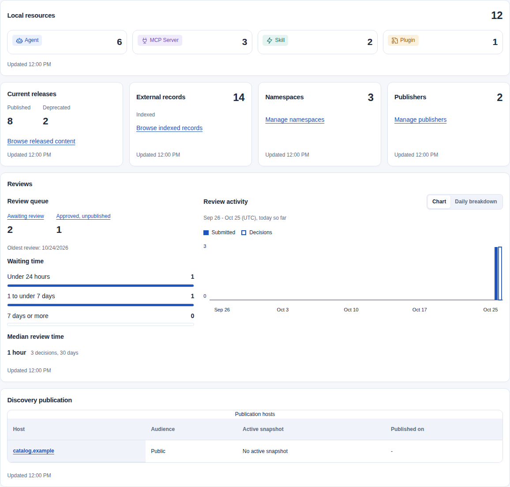](../../../../assets/catalog-ui/overview-content.png)

### Review workload and timing

The review panel shows submissions available through your current history permission. These counts do not mean that you can approve every submission. Independent review and current publication checks still apply.

Select **Awaiting review** to open the current queue. Select **Approved, unpublished** to apply `state=approved&unreleased=true`. A submission stays excluded after its release is retired or revoked. Approval alone does not guarantee that publication can succeed.

Pending age uses three bands: less than 24 hours, 24 hours to less than seven days, and at least seven days. These bands do not set deadlines. The panel shows the oldest pending submission even when the age distribution exceeds its limit.

Activity covers 30 UTC calendar days, including the current partial day. The interval starts at UTC midnight 29 days before the observation date. It excludes the observation time. Submissions use their submission time. Decisions use their decision time, including decisions about older submissions.

Solid bars show submissions. Outlined bars show decisions on the same scale. Narrow screens show three date labels. The daily breakdown keeps every date. Select **Daily breakdown** for every date and each decision outcome. Select **Chart** to return to the graph. The table retains a complete series when the other series exceeds its limit. An incomplete series has no chart or fabricated zeros.

The median measures elapsed time from submission to decision. The dashboard displays a readable duration and retains exact seconds in its tooltip. It includes approved, changes-required and rejected decisions in the activity interval. The median is the middle value, with the two middle values averaged for an even count. The panel also shows the number of decisions measured. This is calendar time, not staff effort or a service deadline.

No decisions means no median observation. Inconsistent timestamps make the affected age distribution or median unavailable. The panel does not clamp negative durations to zero. A complete decision median remains available if only the separate submission series exceeds its limit.

[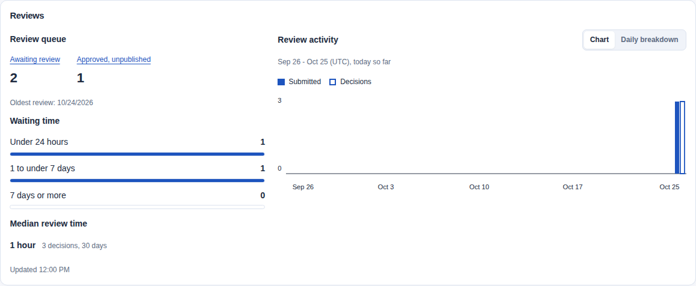](../../../../assets/catalog-ui/overview-review-activity.png)

### Discovery publication metadata

The publication panel lists only hosts configured for your tenant, up to the existing 64-host configuration limit. Disabled hosts show configuration without a snapshot lookup. Enabled hosts show recorded active generation and activation time when those fields exist.

The Audience column shows the configured audience. A Configuration changes column appears when stored audience or profile settings differ. An audience difference also shows the published audience. Recorded metadata does not confirm full document validity or public discovery availability. An enabled host without an active row has no recorded active publication.

Select an enabled host to open its Discovery publication page. The link preserves the selected host and configured audience. Use the existing publication commands to activate, roll back or unpublish a snapshot. Overview performs no publication commands or discovery probes.

### Read the Operations overview

Select **Operations** to inspect Sources, Jobs, search indexing and webhooks. Empty sections show a short message instead of zero-count charts. Summary panels have separate error and refresh controls. Webhook availability and search indexing share one capabilities response. Opening this tab does not read Content summaries. Refresh does not contact peers, probe providers or submit commands.

| Panel | Required access | What it shows |
| --- | --- | --- |
| Federation sources | Tenant `source.read` and enforced `sources.read`. | Nonremoved configurations by status, current-revision sync outcomes and up to five sync problems. |
| Job queues | Tenant `job.read`, enforced `catalog.read` and each Job family's existing permission. | Readable retained Jobs by kind and state, plus the separate due-work subset. |
| Search indexing | Tenant `operations.reindex` and enforced `tenant.admin`. | Existing capability status and processed metadata counts, when returned. |
| Webhook endpoints | Tenant `webhook.read` and enforced `webhooks.manage`. | Active and disabled endpoint counts, when webhooks are enabled. |
| Webhook deliveries and notifications | Tenant `webhook.read_evidence`, its `webhook.read` companion and enforced `webhooks.manage`. | Retained production delivery states, recent failures and existing notification counters. |

Source-only users need no `catalog.read` scope for the Source panel. Job families retain their current source, evidence, publication or reindex permission. Configured publication hosts, current Sources and semantic profiles still restrict Job targets.

Source status describes configuration, not peer health. Sync outcomes use the latest completed attempt for the current revision. A later success removes an earlier failure. Missing indexed evidence appears as **Not synced**. Live-only sources need no indexed sync. Interrupted attempts have no completed observation.

The problem list selects at most five failed or incomplete current-revision attempts. It sorts completion time from newest to oldest, then Source ID. Each row retains the last complete sync time when available. An earlier revision is labelled **Previous configuration**. A failed attempt does not replace the last complete membership.

Select a Source status to apply that exact directory filter. The status survives Reload and Back/Forward. Exact-name filter text stays in the current page. Directory history navigation clears that text. Invalid or repeated status criteria produce an error instead of showing every Source.

The Job table shows one row per kind and one column per state. Each count links to its exact kind and state filters. Terminal counts cover retained Jobs, not lifetime outcomes. Future retries remain waiting. Queued and waiting Jobs become due at `not_before`. Running Jobs become reclaimable at lease expiry. The oldest due time uses these timestamps, not creation time.

**Jobs due** counts the due subset of those Jobs. It does not confirm that a compatible worker is available.

Source and Job measures each select at most 10,001 matching rows. Above 10,000, the panel shows `10,000+` and omits the incomplete distribution. The Source problem list and oldest due Job time remain independently available. Due counts have their own ceiling.

Indexing reuses one capability response within this tab. Counts describe processed metadata in the control index, not unique Resources or expected work. Public discovery snapshots have separate indexes. Missing counts are unavailable, not zero. No completion percentage is calculated.

Disabled semantic search shows that keyword search remains available. The capabilities response does not distinguish global disablement from a tenant exclusion. Enabled indexing without returned details remains unavailable. Provider state is the last reported observation, not a new probe. The panel shows **Loaded** with the browser receipt time because this response has no server observation time.

Select **Manage search indexing** to open Service information. Reindex commands remain there.

[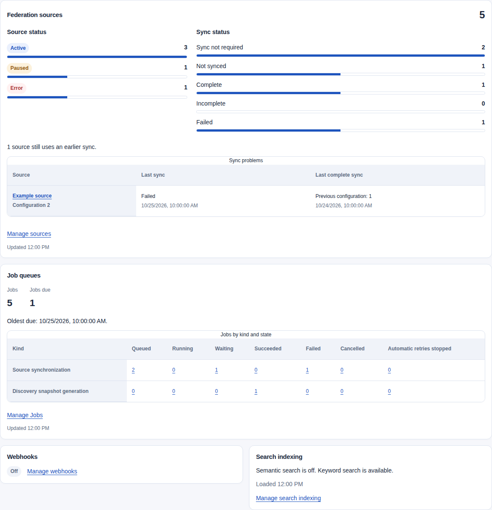](../../../../assets/catalog-ui/overview-operations.png)

### Read webhook summaries

The **Webhooks** panel groups endpoint status, delivery history and notification totals. Webhook-only users can open Operations without `catalog.read`. Disabled or unavailable webhooks produce no private summary requests. Each enabled section has its own error and retry control. **Refresh** reloads all permitted sections.

Delivery bars count retained production rows. Test sends do not count. Disabled endpoints and acknowledged events can retain pending or waiting rows. These counts do not measure dispatch backlog or a lifetime success rate.

The failure table shows up to five active endpoints whose latest retained production attempt failed. Attempts must occur at or after the endpoint's current update. The summary selects the latest attempt before checking its outcome. Equal timestamps use descending delivery ID. A later retained success removes an earlier failure.

The **Delivery failures** table shows the endpoint and its failed attempt time. Failure can occur before an HTTP request. Retention can remove later outcomes. No matching attempt means no retained observation, not a healthy receiver. Endpoint names open the existing workspace. **View delivery** applies the exact delivery ID and recorded state. A retry can change that state. Clear delivery filters to inspect current evidence.

Select an endpoint status to apply that directory filter. Status and exact delivery filters survive Reload and Back/Forward. Directory name text stays on the current page and clears on history navigation. Invalid or repeated criteria produce a refusal instead of a broader read.

Endpoint and delivery distributions each have an independent 10,000-row ceiling. Above that ceiling, the panel shows `10,000+` and omits its incomplete distribution. The failure table remains independently available.

**Events awaiting delivery** includes claimed and deferred work. At its reporting ceiling, the panel shows **At least** that many events. **Events dropped by capacity limits** counts public events. **Final delivery failures** counts recipients. These historical counters do not identify unresolved incidents. They can decrease after a restore.

New summaries show server observation times. Existing notification counters have no server observation time, so **Loaded** shows their browser receipt time. Separate reads are separate observations.

[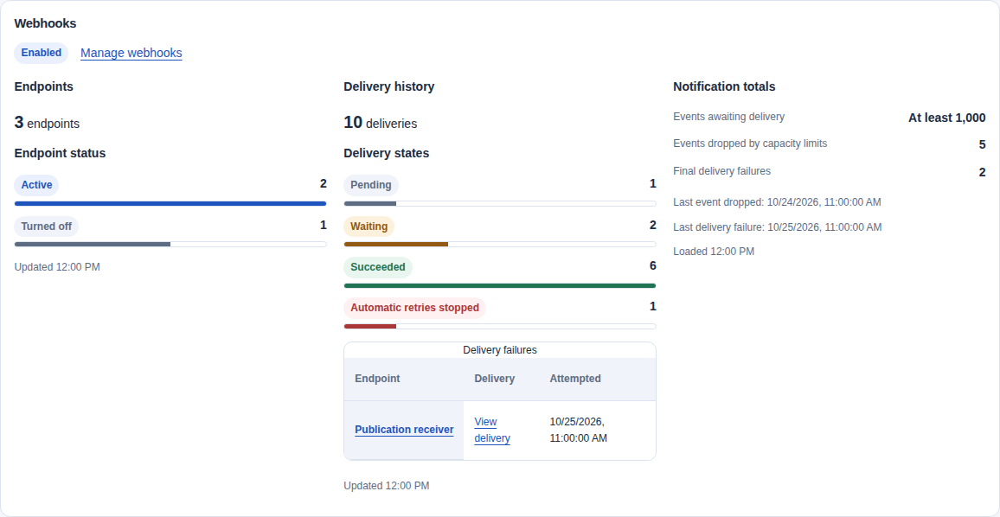](../../../../assets/catalog-ui/overview-webhooks.png)

## Read the Administration overview

Select **Administration** to inspect Catalog access records and moderation counts. These summaries require `tenant.admin` when OAuth scopes are enforced. They do not require `catalog.read` or Resource-read permission. Opening or refreshing this tab sends no commands.

| Panel | Required Catalog permission | What it counts |
| --- | --- | --- |
| Catalog access | Tenant `access.manage`. | People and Service identities by membership state; active Groups and Roles; retained active assignments. |
| Open feedback | Tenant `feedback.moderate`. | Open submissions by category, excluding deleted Resources. The oldest time is the original submission time, including reopened cases. |
| Ratings | Tenant `ratings.moderate`. | Active, withdrawn and removed ratings, including unavailable targets. Active ratings are not waiting for moderation. |

Membership counts describe stored Catalog records. They do not count identity-provider accounts, unique people or signed-in users. An active membership can belong to an inactive realm. Groups count the current sign-in realm. Roles and assignments count the current tenant.

Suspended Groups or members can retain active assignments. Assignment counts do not establish effective access.

Exact private feedback and rating case reads still require the `catalog.read` OAuth scope. Their summaries and inbox lists do not require it.

The membership table separates **People** from **Service identities**, with Total, Active, Suspended and Offboarded columns. Each membership, definition and assignment ID counts once. Role totals distinguish built-in and custom active definitions. **Manage assignments** opens the existing directory; that directory has no assignment-state filter.

Select a membership state to apply that state and identity type in Members. Group and Role links apply `state=active`. Select a feedback category to apply both that category and `state=open`. Rating-state links apply the selected state. These filters survive Reload and Back/Forward. Directory filters also survive a permission refresh.

Directory name, subject and realm text stay on the current page. Private case returns retain the selected list filters and cursor while your access stays unchanged. Access changes clear that return context. Invalid or repeated state, type or category selections show an error. Select an allowed value, or use the directory's **Clear filters** control.

Each count has an independent 10,000-row ceiling. Above it, the panel shows `10,000+` and omits the incomplete distribution. The oldest open feedback time remains independently exact. An empty inbox has no oldest observation. No response-time or resolution-time measure is available.

The summaries show no feedback text, rater identity, Resource metadata or average rating. Each response has its own scope and observation time. A failed panel has a separate **Reload** control; **Refresh** reloads all permitted panels.

[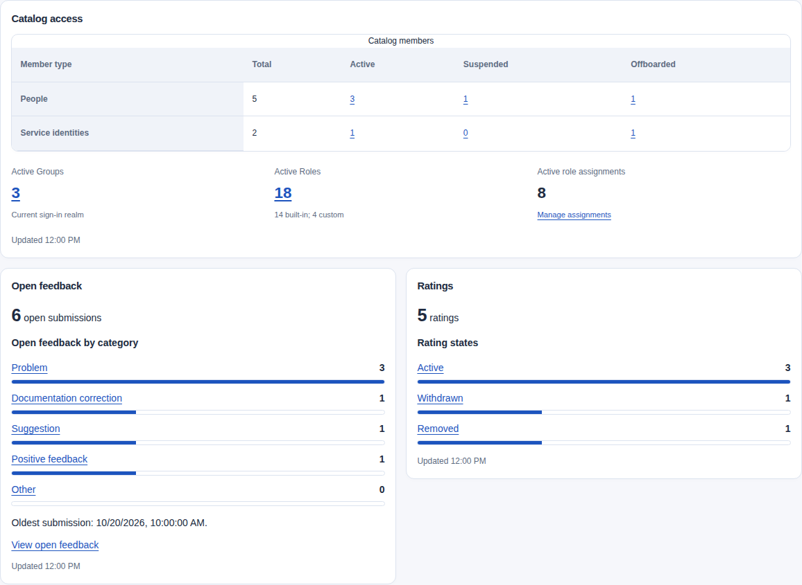](../../../../assets/catalog-ui/overview-administration.png)

## Read live API activity

Open `/overview?view=activity`, or select **Activity** in Overview. An operator must first [enable service activity](../reference/configuration.mdx#service-activity-disclosure). You need current tenant-wide `access.manage` and, when enforced, the `tenant.admin` OAuth scope. Readers and service clients without these grants cannot open the view.

The cards show completed Catalog requests, requests in progress, client/server errors and mean handler time. All values describe one responding API process across all tenants. They do not measure unique clients or the number of servers. **Responding process** shows the execution ID, start time and sample time.

Select **Break down requests by** to switch between request types, HTTP methods and status classes. Other HTTP traffic and Control API search outcomes have separate panels. MCP outcomes show protocol/tool results when MCP is enabled. These outcomes overlap HTTP counts.

Select **Refresh** to take another sample. A second compatible sample after 1-30 seconds supplies requests per second and interval mean time. A restart, another responding process, changed counters or an old sample clears the interval. **Not available** means that a rate or mean cannot be calculated; it does not mean zero.

Select **Live refresh every 10 seconds** for automatic reads while this view is visible. Each interval starts after the preceding read finishes. Hiding the tab pauses live refresh and cancels a pending read. Select **Refresh** after returning.

Failed reads clear the numbers and pause live refresh; select **Reload** to try again. Access changes clear private samples and can require an explicit reload. Observations show **Out of date** after 30 seconds.

Samples stay in browser memory. The page stores no history. Use [Prometheus and Grafana](../operations/helm-monitoring.mdx) for historical charts or multiple replicas. See the [request-statistics contract](../operations/observability.mdx#read-api-request-statistics) for populations and limits.

[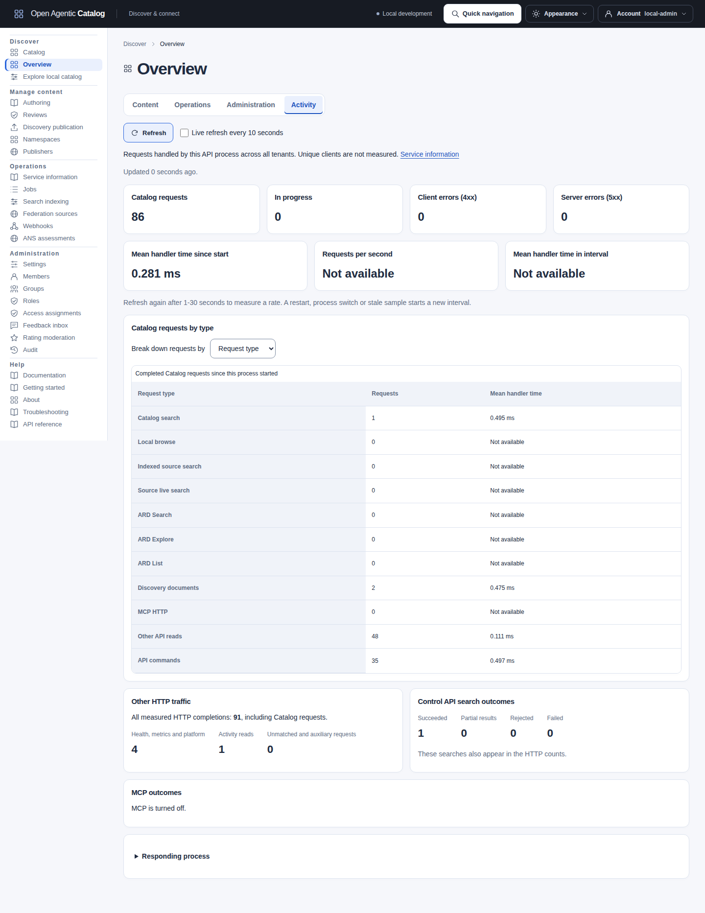](../../../../assets/catalog-ui/overview-service-activity.png)

## Choose a workspace area

The sidebar groups existing pages by task. On narrow screens, open **Workspace menu**; Escape closes it and returns focus to the menu button.

| Group | Pages and purpose |
| --- | --- |
| Discover | **Overview** summarizes readable content. **Catalog** searches available resources. **Explore local catalog** browses local releases and facets, without federated counts. |
| Manage content | Authoring; Reviews; Discovery publication; Namespaces; Publishers. |
| Operations | Service information; Jobs; Search indexing; Federation sources; Webhooks; ANS assessments. |
| Administration | Settings; Members; Groups; Roles; Access assignments; Feedback inbox; Rating moderation; Audit. |
| Help | Documentation when available; Getting started; About; Troubleshooting; API reference. |
| Account, in the header | My access; My work; Saved items and searches; My ratings; My feedback; Sign out. Personal pages require the permissions described below. |

Catalog navigation accepts local `resource.read` available in any namespace or tenant-wide `federation.discover`, with `catalog.read` when scopes are enforced. Explore local catalog requires local resource reads. An omitted origin selection keeps the API's authorized default population. Explicit Indexed/Live selections require federation permission.

If that permission is lost, existing external selections remain visible for removal or reset rather than silently changing the query. An empty authorized result is not proof the entire Catalog is empty.

Sidebar groups organize links. They do not grant or restrict authority. Readers retain access to governed history. Specialist source and audit roles do not need tenant administration or Reader just to use their own pages. Tenant Administrator never bypasses enabled OAuth scope checks.

Open **Account** at the top right to see your subject and identity type. Select **My access** for the exact tenant, identity and grants. Account does not switch tenants. **My access** is read-only. It separates tenant permissions, any-scope navigation hints, paginated exact-namespace permissions and assignment sources.

My access marks Authoring/Reviews **Read-only** when their write permissions or token scopes are absent. Group captions come from your own eligible paths, without group-directory access; namespace names require their independent read permission and otherwise fall back to IDs. Use **Refresh assignment sources** for current cosmetic names and **Refresh My access** for the full session view. Baseline human personal reads and retained own-rating withdrawal remain separate from grants; see [personal access](access-management.mdx#read-your-current-access).

Human accounts can open [My work](#my-work) with `catalog.read` when scopes are enforced. Its queues show only currently readable work. [Saved items and searches](#save-resources-and-searches) requires `library.own` and that read scope; changes also require `personal.write`. Humans retain My ratings without resource-read permission. My feedback requires its own permission and read scope, even after resource access is revoked. Service identities do not see these human-only pages.

Account and Appearance use ordinary links and controls. Press Escape to close the open panel and return focus to its trigger. Moving focus or clicking outside also closes it. Opening one closes the other. **Sign out** still asks before discarding unsaved work. The Account panel closes when the session changes; it disappears after expiry or sign-out.

Breadcrumb parent links use the existing routes. Browser titles describe the page without including record names, identifiers or search text. Ordinary page links and reload use the browser's unsaved-input warning. Catalog record links also preserve the current search within the tab; their Back and Forward actions ask before discarding a draft. History entries contain only a navigation number, never private query, result or draft contents.

Required fields show a star (`*`). Agent protocol controls offer standard choices and custom values. Interface order sets the preferred endpoint. See [protocol choices](resource-authoring.mdx#choose-advertised-protocols).

Open **Create resource** in Authoring to enter identity and native fields before saving. **Next: Content** and **Back: Basics** preserve unsaved input. Select **Include Listing details** to prepare the Publisher, visibility and display metadata before the final confirmation. **Save content draft** carries the acknowledged content references into that Listing. You can also save content alone and prepare the Listing later. Start with [Add and update resources](resource-authoring.mdx) for account setup, instructions and screenshots. Use its [Agent](resource-authoring.mdx#create-an-agent-from-fields), [MCP](resource-authoring.mdx#create-mcp-metadata-from-fields) or [Skill](resource-authoring.mdx#write-a-skill-from-fields) example for your content.

For Plugins, follow [Create a review-tools Plugin in the browser](agent-plugins.mdx#create-a-review-tools-plugin-in-the-browser). Fields generate a manifest and optional components. Download, package and host the complete archive separately. Advanced JSON, local documents and existing archive inputs remain available. Saving does not publish a release.

Use [saved-draft correction](resource-authoring.mdx#correct-a-saved-draft) to fix returned findings. Use [Create a new Version from retained content](resource-authoring.mdx#create-a-new-version-from-retained-content) for a sealed source. An unpublished Version or approved submission does not replace the visible release. Follow the [browser publication tutorial](publishing.mdx#publish-an-agent-in-the-browser) for each role's next action.

Authoring can find a known exact canonical identifier beyond the displayed page and combine it with the Resource kind filter. Follow [Find an existing resource](resource-authoring.mdx#find-an-existing-resource) for matching and cursor rules. Reviews display independently authorized resource identifiers and exact submitted listing names; unavailable context leaves the submission ID/state queue usable.

Select a column heading to sort the table. Select the same heading again to reverse its order.

| Table | Sortable columns |
| --- | --- |
| Explore, Browse releases | Listing, Kind, Version and State |
| Namespaces | Name and Slug |
| Publishers | Name, Declared domains and Approved domains |
| Publisher, Publication domains | Domain and Publication approval |
| Authoring | Identifier, Kind and Updated |
| Members | Login identifier, Identity type, State and Realm |
| Reviews | Submitted listing, Resource identifier, State, Submitted by and Submitted |
| Jobs | Job type / ID, State, Progress, Attempts and Updated |
| My work | Work, Resource and State |
| Saved items | Label, Type and Last updated |
| Publication, ARD and AI Catalog entries | Identifier, Version and Media type |

Cursor-paged tables sort only the loaded page. Paging and Refresh retain the selected column. Sorting does not fetch other pages. Catalog's separate controls order the full search results.

The Publisher inventory sorts domain counts numerically and keeps domain names visible. A Publisher's domain table sorts its complete declared list. Reload retains the selected column when the Publisher revision changes. Version sorting compares text naturally; it does not establish semantic-version precedence.

Jobs sorts progress and attempts numerically. Date columns use the actual timestamps. Sorting keeps pending filters and each row's links or actions.

Publication inventories sort all entries in the selected document before dividing them into pages of 25 rows. Selecting a column returns that inventory to its first page. ARD and AI Catalog keep separate sort and page selections. Ascending version order places empty versions first and missing versions last. Descending order reverses these groups. Empty and missing versions keep their distinct labels.

Review and release pages offer metadata, history and evidence links separately. A permission to read history does not grant content access. Unavailable destinations remain exact references rather than unusable links. Some navigation hints lack the target namespace; the API still checks access when you open them.

Explore Browse, Authoring, Reviews, Namespaces, Publishers, Members and Discovery publication keep **First page** available after a failed later-page read. **Reload** or the collection's **Refresh** restarts without the failed cursor and preserves the selected filters or host. Successful-page Refresh reloads that page. Pending paging controls are disabled and keep keyboard focus.

Access inventories, Jobs, audit results, webhooks, feedback, source directories, synchronization history, observation occurrences and indexed federation diagnostics use the same recovery. Each pager identifies its collection and disables pending navigation. Catalog search has a separate **Retry this page** action for temporary outages. It keeps the displayed results and retries the captured request. A rejected search cursor requires **Start a new search**.

Assignment-revoke drafts require an explicit discard before paging or refresh, and no recovery action resends a mutation.

Access, review, release and publication confirmations show the captured action, exact target references, scope or disposition, relevant changes and reason. Review approval, request changes and rejection are distinct. Names appear where the workflow has already loaded them. Exact references remain available without extra private reads.

The confirmed request and any deliberate retry use the same captured values, revision and idempotency key. Cancel sends no command. These summaries do not expose raw private documents, credentials or one-time secrets.

Closing a resource preview, selecting its tag or namespace, or opening its full record asks before discarding unsaved input. Declining leaves the draft and current criteria unchanged. Escape dismisses the top dialog only when cancellation is available. A pending command or an unknown outcome keeps its confirmation open.

A session end or identity change clears private state immediately. A same-identity permission or scope refresh retains protected drafts and disables unauthorized new sends. If a command's outcome is uncertain, its retry controls retain the original request and idempotency key.

Group-member and assignment revocation editors keep separate reasons. Switching or closing an edited selection asks before discarding it and leaves the Add form untouched. Feedback submission, edit and response drafts are protected before closing disclosures, changing the resource/category/state, paging, refresh or navigation. Saving one feedback row rereads the current bounded page and preserves unchanged rows and an unfinished new submission. Feedback and rating lists also open an exact case ID. Their same-tab return retains applied filters and the case cursor in memory, then rereads the list. Reload, an identity change or a policy/access refresh clears that list return context; protected editor drafts remain during a same-identity refresh. See [feedback triage](feedback.mdx#open-an-exact-case) and [rating recovery](ratings.mdx#edit-withdraw-and-moderate).

A changed or removed row follows the returned revision/filter result. A failed reread keeps the last loaded page labelled as such. Explicit refresh/discard replaces the affected editors. Drafts remain only in the current session's memory.

Edited source-connection settings and topology count as unsaved even without a name or reason. Service refresh similarly protects a search-reindex draft. Changing a populated representation's content source asks before clearing its bytes, URL, handoff or checksum. Leaving Skill archive mode resets archive-specific media/profile values to the selected document defaults.

This does not upload, fetch or execute a resource.

Synchronization and search reindex commands report the accepted Job ID. Acceptance is not completion. Job navigation requires `job.read`, the relevant family permission and `catalog.read` when scopes are enforced. Users without those reads retain the receipt and an explanation.

Webhook inventory reads similarly do not grant creation permission.

## Start and navigate

The UI shows **Starting Catalog** while it loads host settings. If loading fails, select **Reload**. No workspace opens until those settings validate.

Before sign-in, **Documentation** opens the configured manual in a new tab when available. **About** and **Getting started** work without a session or a healthy API. About describes the four resource kinds and links local Apache License 2.0 and browser dependency notices. These legal files do not depend on the optional manual. Signed-in About also shows the actual API/UI host build identities and links Service information.

Getting started explains discovery, contribution, independent review, release publication and tenant configuration. It offers workflow links for your current permissions and explains the prerequisites for unavailable actions. Creating a release and activating discovery are separate steps. These pages do not create sample data or identity-provider users.

[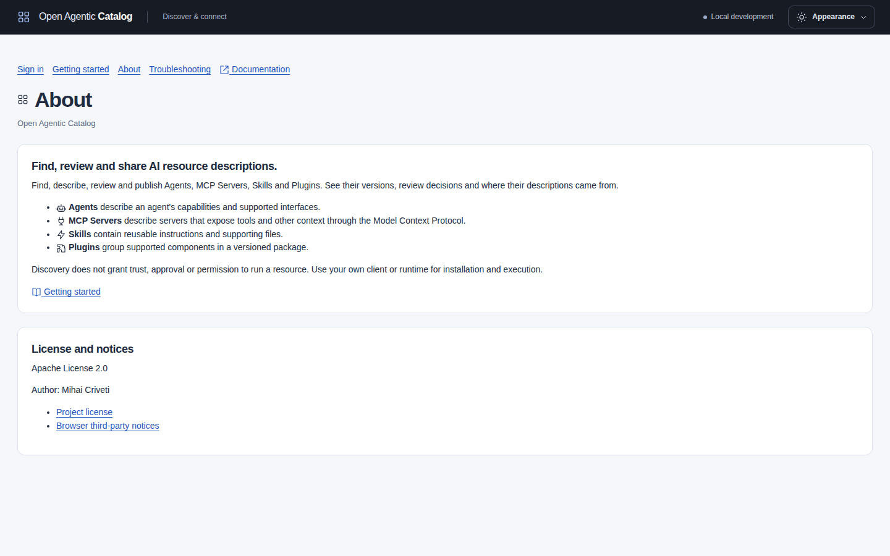](../../../../assets/catalog-ui/about.png)

[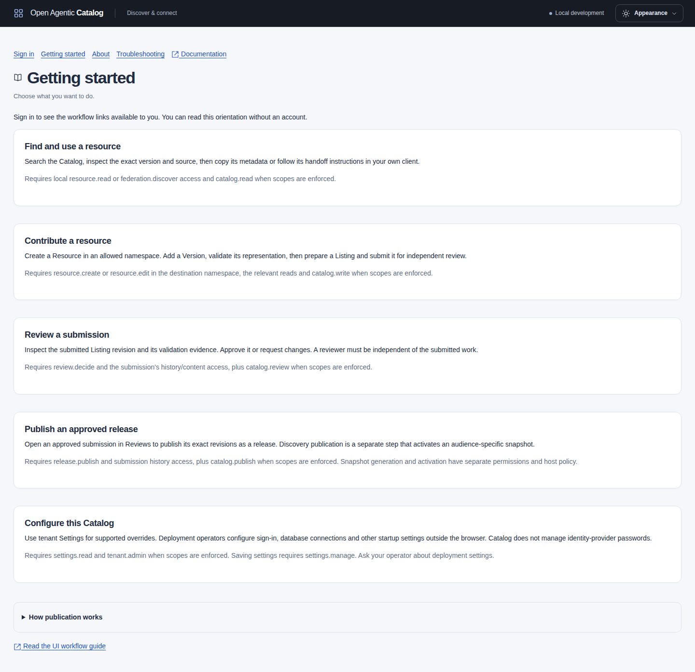](../../../../assets/catalog-ui/getting-started.png)

After sign-in, select **Quick navigation** in the header, or press Ctrl+K or Command+K outside a text field or dialog. Type a page name, then follow its link. Only permitted fixed pages appear; resource names and private searches are not searched. Escape closes the chooser and returns focus. Ordinary unsaved-input protection applies when you follow a link. Catalog remains the default landing page.

## Sign-in and session behavior

Use the [authentication and sign-in runbook](../operations/sign-in.md) to connect the API and optional UI to your issuer.

Development and OIDC login are separate startup modes. Development login is restricted to a loopback UI origin and is rejected in production configuration. OIDC login uses a confidential web client, authorization code and PKCE. It does not fall back to test users if the provider fails.

The provider's ID token must target the UI client, while its JWT access token targets the Catalog API and resolves to a human Catalog membership.

The browser receives an encrypted, HttpOnly session cookie, not an access token in JavaScript. Sessions expire at the earlier of the configured limit and access-token expiry. Sign in again after expiration. Sign-out clears this UI's session and private state across tabs.

Development sign-in choices have their own loading and failure states. Select **Reload sign-in options** after a failed read. Pending sign-out says **Signing out...** and never restores private input from a canceled response. Explicit sign-in and sign-out move keyboard focus to the new page context. Automatic expiry preserves focus in surviving header controls; removed private controls return focus to sign-in.

Development bundles and exact templates appear in separate named groups. Search their labels, descriptions or aliases; counts show how many choices match, and **Clear identity search** restores the roster. Elevated administration and a separate tenant have explicit captions. These are development shortcuts, not production passwords or accounts. Their descriptions explain configured seed intent; retained grants can differ. Reader and discovery includes private local reads, so it is not a published-only consumer identity.

A warning appears two minutes before the known absolute expiry, or immediately for a shorter session. Finish an explicit save where possible. Expiry still clears unsaved input; the warning does not extend the session, autosave or start authentication. An ordinary access refresh does not repeat it.

Sign-out does not revoke the provider token or sign out other applications. If sign-out cannot reach the host, use its retry button before leaving a shared browser.

See [UI deployment settings](../../../../../deployments/helm/open-agentic-catalog/README.md#optional-catalog-ui), [session-key rotation](../operations/maintenance.mdx#rotate-ui-session-keys), [UI architecture](../architecture/catalog-ui.mdx) and [browser testing](../contributing/testing.md#optional-browser-client) for configuration and development details.

## Appearance and document display

Appearance in the header offers visual light, dark and system theme choices plus compact/comfortable density. Use the arrow keys within either choice group. Changes apply immediately. System follows the device's preferred light or dark theme.

Compact reduces card, panel and table spacing while preserving text size and readable form controls. Status labels name the reported state. Color supplements the text. It does not grant access or establish trust. Important preview, filter-clear and code controls have larger targets on touch devices.

Buttons use text labels, sometimes with small symbols. The same symbol identifies the same action across pages. Amber buttons mark actions that need caution; red buttons mark destructive actions. Read the label and confirmation before you continue.

The narrow header wraps brand/environment labels. Only these preferences are stored persistently in the browser. On smaller screens, open Workspace menu to reach all permitted pages; Escape closes it and returns focus to the menu button. Reduced-motion preferences disable visual animations.

JSON panels use syntax highlighting in both themes. Format JSON toggles indentation; Wrap lines switches between wrapped text and horizontal scrolling. Raw retained documents and federation entries start with their original whitespace. These controls change only the display, not stored content or downloaded files.

Large or deeply nested documents and non-JSON text are displayed without highlighting to keep the page responsive.

### Browser and accessibility checks

Chromium is the maintained automated browser baseline. Regression checks cover keyboard controls, responsive layouts, light/dark themes and reduced-motion preferences. The controls above remain usable without relying on color alone.

Automated accessibility checks inspect the rendered page, dialogs, focus and selected contrast combinations. They do not establish native browser zoom, spoken screen-reader behavior or complete accessibility certification. Other browser engines need separate qualification. See [browser testing and qualification limits](../contributing/testing.md#optional-browser-client) for the maintained scope and test commands.

## Check Publisher DNS evidence

Open a Publisher and select **View DNS verification**. The panel shows publication approval, proof expiry and the last DNS check separately.
Choose one exact declared DNS domain. Read the configured mode before preparing a command.

Managers can issue challenges, copy TXT instructions, check DNS and clear evidence. Each command requires a reason and confirmation.
The page requests TXT instructions only when you select **Show TXT instructions**. It hides private instructions if management access changes.

The page reads current status after a command completes. An unsuccessful check shows a failure even when the HTTP command succeeds.
A retry with the same key returns the original result. Submit a new explicit check to query DNS again.
See [Publisher approval and DNS evidence](publishing.mdx#publisher-approval-and-dns-evidence) for modes, permissions and renewal.
Follow [TXT record setup](publishing.mdx#enter-the-txt-record-correctly) for zone-relative names, provider suffixes and quotation marks.
Use [DNS check recovery](publishing.mdx#recover-a-dns-check) for propagation failures, expired challenges and unknown command outcomes.

## Complete forms and recover safely

Filter inputs stay aligned even when their labels or help wrap. Apply, Clear and Refresh use a separate action row. Exact-ID lookups keep their button beside the input when space permits. On narrow screens, controls wrap without hiding fields.

Administration shows a short acting-identity, tenant and scope summary. Expand **Context details** for complete tenant and identity-realm references. Confirmation still shows the exact captured scope. Initial read-only pages show saved facts instead of empty required edit forms. If access changes while you edit, the UI protects your unsent draft and explains why saving is unavailable. Changing identity clears private state.

Search and Explore validate text against the 500-byte UTF-8 limit and publisher filters against 256 bytes before a request. Tags have a 32-item, 80-code-point allowance. Listing categories have a 16-item allowance. Invalid values remain editable.

Listing names, descriptions, representative queries and audit reasons count Unicode code points, including supplementary characters, rather than JavaScript string units. Listing links must be credential-free HTTPS references. Never paste signed URLs or tokens. The backend rechecks all inputs.

Optional Request details on failed reads shows only bounded service codes and request IDs, when supplied. It does not expose dependency messages or private response contents. Reload is deliberate. A failed refresh does not establish that an earlier mutation failed.

Controls with a native required constraint show **Required**. Optional metadata and examples are explained beside the fields. Namespace, Publisher, version and revision pickers load bounded pages. A selected item's known label remains visible when paging away, while its exact ID remains the command value.

Only that selected label is retained in memory. Changing the picker context or signed-in identity discards it. An unknown selection shows its ID instead of inventing a name.

Administration paging groups name their own records or choices, so keyboard and screen-reader users can distinguish an assignment inventory from its Role, Member and Namespace choices, or feedback cases from Resource choices. Each pager has its own busy state and cursor. Focus stays in that group when the activated First page or Next page button disappears. A stale cursor can restart that list without submitting a command or clearing another list's selection.

Namespace and Publisher inventories support [exact server-side directory filters](resource-authoring.mdx#manage-namespaces-and-publishers). Apply or clear them explicitly; typing sends no request. Both supplied fields must match. The filters add no read permissions and keep exact-ID detail access.

Feedback inbox, Rating moderation and Audit offer a guide link beside their heading. Settings retains **Configuration documentation** and its permission-based task directory. The bundled `/docs/` manual opens the fixed relevant guide; an operator's external documentation URL stays exactly configured, and disabling documentation removes these links. Help does not inspect targets, change policy or save a draft.

Local validation focuses an error summary. When the validator knows the exact field, select the error link to open any enclosing disclosure and focus the control. Representation JSON/text, URL/checksum, Skill package/handoff, public representative-query count, extension JSON and specific relationship failures use this path. Unattributed errors remain at form level.

Native required, length and URL checks still apply, and the API remains authoritative. Correcting input does not send a command. Saving still requires confirmation.

A 412 conflict retains the form input and explains that the record changed. Return to the form to copy the draft, then reload and compare the current revision before preparing another command. An uncertain response instead offers only **Retry same command**, preserving the exact request target, body, idempotency key and ETag. Reloading discards that in-memory retry.

Check the record before attempting a new action. Backend error text is not interpreted as a field mapping.

A completed form focuses its acknowledgement. Follow its result link when available.

**Grant another access assignment** and **Add another group member** start a new deliberate operation after success, clear the consumed target and reason, and retain the previous receipt. Role and scope choices remain staged. Each confirmed operation uses a fresh key; an unresolved command cannot start another operation. When you switch Assignment target between Member and Group, the UI clears the selected member or group. It preserves the role, scope and reason.

Role/group metadata and lifecycle forms have separate audit reasons. Publisher metadata uses **Metadata change reason**; domain approval/revocation uses **Publication approval reason**. Finish or discard metadata edits before a domain action. Unsent rating-moderation reasons also warn before leaving. In Settings, replacing a changed draft with either current saved values or previous overrides asks first; neither replacement saves anything.

After saving a Listing revision, **Inspect candidate revision** opens the saved candidate. **Submit for review** selects the server's current candidate when the command executes. Another edit can change that candidate after you prepare confirmation. The acknowledgement identifies the submission and actual revision, and reports a concurrent change. **Prepare another review submission** keeps that receipt while staging another deliberate command.

After updating, rotating or disabling a webhook, adjacent controls cannot reuse the superseded ETag. Use **Reload endpoint** to read and compare the current endpoint. Reload preserves drafts, signing secrets and unresolved commands. **Edit endpoint again** or **Prepare another webhook action** explicitly starts the next operation after successful readback. A disabled endpoint cannot be re-enabled here.

**Refresh snapshots** rereads the selected host's current bounded page. Use **First page** on later pages to find the newest generations, including candidates created by another administrator. Refresh does not build or activate a snapshot.

Rating save, withdrawal, moderation and sharing acknowledgements remain visible if the following read fails. Use **Reload** to recover the read; do not repeat the acknowledged write. An artwork override save retains its acknowledgement separately from its editor. **Refresh artwork override** rereads the head and any opened history; refresh Catalog results separately to view their current projection. These receipts stay in tab memory and clear with the identity.

Administration acknowledgements also retain the exact operation, target, returned revision and safe HTTP attempt ID when available. **Investigate change** appears with current audit-read authority and stages action, target and a bounded interval in Audit. Select **Search audit events** explicitly. A replay's attempt ID can differ from the original audit request ID; it is omitted from the mutation search. See [receipt investigation](../operations/audit.md#investigate-an-acknowledged-administration-change) for older replays and time bounds.

Settings history is a separate explicit audit read. With Settings manage authority, validated before/after overrides can populate a draft after a fresh Settings read and confirmation. Enter a new reason and confirm Save separately. The preview uses current API defaults, not historical worker defaults. See [history and restoration](../reference/configuration.mdx#read-history-and-restore-overrides-to-a-draft).

## Open the manual and API reference

Open **Help > Documentation** to read this manual in a new tab. The UI image includes the manual from the same source revision. Search, themes, diagrams and downloads work without a Catalog session. The public manual contains no tenant data.

[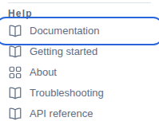](../../../../assets/catalog-ui/help-documentation.png)

The manual stays at `/docs/`, independently of the UI base path. For example, a UI at `/catalog/catalog` serves the manual at `/docs/`. Preserve both paths at a reverse proxy. The application chart adds both ingress paths when needed.

Use `documentationUrl` for an optional credential-free HTTPS override. The override changes the link; the local manual remains available. Its availability does not control readiness or login. Empty configuration uses the bundled manual. A source run without a bundle or override omits the link.

For source builds, bundled-manual inputs and restart requirements, follow [Read the manual through the UI](../contributing/documentation.mdx#read-the-manual-through-the-ui). Host fields are in [UI host configuration](../reference/ui-host-configuration.md).

**API reference** remains available without manual configuration. It describes the connected backend's HTTP contract and requires the normal UI session. Browsing its operations does not execute them.

Documentation links use `noopener noreferrer` and add no token, identity or query. Browsers still apply normal cookie domain and path rules. Ports do not isolate cookies. Use appropriate cookie scopes and an independent hostname for an external manual when necessary.

## Browse API documentation

Open API reference in the sidebar, or Browse API reference from Service information. The compact header shows the connected API version, workspace controls and exact YAML download. Browse endpoints is the initial workspace. Expand **Overview** for the contract description; the sign-in and read-only guidance stays visible.

Endpoints appear in sections following the contract's declared API areas, with their descriptions and operation counts. Use **API areas** beside the list on a wide screen, or **Jump to API section** on a narrow screen, to focus a section without changing filters. **Back to API areas** stays available while scrolling through a section. Collapse a section with its heading or Collapse button; expanding it leaves individual operation bodies closed until you choose one. A previously expanded operation stays expanded through filtering. A known operation link opens its containing section. An explicit Deprecated badge appears only when declared by the contract.

Each endpoint appears once, under its last operation tag. The **API area** filter still matches all of its tags: selecting Identity includes access operations displayed under Groups and members, Roles, Access assignments and My access. The displayed section counts count each matching operation once. Catalog discovery and Discovery are separate areas; read their contract descriptions for their different roles.

Combine **Search API operations**, **HTTP method** and **API area**. Text search covers method, path, operation ID, summary, description and tag names without regard to case; the area choice matches an exact tag. The applied-filter summary explains the current choices and matching operation count. **Clear filters** clears all three and returns focus to search. Matching sections open without expanding every operation. **Browse schemas and shared definitions** opens the independent Definitions workspace. **Browse endpoints** returns to the retained endpoint filters and disclosures.

[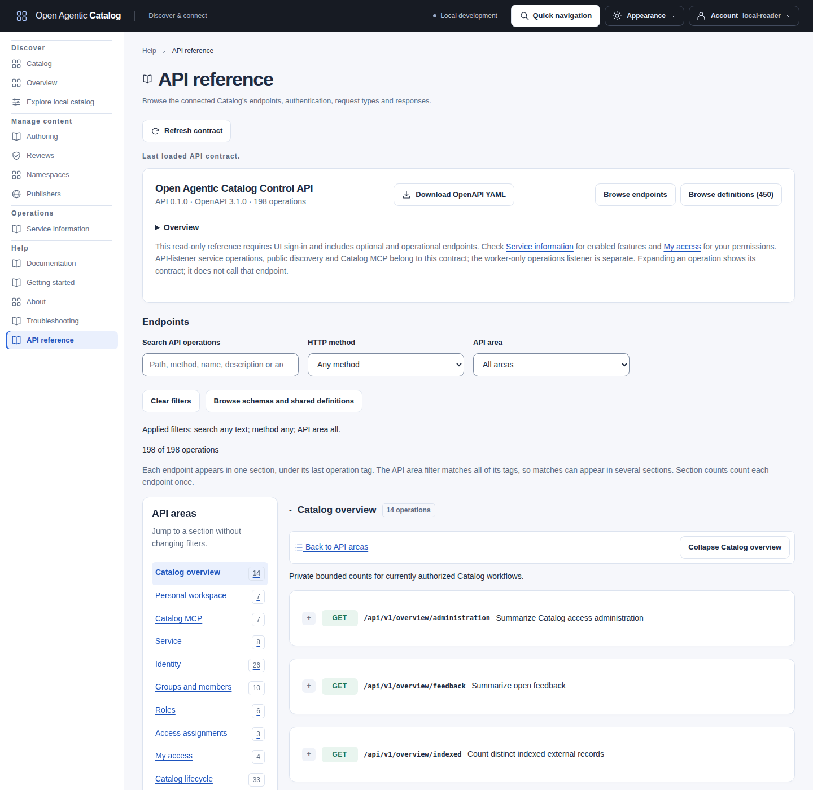](../../../../assets/catalog-ui/catalog-api-areas.png)

Expand an operation to read its **Authentication**, **Parameters**, **Request body** and **Responses** summaries. **Complete decoded data** reveals the original declaration behind a summary. View buttons open its local schema or shared definition. Descriptions and example URLs remain text; opening a summary does not fetch them.

Authentication distinguishes required API credentials, anonymous-or-authenticated alternatives and no required API credential. Anonymous admission still depends on the documented host, audience and domain rules. Missing or malformed scheme metadata is unavailable; it does not establish public access. Combined schemes appear together; separate alternatives remain separate. HTTP Bearer requirement values are not automatically OAuth scopes or Catalog roles. Read each operation's documented permission conditions and use My access for your current grants.

Parameters show their exact name, location, required declaration, description and available type, format, constraints, defaults or examples. Path-level parameters and operation overrides stay together. An undeclared default or required flag remains undeclared. Referenced schema facts describe the target; complete data retains sibling keywords and composition without inventing an effective validation rule.

Request bodies show requiredness and declared media types. Responses retain their exact status, range or default key, media types, descriptions and headers. A declaration with no request or response body differs from unavailable metadata. An accepted Job does not mean that work completed. Control problem details, public discovery and MCP retain their declared envelopes.

Choose **Copy method and path**, **Copy operation ID** or a supplied example's copy button. Path placeholders stay literal; no token, command key or current ETag is inserted. String examples copy verbatim, including surrounding spaces. Other examples copy as decoded JSON, not original YAML bytes. An external example URL is not copied as a request body. Large examples disable copying rather than truncate the payload; use complete data or the exact YAML download for inspection.

Large summary collections show an explicit limit and retain their complete declarations. Unresolved local references keep their links and raw data. Recursive and composed schemas stay available through local links; the UI never fetches external references.

### Inspect shared definitions

Choose **Browse definitions**, or follow an operation's View button. Use **Search definitions** to search names and descriptions across the complete index. **Component kind** narrows the results. Each page groups up to 25 definitions by kind; use First, Previous and Next definitions for other matches. The index scrolls independently and accepts keyboard focus. Clear definition filters resets its search, kind and page.

Choose an Open button or the page's **Schema or shared definition** selector. The selected detail stays available when index criteria or pages exclude it. A notice explains that separation. Following an exact reference does not reset the index search or substitute a different definition. Additional component kinds retain their exact names and complete data.

Schema details show declared properties, required names, types, array items, additional-property rules, defaults and local references. Boolean schemas, type unions and false/zero values remain distinct. Read-only and write-only annotations do not determine requiredness. The allOf, oneOf and anyOf summaries retain their separate meanings; they do not produce an invented combined validation rule. Large structures show a summary-limit notice. Use complete decoded data or follow a local definition to inspect omitted structure.

[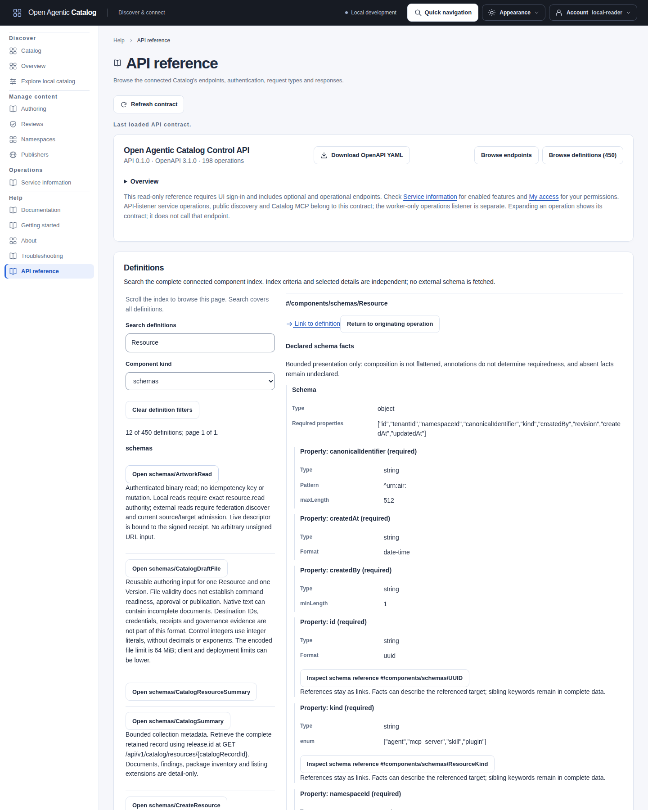](../../../../assets/catalog-ui/catalog-api-definitions.png)

**Return to originating operation** restores focus to the expanded operation and preserves compatible filters. If filters hide it, **Reveal originating operation** explains and clears search, HTTP method and API area before returning. A known operation reached through history has the same explicit **Reveal linked operation** recovery. Other navigation does not silently clear filters.

Nested references and browser Back/Forward use known contract anchors. Each definition history entry retains its independently checked originating operation, including when two operations reference the same definition. Only known contract destinations enter history state; private searches stay in tab memory. Unknown or removed links offer current index recovery.

### Refresh the connected contract

**Link to operation** and **Link to definition** provide reloadable destinations, including local nested references. **Download OpenAPI YAML** saves the exact loaded contract. Its API version comes from the connected OpenAPI document; application build identity and the packaged manual revision are separate facts.

Choose **Refresh contract** explicitly. **Last loaded API contract** remains visible during the request or after a failed refresh. Success replaces the document and its exact YAML together, even when the API version stays unchanged. Compatible searches, method choices, area/kind filters, selected definitions and operation disclosures remain in the tab. Typed searches can legitimately match zero results.

Removed area or kind choices reset to their All choice with an explanation. Removed definitions and originating operations are cleared and explained. No previous detail is substituted for a removed target. A failed refresh retains both the prior document and its download; choose Reload or Refresh contract to try again. Sign-out and identity/access changes discard this workspace. There is no background polling.

[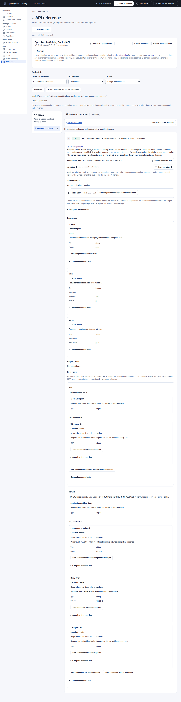](../../../../assets/catalog-ui/catalog-api-reference.png)

Search for `/api/v1/catalog/search` to inspect the operation behind Catalog search without sending a search request.

The reference is read-only and available to any signed-in user. It includes optional features, public discovery and API health endpoints. An entry does not mean that feature is enabled or that your identity can call it. Browsing and following schema links do not execute the documented operations, contact external schema servers or change Catalog data.

Use the overview links to Service information for enabled features and My access for your permissions. API-listener service operations belong to this contract; the worker-only operations listener is separate. The optional **Help > Documentation** link opens the bundled manual or the deployment's explicit `documentationUrl`. The built-in API reference needs no separate documentation server.

## Troubleshooting

| Symptom | Check |
| --- | --- |
| The page cannot connect or login options fail to load | Confirm the UI host and backend are running on the configured ports. `make ui-dev` starts only the UI, not the backend. |
| The page is rejected when using `localhost` | Open the exact configured origin, including hostname and port. The host rejects other Host and Origin values. |
| Login works but Catalog is unavailable to this identity | Check My access. Browsing needs `resource.read` in a tenant or namespace scope, or configured federation discovery authority, plus `catalog.read` when OAuth scope enforcement is enabled. |
| Catalog is empty for a specialist identity | The empty view explains missing local Resource-read access. External results also require discovery permission, available configured sources and the selected modes; absence of visible results reveals no hidden record or source count. Use the [published-only discovery contract](access-management.mdx#use-published-only-discovery) when that is the intended consumer path. |
| Search has no results | Clear the query and filters, check the signed-in tenant, and confirm resources have been published. The UI does not seed data automatically. |
| A search cursor is rejected | Start a new search; changes to data or access can invalidate continuation cursors. |
| Styling or an asset fails after rebuilding | Stop and restart the UI launcher, then reload. The development host has no hot reload and keeps its entry page in memory. Restarting the launcher also requires signing in again. |

Open **Help > Troubleshooting** for sign-in, access, empty searches, stale revisions, uncertain commands and unavailable dependencies. Guidance is public and survives sign-out. My access and Service information links appear when signed in.

Choose **Preview diagnostic details** deliberately, review the preview, then **Copy diagnostic details**. The preview reads the readable API/UI build versions, commits and source states; it includes bounded safe error codes and response request IDs when available. A request ID may identify a UI-host failure or an upstream API response, rather than two independent IDs. Unavailable build facts are omitted. An error without a response request ID has an empty `requestId`.

Tokens, cookies, identities, tenant/object metadata, search text and raw logs are excluded. If clipboard access fails, select and copy the text manually. Copying performs no request or upload; signing out clears private details. Previously copied text remains on your clipboard.

[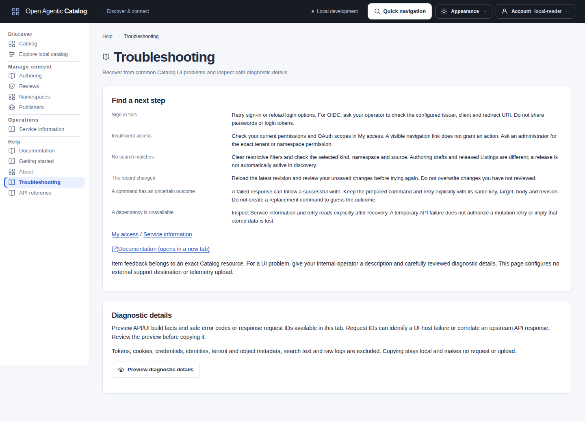](../../../../assets/catalog-ui/troubleshooting.png)

## Task guides

Choose the guide for the task you want to complete.

[Start locally](../contributing/build-and-release.md#build-and-run-the-ui-locally).

[Container deployment](../operations/docker.mdx).

[Tenant operational settings](../reference/configuration.mdx#manage-settings-in-the-ui).

[Development identities and role handoffs](access-management.mdx#development-identities-and-role-handoffs).

[Edit access policy deliberately](access-management.mdx#edit-access-policy-deliberately).

[Find and inspect resources](search-cookbook.mdx#find-and-inspect-resources).

[Copy references and download documents](understand-results.mdx#copy-references-and-download-documents).

[Inspect releases and their history](understand-results.mdx#inspect-releases-and-their-history).

[Explore local releases and facets](search-cookbook.mdx#explore-local-releases-and-facets).

[Manage Namespaces and Publishers](resource-authoring.mdx#manage-namespaces-and-publishers).

[Follow Jobs](../operations/observability.mdx#manage-jobs-in-the-ui).

[Search indexing](../operations/observability.mdx#search-indexing-in-the-ui).

[Job status and actions](../operations/observability.mdx#manage-jobs-in-the-ui).

[Add and update resources](resource-authoring.mdx#author-in-the-ui), then [review and publish](publishing.mdx#publish-an-agent-in-the-browser).

[Inspect revision validation](resource-authoring.mdx#inspect-revision-validation-in-the-ui).

[Manage public discovery snapshots](publishing.mdx#manage-discovery-snapshots-in-the-ui).

[Load a local JSON or Markdown document](resource-authoring.mdx#load-a-local-json-or-markdown-document).

[Reuse a validated name and description](resource-authoring.mdx#reuse-a-validated-name-and-description).

[Administer federation and access](../operations/federation.mdx#manage-sources-in-the-ui).

[Exclude source identifiers](../operations/federation.mdx#exclude-source-identifiers-in-the-ui).

[Adopt exact observations with explicit overrides](../operations/federation.mdx#adopt-an-observation-in-the-ui).

[Request an ANS registration assessment](../operations/federation.mdx#request-an-ans-assessment-in-the-ui).

[Read a private ANS assessment](../operations/federation.mdx#read-a-private-ans-assessment).

[Manage webhooks](../operations/webhooks.mdx#manage-endpoints-in-the-ui) or [investigate and export audit](../operations/audit.md#investigate-and-export-in-the-ui).

[Inspect service information](../operations/observability.mdx#inspect-service-information-in-the-ui).

[Private item feedback](feedback.mdx).

[Development sample catalog](sample-catalog.mdx).

[Origin and local namespace filters](search-cookbook.mdx#origin-and-local-namespace-filters).

[Resource artwork](understand-results.mdx#resource-artwork).

[Recover from an image failure](understand-results.mdx#recover-from-an-image-failure).

Access administration is in [Manage Catalog access](access-management.mdx#manage-access-in-the-ui). Review/release controls are in [publication](publishing.mdx#review-and-release-in-the-ui). Audit controls are in [Audit operations](../operations/audit.md#investigate-and-export-in-the-ui).

## My work

The four queues separate drafts, work awaiting review, requested changes and approved work with no release. Empty guidance describes the selected queue. Approval alone does not establish current publication eligibility.

Open **Account > My work**. Choose Draft resources and candidates, Awaiting review, Changes required, or Approved and never released. Each queue has its own server continuation. Refresh explicitly; the page does not assign reviews or poll.

[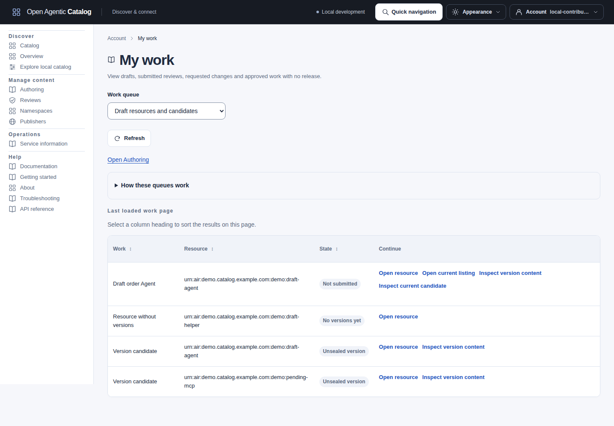](../../../../assets/catalog-ui/my-work.png)

| Queue | Included work |
| --- | --- |
| Draft resources and candidates | Your resources without Versions, unsealed Version candidates, and Listing candidates not previously submitted. |
| Awaiting review | Your exact immutable submissions still awaiting a decision. |
| Changes required | Your latest changes-required submission, with separate links to submitted evidence and the current correction candidate. Resubmission removes the old correction row. |
| Approved and never released | Your approved submissions with no retained release in any state. A newer candidate does not revoke approval. |

Ownership uses your Catalog membership and issuer realm, never a display name or an unqualified token subject. Older Version/Listing revision transitions without exact revision attribution are omitted. This page does not reconstruct ownership from `createdBy`. Rows and links require current namespace permissions. Resource identifiers require metadata reads, display names require content reads, and revision/submission queues require history reads. The API does not require `audit.read` or return raw audit records.

Approval does not guarantee current publication eligibility. The publisher must use the existing release command, which rechecks policy and evidence. Authorized reviewers can open the existing review queue; independent review rules still apply.

## Save resources and searches

Library lists show short saved summaries and readable update times. Open an item for complete saved filters or references. List rows do not check target availability. Exact-label filters match the full label, including capitals, spaces and spelling; duplicate labels remain allowed.

Open an inspected resource and expand **Save resource**. Enter a label, review the read-only captured reference, choose **Save resource**, and confirm. Local saves retain the release and Version revision IDs. External saves retain the source, presentation generation, kind, identifier, and explicit version presence. An absent version and an explicitly empty version remain different identities. Quick save cannot replace the inspected target; deliberate reference editing is available in the saved item's detail.

After Search, expand **Save this named search** to retain the submitted criteria. Unsubmitted search text is not saved. You can also open **Account > Saved items and searches > Save a named search**. Edit **Saved search text**, then expand **More saved filters** for kinds, tags, categories, origins, Namespace, Publisher, license and visibility. These controls make no Search, Explore or suggestion request.

Choose **Edit private saved criteria as JSON** for advanced editing. Both views edit one draft. Unsupported fields, duplicate JSON keys and invalid values must be corrected before saving. Leaving **Specify origins** unchecked retains origin omission. Saving preserves supported values, including literal commas and Unicode spelling; Search applies its own documented normalization later. Check the captured criteria and label in the confirmation before choosing **Confirm**.

[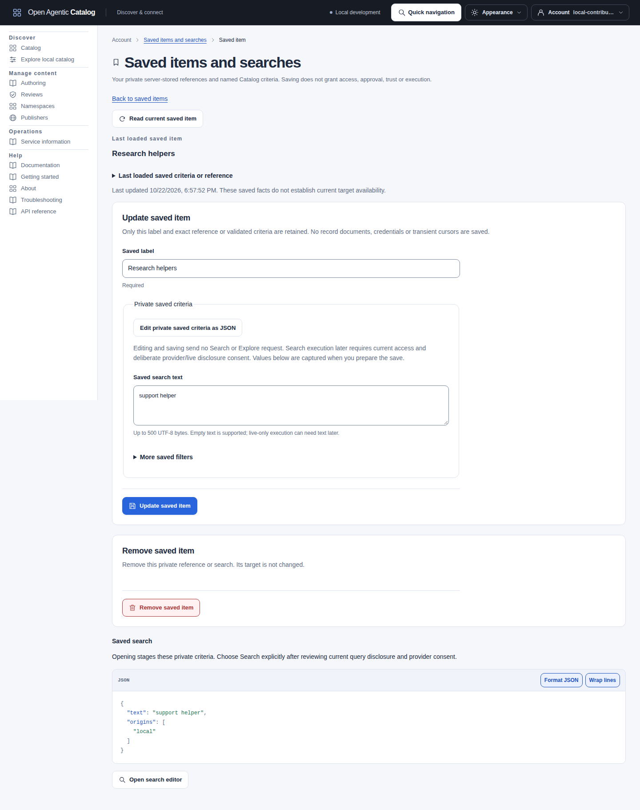](../../../../assets/catalog-ui/saved-search.png)

Your library contains at most 200 items. Labels contain 1-120 Unicode code points without control characters. Each command body is limited to 16 KiB. PostgreSQL also limits the retained JSON input to 16 KiB after database encoding. Criteria exclude cursors, page sizes, transient receipts, credentials and arbitrary source URLs. These limits also apply to API clients.

In the library, enter an **Exact saved label** and optionally select **Saved item type**. Choose **Apply saved item filters**. Matching uses the complete case-sensitive label, including significant surrounding spaces and Unicode spelling; wildcard characters are literal. Duplicate labels can return several items. An empty input omits the label filter. **Clear saved item filters** restores the unfiltered first page. API clients use the optional `label` query parameter on `GET /api/v1/personal/items`; a supplied empty label is invalid.

Each row shows its saved criteria or exact references and last-updated time. These facts do not prove current availability, and listing them does not resolve targets. Filtering happens before page limits. Continuation binds the current owner, permissions, type and exact label. **Refresh saved items** uses applied filters, leaving pending filter edits unchanged. After a continuation failure, it returns to the first page with those applied filters.

Open a saved search and choose **Open search editor**. Review the criteria and current query disclosure/provider consent. Then choose **Search**. Opening the editor makes no Search request. Current permissions and administrator-managed source settings apply. The editor keeps query text out of URLs and browser history; unsaved changes stay in memory and clear with the identity.

Checking consent sends no request. Local category suggestions also require provider consent: allow processing, then open **Categories** or **Filters**. You can enter exact filters without loading suggestions. An explicit live-only Search requires live-source disclosure consent; provider consent applies when local/indexed processing or local counts are requested. Revoking consent stops new requests but cannot recall text already sent.

Opening a local or indexed detail keeps this search workspace in the tab. Return with its Back link or browser Back. Applied criteria, draft text, consent, layout, page and scroll are retained; results are read again using the applied request. Revoked consent leaves the search staged. Reloading or reopening the saved item starts from its stored criteria and requires a new explicit Search.

Use **Check saved reference** to check current access to the exact saved target. Local references open only the saved release/revision. External checks use the current indexed projection and require the same source and generation. A live-only result can be saved, but remains unavailable here until that exact source/generation has a readable indexed projection. Checks make no live query and never substitute another source, generation or release.

Use **Update saved item** to rename a label or change its criteria. Expand **Edit exact resource reference** for a deliberate advanced replacement. Changing a reference requires current target admission; renaming an unchanged reference does not resolve it. Use **Remove saved item** to delete only that private entry. Confirmations name the saved item, revision and captured criteria or reference. Missing or inaccessible targets do not delete your saved references or prevent renaming/removal.

Choose **Read current saved item** for a deliberate read. Unsaved edits require discard confirmation before this read can replace their base. Pending or failed reads retain the draft and labelled last-loaded facts.

New updates/removals require a successful current read and validator. Unsent permitted fields remain editable during read recovery; after a command succeeds, the editor waits for a successful current read. A successful save acknowledgement remains visible after failed readback. Recover an unknown write outcome with **Retry same command**, preserving its original body, validator and key.

The library belongs to one tenant, human membership and realm. Administrators cannot read another person's library. `library.own` permits management of the caller's library, without resource-edit or tenant-admin authority. It is included in Discovery reader and Tenant administrator, and available separately through the global Library member template. Ordinary Reader/Contributor/Reviewer/Publisher grants do not add companions. Explicit development bundles retain their configured additions.

If your access changes while a saved-item editor is open, your entered draft stays in the tab. Loaded item details and checked target results are hidden when read access is lost. After access returns, choose **Read current saved item** before preparing another update or removal. An unknown write outcome still uses **Retry same command**. Changing accounts or opening a different item clears the previous editor.

With OAuth scope enforcement, reads need `catalog.read`; saves, updates and removals need `personal.write`. Ask the issuer administrator to enable the scope and configure the UI client to request it. Sign out and sign in again after changing scopes. Saved items survive reload and sign-in; the next identity cannot reuse the previous person's private results. The Catalog retains required audit and command evidence, but emits no public event for private preferences.

## Resource ratings

Open **Ratings for this version** from a Catalog preview or detail. **My ratings** lists your opinions; authorized moderators use **Rating moderation**. The [ratings guide](ratings.mdx) explains version/source identity, consent, withdrawal and peer claims.
