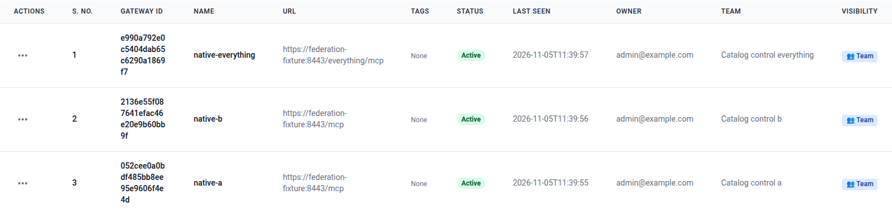
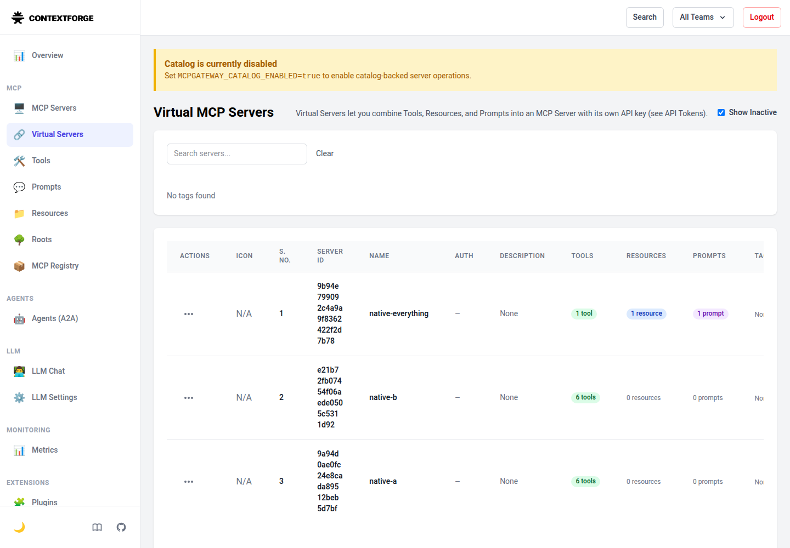

import ContextForgeFlows from "../../../components/architecture/ContextForgeFlows.astro";

Use [IBM ContextForge](https://github.com/IBM/mcp-context-forge) with the Catalog in two ways:

1. Connect an MCP client to ContextForge to search Catalog metadata through six read-only tools.
2. Publish a ContextForge virtual server in the Catalog. Discover its release. Connect an independent MCP client to that server.

<ContextForgeFlows />

The Catalog stores governed metadata. ContextForge forwards MCP requests. Discovering a server does not authorize its execution or supply its credentials.

The first flow uses the Gateway's configured Catalog Reader token. See [Minimum permissions](#minimum-permissions) for identity rules and administrator credential replacement. The [Catalog MCP guide](mcp-server.mdx) explains the read-only tools and their internal routing.

This guide uses the repository's disposable test setup and the official ContextForge 1.1.1 image. It does not add ContextForge to the normal Catalog Compose stack.

## Prerequisites

Use a local Linux AMD64 Docker engine with Compose and a Unix socket. Run as a non-root user with Docker access.

Install GNU Make, Python 3.12-3.14, Git, curl, `gh`, Trivy and the repository's [Go toolchain](../contributing/build-and-release.md#prerequisites-and-identities).

Download the Go modules from the repository root. Pull the fixture's pinned PostgreSQL image:

```sh
go mod download
docker pull --platform linux/amd64 pgvector/pgvector:pg18@sha256:2358fcba361ed2233a5ed81b5fe4ca779ccb304120ce531a3bf51c0ed7e2bc11
```

The helper compiles the fixture from cached modules. It builds the current backend and test images under private tags.

Prepare the [Trivy vulnerability database](../contributing/build-and-release.md#scan-local-images) before you install the test tools.

Install the separate test tools from the repository root:

```sh
make mcp-tools-install
make mcp-catalog-tools-install
make contextforge-tools-install
```

The ContextForge installer checks the latest stable official release against the reviewed pin. It has no 14-day wait. Other tools keep their dependency policies.

Installation downloads tools and images. Test commands use the installed inputs and do not install missing tools.

The fixture uses one API, one worker, PostgreSQL 18, ContextForge, Everything and a client container. It creates private certificates and synthetic credentials.

Everything is the MCP test server from `@modelcontextprotocol/server-everything`. This walkthrough uses its echo tool, static resource and sample prompt.

The Catalog, ContextForge and client use an internal network. Only the fixed frontend also joins the owned administration bridge to publish a loopback port.

The frontend forwards only to fixed internal services. It verifies the ContextForge certificate. Native authentication, permissions and SSRF protection remain enabled.

No model, Redis, SSO stack or Minikube deployment is required.

### Optional browser tools

Select the Node version in `catalog-ui/.nvmrc` through the [UI toolchain setup](../contributing/build-and-release.md#build-and-run-the-ui-locally).

Install the browser tools before you start the walkthrough:

```sh
make ui-install
make ui-browser-install
```

These tools support the automated [Admin UI check](#inspect-the-native-admin-ui). They are not required for the two MCP flows.

## Start a fresh setup

Run these commands from the repository root. Keep the same shell for the remaining steps:

```sh
umask 077
CONTEXTFORGE_RUN=$(python3 -B test/interoperability/contextforge_runner.py prepare)
python3 -B test/interoperability/contextforge_runner.py start "$CONTEXTFORGE_RUN"
python3 -B test/interoperability/contextforge_runner.py register "$CONTEXTFORGE_RUN"
python3 -B test/interoperability/contextforge_runner.py info "$CONTEXTFORGE_RUN" > "$CONTEXTFORGE_RUN/connection-info.json"
```

`prepare` builds the images and creates a unique project under `output/interoperability/contextforge/`. `start` applies owner-only migrations and provisions the isolated identities.

`register` checks both upstreams directly, then creates ContextForge teams, users, roles, Gateways, virtual servers and scoped tokens. It registers six Catalog tools per tenant.

It also registers Everything with one selected echo tool, one static resource and one prompt. Everything requires its own key.

Run each stage once, in order. Do not edit source inputs during a run. Complete the walkthrough within 30 minutes, before the client container exits.

The helper removes its setup if a stage fails or receives an interrupt. The helper rejects stages in the wrong order or after a source change. These refusals leave the setup available for inspection or shutdown.

If cleanup cannot remove the owned containers, it retains the private inputs for an exact `stop` retry.

### Addresses and credentials

Read `connection-info.json` for the generated addresses and file paths. It contains no credential values.

| Connection | Address or file | Use |
| --- | --- | --- |
| Native Admin UI | Generated `adminUrl`, ending in `/v1/admin/` | Open the loopback address in a browser. |
| ContextForge REST API | The same loopback origin, with `/v1/...` paths | The frontend verifies TLS to ContextForge. Use the private CA and an administrator header file. |
| Catalog MCP upstream | `https://federation-fixture:8443/mcp` | ContextForge supplies the configured Catalog Reader token. |
| Virtual MCP server | `https://contextforge:4444/servers/{id}/mcp` | The independent client uses a separate ContextForge token inside the fixture network. |
| Browser login | `private/login.json` | Contains the synthetic administrator email and password. |
| REST authorization | `private/headers/admin.header` | Contains the complete `Authorization: Bearer ...` header. |
| Scoped client authorization | `private/headers/a.header`, `b.header`, `everything.header` | Contains separate server-scoped ContextForge headers. |
| Private trust | `private/frontend/ca.pem` | Contains the public CA certificate, without a private key. |

Keep the private files out of screenshots, terminal output and committed configuration. The header files have mode `0600`.

The loopback address serves the Admin UI and native REST API. MCP clients use the internal hostname required by the fixture's Host allowlist.

The internal virtual-server URL is not reachable from a host IDE. This guide tests the client inside the fixture network.

For a separately deployed gateway, use its operator-approved HTTPS hostname and trust bundle. Follow the [VS Code connection guide](../../../../../extensions/vscode/README.md) for Catalog access.

### Inspect the resolved Compose setup

The helper always selects an explicit project, Compose file and private environment. Inspect that same configuration without printing credentials:

```sh
docker compose \
  --project-directory "$CONTEXTFORGE_RUN/private" \
  --env-file "$CONTEXTFORGE_RUN/compose.env" \
  --project-name "$(basename "$CONTEXTFORGE_RUN")" \
  --file "$PWD/test/interoperability/contextforge/compose.yaml" \
  config --quiet
```

Do not use the root Compose file for this setup. The normal Catalog environment and retained data remain separate.

## Inspect registration through REST

Get the loopback origin from the safe connection information:

```sh
CONTEXTFORGE_URL=$(python3 -c 'import json,sys; print(json.load(open(sys.argv[1]))["adminUrl"].removesuffix("/v1/admin/"))' "$CONTEXTFORGE_RUN/connection-info.json")
curl --fail --silent --show-error --noproxy '*' \
  --cacert "$CONTEXTFORGE_RUN/private/frontend/ca.pem" \
  --header "@$CONTEXTFORGE_RUN/private/headers/admin.header" \
  "$CONTEXTFORGE_URL/v1/gateways?limit=10" \
  --output "$CONTEXTFORGE_RUN/private/gateways.json"
```

Keep the inspection response private. Inspect its names and identifiers without printing connection secrets:

```sh
python3 -c 'import json,sys; print("\n".join(item["name"] for item in json.load(open(sys.argv[1]))))' "$CONTEXTFORGE_RUN/private/gateways.json"
```

The three names are `native-a`, `native-b` and `native-everything`.

### Gateway and virtual server

A ContextForge **Gateway** registers an upstream MCP endpoint and its credentials. The native Admin UI calls these registrations **MCP Servers**.

A **virtual server** exposes selected imported tools, resources and prompts at `/servers/{id}/mcp`. It has a separate identifier and client access policy.

The registration helper uses these native REST calls:

| Method and path | Purpose |
| --- | --- |
| `POST /v1/auth/email/login` | Obtain the administrator access token. |
| `POST /v1/teams/` | Create a private team for each connection. |
| `POST /v1/auth/email/admin/users` | Create a non-administrator runtime user. |
| `POST /v1/teams/{id}/members` | Add that user to the team. |
| `POST /v1/rbac/roles` | Define the runtime permissions. |
| `POST /v1/rbac/users/{email}/roles` | Assign the role in the exact team. |
| `POST /v1/gateways` | Register the upstream URL, CA and authentication. |
| `GET /v1/tools?gateway_id={id}` | Read imported tools after registration. |
| `POST /v1/servers` | Select capabilities for a virtual server. |
| `POST /v1/tokens` | Create its server-scoped client token. |

For the Catalog Gateway, the request body has this structure. The helper supplies the generated team, certificate and raw Catalog token:

```json
{
  "name": "native-a",
  "url": "https://federation-fixture:8443/mcp",
  "transport": "STREAMABLEHTTP",
  "gateway_mode": "cache",
  "auth_type": "bearer",
  "auth_token": "<Catalog Reader token without the Bearer prefix>",
  "ca_certificate": "<complete PEM CA certificate>",
  "team_id": "<native team ID>",
  "visibility": "team",
  "passthrough_headers": []
}
```

The Everything Gateway uses `auth_type: "authheaders"` and an `auth_headers` entry for `X-MCP-Test-Key`. It does not receive either Bearer token.

The virtual-server request nests its selection under `server`:

```json
{
  "server": {
    "name": "native-a",
    "associated_tools": ["<imported tool IDs>"],
    "associated_resources": [],
    "associated_prompts": []
  },
  "team_id": "<native team ID>",
  "visibility": "team"
}
```

Wait for registration to return the expected inventory before selecting capabilities. A cached tool list alone does not prove that forwarded calls work.

### Minimum permissions

| Identity | Permissions used in this setup |
| --- | --- |
| Catalog Reader | Exact namespace Reader grant, Discovery Reader template and a token with `catalog.read`. |
| Catalog Contributor | Namespace-scoped Contributor grant; token with `catalog.read` and `catalog.write`. |
| Catalog Reviewer | Namespace-scoped Reviewer grant; token with `catalog.read` and `catalog.review`. The reviewer differs from the author. |
| Catalog Publisher | Namespace-scoped Publisher grant; token with `catalog.read` and `catalog.publish`. |
| ContextForge runtime user | Team role with `servers.use`, `tools.read` and `tools.execute`. The Everything connection also uses `resources.read` and `prompts.read`. |
| ContextForge client token | Exact team and `scope.server_id`, with only the selected runtime permissions. |
| Synthetic administrators | Bootstrap identities, role assignments and native registrations. Their credentials are not runtime client credentials. |

The ordinary client Bearer authenticates the ContextForge user. The Gateway's configured token determines the Catalog identity.

A shared upstream account does not preserve each downstream user's Catalog identity. The selected image blocks caller `X-Upstream-Authorization` overrides of this Gateway-managed bearer token. An authorized ContextForge administrator changes the Gateway credential through its API.

The Catalog applies its tenant, namespace, membership and OAuth checks to the effective upstream token. Do not grant broader Catalog access because the gateway authenticates clients.

The fixture does not refresh tokens. Catalog tokens last two hours; server-scoped ContextForge tokens request one day. Administrator tokens follow the native image's policy.

Stop this fixture after expiry. Prepare a new fixture. For a maintained deployment, replace the Gateway credential through its supported update API.

Check that the update succeeds. Reconnect the client. The tests verify accepted replacements through new stateless calls, not arbitrary pooled stateful sessions.

## Search the Catalog through ContextForge

Run the proxy checks:

```sh
python3 -B test/interoperability/contextforge_runner.py proxy "$CONTEXTFORGE_RUN"
```

The command publishes sample Agent releases through normal authoring and independent review. It also synchronizes one inert indexed record.

It creates an additional limited virtual server to test tool exclusions.

Both supported client protocols call all six tools through ContextForge. Checks compare exact metadata, filters, pagination and current permissions.

Use the [Catalog tool reference](mcp-server.mdx#available-tools) for tool arguments and responses. ContextForge can prefix imported names.

ContextForge tool discovery uses its own cursor. Catalog Search returns a separate result cursor inside the tool response. Do not interchange them.

The test also stops the owned Catalog API, requires a forwarded-call failure, then verifies recovery. Runtime execution is outside this metadata flow.

## Discover and use a published virtual server

Run the governed handoff:

```sh
python3 -B test/interoperability/contextforge_runner.py handoff "$CONTEXTFORGE_RUN"
```

Separate author, reviewer and publisher identities publish an MCP Server Card for the exact Everything virtual-server URL. The card declares an Authorization secret without a value.

`catalogctl` searches for that release and reads its sealed record. The check verifies revisions, validation evidence, profile, representation bytes and digest.

A later unpublished draft does not change the selected release. Denied Catalog reads produce no runtime configuration or invocation.

Only after those checks does the mapper write `private/client-state/handoff-client.json`. It supplies the separate ContextForge runtime token.

The independent client uses the generated configuration and private CA inside the client container. The handoff check runs this example verbatim:

```python
import asyncio
import json
import ssl

import httpx2
from mcp import Client
from mcp.client.streamable_http import streamable_http_client

async def echo():
    with open("/state/handoff-client.json") as source:
        config = json.load(source)
    trust = ssl.create_default_context(cafile="/private/frontend/ca.pem")
    async with httpx2.AsyncClient(
        verify=trust, trust_env=False, headers=config["headers"]
    ) as http:
        async with Client(
            streamable_http_client(config["url"], http_client=http),
            mode="auto", cache=None
        ) as client:
            tool = (await client.list_tools()).tools[0]
            result = await client.call_tool(tool.name, {"message": "Hello"})
            assert not result.is_error
            print(result.content[0].text)

asyncio.run(echo())
```

The example prints `Echo: Hello`. A failed example fails the handoff check.

`headers` contains the complete `Authorization: Bearer ...` value. Imported tool names can have prefixes; resolve them through native discovery.

The handoff checks exact echo and static resource bytes. It stops Everything and ContextForge separately, then verifies calls after each restart.

The Catalog stays ready during those runtime outages. Its published release and validation evidence remain unchanged.

### Prompt limitation in the selected image

The selected ContextForge image fails private-CA verification when it fetches the selected prompt in this setup. Direct Everything prompt reads succeed.

Gateway echo and static resource reads also succeed with the configured key and CA. The report records prompt forwarding as `peer_limited`, not compatible.

Do not disable TLS verification or remove the wrapper key to hide this failure.

## Inspect the native Admin UI

Import `private/frontend/ca.pem` into a disposable browser profile. Open the `adminUrl` from `connection-info.json`.

This inspection is available after registration. You can run it before the proxy and handoff steps.

Use the synthetic email and password from `private/login.json`. Do not use a Catalog token or a server-scoped token for administrator login.

The native UI uses `/admin/` paths for forms and redirects after the versioned entry page. The fixture forwards those paths and bundled static assets.

Open **MCP Servers** to inspect the three upstream registrations. Open **Virtual Servers** to inspect their selected capabilities.



Upstream registrations supply capabilities to curated Virtual Servers. This synthetic table shows no gateway or Catalog credentials. [Open the full-size screenshot](../../../../assets/contextforge/upstream-registrations.png).

The native "Catalog is currently disabled" banner refers to ContextForge's optional catalog. It does not refer to Open Agentic Catalog.



Run the automated browser check with the [optional browser tools](#optional-browser-tools):

```sh
python3 -B test/interoperability/contextforge_runner.py browser "$CONTEXTFORGE_RUN"
```

The check signs in, inspects both sections and signs out. It uses only installed Playwright tools and a certificate pin for this owned server.

The [separate upstream Web UI](https://github.com/contextforge-org/contextforge-web-ui/blob/v0.2.4/README.md#getting-started) is optional and is not part of this setup. The built-in `/v1/admin/` UI needs no additional stack.

## Connect an existing Catalog

The walkthrough creates disposable services. For an existing Catalog and ContextForge deployment, use the same connection settings with your own addresses and credentials.

1. Enable `mcp.enabled` on the Catalog API. Follow the [HTTP MCP setup](mcp-server.mdx#connect-over-http).
2. Provision a Catalog reader through [access management](access-management.mdx). Use the [permissions above](#minimum-permissions) for the selected namespaces and discovery origins.
3. Register a ContextForge Gateway with the [request structure above](#gateway-and-virtual-server). Replace its URL, token, CA and team.
4. Select the imported Catalog tools in a virtual server. Assign the runtime user and token to that server's team.
5. Connect the MCP client to the virtual server's HTTPS URL. Supply its separate ContextForge token and trusted CA.
6. Call capabilities and current access through the imported tools. Try the [Search example](mcp-server.mdx#search-and-continue-results) with an authorized published resource.

| Setting | Value for your deployment |
| --- | --- |
| Gateway `url` | Catalog API origin plus `/mcp`, such as `https://catalog.example.com/mcp`. The UI and worker do not serve it. |
| Gateway `auth_token` | Catalog reader access token, without the `Bearer` prefix. ContextForge uses this identity for upstream Catalog requests. |
| Gateway `ca_certificate` | CA certificate in PEM format when the Catalog uses private trust. Omit it for a certificate trusted by ContextForge. |
| ContextForge outbound policy | Allow the exact Catalog destination. Private addresses require a narrow SSRF exception, as in the local fixture. |
| ContextForge MCP Host and Origin policy | Allow the gateway hostname used by the client and any required browser Origin. |
| Client URL and authorization | Reachable ContextForge origin plus `/servers/{id}/mcp`, with that server's scoped ContextForge token. |

Keep the [separate credentials and expiry rules](#minimum-permissions). A successful tool list confirms registration; a successful Search confirms a forwarded Catalog read.

To publish your own virtual server in the Catalog, prepare an [MCP Server Card](resource-authoring.mdx#mcp-server-retain-an-experimental-server-card).

Use its reachable HTTPS virtual-server URL. Declare the Authorization secret without storing its value in the card.

Follow the [publication workflow](publishing.mdx) for validation, independent review and release. Supply the runtime token separately when a client uses the discovered server.

## Troubleshoot connections and calls

| Symptom | Check or action |
| --- | --- |
| Registration has no tools | Check the upstream URL, Catalog token, private CA and exact SSRF network exception. Wait for the expected inventory. |
| Native ContextForge HTTP 401 | Check that the header contains a valid ContextForge Bearer token. Check expiry and the selected native account. |
| Native ContextForge HTTP 403 | Check the team, runtime role, token permissions and selected virtual server. |
| Upstream Catalog HTTP 401 | Check the Gateway's Catalog credential, issuer, audience and expiry. The inbound ContextForge token cannot replace it implicitly. |
| Upstream Catalog HTTP 403 | Check the required OAuth scope. HTTP admission differs from a tool-level permission refusal. |
| Tool error `api_denied` | Check current membership and the exact namespace grant. Search can return an empty authorized collection after revocation. |
| Tool error `api_not_found` | Check the selected release and tenant. A wrong-tenant read does not disclose the resource. |
| TLS verification fails | Supply the private CA and use the correct hostname. Do not use `-k` or disable verification. |
| Host or Origin returns HTTP 403 | Use the documented internal MCP address and an approved Origin. The loopback Admin UI address is not the MCP client address. |
| HTTP 429 | Check the gateway's enabled request limit. This bounded fixture uses `RATE_LIMIT_MEDIUM_RPM=1000`. |
| Prompt fails but echo works | Read the documented private-CA prompt limitation. Cached inventory does not prove successful prompt forwarding. |
| A setup stage refuses to repeat | Run `info` to check its phase. Continue in order, or stop and prepare a fresh fixture. |
| Source inputs changed | Run `stop` with the same directory. Prepare a fresh setup after you finish the source edits. |

## Stop the setup and check its result

Read `phase`, `success` and `cleanup` in the run's `report.json` to check progress:

| Completed command | Phase | `success` | `cleanup` |
| --- | --- | --- | --- |
| `prepare` | `prepared` | `false` | `false` |
| `start` | `started` | `false` | `false` |
| `register` | `native-controls-complete` | `false` | `false` |
| `proxy` | `catalog-proxy-complete` | `false` | `false` |
| `handoff` | `governed-handoff-complete` | `true` | `false` |
| `stop`, after both flows | `governed-handoff-complete` | `true` | `true` |

`success` stays false until both flows pass. `cleanup` stays false while the setup runs. The optional browser check does not change the phase.

Remove only this fixture:

```sh
python3 -B test/interoperability/contextforge_runner.py stop "$CONTEXTFORGE_RUN"
python3 -c 'import json,sys; r=json.load(open(sys.argv[1])); print({k:r[k] for k in ("success","cleanup")})' "$CONTEXTFORGE_RUN/report.json"
```

Require both `success: true` and `cleanup: true` after the proxy and handoff stages. A partial walkthrough does not claim complete interoperability.

If cleanup fails, rerun only `stop` with the same owned directory. Do not interrupt teardown twice or use global Docker pruning.

The command removes the project's containers, volume, networks and private credentials. Safe reports and the reviewed browser image remain under the ignored run directory.

For one automatic run with cleanup, use `make test-interoperability-contextforge`. Read the [harness guide](../../../../../test/interoperability/contextforge/README.md) for exact inputs and report fields.
