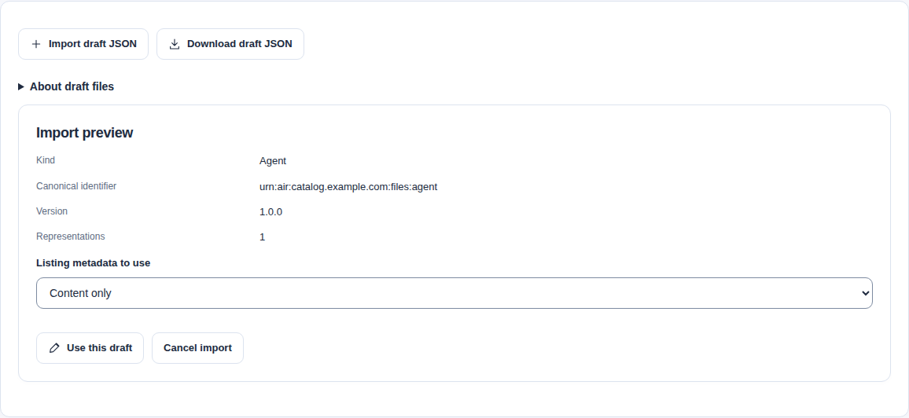
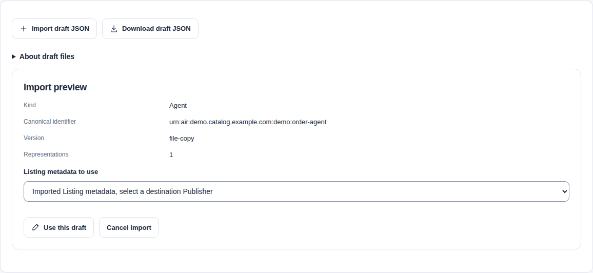

A reusable JSON file carries one Resource identity, one Version's representations and optional Listing metadata. It excludes destination IDs, users, permissions, approvals and releases.

This tutorial uses a source Catalog and a separate destination Catalog. It covers both UI-to-CLI and CLI-to-UI transfer. Neither path invokes the resource.

## Prepare access and inputs

1. Start two independent Catalog deployments.
2. Build `catalogctl` with `make build` from the repository root.
3. Check **Account > My access** in each Catalog.
4. Obtain the destination Namespace and, for Listing metadata, the destination Publisher ID.
5. Complete [human CLI login](../reference/commands.md#human-cli-login) separately for each API origin.

Use [the two-Catalog setup](two-catalog-federation.mdx#prepare-the-owned-environment) when you need a local OIDC environment. File transfer does not require a federation Source or synchronization Job.

| Task | Required access |
| --- | --- |
| Export selected source content | `resource.read` and `resource.read_content` in its Namespace. Enforced OAuth scopes also require `catalog.read`. |
| Create a destination Resource | `resource.create`, plus the editing and read permissions below. |
| Save a Version or Listing | `resource.edit`, `resource.read`, `resource.read_content` and the registered `resource.read_history` companion. Enforced scopes require `catalog.read` and `catalog.write`. |
| Choose a Publisher in the UI | Publisher read permission. An exact Publisher ID also works without browsing permission. |
| Review and publish | Separate destination permissions and independent review. Follow [the publication guide](publishing.mdx#check-access-for-each-publishing-task). |

The destination must support each native profile in the file. Skill packages and Plugin archives need the separate inputs described below. Destination archive, artwork and outbound-network policies still apply.

Run the commands below in one shell. Set these variables to your actual origins, private login files and destination IDs. Use API origins, which can differ from the UI addresses.

```sh wrap
umask 077
TRANSFER_DIRECTORY=$(mktemp -d)
export TRANSFER_DIRECTORY
: "${SOURCE_API:?Set the source API origin}"
: "${SOURCE_LOGIN:?Set its private CLI login file}"
: "${DESTINATION_API:?Set the destination API origin}"
: "${DESTINATION_LOGIN:?Set its private CLI login file}"
: "${DESTINATION_NAMESPACE_ID:?Set the destination Namespace UUID}"
unset CATALOG_REMOTE_TOKEN CATALOG_REMOTE_TOKEN_FILE
```

Add `--ca-file "$CATALOG_CA"` to online commands when your API uses a private CA. For a private issuer CA, also add `--issuer-ca-file "$ISSUER_CA"`. For explicit bearer credentials, replace `--login-file` with `--token-file`. Use separate credential files for the two origins.

## Move a UI download through the CLI

### Download from the source UI

1. Sign in to the source UI as a content Reader.
2. Open the local Catalog record.
3. Find **Download draft JSON** under **Technical details and evidence**.
4. Select **Include Listing metadata** if needed.
5. Select **Prepare draft download**.
6. Select **Save catalog-draft.json**.
7. Save the file as `$TRANSFER_DIRECTORY/from-ui.json`.

On a VersionRevision page, enter an exact matching ListingRevision ID when you include metadata. Without that selection, the download contains content only.

### Preview without a Catalog connection

```sh wrap
./bin/catalogctl import preview \
  --file "$TRANSFER_DIRECTORY/from-ui.json" \
  --namespace-id "$DESTINATION_NAMESPACE_ID" --content-only
```

Preview checks local structure and native input. It does not contact either Catalog or verify destination existence, permissions, remote URLs or domain approval.

`--content-only` omits the file's Listing metadata. To keep that metadata, replace this flag with `--publisher-id "$DESTINATION_PUBLISHER_ID"`. Select that destination Publisher explicitly; the file contains no Publisher ID.

### Create the destination draft

```sh wrap
./bin/catalogctl import apply \
  --file "$TRANSFER_DIRECTORY/from-ui.json" \
  --namespace-id "$DESTINATION_NAMESPACE_ID" --content-only \
  --state-file "$TRANSFER_DIRECTORY/receipts/ui-import.json" \
  --base-url "$DESTINATION_API" --login-file "$DESTINATION_LOGIN"
```

Use the same Listing selection as preview. The result contains destination IDs and acknowledged steps. New Resources and revisions receive new IDs; the canonical identifier and authored content remain from the file. JSON admission can normalize whitespace and property order. The downloaded source file stays unchanged.

Open **Authoring** in the destination UI. Check the Resource's Namespace, Version content and optional Listing. Imported content has no review decision or release.

## Move a CLI export through the UI

Choose one current source release ID from the Catalog record's technical details. Set `RELEASE_ID` to that exact ID.

```sh wrap
./bin/catalogctl export --format draft \
  --release-id "$RELEASE_ID" \
  --output-dir "$TRANSFER_DIRECTORY/from-cli" \
  --base-url "$SOURCE_API" --login-file "$SOURCE_LOGIN"
```

The directory contains `draft.json` and the `export.json` completion marker. Keep the sidecar for source identity and checksums. Import the `draft.json` file.

1. Sign in to the destination UI as an authorized author.
2. Open **Authoring > Create resource**.
3. Expand **Import or download draft JSON**.
4. Select **Import draft JSON**.
5. Choose `$TRANSFER_DIRECTORY/from-cli/draft.json`.
6. Check the preview and choose the Listing metadata to use.
7. Select **Use this draft**.
8. Confirm replacement if the editor contains unsaved input.
9. Select the destination Namespace.
10. Select a destination Publisher if you include imported Listing metadata.
11. Check the content and save through the normal confirmation.



The preview sends no commands. Invalid files, cancellation and unsupported editor sizes preserve the current draft. Omitted imported tags, categories and relationships stay empty.



### Add a Version to an existing Resource

1. Open the destination Resource.
2. Select **Add version**.
3. Import the draft file through the same disclosure.
4. Choose imported Listing metadata, existing target metadata or content only.
5. Enter an unused **Version label**.
6. Set native version fields to the same Version label.

The Namespace, kind and canonical identifier stay fixed. The file must match the existing Resource's kind and identifier. Import does not merge Resources by name or select an existing Resource automatically.

For the CLI, replace `--namespace-id` with `--resource-id "$DESTINATION_RESOURCE_ID"`. Add `--listing-id "$DESTINATION_LISTING_ID"` for an exact existing Listing when you include metadata. Keep the explicit destination Publisher selection.

Set `version` and any native version fields to the same unused label before import.

## Try each resource kind

The source checkout includes five reusable starter files in `examples/native-import/drafts/`. Download a JSON example from the table, or copy the files into your private working directory.

| Example | Input | Before apply |
| --- | --- | --- |
| [Agent](../../../../../examples/native-import/drafts/agent.json) | A2A Agent Card text. | Replace illustrative endpoint metadata when needed. Import does not contact that endpoint. |
| [MCP Server](../../../../../examples/native-import/drafts/mcp-server.json) | MCP registry document text. | Check the declared remote URL. Import does not connect to it. |
| [Standalone Skill](../../../../../examples/native-import/drafts/skill.json) | `SKILL.md` text. | Edit the instructions. This example contains no complete package. |
| [Plugin archive](../../../../../examples/native-import/drafts/plugin-archive.json) | HTTPS archive URL and expected checksum. | Replace the illustrative URL and checksum with an allowed, hosted archive's actual values. |
| [Inspected Skill](../../../../../examples/native-import/drafts/skill-package.json) | Immutable handoff metadata. | Supply the complete package separately and replace the illustrative handoff with its actual Git commit or OCI digest. |

```sh wrap
cp examples/native-import/drafts/*.json "$TRANSFER_DIRECTORY/"
for name in agent mcp-server skill; do
  ./bin/catalogctl import preview \
    --file "$TRANSFER_DIRECTORY/$name.json" \
    --namespace-id "$DESTINATION_NAMESPACE_ID"
done
```

Use the earlier `import apply` command with each selected file and a different receipt path. These examples contain no Listing metadata. They create editable content only.

### Supply an inspected Skill package

The reusable file carries the immutable handoff, not archive bytes, local paths or a complete file inventory. Package selection stays separate.

1. Obtain the complete package from its declared immutable source.
2. Place it beneath the draft file's directory.
3. Set the file's handoff to the exact Git commit or OCI digest for those bytes.

For the checked-in example, copy the matching Skill tree:

```sh wrap
cp -R examples/native-import/skills/review-notes "$TRANSFER_DIRECTORY/review-notes"
./bin/catalogctl import preview \
  --file "$TRANSFER_DIRECTORY/skill-package.json" \
  --namespace-id "$DESTINATION_NAMESPACE_ID" \
  --package-directory 1=review-notes
```

Add the same `--package-directory 1=review-notes` to apply and resume. Alternatively, use `--package-file 1=review-notes.zip` for a supported archive. Paths are relative to the draft file; parent escapes and symbolic links are rejected.

The destination inspects the package through its normal admission rules. Preview does not establish that the declared remote handoff provides those bytes. Neither command executes package scripts.

### Supply a Plugin archive

Use an HTTPS archive permitted by the destination's artifact policy. Set `expectedDigest` to its actual SHA-256 digest. The destination rejects changed bytes behind the same URL.

UI Plugin preparation remains editable after file import. Build and host the archive before saving it. Follow [Plugin preparation](resource-authoring.mdx#prepare-plugin-files-from-fields); import does not reconstruct unavailable files or upload an archive.

## Resume an interrupted CLI import

Use the original file, package inputs, destination options and receipt after an interrupted response:

```sh wrap
./bin/catalogctl import resume \
  --file "$TRANSFER_DIRECTORY/from-ui.json" \
  --namespace-id "$DESTINATION_NAMESPACE_ID" --content-only \
  --state-file "$TRANSFER_DIRECTORY/receipts/ui-import.json" \
  --base-url "$DESTINATION_API" --login-file "$DESTINATION_LOGIN"
```

Resume reuses captured command keys, targets, bodies and ETags. It does not choose a newer Listing revision or repeat the target lookup. A completed resume verifies retained records without new writes.

A failed import can leave acknowledged Resources or Versions. Preserve the receipt and follow the reported correction or recovery action. Do not start another apply with a fresh receipt to recover that work.

In the UI, finish the existing partial-save flow before importing another file. Choose **Create another version** after a completed save to enable import again.

## Review and publish at the destination

1. Check the destination's validation evidence.
2. Prepare the Listing with a destination Publisher.
3. Obtain destination approval for the declared Publisher domain when required.
4. Submit the current Listing for review.
5. Ask a different authorized reviewer to decide it.
6. Publish the approved release with an authorized Publisher account.

Follow [review and publication](publishing.mdx) for exact permissions, ETags and discovery activation. Source approvals, DNS evidence, releases and snapshot state do not travel with the file.

The file is editable authoring input. Native documents, ARD discovery metadata and database backups retain their separate formats and purposes. File transfer does not synchronize Catalogs or copy their users and access policy.

## Troubleshoot a transfer

| Problem | Action |
| --- | --- |
| A canonical identifier or Version label already exists | Select the exact existing Resource for a new Version, or choose a new permanent identity before creating a Resource. |
| Listing metadata has no destination Publisher | Select or supply the destination Publisher ID. Choose content only when you do not need a Listing. |
| A file opens but Save refuses native text | Correct missing fields or malformed text. The browser also refuses numbers it cannot preserve accurately; use the exact text through the CLI when supported. |
| A Skill package is missing | Supply its complete package separately. A standalone `SKILL.md` is not that package. |
| A Plugin archive fails | Check its URL, private trust, destination artifact policy and expected digest. |
| A file exceeds browser limits | Use the CLI. Each browser document and extension text has a 2 MiB limit; the enclosing file ceiling is 64 MiB. |
| An import has partially completed | Resume with its original private receipt. Resolve stale ETags or blocked validation through the reported recovery path. |

Keep downloaded drafts, sidecars, credential files and receipts private. They can contain private authored content and destination references.

The CLI defaults to an 8 MiB response limit and an 8 MiB content limit. Native text has a separate 16 MiB aggregate budget. API and UI forwarding limits also apply. Follow the [CLI size options](../reference/commands.md#export-a-reusable-draft-json-file) when larger supported content needs explicit limits.

## Verify the local workflow

Run `make test-federation-peers` with the [functional test prerequisites](../contributing/testing.md#full-stack-functional-environment). It builds local images and tests two separate PostgreSQL-backed Catalogs. No existing deployment is used.

The draft phase tests all four kinds in both UI/CLI directions. It checks new Resources, new Versions, content-only saves, exact readback and independent publication. Owned cleanup is required; resources are not invoked.
