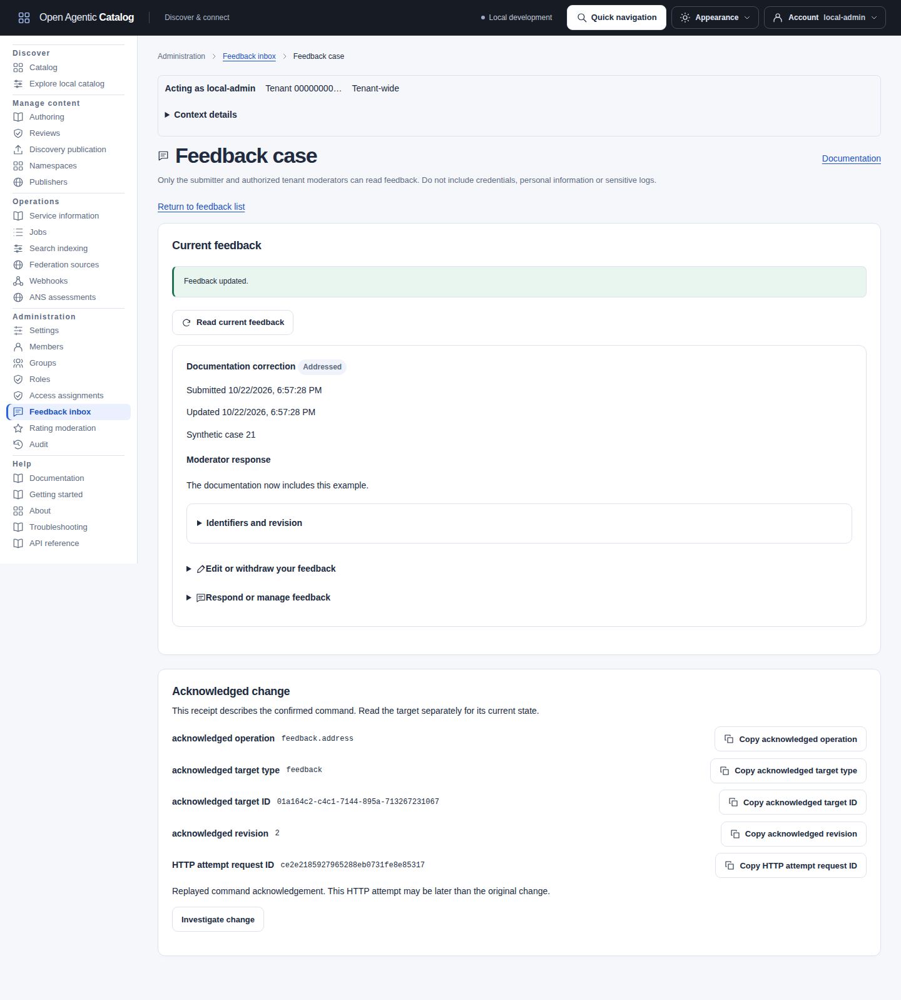

import FeedbackLifecycle from "../../../components/architecture/FeedbackLifecycle.astro";

Send feedback about a locally governed Agent, MCP Server, Skill or Plugin without changing its publication or approval. Only the submitter and authorized moderators in this tenant can read it. Feedback is not a public rating, conversation thread or security assessment. Listing Support links remain available for external support.

## Submit and follow up

<FeedbackLifecycle />

An edit or reopen action clears the current response. A withdraw or remove action clears the current comment and response. Withdrawn and removed submissions cannot change state again. Clearing current fields does not erase older backups.

Sign in with a human Catalog membership, `feedback.own` and permission to read the selected resource.

1. From a Catalog preview, choose **Open full record**. Alternatively, open the Resource through **Manage content > Authoring**.
2. Expand **Item feedback**. The preview itself is read-only.
3. Choose Problem, Documentation correction, Suggestion, Positive feedback or Other.
4. Enter a comment and confirm submission. Do not include credentials, personal information or sensitive logs.

The Catalog fills in your identity and the item context. A published item records its exact release and immutable version revision; feedback from the Resource page is general feedback. Editing does not change this association. External indexed/live items must first be explicitly adopted as local resources; feedback is not sent to another catalog.

Your submissions and current moderator responses appear in the same panel and in **Account > My feedback**. The **Your submissions** section lists existing feedback. Expand **Feedback access** for permission details; this does not load resource content. My feedback remains available after resource-read permission is revoked or a release disappears from search. New submissions require a readable Resource or local Catalog record. You cannot create feedback by pasting a resource ID into My feedback.

**Edit** reopens a submission and clears the earlier response. **Withdraw** permanently clears the current comment and response and prevents further edits. Submit a new report if you need to report the issue again.

## Moderation inbox

Open **Administration > Feedback inbox** with `feedback.moderate`. Filter by resource, category and state. Resource choices and feedback results are paginated.

The heading's **Feedback guide** link opens this procedure in the bundled manual. **Feedback Resource choices pagination** and **Feedback cases pagination** identify separate keyboard control groups. Their First page/Next page controls move only that inventory. Refresh or recover a failed Resource-choice page without changing the selected case filters or an unsaved response. Busy reads disable their own pager. Paging never sends a feedback command.

Named resource choices require separate `resource.read` permission and `catalog.read` scope when scope enforcement is enabled. Expand **Enter exact resource ID** and use **Resource ID filter (optional)** for an exact retained reference. This fallback also works when named choices are unavailable. Apply or clear it explicitly. Category and state remain selected when the Resource changes. Resource choices and cases have independent pages. A selected Resource from another page remains selected.

The UI shows names only from already loaded authorized Resource choices or an explicit **Read resource context** request. It keeps literal IDs when names are unavailable. Resource metadata and release-history links require their separate tenant or exact-namespace permission and OAuth scope. Feedback moderation never grants those reads.

Expand a feedback row, then open **Respond or manage feedback** to mark it addressed, reopen it or remove it. When addressing a record, you can provide or replace its one current response. Reopening clears the earlier response. Moderators cannot edit the submitter's comment. Publisher or author identity does not confer ownership of feedback.

Each case first shows its category, state, submission time and the complete comment and response you are authorized to read. Expand **Identifiers and revision** for its current revision and immutable Resource/release/version references. Moderators also see the already-authorized submitter membership ID. The copy controls copy literal references without loading a protected membership directory.

### Open an exact case

Expand **Open a case by ID**, enter an **Exact feedback ID** and choose **Open feedback case**. You can also follow that link from a row. The UI reads one private case directly. It does not search or scan list pages. A moderator needs `feedback.moderate` and `catalog.read` scope for this read when scopes are enforced. Inbox reads and moderation commands instead require `tenant.admin`. My feedback requires a human submitter with `feedback.own` and `catalog.read`.

Choose **Read current feedback** to reread that case. Confirm before discarding a changed response or comment. Withdrawn and removed cases show their retained references without cleared text or editing controls. Missing, foreign-tenant or unreadable references show a safe error.

**Return to feedback list** restores the captured Resource/category/state filters and case cursor, then rereads through current authorization. The return context stays in private tab memory. Reloading, changing identity or refreshing policy/access clears the list return context. A same-identity refresh keeps protected editor drafts; **Open feedback list** starts with default category/state and no captured case cursor. A case can remain readable even when the captured filters exclude its new state.

[](../../../../assets/catalog-ui/feedback-case.png)

A same-identity permission or scope refresh keeps entered drafts and disables unauthorized new sends. A prepared command retains its captured body and revision. Changing identity clears private drafts, commands and receipts.

Every change checks the feedback revision. If somebody edits or responds first, refresh the feedback and review the current text before trying again. After an uncertain network outcome, retry the exact command with the same idempotency key. Removal remains available to authorized moderators after the submitter loses access. Deleted resources are excluded from normal feedback lists; an authorized moderator with a retained feedback ID can still remove its text through the API.

## API and permissions

The [Control API contract](../../../../../api/openapi/control-v1.yaml) defines exact inputs and responses. Mutations require `Idempotency-Key`; edits and lifecycle commands additionally require the feedback's own `If-Match` ETag, not the Resource ETag.

| Workflow | Endpoint | Required access when OAuth scopes are enforced |
| --- | --- | --- |
| Submit | `POST /api/v1/feedback` | Human with `feedback.own`, resource-read permission in the selected namespace and `feedback.write`. |
| Own submissions | `GET /api/v1/feedback` | Human with `feedback.own` and `catalog.read`; no resource-read grant is required. |
| Current detail | `GET /api/v1/feedback/{feedbackId}` | Submitter with `feedback.own` or moderator with `feedback.moderate`, plus `catalog.read`; the parent resource must still exist. |
| Edit / withdraw | `PATCH /api/v1/feedback/{feedbackId}`, `POST /api/v1/feedback/{feedbackId}:withdraw` | Human submitter with `feedback.own` and `feedback.write`; no resource-read grant is required. |
| Admin inbox | `GET /api/v1/feedback/inbox` | `feedback.moderate` and `tenant.admin`; no Catalog-read grant is required. |
| Address / reopen / remove | `POST /api/v1/feedback/{feedbackId}:address`, `:reopen`, `:remove` | `feedback.moderate` and `tenant.admin`; no Catalog-read grant is required. |

OAuth scopes limit existing Catalog permissions; they do not grant them. The inbox requires `feedback.moderate` permission and the `tenant.admin` scope when scope enforcement is enabled. Named resource selection and resource/history links require separate reads.

For reader feedback, request `catalog.read` and `feedback.write` in the UI host's `scopes` configuration or Helm's `ui.config.scopes`. Add `tenant.admin` for moderators. The host adds `openid` automatically. The issuer must issue the requested scopes, and the backend must resolve an active membership.

Existing development human identities work without another authentication mechanism. Anonymous visitors and service accounts cannot submit feedback, even for public listings.

A creation request contains no submitter field:

```json
{
  "resourceId": "00000000-0000-7000-8000-000000000004",
  "releaseId": "00000000-0000-7000-8000-000000000006",
  "category": "documentation",
  "comment": "Please clarify the configuration example."
}
```

Use IDs returned by your Catalog. Omit `releaseId` for general resource feedback, or provide an exact `versionRevisionId` for revision-specific feedback. A release's version revision is derived and any supplied context must agree. Addressing accepts `{"response":"Updated the example."}` or `{}`; reopen, withdraw and remove accept `{}`. Command responses contain only `id` and `revision`, with an ETag. Read current state separately: a replay receipt describes the original command, not the latest state.

## Limits and retention

Comments and responses are plain text. Each allows at most 4,000 Unicode code points, including supplementary characters such as emoji. Request bodies are limited to 64 KiB or a smaller configured HTTP body limit. The Catalog does not render HTML/Markdown, fetch links or accept attachments. The UI uses the same character count.

List pages default to 20 records and allow at most 100. Continuation cursors are bound to the caller and filters. The API admits at most eight concurrent feedback writes per process. A busy process returns `503`; retry the same command with the same key. This limit is per process, with no deployment-wide rate quota or stored-record cap.

Only current comment/response text is stored. Withdrawal/removal clears it atomically, retaining minimal context/state metadata and safe audit facts. There is no edit history, automatic age-based deletion, notification, email or webhook for feedback. Audit records and durable command receipts never contain comment/response text. Private reads are non-cacheable and the UI does not save feedback drafts to browser storage.

Clearing current fields does not erase database pages, older backups or earlier authorized copies/screenshots. Existing backup procedures cover this table; restoring an older backup restores that recovery point's feedback state. Feedback does not implement legal hold or contractual deletion guarantees. See [backup and restore](../operations/backup-restore.mdx) and [audit](../operations/audit.md).

Lists show category, state, submission time and a short permitted preview. Expand a row to read its full comment and response or open its authorized case. Expand **Identifiers and revision** for exact **feedback ID** and **feedback revision** copy controls. Use these to distinguish similar submissions during internal support or audit investigation. The immutable resource context stays beside the reference. Copying does not fetch the Resource. Case URLs contain only the exact case ID, never comments, responses or return filters.

## Inspect open feedback counts

Open **Overview > Administration** with `feedback.moderate` and enforced `tenant.admin`. The panel counts open feedback by category and shows the oldest original submission time. Deleted Resources are excluded. Reopening keeps the original time. See the [Administration overview](catalog-ui.mdx#read-the-administration-overview) for limits and exact inbox links.
