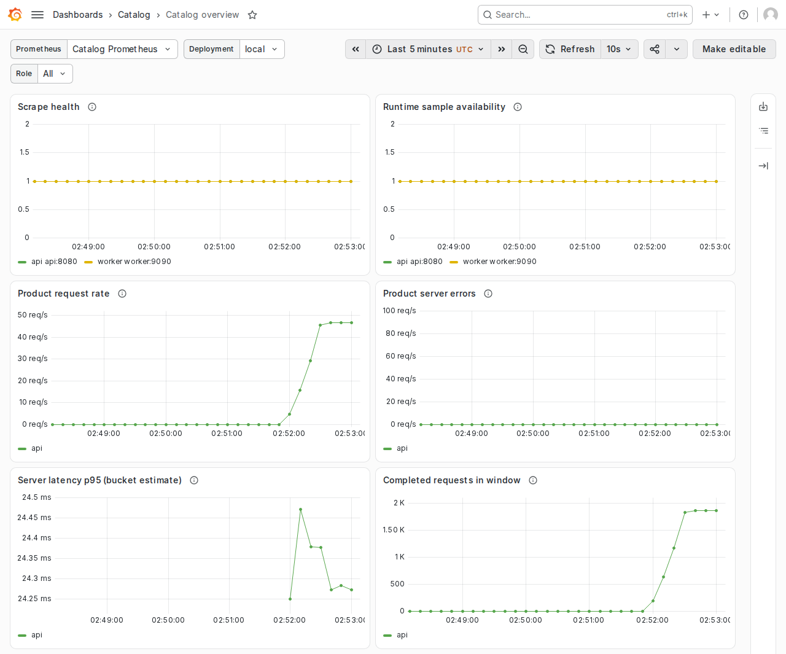
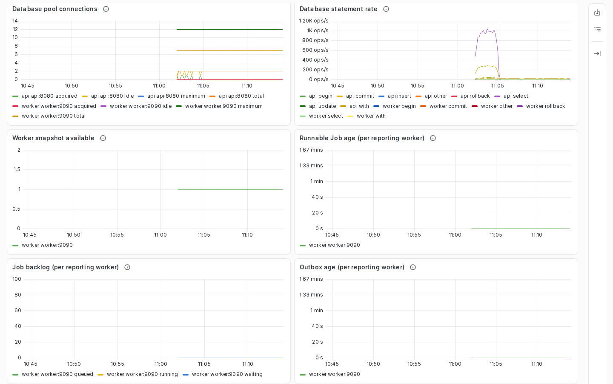
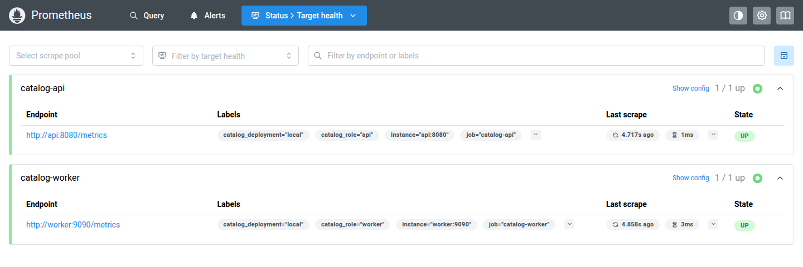

## Choose a diagnostic

Choose a tool for the question you need to answer. Run measurements serially on an otherwise idle host. Keep source, workload and resource limits consistent between comparisons.

| Question | Command or procedure |
| --- | --- |
| Does runtime instrumentation add allocations or CPU work? | `make bench`; compare matched reports with [benchstat](https://pkg.go.dev/golang.org/x/perf/cmd/benchstat). |
| Does Search use the expected SQL reads? | `make test-integration` for exact-role query-count regressions. |
| Is hydration or query planning expensive? | `make bench-search` or `make bench-search-plans`. |
| Does a short Search workload remain correct? | `make test-load-smoke`. |
| Do representative reads and concurrent publication remain correct? | `make test-load`. |
| Does a one-hour mixed workload complete within its bounds? | `make test-soak`. |
| How do supported query cases behave at larger sizes? | `make test-scale`, starting at 1,000 items. |
| Do collectors, stored metrics and dashboard queries work? | `make test-monitoring`. |
| Do UI assets and requests meet the checked-in budgets? | `make ui-performance`. |

Optional local collectors use [Prometheus](https://prometheus.io/docs/introduction/overview/) and [Grafana](https://grafana.com/docs/grafana/latest/). These diagnostics do not establish production capacity or a universal latency objective. A saturation study needs a specific capacity question and a suitable workload. The application works without collectors.

For interactive diagnosis, choose the tool that owns the signal:

| Tool | Use it to | Start here |
| --- | --- | --- |
| Grafana | Compare Catalog health, traffic, database activity and worker state on one dashboard. | [Start local monitoring](#monitor-the-persistent-development-stack), then [read the dashboard](#read-the-grafana-dashboard). |
| Prometheus | Check scrape targets and inspect the metric samples behind a panel. | [Inspect collection](#inspect-prometheus-collection). |
| [Jaeger](https://www.jaegertracing.io/docs/) | Follow a request trace and linked background work when tracing is enabled. | [Start the separate trace viewer](../operations/observability.mdx#view-traces-locally). |

For production setup, see [Monitoring with Prometheus and Grafana](../operations/helm-monitoring.mdx). It covers existing collectors and the optional Helm companion chart, using the same dashboard. The companion chart does not install Jaeger or another trace backend.

Run these seed/load/reset workflows only in their owned local fixtures, never against shared infrastructure. For deployment-specific monitoring and sizing, use your own PostgreSQL and platform controls. See the [deployment guide](../operations/deployment.mdx#artifact-and-deployment-ownership).

## Budget replicas before load

Complete the [replica and dependency worksheet](../operations/database-roles.mdx#replica-and-dependency-budget) before selecting a load profile. It includes rollout and terminating-process overlap, PostgreSQL reserves, direct clients, pooler limits and independent work gates. Its direct and session-pool examples use explicit deployment allocations, not this host's capacity.

Use measured pool waits, Job queue age, CPU/memory and latency to assess the chosen allocation. The connection calculation is a ceiling, not an optimal pool size or throughput target. Existing test request caps remain test settings. A separate pressure/recovery qualification must declare its workload and deadlines before execution.

## Disposable tests

For optional session-pooler overhead, `make test-pgbouncer` also runs three alternating direct/pooled Search pairs with the maintained performance client. Each trial has two readers, one-second warm-up and three-second measurement against the same three public-local smoke records. Complete phases, zero errors and identical response digests are required. Achieved throughput, latency buckets and durations are report-only under `output/pgbouncer/run-*/tests.jsonl`.

Both routes verify database TLS and use the compatibility fixture's same four-connection API limit and aggressive two-second lifetime, 500 ms idle timeout and 100 ms health cadence. These churn settings differ from production defaults. The small fixture is neither a scale nor saturation benchmark. See the [pooling runbook](../operations/database-roles.mdx#connection-pooling-boundary).

Run trials serially without another load or cluster/network campaign. No additional performance framework or timing gate is selected.

Every Search workload requires the current `core-lexical-v1` profile and `core` tier. Smoke/local baselines require exclusively local results with the exact fixture tenant. Indexed/mixed checks enforce their selected local/indexed result shapes. Static phases require the validated response digest to remain unchanged, while mixed phases revalidate each changing response.

These focused checks do not replace the full API contract suite.

Each trial atomically reserves its own small Docker bridge networks from the test-only `172.31.0.0/16` space, using `/28` pools and at most eight create attempts per network. The default network and optional monitoring network carry the exact project and ownership nonce. A generated policy permits only `http://api:8080`, the primary fixture tenant and those exact reserved ranges. No public origin is allowed.

Exhausted reservation or an ambiguous timeout fails with owned cleanup. Never prune another project's networks to make a trial pass.

The trial-only overlay uses Docker's documented [`!reset` merge rule](https://docs.docker.com/reference/compose-file/merge/) to remove inherited development IPAM. Its networks are [external to Compose's lifecycle](https://docs.docker.com/reference/compose-file/networks/#external), but always created and owned by this supervisor, never supplied by the caller. `make compose-check` renders and validates both enabled and disabled trial models without allocating engine resources. Use a Compose version supporting that merge rule.

Cleanup still removes the owned networks; `perf-clean` requires the current version-2 ownership record and refuses older or malformed records before mutation. It does not convert records or assume ownership of earlier development resources.

`make bench` records ten samples each for runtime metric collection and exposition. Each sample includes allocation counts. Read the source identity and results in `coverage/performance/bench-<run-id>/report.json`. It starts no database or container and has a 130-second tool deadline. Use this benchmark to diagnose instrumentation overhead. It does not measure general application performance. These report-only runs need no cleanup reaper.

To compare matched reports, first install the pinned tool with `make benchstat-tools-install`. Run `make bench` for each source on the same idle host. Then run `make bench-compare BENCH_BASELINE=<old-report.json> BENCH_CANDIDATE=<new-report.json>`. The comparison rejects incomplete or incompatible reports. It reports estimates and uncertainty without enforcing a timing threshold; see [benchmark comparison](../../../../../test/performance/README.md#matched-go-benchmark-comparison).

The benchmark validator requires ten samples from each named family. Twelve samples from just one family, missing samples or source drift leave incomplete evidence. Unit tests also cover load-client CLI/report failures, cancellation and exact request quotas, invalid baselines, launcher lifecycle selection, active-run locks, tampered ownership/models, foreign images and cleanup failure. The functional Go wrapper executes the Python tests without Docker.

Isolated Python units can run through the tooling-unit gate. Mocked orchestration does not replace the live trials below.

Run `make test-load-smoke` for an isolated Search diagnostic with direct PostgreSQL connections. The smoke command first seeds three published kinds. By default, two readers warm up for five seconds, then search for 30 seconds. Each reader reuses its HTTP connection. Each response must match the validated baseline, including tenant isolation, complete pagination and unchanged result bytes. Requests have a three-second timeout, 64 KiB header and 1 MiB body limits, no proxy or redirects and a 10 ms worker think time. The per-phase request ceiling is the larger of 50,000 and `workers * seconds * 100`, reflecting the think-time bound.

Early ceiling exhaustion fails the trial rather than silently shortening it. This is closed-loop load, not an offered-rate benchmark. Setup, seeding and compilation are outside the measured window.

Run `make test-monitoring` to add Prometheus and Grafana to the owned stack. Its default measurement lasts 120 seconds. It checks stored metrics, dashboard queries, provisioning and independence from collector stop/start. Both collector processes must start before warm-up. The test checks both app roles remain ready with collectors stopped. Browser review is separate.

The target does not launch Playwright automatically.

Install Docker, Compose, Python 3.12 or later and the repository Go toolchain before running disposable trials. See [local prerequisites](local-development.mdx#start-the-service). They deliberately select Docker's default context, skip Make `.env` parsing, discard ambient runtime credentials, projects, proxies and kubeconfigs, and build a uniquely named application image. Run one isolated measurement target per Make invocation. They do not select an existing development service or another project's monitoring.

Total trial deadlines are 15 minutes for smoke/monitoring, 30 minutes for the four-phase load profile and 80 minutes for the fixed one-hour soak. Cleanup has its own 90-second budget. Readiness observations must finish before their existing 60-second allowance (90 seconds for Grafana), and complete idle-worker observations before the 30-second drain allowance. Success exactly at or after a deadline fails.

Poll sleeps are capped by the remaining allowance. Individual HTTP/process calls retain their independent execution bounds. These are test acceptance deadlines, not application probe settings.

The fixture fixes API CPU/memory to 1 CPU/256 MiB, worker to 0.5 CPU/256 MiB and PostgreSQL to 1 CPU/512 MiB, and verifies Docker applies those limits. Before measurement the supervisor records exact API, worker and PostgreSQL container IDs, start times and zero restart/OOM state in `containerBaseline`. Scale establishes this after its intentional worker stop/start. Every required sample and finalization checks the same identities and state.

A restart, replacement, stopped process or OOM invalidates the trial even if readiness recovers. Collector restarts in the separate monitoring scenario are excluded from this application-process continuity baseline. Required API/worker metric and owned-container/database samples are collected with a ten-second wait between bounded passes, or 60 seconds for the soak. Collection time contributes to the observed interval.

The monitoring test additionally budgets each collector at 0.5 CPU/512 MiB and records its exact image pins. Concurrent host work can still affect results. Do not compare noisy or unlike trials as performance regressions.

Read `coverage/performance/<run-id>/report.json` for source and build identity, seed, profile, phase durations and request and correctness counts. The report also records cumulative latency buckets and bounded numeric observations. The parent process measures phase start and end times with its monotonic clock. The private child `workload.json` uses closed schema version 2 and survives a nonzero child exit. Malformed, missing, oversized, duplicate-key or non-private evidence cannot pass. It distinguishes timeout, transport, HTTP status, body, correctness and cancellation failures.

Warm-up and measurement each report issuance/end boundaries and quota completeness. Child timelines use monotonic durations anchored to wall time. A clock step explicitly disables wall-clock correlation. Parent `phaseWindows`, sample `startedElapsedSeconds` and completion `elapsed` still provide monotonic run alignment.

The brackets include child startup and baseline checks, not exact request timestamps. This ignored private directory also retains the exact load profile and ownership record. Collection windows must be monotonic and complete, including the first and final observations. The maximum completion gap is 45 seconds for short trials or 95 seconds for soak.

Soak growth trends use only complete samples inside the mixed workload parent bracket, excluding setup and drain. The bracket includes warm-up and does not claim exact request-time alignment. Missing work, source drift, required metric failure, setup/workload failure or incomplete cleanup returns nonzero. The report separates the workload verdict from cleanup.

No request bodies, credentials, DSNs or raw SQL enter the report. No supplied DSN or target URL is accepted.

The supervisor deletes only resources bearing both its unique Compose project and ownership nonce, verifies their absence, and removes only its owned application image. It preserves reports and shared upstream images/build cache. To recover an interrupted trial, run `make perf-clean PERF_RUN_ID=<24-hex-run-id>`. It checks the engine, ownership, retained model and active-run lock before deleting anything.

Never use development `compose-reset` to clean a test. A failed reaper is not a successful trial, and an engine outage may require rerunning the reaper after recovery.

### Count Search SQL reads

`make test-integration` includes `TestPostgresSearchQueryCostBaseline`. It seeds governed records through the exact API role and checks several dataset/page sizes, tenant isolation and generation refusals. Its direct repository calls omit `CollectionRevision` and do not initialize current collection permissions.

| Repository read | Empty page | Nonempty page |
| --- | --- | --- |
| Search generation | 1 | 1 |
| Combined exact total and page selection | 1 | 1 |
| Selected metadata summaries | 0 | 1 |
| Representation bindings | 0 | 1 |
| Total read statements | 2 | 4 |

These totals exclude one tenant-context `SELECT`, one `BEGIN` and one `COMMIT`. The two metadata queries process the selected page together, so their count does not increase per result. They return metadata and check representation/retrieval bindings. They do not load complete documents or validate retained package contents.

`TestPostgresComposedSearchQueryCost` includes current collection permissions and the composed local/indexed managers. It checks continuation, generation reconciliation, persisted indexed data and tenant isolation. Lexical queries select live sources, but the fixture has no approved outbound target. Its assertions include policy initialization and reads across multiple transactions. HTTP authentication, authorization and response encoding add separate work. Neither fixture defines a universal SQL count or latency budget for an HTTP request.

## Minikube instrumentation smoke

`make test-minikube` includes direct instrumentation checks in the existing owned single-node Helm workflow. After the governed seed and again after Pod recreation and Helm reconfiguration, it checks the API and worker's fixed runtime availability/value families, worker snapshot availability and queue ages. It sends 25 authenticated searches directly to the API Pod, verifies complete tenant-bound baseline data and unchanged response bytes, and requires the search-route response counter to advance. Validators reject missing, duplicate, non-finite or unavailable required metrics.

The check uses exact owned Pod image identities, explicit-context loopback port-forwards, bounded requests and ordinary harness cleanup. It uses the existing test identity fixture, not an independently qualified provider. This is instrumentation smoke, not a Kubernetes throughput benchmark: port-forward latency is not production latency. It does not deploy Prometheus/Grafana, verify Pod-discovery RBAC or include these assertions in the topology scenario.

The separate `make test-minikube-monitoring` scenario qualifies the [optional companion chart](../operations/helm-monitoring.mdx), including collector RBAC, per-Pod discovery, dashboard queries and retained storage. Use Minikube load only for a selected topology-dependent application question, not as a second mandatory benchmark environment.

## Optional tracing and overhead

Use [distributed tracing](../operations/observability.mdx#distributed-tracing) to follow meaningful request/domain/SQL work and linked asynchronous attempts. `make test-tracing` and `make test-minikube-tracing` check the export boundary independently of monitoring. The [local Jaeger viewer](../operations/observability.mdx#view-traces-locally) uses synthetic development data, loopback listeners and bounded disposable memory. It does not select an existing telemetry service.

Compare the same short workload with tracing disabled, sampled, fully sampled and a rejecting endpoint. Keep dataset, concurrency, CPU/memory limits and cache state comparable. Report latency/errors, allocations and exported span volume. `go test ./internal/platform/tracing -run '^$' -bench . -benchmem` isolates tracing overhead without adding a capacity gate or another benchmark framework.

Per-process export counters describe submissions/failures, not backend storage or exact queue drops. Sampling and collector operations do not replace application/database performance diagnosis.

## Focused Search code diagnostics

The Search benchmark targets, including their `-dsn` variants and recursive Make calls, ignore `.env` and `CATALOG_ENV_FILE` before parsing and must run as a single Make goal. Pass intended tool overrides on the Make command line. For the `-dsn` variants only, supply the disposable `CATALOG_TEST_DATABASE_DSN` explicitly through the command line or environment. The ordinary targets replace any caller test DSN with their own disposable database address.

Run `make bench-search` for selected pages of 1, 20, 100 and 101 records. It compares complete records with metadata summaries. The reference path reads each complete record separately; the metadata path uses two queries for the selected page. The paths return different payloads and perform different integrity checks. This is not a comparison of two interchangeable full-record readers.

The fixture seeds governed records, including inspected Skill packages and renewed evidence, before timing. It reports three 500 ms samples with bytes/allocations per operation. It measures repository reads, not HTTP latency or capacity. Short samples, host contention and PostgreSQL cache state affect timing.

The reference reader is not a selectable production fallback. `make test-integration` separately enforces the [repository read counts](#count-search-sql-reads) and composed-policy assertions, without timing thresholds.

Run `make bench-search-plans` for explicit opt-in selection/count investigation. It first seeds 45 governed records before explicit ANALYZE, then 100 and 1,000 with fixture-owner statistics refreshes, and inspects the actual runtime-selected count/page SQL as the exact tenant-scoped API role. Fixed empty, broad, missing and selective lexical queries run against forced custom and generic prepared plans, with a 21-row page selection and a ten-second context per case. It logs planning/execution time, root buffer totals and bounded scan-node summaries, not complete SQL/tenant data.

Read the logged plan measurements, not the surrounding Go benchmark `ns/op`, which includes diagnostic setup. No planner-choice or timing assertion joins the normal suite. PostgreSQL documents that [EXPLAIN ANALYZE executes the statement and adds overhead](https://www.postgresql.org/docs/18/sql-explain.html). These are read-only synthetic fixtures, never useful deployment data.

Both commands remove their own PostgreSQL project and volume on normal completion or handled failure, using the integration wrapper rather than `perf-clean`. Neither touches development Compose or needs Prometheus/Grafana. The `-dsn` targets are only for an explicitly owned empty disposable database. Results are ordinary Go stdout, not the source-bound packaged trial JSON or a historical comparison gate.

Retain the source revision/diff and host/resource settings with logs when comparing runs. For focused allocation attribution, create a private temporary directory and use standard Go profile flags:

```sh
(
  set -eu
  umask 077
  catalog_profile_dir=$(mktemp -d)
  trap 'rm -rf -- "$catalog_profile_dir"' EXIT
  make bench-search \
    GOFLAGS="-memprofile=$catalog_profile_dir/catalog-search.alloc.pprof -o=$catalog_profile_dir/catalog-search.test"
  go tool pprof -alloc_space -focus=readSearchRecords \
    "$catalog_profile_dir/catalog-search.test" \
    "$catalog_profile_dir/catalog-search.alloc.pprof"
)
```

The subshell removes only its generated directory after you leave pprof. Benchmark allocation totals exclude setup, while the process profile includes fixture setup and other readers. Filter to the relevant call path when inspecting it.

Profiles are local diagnostic artifacts, not committed evidence, and should be shared only after review. These fixed fixtures do not qualify larger payload/history distributions or sustained load.

## Monitor the persistent development stack

Run `make compose-up LOCAL_MONITORING=on`. Grafana is at `http://127.0.0.1:13000`, with username `catalog`. The launcher prints the path to its generated password file under `output/monitoring/<COMPOSE_PROJECT>/grafana-password`. Read that file locally.

Never paste it into reports or commit it. The parent directory is mode 0700. The mounted file is read-only and readable by the non-root Grafana UID. Only Grafana receives it.

The data source and Catalog overview dashboard are provisioned automatically. Prometheus is at `http://127.0.0.1:19090`. Neither needs an external account.

`LOCAL_MONITORING` defaults to `off` and is a Make workflow selector, not a service runtime setting. The port and retention controls below accept the selected Make-compatible `.env`, invoking environment or Make command line. Command-line values take precedence, and file assignments normally override ambient environment values. `COMPOSE_PROJECT`, `COMPOSE` and `CONTAINER_ENGINE` retain their development meanings.

Stop/down/ps/logs detect existing project monitoring even when the selector is omitted. Enabling performs an explicit rebuild/recreation. Trying to start with monitoring off while collectors exist is rejected rather than silently removing them.

`make compose-stop` stops services; `make compose-down` removes containers/networks but preserves data. `make compose-monitoring-reset` stops/removes only the selected project's collectors and monitoring volumes, preserving PostgreSQL and the local credential. Use it before deliberately returning to default-off startup. `make compose-reset` is destructive to all selected development data, including monitoring history, even after `compose-down` with the monitoring selector omitted.

It is not the monitoring-only reset. Reset preflight validates retained monitoring volume names and project labels before removing collectors.

Prometheus scrapes only `api:8080` and `worker:9090` on this project's dedicated bridge every ten seconds, with four-second scrape deadlines, 1 MiB bodies and fixed sample/label limits. Developer worker operations remain unpublished. The disposable test alone adds an invocation-owned loopback worker mapping for numeric checks. Docker does not publish host ports for a container attached solely to an internal network, so the UI bridge is not an egress firewall.

Collector telemetry, update checks, plugin installation, anonymous access and unneeded integrations are disabled. Do not add arbitrary data sources or external targets.

Prometheus defaults to six hours or 512 MB of blocks, with bounded query time/concurrency/samples. Head/WAL/compaction space means block retention is not a hard disk quota. Grafana has a separate data volume. Neither can access the Catalog database, Docker socket or host process namespace.

Review the [tool-image boundary](../reference/dependencies.md#optional-local-monitoring-tools) before using these non-distributed upstream tools. They are not Catalog release artifacts or production monitoring recommendations.

## Read the Grafana dashboard

1. Open Grafana at `http://127.0.0.1:13000`, or the port selected for your Compose project.
2. Sign in as `catalog` with the generated password described [above](#monitor-the-persistent-development-stack).
3. Open **Dashboards**, then the **Catalog** folder and **Catalog overview**.
4. Set **Prometheus** to **Catalog Prometheus** and **Deployment** to **local** for the supplied Compose setup.
5. Set **Role** to **All**, **api** or **worker**.
6. Choose a time range with recent activity and select **Refresh**.

The dashboard UID is `catalog-overview`. Its data source UID is `catalog-prometheus`. Both are provisioned automatically. The default time range is 15 minutes and the refresh interval is 10 seconds. These display controls do not change the scrape interval or retention.

Use your own deployment label and compatible data source when you import the dashboard into an existing Grafana installation. Helm access uses your admin Secret's credentials, not the Compose username and password file. See [Helm access and installation](../operations/helm-monitoring.mdx#package-and-install).



*The first six panels show synthetic local traffic with Role set to All and a five-minute display window. These values illustrate the dashboard; they are not production capacity measurements.* [Open the full-size screenshot](../../../../assets/monitoring/catalog-overview.png).

Scroll down for database, worker and runtime panels. Use these groups to choose your next diagnostic:



The synthetic stack uses Catalog Prometheus, deployment local, Role All and a 30-minute window. Idle zeros are observations, not capacity measurements. [Open the full-size screenshot](../../../../assets/monitoring/catalog-database-worker.png).

| Panel group | What it tells you | How to interpret it |
| --- | --- | --- |
| Scrape health and runtime availability | Whether Prometheus can collect each process and the process can report runtime samples. | Start here when other panels have no data. A healthy scrape does not prove every dependency is ready. |
| Product traffic, errors and latency | Completed product requests, server-error rate and a histogram estimate of server latency. | Health and scrape traffic are excluded. The request count uses the rolling query interval, not the full display range. The p95 value is a bucket estimate, not exact browser latency. |
| Database pool and SQL | Connection use, acquisition wait, statement rate and client-side SQL time. | Compare pool waits with request load and SQL activity before increasing the pool size. |
| Worker snapshots, Jobs and outbox | Snapshot availability, runnable Job age, backlog and notification age. | API-only views have no worker samples. Each worker repeats database-global values; do not sum them across replicas. |
| Go runtime | Heap, allocations, goroutines and garbage collection. | Heap is not container memory use. Live heap at the last collection is not current allocated heap. |
| Retries and optional features | Persisted retry rates/delays, search outcomes, embedding operations, API refusals and trace-export failures. | [Retry signals](../operations/observability.mdx#retry-signals) measure scheduled delay, not actual queue wait. Optional features may have no observations. |

No data is different from an observed zero. A rate needs enough samples, and latency needs completed requests. A stopped target or an unavailable worker snapshot also produces missing data. Do not interpret an empty panel as proof that the service is healthy. Read the [metric contract](../operations/observability.mdx#metrics-contract) and [detailed interpretation](#interpretation-and-troubleshooting) for each signal's limits.

## Inspect Prometheus collection

Open Prometheus at `http://127.0.0.1:19090`, or your selected monitoring port. Open **Target health** at `/targets` to inspect the API and worker scrape status. The local jobs are `catalog-api` and `catalog-worker`. Check the latest successful scrape before you diagnose a blank Grafana panel.



Both latest scrapes succeeded. Scrape health does not establish application readiness. [Open the full-size screenshot](../../../../assets/monitoring/prometheus-target-health.png).

Open the query page and evaluate this expression for the supplied local setup:

```text
up{catalog_deployment="local", job=~"catalog-(api|worker)"}
```

Each target should return `1` when its latest scrape succeeds. A value of `0` means that scrape failed. A missing result means there is no matching current sample; check target selection and collection. It is not a healthy zero. Replace `local` with your installation's scrape label outside the supplied Compose setup.

For a panel-specific problem, open its Grafana query inspector and check the selected data source, deployment, role and time range. Keep the supplied dashboard as the query authority. See [Prometheus query basics](https://prometheus.io/docs/prometheus/latest/querying/basics/) for expression syntax.

To inspect a request's spans instead of metric samples, use the separate [Jaeger procedure](../operations/observability.mdx#view-traces-locally). Tracing is off by default. Enabling local Grafana and Prometheus does not enable trace export.

## Scale trials

Run `make test-scale` for a fresh 1,000-item catalog. Use `make test-scale PERF_ITEMS=10000` or `make test-scale PERF_ITEMS=100000` explicitly for larger fixtures. Start at 1k when changing the harness or query implementation, then run the sizes affected by the change. Repeat a size when comparing timings.

Previously completed qualification does not require restarting a fixed sequence. Each invocation builds its own image and database, then removes them. It never adds data to the development catalog. No Grafana, Prometheus or external service is required.

The versioned synthetic distribution is 90% local releases and 10% indexed identifier/version groups. These totals include three existing smoke records in each population. Version 2 covers Agents, MCP Servers, Skills and Plugins, five populated Namespaces, common/rare/absent terms, a seven-item pagination subset and a retained prior version for one in 100 generated local records. Every fiftieth Agent or Skill representation is larger. Plugin archives retain their exact sample bytes, digests, sizes and inspected components.

Small documents are deliberately reused, so this is not a worst-case unique-document storage test. Three separate second-tenant records test isolation and are not counted again. Only the small smoke/mixed subset is publicly published. Normal publication and source-snapshot limits remain unchanged.

The test-only Go helper uses ordinary domain services and exact API/worker roles, including validation, independent review, immutable evidence and real synchronization Jobs. Static indexed metadata avoids external network ingestion. The packaged worker stops during setup and resumes before HTTP measurements.

Two workers prepare a pair of drafts within the existing two-connection pool limit. Both preparations finish before serial publication. The next pair starts after publication. This preserves Serializable publication without concurrent generation changes or retries. Setup retains its deadline, numeric progress, container/database samples and post-seed ANALYZE.

The helper runs in a temporary container using the trial's backend image. It shares the owned PostgreSQL network namespace and connects through loopback, without the host-published port. Its limits are two CPUs, 512 MiB of container memory and a 256 MiB Go memory target. It exits before HTTP measurements. Application and PostgreSQL resource limits stay unchanged.

The report records actual Resources, version/listing revisions, releases, raw observations, stored document bytes, representation-reference bytes, indexed response size and helper allocations separately from achieved searchable totals. Setup speed is not HTTP write throughput.

`seedResult.sql` records statement counts, failures and client-side elapsed microseconds by fixed SQL class. These times include network and server work. They are not execution plans and contain no SQL, parameters or raw errors. Preparation overlaps queries, so the sum of SQL times can exceed setup elapsed time.

For setup failures, inspect `failureStage` and `seedResult.stage`. An earlier source-sync command is not attributed to a later seed failure.

Sixteen named read cases cover empty and common-term Search, local/indexed lexical Search, rare/absent terms, local/indexed exact AIR lookup, kind/tag/publisher filters, local Explore facets, a 100-result page, the third 20-result local page, a two-result terminal page and the small public manifest. A one-second-per-case preflight validates all cases before the normal five-second warm-up and 30-second measurement per case. Facets check local-only bucket counts, ordering and `otherCount`; Search checks totals, result shape, filters, order, provenance and tenant isolation. Cursor values may rotate, but result content, generation and continuation shape must remain unchanged.

Later-page cursors are obtained by bounded real traversal immediately before their phase. Mixed first-page readers then run alongside the existing governed publication/source-sync journey, with terminal Job checks and post-load drain.

API, worker and PostgreSQL retain the normal harness CPU/memory limits. Restart, OOM and stopped-container checks fail the run even if readiness later recovers. Parent samples include application/SQL counters, pool state, container working sets, database/WAL/temp activity and progress. Read metrics include Search and Explore.

Reports use fixed case names, latency buckets and achieved throughput. This closed-loop workload does not establish saturation capacity or a production SLA. Do not edit repository files, including documentation, or run other heavy tests during comparable measurements. The source-integrity check fingerprints all tracked and nonignored files at the start and end.

A documentation-only edit also invalidates the trial. Finish the run before recording new results in maintained documentation.

| Items | Maximum seed time | Database-size guard | Required visible daemon free space before build |
| --- | --- | --- | --- |
| 1,000 | 10 minutes | 256 MiB | 768 MiB |
| 10,000 | 30 minutes | 2 GiB | 2.5 GiB |
| 100,000 | 2 hours | 16 GiB | 16.5 GiB |

These finite guards are not capacity promises or qualification evidence. Database guards reserve conservative headroom rather than predicting storage needs from the measured fixture. The free-space check includes a 512 MiB margin beyond the database guard; WAL and image/cache growth are additional reasons to monitor free space. The visible daemon filesystem is resampled during setup and measurement, with a 128 MiB minimum-free-space floor.

If the daemon filesystem is not locally visible, the report marks its capacity check unavailable instead of substituting client filesystem space. The overall deadline is the seed budget plus 30 minutes. Scale phase settings must also satisfy `17 * (duration + warmup + 15) <= 880` seconds. Defaults fit, but longer per-case runs may be rejected before startup.

Seed sampling is bounded to 80 records and timed sampling to 96. Failed or resource-limited sizes remain unqualified. A smaller pass cannot qualify 100k.

Normal success, failure and handled interruption remove owned containers, volumes, networks, application image and helper/client binaries. Private bounded reports remain in `coverage/performance/<run-id>/`. Shared upstream images and build cache remain in Docker. Recover a hard-killed run with `make perf-clean PERF_RUN_ID=<id>`.

Rerunning cleanup on a valid already-clean run is safe. Do not use `compose-reset`, delete unrelated volumes or prune the host.

Dashboard qualification adds fourteen read-only checks before timed traffic. They compare counts with independent setup queries and bound each response to 128 KiB. A sparse reader has 105 Namespace grants. Its populated Namespace falls after the first `/me` page. Overview must still count its authorized Resources.

Three Plugin preflight checks cover local, indexed and combined results. The sixteen existing timed cases remain unchanged. Optional SQL diagnostics include twenty dashboard probes for ordinary and sparse access. They use the exact API role and current collection policy.

Collection queries evaluate global permissions once per statement. Namespace checks select current direct and group grants without a grant lookup for each candidate. Neither optimization caches permissions between statements or changes which records a reader can see.

### Measured baseline

Record measured results, source identities and environment limits with each local run under ignored `output/`. Historical 1k, 10k and 100k passes used different source revisions. A historical pass does not qualify a new build. Run the affected sizes again after a relevant change.

Historical version-1 trials cover Agents, MCP Servers and Skills. Version 2 adds Plugins and seven duplicate indexed contributions. Keep measurements from these versions separate. No trial qualifies a 100k public manifest. One committed mixed publication does not establish sustained write capacity. Mean measurements from closed-loop tests do not establish saturation throughput or production latency.

Version 2 passes the 1k and 10k correctness checks, fourteen dashboard reads and 78 SQL-plan probes per size. Both runs detect clock steps and disable wall-clock correlation. Their durations remain development diagnostics. Version 2 has no 100k qualification.

### Reading scale results and retrying

Inspect `report.json` for the final status, failure stage/code and separate cleanup outcome. `scalePreflight` holds correctness checks; `readScenarios` holds each read case's warm-up and measured results; `mixedJourney` records committed work. `progress.json` is a bounded checkpoint, not a passing verdict. Compare measured request counts, failures, latency sums/buckets and elapsed time for the same case and controls.

A mean is latency sum divided by request count. Bucket data does not provide an exact percentile. Seed duration is separate from measured request latency, and one successful mixed write does not establish sustained write capacity.

The PostgreSQL fixture uses one CPU, 512 MiB total memory and an explicit 256 MiB shared-memory ceiling for parallel queries. Shared memory still consumes the container's overall memory allowance. This is a test configuration, not a production sizing recommendation. The report records the enforced shared-memory limit.

Failed seeded trials retain only fixed recent database-error classifications, not raw logs or SQL. Missing classifications cannot rule out an earlier error outside the bounded log tail.

Failed correctness reads record the HTTP status and an allowlisted service code. Exact cursor refusals identify invalid live cursors or stale generations. Reports exclude arbitrary response text and private values.

Run timing comparisons serially with no builds, browser workloads or EXPLAIN probes alongside them. Diagnose a slow case separately using the actual tenant-scoped count/page SQL and custom/generic prepared plans. Distinguish database CPU and buffer work from physical/temp I/O, pool waits and per-result network queries. A small page or fixed round-trip count does not imply a cheap selection, and an indexed-match Search still considers local candidates.

Preserve result counts, ranking, filters, current evidence and tenant isolation when comparing an optimization. Do not change query semantics to improve a benchmark.

Local search combines exact count and bounded page selection over one narrow match set. Explore likewise shares one matching pass across exact totals and requested buckets, retaining only requested value arrays. Local Search and Explore use parameter-bound, unnamed extended-protocol execution so normal PostgreSQL auto planning can use each request's text and filters rather than reuse a generic named plan. This retains one protocol round trip per selection and leaves other queries and session planner settings unchanged.

Its diagnostic `page` plan includes both operations. Standalone local `count` is a reference probe, not a second runtime query. Indexed count/page remain separate and an exact zero count skips page selection. Source scopes are evaluated once per indexed statement.

Observation lookups remain indexable and selected-page provenance uses all eligible sources. `make bench-search-plans` compares 45/100/1,000 local records and a separate 10,000-observation indexed fixture using both plan modes. These focused fixtures do not replace HTTP scale qualification.

Indexed selection disables JIT within the current transaction because compilation can dominate its bounded provenance queries. Commit or rollback restores the previous setting. Other transactions and `plan_cache_mode` remain unchanged. The plan benchmark compares default execution with JIT disabled and records compiled function counts. Native scale probes use the runtime indexed policy.

For local and indexed query diagnosis on the actual scale fixture, use `make test-scale PERF_ITEMS=10000 PERF_SQL_PLANS=on`. This optional flag defaults to `off` and accepts only `on` or `off`. Its test helper is built before measurement and captures 86 read-only custom/generic plan probes after readers stop and before cleanup. Diagnostics also run after a workload failure when setup completed.

The inventory contains 42 local Search/Explore probes, 24 indexed Search probes and 20 Overview probes, totaling 86. The local count includes eight publisher-order page probes: ascending and descending first/third-page cases in both plan modes. Other local probes include kind filters, combined kind/tag facets and `Scale Local` first/third-page comparisons. Overview probes cover ordinary and sparse Namespace access.

The continuation position comes from two real 20-item pages, not an approximate offset. Each statement has a five-second deadline. Continuation setup is bounded to 30 seconds and the helper has a 390-second process deadline. `report.json` stores bounded node counts, execution/planning times, buffer hits/reads and temporary writes under `sqlPlans`.

It excludes SQL text, expressions, cursor values and credentials. Preparation and assembled argument-count failures invalidate collection. A failed executed query is marked `query-failed`, not silently omitted. Complete slot collection does not imply every SQL query succeeded.

The report is limited to 512 KiB, with at most 320 nodes per plan and 32 levels below the root. Each node has at most 128 children. Zero counters, empty relation names and empty child lists are omitted; an absent counter means zero. Every node and nonzero measurement remains present. Current indexed page plans reach 260 nodes; the diagnostic bound does not change application limits or performance budgets.

Inspect `sqlPlans.failure` when collection fails. Its fixed codes distinguish helper failure, deadline, output size, report shape and plan bounds. Raw helper output and parser errors are not retained. A failed plan collection makes the trial incomplete even when the HTTP workloads pass.

Interruptions skip this extra work. The ordinary `bench-search-plans` target instead builds separate local/indexed fixtures and measures warmed cached/request-planned local reads and Explore. Plan instrumentation is not an HTTP latency measurement.

`scale-daemon-disk-budget` means the visible Docker filesystem lacks the required headroom. Go compilation can also exhaust the checkout or temporary filesystem independently of Docker. The table's minimum is an admission guard, not a guarantee that a cold image/tool build will fit. Provide additional build space or use a suitably sized runner, confirm owned cleanup, then start a fresh invocation.

Increasing request timeouts, changing the host clock or resetting the development database does not resolve this failure. An unavailable capacity check or failed trial is not evidence of an application bottleneck.

### Compare publisher ordering

The scale preflight checks publisher ascending and descending order on first and third pages. It follows real cursors and verifies exact fixture identities. Sparse Namespace reads and another-tenant denial run before timing. Add `PERF_SQL_PLANS=on` for the production publisher-order SQL plans after timed readers stop.

The unchanged 1k fixture has 897 generated local releases, all with one publisher. Both directions therefore test publisher lookup and stable name ties. They do not measure many-publisher distributions. The [harness guide](../../../../../test/performance/README.md#publisher-sort-preparation) defines the selected matched experiment. Select `PERF_SCALE_WORKLOAD=publisher-sort` for its six-phase timing comparison. The default 16-case scale workload remains unchanged.

### Publisher-sort results

These are historical measurements from November 1, 2026, using fixture version 2. The recorded source commit is `03e5b8811401172004b9c65c05d1d918ec558207`. Its input fingerprint is `sha256:c3446ae6a55794758d1ca7e24d985022722c237269b2d3edc6c8d4e95eb13997`. Both served builds report version `performance` and source state `unknown`. These identifiers describe the measured inputs, not qualification of a current release.

Each trial uses two closed-loop readers, five seconds of warm-up and thirty seconds of measurement per case. Recorded memory limits are 256 MiB for each backend role and 512 MiB for PostgreSQL. The load generator reports `GOMAXPROCS=32`; this is not a CPU quota or hardware inventory. Host hardware/OS, tool versions and enforced CPU quotas were not retained. Current harness defaults cannot supply those missing historical facts.

Two serial 1k trials select 897 generated local releases with one shared publisher. Default first-page means range from 26.9 to 27.6 ms. Publisher-order first-page means range from 32.8 to 34.4 ms. Third-page means range from 18.1 to 18.6 ms for default order, and 21.9 to 23.2 ms for publisher order.

The publisher expression performs 897 cached publisher lookups per page statement. Sampled SQL time increases by about 4 ms per search. Statement counts remain unchanged for the same page type. The trials record no request failures, connection-pool waits or temporary-file growth during sampled read windows.

The experiment selected no SQL change. Both trials met their request, SQL and resource bounds; no production latency target was selected. The measured overhead does not establish behavior with many publishers or production capacity.

Means use accumulated request time divided by request count; histogram buckets do not provide exact percentiles. Measured phases record backward wall-clock adjustments of roughly 1.7 seconds. Parent/child clock correlation is unavailable. Preserve those limits when comparing later results; these trials do not establish stable-clock qualification.

### Measure public snapshot delivery

Run `make test-public-delivery` twice, serially, on an otherwise idle host. Each owned trial publishes 1,000 resources plus the Registry entry. It uses two closed-loop readers, five seconds of warm-up and sixty seconds of measurement for each phase. These settings are fixed.

Full `200` responses and matching-ETag `304` responses have separate measured phases. Reports retain exact encoded bytes, ETag, digest, latency buckets, errors, resource samples, SQL work and pool waits. Valid 304 responses have no body; their successful response-body byte count is zero. These totals exclude headers and network overhead.

Activation, withdrawal, rollback, host/audience binding and authenticated access checks run before timing. The fixture adds 997 small public MCP releases to the three smoke releases through normal governance. It leaves the original four-entry public benchmark unchanged. The [harness guide](../../../../../test/performance/README.md#public-snapshot-delivery) describes report fields and bounds. Measurements do not establish production capacity or justify a cache without further analysis.

### Public snapshot results

These historical measurements date from November 2, 2026, using fixture version 2. Both trials record source commit `8945b9dfa131ad5a4fe894c958ee0d95e034c074` and input fingerprint `sha256:7027fef136b4a655e5be8730e4a7d9cfc9d6e700e106bd41af1423aa7336187a`. The served build label is `performance`, with source state `unknown`. The complete manifest digests differ because each trial creates fresh immutable identities.

The recorded workload uses two closed-loop readers, five seconds of warm-up and sixty seconds of measurement per phase. Samples retain 256 MiB memory limits for API and worker, and 512 MiB for PostgreSQL. The generator reports `GOMAXPROCS=32`. Host hardware/OS, tool versions and enforced CPU quotas were not retained. Treat the latency and sampled CPU values below as observations from those runs, rather than a reproducible capacity baseline.

Two serial trials serve the 1,001-entry manifest without failed requests. Both pass activation, withdrawal and rollback checks. They also pass host, audience and access checks.

| Phase | Baseline mean, ms | Repeat mean, ms |
| --- | --- | --- |
| Full 200 | 217.0 | 213.2 |
| Conditional 304 | 213.1 | 207.4 |

Full responses contain 919,812 bytes in the baseline and 919,732 bytes in the repeat. Conditional responses have no body.

Conditional responses save body bandwidth, but still load and validate the full snapshot before the ETag check. Sampled API CPU remains around one core in both phases. These trials show no persistent connection-pool pressure. They do not establish production capacity or a reliable latency benefit from conditional requests.

The comparison selected no delivery optimization. These results do not justify a cache. If public polling needs lower CPU use, profile snapshot loading and validation before selecting an optimization.

The means are request-time averages; bucket histograms do not establish exact percentiles. Both trials record backward wall-clock adjustments of roughly two seconds during measurement, with unavailable parent/child correlation. Neither stable-clock behavior nor current-build performance is qualified by these historical results. See [measurement interpretation](#interpretation-and-troubleshooting) before comparing another workload.

## Configure trials and review fixed limits

These are launcher settings, not `catalogd` JSON fields or Helm values. Numeric inputs accept decimal integers only and are checked before enabled-stack startup or trial allocation. Invalid values fail without echoing their contents.

| Setting | Default | Accepted values and scope |
| --- | --- | --- |
| `LOCAL_MONITORING` | `off` | Retained Compose `off` or `on`; no account or remote service required. |
| `CATALOG_MONITORING_PROMETHEUS_PORT` | `19090` | Retained Compose loopback host port, 0-65535. Zero assigns a port; inspect `make compose-ps`. |
| `CATALOG_MONITORING_GRAFANA_PORT` | `13000` | Same rule; nonzero collector ports must differ. Host-port availability is checked by Docker at startup. |
| `CATALOG_MONITORING_RETENTION_HOURS` | `6` | Retained Compose block age, 1-24 hours. |
| `CATALOG_MONITORING_RETENTION_MB` | `512` | Retained Compose block size, 128-2048 MB. The first retention limit reached applies; neither is a hard filesystem quota. |
| `PERF_DURATION_SECONDS` | Smoke/scale `30`, load/public delivery `60`, monitoring `120`, soak `3600` | Each measured phase: smoke/load 30-180 seconds; scale also enforces the total-phase budget above (maximum 31 seconds with the default warm-up); monitoring 120-180 seconds; public delivery fixed at 60; soak fixed at 3600. Empty keeps the target default. |
| `PERF_WARMUP_SECONDS` | `5` | Warm-up per phase, 0-10 seconds; soak and public delivery fixed at 5. Excluded from measured counts. Zero is a cold-start diagnostic, not a warmed comparison. |
| `PERF_WORKERS` | `2` | Closed-loop readers, 1-8; soak and public delivery fixed at 2. They do not specify requests per second. |
| `PERF_ITEMS` | `1000` | Scale only: 1000, 10000 or 100000 searchable items; fixed size-specific setup/storage guards apply. |
| `PERF_SQL_PLANS` | `off` | Scale only: `on` captures bounded local/indexed count/page and local facet plans after measurement and before cleanup; `off` adds no probe build or execution. |

For example:

```sh
make compose-up LOCAL_MONITORING=on CATALOG_MONITORING_GRAFANA_PORT=13001 CATALOG_MONITORING_RETENTION_HOURS=12
make test-load-smoke PERF_DURATION_SECONDS=60 PERF_WARMUP_SECONDS=10 PERF_WORKERS=4
make test-monitoring PERF_DURATION_SECONDS=150 PERF_WORKERS=4
```

Use one disposable target per Make invocation. Separate invocations use separate owned resources. Concurrent trials can still distort timing measurements. Run serially on a controlled host when collecting comparable timing evidence.

Disposable targets skip `.env` before parsing. Supply performance controls on the Make command line or in the invoking environment, not in that file. They discard developer monitoring settings, use assigned loopback ports and default collector retention, and record the effective workload controls in both `report.json` and the private `profile.json`. They do not accept arbitrary URLs, DSNs, image overrides or existing monitoring targets.

Changing short-profile duration does not extend that target's total deadline. Numeric heartbeat sampling retains at most 80 observations plus final samples, or 96 timed observations for scale. Required gaps above 45 seconds for short profiles or 95 seconds for the soak invalidate evidence. At least two samples are required, and the soak requires at least 50.

Database/WAL statistics reset markers must remain unchanged.

Re-run `compose-up LOCAL_MONITORING=on` with the desired settings to recreate collectors and apply changed ports or retention; `compose-stop` followed by start does not rewrite an existing container's configuration. Lower retention can permanently expire existing monitoring history. Save selected settings in the local `.env` for repeatability. It is not committed.

The project password is reused across recreation, and resetting monitoring history does not rotate it.

The app's fixed low-cardinality metrics are always available on `/metrics`. Collector enablement does not enable or disable instrumentation. There is no per-metric allowlist, pprof toggle, metrics push endpoint or tenant-label setting. Optional [OTLP trace export](../operations/observability.mdx#distributed-tracing) is configured separately.

API listener and worker operations address use the ordinary [runtime configuration](../reference/configuration.mdx). Keep unauthenticated metrics on trusted platform networks as described in the [operations runbook](../operations/observability.mdx). Compose/Helm use fixed container ports for their probes and scrape targets: changing a process address alone does not rewire those contracts.

Scrape cadence (10 seconds), timeout (4 seconds), sample/label/body/query limits, metric buckets, collector CPU/memory limits, image digest pins, synthetic seed and workload mix are reviewed source-controlled defaults, not arbitrary environment overrides. Prometheus settings live in `deployments/monitoring/prometheus.yaml` and `compose.monitoring.yaml`; Grafana defaults, provisioning and dashboard queries live under `deployments/monitoring/`. Editing these assets requires review and the monitoring gate, including enough samples for rate windows. Grafana's time picker and refresh control allow interactive inspection without changing collection cadence.

No production alert thresholds, paging integration, remote write or database exporter are preconfigured. The hour-long profile has separate fixed bounds below. It does not relax short-target limits. The harness does not generate a fixed offered request rate or measure saturation.

Minikube uses the existing resource/deadline settings documented in the [deployment guide](../operations/deployment.mdx#maintained-local-minikube-verification). Its 25-search checks are fixed functional assertions, not a configurable benchmark profile. `LOCAL_MONITORING=on` remains Compose-only. The ordinary product Helm chart has no monitoring dependency.

The separate [Helm monitoring chart](../operations/helm-monitoring.mdx) exposes its own scrape/resource/retention/storage values and is qualified by `make test-minikube-monitoring`, independently of the Compose controls above.

## Interpretation and troubleshooting

The overview selects a Prometheus data source, one deployment and API/worker roles. Scrapers supply `catalog_deployment` (an installation-unique stable value) and `catalog_role` (`api` or `worker`). The local fixture uses `local`. Preserve `job` and unique per-process `instance` labels.

Production operators may add these scrape labels or adapt selectors. The app emits neither label and needs no Kubernetes discovery dependency. The pinned `promtool` tests dashboard expressions with synthetic fixtures. These cover separate installations and replicas, counter resets, stale or missing traffic, failed snapshots and runtime availability.

Worker-only panels deliberately have no samples for API-only selection. An observed healthy zero is not a missing series: fallbacks are scoped to healthy observed traffic, rates are gated per replica before aggregation, and histograms without observations have no percentile.

Record source identities, workload settings, outcomes and limitations with each load, monitoring or collector-cost result. Different workloads and host conditions are not interchangeable performance baselines. The developer profiles do not establish saturation or production capacity.

The overview separates product requests from health/scrape traffic and shows target/runtime availability, server latency, pool/SQL activity, per-worker database-global state and runtime memory/GC. Counter rates reset per process. Never sum duplicate global Job/outbox gauges across worker replicas. No data is not a healthy zero: a never-created error series, no matching traffic, failed scrape and unavailable snapshot have different meanings.

Histogram quantiles are bucket estimates, not exact client latency percentiles. Heap is not container RSS, and last-GC live heap is not current allocated heap.

Trial samples retain all seven emitted Job states (`queued`, `running`, `waiting`, `succeeded`, `failed`, `cancelled`, `dead_letter`) and exclude unknown or private-labelled samples. They require the worker snapshot-availability marker and both queue-age gauges. A missing or unavailable snapshot fails the trial rather than becoming zero backlog. Stored runtime and synthetic-traffic checks require finite positive Prometheus samples, rejecting missing series, NaN and infinity.

Rising runnable Job or pending outbox age calls for checking worker readiness, snapshot availability, component state and retry failures before changing capacity or retention. Pool waits with sustained acquired connections near the maximum call for correlating SQL duration, request load and database capacity. A larger pool alone can increase database pressure. Missing or stale observations require checking the exact scrape target and snapshot/runtime availability before interpreting zeros.

Database disk space, engine health and backup/recovery evidence require operator-owned infrastructure monitoring; Catalog metrics do not cover them. Choose capacity from the maintained load/soak/scale measurements and deployment workload, and use the [housekeeping runbook](../operations/housekeeping.md) for configured retention and bounded cleanup. No universal alert threshold or automatic purge is implied.

Unit tests cover CLI/report validation, cancellation, quotas, timeout/transport/body accounting, pagination/provenance, clock boundaries, lifecycle ownership, source drift, failed cleanup, benchmark sample counts and preservation of live evidence during durable Search refresh. Live orchestration is tested separately. See the [dependency reference](../reference/dependencies.md) for monitoring-tool maintenance.

Check project-scoped `compose-ps` and `compose-logs` for startup failures. PostgreSQL readiness uses TCP, avoiding the entrypoint's temporary bootstrap-only socket server. Port collisions and failed reconfiguration return nonzero and can leave a partially recreated stack. Retained recreation is not transactional: it never automatically tears down Catalog/PostgreSQL to roll back a monitoring error.

Inspect the selected project's state, correct the port/configuration and explicitly rerun `compose-up LOCAL_MONITORING=on`. The owned monitoring test separately proves a real Docker port-bind refusal and ordinary owned cleanup. Dynamic disposable ports can change on collector restart, so the harness rediscovers them. Grafana's first schema initialization can take longer under its CPU limit.

The monitoring test requires exactly the configured `local` API (`catalog-api`, `api:8080`) and worker (`catalog-worker`, `worker:9090`) targets with their matching role labels. During stopped collectors it checks API/worker readiness and an authorized reader GET against independently known seeded Resource identity, identifier and kind. After restart it requires both targets healthy and both underlying application sample timestamps newer than a baseline observed after restart. Instant-query evaluation timestamps cannot establish fresh collection.

A missing required measurement still invalidates the test's evidence.

## Representative reads, mixed work and finite soak

While a trial runs, the console reports its current stage, elapsed time, sample count and completed publications. Read the atomically replaced private `coverage/performance/<run-id>/progress.json` for the latest bounded observation. It is a timestamped checkpoint, never a completion verdict. After interruption it can remain stale.

A required observer or mixed-writer failure interrupts the reader subprocess through the existing signal/group-cleanup path and retains incomplete evidence. The final `report.json` is authoritative for workload, observation and cleanup outcomes. Synthetic query tests run after timing in a short network-disabled invocation of the same pinned `promtool`, with read-only input and bounded tmpfs. No collector is made writable.

The occupied-port test uses the owned collector's already allocated Docker port, so it works with a daemon in a separate VM as well as a local engine.

`make test-load` runs local SQL Search, indexed SQL Search, anonymous immutable ARD reads, then mixed Search readers with a bounded governed publication/source-sync writer. Each phase defaults to 60 measured seconds plus five seconds warm-up. The fixture seeds three published kinds in each of two tenants through the shipped smoke command, exposes only the second tenant's public snapshot through the owned Docker alias and indexes its three resources. The public manifest includes a Registry self entry in addition to resources.

Setup is outside timing. No external source or additional component is used.

The mixed workflow creates one small Skill Resource/version/listing/revision, independently reviews and publishes it, activates an immutable snapshot and synchronizes the owned source. It verifies exact Search/public readback, cross-tenant 404, stale revision 412 and stale cursor 400. Concurrent identical Resource and synchronization keys must yield one identity and replay evidence. A synchronization 202 is accepted work, not completion.

All polls of an accepted Job share one 30-second deadline, measured with a monotonic clock. The workload accepts success only before the deadline. Failed, cancelled and dead-letter Jobs stop the workflow immediately. Malformed or unknown states also fail the workflow. Polling sleeps never exceed the remaining allowance. The deadline does not cancel an active HTTP request; existing transport limits still apply.

Reports separate attempted/committed publications, terminal synchronization Jobs, command requests, polling and verification. Static read phases require an unchanged validated response digest. Mixed reads validate changing generations/pages and local/indexed union/tenant invariants. One workflow starts every 30 seconds, with at most six additional releases in the longest short profile.

This is representative contention, not every functional API surface or an authoring-throughput claim.

`make test-soak` reuses the mixed workflow with a fixed 3600-second measurement, five-second warm-up, two readers, 10 ms think time and 720,000 requests per phase. It permits at most 60 additional releases, starting one workflow every minute. Overrides must be empty or match the fixed profile. The 80-minute total budget leaves bounded setup/finalization room.

Post-load nonterminal Jobs and pending outbox must drain within 30 seconds. The report requires successful observed checks for all seven housekeeping classes and no additional failed checks, then reports early/late three-sample API/worker heap, goroutine, working-set and database-size slopes. It does not require flat database size: immutable history grows with useful work. Normal five-minute housekeeping, 15-minute source maintenance, seven-day terminal-Job and 24-hour acknowledged-outbox retention remain unchanged.

One hour does not qualify either retention lifetime. `TestPostgresHousekeepingReclaimsOnlyDisposableState` and the packaged housekeeping journey supply eligible/protected retention evidence. This run does not claim unobserved retries, lease takeover or physical recovery. Reuse the functional and recovery tests for those contracts.

Failed reads retain bounded numeric HTTP status counts and one exact `400-stale-generation` classification. No arbitrary problem text or request ID enters the report. These responses remain failures, not successful retries in the load generator. PostgreSQL Search reads local and indexed durable results from one read-only snapshot and closes it before live discovery.

Concurrent commits do not force first-page generation reconciliation. Stale client cursors still require a fresh search. Final drain and observations are attempted before rejecting a completed failed workload. A failed or interrupted trial is never promoted to a pass because cleanup succeeded.

A failed activation additionally retains only numeric wall-clock adjustment/candidate-age observations and whether the exact publication timestamp guard appeared in at most 40 owned PostgreSQL log lines. Raw logs and SQL are never copied into the report. This is a bounded failure diagnostic, not proof of causation or an application clock workaround. Keep history guards intact and qualify on a host with a stable clock.

Required observations include existing fixed SQL-class counts/duration, pgx pool acquisition/wait, Search-route counts, runtime availability and worker snapshot/Job/housekeeping signals. Docker statistics sample only exact owned IDs and report CPU percent, cache-adjusted working-set bytes, enforced memory limit and PIDs, not RSS. A fixed read-only fixture-owner PostgreSQL query, with a two-second statement timeout, records database bytes, block reads/hits, temporary bytes, inserted/updated/deleted rows, WAL bytes and reset markers. No runtime grants change.

Observer traffic itself has cost. Non-scale workload databases must stay within 512 MiB. Scale uses the size-specific database guards above. CPU throttling and host isolation are explicitly unavailable, not zero.

Generator evidence records Go concurrency, final heap/goroutines, total allocations and GC cycles. It is not peak memory or proof of offered-rate headroom.

For comparable collector cost, run repeated serial `make test-load-smoke PERF_DURATION_SECONDS=120` and `make test-monitoring PERF_DURATION_SECONDS=120` with identical source, readers, warm-up, seed and service budgets. Do not browse or run other heavy tests during the timed comparisons. Compare client counts/latency sums and bucket distributions alongside collector resources and worker SQL. Never average percentiles or compare the unlike default durations.

Browser qualification is a separate owned monitoring invocation. These developer measurements establish correctness and expose regressions, not a production capacity or overhead guarantee.

## UI performance budgets

After `make ui-install` and `make ui-browser-install`, run `make ui-performance` from the repository root. The opt-in runner reuses the local browser launcher, private production Vite assets, real Go UI host and API, and disposable memory storage. It needs the installed Go/Node tools and Chromium, with no Compose, PostgreSQL or identity provider. Run it separately from builds and load tests when comparing timing results.

The runner also needs Go to record build identity.

The fixture publishes 25 governed releases, including a 1 MiB retained document, and exercises anonymous bootstrap, authenticated cold loading, warm document navigation, pagination, search, filtering and explicit detail. Every journey has one warm-up and five recorded observations. Cold contexts receive the real login session only in memory. Warm navigation reuses that context's HTTP cache.

No routing, coverage instrumentation, trace, screenshot or saved session file is used. Ordinary browser, visual and browser-coverage selections exclude these measurements.

The checked-in `catalog-ui/scripts/performance-budgets.json` sets generous raw-byte ceilings to catch substantial accidental growth:

| Asset scope | Maximum |
| --- | ---: |
| Entry JavaScript and static imports | 500 KiB |
| Entry CSS | 100 KiB |
| All emitted JavaScript | 1184 KiB |
| All emitted CSS | 200 KiB |

Shared files count once. Route totals include their static dependency closure and the shared entry. Do not add overlapping route totals. The report also records each asset and a gzip estimate.

The local Go host does not compress these assets, so the estimate is not transferred bytes. Resource Timing records observed encoded/decoded/transfer bytes and cache observations separately. A zero transfer with a nonzero encoded body identifies a cache observation. Missing timing data is a failed measurement.

Search responses in this specific fixture must stay below 64 KiB, without the large retained document. Each search action must make one search request, and detail must be fetched once on explicit preview, with no eager detail requests in the other journeys. Incidental asset/bootstrap request counts are reported without an exact global request-count budget. These test checks do not restrict valid production object sizes or replace runtime limits.

Budget changes require an explicit source edit and review. The runner never learns a larger passing baseline automatically. The 1184 KiB total ceiling includes guided authoring, reusable draft files, local sign-in controls and MCP client exports. The current production build uses about 1148 KiB, leaving about 36 KiB of headroom. This is a growth guard, not a browser limit or a latency target.

Shared helpers used by the initial shell and lazy screens occupy separate chunks. Lazy-only authoring, comparison and source controls stay outside the entry closure. The Skill parser and Plugin examples also remain lazy. The split reduces initial JavaScript without removing features; it slightly increases total emitted bytes. Entry, CSS, response and request limits remain unchanged.

All durations are report-only. Reports retain all six observations and calculate the median/minimum/maximum from the five recorded samples. Document navigation measures elapsed time within the destination document. In-page actions use a same-document monotonic difference.

Both include browser-driver/assertion overhead until the expected result is observed. These are local lab measurements, not field Web Vitals, production capacity or latency promises. A slower successful observation does not fail the gate. Incorrect results, request errors, excess work, missing data, source changes and failed cleanup do fail it.

`UI_PERFORMANCE_TIMEOUT_SCALE` scales only test execution time limits. It defaults to `3` and accepts integers `1` through `10`. Invalid or unlimited values fail before allocation. At the default, render assertions allow 30 seconds, each test including its ordinary fixture setup allows 3 minutes, the browser suite allows 30 minutes, and each launcher build/test phase allows 36 minutes.

Fixture readiness uses an elapsed 90-second deadline, individual health probes and ownership reads allow 3 seconds, demo seeding 90 seconds and administrative requests 30 seconds. Ordinary browser defaults, application timeouts and bounded shutdown/forced cleanup remain unchanged. For a slower runner, `make ui-performance UI_PERFORMANCE_TIMEOUT_SCALE=6` doubles these execution allowances without changing measurements, budgets or sample counts. An overloaded application's actual error remains a failure.

A timeout means incomplete execution, not proof of a performance regression.

Each invocation writes an ignored private report directory under `output/performance/ui/run-*`. A successful `report.json` has version `1`, `status: passed` and `cleanup: passed`, source commit/content hash, lock/build hashes, tool/browser/OS/CPU identities, effective deadlines, fixture/cache policy, asset inventory, samples and timing summaries. `inputs.json`, partial `samples.json` and safe `execution.json` support diagnosis. Failures retain `failed.json` and do not publish a new successful report.

Reports omit credentials, cookies, session state, private query URLs and response bodies. Compare runs only with matching workload, cache, measurement policy and relevant host/tool inputs. A report from an earlier source is historical evidence. No upload or CI setup is performed.

## Read current API activity without a collector

The optional [request-statistics API](../operations/observability.mdx#read-api-request-statistics) returns counters for one responding API process. It defaults off and requires current administration permission. It combines traffic across tenants without tenant, user, resource or query identifiers. Use matching execution identities and monotonic elapsed time when comparing samples. Prometheus and Grafana remain the tools for history and multiple replicas. Use the [Activity tab in Overview](catalog-ui.mdx#read-live-api-activity) for manual or opt-in live observations.
