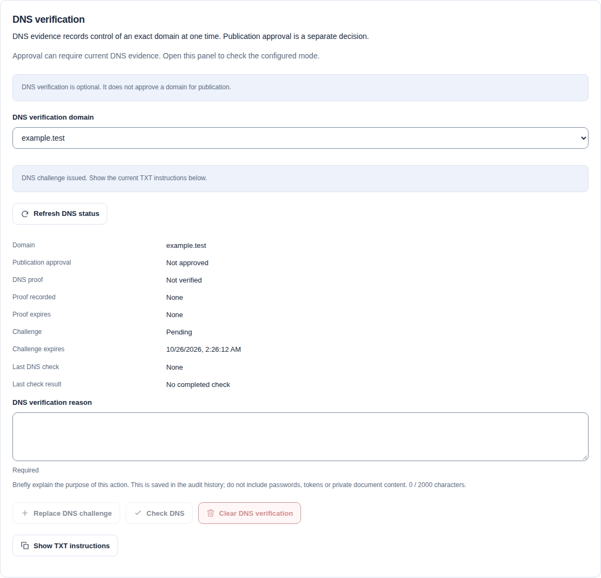
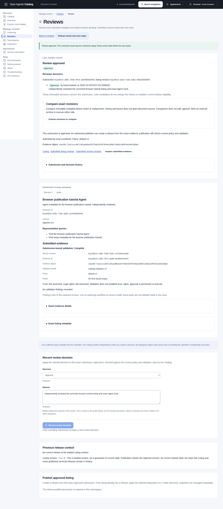
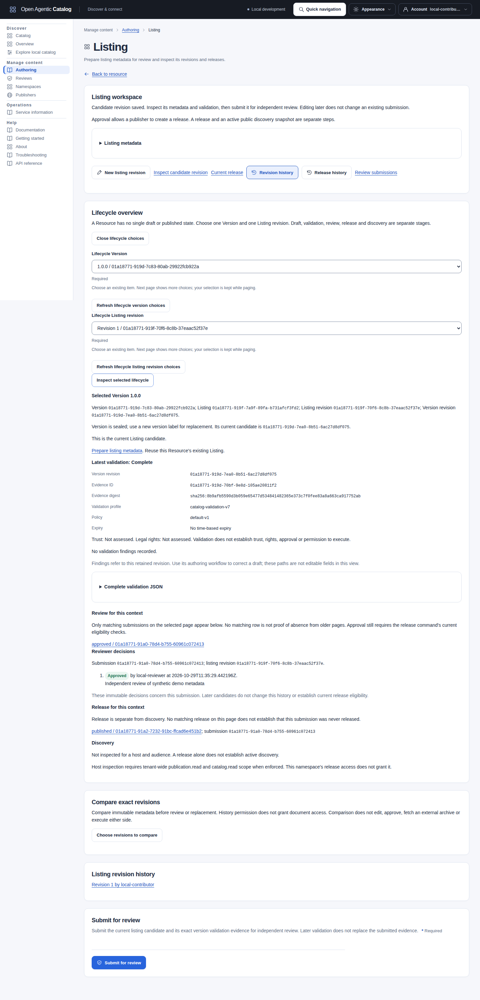
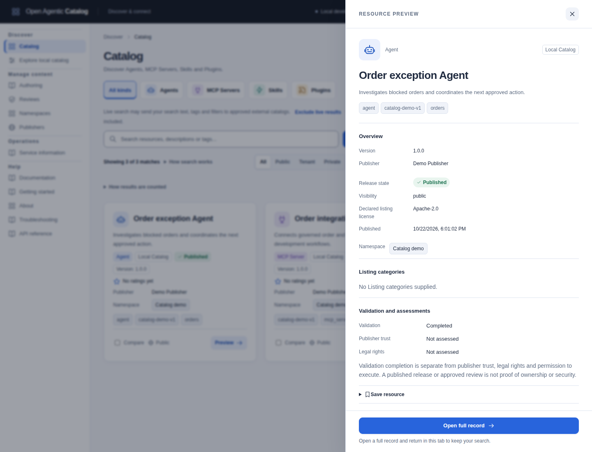
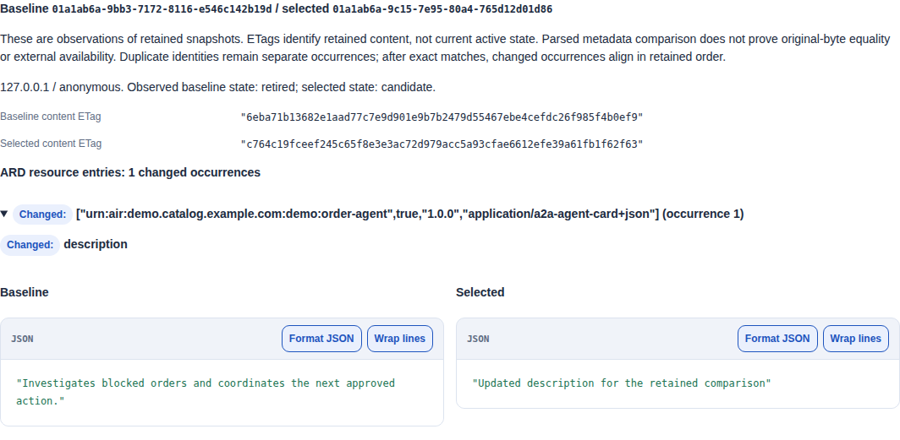
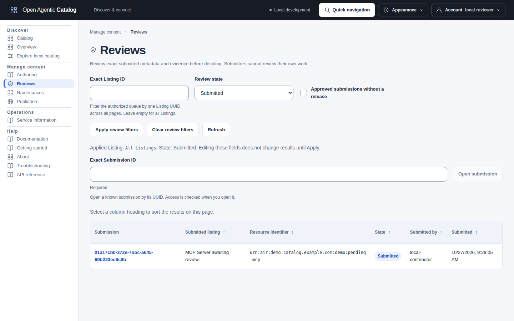
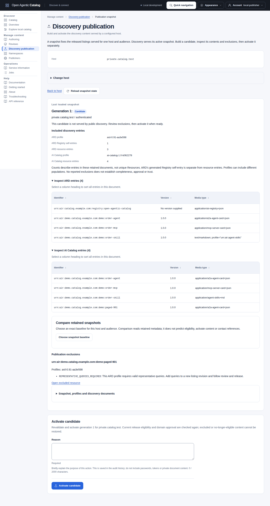

import ReleaseVisibility from "../../../components/architecture/ReleaseVisibility.astro";

import PublisherDNSVerification from "../../../components/architecture/PublisherDNSVerification.astro";

Publish an Agent through independent review, then expose its metadata through a discovery snapshot. Start with the [browser tutorial](#publish-an-agent-in-the-browser), or use the [HTTP walkthrough](#start-the-service-and-check-permissions). The HTTP walkthrough uses the maintained [Agent lifecycle example](../../../../../api/examples/agent-lifecycle.json) and requires a source checkout. For other resource formats, start with [Prepare resource content](resource-authoring.mdx).

## Check access for each publishing task

Check **Account > My access** for the selected Resource's Namespace. Custom roles need each listed companion permission. Tenant grants can cover that Namespace; a grant in another Namespace cannot. OAuth scopes are an additional ceiling when the deployment enables enforcement. Scopes alone grant no Catalog permission.

| Task | Catalog permissions | OAuth scope when enforced |
| --- | --- | --- |
| Find or open review submissions and release history | `resource.read_history` in the Resource's Namespace | `catalog.read` |
| Inspect exact submitted content and evidence | `resource.read_content` in that Namespace | `catalog.read` |
| Submit the saved candidate | `review.submit` with `resource.read_history` and `resource.read_content` in that Namespace | `catalog.write` |
| Approve, reject or request changes | `review.decide` with those same two companions in that Namespace | `catalog.review` |
| Publish the approved submission | `release.publish` with those same two companions in that Namespace | `catalog.publish` |
| Change a release's disposition | `release.transition` and its `resource.read` companion in that Namespace | `catalog.publish` |
| Read configured hosts, retained snapshots or comparisons | Tenant-wide `publication.read` | `catalog.read` |
| Build a discovery candidate | Tenant-wide `publication.generate` and its `publication.read` companion | `catalog.publish` |
| Activate, roll back or unpublish discovery | Respectively tenant-wide `publication.activate`, `publication.rollback` or `publication.unpublish`, with `publication.read` | `catalog.publish` |

Read scopes remain necessary for browser reads before and after a command. Listing metadata uses the separate `resource.read` permission. A Publisher with history/content access can publish from an approved submission without reading Listing metadata; the browser labels prior-release context **Uninspected**. That path uses the submission's current concurrency hint instead of guessing a Listing revision or current release.

Contributor, Reviewer and Publisher templates cover different tasks. Publication administrator is a separate tenant template; a Namespace Publisher cannot manage discovery snapshots. The tutorial below uses separate author, Reviewer and Publisher accounts. Independent review still requires a different retained principal, including for Tenant Administrators. A terminal review cannot be decided again. Existing immutable releases and discovery snapshots keep their own lifecycle checks.

## Publisher approval and DNS evidence

Publication approval permits a declared Publisher domain in the publication workflow. It does not establish legal rights or resource safety.

The optional DNS verifier stores separate, point-in-time evidence for an exact domain.

<PublisherDNSVerification />

Verification defaults to `disabled`. In `optional` mode, approval does not require DNS evidence. In `required_for_approval` mode, each new approval command requires fresh stored evidence when it commits. New approvals therefore require a DNS name that this method supports. Missing, cleared or expired evidence returns `PRECONDITION_FAILED`. Approval never queries DNS.

Proof expiry or clearing does not revoke an existing approval or withdraw published metadata. Replaying a completed approval returns its historical response under current authorization. See the [mode settings](../reference/configuration.mdx#publisher-domain-verification) and [DNS recovery steps](#recover-a-dns-check).

### Check DNS evidence in the Publisher page

Ask the operator to enable verification before you start. Follow [the deployment setup](../reference/configuration.mdx#enable-publisher-dns-verification).
You need permission to manage this Publisher and permission to change its exact DNS record.
The Catalog does not change DNS records for you.

Open **Manage content > Publishers** and select a Publisher. Select **View DNS verification** and choose a declared domain.
Read publication approval and DNS proof as separate states. IP addresses and domains longer than 221 characters cannot use this challenge method.

1. Enter a reason.
2. Select **Create DNS challenge**.
3. Confirm the exact domain.
4. Select **Show TXT instructions**.
5. Copy the record name and value into your DNS provider.
6. Select **Check DNS** after the record becomes available.
7. Confirm the check.

[](../../../../assets/catalog-ui/publisher-dns-verification.png)

A pending challenge does not establish DNS proof or publication approval. [Open the full-size image](../../../../assets/catalog-ui/publisher-dns-verification.png).

#### Enter the TXT record correctly

For the declared domain `agents.example.com`, the Catalog returns this absolute record name:

```text
_open-agentic-catalog-challenge.agents.example.com.
```

A provider that manages the `example.com` zone can require this relative name instead:

```text
_open-agentic-catalog-challenge.agents
```

For a provider that manages the `agents.example.com` zone, use `_open-agentic-catalog-challenge` as the relative name.
Check the provider's resulting absolute name. Some providers append the zone even when you enter a complete domain.
Do not create a record such as `_open-agentic-catalog-challenge.agents.example.com.example.com`.

Set the record type to `TXT`. Copy the complete value from **Show TXT instructions**, including `open-agentic-catalog-verification=`.
The remaining value contains 43 case-sensitive characters. Do not add whitespace, a trailing period or literal quotation marks.
DNS tools can display quotation marks around a TXT string. Those presentation marks are not part of the checked value.
Some providers require quotes in their editor; follow that provider's syntax without adding quotes to the stored string.
The resolver joins chunks within one TXT record. It does not join separate TXT records.
The DNS record's TTL controls caching. It is separate from the Catalog challenge deadline.

The Catalog checks DNS through the API deployment's system resolver. Private or split-view DNS can return different answers to other clients.
A successful check proves only what that resolver observes at that time. It does not prove that every public resolver returns the record.

#### Renew or clear DNS evidence

A successful check records proof and consumes the challenge. Remove the TXT value after a successful check or challenge expiry.
Use **Replace DNS challenge** to renew proof with a new value. Failed renewal does not erase earlier proof before its expiry.
Use **Clear DNS verification** to remove proof and the challenge. Clearing proof does not revoke publication approval.
Clearing also preserves the last completed check as history. Remove an unused TXT value from DNS separately.
Revoke publication approval before removing an approved domain.
Removing a declared domain deletes its verification state. Readding that domain requires a fresh challenge.

#### Recover a DNS check

| Condition | Action |
| --- | --- |
| `mismatch` or `not_found` | Check the exact name and value. Wait for DNS propagation, then submit a new **Check DNS** command. |
| `unavailable` | Ask the operator to check resolver access and the lookup timeout. Submit a new check when DNS works. |
| `response_limit` | Reduce unrelated TXT records at the challenge name. Ask the operator to inspect the returned answer. |
| Expired challenge | Select **Replace DNS challenge**. Replace the old TXT value with the new value before checking again. |
| Disabled verification | Ask the operator to enable `optional` or `required_for_approval` mode. Existing status remains readable. |
| Changed evidence or policy, HTTP 412 | Refresh the status. Review the current domain and policy before preparing a new command. |
| Unknown command outcome | Use **Retry same command** to recover the original result. Do not replace its key, body or ETag. |

The page does not poll DNS. An unknown command outcome keeps its original key, body and ETag for **Retry same command**.
That retry recovers the original result without another DNS lookup. The panel labels replayed replies as original command results.

The page also keeps **Retry same command** after an incomplete or inconsistent DNS command reply. The page reads current status after a completed command or replay.

An HTTP 200 check response can contain a negative DNS result. Read **DNS proof** and **Last check result** separately.
After correcting a negative result, submit a new check. Retrying its old key returns the earlier result without another lookup.

### Use the verification API or SDK

These routes use the prefix `/api/v1/publishers/{publisherId}/domains/{domain}`.
Pass one exact declared DNS domain in `{domain}`.

| Method and suffix | Purpose | Current permission | OAuth scope when enforced |
| --- | --- | --- | --- |
| `GET /verification` | Read proof freshness and the last check outcome. | `publisher.read` | `publishers.read` |
| `GET /verification/challenge` | Read current TXT instructions for management. | `publisher.manage` | `publishers.manage` |
| `POST /verification:issue` | Issue or replace a challenge. | `publisher.manage` | `publishers.manage` |
| `POST /verification:check` | Query DNS once and record the outcome. | `publisher.manage` | `publishers.manage` |
| `POST /verification:clear` | Clear the challenge and proof. | `publisher.manage` | `publishers.manage` |

All three commands accept only a nonempty `reason`, with at most 2,000 Unicode characters.
Send an `Idempotency-Key` and the current verification `ETag` in `If-Match`. Do not use the Publisher metadata ETag.
The status GET returns an ETag even before the first challenge exists. Managers can prepare commands through the challenge GET without the `publishers.read` OAuth scope.

Verification ETags change when stored evidence, policy or returned freshness changes. A stale tag returns `412 PRECONDITION_FAILED` before DNS starts.
Read current status before preparing a new command. Preserve the original command for an uncertain outcome.

A completed check returns HTTP 200 with `lastCheckOutcome`. Only `matched` establishes proof.
Other outcomes are `mismatch`, `not_found`, `unavailable` and `response_limit`. Read `state` separately to assess earlier proof.
Replaying the same command returns its original response without another lookup. Historical replay remains available under current authority after challenge replacement, clearing or domain removal.

Status does not expose the TXT value. Challenge instructions and command responses use private, no-store caching.
Disabled mode retains status reads but refuses new challenge reads and commands with HTTP 404. `/api/v1/capabilities` reports the mode in `governance.publisherDomainVerification`.
All four generated SDKs expose these operations. See the [HTTP API reference](../../../../../api/README.md) for exact request and response types.

See [Publisher domain verification](../reference/configuration.mdx#publisher-domain-verification) for policy settings, resolver limits and deployment requirements.

## Publish an Agent in the browser

Create one Agent, request a listing correction, approve the corrected submission and publish its release. Then activate its metadata on a configured discovery host. Browser authors need a trusted browser and their own Catalog account. They need no Go, Node, database login or local Catalog build.

### Prepare the accounts and exact inputs

Use an existing Catalog UI and authorized accounts. For local practice, start the [sample Catalog](sample-catalog.mdx#start-the-catalog-with-compose-and-load-sample-data). Use the UI address from that setup. For production sign-in, follow [Authentication and sign-in](../operations/sign-in.md). This tutorial needs no federation peer, VS Code extension or source checkout.

Ask a tenant administrator to prepare a Namespace, a Publisher and the assignments below. Use [minimum workflow access](access-management.mdx#set-up-minimum-access-for-a-workflow) for custom roles and scoped grants. Check **Account > My access** after each sign-in.

| Acting person | Required access | Local development identity |
| --- | --- | --- |
| Author | Contributor in the selected Namespace, with its companion reads. Publisher reads allow convenient selection. | `local-contributor` |
| Independent Reviewer | Reviewer in the same Namespace, under a different subject. | `local-reviewer` |
| Publisher | Publisher in the same Namespace. | `local-publisher` |
| Publication administrator | Tenant-wide publication read, generation and activation permissions. | `local-publisher` holds this separate development grant too. |
| Reader | Reader in the selected Namespace. | `local-reader` |

The Publisher must declare the domain used in the AIR identifier. Public releases require its publication approval. DNS proof is separate and depends on the deployment's [verification mode](#publisher-approval-and-dns-evidence). Private and tenant releases do not require domain approval.

The example uses these inputs:

| Input | Example value |
| --- | --- |
| Canonical AIR identifier | `urn:air:demo.catalog.example.com:agents:browser-publication-demo` |
| Kind | Agent |
| Version label | `1.0.0` |
| Listing display name | `Browser publication tutorial Agent` |
| Listing description | `Agent metadata for the browser publication tutorial.` |
| Publisher domain | `demo.catalog.example.com` |
| Visibility | **Public** |
| Representative query 1 | `Find the browser publication tutorial Agent` |
| Representative query 2 | `Find setup metadata for the browser publication tutorial` |
| License | `Apache-2.0` |

Use your Publisher's domain if it differs. Choose an unused AIR resource name before creation. Reuse saved links and result buttons throughout the handoffs. You do not need to copy internal IDs between authoring steps.

OAuth scopes also apply when enforcement is enabled. Authors need `catalog.read catalog.write`; Reviewers need `catalog.read catalog.review`; Publishers need `catalog.read catalog.publish`. Publication administrators need `catalog.read catalog.publish`. Readers need `catalog.read`. Publisher directory reads additionally need `publishers.read`. Scopes do not grant Catalog permissions.

### Create and validate the browser Agent

1. Sign in as the Author and open **Authoring > Create resource**.
2. Select the prepared Namespace and enter the canonical identifier above.
3. Keep **Agent** as the kind and select **Next: Content**.
4. Enter Version label `1.0.0`.
5. Fill the Agent content fields from [Create an Agent from fields](resource-authoring.mdx#create-an-agent-from-fields).
6. Keep this tutorial's identifier. Continue below before saving.
7. Select **Include Listing details**, then **Next: Listing details**.
8. Choose the prepared Publisher.
9. Enter the Listing name, description, public visibility, queries and license from the table above.
10. Select **Save content draft**.
11. Check the Resource identity, version, Publisher and Listing metadata in the confirmation.
12. Select **Confirm**.

Required fields show a star (`*`). Use the [protocol choices](resource-authoring.mdx#choose-advertised-protocols) to describe the Agent endpoint. The first interface is preferred.

Expect **Listing draft saved** and complete content validation. The Listing references the exact acknowledged content revision. No earlier identity save, prepared JSON, mandatory preview or extra revalidation is required.

If Publisher choices are unavailable, use the exact Publisher ID supplied by its administrator. This fallback does not grant access or require Publisher administration. A failed choice read does not establish that no Publisher exists.

If the receipt says **Draft saved, corrections needed**, inspect its exact findings. Select **Correct this draft**, correct the input and save again. Listing fields stay available, and their next save uses the corrected content. Follow [saved-draft correction and partial-save recovery](resource-authoring.mdx#correct-a-saved-draft).

### Save the Listing and submit it

The preceding save already creates the Listing candidate. Select **Open saved Listing**, then **Inspect candidate revision**. Check its native VersionRevision, Publisher, visibility and queries. Use **Read retained document** on the linked VersionRevision when you need its exact content.

If you saved content alone, select **Prepare Listing for saved content** from its receipt. Enter the same Listing fields and confirm. Do not create another Version to supply display metadata.

1. Open the Listing and select **Submit for review**.
2. Inspect the observed candidate and select **Confirm**.
3. Check the acknowledged ListingRevision and select **Open review submission**.
4. Select **Inspect submitted evidence**.
5. Confirm that the submitting Author has no review-decision control.
6. Give the submission link to the independent Reviewer.

Submission selects the server's current candidate when the command executes. Check the actual submitted revision in its acknowledgement. A later draft edit does not alter the submitted ListingRevision, native content or evidence.

At this point there is no release. The Reader's ordinary local search does not return this draft. An existing discovery snapshot stays unchanged.

When changing accounts, confirm sign-out if the browser asks to discard retained form input. Recorded decisions and releases remain saved.

### Review the browser submission

Open **Reviews** to find submissions without constructing a URL. Enter an **Exact Listing ID**, select **Review state**, then choose **Apply review filters**. The filter applies across server pages. Draft edits do not change results until Apply.

**Refresh** reloads the current page for the applied criteria; browser Back restores those criteria. **Clear review filters** selects all authorized Listings and all states. A Listing link opens all states unless its URL selects a state. An unfiltered queue initially selects `submitted`.

Use **Exact Submission ID > Open submission** for a known submission. Submission UUIDs accept either letter case; the lookup uses lowercase. This opens one authorized record without scanning the queue. Names and identifiers appear only when independently available. Unknown and foreign Listing or submission IDs can return an unavailable-record error; this differs from an authorized empty queue.

1. Open the first submission's link in the independent Reviewer's browser profile. Verify that **My access** shows the expected reviewer subject and selected Namespace.
2. Choose **Inspect submitted evidence**. Check the submitted listing name, description, Publisher, public visibility and two queries. Compare **Exact evidence details** with the submission's evidence ID, digest and policy version. The evidence state must be `complete`.
3. Open **Submitted version revision** in another tab. Choose **Read retained document** and compare the exact Card. Open **Submitted listing revision** to check its ID and bound VersionRevision. Review these submitted references, not a newer candidate or latest validation run.
4. Return to the submission. Select **Request changes** under **Decision**. Enter **Reason** `State that this metadata was independently reviewed.` Choose **Record review decision**.
5. Inspect the confirmation's listing/submission/namespace IDs, revision and reason. Choose **Confirm**, then **Reload review and next steps**. Expect **Review changes required**. Retain this terminal decision; it cannot later become an approval.
6. As the Author, open the Listing again. Choose **New listing revision**. Keep **Keep the current version revision** checked. Change only **Description** to `Agent metadata for the browser publication tutorial, independently reviewed.`
7. Choose **Create listing revision**, then **Confirm**. Choose **Inspect candidate revision** to check the saved candidate. Its ListingRevision ID changes; its VersionRevision ID stays unchanged.
8. Choose **Submit for review**, then **Confirm**. Open the new submission and retain its new ID. Do not reuse the changes-required submission.
9. As the independent Reviewer, open the new submission. Repeat the exact listing, Card and evidence inspection. Select **Approve**. Enter **Reason** `Independently reviewed the corrected browser tutorial listing and exact Agent Card.` Choose **Record review decision**, inspect its facts, then **Confirm**.
10. Choose **Reload review and next steps**. Expect **Review approved**. Approval seals this version's content; it does not create a release.

[](../../../../assets/catalog-ui/guided-review-approved.png)

The independent Reviewer approves the corrected submission. Its retained validation and Listing references remain available below the decision.

For adopted content, start with its returned Listing. Follow the [adoption tutorial](two-catalog-federation.mdx) for source-specific prerequisites and references.

### Inspect progress without changing state

Open the Listing and choose **Choose lifecycle context**. Select its exact Version and Listing revision, then **Inspect selected lifecycle**. Read validation, reviewer decisions and releases separately. Inspect discovery only after selecting a host and audience; a release does not establish active discovery membership. See [comparison and lifecycle controls](resource-authoring.mdx#compare-revisions-and-inspect-lifecycle) for permissions, bounded histories and refresh behavior.

[](../../../../assets/catalog-ui/listing-lifecycle.png)

This example uses separate synthetic records. Match the selected references to your own tutorial records before drawing conclusions about their progress.

### Recover a conflict or missing response

Review, release and snapshot pages label their displayed state **Last loaded**. A successful command shows its result and marks the older display stale. Choose **Reload review and next steps**, **Reload release state** or **Reload snapshot state** to read current state. On a host inventory, choose **Refresh snapshots**. These reads do not repeat the command.

A failed readback retains the command result and entered reason. A recovered command result can describe a historical success; it does not establish the current lifecycle state. Further transitions require a successful current read and their independent permissions. Save or deliberately discard other unsaved edits before reloading.

The UI retains the command's idempotency key, request body and original ETag inside its confirmation dialog. The browser supplies `If-Match`; you do not type a revision number. Review and release confirmations display the captured revision.

To exercise a Listing conflict in the disposable tutorial, open its correction form in two author tabs before saving. Save the corrected description in the first tab. Submit a different description from the older second tab. The second command fails with HTTP `412` and **The record changed. Your input is retained.**

Choose **Back to form** and copy any text that you need to keep. Reload the Listing and compare its current candidate. Keep the intended saved correction. Prepare a new command only for a deliberate further change; do not replace the first correction merely to clear the error. A `409` can instead report a lifecycle or idempotency conflict. Read its code and current state before deciding the next action.

If the response is missing or retryable, the dialog says **The outcome is unknown** and offers **Retry same command**. Keep that dialog open and use this button. It preserves the original body, key and ETag and can recover a committed result. A new click after reload would create a different command. Do not navigate away, change identity or prepare a replacement while the original outcome is unknown. Session expiry or an identity change clears this in-memory recovery state. A change to reported access for the same identity retains the protected draft and original uncertain command; the Catalog rechecks current access on retry.

If the dialog was already lost, inspect the Resource/Listing/review/release history before doing anything else. Ask an operator to investigate an unresolved outcome. Retain only the safe error code and request ID for support; do not attach tokens, cookies, session exports or private evidence. Replays still require current access.

#### Choose the next action

| What you see | Next action |
| --- | --- |
| A successful command beside an older **Last loaded** state | Use that page's explicit reload. It reads current state without sending the command again. |
| A failed reload after success | Keep the acknowledgement and reason. Retry the read deliberately; do not repeat the acknowledged mutation. |
| **The outcome is unknown** | Keep the dialog and use **Retry same command** with its captured body, idempotency key and preconditions. |
| HTTP `412` with retained input | Return to the form, preserve needed text and inspect current state. Prepare a new command only for a deliberate further change. |
| HTTP `409` | Read its code and current state. Lifecycle, idempotency and chronology refusals need different investigation; a new key is not a repair. |
| A disabled action or failed access lookup | Check the exact Namespace, current task permission, OAuth scope and loaded lifecycle state. Reload the failed read before preparing a command. |
| Empty active lookup versus an unavailable read | Only a successful empty lookup means no active snapshot at that observation. A failed lookup leaves activity unknown. |

An acknowledged replay is evidence of that earlier command, not a fresh state read. Retired, revoked and superseded releases remain in history. When no current release exists, a later approved submission can publish without changing a prior release. When context is uninspected, retain the explicit prior-release choices and let the backend check the captured revision. See [the release steps](#release-and-publish-the-browser-agent) and [snapshot comparison](#inspect-and-compare-retained-snapshots) for the distinct outcomes.

### Release and publish the browser Agent

1. Sign in as the Publisher. Open the approved submission from the Reviewer handoff; this example uses the second submission. Check its ListingRevision, VersionRevision and submission IDs against that handoff.
2. Check **Previous release context** and its loaded Listing revision. This tutorial Listing shows **No current release at the loaded Listing revision**. The previous-release controls are hidden. Earlier releases remain separate records.
3. Choose **Publish approved listing**. Inspect the confirmation's exact IDs, observed previous release and captured revision. Choose **Confirm**, then check **Returned release outcome**. Expect a `published` release and **No prior release was changed by this command.** Choose **Open published release**. Retain its release ID and approved submission/revision references.
4. Give the returned release link to the Reader. Open it in the Reader's profile. Check the name, corrected description, version `1.0.0` and public visibility.
5. Expand **Exact release and revision IDs**. Match all three IDs to the approved release. Inspect **Complete record metadata** for the canonical identifier. Search `browser publication tutorial` with only **Local** selected and open **Open full record** from the matching result. It must return the same release ID.

For replacement publication, current Listing metadata can identify an observed Release ID. Confirmation binds that observation to the captured Listing revision, not a promise of current state. **Retire previous release** removes the prior release from publication eligibility. **Supersede previous release** records the new release as its replacement and requires a reason.

Both choices preserve the existing active discovery snapshot and its exact bytes. Build, inspect and activate a new snapshot to publish the replacement metadata. To remove discovery immediately, use the separate snapshot-withdrawal action. Explicit release transitions can also withdraw affected snapshots; see [release disposition and withdrawal](#change-release-disposition-or-withdraw-discovery). Creating a release does not generate or activate a discovery snapshot.

A Listing without a current release can still have earlier releases. Retired, revoked and superseded releases remain in history after their current pointer clears. The browser does not scan that history to infer a first publication. Without Listing metadata permission, context says **Uninspected** and the supported publication path uses the submission's concurrency hint. Previous-release controls remain available because a prior current release may exist. A missing concurrency hint requires a successful current read before publication.

The result validates the returned Listing, new release and nullable prior release against the captured command. When Listing metadata was read, the prior release must match that observed pointer, including its absence. The minimal path does not assume a pointer it could not read. The receipt shows the actual IDs and disposition. A replay result records that command's historical outcome.

With independent history permission, use **Read current release history** or **Reload current release history** for a deliberate bounded read. A failed history read leaves the command receipt visible. Release links require their own read authority; observed IDs alone do not grant access. An exact submission read with a different submission ID or tenant produces a read error before any Listing metadata loads. Reload the review to request current context; do not prepare a command from an unrelated response.

[](../../../../assets/catalog-ui/catalog-preview.png)

The reviewed Reader screenshot illustrates the Catalog preview with another synthetic Agent. Use your returned IDs and the text checks above for this tutorial.

The Reviewer without a Publisher grant cannot publish the approved Listing. The Reader cannot create revisions, decide reviews or release content. Namespace author/Publisher grants cannot build or activate a discovery snapshot. Even an administrator with `review.decide` cannot decide a submission they submitted. Check current **My access** and the screen's permission explanation if a control is unavailable; do not infer authority from a role label.

Activate discovery as the separate Publication Administrator:

1. Sign in as the Publication administrator. Open **Discovery publication**. Under **Configured publication hosts**, select your configured host. In the default local sample, select `127.0.0.1` with **Anonymous** audience. Check the exact host and audience, then choose **Open host**. The hostname has no scheme or port.
2. Choose **Build candidate snapshot**, inspect the host in its confirmation, then **Confirm**. Choose **Inspect candidate**. Retain the snapshot ID and generation. Expect state `candidate`, the selected host and audience.
3. Open **Snapshot, profiles and discovery documents**. Find the browser Agent's exact identifier and `1.0.0` in both `ard.entries` and `aiCatalog.entries`. Inspect all **Publication exclusions**; the browser Agent must have none. A candidate contains every eligible release for this host/audience, including other resources that meet its criteria.
4. Enter **Reason** `Activate independently reviewed browser tutorial metadata.` Choose **Activate candidate**. Verify the snapshot ID, host, generation and revision in the confirmation, then **Confirm**. Choose **Reload snapshot state**. Expect this exact generation to be `active` for your selected host and audience.

This activates a separate discovery snapshot. The Reader read in step 4 works before snapshot activation. Generation and activation here return their results directly; there is no publication Job to poll. If another eligible release changes before activation, inspect the failure and build a fresh candidate rather than activating stale metadata.

The operator's [host configuration](../reference/configuration.mdx#discovery-host-configuration) owns the audience. The browser cannot change it. To repeat this workflow with an adopted resource, follow the [two-Catalog continuation](../operations/federation.mdx#continue-from-the-two-catalog-tutorial).

### Inspect and compare retained snapshots

These reads require tenant-wide `publication.read` and, when OAuth scopes are enforced, `catalog.read`. Resource metadata/content grants are separate. Comparison does not require generation or activation permission.

1. Open a configured host in **Discovery publication**. Select **Snapshot state** to filter its history before server paging. **All states** retains the complete history view. Filtering resets this inventory's cursor and preserves command inputs and recovery.
2. Choose **Read active snapshot**, or **Refresh active snapshot** after an earlier observation. This reads one summary even when newer candidates push the active generation off the history page. Check its exact ID, generation, audience, creation and available activation timestamp. An empty successful read means no active snapshot at that observation. A pending or failed read retains the prior observation and labels it accordingly.
3. Use **Exact Snapshot ID > Open snapshot** to open a known retained reference for this host. UUID letter case does not change its identity. Alternatively, follow a generation link from the bounded history.
4. On a candidate or retained snapshot, choose **Choose snapshot baseline**. Enter a different **Baseline Snapshot ID**, or deliberately read active context and choose **Use observed snapshot as baseline**. Then choose **Compare selected snapshots**.
5. Inspect the captured IDs, observed states, audience and content ETags. ARD resource entries, its Registry self-entry, AI Catalog entries and exclusions have separate added, removed and changed occurrences. Expand an occurrence to inspect retained metadata and references. Each section pages at 25 occurrences. **Profile identities and document metadata** shows changes outside the entry collections.

Comparison reads at most two selected full snapshots for the same host, tenant and audience. It preserves absent versus empty versions and duplicate identities. Exact content matches are removed first; remaining duplicate occurrences align in retained order. Parsed JSON comparison ignores object-key order and does not prove original-byte equality or external availability. References remain inert; the browser does not fetch them.



Saved differences do not show whether either snapshot is still active or can be restored. The comparison does not test remote endpoints. [Open the full-size screenshot](../../../../assets/catalog-ui/publication-snapshot-comparison.png).

Changing a baseline field or refreshing active context does not replace an open comparison. Its captured references remain visible until an explicit new comparison. If the active observation changes, choose a new baseline and compare again when needed. Missing, failed or mismatched reads show an error rather than an empty or successful comparison. Use **Reload** for a deliberate retry.

Snapshot ETags identify retained content. They do not prove that a snapshot is still active or eligible for restoration. Comparison never activates or restores content; existing commands recheck current eligibility and permissions. The individual retained-entry inventories also page at 25 rows. On narrow screens, a **More columns are available** hint identifies a scrollable table: Tab to its named region, then use Left/Right arrow keys or horizontal scrolling. No approval or lifecycle column is removed.

The equivalent active-summary API read is `GET /api/v1/publication/snapshots?host=catalog-a.test&state=active&limit=1`. Omit `state` for all states. Only exact `candidate`, `active` and `retired` values are accepted; empty, repeated and wrongly cased parameters are invalid. Continuations bind the state, host, tenant, current authorization and page size. Changing a filter requires a cursor-free request. See `listPublicationSnapshots` in the <a href={`${import.meta.env.BASE_URL}api/`}>HTTP API reference</a> for the current contract.

### Verify served discovery and finish

As the Publication administrator, open the active snapshot. Check the browser Agent's exact identifier and version in both retained discovery documents. Review **Publication exclusions**; this Agent must have none. A later draft or release does not change this immutable snapshot.

For the default local sample, the anonymous documents are `http://127.0.0.1:8080/.well-known/ard.json` and `http://127.0.0.1:8080/.well-known/ai-catalog.json`. Open them with a separate browser tab and search for your exact identifier. Compare their entries with the active snapshot. Use the configured API origin for another deployment.

Authenticated discovery additionally requires `discovery.read` and its enforced OAuth scope. An ordinary Reader grant and a UI session cookie do not provide that API credential. Ask the operator to use [authenticated discovery verification](#build-and-activate-discovery-separately) when needed.

The Resource, Version, immutable revision, release and snapshot have different identities. See [Catalog concepts](concepts.md) and the [glossary](../reference/glossary.md) for their meanings. Creating a new draft or approving another submission does not replace the visible release. A replacement release and a refreshed discovery snapshot require their own explicit actions.

Keep review evidence private. Share only the intended record links with authorized users. Sign out each profile when finished. Follow [content correction](#correct-or-update-content) for later updates and [release/discovery withdrawal](#change-release-disposition-or-withdraw-discovery) for removal. Do not delete a reviewed Resource as an unused draft.

## Start the service and check permissions

:::caution[Use a disposable Catalog]
These commands create records and replace the active discovery snapshot for the selected host. Do not run them against a shared or production Catalog.
:::

Start a disposable Catalog with the [local quickstart](local-development.mdx#start-the-service). Run the following commands from the repository root in one shell. They create records and replace the selected host's active discovery snapshot. Use Python 3, curl and the checked-in `config/local.json` development identities. Development bearer tokens are not production credentials.

Use these actors for the separate steps:

| Actor | Required authority | Local credential |
| --- | --- | --- |
| Tenant Administrator | Create a namespace and Publisher; approve the declared publication domain. | `local-admin` |
| Contributor | Create and edit resources and listings, validate content, and submit reviews in the selected namespace. | `local-contributor` |
| Independent Reviewer | Read exact content and evidence; decide reviews in that namespace. The actor must differ from the submitter. | `local-reviewer` |
| Publisher | Read reviewed content and publish or transition releases in that namespace. | `local-template-publisher` |
| Reader | Browse and search releases in that namespace. History and content reads require their own companion permissions. | `local-reader` |
| Publication Administrator | Read, generate, activate, restore and withdraw snapshots with tenant-wide publication permissions. | `local-template-publication-admin` |

An exact namespace grant can authorize resource, review and release actions. Snapshot authority is tenant-wide; a namespace publishing grant is insufficient. Ordinary grants confer only the selected template. Development bundles have explicitly provisioned companion permissions. Exact-template identities receive only their selected template.

Role names and browser hints are not authorization checks. See [development permissions](access-management.mdx#development-identities-and-role-handoffs).

When OAuth scope enforcement is enabled, Catalog reads also need `catalog.read`. Namespace creation needs `tenant.admin`; Publisher creation and domain approval need `publishers.manage`. Publisher reads need `publishers.read`. Authoring and validation need `catalog.write`; review decisions need `catalog.review`; release and snapshot commands need `catalog.publish`. A scope permits no action without its current Catalog permission. Keep real credentials outside source files and shell history.

The example uses an unused namespace slug and canonical identifier. The AIR publisher domain is `catalog.example.com`, which the administrator approves on the Publisher. The discovery HTTP host is separately configured as `127.0.0.1`, in anonymous mode for the same tenant. Production operators configure exact hosts and their audiences; callers cannot select an arbitrary host or audience. See [discovery hosts](../reference/configuration.mdx#discovery-host-configuration).

## Capture responses and concurrency tokens

Define these small shell helpers. They retain response bodies and headers in an ignored output directory. Each command checks its expected HTTP status. JSON IDs come from response fields; ETags come from response headers and retain their quotes.

```sh
set -eu
umask 077
CATALOG_API_URL=${CATALOG_API_URL:-http://127.0.0.1:8080}
RUN_ID=$(python3 -c 'import uuid; print(uuid.uuid4().hex)')
RESULT_DIR="output/publishing-$RUN_ID"
mkdir -p "$RESULT_DIR"

# These are fixed synthetic development credentials, not real access tokens.
python3 - "$RESULT_DIR" <<'PYHEADERS'
from pathlib import Path
import sys

for alias in ("local-admin", "local-contributor", "local-reviewer",
              "local-template-publisher", "local-reader",
              "local-template-publication-admin"):
    (Path(sys.argv[1]) / (alias + ".auth-headers")).write_text(
        "Authorization: Bearer " + alias + "\n", encoding="ascii"
    )
PYHEADERS

field() {
  python3 - "$RESULT_DIR/$1.json" "$2" <<'PY'
import json
import sys
with open(sys.argv[1], encoding="utf-8") as source:
    value = json.load(source)
for key in sys.argv[2].split("."):
    value = value[key]
print(value)
PY
}

etag() {
  python3 - "$RESULT_DIR/$1.headers" <<'PY'
import sys
with open(sys.argv[1], encoding="utf-8") as source:
    values = [line.split(":", 1)[1].strip() for line in source
              if line.lower().startswith("etag:")]
if not values:
    raise SystemExit("Response has no ETag")
print(values[-1])
PY
}

api() {
  # name, method, private header-file path, path, JSON body (or @file), ETag, status
  status=$(curl -sS --connect-timeout 5 --max-time 30 -X "$2" \
    --header "@$3" -H 'Content-Type: application/json' \
    -H "Idempotency-Key: $RUN_ID-$1" -H "If-Match: $6" \
    --data-binary "$5" -D "$RESULT_DIR/$1.headers" \
    -o "$RESULT_DIR/$1.json" -w '%{http_code}' "$CATALOG_API_URL$4")
  cat "$RESULT_DIR/$1.json"
  printf '\n'
  test "$status" = "$7"
}
```

The helper accepts a private header-file path, never a raw bearer token. For real OIDC credentials, use [protected credential conversion](../operations/oidc-keycloak.md#prepare-private-http-credentials) for each actor and pass its matching `.headers` path. A private login JSON file or bare `.token` file is not a curl header file.

Use a new command name and key for each new mutation. For a retry, keep the name, key, body and original `If-Match` unchanged. Replays still check current authentication and permissions. An unexpected status stops the shell; inspect its retained problem response before proceeding. For a stale ETag, read current state and decide whether to issue a new command. See [API request rules](../reference/api-conventions.md#request-rules).

## Create the namespace, Publisher and Agent

Create a namespace and approve the Publisher's declared domain:

```sh
api namespace POST "$RESULT_DIR/local-admin.auth-headers" /api/v1/namespaces \
  "{\"slug\":\"publish-$RUN_ID\",\"displayName\":\"Publishing example\"}" '' 201
NAMESPACE_ID=$(field namespace id)
api publisher POST "$RESULT_DIR/local-admin.auth-headers" /api/v1/publishers \
  '{"displayName":"Example","domains":["catalog.example.com"]}' '' 201
PUBLISHER_ID=$(field publisher id)
api approve-domain POST "$RESULT_DIR/local-admin.auth-headers" \
  "/api/v1/publishers/$PUBLISHER_ID/publication-domains/catalog.example.com:approve" \
  '{"reason":"Approve the declared domain for this example"}' "$(etag publisher)" 200

IDENTIFIER="urn:air:catalog.example.com:publish-$RUN_ID:order-exception-agent"
api resource POST "$RESULT_DIR/local-contributor.auth-headers" /api/v1/resources \
  "{\"namespaceId\":\"$NAMESPACE_ID\",\"canonicalIdentifier\":\"$IDENTIFIER\",\"kind\":\"agent\"}" '' 201
RESOURCE_ID=$(field resource id)
```

Build a version request from the native sample. The [resource authoring guide](resource-authoring.mdx#agent-retain-an-a2a-agent-card) owns the format explanation. The Card's endpoint is metadata; the Catalog does not invoke it.

```sh
python3 - "$RESULT_DIR/version-request.json" <<'PY'
import json
import sys
from pathlib import Path
card = json.loads(Path("samples/cards/order-agent.json").read_text(encoding="utf-8"))
body = {"version": "1.0.0", "representations": [{
    "role": "primary", "mediaType": "application/a2a-agent-card+json", "data": card
}]}
Path(sys.argv[1]).write_text(json.dumps(body), encoding="utf-8")
PY
api version POST "$RESULT_DIR/local-contributor.auth-headers" "/api/v1/resources/$RESOURCE_ID/versions" \
  "@$RESULT_DIR/version-request.json" '' 201
VERSION_ID=$(field version version.id)
VERSION_REVISION_ID=$(field version revision.id)
api validation POST "$RESULT_DIR/local-contributor.auth-headers" "/api/v1/version-revisions/$VERSION_REVISION_ID:validate" \
  '{}' '' 201
EVIDENCE_ID=$(field validation evidence.id)
test "$(field validation evidence.state)" = complete
```

Version creation returns `{version, revision, evidence}`. Explicit validation returns `{revision, evidence}` with a new evidence ID over unchanged content. Both operations are synchronous HTTP 201 responses, not Jobs.

HTTP 201 confirms retention; it does not mean every finding passed. Inspect `evidence.findings`, each representation's validation result and the content digest before proceeding. Stop if evidence is blocked. Legal rights and trust can remain `not_assessed` even when structural evidence is complete. See [evidence and trust](../reference/standards.mdx) and [validation freshness and expiry](../reference/api-conventions.md#version-validation-runs).

## Review and release in the UI

The Reviews queue shows each submission ID, state, exact submitted listing name and resource canonical identifier. Names remain those of the submitted revision after later candidate edits. The queue requires `resource.read_history`; the identifier additionally needs `resource.read`, and the name needs `resource.read_content` in the same namespace. Missing permissions show **Identifier unavailable** or **Name unavailable** without blocking the ID/state queue. Opening private submitted evidence still requires its separate content permission.

[](../../../../assets/catalog-ui/review-queue-context.png)

The submitted name remains visible after a later candidate rename. This image contains synthetic metadata and does not grant evidence access.

Prepare the Resource, version and Listing through [UI authoring](resource-authoring.mdx#author-in-the-ui). Then complete the separate review and release actions:

1. Submit the current candidate for review. In Reviews, inspect the submitted listing/version and select Inspect submitted evidence. This reads the exact evidence ID, digest and policy bound to the submission, not a later validation run. A different authorized reviewer can approve, request changes or reject with a reason. The submitter cannot approve their own work, even as Tenant Administrator.
2. A Publisher can publish an approved submission and choose the prior release's disposition. Releases can be deprecated, retired, superseded or revoked where the current state permits; reason, replacement and sunset inputs follow the API contract. Discovery publication is separate: select a configured host, build and inspect a candidate, then activate it. Retained snapshots support rollback, and a host can be unpublished.

Inspect submitted evidence shows the exact submitted listing's name, description, visibility, tags, categories, queries and relationships alongside validation, trust and rights results. Raw listing metadata and evidence remain available in expandable sections. This view uses the submission's immutable revision, even if a newer listing candidate exists. URLs are displayed as text, not embedded or fetched content.

Hiding submitted evidence asks for confirmation if it would discard an unsaved review reason.

Release **Replacement guidance** always accepts an exact release ID, including a release from another listing. **Choose same-listing replacement** explicitly reads one bounded history page when history access permits it. Only other published/deprecated releases on that page are offered. Next page preserves selection, and hiding the picker preserves the exact ID.

Supersession requires a replacement. Deprecation does not. The backend remains authoritative for current eligibility and scope.

Read-only release views show current facts and explain the required access. They omit empty disposition, reason, replacement and sunset fields. A draft prepared before access or state changes remains protected; a new send requires current authority and eligibility. If a command's outcome is uncertain, its retry controls retain the original request and idempotency key.

## Submit the exact listing for independent review

Create a public listing revision bound to the validated content. Supply two to five representative queries for public ARD publication. They describe useful discovery questions, not executable instructions.

```sh
api listing POST "$RESULT_DIR/local-contributor.auth-headers" /api/v1/catalog-listings \
  "{\"namespaceId\":\"$NAMESPACE_ID\",\"resourceId\":\"$RESOURCE_ID\"}" '' 201
LISTING_ID=$(field listing id)
api listing-revision POST "$RESULT_DIR/local-contributor.auth-headers" "/api/v1/catalog-listings/$LISTING_ID/revisions" \
  "{\"versionRevisionId\":\"$VERSION_REVISION_ID\",\"displayName\":\"Order exception agent\",\"description\":\"Investigates blocked orders and coordinates the next action.\",\"tags\":[\"orders\",\"operations\"],\"categories\":[\"order management\"],\"representativeQueries\":[\"Resolve a blocked customer order\",\"Investigate why an order is delayed\"],\"publisherId\":\"$PUBLISHER_ID\",\"license\":\"Apache-2.0\",\"visibility\":\"public\"}" \
  "$(etag listing)" 201
LISTING_REVISION_ID=$(field listing-revision revision.id)
api submission POST "$RESULT_DIR/local-contributor.auth-headers" "/api/v1/catalog-listings/$LISTING_ID/submissions" \
  '{}' '' 201
SUBMISSION_ID=$(field submission id)
api review-evidence GET "$RESULT_DIR/local-reviewer.auth-headers" "/api/v1/review-submissions/$SUBMISSION_ID/evidence" \
  '' '' 200
test "$(field review-evidence id)" = "$EVIDENCE_ID"
test "$(field review-evidence digest)" = "$(field submission evidenceDigest)"
test "$(field submission listingRevisionId)" = "$LISTING_REVISION_ID"
test "$(field submission versionRevisionId)" = "$VERSION_REVISION_ID"
api review-listing GET "$RESULT_DIR/local-reviewer.auth-headers" "/api/v1/listing-revisions/$LISTING_REVISION_ID" \
  '' '' 200
api review-content GET "$RESULT_DIR/local-reviewer.auth-headers" "/api/v1/version-revisions/$VERSION_REVISION_ID" \
  '' '' 200
```

Listing revision creation returns `{listing, revision}`. Submission returns the ReviewSubmission directly. Check its `listingRevisionId`, `versionRevisionId`, `evidenceSetId`, `evidenceDigest` and `policyVersion`. The evidence read returns the exact EvidenceSet bound to that submission. The Reviewer must inspect the listing, retained native content and findings before approval. Use authorized exact revision reads or the [browser review procedure](#review-and-release-in-the-ui).

Approve as the independent Reviewer, then publish as the Publisher:

```sh
api approval POST "$RESULT_DIR/local-reviewer.auth-headers" "/api/v1/review-submissions/$SUBMISSION_ID:approve" \
  '{"reason":"Independent review of exact content and listing completed"}' \
  "$(etag submission)" 200
api current-listing GET "$RESULT_DIR/local-template-publisher.auth-headers" "/api/v1/catalog-listings/$LISTING_ID" \
  '' '' 200
api release POST "$RESULT_DIR/local-template-publisher.auth-headers" "/api/v1/catalog-listings/$LISTING_ID:publish" \
  "{\"submissionId\":\"$SUBMISSION_ID\"}" "$(etag current-listing)" 201
RELEASE_ID=$(field release release.id)
```

Approval seals the version against content revision changes. The submitter cannot approve their own submission, even with administrator authority. Approval returns `{submission, version}`.

Publication returns `{listing, release, priorRelease}`; `priorRelease` is null for the first release. It binds the exact approved revisions. It rechecks validation evidence and public eligibility, including the approved AIR publisher domain. No Job is returned for approval or release publication.

## Read the release as a Reader

Read the authenticated Catalog item by release ID, then browse and search:

```sh
api reader-item GET "$RESULT_DIR/local-reader.auth-headers" "/api/v1/catalog/resources/$RELEASE_ID" '' '' 200
api reader-browse GET "$RESULT_DIR/local-reader.auth-headers" "/api/v1/catalog/resources?namespaceId=$NAMESPACE_ID&limit=10" '' '' 200
api reader-search POST "$RESULT_DIR/local-reader.auth-headers" /api/v1/catalog/search \
  "{\"text\":\"blocked orders\",\"namespaceId\":\"$NAMESPACE_ID\",\"origins\":[\"local\"],\"limit\":10}" '' 200
```

Authenticated Catalog browse and Search use visible current releases with current permissions. They do not require snapshot activation. On an empty service, public discovery manifests still return HTTP 404 until activation. An existing active snapshot continues to serve its previous document.

Check the returned resource, listing and release IDs rather than assuming a query returns one result. Use the returned continuation cursor when present; retain the query and authority. See [client integration](integrating.mdx).

## Manage discovery snapshots in the UI

Rating-sharing controls have separate authority. Follow [publication sharing](ratings.mdx#share-aggregate-summaries) for that workflow.

A governed Listing release and a host's public discovery snapshot are separate. Open **Discovery publication** to load your tenant's **Configured publication hosts**. Expand **Change host** if a host is already selected. Select an enabled host, then choose **Open host**. The choices show the exact hostname and configured discovery mode (`anonymous`, `authenticated` or `disabled`).

Mode is configuration, not health or proof of availability. Disabled hosts remain visible but cannot be selected for opening. There is no automatic selection, candidate build or activation.

Before changing an established hostname, audience or publication domain, follow [Change discovery hosts and audiences](../operations/maintenance.mdx#change-discovery-hosts-and-audiences). The procedure covers replacement candidates, planned withdrawal, retained snapshots and guarded recovery.

After opening a host, a compact host and audience summary precedes its inventory. On an exact snapshot, the compact summary names the host; the loaded snapshot supplies its retained audience. Expand **Change host** to inspect named choices or enter a host manually. Edits do not change the selected host until **Open host**. An exact snapshot retains its own host and audience independently of staged host choices.

The authenticated `GET /api/v1/publication/hosts` read requires tenant-wide `publication.read` permission and `catalog.read` when scopes are enforced. Namespace publishing alone is insufficient. It exposes only hostnames and modes for the current tenant, sorted by hostname. The deployment's existing 64-host ceiling bounds the entire inventory, so it has no pagination.

An empty result is shown explicitly. **Refresh host choices** and failed-read **Reload** reread only the inventory. They do not reopen snapshots or change a prepared command.

You can still enter an exact host manually, including when choices cannot be loaded. Existing `?host=` snapshot links and bookmarks remain valid. An inventory failure does not hide the selected snapshot or prevent an otherwise authorized exact-host command. The backend rechecks current host ownership, mode and command authorization, including configuration or access changes after selection.

An identity change discards in-memory choices, selection and command state. An explicit bookmark is read again under the new identity. No browser storage or public URL is inferred from the UI's proxy origin. Operators manage the bindings in [discovery configuration](../reference/configuration.mdx#discovery-host-configuration).

After opening a host, build a candidate. Building returns the candidate directly. **Inspect candidate** shows exclusions before activation. It does not queue a publication Job or activate the candidate.

Use **Refresh snapshots** to reread the selected host's current page, including candidates created by another administrator. On later pages, choose **First page** to find the newest generations. Refresh does not build or activate a snapshot.

Activate an eligible candidate with a reason, then use **Reload snapshot state** to see its current state. Later Listing releases do not change an active snapshot automatically. Restoring a retained snapshot rechecks current release eligibility and domain approval. **Unpublish host** withdraws public discovery for that host while retaining governed history.

Use **Refresh snapshots** to inspect the outcome. Building requires tenant-wide `publication.generate`. Activation, restoration and withdrawal require `publication.activate`, `publication.rollback` and `publication.unpublish`, respectively, with `catalog.publish` when scopes are enforced. A namespace publishing grant is insufficient.

Publication exclusions retain their exact reason codes and profile IDs, with short explanations for known codes and an evidence-first fallback for unknown ones. A resource link appears only when tenant-wide resource-read authority is known. The exclusion projection has no namespace from which to infer a scoped grant. Editing does not change a retained candidate: follow the applicable validation, review, release and candidate-generation workflow.

**Included discovery entries** summarizes the loaded snapshot's profiles and entries. ARD's generated Registry self-entry is counted separately; an empty Catalog still has that one ARD entry and zero AI Catalog resource entries. Expand either inventory to inspect exact identifiers and supplied versions. Counts describe entries, not unique Resources. Different versions can share an identifier.

The header describes the retained audience, independently of the host form's staged audience. Public and tenant-visible releases can enter the authenticated audience; private releases do not. A tenant-visible release without representative queries can appear in AI Catalog while being absent from ARD. Public releases require two to five queries. No reported exclusions does not prove completeness, approval or trust. Building and inspecting still require a separate activation command.

[](../../../../assets/catalog-ui/publication-contents.png)

See the [retained comparison example](#inspect-and-compare-retained-snapshots) before choosing a baseline.

## Build and activate discovery separately

<ReleaseVisibility />

Release publication updates eligible current Catalog reads. Discovery reads change only after separate snapshot activation, or safety withdrawal. Building a candidate leaves the previous active snapshot unchanged.

Later releases and corrections do not refresh retained snapshot bytes. Build and activate another eligible candidate to expose them. Safety withdrawal can retire a whole snapshot containing an affected release.

The Publication Administrator selects a configured host. Inspect its inventory before building:

```sh
api hosts GET "$RESULT_DIR/local-template-publication-admin.auth-headers" /api/v1/publication/hosts '' '' 200
api candidate POST "$RESULT_DIR/local-template-publication-admin.auth-headers" /api/v1/publication/snapshots \
  '{"host":"127.0.0.1"}' '' 201
SNAPSHOT_ID=$(field candidate id)
```

The build returns an immutable Snapshot directly, including `host`, `audience`, `generation`, `ard`, `aiCatalog` and `exclusions`. It does not activate the candidate. It includes all eligible releases for the host's tenant and audience, not just this Agent. Inspect every exclusion before activation.

Check that this Agent appears in both generated documents:

```sh
python3 - "$RESULT_DIR/candidate.json" "$IDENTIFIER" <<'PY'
import json
import sys
with open(sys.argv[1], encoding="utf-8") as source:
    snapshot = json.load(source)
assert snapshot["host"] == "127.0.0.1"
assert snapshot["audience"] == "anonymous"
for document in ("ard", "aiCatalog"):
    assert any(entry["identifier"] == sys.argv[2]
               for entry in snapshot[document]["entries"]), document
print(json.dumps(snapshot["exclusions"], indent=2))
PY
api activation POST "$RESULT_DIR/local-template-publication-admin.auth-headers" "/api/v1/publication/snapshots/$SNAPSHOT_ID:activate" \
  '{"host":"127.0.0.1","reason":"Activate the inspected discovery candidate"}' \
  "$(etag candidate)" 200
curl -fsS --connect-timeout 5 --max-time 30 \
  -D "$RESULT_DIR/ard.headers" "$CATALOG_API_URL/.well-known/ard.json" \
  -o "$RESULT_DIR/ard.json"
curl -fsS --connect-timeout 5 --max-time 30 \
  -D "$RESULT_DIR/ai-catalog.headers" "$CATALOG_API_URL/.well-known/ai-catalog.json" \
  -o "$RESULT_DIR/ai-catalog.json"
python3 - "$RESULT_DIR" "$IDENTIFIER" <<'PY'
import json
import sys
from pathlib import Path
directory = Path(sys.argv[1])
candidate = json.loads((directory / "candidate.json").read_text(encoding="utf-8"))
for filename, document in (("ard.json", "ard"), ("ai-catalog.json", "aiCatalog")):
    served = json.loads((directory / filename).read_text(encoding="utf-8"))
    assert served == candidate[document], filename
    assert any(entry["identifier"] == sys.argv[2] for entry in served["entries"])
print("Verified both active discovery documents for", sys.argv[2])
PY
```

Activation checks the candidate ETag and current full release eligibility. A changed eligible release set can invalidate a candidate. Build a fresh candidate when needed. Anonymous discovery now serves retained host-bound documents without a bearer token. Authenticated discovery hosts instead require their configured audience and discovery authorization. Use the host's real URL; changing a JSON `host` field does not change deployment routing.

ARD needs two to five representative queries per entry. Snapshot exclusions can report `REPRESENTATIVE_QUERIES_REQUIRED`, `LISTING_NOT_PUBLIC`, `STANDARD_PUBLIC_REPRESENTATION_REQUIRED`, `PUBLICATION_EVIDENCE_BLOCKED` or `PUBLIC_DELIVERY_FORM_REQUIRED`. Some exclusions apply to only one generated format. Check the returned profile and reasons rather than inferring inclusion from a published release. See [discovery publication in the UI](#manage-discovery-snapshots-in-the-ui).

The active snapshot does not refresh when a release is published or edited. Build, inspect and activate another candidate to expose eligible changes. Immutable snapshot bytes also retain their own ETags and digests; AI Catalog has a different ETag from ARD.

### When another operation returns a Job

The walkthrough needs no Job polling. Other operations can enqueue asynchronous work. A source synchronization response contains `job`; semantic reindexing returns the Job directly. Save its `id`, then read `GET /api/v1/jobs/{jobId}` with `job.read` and the relevant family permission:

| Job kind | Additional current permission |
| --- | --- |
| `source.sync` | `source.read` |
| `source.trust_verify` | `source.read_evidence` |
| `publication.generate` | `publication.read` |
| `semantic.reindex` | `operations.reindex` |

When OAuth scopes are enforced, the generic Job read also needs `catalog.read`. Current target authority still applies. Inspect `state`, `result`, `safeError` and `failureClass` when present. A worker must run for queued work. A successful source Job can retain an incomplete snapshot; verify the source snapshot separately.

Job responses contain bounded metadata and result references. Private ANS assessments use their separately authorized, audited read; a successful Job does not mean the registration passed. Follow [ANS assessment operations](../operations/federation.mdx#request-an-ans-registration-assessment) for that evidence.

Do not treat HTTP 202 acceptance as completion. The [API conventions](../reference/api-conventions.md#practical-administration) and [UI Job controls](../operations/observability.mdx#manage-jobs-in-the-ui) explain current reads, cancellation and retry.

### Read the next workflow state

The screens describe their current state and the next supported step. After a review decision, use **Reload review and next steps**. After a release transition, use **Reload release state**. A changes-required or rejected submission stays retained: prepare a corrected listing revision and a new submission rather than replacing its history.

A release page links to public discovery snapshots only with tenant-wide `publication.read` permission and the required `catalog.read` scope. A release does not establish that any public snapshot is active, and validation alone does not establish trust, legal rights, approval or permission to run a resource.

## Correct or update content

For unwanted external metadata, use [source containment and forward correction](../operations/federation.mdx#correct-an-unwanted-successful-synchronization). Synchronization does not update an adopted local Resource. Correct that local copy through the workflow below.

Use [Listing relationships](resource-authoring.mdx#describe-listing-relationships) to describe dependencies or related Versions. A `supersedes` relationship does not change release disposition.

Choose the correction path before creating a new revision. Revalidation appends evidence; it does not change retained content. If evidence becomes stale, resolve the pending submission before submitting again.

Keep immutable revisions and review evidence. Use a new idempotency key for each correction, and read the current aggregate ETag before changing it.

| Correction | New version label? | Supported next step |
| --- | --- | --- |
| Only listing text, tags or queries | No | Create a listing revision with the unchanged `versionRevisionId` and current listing ETag. Submit that revision for independent review, then publish it. |
| Unsealed native content | No | Read `GET /api/v1/resource-versions/{versionId}`. Post `{ "representations": [...] }` to `/api/v1/resource-versions/{versionId}/revisions` with its ETag. Save the returned revision and evidence, then create a listing revision bound to that VersionRevision before submission. The body has no `version` field. |
| Sealed native content | Yes | Create a label through `/api/v1/resources/{resourceId}/versions`, such as `1.0.1`, with corrected content. Keep the Card's native version consistent. Create a listing revision bound to the new VersionRevision, then submit, review and publish again. |

Approval seals the version label. If a Reviewer requests changes or rejects a submission, inspect the reason and choose the correction above. Create a corrected listing revision and a fresh submission. The `changes_required` and `rejected` decisions are terminal; those submissions cannot later be approved.

Use the complete listing body from the example for a listing correction; `/revisions` creates a new revision rather than a partial patch. Review binds exact evidence. Revalidation before approval can make a pending submission's evidence stale. An independent Reviewer must request changes or reject that pending submission using its current ETag before a fresh submission can be created. The Catalog permits only one pending submission per listing. After release publication, refresh discovery separately.

When replacing a listing's current release, the publish body can state the prior disposition explicitly:

```json
{
  "submissionId": "00000000-0000-7000-8000-000000000015",
  "priorDisposition": "superseded",
  "priorReason": "Replace this release with the corrected approved listing"
}
```

Replace the example UUID with the newly approved submission ID. The default prior disposition is `retired`; `superseded` requires a reason. Publishing a replacement updates authenticated current Catalog reads. It does not automatically rebuild or withdraw the existing snapshot. Build and activate a replacement when the discovery metadata must change.

## Change release disposition or withdraw discovery

A Publisher can call `POST /api/v1/listing-releases/{releaseId}:deprecate`, `:retire`, `:supersede` or `:revoke`. Read the release first and supply its current ETag, an idempotency key and a nonblank `reason`. Each transition returns HTTP 200. These commands change release state, not the native runtime.

| Action | Guard and effect |
| --- | --- |
| Deprecate | Only a `published` release can become `deprecated`. It remains eligible for authenticated browse and Search. The active discovery snapshot retains its old bytes. Optional `replacementId` must identify another published or deprecated release in the same tenant. Optional `sunsetAt` must be in the future; it is guidance, not an automatic retirement timer. |
| Retire | A published or deprecated release can become `retired`. It leaves current browse and Search when it is the current release. The operation withdraws an entire active snapshot that contains it. It retains history. Do not supply replacement or sunset fields. |
| Supersede | A published or deprecated release can become `superseded`. Supply a different published or deprecated `replacementId` in the same tenant; it can belong to another listing. The operation clears the current pointer when applicable and withdraws a containing active snapshot. It does not switch the listing pointer to that replacement. Do not supply `sunsetAt`. |
| Revoke | A published, deprecated, retired or superseded release can become `revoked`. Revocation is terminal. It clears the current pointer when applicable and withdraws a containing active snapshot. Do not supply replacement or sunset fields. |

Authorized history reads retain the release and its reason after withdrawal. A containing snapshot is retired as a whole; the Catalog does not edit one entry out of immutable bytes. Build a new candidate to restore discovery of other eligible resources. Revoking an approved Publisher domain also withdraws affected active snapshots. See the [lifecycle API](../../../../../api/openapi/control-v1.yaml) for exact request fields.

A Publication Administrator can withdraw only the selected host's active snapshot:

```json
{
  "host": "127.0.0.1",
  "reason": "Withdraw discovery metadata while its replacement is reviewed"
}
```

Send that body to `POST /api/v1/publication:unpublish` with an idempotency key. This endpoint has no `If-Match` requirement. It retires the active snapshot and preserves history. Authenticated Catalog release browse and Search remain available under their current permissions.

To restore an eligible retired snapshot, send the same host/reason shape to `POST /api/v1/publication/snapshots/{snapshotId}:rollback`. Supply the retained snapshot's current ETag and a new idempotency key. Rollback rechecks its structure, evidence, artifacts, full current release membership and entry content. A new release, changed release metadata or revoked domain can make an old snapshot ineligible. Build a fresh candidate when rollback fails eligibility. Rollback does not reverse release transitions, content revisions or database migrations.

Release and snapshot withdrawal do not stop an external Agent, revoke its runtime credentials or delete retained governance history. Clients must obtain separate runtime authorization. Follow [review and release in the UI](#review-and-release-in-the-ui) and [discovery snapshot management](#manage-discovery-snapshots-in-the-ui) for the same guarded operations through the UI.

## Optional rating summaries

Publication can include consented local rating aggregates. Deployment enablement, audience opt-in and the minimum count must all permit sharing. Generate a normal candidate after changing ratings. Activation and rollback reject stale consented totals. See [resource ratings](ratings.mdx#share-aggregate-summaries).

## Remove request credentials

After finishing the walkthrough, remove only the temporary header files created above. Retain response bodies and headers privately when needed for investigation. This does not withdraw publications or delete Catalog records.

```sh
rm -f -- "$RESULT_DIR/"*.auth-headers
```

Remove separately converted real-credential files through the [credential conversion cleanup](../operations/oidc-keycloak.md#prepare-private-http-credentials) after their final use.
