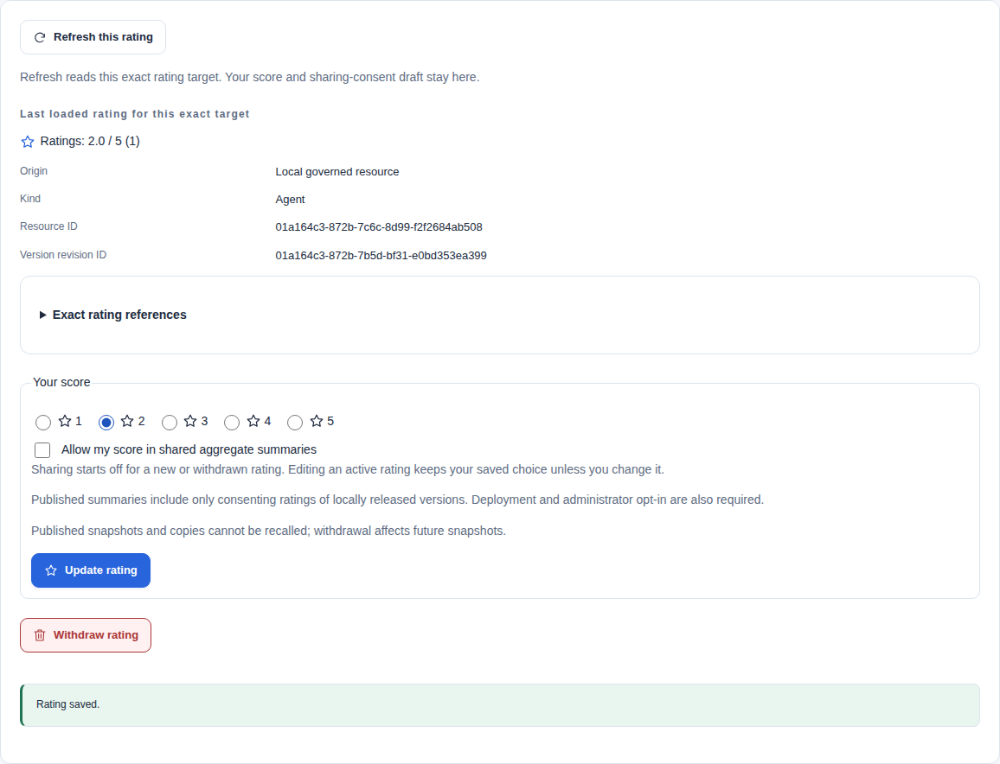

Ratings are human opinions about an exact resource version. They do not indicate approval, trust, installation, availability or search relevance.

See [result evidence](understand-results.mdx#understand-what-the-evidence-establishes) to distinguish ratings from validation, review, provenance and optional registration assessments.

## Before you start

Sign in with a human identity to submit a score. Service accounts cannot score resources. Your current Catalog permissions and OAuth scopes determine which actions you can use.

| Action | Catalog authority | OAuth scope when enforced |
| --- | --- | --- |
| Read a resource's totals | Current access to that exact resource or source result | `catalog.read` |
| Submit or edit your score | Current target access and `ratings.own` for that target | `ratings.write` |
| Read your retained ratings | Current human identity and ownership | `catalog.read` |
| Withdraw your active score | Current human identity and ownership; target access and `ratings.own` are not required | `ratings.write` |
| Read the moderation inbox | Tenant `ratings.moderate` | `tenant.admin` |
| Remove a score or permit resubmission | Tenant `ratings.moderate` | `tenant.admin` |
| Read or change publication sharing | Tenant `ratings.sharing.manage` | `tenant.admin` |

For local resources, `ratings.own` can apply to the tenant or exact namespace. Foreign results require tenant authority. An OAuth scope limits a permission; it does not grant one. See [access management](access-management.mdx) for role and assignment controls.

## Rate a resource

1. Sign in with a human Catalog identity.
2. Open a Catalog item or its full record.
3. Expand **Ratings for this version**.
4. Select one to five stars.
5. Choose whether to allow your score in shared aggregate summaries.
6. Submit and confirm the command.

Sharing consent is off for a first or withdrawn submission. An edit preserves your existing choice unless you change it. A zero count displays **No ratings**; it is not a zero-star opinion.

For local and indexed targets, choose **Refresh this rating** to reread the exact target. Your score and sharing-consent draft remain in place. Pending or failed reads keep labelled last-loaded totals; new score or withdrawal commands wait for successful readback. Refresh does not submit an opinion, resolve another resource or change the target. Live results use the separate captured-search refresh below.

Check the captured score and **Sharing consent** in the confirmation. These values describe the submitted command, including saved consent when an edit leaves that choice unchanged. Consent alone does not publish a summary. Published summaries include only consenting ratings of local released versions; ratings of external entries are excluded.

Closing an edited rating panel or leaving its preview asks before discarding your changes. An unknown command outcome keeps the confirmation open for an explicit retry with the same request.

Only you and authorized tenant moderators can read your individual rating. Ordinary readers see a count and a one-decimal average for items they can access. For example, **Ratings: 2.0 / 5 (1)** means one active opinion with a two-star average. Private [item feedback](feedback.mdx) remains a separate feature.

This screenshot uses a disposable synthetic Agent. Select the image to open it at full size.

## Understand the version and source

A local rating belongs to one Resource and immutable VersionRevision. A new release of that same revision uses the same ratings. A different revision starts a separate total.

For an external item, **Ratings here** means opinions recorded in this consuming Catalog. Each rating identifies the source, its authority generation, exact resource identifier (AIR), advertised version and resource kind. The generation changes when an administrator replaces the source endpoint or interface. Different sources never share a total.

Same-version source updates retain existing opinions. The owner sees a warning when the entry has changed since their rating. An unversioned source entry is labelled explicitly. Replacing the source authority starts a separate total.

Live results use a signed rating proof. A rating write does not fetch the peer or invoke the resource. Follow [proof refresh](#refresh-a-live-results-rating-proof) if it expires.

An optional **Peer-reported rating** shows a separate publisher summary, its reporting origin and measurement time. It is not added to local totals. A valid summary is a publisher claim, not independently verified usage or satisfaction.

## Refresh a live result's rating proof

Live rating proof expires after five minutes. Select **Refresh live ratings** in the preview to repeat its captured Catalog search. The request keeps its origins, filters and page cursor. The score and consent draft remain available.

A later-page cursor has a separate fifteen-minute lifetime. An expired cursor or changed result can prevent renewal. Start a new Catalog search and reopen the current result; the UI does not silently discard the cursor or change the rating target. Refresh does not require identical metadata bytes. It must still match the source, presentation generation, identifier, version presence, version and resource kind.

Closing the rating panel or preview cancels pending refreshes. The refresh button is disabled while its request is pending. Cancelled responses cannot replace proof. Refresh never submits an opinion automatically.

## Edit, withdraw and moderate

Open **My ratings** to view your retained opinions. Reads need `catalog.read` when OAuth scopes are enforced; withdrawal needs `ratings.write`. You can withdraw after target access or `ratings.own` permission ends. Withdrawal clears the current score and sharing consent.

You can read your retained ratings without current access to their targets. Submitting a new opinion or reading its aggregate still checks current target admission. These are separate operations; the generic API descriptions do not add a target-read requirement to My ratings or withdrawal.

In **My ratings**, **Saved sharing consent** and **Last rating update** describe the saved opinion. Consent permits future eligible shared summaries; it does not prove that any summary has been published. Foreign ratings remain excluded from published summaries. Withdrawn and removed ratings retain their state with consent cleared. These fields require no additional reads or broader target access.

Check the origin, resource kind and target references before an action. Local opinions name their immutable version revision. Foreign opinions name their source and presentation generation. Identical identifiers and version labels can refer to different targets. Expand **Exact rating references** to inspect the returned IDs. Confirmations repeat the exact target; retained references do not grant resource access.

A moderator can remove an opinion with a reason. Removal prevents resubmission until a moderator permits a fresh submission. Moderators cannot choose or replace another person's score. After withdrawal or moderator permission to submit again, a fresh submission starts with sharing off.

To moderate an opinion:

1. Open **Rating moderation** under **Administration**.
2. Select a **Rating state** to narrow the list if needed.
3. Choose **Remove rating** or **Permit new submission** on the intended rating.
4. Check the selected target, version and revision. Enter a **Moderation reason** without credentials or sensitive details.
5. Select that action in the selected moderation panel, then confirm the command.

**Permit new submission** leaves the score withdrawn and sharing consent off. The owner must submit a new opinion; this action does not restore the old score.

Commands require an idempotency key. Changes require the current ETag. An old successful replay returns its original acknowledgement; it does not restore a withdrawn or removed score. Current authentication and relevant permissions still apply.

Lists default to 25 records and permit at most 100. Continuation cursors are bound to the caller and filters. One verified issuer account has at most one current opinion per tenant and target, even if its membership is recreated. This does not verify unique natural persons across accounts.

Withdrawal and removal clear the current score and consent. The Catalog retains minimal revision history and audit evidence; ordinary database backups can retain earlier state. Clearing a score is not a guarantee of erasure from backups or published copies. See [audit records](../operations/audit.md#rating-commands) for recorded actions and excluded fields.

Lists show score, state, update time and target. Expand **Identifiers and sharing** for exact references and consent facts.

Choose **Refresh ratings** in My ratings or Rating moderation to reread the selected state and current page. It preserves the selected moderation target, revision and reason. Filter changes and paging also retain that separate draft. Choose **Cancel moderation** to discard it deliberately.

Pending or failed reads keep the labelled last-loaded page. My ratings makes no extra target lookup, and you can still withdraw your active ratings after losing access to their targets. A failed continuation can be retried with **Reload**; **First page** deliberately resets that cursor and keeps the selected state. Busy reads disable refresh and paging.

The **Rating cases pagination** group names those paging controls. The heading's **Ratings guide** link opens this procedure in the bundled manual. Opening help does not read another person's rating or grant moderation authority.

Expand **Open a case by ID**, enter an **Exact rating ID** and choose **Open rating case**. You can also follow that link from a row. This reads one currently authorized case without scanning list pages or reading its Resource. Exact reads need `catalog.read` scope when enforced. Inbox reads and moderation commands instead need `tenant.admin`; the Catalog permission remains `ratings.moderate`. My ratings retains its human/owner boundary without target-read permission.

The case shows the current state, revision and exact local Resource/VersionRevision or external Source/generation references. Copy controls preserve literal IDs and advertised version text. Rating owners are not exposed. A moderator's exact read can include another person's case. To confirm ownership before withdrawal, a moderator opens the case from their own **My ratings** list. An ordinary owner can withdraw from a direct case without resource reads.

After a revision conflict, choose **Back to form**, then **Read current rating**. Review the new state before preparing another command. The reason remains available, and reading does not resend the rejected mutation. Use the prepared command's retry control after a timeout or unreadable write reply. It preserves the original request and idempotency key.

**Return to rating list** restores the selected state and current cursor, then rereads through current authorization. This single return context stays in private tab memory. Reloading, changing identity or refreshing policy/access clears the list return context. A same-identity refresh keeps the selected moderation draft; **Open rating list** starts with default filters and no captured cursor. A changed case can fall outside the returned list's state filter.

A same-identity permission or scope change retains a draft and disables unauthorized new sends. A prepared command keeps its captured target, body and revision. If the outcome is uncertain, use the retry control for the original command. The backend checks authorization again.

An unsent **Moderation reason** warns before leaving. A successful moderation command consumes its captured reason. Rating and sharing acknowledgements stay visible even if the following read fails; use **Reload** to recover the read without sending the write again. Identity changes clear these private receipts.

## Resolve a failed command

| What you see | What to do |
| --- | --- |
| Scoring controls are unavailable | Check your human identity, exact-target permission and `ratings.write` scope. Read access alone does not grant scoring. |
| A live proof has expired | Select **Refresh live ratings**. The UI preserves your unsaved score and consent choice. |
| The rating or source has changed | Refresh the current record and review its state before preparing a new command. Do not overwrite another change with an old ETag. |
| A write times out or returns an unreadable acknowledgement | Use the prepared command's retry control. It reuses the same idempotency key and request. Do not create a second command to guess whether the first succeeded. |
| A moderator removed your opinion | Ask an authorized moderator to permit a new submission. You cannot replace a removed score directly. |

API clients follow the same [command and replay rules](../reference/api-conventions.md#rating-commands). The HTTP API reference contains the rating request and response schemas.

## Share aggregate summaries

Sharing requires all three conditions:

- The operator enables `ratings.sharingEnabled`.
- An administrator with `ratings.sharing.manage` enables sharing for the configured publication host and audience.
- Each included person explicitly consents to sharing their score.

At least five consented scores are required. The operator can raise this minimum to 1,000 with `ratings.minimumSharedCount`. Nonconsented opinions remain in authorized local totals but never enter the shared summary.

To enable sharing for an audience:

1. Open **Discovery publication**.
2. Choose a configured host, or enter its exact hostname and **Discovery audience**. Select **Open host**.
3. Expand **Rating summary sharing**.
4. Enter a **Sharing reason** without credentials or sensitive details.
5. Select **Enable sharing** and confirm the command.
6. Generate and activate a normal publication snapshot with the required publication permissions.

Sharing administration does not require snapshot-read permission. Without that permission, enter the configured host and audience manually; no host inventory or snapshot is read. A bookmark can supply `?host=HOST&audience=anonymous` or `?host=HOST&audience=authenticated`. The API checks the exact configured pair.

Editing the host fields does not change the opened sharing target. Select **Open host** to apply a new pair. Closing or replacing an unsaved sharing form requires confirmation.

The choice applies only to that tenant, host and audience. It does not enable sharing for other hosts or audiences. The operator setting must also be enabled. Saving this choice does not publish a snapshot.

Only locally released versions can contribute shared summaries. Foreign opinions, individual records and private feedback are excluded. Activation and rollback recheck current consented totals and audience opt-in. If these inputs have changed, generate a new candidate instead of activating the stale one.

The summary is a [Catalog extension](../reference/standards.mdx#optional-rating-summaries), not a standard ARD rating protocol. It contains the reporting origin, exact version, scale, count, sum and measurement time. It contains no individual identities.

Previously published snapshots and copied documents cannot be recalled. Withdrawal or disabling sharing affects future snapshots. Use normal publication replacement or [safety withdrawal](publishing.mdx) to stop serving a previous snapshot locally.

See the [configuration reference](../reference/configuration.mdx#resource-ratings) for operator settings and the [architecture decision](../architecture/decisions/0023-human-resource-ratings.md) for privacy and persistence rules.

## Imported here

An external result can show **Imported here** when retained adoption evidence identifies an exact local match you may read. The link opens that Resource. A changed source entry is labelled separately.

The match uses historical source authority, AIR, advertised version and kind. A locally assigned version does not replace an absent peer version. Private, unrelated or ambiguous matches are omitted.

This indicator is not an installation count. The Catalog does not observe installation or a browser's final file save. It does not invent install, download or popularity numbers.

## Inspect retained rating counts

Open **Overview > Administration** with `ratings.moderate` and enforced `tenant.admin`. The panel counts active, withdrawn and removed ratings, including unavailable targets. Active ratings are not pending moderation. There is no average score across unrelated versions. See the [Administration overview](catalog-ui.mdx#read-the-administration-overview) for limits and exact state links.
