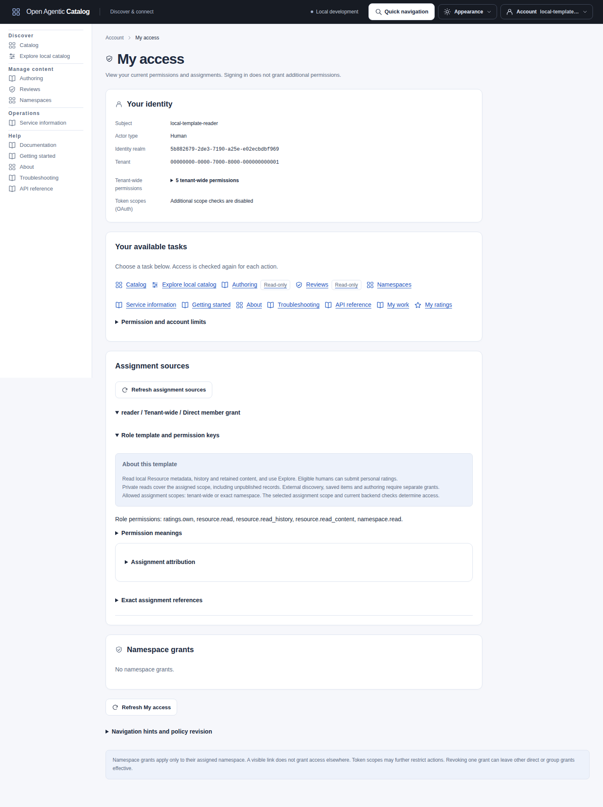
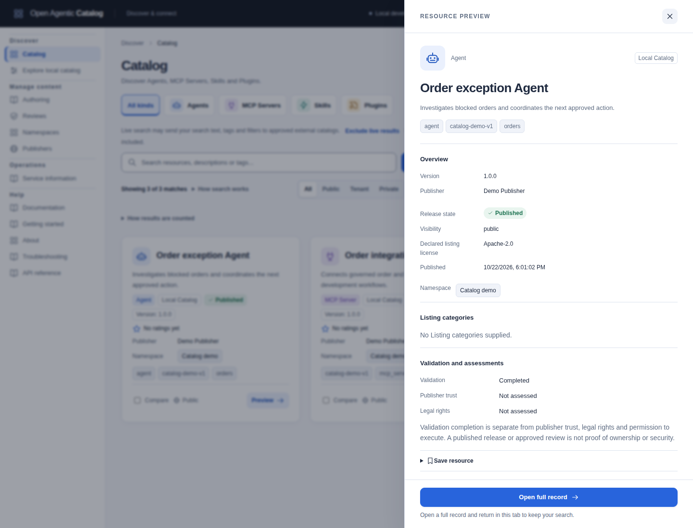

Use this path when your administrator already operates a Catalog. Browser access needs no checkout, Go, Node, PostgreSQL or container tools. To run your own service, use the separate [local quickstart](local-development.mdx).

## Get your connection details

Ask your administrator for:

- The Catalog UI URL, including any path prefix.
- An account with the configured [identity provider](../reference/glossary.md#identity-provider-idp) and its password or other sign-in method.
- An active Catalog [membership](../reference/glossary.md#membership) with read access to the intended [tenant](../reference/glossary.md#tenant) and [namespaces](../reference/glossary.md#namespace).
- The name of one published resource you should be able to read.

Request the API origin only if you want the optional CLI or VS Code client. It can differ from the UI URL. Native clients also need their own issuer/client settings and private certificate trust, when applicable. A browser reader does not configure the backend.

Account creation and password resets belong to the identity provider. Catalog administrators separately manage membership and permissions. See [users, passwords and Keycloak](../operations/oidc-keycloak.md#run-the-interactive-local-tutorial) for the operator procedure.

## Make your first browser visit

1. Open the supplied UI URL.
2. Select its sign-in action and complete the configured provider login.
3. Open **My access**.
4. Check **Subject**, **Actor type**, **Identity realm** and **Tenant** against your expected account.
5. Inspect **Tenant-wide permissions** and **Namespace grants**. Look for `resource.read` at the tenant or intended namespace.
6. Open **Catalog** and select **Filters**.
7. Under **Origin**, select **Local Catalog** and clear **Indexed external** and **Live external**, if shown. Select **Apply filters**.
8. Search for the published resource named by your administrator.

Typing stages text; choose **Search** or press Enter to apply it. **Refresh results** rereads applied criteria and preserves pending text. See [refresh and comparison](search-cookbook.mdx#apply-text-refresh-and-compare-results) before repeating a live or provider-backed search.

Signing in does not add permissions. **My access** explains current grants and their direct/group sources. Navigation hints show where an action might be available; the backend still checks each action and its exact scope. An administrative link or a remembered URL does not grant administrative access.

If OAuth [scope](../reference/glossary.md#scope) enforcement is enabled, your token also needs `catalog.read`. A role name alone is not an access check. Use **Refresh My access** after an administrator changes your grants.



This development example has scope checks disabled. Your Catalog can use different roles and namespace grants, with OAuth scopes enabled. [Open the full-size screenshot](../../../../assets/catalog-ui/my-access-reader.png).

See [Read your current access](access-management.mdx#read-your-current-access) for grant details.

A saved draft or approved submission does not appear in the Reader's local search. A new unpublished Version does not replace the current release.

An empty Catalog is a valid result. Successful login does not imply that the tenant contains readable published releases. Ask your administrator to confirm the exact resource, release state and grants before changing search terms indefinitely.

## Inspect and copy one result

1. Select the resource card or name to open its preview.
2. Read **Overview**: description, resource kind and exact advertised version.
3. Confirm that its origin is local. **No version supplied** and an explicitly **Empty version** are different external states.
4. In **Use this resource**, select **Copy Resource identifier**. Select **Copy Resource version**.
5. Expand **Exact release and revision IDs**. Select **Copy Release ID**.
6. Select **Open full record** when you need the complete local record and its permitted history links.

Use the browser's Back action to return to your search. The UI retains your applied criteria, pending text and layout in this tab.



The preview separates publication from assessments. Copy controls remain available through the procedure above. [Open the full-size screenshot](../../../../assets/catalog-ui/catalog-preview.png).

Keep the identifier, version and local release UUID together. They identify different parts of the selected resource. [Understand a result and its evidence](understand-results.mdx) explains the references, validation, review, ratings and external provenance.

Copying a Card, package URL or identifier does not install or invoke anything. The web UI provides metadata and explicit document/reference handoffs. Your chosen client and the target resource enforce any later installation or execution decision.

For concrete searches against an owned sample Catalog, follow the [search cookbook](search-cookbook.mdx). An existing Catalog need not contain those samples.

## Optional: save a resource or search

Open **Account > Saved items and searches** to manage your private library. Use **Save resource** on a record or **Save this named search** after a submitted Catalog search. Each save requires explicit confirmation. Saving retains the exact reference or validated criteria, not resource documents or access rights.

Quick resource saving shows a read-only reference. Named searches use guided text and optional filters, with an advanced JSON view of the same draft. You can filter by item type and the complete, exact label. The library shows saved summaries without resolving each target. Follow [Save resources and searches](catalog-ui.mdx#save-resources-and-searches) for matching, consent and recovery.

Ask your administrator for `library.own` if the page is unavailable. With OAuth scope enforcement, reads also need `catalog.read` and changes need `personal.write`. Opening saved criteria stages an editor; review current disclosure and consent, then select **Search** explicitly. See [saved items and searches](catalog-ui.mdx#save-resources-and-searches) for quotas, unavailable references and removal.

## Optional: use an existing CLI binary

Obtain a built `catalogctl` binary from your administrator. No released binary download is assumed. Maintainers can follow [the build guide](../contributing/build-and-release.md); readers with a supplied binary do not need its source-build prerequisites.

Ask for the API origin, exact [issuer](../reference/glossary.md#issuer) URL, registered [public CLI client](../reference/glossary.md#confidential-and-public-client) ID and required scopes. Browser cookies do not supply CLI credentials. Create a private credential directory and select a new credential filename:

```sh
mkdir -p "$HOME/.catalog-login"
chmod 700 "$HOME/.catalog-login"
catalogctl auth login \
  --issuer https://identity.example.com/realms/catalog \
  --client-id catalog-cli \
  --base-url https://catalog.example.com \
  --scope catalog.read \
  --file "$HOME/.catalog-login/reader.json"
```

Replace the two example origins and client ID with the administrator's values. Open the authorization URL on the same machine as the CLI. For private certificates, add `--issuer-ca-file PATH` and `--ca-file PATH` with the separately supplied issuer and API CA files. Keep TLS verification enabled.

Login requires a new file. To replace an existing login, first run `catalogctl auth logout --file "$HOME/.catalog-login/reader.json"`. Do not edit or overwrite its contents.

Select that credential file explicitly for each remote command:

```sh
unset CATALOG_REMOTE_TOKEN CATALOG_REMOTE_TOKEN_FILE
catalogctl remote search \
  --base-url https://catalog.example.com \
  --login-file "$HOME/.catalog-login/reader.json" \
  --origin local --text "administrator-provided resource name"
```

Add the applicable private trust flags to this command too. The CLI returns one page in `data`; check `data.partial`, `data.diagnostics` and `data.nextCursor`. See [CLI commands and human login](../reference/commands.md#human-cli-login), [remote Search](../reference/commands.md#remote-catalog-reads) and the <a href={`${import.meta.env.BASE_URL}api/`}>HTTP API reference</a> for complete contracts.

## Optional: browse from VS Code

Obtain the local VSIX from your administrator or maintainer and follow [VS Code installation](../../../../../extensions/vscode/README.md#install-the-local-package). The installed package includes its SDK. Browsing needs no repository checkout or separate Node/Go installation.

Add a **control** connection using the supplied API origin, then follow [native sign-in](../../../../../extensions/vscode/README.md#sign-in-and-sign-out). OIDC uses a separately registered public desktop client. Its credentials stay in VS Code SecretStorage; the extension does not reuse the UI cookie or CLI credential file.

Run **Catalog: Test Connection**, then **Catalog: Open Catalog**. Resource use has separate native requirements and consent. The extension's packaged desktop qualification covers Linux amd64; check its guide before relying on other hosts or installation workflows.

## Troubleshoot connection, sign-in, and search problems

| What you see | What to check |
| --- | --- |
| The UI does not load, or a native client returns HTML | Confirm the UI URL separately from the path-free API origin. Native clients connect to the API, not the UI host. See [connection setup](../operations/sign-in.md). |
| Certificate verification fails | Obtain the correct CA for that browser or native client. Keep hostname verification enabled. See [private issuer/API trust](../operations/sign-in.md). |
| Provider login succeeds but Catalog refuses access | Ask the administrator to check the current subject, identity realm, active membership and applicable grants. [Access management](access-management.mdx) owns those records. |
| A native client reports an expired or wrong-audience token | Use that client's configured login again or its supported refresh. Confirm the API audience and issuer; an ID token is not an API access token. See [human CLI login](../reference/commands.md#human-cli-login). |
| Search returns no accessible published results | Clear unintended filters and confirm the expected local release with the administrator. Check read grants and release eligibility; a successful login can still show an empty Catalog. See [search outcomes](search-cookbook.mdx#tell-empty-limited-and-partial-results-apart). |
