import NativeImportRecovery from "../../../components/architecture/NativeImportRecovery.astro";

Add an Agent, MCP Server, Skill or Plugin through the browser, native CLI or Control API. The browser can generate documents from fields. You do not need to prepare JSON for that workflow.

| What you have | Where to start |
| --- | --- |
| Details for a new item, without a prepared document | [Create and prepare a resource](#create-and-prepare-a-resource), then use the fields for your resource kind. |
| A reusable Catalog draft JSON file | [Import or download draft JSON](#import-or-download-draft-json). |
| An already deployed Agent or MCP server | [Register an existing server](#register-an-existing-server). |
| A saved MCP Registry response | [Import one MCP Registry record](#import-one-mcp-registry-record). |
| An existing Agent or MCP JSON document, or a `SKILL.md` file | [Load a local document](#load-a-local-json-or-markdown-document), or paste its text into the matching advanced editor. |
| A complete Skill directory | [Upload a complete Skill package](#upload-a-complete-skill-package). Include its immutable Git or OCI handoff. |
| Plugin files or an existing Plugin archive | [Prepare Plugin files](#prepare-plugin-files-from-fields), or supply the existing archive's HTTPS URL. |
| A correction or another version of an existing item | [Correct a saved draft](#correct-a-saved-draft) or [create a new Version from retained content](#create-a-new-version-from-retained-content). |
| Several native documents for a scripted import | [Preview a native draft](#preview-a-native-draft-locally), then [apply it](#apply-and-resume-a-native-draft). |
| An application that sends API requests | [Prepare a version request](#prepare-a-request-to-create-a-version). |
| A local Catalog that needs demonstration data | [Set up a sample Catalog](sample-catalog.mdx). |

Saving content creates a draft. Follow [review and publication](publishing.mdx#publish-an-agent-in-the-browser) to make an approved release available to readers.

## Separate native content from the listing

A Resource identifies one Agent, MCP Server, Skill or Plugin. A VersionRevision retains its native representations. Validation runs record separate evidence for that immutable content. A ListingRevision supplies the display name, description, publisher, tags, representative queries and visibility for one exact VersionRevision.

Keep protocol endpoints, capabilities and package content in the native representation. Put Catalog presentation and discovery metadata in the listing. Similar names and descriptions can occur in both documents, but changing a listing does not rewrite native content.

Choose the supported format from the [standards reference](../reference/standards.mdx). Check the [pinned profiles](../../../../../schemas/PROFILES.md) when you prepare content for a specific specification version. The declared `mediaType` selects validation; the Catalog does not infer the format from the filename.

## Register an existing server

Obtain the metadata document from the server's producer. An Agent uses an A2A Agent Card. An MCP server can use an experimental Server Card or Registry `server.json`.

A metadata-document URL returns that document. An endpoint inside the document identifies the Agent or MCP service. Do not enter an invocation URL as the document URL. A JSON-RPC `tools/list` response and an MCP client's connection settings are not Catalog metadata documents.

Some MCP servers publish no separate metadata document. Use [MCP fields](#create-mcp-metadata-from-fields) to describe one instead. Select only capabilities, protocols and distribution details that the producer supplies.

1. Check [authoring access](#check-access-before-authoring) in the destination Namespace.
2. Open **Authoring > Create resource**.
3. Select the kind.
4. Enter an unused permanent identifier.
5. Select **Next: Content**.
6. Set **Version label** to the native document's resource version.
7. Choose the matching [Agent](#import-or-edit-an-existing-agent-card) or [MCP](#import-or-edit-mcp-metadata) format.
8. Load the producer's local document, or select **Anonymous HTTPS document** under **Content source**.
9. For HTTPS, enter the metadata-document address in **Document URL**.
10. Save the draft through the [normal confirmation steps](#create-and-prepare-a-resource).
11. Inspect the returned validation findings.

Selecting an HTTPS source does not fetch the document. Saving sends the request that retrieves and retains its bytes. For HTTPS input, check **Media type** under **Advanced representation settings**. Use `application/a2a-agent-card+json` for an Agent Card, `application/mcp-server-card+json` for a Server Card, or `application/vnd.mcp.server+json` for Registry metadata.

HTTPS retrieval uses the deployment's public outbound fetch policy. The URL must be credential-free. The response must use the declared base media type and fit the configured limits. Do not supply `expectedDigest` for Agent or MCP documents; that input applies to Plugin archives. Use a local file if the document cannot be retrieved under the operator's policy. Resolve validation findings before review; do not change network controls to bypass a refusal.

Use **Revalidate revision** on the exact revision when you need fresh evidence. It requires `resource.validate` and `resource.read_content`; enforced OAuth scopes also require `catalog.write`. Revalidation compares remote bytes with the retained document. It does not replace that document or run continuously.

Changed bytes require a new VersionRevision while the Version remains unsealed. A sealed Version requires a [new Version label](#create-a-new-version-from-retained-content) and matching native version. A blocked revalidation can withdraw entire active discovery snapshots containing the affected release. Retained content stays unchanged. Follow [validation recovery](#inspect-revision-validation-in-the-ui) and [publication corrections](publishing.mdx#correct-or-update-content) before restoring discovery.

Saving metadata does not deploy or invoke the server. Validation, independent review, release and snapshot activation remain [separate steps](publishing.mdx).

## Author in the UI

A star (`*`) marks required fields. The form also checks fields when you continue or save. Conditional fields become required when you select their input path.

### Prepare your account and inputs

1. Open your Catalog UI and sign in with your own account.
2. Ask a Tenant Administrator for authoring access in the destination Namespace.
3. Obtain the Namespace name or ID.
4. Obtain a Publisher name or ID if you plan to include Listing details.

Use the [sample Catalog](sample-catalog.mdx#start-the-catalog-with-compose-and-load-sample-data) for local practice. For a deployed Catalog, follow [Authentication and sign-in](../operations/sign-in.md). Browser authors need no local compiler, SDK or database connection.

The Namespace must exist before you create a Resource. The Publisher must exist before you save a Listing. An administrator can [create these entries](#manage-namespaces-and-publishers). You can save content without Listing details or a Publisher.

Enter an exact ID if the form does not list your Namespace or Publisher. The Catalog checks access when you confirm.

Choose an unused permanent identifier for a new Resource. Use [Find an existing resource](#find-an-existing-resource) before creating another Version of an existing item. Endpoint addresses describe your Agent or MCP server. Adding metadata does not deploy, start or invoke that service.

### Check access before authoring

Open **Account > My access** and check the exact destination Namespace. An Authoring navigation link can reflect access in another Namespace. It does not authorize a command in this one. Role names describe templates; current permissions and token scopes decide access.

| Task | Catalog permissions in the target Namespace | OAuth scope when enforced |
| --- | --- | --- |
| Browse or open Resource, Version and Listing metadata | `resource.read` | `catalog.read` |
| Create a Resource | `resource.create` and its `namespace.read` companion | `catalog.write` |
| Create a Version, VersionRevision, Listing or ListingRevision | `resource.edit` with `resource.read`, `resource.read_history` and `resource.read_content` | `catalog.write` |
| Read revision/release history and review summaries | `resource.read_history` | `catalog.read` |
| Read retained revision content or validation evidence | `resource.read_content` | `catalog.read` |
| Revalidate an exact VersionRevision | `resource.validate` and its `resource.read_content` companion | `catalog.write` |
| Submit the saved Listing candidate for review | `review.submit` with `resource.read_history` and `resource.read_content` | `catalog.write` |
| Delete an eligible unused Resource | `resource.delete_draft` and its `resource.read` companion; creator or protected-administrator checks also apply | `catalog.write` |

These scopes apply to the selected API action. Opening a browser detail page or reading a picker can need a separate read scope. For example, a create-only delegate can enter a known Namespace UUID with `catalog.write`, without loading metadata using `catalog.read`. Keep returned references when the next page requires access you do not have.

Custom roles must include the listed companion permissions. A Contributor template includes authoring and submission, but not independent review or release publication. Ask the Tenant Administrator for the listed task in the exact Namespace. See [review and publication access](publishing.mdx#check-access-for-each-publishing-task) for the next handoff. Namespace/Publisher administration retains its [separate access requirements](#manage-namespaces-and-publishers).

Missing permission, a pending or failed exact-Namespace check, an absent prerequisite and a terminal lifecycle state have different causes. Read the form's explanation. A permitted Namespace selector stays editable before Create is ready; changing to an authorized Namespace can make the command available. Existing metadata and permitted evidence remain inspectable when mutation fields are disabled.

### Create and prepare a resource

1. Open **Authoring > Create resource**.
2. Select the Namespace and kind.
3. Enter a permanent identifier, or use **Build an AIR identifier**.

   For the builder, enter the publisher domain, optional AIR namespace segments and resource name. Select **Use AIR identifier**. The administrative Namespace is separate from AIR namespace segments. The builder does not verify domain control.

4. Select **Next: Content**.
5. Enter a **Version label**.
6. Complete the fields for your kind: [Agent](#create-an-agent-from-fields), [MCP Server](#create-mcp-metadata-from-fields), [Skill](#write-a-skill-from-fields) or [Plugin](#prepare-plugin-files-from-fields).
7. Select **Include Listing details** if you want to save a Listing with the content.

   Complete these steps only when you include a Listing:

   1. Select **Next: Listing details**.
   2. Choose its Publisher.
   3. Select its visibility.
   4. Enter a display name and description, or leave them empty to use validated primary-document values.
   5. Set any optional Listing metadata.

8. Select **Save content draft**.
9. Check the identity, Namespace, version and save scope in the confirmation.
10. Check the Listing details when included.
11. Select **Confirm**.

Select **Back: Basics** or **Back: Content** to check earlier input. Next and Back preserve content and staged files without writes. Each save uses a separate command key. A later failure does not repeat acknowledged writes.

[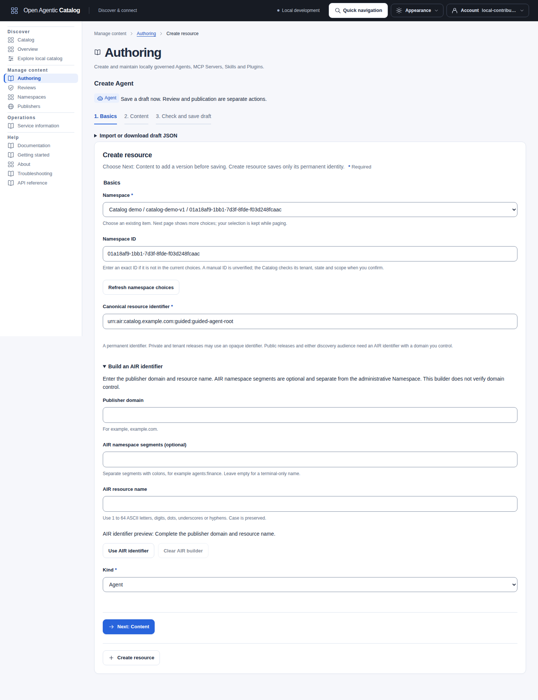](../../../../assets/catalog-ui/authoring-basics.png)

The AIR builder fills the permanent identifier. **Next: Content** opens the content editor without saving.

Expand **Use a local example** for sample content. Choose the format. Select **Use example**. Confirm replacement of existing content when asked. Examples select their matching media type; they do not contact declared endpoints.

### Correct missing or invalid fields

Fields with missing or invalid values show an error message and a highlighted border. Checks for required values focus the first invalid field. Select a field link in an error summary to focus that field. Correct the value to clear its error. **Next: Listing details** checks Content before it opens Listing details. The Catalog still validates submitted content and records its findings.

[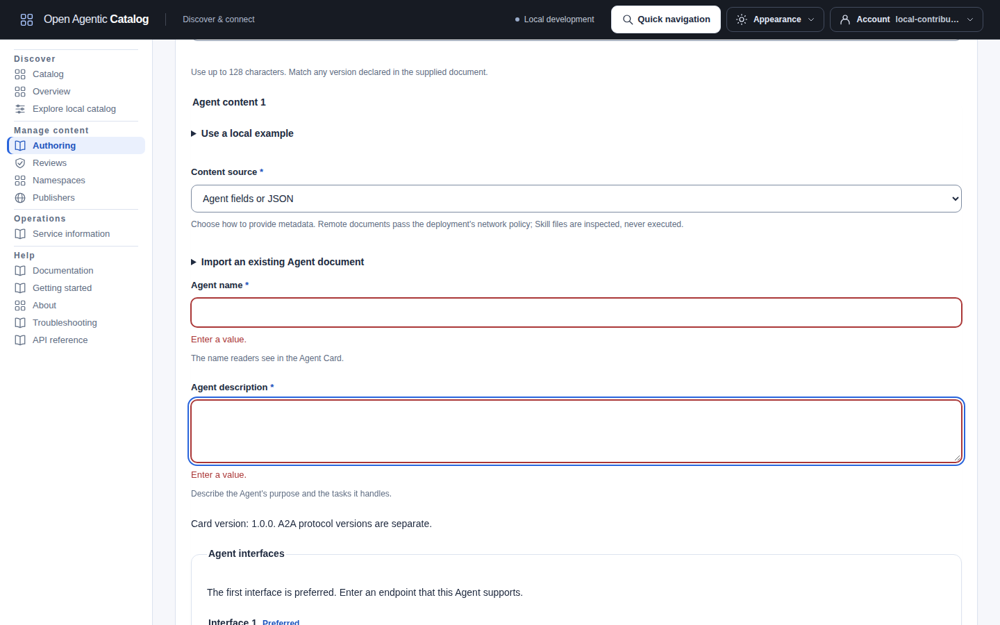](../../../../assets/catalog-ui/authoring-required-fields.png)

This check catches missing input before a save. Advanced documents and archive contents also need the Catalog's validation after submission.

### Check the saved draft

Read the returned validation findings. **Draft saved** confirms retained content. **Draft saved, corrections needed** identifies a saved revision with validation errors. Select **Correct this draft** to edit the retained input. Select **Save corrected draft** to create another revision with the captured Version ETag.

**Listing draft saved** confirms that the Listing references the saved content. Select **Open saved Listing** to inspect it and continue to review.

Select **Prepare Listing for saved content** if you saved content alone. The workspace supplies the exact saved revision. It updates the Resource's existing Listing when one exists. A failed lookup does not permit another Listing.

[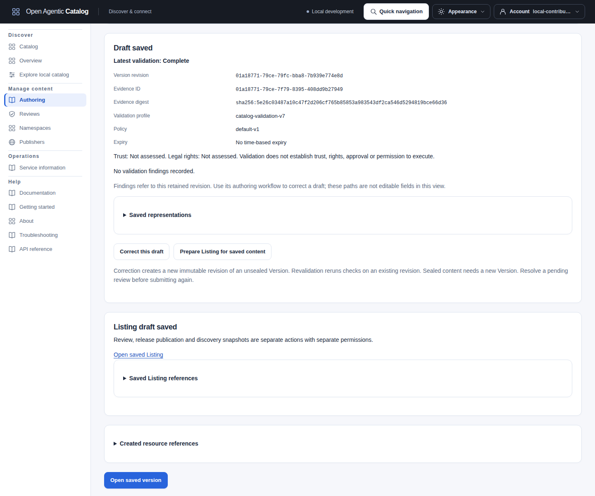](../../../../assets/catalog-ui/authoring-saved-draft.png)

The result links open the exact saved Version and Listing.

A saved draft is not published. Review, release publication and discovery snapshots require separate actions and permissions. Both discovery audiences require an AIR identifier and a supported primary representation.

A public release requires two to five representative queries and administrator approval of the AIR publisher domain. Tenant-visible releases can omit these queries for AI Catalog output, but ARD output requires them. Private and tenant releases do not require domain approval.

**Create resource** on Basics saves only the identity. A creation-only delegate can use it without content-editing authority. With editing authority, **Continue to content** opens the same draft without creating another Resource. Saving only the identity leaves Version content unsaved. The UI protects that content until you save it or confirm its removal. **Add version** starts at Content for the fixed existing Resource.

After a complete save, **Add another item** clears the identifier, native content, version, staged files and command keys. For the next item, it keeps the selected Namespace and kind. **Create another version** keeps the existing Resource identity. The previous save receipt remains available. Private input stays in memory and clears when the signed-in identity changes.

On a Resource's Authoring page, **Versions** and **Listings** open and refresh their corresponding history. Select a Version to inspect its revisions and validation. Use **Add version** for another version label. See [new Versions and retained content](#create-a-new-version-from-retained-content) before copying an existing item.

### Create an Agent from fields

Use **Agent fields or JSON** under **Content source**. Enter these values after Basics. You do not need a prepared document.

Use a Namespace where you can create and edit content. The [access setup](access-management.mdx#set-up-minimum-access-for-a-workflow) lists the required companions. For this example, enter `urn:air:demo.catalog.example.com:agents:order-status-tutorial` as the canonical identifier. Use your Publisher's approved domain instead of `demo.catalog.example.com` when preparing a public release.

| Field | Example input |
| --- | --- |
| Version label | `1.0.0` |
| Agent name | `Order status Agent` |
| Agent description | `Explain an order and its next step.` |
| Interface 1 HTTPS URL | `https://agents.example.test/orders` |
| Input format 1 | **JSON** |
| Output format 1 | **Text** |
| Ability 1 name | `Explain order status` |
| Ability 1 ID | Select **Use suggested ability ID: explain-order-status**, or enter your own ID. |
| Ability 1 description | `Explain order status without changing the order.` |
| Ability 1 tag 1 | `orders` |

The interface URL describes an existing Agent endpoint. It is separate from the Catalog address. The Catalog does not invoke it.

The generated Card uses the Version label. Changing that label updates a Card created through these fields. The initial interface uses JSON-RPC and A2A protocol version `1.0`. The resource version and protocol version are separate values.

Select **Add interface** when the Agent supports another endpoint. Keep the preferred interface first. Expand the interface's protocol settings to change its binding or protocol version. The same HTTPS requirement applies to gRPC interfaces.

Select **Add ability** to describe another ability. These entries do not create separate Catalog Skill resources. Enter tags as separate values. A comma stays within its value. Choose **Custom media type** for formats other than Text or JSON.

The **Add interface** and **Add ability** buttons focus the new row's first field. Each Remove button focuses a remaining row.

Expand **Optional Agent capabilities** to advertise supported features. Select only features that the Agent implements. New Cards advertise no optional capabilities.

Select **Include Listing details** to prepare display metadata now. Select **Next: Listing details**, then choose your Publisher. Enter `Order status Agent` as the display name and `Explain an order and its next step.` as the description. Keep private visibility for this draft. Add two representative queries before discovery publication: `Find an order status Agent` and `Explain a delayed order`.

Select **Save content draft**. Check the captured request. Select **Confirm**. Expect **Draft and Listing saved** and complete content validation. Select **Open saved Listing** for [independent review and publication](publishing.mdx#publish-an-agent-in-the-browser). The Listing already references the acknowledged content; do not copy revision IDs.

To save content alone, leave **Include Listing details** clear. Expect **Draft saved. Version 1.0.0.** You can prepare the Listing later.

[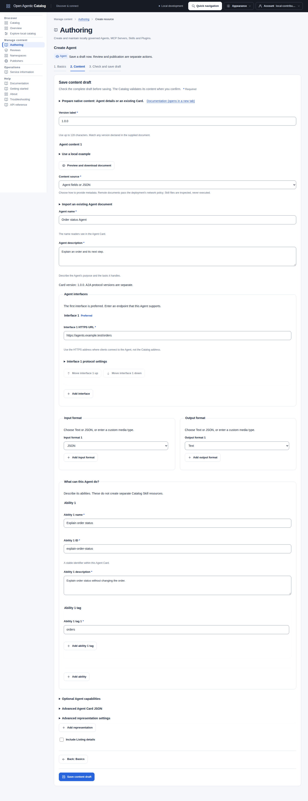](../../../../assets/catalog-ui/document-first-authoring.png)

The Agent fields generate the Card without a prepared JSON file. Open the image for full-size details.

[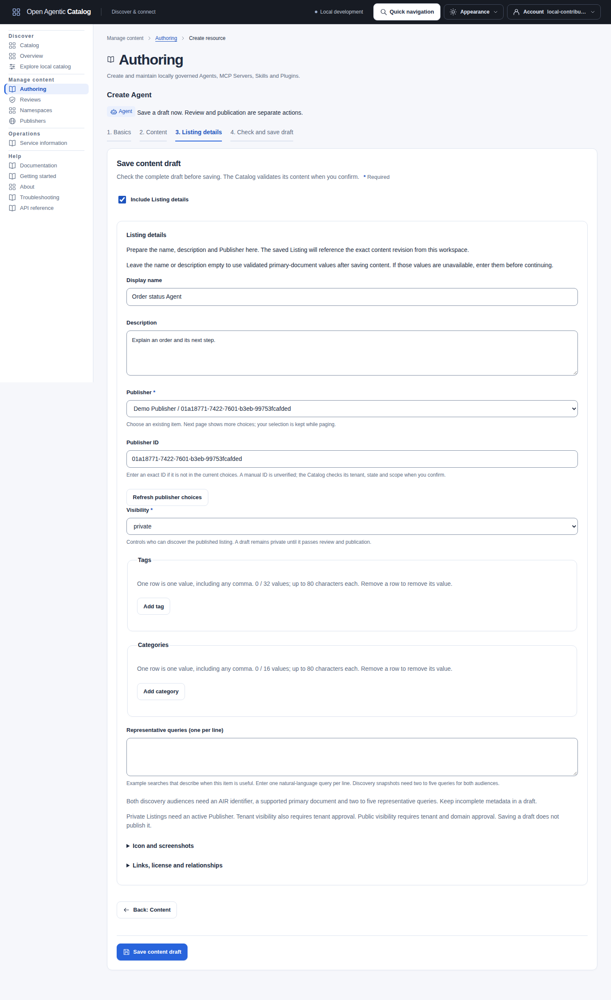](../../../../assets/catalog-ui/guided-listing-details.png)

Prepare display metadata before saving content. The final save links it to the returned content revision.

#### Import or edit an existing Agent Card

Expand **Import an existing Agent document**. Select a UTF-8 JSON file with **Document file**. Select **Use loaded document**. Confirm replacement of existing content when asked.

Review the imported Card under **Advanced Agent Card JSON**. Close that section to edit recognized fields. Switching views preserves the document, ordered interfaces and untouched advanced values.

Use Advanced JSON for provider details, security declarations, extensions, signatures and other Card fields. Unsupported structures and invalid JSON stay visible in Advanced. Numeric-fidelity and document-size limits still apply.

Do not enter passwords, tokens or private signing keys in a Card.

Imported Cards keep their declared version. Use **Use document version ... as Version label** to keep that value. Use **Use Version label in this Card** to replace it explicitly.

Signed Cards have read-only fields and JSON. Select **Create unsigned copy** only when you intend to remove all Card signatures. Confirm the removal before editing. Alternatively, import an externally re-signed Card. The Catalog checks signature structure; it does not verify the signatures or hold signing keys.

### Create MCP metadata from fields

Select **MCP Server** as the kind. Select **Next: Content** after completing Basics. Use **MCP fields or JSON** under **Content source**.

Choose **MCP document** for your purpose:

| Choice | Generated document | Use |
| --- | --- | --- |
| Hosted server | Experimental MCP Server Card | Describe remote connectivity. Discovery snapshots require this format as the primary representation. |
| Package or distribution metadata | Registry `server.json` | Describe remote or package distribution. Registry-only drafts and releases remain available. |

New entries start with a hosted Server Card. The Card format remains experimental. Neither format lists the server's tools, prompts or resources.

#### Describe a hosted MCP server

Enter these values for a Server Card:

| Field | Example input |
| --- | --- |
| Version label | `1.0.0` |
| MCP server name | `com.example/documentation` |
| MCP display title (optional) | `Documentation search` |
| MCP description | `Search documentation without changing it.` |
| Endpoint 1 URL, after **Add endpoint** | `https://mcp.example.test/documentation` |
| Endpoint 1 transport | **Streamable HTTP** |

Use `urn:air:demo.catalog.example.com:mcp:documentation-tutorial` as the canonical identifier for this example. The endpoint describes an existing server; the Catalog does not call it.

The server name uses `namespace/server` syntax, with exactly one slash. It differs from the Resource's AIR identifier and Listing display name. Description and title each allow up to 100 Unicode characters. The server name allows up to 200 characters under its ASCII pattern.

Select **Add endpoint** when you want to declare an endpoint. Enter its URL. New rows use Streamable HTTP; select Server-Sent Events when appropriate. Endpoint rows are optional. Add focuses the new URL field; Remove focuses another endpoint or Add.

Use an absolute HTTPS URL for a literal remote endpoint. A Server Card can also retain a template such as `{baseUrl}/mcp`. Define its variables in Advanced JSON. The Catalog does not substitute variables or connect to the endpoint.

Expand an endpoint's **protocol versions (optional)** section to declare supported MCP protocol versions. Select **Add endpoint 1 protocol version** and enter a value such as `2025-11-25`. Declare only versions that the endpoint supports. New documents do not advertise a protocol version automatically.

Expand **Endpoint 1 headers** to describe required authentication headers. Select **Add header requirement**. Enter the header name and an optional description. The Required and Secret checkboxes describe the client's input. Do not enter credentials. These declarations do not configure Catalog sign-in or enforce the MCP server's authentication.

The generated document follows **Version label**. Package and MCP protocol versions remain separate. Select **Include Listing details**, then **Next: Listing details**. Choose your Publisher and enter `Documentation search` as the display name. Enter `Search documentation without changing it.` as the description. Keep private visibility. Select **Save content draft**, check the request and select **Confirm**. Expect complete validation and a Listing linked to the saved Card.

Leave **Include Listing details** clear to save content alone. This creates neither a release nor a discovery snapshot.

[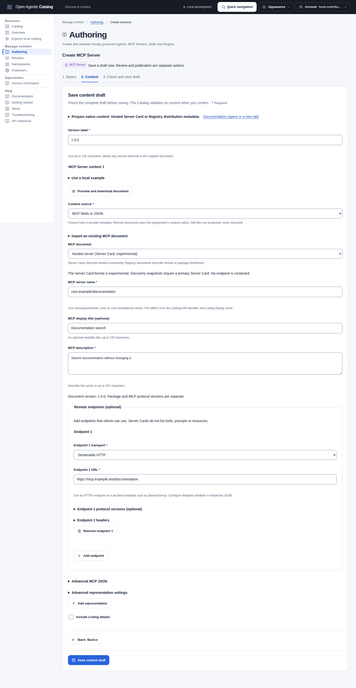](../../../../assets/catalog-ui/mcp-field-authoring.png)

These fields describe the hosted server example above. Open the image for full-size details.

#### Describe Registry packages or remote distribution

Choose **Package or distribution metadata** before entering the document. Enter the same server name, description and optional title fields.

For a remote distribution, select **Add endpoint**. Choose Streamable HTTP or SSE and enter a safe absolute HTTPS URL. Registry remote URLs follow the Catalog's HTTPS rule; they do not accept a leading variable template. Header declarations work as described above.

For a package distribution, select **Add package**. Choose its registry type and enter the package identifier. For example, choose npm and enter `@example/documentation-mcp`. Use **Other registry type** for another declared registry. The Catalog does not query that registry.

Choose the package transport. Stdio needs no URL. Streamable HTTP and SSE require a transport URL or template. Package metadata can describe local HTTP addresses, such as `http://localhost:{port}/mcp`. This does not permit HTTP for a Registry remote endpoint.

Package version is optional. Enter a specific package release when known; do not enter `latest` or a version range. It does not replace the document's Catalog version. For MCPB, also enter the package file's actual SHA-256 hash as 64 lowercase hexadecimal characters.

Expand **Package 1 environment** to declare environment inputs such as `API_KEY`. Enter names and requirements, not secret values. Use Advanced JSON for argument arrays, runtime hints, registry URLs and other native settings. Preserve individual argument boundaries; do not combine them into a shell command.

You can save Registry metadata without an endpoint or package. Validation reports a missing-distribution warning. To prepare discovery snapshots, add a separate primary Server Card. Keep the Registry document in another representation with a non-primary role. Changing formats does not create or update a Listing.

#### Import or edit MCP metadata

Choose the matching MCP format before importing. Expand **Import an existing MCP document**. Select a UTF-8 JSON file with **Document file**. Select **Use loaded document**. Confirm replacement of existing content when asked.

Review the imported document under **Advanced MCP JSON**. Close that section to edit recognized fields.

Imported documents keep their native version. Use **Use document version ... as Version label** to adopt it. Use **Use Version label in this MCP document** to replace it explicitly. Other package versions, ordered arrays and untouched advanced values remain unchanged.

Advanced JSON supports private MCP descriptors, repository data, URL variables, non-secret defaults, package arguments and extensions. Invalid or unsupported input stays available there. Numeric-fidelity and document-size limits still apply.

Choosing another MCP document format starts a new document in that row. Confirm the replacement when content or a staged file exists. The selector does not convert existing JSON between formats. Other representation rows, roles and profile IDs remain unchanged.

### Write a Skill from fields

Contributors can create a standalone Skill without preparing YAML. Tenant administrators use the same form. Reviewers inspect the saved validation evidence before approval.

1. Choose **Skill** under **Kind**, then select **Next: Content**.
2. Enter the Catalog **Version label**.
3. Keep **Write/import SKILL.md** under **Content source**.
4. Enter **Skill name** and **Skill description**.
5. Write the steps under **Skill instructions (Markdown)**.
6. Expand **Optional Skill fields** when the Skill needs them.
7. Include Listing details before saving when needed, as described below.
8. Select **Save content draft**.
9. Confirm the destination and content.
10. Inspect the saved validation findings before review.

For a complete example, use these values:

| Field | Example input |
| --- | --- |
| Canonical identifier, in Basics | `urn:air:demo.catalog.example.com:skills:review-notes-tutorial` |
| Version label | `1.0.0` |
| Skill name | `review-notes` |
| Skill description | `Prepare release review notes.` |
| Skill instructions (Markdown) | `Read the release notes. Summarize the changes and list open questions.` |

To include a Listing, select **Include Listing details**, then **Next: Listing details**. Choose your Publisher and enter `Release review notes` as its display name. Enter the Skill description above. Keep private visibility, then save and confirm. Expect complete validation and a Listing linked to this exact Skill revision.

Names use 1 to 64 lowercase ASCII letters, digits and single hyphens between words. Descriptions contain 1 to 1024 decoded characters. The editor quotes YAML values, so punctuation, numeric-looking strings and Unicode remain text. The complete document limit is 500,000 UTF-8 bytes.

Optional fields include a license, compatibility requirements, string metadata and experimental allowed-tool declarations. Compatibility uses at most 500 characters; clearing it omits the field. Allowed-tool declarations do not grant Catalog permissions or authorize execution. Add a `version` key under **Skill metadata** if your consumer needs it. Agent Skills has no top-level version field; the Catalog Version label stays separate.

Select **Preview and download document** to inspect or download `SKILL.md`. Preview shows escaped source text. It does not render instructions or run code.

[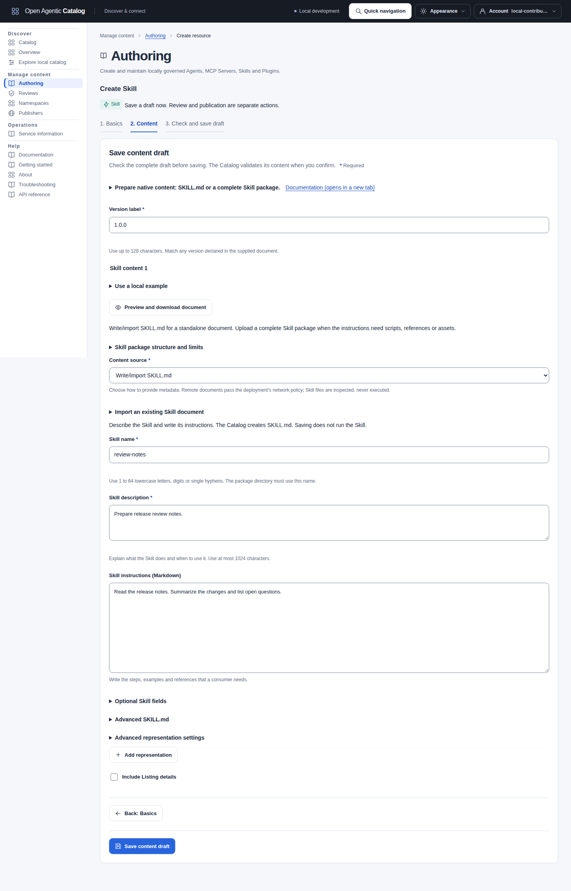](../../../../assets/catalog-ui/skill-field-authoring.png)

These fields generate the example Skill document. Open the image for full-size details.

#### Import or edit Skill YAML

Expand **Import an existing Skill document** to load a UTF-8 `SKILL.md`. Select **Use loaded document** after inspection. Existing content requires confirmation before replacement. The complete original opens under **Advanced SKILL.md**.

Guided fields recognize simple YAML strings and string metadata. Block scalars, aliases, tags, inline maps and unsupported fields stay in Advanced without conversion. These inputs can still be saved for backend validation. Switching views alone does not rewrite the document. An actual field edit quotes frontmatter values and preserves the decoded supported fields and Markdown body; comments and frontmatter formatting can change.

Skill JSON, anonymous HTTPS documents and profiled Markdown remain available through the existing content and representation controls. Skill JSON describes metadata; it does not establish complete-package conformance.

#### Upload a complete Skill package

Use a complete archive when instructions refer to scripts, reference documents, templates or other supporting files. Choose **Upload a complete Skill package**. Inspect **Skill package structure and limits** before selection.

```text
review-notes/
  SKILL.md
  scripts/       (optional)
  references/    (optional)
  assets/        (optional)
```

The archive root must match the `name` in `SKILL.md`. A standalone document cannot establish its parent directory name. Include every file that the instructions need.

Use ZIP or gzipped tar up to 16 MiB. Inspection permits up to 1024 files and 64 MiB after expansion. Each file can use up to 16 MiB. Paths allow 16 levels below the root; expansion cannot exceed 100 times the archive size. The deployment request limit also covers base64 expansion and JSON overhead, so it can reduce the upload limit.

1. Select the complete **Skill archive**.
2. Include a Git handoff, an OCI handoff, or both under **Immutable handoff**.
3. Enter the exact Git commit and package directory, or the OCI digest reference.
4. Confirm the draft and inspect the returned package findings.

The Git directory ends with the inspected Skill root. Mutable Git branches and OCI tags are insufficient. **Edit immutable handoff as JSON** remains available. The Catalog retains inspection metadata and immutable references, not the archive bytes. It does not verify remote availability, clone, pull, install or run the package.

A package-only Version can be reviewed and released. Discovery snapshots need a supported primary document or delivery representation. A Git/OCI handoff alone does not supply that content.

Select **Add primary SKILL.md for discovery** when the uploaded package is primary. This adds a blank primary document and changes the package role to **distribution**. The uploaded archive, handoff and other rows remain unchanged. Complete the primary document before saving. Alternatively, add an anonymous delivery representation and assign exactly one primary role through **Advanced representation settings**. The form supports at most sixteen representations.

### Choose advertised protocols

Open **Interface 1 protocol settings** in the Agent editor. Choose JSON-RPC, gRPC or HTTP+JSON for the endpoint. Select **Other (enter a value)** for a custom binding.

Choose A2A protocol version `1.0`, `0.3` or a custom `major.minor` value. This value describes the endpoint protocol. It is separate from the Agent Card specification release and the Catalog Version label.

Use **Add interface** for another endpoint or protocol combination. Use **Move interface ... up** or **Move interface ... down** to set their order. The first interface is preferred. Each row keeps its URL, protocol values and imported fields.

MCP Server Card endpoints can declare **protocol versions (optional)**. Add a row, then choose `2026-07-28`, `2025-11-25` or a custom value. Complete each added row or remove it. Keep the declaration absent when the endpoint does not advertise it. These controls do not apply to Registry metadata.

These choices describe the advertised service. The Catalog does not contact the endpoint or confirm its protocol support. Imported custom values remain editable. Signed Agent Cards require an unsigned copy or an externally re-signed document before changes.

[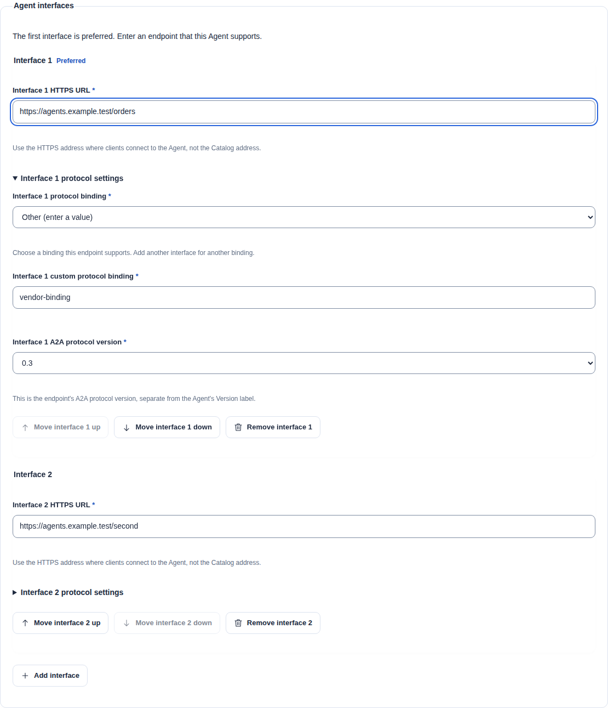](../../../../assets/catalog-ui/authoring-protocol-choices.png)

### Use local examples and document previews

The Agent example supplies a complete A2A Agent Card. MCP examples distinguish a hosted Server Card, Registry remote metadata and Registry package metadata. Registry metadata alone does not supply discovery snapshots. The Skill example supplies a standalone `SKILL.md`. Replace illustrative names, descriptions, endpoints and protocol declarations before using a sample for your own item.

Examples replace only the selected representation. Other rows keep their content and roles. If the document declares a resource version, **Use document version ... as Version label** offers that value. Replacing an existing different label requires confirmation. Package and protocol versions remain independent.

Select **Preview and download document** to inspect the current editor text. The preview shows a heading and filename beside the fields on wide screens. On narrow screens, focus moves to the preview. Select **Back to editor** to return to its preview button. The preview displays escaped text and never runs HTML or Markdown.

The download contains the current editor text. Inline JSON saves its parsed value, so original formatting and number notation can change.

[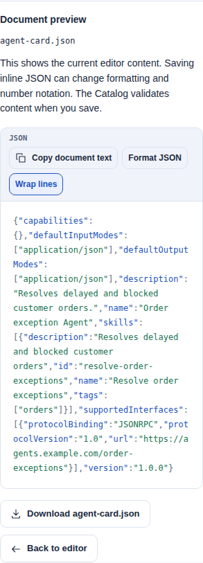](../../../../assets/catalog-ui/authoring-mobile-preview.png)

Initial input and draft reuse reject numbers that the browser cannot preserve, including rounded decimals and underflow. Supply an allowed HTTPS document instead when required. Loading, editing and previewing do not contact declared endpoints or save commands. The backend validates content after confirmation.

### Prepare Plugin files from fields

1. Select **Plugin**.
2. Continue to **Content**.
3. Enter a **Version label**.
4. Select **Prepare Plugin files** under **Plugin input**.
5. Enter the **Plugin name**. Use up to 64 lowercase letters, digits, dots or hyphens. Do not repeat dots or hyphens.
6. Enter the optional description and license. Use **Use Catalog version ... in manifest** when the manifest needs that version.

A minimal Plugin needs only root `plugin.json`. The form supplies the pinned schema. A manifest version, when present, must match the Catalog Version label. It is a resource version, not the Plugin schema version.

[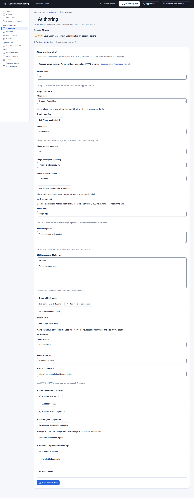](../../../../assets/catalog-ui/plugin-field-authoring.png)

The prepared files need packaging and an archive URL before the Catalog can inspect them.

#### Add optional components

Select **Add Skill component**. Enter its name, description and Markdown instructions. Optional Skill fields remain available. The generated path is `skills/<name>/SKILL.md`. Its directory and frontmatter use the same name. These files belong to the Plugin. They do not create separate Catalog Skill Resources or require a Skill package handoff.

Select **Add MCP server**. Enter a distinct server name. Choose stdio, Streamable HTTP or SSE. For stdio, enter one executable. Add each argument separately. Spaces inside an argument remain intact. For HTTP transports, enter an HTTPS endpoint. HTTP is permitted only for exact localhost or a loopback IP address. The Catalog does not contact these endpoints during preparation.

Expand **Optional connection fields** for non-secret environment values, working directories or headers. Preserve literal placeholders such as `${PLUGIN_ROOT}` and `${USER_VALUE}` for the consumer. Do not paste runtime credentials. Do not define the reserved `PLUGIN_ROOT` or `PLUGIN_DATA` environment variables. Use a contained `./path`, `${PLUGIN_ROOT}` or `${PLUGIN_DATA}` working directory. Do not supply Authorization, Proxy-Authorization or Cookie headers.

Plugin `mcp.json` uses its own schema and a named `mcpServers` map. It is not an MCP Server Card or Registry document. Use **Edit Plugin manifest JSON**, **Edit Plugin MCP JSON** or **Edit component SKILL.md** for advanced fields. Invalid text stays visible for correction. Guided edits preserve untouched recognized values. The backend validates the complete archive after submission.

Use the download link in an Advanced editor to save its exact text. This includes valid Skill YAML that uses block scalars or other forms outside the guided subset. Keep each Skill in a directory that matches its frontmatter name. Prepare and host the complete archive yourself. Advanced downloads do not claim that the files pass validation.

#### Download, package and submit

1. Select **Preview and download Plugin files**.
2. Expand each file path. Download its file. Save each file under the displayed path.
3. Add any scripts or assets referenced by your components.
4. Run the displayed ZIP or gzipped-tar command from the directory containing `plugin.json`. Add supporting paths to that command when needed.
5. Host the complete archive at your own credential-free HTTPS URL. The Catalog provides no archive host.
6. Select **Continue with archive inputs**.
7. Select **ZIP** or **Gzipped tar** under **Plugin archive format**.
8. Enter the **Plugin archive URL**. Its path needs no filename suffix.
9. Enter the optional SHA-256 checksum as `sha256:` followed by 64 lowercase hexadecimal digits.
10. Save the draft. Confirm the archive request. Inspect the returned validation evidence.

The format control selects the matching archive media type. The backend retrieves and inspects the complete archive. Downloads and local preparation do not submit, install or execute a Plugin. Local manifests and archive uploads remain unsupported.

Select **Use an existing archive** to skip file preparation. Switching between preparation and archive inputs preserves the URL, checksum and prepared files. File edits do not update an already hosted archive. Package the changed files. Host the new archive before you replace the archive inputs. A reused archive retains its pinned checksum. The form never clears that checksum when you edit the URL or format. Review any replacement checksum explicitly.

Expand **Use Plugin example files** for an optional complete set of sample documents. Confirm before replacing prepared files. Review illustrative names, descriptions and endpoints before use. This action leaves archive inputs unchanged.

### Permissions and content settings

Saved versions, revisions, listings, submissions and releases are reachable through paginated history links after a new login. Editors require the action permission and its companion reads in the target namespace. OAuth scopes also apply when the deployment enforces them. A namespace grant applies only to that namespace. The UI resolves the selected namespace when necessary without loading the entire grant inventory.

Creating a Resource requires `resource.create`; adding a version requires `resource.edit`. A role name alone does not authorize either action. Without Publisher directory access, enter a local Publisher UUID supplied by someone with that access. The editor does not fetch the directory or grant additional access.

Unavailable mutation fields are disabled for missing authority or an ineligible lifecycle state. Choosing a Namespace remains possible before Create is ready. A pending permission check or missing revision can block submission; read the displayed explanation before preparing a command. Permitted evidence and reload controls remain available.

Each destination link needs its own read permission and OAuth scope. A Resource read does not grant Namespace details, content or release history. When a destination cannot be read, retain its displayed ID for an authorized handoff. The UI does not load unrelated directories to supply names.

Use a version label of up to 128 Unicode characters. Match any version declared in the native document. Use an example, enter the document or load a local file first. Open **Advanced representation settings** to change its role, media type or optional profile ID. Keep the default media type unless your document uses another supported format for its resource kind. Usually leave **Profile ID** blank; it does not select a different validator. MCP Registry metadata can validate and release locally; discovery snapshots for either audience require a supported primary MCP Server Card.

**Prepare native content** appears before the native inputs. It explains the selected kind and links its maintained example in the bundled manual. Agent fields generate an A2A Agent Card. MCP fields offer a hosted Server Card or Registry distribution metadata, with the matching media type selected automatically. Skill input accepts Markdown or a complete package with an immutable Git/OCI handoff. Plugin fields prepare a manifest and optional components. Submission still requires a complete HTTPS archive containing those files.

Expand **Prepare native content** for the detailed input rules. The help does not insert content. **Use a local example** is a separate explicit action. An operator-selected external documentation URL stays exact; disabled documentation leaves the inline guidance available without a link.

Initial Resource and Version creation carry acknowledged results forward without a reload. Existing revision editors still require their current ETag. Reload after a conflict before preparing another revision change.

Press **Create listing revision** to prepare the request and open confirmation. Before **Confirm**, review the captured target, revision marker and **Review saved and proposed metadata** comparison. The summary distinguishes a first revision from an edit and names the saved ListingRevision when one exists. The comparison includes changed VersionRevision and Publisher references, description, tags, categories, queries, links, license and visibility. Removed optional values appear as absent. Arrays retain their order, commas and Unicode spelling.

Open **Review relationships, extensions and artwork** to inspect those changes. **Preview proposed listing metadata** shows the proposed display metadata without a saved revision number. These views show bounded decoded metadata, not original-byte equality or a native-document comparison. URLs remain text; opening the confirmation does not fetch images, native documents or links. Artwork changes are request input: the backend validates and seals descriptors when you confirm.

Cancel returns to the draft without a write. Confirmation and deliberate retry use the captured request, even if the surrounding form changes. Saving creates an immutable candidate; independent review and release publication remain separate actions.

To discard an unused draft, expand **Discard an unused resource** on its Resource page. Enter a reason, then check the captured Resource ID, canonical identifier, Namespace ID, ETag and reason. Read the eligibility explanation before confirming. Cancellation sends no deletion. The backend checks current authority and history; a stale, deleted or ineligible Resource can still be refused. Reload and review current state after a conflict.

Listing **Tags** and **Categories** use one value per row, with up to 32 tags or 16 categories and 80 Unicode characters per value. A comma is literal: `operations, tools` stays one value when saved or when other fields are edited. Add a row to add a value. Fill or remove an empty row before submitting.

Add focuses the new input. Removal focuses the next remaining input or Add. Listing preparation retains existing trimming and duplicate removal. Empty or failed namespace, Publisher and version choices explain the prerequisite. **Refresh publisher choices** and equivalent selector controls reloads a successful selector from its first page without discarding other form input or the selected known label. Namespace options include slug and ID; Publisher options include ID. An exact-ID field remains available when a permitted item is absent from the loaded page. The server checks manual IDs when the command is confirmed.

Create/back links appear only with already-known permission. Paging remains bounded and does not establish that no other permitted item exists.

For a Skill package, **Immutable handoff** offers labelled Git HTTPS repository, full 40- or 64-character commit and relative directory fields, plus an OCI `registry/repository@sha256:<digest>` reference. At least one is required; both are allowed. The Git directory must end with the inspected Skill root. Preparation rejects dot/traversal and encoded repository paths, checks ASCII registry hosts and enforces existing directory byte, segment and depth limits.

Final reference and inspected-root validation remain authoritative in the backend. Choose a non-empty archive up to 16 MiB; deployment request limits can be smaller. The Catalog retains inspection metadata and handoff references, not the archive bytes. It does not check remote package availability, clone, pull, install or execute the package.

**Edit immutable handoff as JSON** edits the same draft. Required handoff instructions remain visible in both editors. Invalid JSON stays visible until corrected. Switching editors never selects a different hidden value.

A package-only Skill can have a release and authenticated Catalog metadata. A discovery snapshot also needs a supported primary representation with an inline document or delivery reference. A Git or OCI handoff alone does not supply that discovery document.

Authoring remains available with `resource.create` even without resource-read permission. Its landing page offers **Create resource** without loading an inventory. Creation requires `resource.create` and its `namespace.read` companion in the destination namespace, plus `catalog.write` when scopes are enforced. The form checks only that exact namespace, including grants beyond the first My access page.

Choose a namespace or enter its exact ID. If namespace names cannot be read, the form offers only the ID field. Creation and adoption do not require `catalog.read`. Keep the returned references; opening the new resource separately requires `resource.read` and the applicable read scope. Direct member grants use the same namespace-ID fallback.

**Add version** requires confirmed `resource.edit` permission in the Resource's namespace. Required selection, missing write scope, unconfirmed access and sealed-version restrictions have separate explanations. The API still decides every command. A grant change can deny an action that was previously available.

Version and listing revision editors check `resource.edit` in the exact namespace and the current revision marker. History remains readable with its independent permission when editing is unavailable. A pending or failed exact-Namespace check retains an open editor's input and disables the command. Permission or scope changes retain protected drafts and explain unavailable actions. Replacing the tenant, realm or signed-in identity clears private drafts and retry state.

Permission checks resolve the selected Namespace even when its grant is beyond the first My access page. The command remains unavailable while that lookup is pending or has failed; authorized draft inputs remain usable. **Reload** retries the lookup. Listing revision creation uses `resource.edit`.

Submission uses `review.submit`, separately checked in the exact namespace with `catalog.write` scope when enforced.

A representation row asks before discarding entered content or a staged document. An untouched new row can be removed immediately. Keyboard focus moves to a remaining row or **Add representation**. The last required representation cannot be removed. Local file failures explain safe validation categories without displaying private file errors.

### Load a local JSON or Markdown document

Select the document format in a version's representation editor. Expand **Import an existing Agent document** for Agents. Choose a file with **Document file**.

The chooser shows the selected filename while the document is ready to load. **Use loaded document** applies it to the editor. **Discard selected document** clears the selection.

Selection alone does not change the preview or editor. Choose the same file again to reread it. Cancelling the chooser keeps the staged selection.

The selected format stays unchanged. Filenames do not select a validation profile. Files must be non-empty UTF-8 text up to 2 MiB, without NUL characters.

[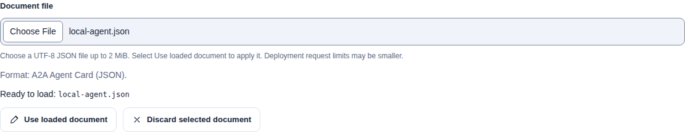](../../../../assets/catalog-ui/authoring-file-stages.png)

JSON mode also checks that the input is an object with no duplicate keys, excessive nesting or unsafe numbers. Deployment request limits may be smaller, especially when combining representations.

Select Use loaded document to place the prepared text into the editor. If it differs from existing text, confirm replacement or cancel to keep your edits. Review the content, then use the normal save and confirmation controls. Selecting or loading a file does not create a version, contact external URLs or publish anything.

Resolve every selected file before saving: choose **Use loaded document** or **Discard selected document**. Save refuses to prepare old editor text while a replacement file is pending or ready. Discard keeps the current text and ignores a late read; applying focuses the document editor. This applies independently to each representation.

Leaving the editor asks before discarding a selected document, including while it is being read. A failed read leaves your existing text unchanged.

JSON is saved through the existing parsed-object API. It is not an original-byte file upload. Skill archives and Plugin archive URLs retain their separate input controls and validation rules.

### Import or download draft JSON

A reusable draft file contains one Resource identity, one Version's representations and optional Listing metadata. It uses `open-agentic-catalog-draft-v1`.

Follow [Move drafts between Catalogs](draft-transfer.mdx) for complete UI/CLI transfers, examples for all four kinds and separate package inputs.

The file contains no destination Namespace, Publisher identity, approval or release. It is not an ARD discovery document or database backup.

1. Open **Authoring > Create resource**, or choose **Add version** on an existing Resource.
2. Expand **Import or download draft JSON**.
3. Select **Import draft JSON** and choose the file.
4. Check the import preview.
5. Choose **Content only**, **Imported Listing metadata** or **Existing target Listing metadata**.
6. Select **Use this draft**.
7. Confirm replacement if the editor contains unsaved input.
8. Choose a destination Namespace for a new Resource.
9. Select a destination Publisher if you include imported Listing metadata.
10. Check the content and continue through the normal save confirmation.

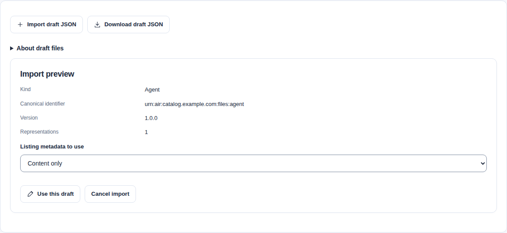

The **Existing target Listing metadata** option applies only when you add a Version. Its Namespace, kind and canonical identifier stay fixed. The file must match that Resource's kind and identifier.

Imported Listing metadata replaces the fields together and clears the Publisher selection. Omitted tags, categories and relationships stay empty. For a new Resource, changing the destination Namespace before saving preserves your edited Listing fields. Existing target metadata uses the current Listing lookup. A failed lookup blocks saving; it does not create another Listing.

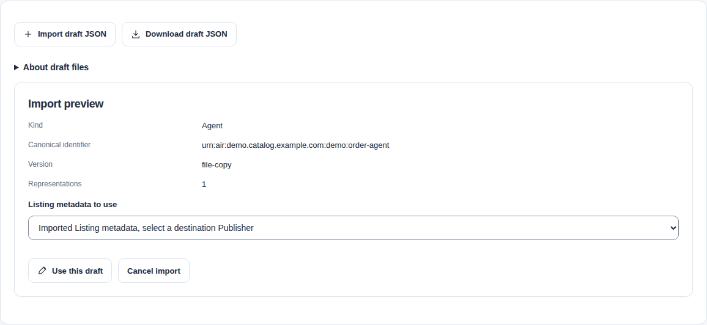

Loading a file sends no commands. Invalid enclosing files and unsupported browser sizes leave the current draft unchanged. Missing native fields remain editable.

Import is unavailable after a save starts, including partial saves and uncertain responses. Finish the current recovery first. Choose **Create another version** after saving, or open a fresh authoring flow for another Resource.

Expand **Import or download draft JSON**. Select **Download draft JSON** to capture the current editor values. Select **Save catalog-draft.json** to save that capture. Apply or discard staged native documents first. Apply or clear AIR-builder fields before downloading.

Downloads preserve incomplete native text and Listing extension text. Normal Save validation still applies. The browser refuses JSON numbers that it cannot preserve accurately.

Skill package bytes travel separately. Supply the package and its immutable Git or OCI handoff before saving. Plugin preparation remains editable, but saving requires a hosted archive. Existing Plugin archive references retain their expected checksums.

The file limit is 64 MiB. Each native editor document and Listing extension text has a 2 MiB browser limit. Use the [CLI importer](#import-a-reusable-json-draft) for larger supported content.

Editor downloads remain available during partial-save recovery, except while a command is pending. They do not replace the current command or its recovery controls.

For saved content, open a VersionRevision or a local Catalog record. On a Catalog record, find the download under **Technical details and evidence**. Use **Prepare draft download**, then **Save catalog-draft.json**. This action downloads exact retained bytes and verifies the response checksum.

Select **Include Listing metadata** when needed. A Catalog record supplies its exact ListingRevision ID. On a VersionRevision page, enter a ListingRevision ID that references that content revision.

Existing Listing extensions can contain numeric values. Import the exact saved draft or replace the extension text before saving or downloading from the editor. Decoded server values cannot recover the original numeric tokens.

Saved downloads require current metadata and content read permission, including the applicable OAuth scope. History permission is not required. Exact stored export preserves native numeric tokens without browser JSON conversion.

### Start a replacement from the current draft

Open an unsealed Version and choose **New revision**, then **Start from current draft**. This explicitly reads its exact candidate and stages every supported representation before replacing any form input. It requires content-read permission in the namespace as well as permission to edit. The source revision ID stays visible. **Start with blank replacement** keeps blank authoring available.

The browser does not merge a partial read. A failed or mismatched read, or an edit made while loading, leaves existing input unchanged. Losing content-read permission cancels a pending reuse without applying its response. A sealed Version needs a new version label. Saving still uses the Version's loaded ETag; a concurrent change requires recovery from current state.

Retained text uses authenticated, checksum-verified reads. Inline JSON is a decoded editing value, not an original-byte copy. Numeric inline JSON without original text and raw numeric values the browser cannot preserve are refused. Supply an exact document through a supported input instead. Reusing an HTTPS URL fetches and validates it again on save. A reused Plugin URL carries its retained archive checksum. Skill inspection metadata cannot recreate the complete archive: upload the complete package with its immutable handoff.

### Create a new Version from retained content

1. Open the existing Version. Select **Create new Version from this revision**. This action also supports a sealed source.
2. Enter a new **Version label**. Edit the populated Agent, MCP or Skill fields.
3. Review native version updates in the final confirmation. These updates preserve protocol versions and MCP package versions.
4. Save the new Version. The source revision stays unchanged.

[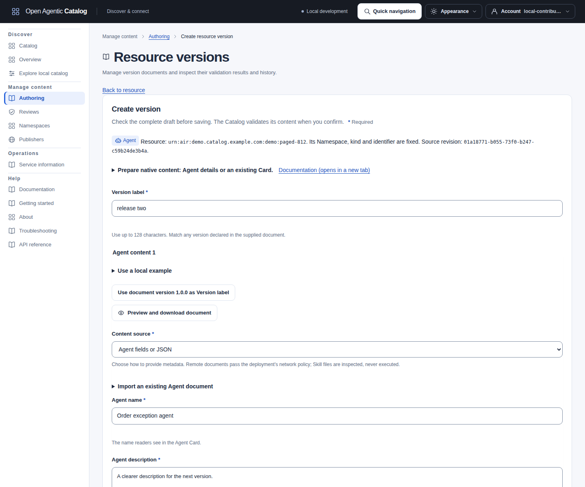](../../../../assets/catalog-ui/authoring-new-version.png)

The synthetic example reuses a sealed Agent revision. Saving creates another Version without changing the source.

On **Add version**, expand **Start from an existing revision**. Select **Browse source history** to choose readable Version and Revision labels. Each page contains at most 25 choices. Alternatively, enter an **Exact source revision ID** and select **Load source revision**. A failed, cancelled or superseded read leaves current input unchanged.

Changing the selected source or the retained document option cancels a pending read. Select **Load source revision** again to read the new selection.

HTTPS sources remain references by default. Their content is retrieved again when saved. Select **Use retained document bytes instead of HTTPS references, where available** to edit a retained document instead. The browser checks the downloaded bytes against their retained digest. Skill inspection cannot recreate an archive. Supply the original complete package and handoff.

Plugin reuse keeps the archive URL and checksum. **Prepare Plugin files** opens retained manifest and component documents when available. **Original Plugin files** identifies scripts and assets that need the original package. These documents do not reconstruct the archive. Package and host changed files before submitting a replacement archive.

#### Update the released Agent example

1. Open the released Agent's Version and select **Create new Version from this revision**.
2. Enter `1.1.0` as **Version label**.
3. Change **Agent description** to `Explain an order and list its next steps.`
4. Select **Include Listing details**, then **Next: Listing details**.
5. Keep the existing Publisher, visibility, tags, queries and other Listing metadata.
6. Select **Create version**.
7. Check the native version update and existing Listing in the confirmation.
8. Select **Confirm**.

The new draft references a new exact revision. The sealed source and current release stay unchanged. Submit the new Listing candidate for an independent review before publishing it.

#### Change only the Listing description

1. Open the existing Listing and select **New listing revision**.
2. Keep **Keep the current version revision** selected.
3. Change **Description** to `Find order status guidance and next steps.`
4. Select **Create listing revision**.
5. Inspect **Review saved and proposed metadata**.
6. Confirm the metadata change and unchanged VersionRevision reference.

This creates a ListingRevision without creating a Version or changing native content. Review and release publication remain separate.

### Correct a saved draft

Read the exact finding code, path and message below the save receipt. **Correct native version** links a supported finding to its editor. Other findings remain available with the saved representation metadata. Empty paths are valid diagnostics.

**Correct this draft** keeps the input and saves a new immutable revision of the unsealed Version. It uses the returned Version ETag. A concurrent change or sealing can refuse the command. Preserve your input before reloading current state after a conflict. Existing invalid revisions remain evidence.

Listing input stays in the workspace during correction. The next Listing save uses the corrected revision. If content saves but Listing metadata is incomplete, enter the missing metadata and continue. The UI reuses the acknowledged content. Metadata-only edits remain available on the Listing page. Revalidation checks an existing exact revision without changing its content. Resolve a pending review before submitting another candidate.

#### Resume a partial save

| What happened | Action |
| --- | --- |
| Resource saved; Version refused | Select **Back to form**. Correct the content and save again. The Resource identity stays fixed. |
| Content saved; Listing needs a name or description | Select **Back to form**. Complete the Listing fields and save again. The acknowledged Version is reused. |
| Listing created; its revision was refused | Select **Back to form**. Correct the Listing fields. The next save uses the acknowledged Listing. |
| A save response is missing or unusable | Keep the dialog open. Select **Retry same command**. It keeps the captured keys, input and ETags. |
| Another editor changed or sealed the Version | Preserve your input. Inspect current state before preparing another command. A sealed Version needs a new Version label. |

Next and Back do not repeat acknowledged commands. After a partial save, the saved Resource identity and Version label stay fixed. Do not reload or start another item to recover an unknown outcome. Follow [command recovery](publishing.mdx#recover-a-conflict-or-missing-response) if the dialog is lost.

### Inspect findings and reviewer decisions

Version revision pages show finding severity, code, native-document path and message before the full JSON. They name the exact revision, evidence ID/digest, validation profile, policy and expiry. Blocked or expired evidence needs attention; trust and legal-rights assessments remain separate. A finding path refers to retained evidence, not an editable field in that view.

Review detail shows immutable decisions with action, reviewer, timestamp and reason. Missing reasons are labelled honestly. Read these before preparing a correction. Submitted validation remains bound to that submission; newer draft validation does not replace it. A newer candidate does not invalidate an older immutable approval, and approval alone does not establish current release eligibility.

### Compare revisions and inspect lifecycle

Version, Listing and review detail offer **Choose revisions to compare**. Choose exact before/after IDs from bounded history and select **Compare selected revisions**. Review comparisons fix the after-side to the submitted revision. Listing fields show additions, removals and changes; arrays retain order. Version comparisons show representation roles, formats, delivery references and digests. History access alone does not grant document access. **Compare linked Version revisions** explicitly reads the native revisions referenced by the selected Listing revisions. On a review, its after-side remains the submission's immutable native revision, even if the current candidate changes.

**Inspect selected documents** reads retained documents only on request. Changing either representation clears the previous documents; select Inspect again to read the new pair. Available exact text retains whitespace and numeric tokens and passes checksum verification. Decoded inline JSON displays a precision limitation; unsupported lossless comparisons are refused. Plugin/Skill manifests and inventories can be inspected, but comparison never fetches or reconstructs their archives.

**Document changes** highlights removed and added text, including small changes within a JSON line. Select **Next change** or **Previous change** to move keyboard focus to a changed region. With a change focused, use **Alt+Down** or **Alt+Up** to continue in either direction. The summary announces its position. Both selected revision IDs remain above the comparison.

Excerpts mark spaces, tabs, line endings and a leading byte order mark (BOM). These markers help distinguish changes that look identical on screen. The original documents remain below, with their exact text and copy controls. **Format JSON** affects only that original-document display; it does not change the comparison or stored bytes.

Identical verified bytes produce no changes. Detailed navigation has smaller work limits than the 2 MiB original-document view. If it is unavailable, inspect both originals; the UI does not present a partial comparison as complete. Comparison reads do not edit or approve either revision.

If document verification or UTF-8 decoding fails, neither document is shown. The message identifies the failed check; **Reload** retries the selected pair. API access errors retain their separate explanation. Signing out clears the comparison and cancels pending document reads.

[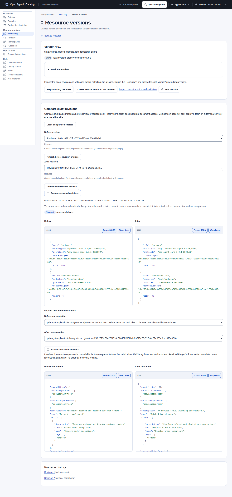](../../../../assets/catalog-ui/version-comparison.png)

The synthetic example compares two immutable revisions. A refused document comparison does not prevent inspection of their representation metadata.

Resource and Listing detail also offer **Choose lifecycle context**. Select one Version and one Listing revision, then **Inspect selected lifecycle**. The view checks their exact relationship before showing draft, validation, review and release context. Several Versions can have different progress; the Resource has no aggregate draft/published state. Review and release histories are paged, so no matching row on one page does not prove absence.

Discovery remains separate. With tenant-wide publication-read access, explicitly inspect one configured host and audience. The view names observed snapshot IDs, generations and states. Press either **Inspect** button again to reread its selected context; refreshing the lifecycle clears the earlier discovery observation. Snapshot metadata alone does not prove that the selected release is included; follow its snapshot link to inspect documents and exclusions. Unloaded or unauthorized stages remain not inspected. Nothing here approves, publishes or executes a resource.

### Reuse a validated name and description

When creating a listing revision, choose a version revision or keep the existing one. Select Load name and description suggestions to read its validation evidence, then choose one Prefill representation. Only valid representations in a complete validation result are offered. The preview shows the source version revision and available name/description.

Absent or overlong values are not guessed or truncated. Reading and selecting a preview do not edit the listing.

Select Use suggested name and description to apply the displayed fields. Replacing different existing text requires confirmation. Missing suggestions leave existing fields unchanged, and all fields remain editable before saving. Publisher, namespace, visibility, representative queries, licensing and other metadata are not copied.

Save the listing revision normally, then follow the existing independent review and publication process. These conveniences do not add a new standards format or imply approval.

JSON editors reject duplicate keys, excessive nesting and non-finite numbers. Whole numbers must be between `-9007199254740991` and `9007199254740991`. For a representation document with larger exact numbers, choose **Anonymous HTTPS document** under **Content source**. The backend fetches and validates that document through its outbound security policy. This option does not apply to listing metadata, adoption overrides or handoff JSON. Unknown extension fields are preserved, and neither JSON nor Markdown is executed as page content.

When editing an existing listing, Keep the current version revision is selected by default. Leave it selected for metadata-only changes, or clear it to choose another version and its exact revision. This saves a new listing revision. It does not change an existing release or bypass review.

Use [Listing relationships](#describe-listing-relationships) to reference related local Resources and Versions.

Extensions remain a JSON object for custom metadata.

Saving a form opens collapsed sections containing invalid fields so you can correct them. Adding a relationship moves keyboard focus to its type. Removing one moves focus to a remaining row or Add relationship.

Selecting a Skill ZIP or gzip archive sets its corresponding media type automatically. The backend validates the archive contents and immutable handoff.

## Describe Listing relationships

Open **Links, license and relationships** in Listing details. Select **Add relationship**. Choose **Relationship type**. Enter the target Resource's canonical identifier in **Target identifier**. Supply **Target version** when needed. Use an identifier such as `urn:air:catalog.example.com:mcp:documentation`, not a Resource UUID or display name.

| Choice and API value | Meaning |
| --- | --- |
| Depends on (`depends_on`) | Declares a dependency on the target Resource or Version. |
| Recommended with (`recommended_with`) | Recommends the target for use with this item. |
| Bundled with (`bundled_with`) | Declares that this item is bundled with the target. |
| Supersedes (`supersedes`) | Declares that this Version replaces an exact older or different Version. |

Targets must exist in the same tenant. A supplied version label must exist on that target. `supersedes` always requires an exact target version. A relationship to the same Resource also requires an exact, different Version. Neither an omitted version nor the source Version can identify that same-Resource target.

For example, a producer can declare a dependency on an existing documentation server. A new `1.1.0` release can also declare that it supersedes its own `1.0.0` Version. Replace both identifiers below with existing targets. Add these entries to `relationships` in the complete Listing revision request:

```json
{
  "relationships": [
    {
      "type": "depends_on",
      "targetIdentifier": "urn:air:catalog.example.com:mcp:documentation",
      "targetVersion": "0.1.0"
    },
    {
      "type": "supersedes",
      "targetIdentifier": "urn:air:catalog.example.com:agents:order-agent",
      "targetVersion": "1.0.0"
    }
  ]
}
```

This fragment is not a complete API request. In the UI, add one row for each object with the same type, identifier and version. Save a normal Listing revision, then follow [review and publication](publishing.mdx#correct-or-update-content). The source Version for the second row must differ from `1.0.0` when it uses that same Resource identifier.

A revision accepts up to 64 relationships. Duplicate type/identifier/version combinations are rejected after normalization. The Catalog trims surrounding whitespace, normalizes relationship types and canonicalizes AIR identifiers. Relationship targets do not gain access permissions through the source Listing.

Inspect saved relationships in the exact Listing revision metadata. Reusable draft files preserve them, but import does not create or remap missing targets. Current ARD and AI Catalog discovery entries do not project these relationships.

Relationships describe producer metadata. They do not install dependencies, fetch a graph, prove package contents or change a release's disposition. Use the separate [release lifecycle commands](publishing.mdx#change-release-disposition-or-withdraw-discovery) to supersede a release.

## Find an existing resource

Open **Authoring** to browse resources you can read. Paste a known identifier into **Exact canonical identifier**, then choose **Find resource**. The server searches the authorized inventory, including resources beyond the displayed page. Use **Resource kind** to narrow it further; **Clear identifier** removes only the identifier filter.

This lookup matches the whole identifier, not part of a name or description. Surrounding whitespace is removed. AIR scheme and publisher spelling are canonicalized; namespace and resource-name case remain significant. Opaque identifiers retain case and Unicode spelling. An empty result can mean no match, a kind mismatch, deletion or unavailable access.

Changing either applied filter starts at the first page. The input stays in memory and is not added to browser history. Refresh reads the current page; after a failed continuation, reload starts again with the selected filters.

API clients use `GET /api/v1/resources?canonicalIdentifier=...&kind=agent&limit=25`. URL-encode the identifier, preserve the returned `nextCursor`, and keep both filters unchanged during continuation. Changing the canonical identity or kind invalidates a cursor. The SDKs expose this query in their generated resource-list operation; `catalogctl remote` does not offer a resource-inventory list command. Its discovery Search operates on published metadata instead.

[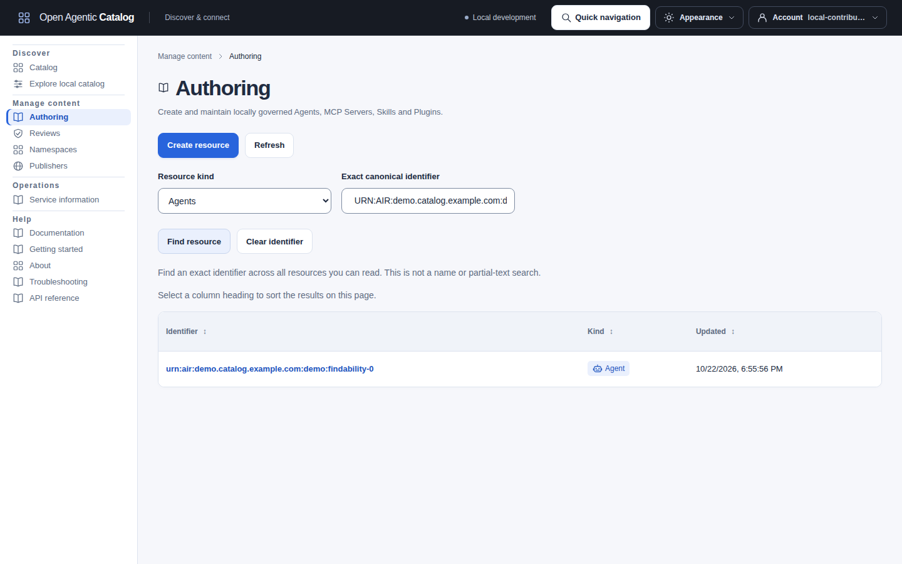](../../../../assets/catalog-ui/authoring-exact-identifier.png)

The synthetic resource is absent from the initial inventory page. The exact server filter finds it without paging through the inventory.

## Manage Namespaces and Publishers

Namespaces organize locally governed resources. Open Namespaces to page through existing entries, inspect one or create a new namespace. Its slug is stable. Editing changes only its display name or description and requires a reason.

There is no namespace deletion command.

To find an existing entry, fill **Exact display name**, **Exact slug**, or both and select **Apply filters**. Publisher inventories offer **Exact display name** and **Exact declared domain** instead. These query the authorized server inventory, including records beyond the current page. They do not search fragments or filter only the displayed rows.

| Filter | Matching rule |
| --- | --- |
| Display name | Exact stored case, spaces and Unicode spelling. Duplicate names remain separate records; follow the stable ID in the detail link. At most 160 Unicode code points. |
| Namespace slug | Trim surrounding whitespace and lowercase; match the complete stable slug. At most 64 characters before normalization. |
| Publisher declared domain | Trim, lowercase and remove one trailing dot, as on creation. Match a complete declared DNS name, independently of publication approval. At most 253 characters before normalization. |

Supplying both fields requires both to match. Leave unused fields empty. **Apply filters** and **Clear filters** start this inventory at its first page. **Refresh** rereads the current page with its applied filters. After a failed continuation, **Reload** restarts this inventory with those filters; it does not reset another picker or submit a command. Typing alone sends no request. Criteria stay in the current page's memory. Results show the applied filters separately from unsent form edits. An empty filtered list means no authorized records match those applied criteria.

API clients use `GET /api/v1/namespaces?slug=tools&displayName=Tools&limit=25` or `GET /api/v1/publishers?declaredDomain=example.com&limit=25`. URL-encode values and send the same applied filters, limit and returned `cursor` for continuation. Changed filters, tenant or current policy invalidate that cursor. Empty, repeated, unknown and wrongly cased query fields are rejected. Names can repeat; neither a name nor a declared domain substitutes for the returned ID. Exact-ID detail routes remain available. SDK list operations expose the same optional inputs.

Lookup adds no permissions: Namespace results require current tenant or exact-namespace `namespace.read` plus `catalog.read` when scopes are enforced; Publisher results require tenant-wide `publisher.read` plus `publishers.read`. A create-only delegate can create an entry without browsing these inventories. Permitted pickers retain exact-ID entry when the name cannot be read; the command rechecks the supplied target.

Publishers associate metadata with declared domain names. Enter domain names separated by commas or new lines, not URLs. Creation does not approve a domain for publication. Open a Publisher to edit its name/domains or manage publication approvals with a reason.

Namespace and Publisher details show saved facts when editing authority is absent. They omit empty required edit fields. A draft already entered remains protected if access changes, including a separately staged publication-domain reason. Confirmation rechecks current action readiness before a new send.

Revoke an approved domain before attempting to remove its declaration. The backend also protects active publication dependencies. Revocation can withdraw active discovery snapshots containing that domain. The confirmation explains this consequence, and the result lists exact affected release IDs and withdrawn hosts. Copy these references from the revocation receipt. The receipt needs no additional release or publication reads and clears when you reload, change publisher or change identity.

Approval is not proof of domain ownership, publisher authority or legal rights.

| Workflow | Required access |
| --- | --- |
| Namespace list/detail | `namespace.read` at the applicable scope; `catalog.read` when OAuth scopes are enforced. |
| Namespace creation/update | Tenant-wide `namespace.create` for creation; `namespace.manage` in the exact namespace for updates. Both need `tenant.admin` when enforced. Detail reads also need `catalog.read`. |
| Publisher list/detail | Tenant-wide `publisher.read`; `publishers.read` when enforced. |
| Publisher creation | Tenant-wide `publisher.create`; `publishers.manage` when enforced. A namespace grant is insufficient. |
| Publisher metadata/domain edits | Tenant-wide `publisher.manage`; `publishers.manage` when enforced. Viewing the detail also needs its separate read permission/scope. |
| Publication-domain approval/revocation | Tenant-wide `publisher.approve_domain`; `publishers.manage` when enforced. Viewing the detail also needs its separate read permission/scope. |

Submit the form, review the confirmation and select Confirm. Edits use the exact record revision returned by the API. A conflict requires reloading and reviewing the newer record, not overwriting it. After a successful edit or domain command, reload the record before making another change.

Save or discard metadata edits before changing publication approvals.

If the response is lost, the dialog retains the command and offers Retry same command with the original idempotency key and preconditions. Do not repeat it as a new action. Reloading, leaving the page or losing the session discards that in-memory retry. Check the record before recreating an action.

Form input is not autosaved or stored persistently in the browser. Navigation/sign-out warns about unsaved work. Session expiry or an identity change clears private state. For the same identity, changes to reported access retain protected drafts and uncertain commands; a new send requires current authority, and retries recheck backend access. Private read results and command receipts can be cleared separately when access changes.

A 429 or 503 response can suggest a retry time through `Retry-After`. The error displays a fixed date and time in your browser's locale, measured from response receipt. This is advice, not a guarantee of recovery or an automatic retry. Reload and Retry same command remain available immediately.

Retry explicitly when ready. The client accepts integer seconds or HTTP dates up to 24 hours ahead and ignores malformed, expired or excessive hints. Rerendering the existing error does not change its suggested time. An explicit reload or replay can receive new advice from a new response.

## Import a reusable JSON draft

Use a reusable `draft.json` file to copy authoring input from an exact saved Version or release. The file contains native documents and optional Listing metadata. It excludes destination identities, permissions and publication state.

1. [Export the reusable file](../reference/commands.md#export-a-reusable-draft-json-file) from readable saved content.
2. Choose a destination Namespace, or select an exact Resource for a new Version.
3. Supply a destination Publisher if you include the file's Listing metadata.
4. Run `catalogctl import preview` with those destination flags.
5. Fix local findings and supply any separate Skill package inputs.
6. Run `catalogctl import apply` with a new private receipt.
7. Use `catalogctl import resume` with unchanged inputs after an interruption.

Select `--content-only` when you need only the Resource and Version. No Publisher is required. New-Version import checks the existing Resource's kind and canonical identifier. An optional exact Listing ID avoids a collection lookup. The importer captures its ETag and refuses mismatched parents or ambiguous lookups before writes.

Preview performs no network calls. URL retrieval, destination authority and server admission remain separate checks. Plugin preparation still needs external packaging and an HTTPS archive reference. A failed command can leave acknowledged drafts; preserve the receipt. See the [complete CLI procedure](../reference/commands.md#import-a-reusable-draft-json-file) for commands, package paths, permissions and outcomes.

## Import one MCP Registry record

Use a saved native `server.json`, or extract one server from a saved Registry response. A response wrapper can contain both `server` and Registry-owned `_meta` fields. Import only its `server` object. Preserve that object's own `_meta` and unknown native fields. A Server Card, Registry document and MCP client configuration are different formats.

The [offline response fixture](../../../../../examples/native-import/mcp-registry-response.json) contains one synthetic server and separate wrapper metadata. It does not require a public Registry request or a running MCP service. The [matching manifest](../../../../../examples/native-import/mcp-registry-import.yaml) references the extracted `server.json`.

Build `catalogctl` with `make build`. Run these commands from the repository root. They create a private working directory under ignored `output/`:

```sh
umask 077
mkdir -p output/native-import
REGISTRY_WORK=$(mktemp -d "$PWD/output/native-import/registry-XXXXXX")
cp examples/native-import/mcp-registry-response.json "$REGISTRY_WORK/response.json"
cp examples/native-import/mcp-registry-import.yaml "$REGISTRY_WORK/import.yaml"
python3 - "$REGISTRY_WORK" <<'PYREGISTRY'
import json
import sys
from pathlib import Path
folder = Path(sys.argv[1])
response = json.loads((folder / "response.json").read_text(encoding="utf-8"))
server = response["server"]
if not isinstance(server, dict):
    raise SystemExit("The response server must be a JSON object")
(folder / "server.json").write_text(
    json.dumps(server, ensure_ascii=False, indent=2) + "\n", encoding="utf-8"
)
PYREGISTRY
./bin/catalogctl import preview --file "$REGISTRY_WORK/import.yaml"
```

This extraction handles the checked-in fixture. For other responses, copy the native object's JSON text directly when numbers need exact preservation. Do not submit the wrapper or convert client connection settings into Registry metadata. Keep credentials outside all metadata files.

Before apply, replace `namespaceId` and `listing.publisherId` with existing destination IDs. Choose an unused `canonicalIdentifier` deliberately. Keep `visibility: private` for the initial Listing. Match the manifest's `version` to the native server version, `0.1.0` in this fixture. The native schema version and any package version are separate values.

The manifest uses `dataFile: server.json` with media type `application/vnd.mcp.server+json`. Follow the existing [apply and resume procedure](#apply-and-resume-a-native-draft) with this manifest and its own private receipt. Preview checks local native input without contacting the declared endpoint. Apply still checks current permissions and destination identities.

For the browser, choose **MCP fields or JSON**, then **Package or distribution metadata** under **MCP document**. Load the extracted `server.json` through [Import an existing MCP document](#import-or-edit-mcp-metadata). Use the same Version label and private Listing choices. Unknown native fields stay in Advanced JSON. The browser's [numeric and text limits](#load-a-local-json-or-markdown-document) still apply.

Registry-only metadata can validate and become a local release through normal review. Active ARD and AI Catalog snapshots require a supported primary Server Card. Add that Card separately before preparing discovery; keep Registry metadata in a non-primary representation. Do not fabricate a Card, approval, ownership or trust from a Registry response.

This workflow imports selected drafts. It does not connect a federation source or continuously mirror a Registry. After release, use the separate [MCP client configuration workflow](understand-results.mdx#download-an-mcp-client-configuration) when the retained metadata supports it. The existing [reusable MCP draft](../../../../../examples/native-import/drafts/mcp-server.json) uses the Catalog's transfer format, not a Registry response.

## Preview a native draft locally

Use `catalogctl import preview` to check local input before you submit API requests. Preview needs no running Catalog, access token or database. It reads local files and uses the same pinned native validators as the backend. It creates no records and makes no network requests. Use apply after you check the preview.

Build the CLI with `make build`. Create a directory for your manifest and copy the native document into it. For example, copy `samples/cards/order-agent.json` as `agent.json`. Save this manifest as `import.yaml` in the same directory:

```yaml
format: 1
resources:
  - key: order-agent
    namespaceId: 00000000-0000-7000-8000-000000000010
    canonicalIdentifier: urn:air:catalog.example.com:agents:order-agent
    kind: agent
    version: "1.0.0"
    listing:
      publisherId: 00000000-0000-7000-8000-000000000020
      displayName: Order agent
      description: Helps resolve order exceptions.
      visibility: tenant
      tags: [orders, support]
      representativeQueries: [resolve an order exception, check an order]
    representations:
      - role: primary
        mediaType: application/a2a-agent-card+json
        dataFile: agent.json
```

Replace the namespace and publisher UUIDs with existing identities in your target Catalog. UUID hexadecimal letters are normalized to lowercase to match API responses. Preview checks UUID syntax, not identity existence or your permissions. The stable `key` uses lowercase letters, digits and single hyphens, with at most 64 characters. Private drafts can use non-AIR canonical identifiers and non-semantic version labels. A declared native version must match the Catalog version label.

Opaque identifiers permit up to 512 Unicode code points; version labels permit up to 128. Relationship targets use the same limits. Native import and the API preserve exact Unicode spelling after trimming surrounding whitespace. AIR identifiers retain their ASCII syntax. Request bodies and native documents have separate byte limits. See [identifier and version lengths](../reference/api-conventions.md#identifier-and-version-lengths).

```sh
./bin/catalogctl import preview --file /path/to/draft/import.yaml
```

### Use the Agent and Skill starter

The source checkout includes `examples/native-import/`. Its `import.yaml` declares two private drafts: an A2A Agent Card and a standalone Skill document. The Skill input is not a complete package. The Agent endpoint is illustrative metadata; import does not contact or run it.

From the repository root, build the CLI and copy the starter privately:

```sh
make build
umask 077
import_dir=$(mktemp -d "${TMPDIR:-/tmp}/catalog-import.XXXXXX")
cp -R examples/native-import/. "$import_dir/"
```

Edit `$import_dir/import.yaml` before the first apply:

1. Replace both `namespaceId` values with an existing Namespace ID in your target tenant.
2. Replace both `listing.publisherId` values with an existing Publisher ID in that tenant.
3. Use a different `canonicalIdentifier` for each Resource, without reusing an identifier from the target tenant.
4. Keep the Agent version in `agent.json` equal to its manifest version.

Keep all referenced files beneath `$import_dir`. Obtain existing IDs through [Namespaces and Publishers](#manage-namespaces-and-publishers). The caller needs `resource.create` and `resource.edit` in the selected Namespace. Exact readback also needs resource read/content access. A Contributor grant supplies these permissions.

Import requires no Publisher management or Publisher-read permission. Enforced OAuth scopes require both `catalog.read` and `catalog.write`.

Preview the final files:

```sh
./bin/catalogctl import preview --file "$import_dir/import.yaml"
```

The unchanged checked-in starter also passes offline preview. Its sample UUIDs establish valid syntax, not existing destinations. Preview checks local content; the API checks current access and destination availability.

Apply with the API origin and your private bearer-token file:

```sh
./bin/catalogctl import apply \
  --file "$import_dir/import.yaml" \
  --state-file "$import_dir/private/import-state.json" \
  --base-url https://catalog.example.com \
  --token-file /run/secrets/catalog-access-token
```

Use the API listener, not the UI origin. Add `--ca-file /path/to/ca.pem` for a private CA. Preserve certificate verification. Apply creates the private receipt directory if its parent exists. Inspect the JSON `disposition`, per-item steps and acknowledged IDs as described in [Check the import result](#check-the-import-result).

### Resume an interrupted starter import

An interrupted apply can leave earlier drafts or commands committed. Preserve the exact manifest, native files and receipt. Do not change a destination, asset or canonical identifier after the first apply. Resume with the same API origin, credential identity and trust:

```sh
./bin/catalogctl import resume \
  --file "$import_dir/import.yaml" \
  --state-file "$import_dir/private/import-state.json" \
  --base-url https://catalog.example.com \
  --token-file /run/secrets/catalog-access-token
```

Use the original receipt after successful completion too. A completed resume reads exact retained drafts without new creation commands. A separate new import needs distinct canonical identifiers, final input files and a new receipt. Do not delete a receipt or choose a fresh key to bypass an uncertain result. Follow the [replay limits and repair procedure](#apply-and-resume-a-native-draft) if recovery stops.

Import creates no review submission, release or active publication. It does not install or execute either resource. The `samples/catalog.yaml` development inventory uses a separate format and workflow.

### Manifest fields

`format` must be `1`. `resources` must contain one to 64 items. Item keys and canonical identifiers must be unique after normalization. Each item requires `key`, `namespaceId`, `canonicalIdentifier`, `kind`, `version`, `listing` and `representations`. Select one of the four supported kinds. The Resource and Listing use the same namespace. Preview does not create namespaces or publishers. Every local item is prepared and validated before apply sends its first write.

The listing requires `publisherId`, `displayName`, `description` and `visibility`. Visibility can be `private`, `tenant` or `public`. Optional fields match the [CreateListingRevision API](../../../../../api/openapi/control-v1.yaml): `tags`, `categories`, `representativeQueries`, `documentationUrl`, `supportUrl`, `license`, `termsUrl`, `relationships` and `extensions`. Do not supply generated Resource, Listing or VersionRevision IDs.

Use `extensionsFile` instead of `extensions` to load an arbitrary JSON object from a local file. Do not supply both. Inline extension values can contain JSON-compatible YAML objects, arrays, strings, booleans, nulls and decimal numbers. Preview preserves exact numbers in prepared requests. Quote strings that YAML could interpret as numbers or dates. Hexadecimal, octal, infinite and other non-JSON numbers are rejected.

Listing extensions retain JSON numeric values, including large integers and exponents. [PostgreSQL can change numeric notation](https://www.postgresql.org/docs/18/datatype-json.html#JSON-INPUT-OUTPUT) without changing the value. Listing integrity checks compare exact decimal values. Values must fit the [PostgreSQL numeric range](https://www.postgresql.org/docs/18/datatype-numeric.html#DATATYPE-NUMERIC-DECIMAL). Quote a value such as `"1e999"` when it must remain a string. Preview does not verify server retention.

The API rejects unsupported numbers as invalid input. Earlier import steps remain committed; preserve the receipt after a refusal.

Artwork input belongs in `extensions`; preview does not retrieve or seal images. Follow [listing artwork](#icons-and-screenshots) for the input and operator policy.

Each representation requires `role`, `mediaType` and exactly one input source. Use one to sixteen representations and exactly one `primary` role. Other roles are `distribution`, `metadata` and `documentation`. Optional `profileId` follows the current API contract. It does not override the pinned validator selected by the media type or establish trust.

| Source field | Prepared API input | Use |
| --- | --- | --- |
| `dataFile` | `data` | One UTF-8 JSON object. Unknown native fields and exact JSON numbers are preserved. |
| `contentFile` | `content` | Nonempty UTF-8 text without NUL. Standalone Skill Markdown retains its exact body. |
| `packageFile` | `packageData` and `handoff` | Complete Skill ZIP or gzipped-tar bytes, unchanged. |
| `packageDirectory` | `packageData` and `handoff` | Complete Skill directory, encoded as a deterministic ZIP. Declare `application/agent-skills+zip`. |
| `url` | `url` | Existing credential-free HTTPS content. Only request intent is checked locally. |

Use the declared media type for the content. A filename extension does not select a validator. MCP Registry metadata and experimental MCP Server Cards remain distinct. A private Registry-only draft is permitted. Public MCP discovery still needs the separate primary Server Card. Preview does not establish public publication eligibility.

### Import several resources

Put each resource in the same `resources` sequence. The CLI processes them in manifest order, with four creation commands per resource. Different items can use different existing namespaces and publishers.

For example, add this second Agent after `order-agent` in the manifest above. Copy its native Card to `support-agent.json` and ensure its declared version is `1.0.0`.

```yaml
  - key: support-agent
    namespaceId: 00000000-0000-7000-8000-000000000010
    canonicalIdentifier: urn:air:catalog.example.com:agents:support-agent
    kind: agent
    version: "1.0.0"
    listing:
      publisherId: 00000000-0000-7000-8000-000000000020
      displayName: Support agent
      description: Coordinates support with the order agent.
      visibility: tenant
      relationships:
        - type: depends_on
          targetIdentifier: urn:air:catalog.example.com:agents:order-agent
          targetVersion: "1.0.0"
    representations:
      - role: primary
        mediaType: application/a2a-agent-card+json
        dataFile: support-agent.json
```

A relationship to another imported resource must target an earlier item. A supplied target version must match that item's version. Self references and forward references are rejected before writes. The CLI does not reorder items or schedule dependencies. The API checks targets outside the manifest.

The batch is not one transaction. Earlier successful commands remain committed if a later item fails. Resume uses the unchanged whole manifest and its original receipt. To import additional resources, use a separate manifest and new receipt.

### Complete Skills and Plugins

A Skill archive or directory requires an immutable Git or OCI `handoff`. A directory must include `SKILL.md`, with a name that matches its root directory. Supporting files and executable-mode evidence are preserved. Package depth counts segments below the Skill root; parent directories such as `assets/skills/` do not count. The CLI does not execute files, clone repositories or pull images. A standalone Markdown input remains a document, not a complete package.

```yaml
representations:
  - role: primary
    mediaType: application/agent-skills+zip
    packageDirectory: safe-skill
    handoff:
      git:
        repository: https://example.com/team/skills.git
        commit: aaaaaaaaaaaaaaaaaaaaaaaaaaaaaaaaaaaaaaaa
        directory: skills/safe-skill
```

The commit above is a placeholder. Supply the full immutable commit for your content. An OCI alternative uses `handoff.oci.reference` with an exact `sha256` image digest. Preview validates the declaration but cannot prove that the remote content matches the local package.

A Plugin requires an existing HTTPS ZIP or gzipped-tar archive. Declare `application/agent-plugins+zip` or `application/agent-plugins+gzip` with `url`. An optional `expectedDigest` is `sha256:` followed by 64 lowercase hexadecimal digits. Local Plugin manifests, package uploads and temporary archive servers are not supported by this command. The backend must retrieve and inspect the complete archive under its own outbound policy.

### Limits and preview results

Local paths must stay beneath the manifest directory. Symbolic links, path escapes and nonregular files are rejected. YAML controls reject duplicate or unknown fields, typed nulls, aliases, merges, custom tags, invalid Unicode and extra documents. JSON files reject duplicate keys, malformed Unicode and trailing values.

| Limit | Value |
| --- | --- |
| Resources and commands | One to 64 resources; four creation commands per resource, at most 256. |
| Manifest | 2 MiB, depth 32, at most 20,000 nodes. |
| Encoded request | 2 MiB by default; `--max-request-bytes` accepts 1-67,108,864 bytes. |
| Combined prepared requests | 64 MiB. JSON syntax, escaping and package base64 count. |
| JSON report and private receipt | Each at most 2 MiB. Reports omit native documents and full responses. |
| Native documents | 16 MiB per revision. |
| Skill archive | 16 MiB compressed; 64 MiB expanded; 16 MiB per file; 1,024 files; depth 16 below the root. Existing archive path and expansion-ratio checks also apply. |
| Whole preview | Two minutes by default; positive `--timeout` up to ten minutes. Interrupts cancel preparation. |

The JSON report has an ordered `resources` array. Each item lists four planned POST commands, bindings for server-generated IDs, encoded body sizes and SHA-256 checksums. The root records aggregate prepared bytes, client ceilings and whether every item passed local validation. The final ListingRevision command needs the Listing creation ETag. Full native documents and package base64 are omitted. Native findings show fixed codes, severity and representation indexes, without quoting supplied values.

File checksums cover original bytes. Generated Skill checksums cover ZIP bytes and executable modes. Request checksums cover encoded JSON bodies; commands with generated IDs use an explicit UUID placeholder. These are templates, not completed mutations. Server canonical JSON and retained archive checksums have their own scopes. Inline JSON whitespace can change during encoding.

Local validation errors return a nonzero exit status. Native validation errors also produce a JSON report. A successful preview leaves permissions, identities, server limits, remote content, artwork policy, trust, rights and publication checks unresolved. A larger CLI limit cannot enlarge server limits. Continue with [apply and resume](#apply-and-resume-a-native-draft), or use the [API recipes below](#prepare-a-request-to-create-a-version) for direct requests. Inspect the retained evidence after submission.

## Apply and resume a native draft

For each item, apply creates a Resource, its Version and immutable VersionRevision, a Listing, then its immutable ListingRevision. It finishes one item before it starts the next. Each request commits separately. The CLI does not submit for review, approve, release, publish, install or execute content.

Supply an API origin and select explicit bearer credentials or a private human login file. HTTPS is required except for literal loopback addresses. With bearer credentials, token files take precedence over `CATALOG_REMOTE_TOKEN`. The CLI uses one token snapshot per invocation. It does not follow redirects, use proxy environment variables, or load backend configuration or database credentials.

To use [human CLI login](../reference/commands.md#human-cli-login), replace `--token-file` with `--login-file PATH`. Clear `CATALOG_REMOTE_TOKEN` and `CATALOG_REMOTE_TOKEN_FILE` first; login-file selection rejects either bearer source, including inherited values. Add `--issuer-ca-file PATH` when refresh needs private issuer trust. Login-file refresh completes before the import session starts. API trust remains separate under `--ca-file`.

The resolved caller needs `resource.create` and `resource.edit` in every selected namespace. Exact readback also needs resource read/content access. Supply an existing publisher ID; import does not require publisher management or publisher-read permission. When OAuth scope enforcement is enabled, supply `catalog.read` and `catalog.write`. The server checks current permissions on each request.

```sh
./bin/catalogctl import apply \
  --file /path/to/draft/import.yaml \
  --state-file /path/to/draft/private/import-state.json \
  --base-url https://catalog.example.com \
  --token-file /run/secrets/catalog-access-token
```

Use a new state file for each import. Its immediate directory must be private to your account, with no group or other access. Apply creates that directory with mode `0700` if its parent exists. State and lock files require mode `0600`. Symlinks are rejected. A persistent lock file coordinates invocations; an operating-system lock is released when the process exits.

Before any API write, the CLI prepares all input, checks current permissions in every selected namespace and checks advertised limits. Each namespace check must resolve to the same principal through `/api/v1/me`. The smaller client/server request budget applies, including JSON and base64 overhead. The server remains the authority for remote content, relationships, publisher availability and artwork validation.

### Check the import result

Apply and resume emit bounded JSON with a root `disposition` and an ordered `items` array. Each item contains its key, disposition, per-step state and acknowledged IDs. `currentKey` identifies the item where processing stopped, when known. Full native documents, archives, tokens and response bodies are omitted. Validation findings use fixed summaries with severity; read the exact VersionRevision for full retained diagnostics. Exit status `0` requires all planned acknowledgements and successful exact readback for every item. Diagnostics use stderr. A preparation failure can occur before an outcome report exists.

| Disposition | Meaning and next action |
| --- | --- |
| `complete` | All draft steps are acknowledged and readable. Continue through the normal review workflow when ready. |
| `blocked` | The current Version committed with blocked validation evidence. No Listing was created for that item. Inspect its exact VersionRevision and correct content through the existing revision workflow. |
| `failed` | Preflight, a definitive command refusal or verification failed. Inspect the receipt and retained IDs before further action. |
| `uncertain` | A command lacked a valid acknowledgement, or final verification could not complete. A server commit may already exist. Preserve the receipt. |

An item can also be `unattempted` or `incomplete`. `unattempted` means none of its commands started; `incomplete` means only a prefix was acknowledged. Apply stops at the first blocked, failed or uncertain item. Earlier completed items retain their IDs; later items remain unattempted.

A canonical-identifier conflict never permits adoption or overwrite. An `If-Match` failure stops the sequence; the CLI does not replace the Listing ETag. No failure triggers deletion or automatic rollback. If stdout fails, use the receipt to inspect progress.

### Resume with the original receipt

Use the same manifest, assets and preparation flags. A later invocation can use a renewed token for the same tenant, realm, membership and subject.

<NativeImportRecovery />

Each API command commits separately. Resume preserves acknowledged steps and original command keys; it does not roll back drafts or publish them.

```sh
./bin/catalogctl import resume \
  --file /path/to/draft/import.yaml \
  --state-file /path/to/draft/private/import-state.json \
  --base-url https://catalog.example.com \
  --token-file /run/secrets/catalog-access-token
```

The current private receipt uses format `2`. It binds the origin, resolved principal, whole manifest, all asset digests, exact request digests, keys, ETags and original attempt times. Keep it unchanged. Changed, appended, removed or reordered items, changed assets and changed encoder output are refused. Older development receipts are also refused; do not replace an uncertain command with a new import to bypass this check. Its checksum detects accidental edits; it does not protect against a person who controls your account. It stores compact acknowledgements, not a native-content backup.

The CLI makes no automatic mutation retries. Explicit resume can repeat an uncertain request with its original key only within 23 hours and 59 minutes of its first attempt. The server retains completed commands for 24 hours. This conservative window assumes an accurate local wall clock; a future timestamp or expired window stops recovery. A pending or repair-required response also stops the current invocation. A later explicit resume can check the original key within the same replay window; it must stop again if the command remains pending. Do not delete a receipt or use a fresh key to bypass uncertainty.

After expiry, acknowledged IDs can still be read. An unacknowledged creation needs operator investigation; a matching name or collection item is not ownership evidence. Use the [command repair procedure](../operations/idempotency-repair.mdx) when applicable. Completed reruns read exact acknowledged revisions without creating drafts, even if later work changed candidate pointers or approval state. Private evidence reads still create the required audit records.

The whole invocation deadline defaults to two minutes, with a ten-minute maximum. `--max-response-bytes` defaults to 8 MiB and permits up to 64 MiB for larger retained evidence. Receipts are bounded to 2 MiB. Cancellation preserves saved progress. For a large batch, select a suitable deadline within these bounds; the deadline applies to the whole invocation. Requests and readback run sequentially, and full API responses are not retained in the receipt.

## Export an existing native document

Use [`catalogctl export`](../reference/commands.md#export-a-native-document) for one exact governed release. Supply a new output directory and select a representation if the release has several. The sidecar distinguishes exact retained documents from inline JSON and external package references.

Use [selection preview and batch export](../reference/commands.md#preview-a-local-selection) for several local releases. Preserve their separate version and release identities. Check each outcome in `batch.json` before you select a document for import.

Exported JSON or standalone Markdown can supply an asset for a new import manifest. Choose the destination namespace, canonical identifier, version and publisher explicitly. Preview the input and use ordinary draft admission. The export sidecar is not an import manifest. External Skill or Plugin references do not contain a complete package; do not treat the inspection inventory as an archive.

For example, an exported native Agent JSON document can become `dataFile` in a new manifest. Use its `mediaType` and optional `profileId` from `export.json`. This example assumes `application/vnd.open-agentic-catalog.agent+json`; choose the actual document's media type for other formats.

Select the destination API origin and a protected bearer-token file. Add `--ca-file PATH` for a private API CA. Keep the private receipt prerequisites from [apply and resume](#apply-and-resume-a-native-draft).

```sh
# Set the destination UUIDs to existing objects you can use.
cat > ./exported-release/import.yaml <<EOF
format: 1
resources:
  - key: imported-agent
    namespaceId: "$DESTINATION_NAMESPACE_ID"
    canonicalIdentifier: custom:imported-agent
    kind: agent
    version: "1.0.0"
    listing:
      publisherId: "$DESTINATION_PUBLISHER_ID"
      displayName: Imported agent
      description: Native document selected for a new draft.
      visibility: private
    representations:
      - role: primary
        mediaType: application/vnd.open-agentic-catalog.agent+json
        dataFile: native.json
EOF
./bin/catalogctl import preview --file ./exported-release/import.yaml
./bin/catalogctl import apply --file ./exported-release/import.yaml \
  --state-file ./import-progress/state.json \
  --base-url https://catalog.example.com \
  --token-file /run/secrets/catalog-access-token
```

Place the manifest beside the selected `native.json`. For a batch, this is the release's UUID subdirectory. Choose a fresh canonical identifier if the destination tenant already contains the original. Import creates a draft; review and publication remain separate. Copy listing metadata only after you review its destination permissions, publisher and references. Export does not automatically generate an import manifest or preserve prior governance decisions.

## Prepare a request to create a version

Use an existing namespace where your identity can create resources and versions. OAuth scope enforcement also requires `catalog.write`. For a new Resource, send this body to `POST /api/v1/resources`:

```json
{
  "namespaceId": "00000000-0000-7000-8000-000000000010",
  "canonicalIdentifier": "urn:air:catalog.example.com:default:order-exception-agent",
  "kind": "agent"
}
```

Replace the namespace UUID and identifier with your values. Select `agent`, `mcp_server`, `skill` or `plugin` for `kind`. Save the returned Resource ID.

The recipes below use Python's standard library to place sample content inside the JSON request. Run them from the repository root with Python 3 available. Each recipe writes `version-request.json`; choose one recipe for the matching Resource kind. The sample endpoints are metadata examples, not running services.

### Agent: retain an A2A Agent Card

Use `samples/cards/order-agent.json` as the native document:

```sh
python3 - <<'PY'
import json
from pathlib import Path

card = json.loads(Path("samples/cards/order-agent.json").read_text(encoding="utf-8"))
request = {"version": "1.0.0", "representations": [{
    "role": "primary", "mediaType": "application/a2a-agent-card+json", "data": card
}]}
Path("version-request.json").write_text(json.dumps(request), encoding="utf-8")
PY
```

The Card declares supported interfaces, capabilities, input/output modes and skills. Its `supportedInterfaces` describe protocol bindings and endpoint URLs. Review these declarations before you replace the sample with your own Card. Follow the [Agent Card validation rules](../reference/standards.mdx#validation-rules); a structurally valid Card does not establish endpoint reachability or runtime permission.

### MCP Server: retain an experimental Server Card

Use `samples/cards/order-mcp.json` as the native document:

```sh
python3 - <<'PY'
import json
from pathlib import Path

card = json.loads(Path("samples/cards/order-mcp.json").read_text(encoding="utf-8"))
request = {"version": "1.0.0", "representations": [{
    "role": "primary", "mediaType": "application/mcp-server-card+json", "data": card
}]}
Path("version-request.json").write_text(json.dumps(request), encoding="utf-8")
PY
```

This Card declares a Streamable HTTP remote endpoint and supported protocol versions. Validation reports the Card profile's experimental status. The Catalog does not connect to that endpoint or list its tools.

Keep these three MCP documents distinct:

| Document | Request or package use |
| --- | --- |
| MCP Registry `server.json` | Submit a JSON `data` object with `mediaType: application/vnd.mcp.server+json`. It describes distribution packages or remote endpoints. Use `role: distribution` when a separate primary Card supplies discovery content. |
| Experimental MCP Server Card | Submit a JSON `data` object with `mediaType: application/mcp-server-card+json` and `role: primary` for ARD and AI Catalog snapshots. |
| Plugin `mcp.json` | Include this connection configuration in the complete Plugin package. It is not a standalone Registry record or Server Card. |

ARD and AI Catalog snapshots require a valid primary MCP Server Card, including snapshots for authenticated hosts. A Registry `server.json` record alone can remain available through Control reads. Changing its media type does not convert it into a Server Card. See [MCP metadata](../reference/standards.mdx#mcp-server-metadata) for the formats and their specification links. The maintained `samples/cards/everything.registry.json` and `samples/packages/documentation-toolkit/mcp.json` illustrate the other two shapes.

### Skill: retain a standalone Markdown document

Use the maintained first-party `SKILL.md` to construct a document-only request:

```sh
python3 - <<'PY'
import json
from pathlib import Path

skill = Path("samples/first-party/catalog-discovery/SKILL.md").read_text(encoding="utf-8")
request = {"version": "1.0.0", "representations": [{
    "role": "primary", "mediaType": 'text/markdown; profile="urn:air:agent-skills"',
    "content": skill
}]}
Path("version-request.json").write_text(json.dumps(request), encoding="utf-8")
PY
```

`content` is a JSON string containing the YAML frontmatter and Markdown. `application/agent-skills+md` is also supported for standalone Skill Markdown. Use `data` for the separate `application/agent-skills+json` metadata format; JSON acceptance does not establish a complete Skill directory.

This document references other files. The recipe retains only `SKILL.md`, so it does not deliver the complete first-party Skill. Use a complete package when consumers need its README, references, license or scripts.

A complete Skill package contains one root directory and its `SKILL.md`, plus every required supporting file. Submit ZIP or gzipped-tar bytes as base64 `packageData`, with `application/agent-skills+zip` or `application/agent-skills+gzip`. Supply `handoff.git`, `handoff.oci` or both in the same representation. Git uses a complete commit object ID; OCI uses an exact digest. Do not substitute a branch or mutable tag.

The Catalog inspects the package without executing its files. It retains the file inventory, archive digest and immutable handoff locations, but does not retain or host archive bytes. It does not verify remote Git or OCI content. A package-only release can supply authenticated Catalog metadata, but public snapshots exclude it without a supported public delivery form. See [Skill package requests](../reference/api-conventions.md#agent-skill-package-requests) for exact handoff fields and package rules.

### Plugin: submit the complete package

Follow [Catalog Agent Plugins](agent-plugins.mdx) for the complete HTTPS archive request, manifest, components and checksum checks. A Plugin requires its full package, including root `plugin.json`; a manifest-only JSON request is insufficient. Its contained Skills and MCP configuration share the Plugin's review and release, rather than becoming separate Resources automatically.

## Submit inline or HTTPS content

For the chosen recipe, configure `CATALOG_API_URL` and `RESOURCE_ID` for your selected service. Prepare the identity's private curl header file through [protected credential conversion](../operations/oidc-keycloak.md#prepare-private-http-credentials). Set `CATALOG_HEADERS_FILE` to that file path, then send the generated body:

```sh
curl --fail-with-body \
  --header "@$CATALOG_HEADERS_FILE" \
  -H 'Content-Type: application/json' \
  -H 'Idempotency-Key: author-version-1' \
  --data-binary @version-request.json \
  "$CATALOG_API_URL/api/v1/resources/$RESOURCE_ID/versions"
```

The header file contains the Authorization header; it is not the private login JSON or a bare bearer-token file. Only its path enters curl arguments. Keep it protected and remove it after its final use:

```sh
rm -f -- "$CATALOG_HEADERS_FILE"
```

Use a new idempotency key for each new command. Keep the same key and request for a retry. The response contains `version`, `revision` and `evidence`. Save their IDs for listing authoring and later reads.

For an external Agent Card, MCP document or standalone Skill document, replace `data` or `content` with a credential-free HTTPS `url`. Keep the declared media type. The response's base media type must match it. The deployment must permit the origin through its public fetch policy. Source credentials and private federation network profiles do not apply to this retrieval. See the [HTTPS representation example](../../../../../api/examples/https-representation.json) and [request rules](../reference/api-conventions.md#request-rules).

Use exactly one input form per representation: `data`, `content`, `url`, or Skill `packageData` with `handoff`. JSON belongs in `data`; standalone Markdown belongs in `content`. HTTPS retrieval retains validation bytes separately from the external delivery URL. Changing the external bytes does not update an existing VersionRevision.

Service-private Agent descriptors use `application/vnd.open-agentic-catalog.agent+json` with JSON `data` containing `name` and `framework`. Private MCP registrations use `application/vnd.open-agentic-catalog.mcp-registration+json` with `name` and `transport`. These are Catalog formats, not A2A Cards or MCP Server Cards. They cannot supply the standard primary representation required for ARD or AI Catalog snapshots. Listing visibility remains a separate setting; the media type does not assign access permissions.

## Check evidence before review

:::note[Retention is not approval]
The Catalog can retain invalid content. Independent review and publication checks still apply.
:::

HTTP 201 means the Catalog retained a revision. Check `evidence.state`, `evidence.findings` and each representation's validation result before you proceed. Retained invalid content can have blocked evidence. Complete evidence does not establish publisher trust, independent approval or publication eligibility. See [what each evidence result establishes](integrating.mdx#understand-what-the-evidence-establishes) before submitting it for review.

Create a listing for the Resource and a ListingRevision bound to the returned VersionRevision. Then follow [review and publication](publishing.mdx). The [maintained Agent lifecycle example](../../../../../api/examples/agent-lifecycle.json) shows the separate listing, review, release and snapshot requests.

To correct an unsealed version, create another immutable revision through `POST /api/v1/resource-versions/{versionId}/revisions`. Supply the current version ETag in `If-Match`. The body contains `representations`, but no `version` field. After approval seals the version, create a new version label. For refreshed validation evidence, use [version validation runs](../reference/api-conventions.md#version-validation-runs).

### Inspect revision validation in the UI

To open a revision bookmark, you need `resource.read_content` in the Resource's namespace and `catalog.read` when scopes are enforced. The response includes that namespace, so the screen needs no parent Resource or Version read. **Revalidate revision** separately requires `resource.validate` in that namespace and `catalog.write` when scopes are enforced. The UI sends `{}`. Clients cannot select an authorization namespace.

**Latest validation** shows readable states such as **Complete** or **Blocked**, with separate trust and legal-rights results such as **Not assessed**. Expired evidence remains marked as expired. Reviews label their captured result **Submission-bound validation**; later validation does not replace it. These results do not establish review approval or permission to execute. Supplied findings and exact evidence remain available unchanged.

For an inspected Skill package, **Skill package inspection** shows structural state, file count and expanded size. A successful structural inspection offers **File inventory**; a failed inspection has no partial inventory. Supplied Git repository, commit, directory and OCI digest references have individual copy controls. **Representation metadata** retains the raw inspection and handoff metadata.

The complete Skill archive is not stored here. Displaying or copying its references does not fetch, clone, pull, install or execute content. Structural validation does not assess malware, secrets, licenses or provenance, or establish remote availability.

Check the exact VersionRevision ID, parent Version ID, Namespace ID and revision number in its confirmation. Revalidation uses an idempotency key without `If-Match`; it reassesses that retained revision under current policy. Cancel sends no command. The dialog retains the whole-snapshot withdrawal warning, and the backend rechecks current permission and eligibility. The confirmation needs no additional parent metadata reads.

Version and Listing metadata do not require history authority. Revision and release histories load only with `resource.read_history` in the owning namespace and `catalog.read` when scopes are enforced. A metadata-only view makes no history request.

History summaries remain visible without `resource.read_content`. Revision-document links appear only with that additional permission in the owning namespace. Release history links do not require content-read permission.

If a submission is pending, ask an independent reviewer to request changes or reject it before you submit new evidence. Revalidation preserves evidence bound to earlier reviews. A blocked external check can withdraw entire active discovery snapshots containing the revision, including when external content is temporarily unavailable. Inspect the findings before recovery. To change approved content, create a new version label and a Listing revision that references its new version revision, then submit that Listing for review.

## Icons and screenshots

Use the listing editor to add one icon and an optional ordered screenshot gallery. Supply a credential-free HTTPS URL, alternative text, a rights declaration and attribution for each image. Add a license or permission reference when applicable. A source-code license does not establish the right to use a project's logo.

Operators must allow the exact HTTPS image origin in [listing media configuration](../reference/configuration.mdx#listing-artwork). Empty origin configuration disables retrieval. The default permits four screenshots per listing; the operator can change this limit. Supported images are static PNG and JPEG. Do not include credentials, spaces or a fragment (`#`) in the image URL. SVG, animated PNG and other formats remain unavailable for display.

### Add artwork in the UI

Editing requires `resource.edit` in the listing's namespace, plus `catalog.write` when OAuth scopes are enforced.

1. Open the listing under **Authoring**.
2. Select **New listing revision**.
3. Expand **Icon and screenshots**.
4. Select **Add icon** or **Add screenshot**.
5. Enter the image URL and alternative text.
6. Select the rights basis and enter attribution.
7. Add an optional caption or rights reference.
8. Use **Move screenshot ... earlier** to change the gallery order, if needed.
9. Prepare and confirm **Create listing revision**.
10. Complete the normal review and release workflow to update discovery results.

For the rights basis, select **I own this image**, **Licensed use** or **Permission granted**. These choices declare ownership, a suitable license or permission from the rights holder. Attribution is required even when you own the image. Expand the field's help for more detail.

An optional rights reference is a credential-free HTTPS link without a fragment (`#`). Do not include private proof or secrets. The Catalog does not fetch this reference or verify your rights.

Add focuses the new artwork field. Moving a screenshot earlier keeps focus with that asset, including repeated keyboard movement and duplicate URLs. The UI asks for confirmation before it removes an image with entered values. The fields remain when you cancel removal.

Known local errors link to the exact artwork row/field and open its disclosure. Malformed extension JSON remains an error in the JSON editor. No image is fetched until a command is confirmed.

Use **Remove icon** or **Remove screenshot** to remove an image from the new revision. Existing published metadata remains unchanged until the replacement revision is released. See the [gallery example](understand-results.mdx#resource-artwork) for the reader view.

### Supply artwork through the API

Add the following `extensions` member to `POST /api/v1/catalog-listings/{listingId}/revisions`. Include the current `If-Match` value and an `Idempotency-Key`, as described in the [request rules](../reference/api-conventions.md#request-rules). Replace the example URLs and attribution with your own. The artwork section is optional; other required [listing fields](../../../../../api/openapi/control-v1.yaml) are not shown here.

```json
{
  "extensions": {
    "https://github.com/open-agentic-catalog/open-agentic-catalog/schemas/artwork/v1#descriptor": {
      "schemaVersion": 1,
      "icon": {
        "url": "https://images.example.com/catalog-icon.png",
        "alt": "Blue and gold project logo",
        "rights": {
          "basis": "owned",
          "attribution": "Example project"
        }
      },
      "screenshots": [
        {
          "url": "https://images.example.com/catalog-overview.jpg",
          "alt": "Resource search with filters and result cards",
          "caption": "Search results in the example application.",
          "rights": {
            "basis": "owned",
            "attribution": "Example project"
          }
        }
      ]
    }
  }
}
```

Each asset requires `url`, `alt` and `rights`; `caption` is optional. Rights requires `basis` and `attribution`; `reference` is an optional HTTPS URL. Rights basis is `owned`, `licensed` or `permission`. The [artwork schema](../../../../../schemas/extensions/artwork-v1.schema.json) defines authoring inputs under `$defs.input` and the retained descriptor at its root.

The backend validates image bytes and records their digest, type, size and dimensions. Do not submit these computed facts in an authoring command. The editor removes them when it copies a previous revision. Existing review, release and rollback rules apply to artwork changes. A replayed completed command returns its original result without another image fetch.

Delivery verifies the retained digest. Replace the descriptor through a new listing revision if the external image bytes change.

Removing artwork leaves a resource-kind glyph. Artwork never establishes trust, installation permission or legal clearance. Native icon references can prefill the editor, but an explicit local listing still needs its own rights declaration and validation.

## Creator and reviewer identity

Deleting an eligible draft requires `resource.delete_draft` plus either its exact originating membership, realm and subject, or protected `access.manage` authority. Equal subject strings from different issuer realms do not establish ownership. The backend resolves immutable creation audit attribution; missing or ambiguous attribution fails closed for creator-only access. Imports use the same Resource creation command. Adopted Resources retain adoption dependencies and cannot be deleted through this draft operation. Human and service creators follow the same ownership rule; public `createdBy` remains attribution text.

Independent review rejects the originating membership and the same retained tenant/issuer-realm/subject principal. A different membership ID alone does not establish independence. An unrelated reviewer with an equal subject string in another realm can review with current permissions. Missing or ambiguous submission attribution refuses a decision. Command retries recheck current authority and preserve these checks.

The UI offers review and draft-deletion entry using current scoped permissions and the loaded state. A displayed creator or submitter subject does not prove identity, so matching text does not enable ownership or block an unrelated reviewer. When you confirm, the backend checks the retained principal binding. Genuine self-review receives `SEPARATION_OF_DUTIES`; a noncreator without protected administration receives `FORBIDDEN` for deletion. The UI shows the refusal without reporting a successful mutation.
