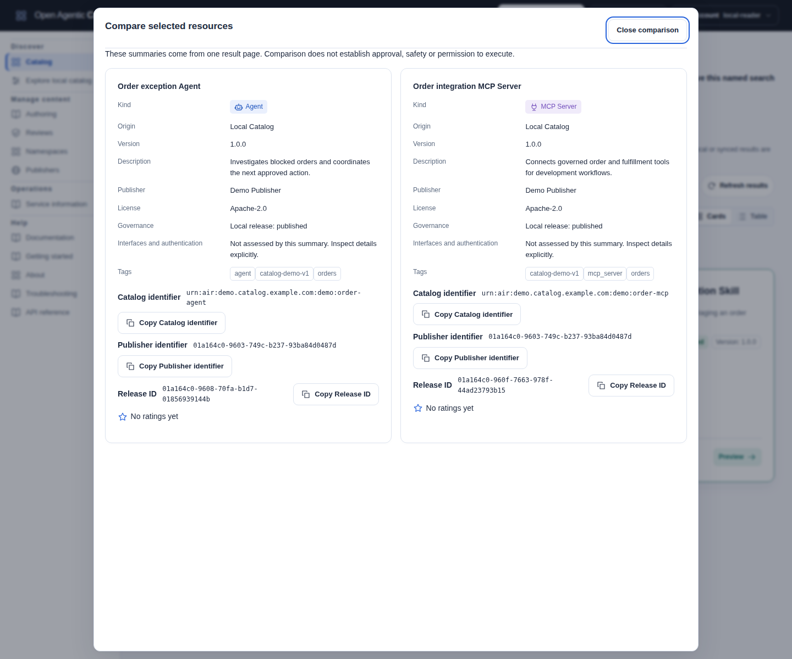
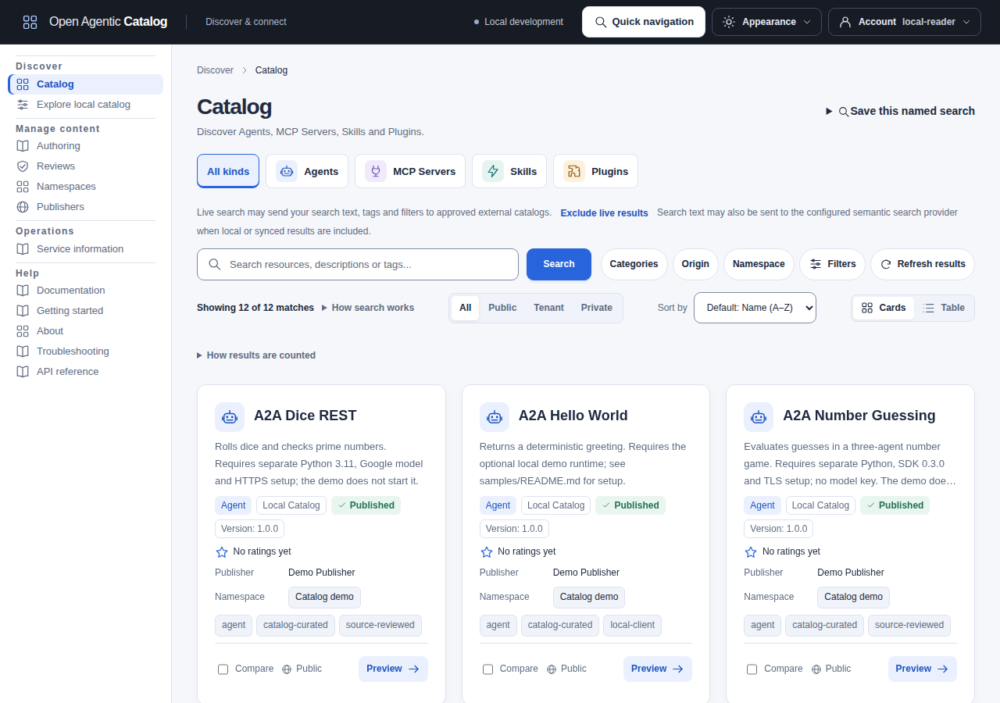
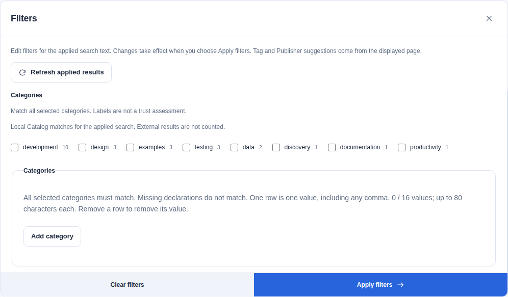
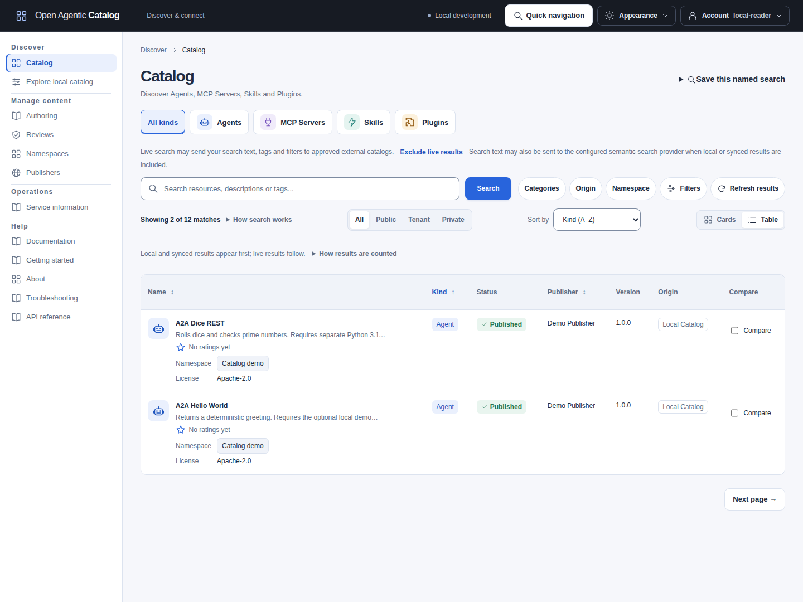
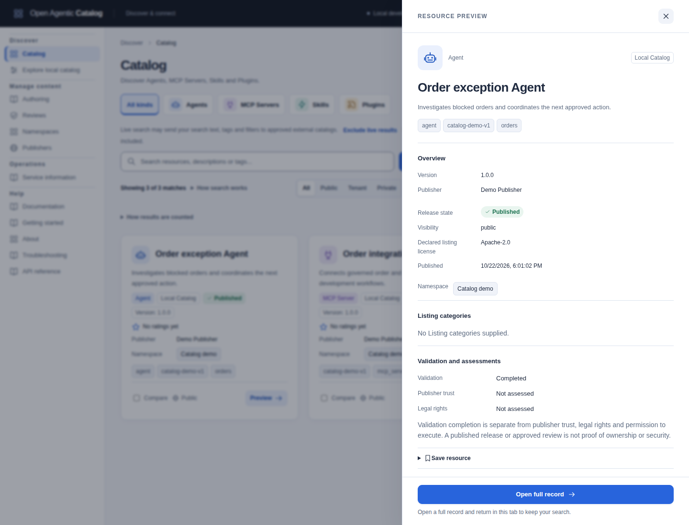

Use these recipes after [connecting as a reader](reader-quickstart.mdx). The main recipes use [lexical search](../reference/glossary.md#lexical-and-semantic-search) and need no model or running sample resource peers. Searches return metadata, not runtime instances or execution permission.

## Prepare the sample data and reader

Prepare a fresh owned curated Catalog with [the sample guide](sample-catalog.mdx). These recipes require the current revision-3 category metadata from `samples/catalog.yaml`. An ordinary production Catalog may contain none of these resources.

Check the selected listings' categories before the category recipe. Curated data owned by an older load receipt can match resource names but return no category matches. Rebuilding the application does not rewrite those listings. Use a fresh owned fixture or normal Listing revision, review and publication; do not reset retained data or delete its receipts. Append-only sample extension does not update existing entries.

The configured reader needs `resource.read` for both **Catalog demo** and **IDE plugins** [namespaces](../reference/glossary.md#namespace), or tenant-wide read permission. OAuth [scope](../reference/glossary.md#scope) enforcement additionally requires `catalog.read`. The development sample profile supplies synthetic `local-reader` credentials; use them only with its development authentication.

For CLI recipes, obtain a built `catalogctl` as described in the [reader quickstart](reader-quickstart.mdx#optional-use-an-existing-cli-binary). Select your owned development API and its synthetic token:

```sh
export CATALOG_REMOTE_BASE_URL="http://127.0.0.1:${CATALOG_COMPOSE_HTTP_PORT:-18086}"
unset CATALOG_REMOTE_TOKEN_FILE
export CATALOG_REMOTE_TOKEN=local-reader # Development fixture only.
catalogctl remote capabilities
```

The sample guide selects API port 18086. Retain a different selection in `CATALOG_COMPOSE_HTTP_PORT` before setting this origin. The UI has its separate URL. For an OIDC Catalog, use explicit [human login credentials](../reference/commands.md#human-cli-login) instead; do not combine `--login-file` with the development token environment.

## Find one known resource of each kind

In **Catalog**, open **Filters**. Select **Local Catalog** under **Origin**, clear the external origins and select **Apply filters**. Choose the resource kind, enter the search text and select **Search**.

| Search text | UI kind / CLI kind | Expected named result |
| --- | --- | --- |
| `testing` | Skills / `skill` | Web Application Testing |
| `everything` | MCP Servers / `mcp_server` | MCP Everything |
| `web testing toolkit` | Plugins / `plugin` | Web Testing Toolkit |
| `hello world` | Agents / `agent` | A2A Hello World |

Run the matching CLI searches:

```sh
catalogctl remote search --origin local --kind skill --text testing
catalogctl remote search --origin local --kind mcp_server --text everything
catalogctl remote search --origin local --kind plugin --text "web testing toolkit"
catalogctl remote search --origin local --kind agent --text "hello world"
```

Inspect `data.items[].displayName`, `kind` and `type`. Each expected item has `type: "local"`. Other matches and scores can vary; these recipes require the named result, not a particular score or first-place ranking.

Select a result and inspect its version and [exact references](understand-results.mdx#read-a-local-result). A locally published release need not be present in an active ARD discovery snapshot.

## Apply text, refresh and compare results

Typing changes the text draft. Choose **Search** or press Enter to apply it. The pending-text notice explains when results still use previous text. Kind shortcuts, filters, previews and **Save this named search** use applied criteria.

Choose **Refresh results** to reread the first page with applied criteria. It preserves unsubmitted text and starts a new bounded result window. An open filter panel has **Refresh applied results**, which preserves its edits. Refresh can repeat permitted live queries or embedding-provider processing.

While continuation or refresh is pending, the UI labels displayed results as previously loaded. It keeps that label after retryable failures. Use **Retry this page** for the captured failed request, or **Start a new search** when the cursor is stale.

On an indexed record, choose **Reload indexed record** to read the current indexed projection again. Changed editors require discard confirmation. This read makes no live peer query.

Select **Compare** on two results from the displayed page. Then choose **Compare selected (2/2)**. The comparison shows returned names, descriptions, kinds, origins, versions, Publishers, release states, tags and rating distinctions. Missing facts remain unavailable. It makes no detail, provider or peer request. Comparison does not establish trust, runtime availability or execution permission.

Close the comparison or press Escape to return focus to a selected result. Remove a choice before selecting a third result. A new response, query, page or identity clears the selection. Cards and tables share the selection. Use a preview to read an unclipped description or all tags; **Show all tags** also opens that preview.

[](../../../../assets/catalog-ui/catalog-comparison.png)

### Save and return to a search

After Search, choose **Save this named search** to retain applied criteria. Unsubmitted text is not included. Guided editing and saving make no Search, Explore or suggestion request.

Open the saved item and choose **Open search editor**. Review disclosure and provider consent, then select **Search** explicitly. Checking consent alone sends no request. Follow [Save resources and searches](catalog-ui.mdx#save-resources-and-searches) for permissions, exact-label lookup and recovery.

Same-tab return from a local or indexed record retains the applied criteria and pending text, then reads results again. Revoked consent leaves the search staged. Reloading requires a new explicit Search from the stored criteria.

## Combine kinds, categories, a tag and a license

Clear the text query. Open **Filters** and select both **Skills** and **Plugins** checkboxes; the toolbar shortcuts select only one kind. Choose categories `development` and `testing`. Add exact tag `catalog-curated`; under **More filters**, enter `Apache-2.0` in **License declaration**. Keep only **Local Catalog**, then select **Apply filters**.

```sh
catalogctl remote search --origin local --kind skill --kind plugin \
  --license Apache-2.0 --category development --category testing \
  --tag catalog-curated --limit 10
```

With the unchanged current curated data and tenant-wide read access, this returns **Web Application Testing** and **Web Testing Toolkit**. Either selected kind can match. Both categories and the tag must match. The license is the complete case-sensitive declaration: `Apache-2.0 AND MIT` does not match `Apache-2.0`.

Category suggestions and facet counts describe matching local releases. They do not count external inventory, opinions, installations or running services. [Filter semantics](../reference/api-conventions.md#catalog-origin-and-local-namespace-selection) remain the authority for exact matching.

## Restrict the same query to one namespace

Obtain the **Catalog demo** namespace UUID from an authorized namespace read or the selected Skill's `local.resource.namespaceId`. A Resource, Listing or release UUID is a different identifier.

The UI namespace chooser requires `namespace.read` for applicable choices and `catalog.read` when scope enforcement is enabled. Open **Filters**. Select **Load namespaces**. Choose **Catalog demo** under **Local namespace**. Select **Apply filters**. Selecting a namespace restricts origins to local releases.

Set the actual UUID from your read, then repeat the exact filters:

```sh
export CATALOG_DEMO_NAMESPACE_UUID=REPLACE_WITH_CATALOG_DEMO_NAMESPACE_UUID
catalogctl remote search --origin local --kind skill --kind plugin \
  --license Apache-2.0 --category development --category testing \
  --tag catalog-curated --limit 10 \
  --namespace "$CATALOG_DEMO_NAMESPACE_UUID"
```

This leaves **Web Application Testing**. **Web Testing Toolkit** belongs to **IDE plugins**. The namespace filter narrows access; it does not grant access or filter federated namespaces.

Removing a Namespace leaves the explicit local-origin choice in place. Change **Origin** deliberately to include external results. Tag and Publisher suggestions come from the current page; category counts cover local matches. Empty or failed choices do not prevent manual exact filters.

Use **Exact namespace ID** when you already know the UUID or cannot load directory choices. This field requires no namespace-directory read. It narrows the query and does not verify existence or grant Resource access.

### Save this group as a private named search

The query above combines tag `catalog-curated` with namespace **Catalog demo** and the earlier kind, category and license filters. `POST /api/v1/catalog/search` accepts these as `tags`, `namespaceId`, `origins`, `kinds`, `categories` and `license`. The namespace UUID selects local releases; it does not identify an external protocol namespace.

Saving requires a human account with `library.own`. With OAuth scope enforcement, reads also need `catalog.read`; saves need `personal.write`. An ordinary Reader grant does not include library access. Ask for the Library member template if needed.

1. Expand **Save this named search** after the filtered results load.
2. Enter `Catalog demo testing tools` in **Saved label**.
3. Expand **More saved filters** to check namespace, tag and the other filters.
4. Select **Save named search**.
5. Review the confirmation. Select **Confirm**.
6. Open **Account > Saved items and searches**.
7. Open your saved item. Select **Open search editor**.
8. Review the criteria and any required query consent.
9. Select **Search** to read current results.

The saved item belongs to your library. It stores criteria, not results, approvals or access grants. Opening it does not run Search. Sharing a page URL transfers neither the saved search nor access to its targets.

Tags remain governed Listing metadata. Saving this query does not create private tags or change the releases. A released tag changes through a new Listing revision, review and release.

See [saved-library controls and recovery](catalog-ui.mdx#save-resources-and-searches) for full instructions. Use the [organization and reuse guide](concepts.md#organize-and-reuse-resources) to choose another workflow.

## Read more result pages

Clear the namespace, kinds, categories, license and text. Keep origin **Local Catalog** and tag `catalog-curated`. The twelve published curated releases fit on one UI page; Catalog requests 24 items per page. For a larger authorized collection, use **Next page** and **Previous page** when shown. Filters stay attached to that search.

The CLI fetches one page per command. To see continuation with this small collection, request two items and retain the returned cursor:

```sh
umask 077
export CATALOG_SEARCH_DIRECTORY=$(mktemp -d)
catalogctl remote search --origin local --tag catalog-curated --limit 2 \
  > "$CATALOG_SEARCH_DIRECTORY/page-1.json"
CATALOG_SEARCH_CURSOR=$(python3 -c \
  'import json,sys; print(json.load(open(sys.argv[1]))["data"].get("nextCursor", ""))' \
  "$CATALOG_SEARCH_DIRECTORY/page-1.json")
test -n "$CATALOG_SEARCH_CURSOR"
catalogctl remote search --origin local --tag catalog-curated --limit 2 \
  --cursor "$CATALOG_SEARCH_CURSOR" \
  > "$CATALOG_SEARCH_DIRECTORY/page-2.json"
```

Use each page's new `data.nextCursor` for the next invocation. Preserve origin, tag, other filters, limit and identity. Stop when the cursor is absent or empty; an empty item array alone does not end pagination. Keep the private responses only as long as you need them.

`data.durableTotal` counts the matching local/indexed projections, not the number on this page. `data.liveCount` counts transient live items included on this page. Neither is an upstream inventory total. Cursors expire; restart deliberately after a stale cursor instead of changing filters under it.

## Compare local and indexed external results

Use [the two-Catalog federation tutorial](two-catalog-federation.mdx) to prepare independent Catalogs A and B. [Federation](../reference/glossary.md#federation) exchanges published metadata between their separate databases. Start with A's published Agent and B's complete synchronized source view. The indexed baseline does not enable live queries.

On B, use a reader with `resource.read` for the selected local release and tenant `federation.discover` for external Search. The tutorial supplies Reader and Discovery reader grants. Enforced OAuth scopes additionally require `catalog.read`. An ordinary reader does not register arbitrary source URLs.

Select B's API and the tutorial's explicit reader login file, then search for the Agent's known text:

```sh
unset CATALOG_REMOTE_TOKEN CATALOG_REMOTE_TOKEN_FILE
catalogctl remote search \
  --base-url https://catalog-b.test:8445 \
  --login-file "$CATALOG_TUTORIAL_DIRECTORY/b/reader-login.json" \
  --issuer-ca-file "$CATALOG_TUTORIAL_DIRECTORY/trust/ca.pem" \
  --ca-file "$CATALOG_TUTORIAL_DIRECTORY/trust/ca.pem" \
  --origin indexed --kind agent --text "federation tutorial"
```

In B's UI at `https://browse-b.test:9445`, select only **Indexed external** for the same query. Expect **Federation tutorial Agent**, identifier `urn:air:tutorial.catalog.example:agents:federation-demo`, version `1.0.0`. Inspect `type: "indexed"` and its retained `indexed.sourceIds`. No local release ID is created by synchronization. Readers receive attribution without permission to read private source evidence.

If an administrator also governs and publishes a matching local counterpart on B, indexed-only Search can still return the external counterpart. Selecting **Local Catalog** and **Indexed external** together allows local releases to take precedence for matching identities. The indexed tutorial itself leaves the synchronized entry external. Keep exact identifier and version-presence/value when comparing them. [Result interpretation](understand-results.mdx#read-an-external-result) explains the provenance fields.

### Optional: include live external results

Have an administrator follow [indexed/live/referral participation](../operations/federation.mdx#choose-indexed-live-and-referral-participation). They must inspect the Registry Search interface, enable hybrid source retrieval/live queries, acknowledge query disclosure and configure B's exact authenticated discovery host. Source hybrid retrieval is separate from embedding-based hybrid search.

Use nonblank search text and direct traversal with `live.federationMode: "none"`. Select **Live external** in the UI only after those prerequisites. The CLI exposes `--origin live`; the full source/traversal configuration belongs to the operator runbook.

Live calls can disclose text, tags and filters to approved peers. A live item has `type: "live"`, `live.sourceId`, the source locator and the returned entry. It is transient metadata, not a synchronized observation or locally reviewed release.

## Tell empty, limited and partial results apart

| Outcome | What to inspect | What it means |
| --- | --- | --- |
| No text match | Search local Skill text `catalog-cookbook-no-such-resource-2026` | A successful response can have no items. Check filters before concluding that the Catalog contains no resources. |
| Access-limited search | Repeat a known query with a reader limited to one authorized namespace | Only readable local releases appear. Empty results do not disclose inaccessible records or prove their absence. |
| Partial live search | Use the prepared live fixture during an owned peer outage; inspect `data.partial` and `data.diagnostics` | Accepted local/indexed/live results can remain usable while some approved source queries or results are incomplete. |

Local Search can return `200` with an empty authorized population when the member has no applicable read grant. Explicit indexed/live origins require tenant `federation.discover`; an enforced OAuth ceiling also requires `catalog.read`. See [private collection authorization](../reference/api-conventions.md#private-collection-authorization) for selection and exact-read rules.

The UI displays **Search diagnostics** and an incomplete-source notice when applicable. A successful HTTP request or CLI exit 0 can still contain partial Search. Do not confuse federation `partial` with semantic `partialIndex`.

Only exercise outages in your own disposable fixture. An unavailable source does not authorize a reader to change its credentials, destination or policy. [Federation troubleshooting](../operations/federation.mdx) owns those repairs.

## Origin and local namespace filters

Origin selects metadata populations: **Local Catalog**, **Indexed external** and **Live external**. Indexed-only Search can return an external counterpart of a local release. Selecting Local and Indexed together permits local precedence. A source location is not a runtime location or execution permission.

**Local namespace** selects the local Listing's owning namespace UUID. It is not a Resource UUID or an AIR namespace segment. Select **Load namespaces** explicitly, then **Next namespace page** for additional authorized choices. Namespace-directory reads need their own permission.

Choosing a namespace keeps only Local Catalog and disables external origins until the namespace is cleared. Removing its applied chip keeps local-only origin selection. Each origin has its own removable chip; remove the namespace before changing origins. Category and namespace facet buckets refine local queries; source and trust buckets remain informational where the query API has no matching selector.

Live Search needs nonblank text and permits at most 50 transient candidates in one unchanged bounded window. Core ranking can interleave durable and live matches. Hybrid ranking preserves the order of local and indexed matches and places live results after them. Live-only Search performs no durable/embedding query: `durableTotal` is zero and `liveCount` counts this page, not the peer's total inventory.

## Optional: compare lexical and hybrid retrieval

Use an already configured embedding provider; operator setup belongs to [hybrid search](../operations/hybrid-search.mdx). Keep the query and exact filters unchanged when comparing fresh searches. Semantic similarity does not override filters, grants or local/external provenance.

| Response field | Meaning |
| --- | --- |
| `data.tier` | Required actual retrieval tier: `core` or `hybrid`. It is not merely the deployment setting. |
| `data.fallbackReason` | Optional safe reason a fresh query used lexical fallback: `indexing`, `provider_unavailable`, `index_changed` or `work_limit`. Its absence is not a failure. |
| `data.partialIndex` | Optional indication that some eligible metadata remains lexical-only because it cannot be embedded. This differs from incomplete federation results. |

A hybrid continuation retains its bound ranking; it cannot silently become lexical during a dependency outage. Start a new query only when the documented error requires it. Search scores measure relevance, not confidence, approval or trust.

For exhaustive flags and envelopes, use [CLI Search reference](../reference/commands.md#remote-catalog-reads) and the <a href={`${import.meta.env.BASE_URL}api/`}>HTTP API reference</a>. The [LangGraph assistant](../../../../../examples/langgraph/README.md) is an optional local-release-only client of these same read contracts.

## Find and inspect resources

These controls apply to any authorized Catalog, not only the cookbook's samples. The screenshots use a disposable curated fixture with twelve published resources, three per kind, and its configured `local-reader`. Select an image to open it at full size. The sidebar follows the current caller's permissions.

[](../../../../assets/catalog-ui/catalog-browse.png)

### Submit search and filter edits

Select **Search** or press Enter to submit search text. The compact **Agents**, **MCP Servers**, **Skills** and **Plugins** shortcuts select one kind immediately. **All kinds** clears the kind selection, preserves other submitted criteria and returns to the first page. Use kind checkboxes in **Filters** to combine kinds; matching any selected kind is sufficient. No kind selection includes all kinds.

Select **Categories**, **Origin** or **Namespace** beside Search to open that control, or **Filters** for the complete panel. Namespace choices require namespace-read permission. **More filters** contains license, visibility and publisher.

**Apply filters** submits the panel's edits together. Closing without applying discards those edits. Desktop uses an in-page panel; widths up to 900px use a modal drawer with scrollable controls and an accessible Apply footer. Resizing preserves the unapplied draft. Escape or **Close filters** returns focus to the opener.

Search text is a separate draft. Kind shortcuts, metadata filters and result-tag actions preserve submitted text even when the input has an unsubmitted edit. Only Search or Enter submits that text. **Clear filters** resets the panel's draft kinds, tags, categories, license, publisher, visibility, origins and namespace; apply to save it. **Clear all** above results resets the submitted query and every filter.

### Match exact metadata

| Filter | Matching and bounds |
| --- | --- |
| License declaration | Trimmed case-sensitive complete declaration, up to 256 Unicode code points. SPDX expressions are not evaluated. Missing declarations do not match. |
| Categories | Enter one value per row. All selected values must match after trimming/lowercasing; at most 16 labels of 80 code points each. Commas remain literal. Local Listing categories and external literal Dublin Core subjects supply the declarations. |
| Tags | Use **Add tag**, then **Add exact tag** for one value at a time. Apply includes a pending value. All selected tags match after trimming/lowercasing; at most 32 tags of 80 code points. Commas remain part of one value. |
| Publisher | Exact local Publisher UUID or normalized external AIR publisher component. This is not a display-name search. |
| Visibility | All/Public/Tenant/Private narrows eligible matches immediately; it never grants private access. |
| Local namespace | Exact local Listing namespace UUID. Selecting it restricts origins to local releases. |

Category/license filters apply across selected origins before ranking, totals and pagination, including optional hybrid retrieval. Missing or unusable declarations do not match; live filtering can be partial when evidence or work limits prevent complete results. Unicode code-point limits count combining accents and joined emoji components separately.

Category suggestions show at most 24 labels with local counts for the applied query. Indexed/live results are excluded. Selected labels remain available when absent from suggestions. Enter rows manually when suggestions are empty or unavailable. Draft edits do not refresh counts or contact peers; external-only searches use manual categories without local suggestion requests.

Tag suggestions come from the current page. **Search tag suggestions** narrows that list with case-insensitive literal text; it does not query resources or fetch suggestions. Selected tags stay visible. Selecting a result tag adds its exact value immediately without opening the preview or duplicating an applied tag.

Publisher suggestions show at most eight current-page values. Local names appear beside exact UUIDs; external values say **External AIR publisher**. Identical names with different UUIDs remain distinct. Missing names fall back to identifiers. A selected publisher remains applied on later pages even when absent from suggestions. These choices enumerate no tenant directory and are not a complete Catalog-wide facet list.

[](../../../../assets/catalog-ui/catalog-filters.png)

Scroll within the panel for remaining controls. The footer keeps **Apply filters** available. Applied criteria appear as individually removable chips; they filter on the server, not just over visible cards.

Each origin has its own labelled chip. Removing one preserves other applied criteria and unsubmitted text, then starts the first page. Removing the final origin chip restores the API's default origins. With external-discovery permission, a nonblank submitted query can then contact approved Catalogs. Unsubmitted text remains a draft.

A namespace chip shows its known name, or the exact UUID when the name is unavailable. Its action label includes the UUID. When permitted, an unknown selected name requires only that namespace lookup, not a directory scan. Without namespace-read permission, the UUID remains usable. A namespace restricts results to local releases; remove the namespace before changing origins. Removing the namespace keeps the local origin selected.

### Control disclosure, order and continuation

Origin describes metadata provenance, not where a resource runs. Without external-discovery permission, the notice identifies local-only access. **Live external** can disclose text, tags and filters to administrator-approved Catalogs. **Exclude live results** applies those origin criteria immediately, preserves other submitted criteria and starts the first page. It does not submit an edited search-box draft.

Alternatively, clear Live external in Filters and apply. Local/indexed Search can still disclose text to the configured embedding provider when semantic search is enabled. Live-only Search does not use that provider. These controls affect future requests; they cannot recall submitted data or promise that every outbound operation stops.

Default order is **Name (A-Z)** without search text and **Relevance** with text. Use **Sort by** in Cards or Table view, or select the **Name**, **Kind** or **Publisher** column heading. Select the heading again to reverse its order. Sorting applies across pages and restarts at the first page. It preserves your filters and unsubmitted search text. Publisher ordering uses its displayed local name or external declaration; ties use resource name and stable result identity. Saved searches retain the selected order.

[](../../../../assets/catalog-ui/catalog-table-sorted.png)

Kind is ascending in this example. The highlighted heading and arrow show the selected order.

Column sorting uses keyword matches. Choose **Relevance** to include meaning-based search when configured. Column sorting does not call the embedding provider for Search; category suggestions have their own permitted provider processing. Local and indexed matches come first, followed by the separately sorted live results. Version, status and comparison controls have no sort action. There is no popularity, rating or recently added sort.

Counts distinguish local and indexed matches from live results on the current page. **How results are counted** appears when live results are included. Its total is not a complete inventory of external catalogs.

Default keyword pages can mix local, indexed and live matches. Meaning-based and explicit column ordering put local and indexed matches before live results. Live-only Search can also continue its bounded window. **Next page** uses the server cursor. **Previous page** rereads an earlier page using up to ten recent request cursors kept in memory; it does not display a cached result. **First page** remains available after older history is dropped.

Changing criteria, submitting Search again or an explicit new-search retry clears page history. A rejected cursor offers **Start a new search** with submitted criteria. If continuation fails temporarily, the previous page remains visible and **Retry this page** resubmits the same token. Network, rate-limit and dependency failures can cause this; the UI does not infer a peer outage or schedule automatic retries. Changed evidence or expiry requires a deliberate new search.

### Read diagnostics and empty states

Partial Search retains available results. **Retry search** deliberately rereads the first page; no retry is automatic. Expand **Search diagnostics** for status, explanation and safe API message. A returned source UUID can be selected/copied. **Open source** requires tenant `source.read` and, when enforced, `sources.read`. The UI neither fabricates source links nor requests a source directory to resolve names.

| Diagnostic | Meaning |
| --- | --- |
| `failed` | A source request failed; this status alone does not establish the cause. |
| `invalid_response` | A source response could not be used. |
| `insufficient_evidence` | A live entry lacked bounded declarations needed by Control filters. Accepted results remain usable, with a partial response. |
| `policy_stale` | Source policy evidence is not current; an authorized source administrator can reinspect it. |
| `fanout_limited` | Source selection was limited or a duplicate source was skipped; inspect the returned explanation. |
| `diagnostics_truncated` | Further diagnostics exceed the response bound. |
| `live_results_limited` | Additional transient results could not be safely continued or exceed the current hybrid/live-only boundary. |
| `continuation_unavailable` | A Registry has another page that this bounded query did not follow. |

Empty filtered results offer **Clear search & filters**. An unfiltered empty result offers **Refresh results** and an authoring link only when permitted. No items does not prove the tenant has no drafts, inaccessible releases or unavailable source data.

### Open cards, records and previews

**Cards** and **Table** show the same result set without a detail read for every row. Kind icons supplement text; local Published/Deprecated badges describe lifecycle rather than security certification. Cards show four clickable tags and keep the rest in preview/detail. Available publisher/namespace labels and listing license remain separate from native provider/author/license declarations.

Cards lead with the name, shortened description, version and origin, followed by publisher, local namespace, tags and ratings. Table, preview and full record retain the available Listing license. Origin and local release state remain separate. Visibility appears only on local results. Missing external publisher metadata says **Not supplied**. **No version supplied** differs from an explicitly **Empty version**; previews retain the complete description.

Directory names can change without rewriting released metadata and do not prove authorship or grant directory access. Compact license text preserves at most 256 code points; longer declarations remain explicit on the full record. Missing facts are not invented.

Select a card or table resource name for its side-panel preview. Local results offer **Open full record**; indexed results offer **Open current indexed record**. Both details can be bookmarked/reloaded. Live results provide transient previews. Failed reads offer **Retry record**. See [validation, provenance and resource references](understand-results.mdx#inspect-validation-and-source-provenance) before a handoff.

[](../../../../assets/catalog-ui/catalog-preview.png)

Preview metadata scrolls separately; Close and Open full record remain available. Close, Escape or a completed primary pointer press/release outside a local preview preserves submitted filters, draft text, Cards/Table layout and focus without another Search request. Same-tab local and indexed detail links and **Back to Catalog** preserve submitted criteria, request cursor, text draft, layout and scroll. Returning rereads current results. Browser Back/Forward follows those links and asks before discarding an edited rating or artwork draft. Every indexed entry rereads its exact identifier and version presence; removed or newly hidden entries can become unavailable.

Reloads, direct URLs and new tabs start a fresh search. Identity/access changes discard this state. Criteria, query text and layout are not saved in the URL or browser storage. Bookmark a record detail instead: indexed bookmarks resolve the current visible identifier/version, not a historical snapshot, and may stop resolving after source, scope or publication changes.

Tags on previews/full local records apply exact tag filtering with the submitted criteria and restart pagination. Full-record filtering returns to Catalog in the same document and focuses Search. It never applies unrelated form drafts.

Full local records show workflow links only for independently confirmed namespace permissions and applicable OAuth scopes. Resource and Listing metadata require metadata-read permission. Version documents need content-read permission. Approved review and Release details need history-read permission; release history through Listing also needs metadata-read permission. A metadata-only caller receives **Resource metadata** and **Listing metadata** links. Unknown namespace grants do not authorize links; the UI resolves only the selected namespace when needed. Backend authorization still applies when a link opens.

## Explore local releases and facets

**Explore** separates locally governed releases from federated Search. **Browse releases** supports one kind and one visibility selection with server-controlled pagination. **View counts** accepts multiple kinds, text, exact tags/categories, license, publisher, visibility and local namespace. Select **Apply filters** to refresh counts even when submitted criteria are unchanged.

Open **Tags and categories** or **Publisher, license and visibility** for additional filters. Opening a group makes no query. **Refresh browse results** rereads the current browse page. **Refresh counts** rereads applied criteria while preserving unapplied edits. Neither view polls automatically.

Select a kind, tag, category, publisher, visibility or namespace bucket to refine the submitted query immediately. Kinds match any selection; every selected tag/category must match. Publisher, visibility and namespace buckets replace that filter. Other submitted criteria remain; unrelated drafts are not applied. Remove applied chips individually or use **Clear filters** to reset fields.

Enter one tag/category per row with **Add** and **Remove**. Commas stay literal, including values absent from current buckets. A selected exact value survives edits to other criteria. Keyboard focus returns to Search after a refinement. Unsupported trust-state/source buckets remain informational.

Counts describe matching local releases, excluding indexed/live observations. They do not predict counts after a filter changes. Each facet shows at most 20 values. Omitted bucket memberships count memberships outside that bound, not distinct hidden releases or a continuation token. Counts are hidden during query changes/failures; **Reload** retries a failed read. Identity/access changes clear the facet query/results.

Browse and count modes retain separate applied filters, browse cursor and unsubmitted count edits in memory. Switching modes rereads that mode with its own criteria. Opening a local release and selecting **Back to Explore**, or browser Back, restores the originating mode. Reload and identity/access changes clear this context.

**Use browse filters in counts** explicitly replaces count criteria with the browse kind, visibility and namespace. **Use count filters in browse** transfers applied criteria only when Browse can express them. Browse cannot express multiple kinds, text, tags, categories, license or publisher. The transfer resets its page; unsupported criteria are never silently dropped.

**Search local Catalog** transfers the applied count query to Catalog with only local origins. It includes submitted text, exact tags and categories; it does not submit edited fields or contact federation peers. Catalog and counts can use different matching, ordering and populations. Catalog Search can also send text to a configured embedding provider. This action therefore does not promise the same result count or ranking. Browser Back returns to the retained count context.
