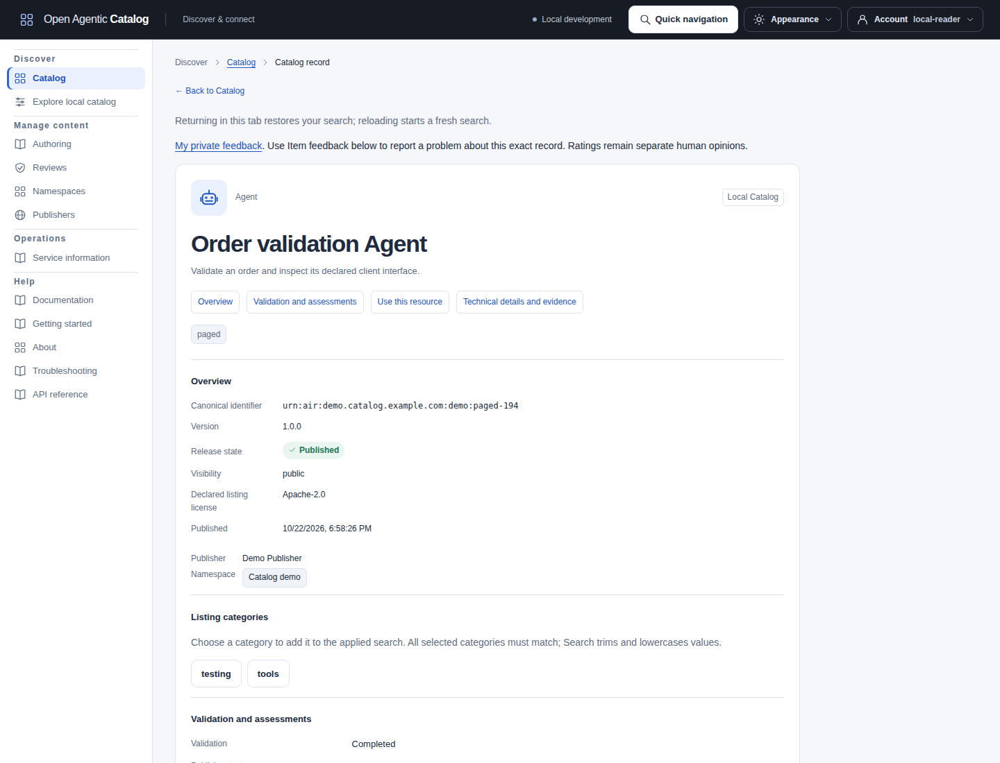
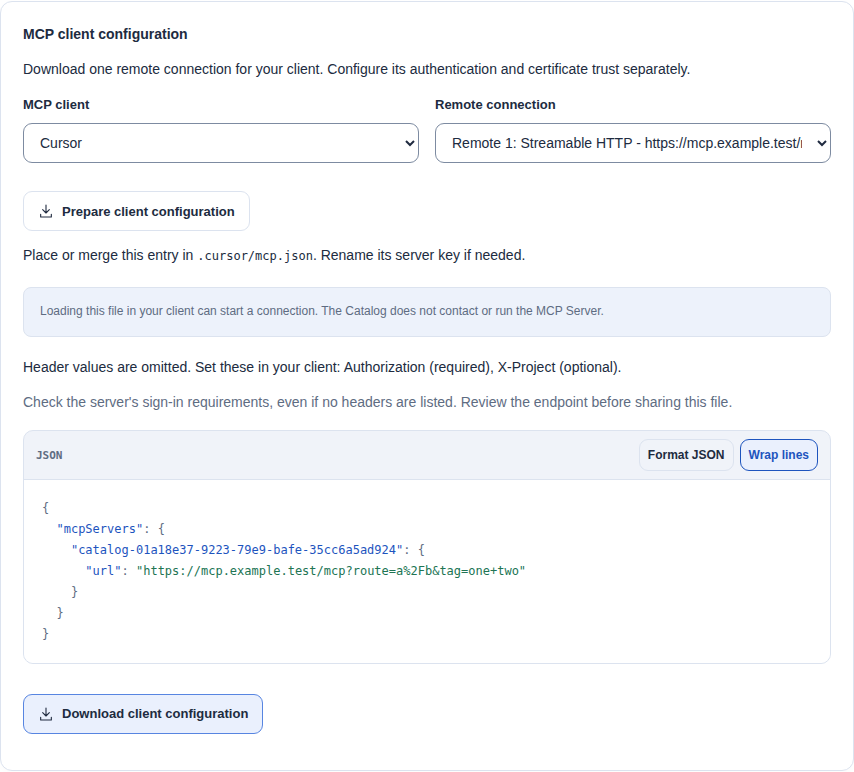
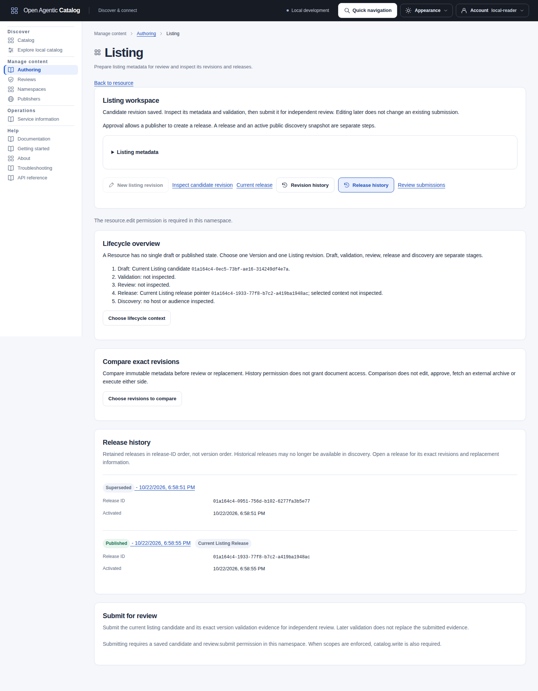
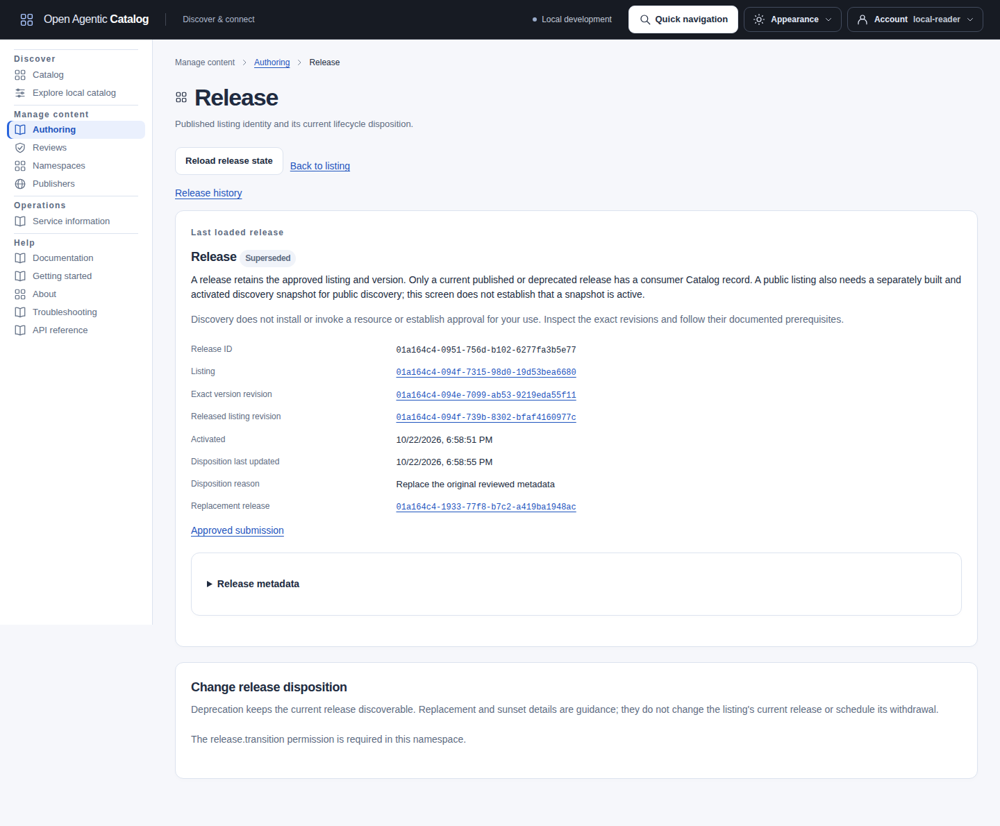
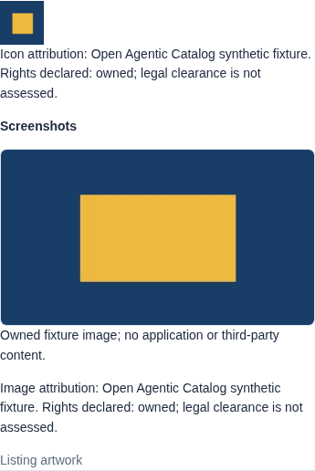

A Catalog result describes a resource. It does not grant permission to install, invoke or execute it. Use this page after [your first reader visit](reader-quickstart.mdx) or a [search recipe](search-cookbook.mdx).

## Read a local result

In the curated sample Catalog, search Local Skill results for `testing` and select **Web Application Testing**. Its fixed sample metadata includes:

```json
{
  "displayName": "Web Application Testing",
  "type": "local",
  "kind": "skill",
  "identifier": "urn:air:demo.catalog.example.com:demo:webapp-testing",
  "versionPresent": true,
  "version": "source-8a1541c4"
}
```

This is a selected-field excerpt, not a complete response. Your fixture supplies its own UUIDs. The example's [version](../reference/glossary.md#resourceversion) names the packaged content; it is not a revision counter, ETag or running installation.

Prepare the sample Catalog and configure the CLI through [the Search cookbook](search-cookbook.mdx#prepare-the-sample-data-and-reader). Keep that shell open. Read the references from your actual Search response:

```sh
umask 077
export CATALOG_RESULT_DIRECTORY=$(mktemp -d)
catalogctl remote search --origin local --kind skill --text testing \
  > "$CATALOG_RESULT_DIRECTORY/search.json"
python3 - "$CATALOG_RESULT_DIRECTORY/search.json" <<'PY'
import json
import sys

page = json.load(open(sys.argv[1]))["data"]
item = next(item for item in page["items"]
            if item["displayName"] == "Web Application Testing")
print(json.dumps({
    "displayName": item["displayName"],
    "type": item["type"],
    "id": item["id"],
    "identifier": item["identifier"],
    "versionPresent": item["versionPresent"],
    **({"version": item["version"]} if item["versionPresent"] else {}),
    "releaseId": item["local"]["release"]["id"],
    "resourceId": item["local"]["resource"]["id"],
}, indent=2))
PY
```

| Field in CLI Search | How to use it |
| --- | --- |
| `data.items[].displayName` | Display text. Search does not return a common `name` field. |
| `type` | Metadata origin: `local`, `indexed` or `live`. The common field is `type`, not `origin`. |
| `id` | Search-result identity. For local results it is `local:` followed by the release UUID. |
| `local.release.id` | Bare ListingRelease UUID for `catalogctl remote record --id UUID`. Do not pass the `local:` prefix. |
| `local.resource.id` | Stable Resource UUID. It is a different record and cannot replace the release ID. |
| `identifier` | Canonical resource identifier. It is not a database UUID or an authentication credential. |
| `versionPresent` and `version` | Exact advertised version presence and value. Preserve an absent version separately from a present empty string. |

Raw HTTP Search returns the same `items` fields without the CLI's `data` envelope. ARD Search has a different `results` envelope and representation-media-type `type`; follow [the interface conventions](integrating.mdx#interpret-results-before-handing-them-off).

In the web UI, open **Use this resource** and **Exact release and revision IDs** to inspect the equivalent local references. Use **Open full record** for the authorized local record. [Copy and download controls](#copy-references-and-download-documents) preserve their different scopes.

Full local records have **Record sections** links for Overview, Validation and assessments, Use this resource, and Technical details and evidence. Each link moves keyboard focus below the header. Section bookmarks work after reload. **Return to results** appears after the full record and personal controls; a saved-search workspace uses **Return to saved search**. Same-tab return retains the applied search and pending text. Reload starts a fresh workspace.

**Listing categories** shows up to sixteen complete declarations of up to eighty Unicode characters each. Choose a category to add it to the applied search. This preserves pending text, other filters and exact spelling in the submitted criteria. Search trims and lowercases categories; all selected categories must match. Blank declarations have no filter action. Canonical identifier, Catalog Publisher and Listing license remain separate from each representation's provider, author and native license.

[](../../../../assets/catalog-ui/catalog-record.png)

This synthetic local record shows the section index and complete category controls. Assessments, handoff and personal controls continue below.

## Read an external result

Follow [the two-Catalog tutorial](two-catalog-federation.mdx) through A's Agent publication and B's complete indexed synchronization. Search B with its reader and only **Indexed external** selected. Inspect the matching Agent's actual fields:

```json
{
  "displayName": "Federation tutorial Agent",
  "type": "indexed",
  "kind": "agent",
  "identifier": "urn:air:tutorial.catalog.example:agents:federation-demo",
  "versionPresent": true,
  "version": "1.0.0"
}
```

This selected-field excerpt uses the tutorial's fixed authoring metadata. Read the source/observation references from your own synchronized result; they are not shared IDs across installations.

- `type: "indexed"` identifies a retained synchronized [observation](../reference/glossary.md#observation-and-occurrence), rather than B's local release.
- `identifier`, `versionPresent`, `version` when present, `kind` and `displayName` describe that external resource. Preserve their exact values.
- `indexed.sourceIds` and `indexed.presentationSourceId`, when supplied, attribute the observations and selected presentation to their source.
- `indexed.observationGroupId` identifies the grouped observations. `normalizedEntryDigest` binds normalized metadata; it is not a downloadable package checksum.
- `conflict`, `sameSourceConflict`, `sourceCount` and `sourcesTruncated` describe the bounded attribution and conflict state.

Keep this reader-visible attribution with copied references. It does not grant `source.read` or private evidence access. An ordinary Reader cannot turn a source UUID into permission to inspect source credentials or assessment evidence.

An indexed item has no `local.release.id` for `catalogctl remote record`. Synchronization does not adopt it. An authorized adoption creates a separate local draft that still needs validation, review and release.

With separately enabled live Search, `type: "live"` instead carries `live.sourceId`, `live.source` and the exact bounded returned `entry`. Live metadata is transient; it is not a retained synchronized snapshot. The source locator identifies discovery provenance, not necessarily the publisher or runtime endpoint.

An external preview can omit version, license, documentation or delivery information. Missing fields are unknown. Do not invent a local release, package URL or invocation endpoint from an identifier. See [external Search recipes](search-cookbook.mdx#compare-local-and-indexed-external-results) and [federation operations](../operations/federation.mdx).

On a current indexed record, choose **Reload indexed record** for the same identifier and version-presence selection. This reads the current indexed projection without a live peer query. Current source contributions can change. Pending or failed reloads keep the last loaded projection labelled; edited rating/artwork input requires explicit discard before reload. The section links preserve source provenance before handoff.

**Refresh live artwork** and **Refresh live ratings** repeat the captured Catalog search, including its filters and page. They can disclose criteria to current approved sources or send text to the configured embedding provider. This is not a local image-cache refresh. They preserve open drafts and require the same source, generation, kind, identifier and version presence. A changed target or expired result window requires a new search; refresh never silently substitutes another result or creates a permanent live-record link. Artwork refresh is unavailable without the exact reported source and generation; the existing summary remains readable.

## Inspect validation and source provenance

Previews and full records group information as **Overview**, **Use this resource** and **Technical details and evidence**. Local records also place **Validation and assessments** before resource use. Expanding a section makes no network request. Retained downloads remain explicit authenticated reads with byte verification.

Local previews/full records place **Validation and assessments** before **Use this resource**. **Completed** means validation state `complete`; **Blocked** means `blocked`. Publisher trust is separately labelled Not assessed, Unsupported, Unverified, Reported verified, Failed or Expired. Current legal rights are **Not assessed**. These labels follow returned evidence, not release state.

Publication, validation completion and approval do not prove ownership or security. General Trust Manifest signature verification is unavailable; the separately enabled ANS assessment has its own explicit boundary. Missing or malformed assessment data causes a record-read error. Select **Retry record** to try the read again. Handoff stays unavailable until a valid record loads; complete validation evidence remains available in JSON.

Indexed previews/current records show **Source provenance** before handoff: source count, at most sixteen exact UUIDs and an explicit truncation notice. **Identity variants** reports conflicts; **Same-source variants** separately reports multiple current variants from one source. Copy exact source/observation-group references. Missing IDs remain explicit.

**Compare source contributions** and source pages require `source.read` plus `sources.read` when scopes are enforced. Ordinary readers receive attribution without those directory reads. The comparison URL binds identifier, version presence and exact optional version; the opaque observation-group ID is not its route key. This current projection is not immutable validation evidence, a timestamp or an availability check. Upstream declarations are not local trust/rights assessments.

### Read the native representation summary

**Use this resource** summarizes each representation independently from already-loaded authorized evidence. Provider, author and native license appear only when supplied. Skill normalized facts currently omit frontmatter license, so the UI does not substitute the Listing license. Representations can carry different declarations.

| Representation | What the UI shows |
| --- | --- |
| A2A Agent Card | Declared Agent version and interfaces; endpoint, transport and protocol version remain distinct. |
| MCP Registry document | Server version, remote transports and package registry/identifier/version/transport. Package version can differ from server version. |
| Experimental MCP Server Card | Declared remote connections/server version; no invented Registry package list or runtime tool inventory. |
| Skill | Supplied immutable Git/OCI references and available package root/structure/file count. A retained document may omit supporting files. |
| Plugin | Inspected root and declared Skill/MCP component names/paths, separate from the external archive reference. Retained component documents are not the complete archive. |

Endpoints, packages and components show at most 16 entries with an explicit overflow notice. Long declarations direct you to complete metadata. Authentication summaries never copy header values, environment defaults or commands. Unsupported/missing declarations do not imply anonymous access or a failed security assessment. No URL is fetched to manufacture a badge. OCI distribution does not establish a running container; declared interfaces do not establish uptime or access.

Each representation with inline data offers **View decoded metadata** in both preview and full record. It uses already-loaded data and makes no additional read. This inert JSON display reconstructs whitespace and can round decoded numbers; it is not original bytes. It offers no reconstructed copy or export. Use a separately verified retained-document download when exact bytes are available.

JSON panels offer **Format JSON** and **Wrap lines** in both themes. Raw retained documents and federation entries start with their supplied whitespace. Formatting changes only display, not retained content or downloaded files. Large/deep documents and non-JSON text omit highlighting to keep the page responsive.

## Copy references and download documents

In **Use this resource**, copy the identifier/version and expand **Exact release and revision IDs** for local release, version-revision and listing-revision references. **Representation evidence** exposes media type, profile, digest scope/checksum and byte size. **Inspect retained version revision** reads complete evidence under its own current authorization/audit boundary.

Git repository, full commit and directory are separate copies. Digest-pinned OCI references stay literal. Metadata/archive URLs are not runtime endpoints. Inline A2A/MCP summaries preserve declared endpoint/transport and authentication guidance; credentials and connection-header values are not copied.

A raw retained text viewer offers **Copy document text** only when its caller supplies original text explicitly. Copying preserves supplied whitespace, duplicate keys and numeric tokens, independently of Format JSON. Decoded metadata and reconstructed JSON offer no such action. The clipboard limit is 2 MiB of UTF-8; if clipboard access fails, you can select and copy the text manually. These controls do not follow external links.

The notice beside **Prepare retained document download** explains its independent permission. Readable metadata or a digest grants no download access. The server requires a currently authorized content reference and `catalog.read` scope when enforced. The displayed namespace hint can be pending, unavailable or lack `resource.read_content`; another authorized reference can still permit the same document. A failed hint read has an explicit retry. Preparing the download always checks current server admission.

For a stored artifact:

1. Select **Prepare retained document download**.
2. Wait for the authenticated read and SHA-256 verification against exact bytes and content-addressed artifact ID.
3. Select **Save retained document**.

The file preserves bytes and displays the validated media type. Its safe filename is `catalog-document-<digest>.<extension>`. A fixed mapping uses `.json` for supported JSON documents, `.jsonld` for JSON-LD, `.md` for Markdown/Skill Markdown, `.txt` for plain text and `.yaml` for YAML. Other types use `.bin`; neither resource names nor arbitrary media subtypes become filename extensions. Preparing again checks current access and replaces the earlier link. Closing the preview, leaving the view or signing out cancels preparation and removes its link. Previously saved files and clipboard copies remain. Failed reads/checks create no downloadable file and can be retried. Version revisions offer the same control beside **Read retained document**.

Inline record JSON is not an original-byte export. Inspected Skill/Plugin archive bytes are not retained for download; inspection documents cannot recreate their package. Eligible credential-free HTTPS Git, metadata-document and listing Documentation/Support/Terms URLs offer explicit **Open** beside **Copy**. Open shows the destination in an isolated tab without a referrer.

For a missing archive, use the declared external archive or immutable Git/OCI reference with a compatible client. Follow the kind-specific guide linked beside the handoff when documentation is configured. Inline-only JSON remains readable as decoded metadata; the UI does not reconstruct an original document, complete Skill tree or Plugin archive. Authentication and execution requirements remain separate from Catalog download permission.

Whitespace/control characters or URL credentials prevent linking. Commits, directories, OCI references, archives and runtime protocol endpoints remain literal copy controls; the UI invents no web destination. Copy/download preparation never follows external references. Copy uses only the displayed value; if clipboard access fails, select/copy it manually.

External previews/current indexed records supply declared identifier/version with provenance, not a local release or approval. Their metadata digest is not downloadable-document integrity evidence. Missing delivery/version/authentication details remain explicit. Agent/MCP guidance refers to declared interfaces; Skill guidance distinguishes one document from the complete tree; Plugin guidance distinguishes retained inspection from external archive delivery.

## Download an MCP client configuration

Current local MCP records with published or deprecated releases offer **MCP client configuration** under **Use this resource**.
This exports one declared HTTPS connection from a supported MCP Registry document or experimental Server Card.
The generated JSON contains client settings, not an original native MCP document.
Package commands and stdio connections remain available as native metadata, without generated client configuration.

1. Open the local MCP record.
2. Choose a representation if the record has several.
3. Choose **VS Code**, **Claude Code** or **Cursor**.
4. Choose a remote connection if the document declares several.
5. Select **Prepare client configuration**.
6. Review the JSON preview and omitted header names.
7. Select **Download client configuration**.
8. Place or merge the entry in your client's project file.

For stored documents, preparation first checks your content permission and verifies the document's checksum, media type and size.
The UI reuses verified bytes when you change clients.
Leaving the record or signing out clears these temporary bytes.
If preparation reveals several connections, choose one and prepare again.
Unsupported connections remain visible with an explanation; their original numbered positions do not change.

| Client | Project file | Generated entry |
| --- | --- | --- |
| VS Code | `.vscode/mcp.json` | `servers` with `type` and `url` |
| Claude Code | `.mcp.json` | `mcpServers` with `type` and `url` |
| Cursor | `.cursor/mcp.json` | `mcpServers` with `url` |

The browser downloads `mcp.json` for all three clients.
For Claude Code, rename it to `.mcp.json` in your project.
The [CLI exporter](../reference/commands.md#export-an-mcp-client-configuration) writes the client filename directly into a private output directory.
The generated key is `catalog-<release UUID>`; you can rename it when you merge the entry.

Configure target authentication and certificate trust in your client.
Header values are omitted, including optional values and defaults.
The preview lists declared header names and identifies required headers.
Check the server's sign-in requirements even when no headers are listed.
Review endpoint URLs before sharing configuration files.

Export does not contact the MCP Server or change your client settings.
Opening the configuration in your client can initiate a connection.
Changing a selection clears the preview and download link.
Leaving the record, signing out or a known access change clears temporary output.
Previously saved files remain on your computer.

[](../../../../assets/catalog-ui/mcp-client-configuration.png)

## Inspect releases and their history

From a full local record, select **Release details** for the exact released revisions or **Release history** for paginated Listing history. The history link selects/focuses its tab, including after bookmark reload; ordinary Listing links open revision history. External results without a local Listing have no local release history.

History shows release state, activation date and ID, with the Listing's current release separate. Pages follow immutable release-ID order, not version-number or activation-date sorting. **Next page** reads another bounded page; **First page** rereads the beginning. Empty pages remain explicit. After failed continuation, **Reload** retries that read and First page restarts without the stale cursor.

History needs `resource.read_history` at the namespace and `catalog.read` when scopes are enforced. Read access grants no authoring/publication authority. Each governance link checks its own permission: **Resource and versions**, **Listing and revisions**, **Approved review** or **Release details**.

Release details link exact released content/listing revisions, not the current candidate. Activation and disposition-update dates are separate, with optional sunset, plain-text reason and replacement link. Select a replacement explicitly; the UI does not follow chains. Version labels come from existing Catalog metadata without extra private evidence reads. Explicit revision inspection follows authorized, audited evidence reads.

Superseded, retired and revoked releases remain in history but have no current Catalog-record link. Only the Listing's current published/deprecated release qualifies. A sunset date alone does not change lifecycle state. Current Control records and active host/audience publication snapshots remain separate.

An authorized disposition change requires reading consequences before confirmation. Deprecation keeps a current release discoverable. Retirement, supersession and revocation withdraw entire active snapshots that contain the release. Activate a replacement snapshot to make the other entries discoverable again. Naming a replacement does not select the Listing's current release. See [eligible disposition transitions](publishing.mdx#change-release-disposition-or-withdraw-discovery).

[](../../../../assets/catalog-ui/release-history.png)

[](../../../../assets/catalog-ui/release-details.png)

These screenshots use disposable synthetic metadata. Retained history and current Catalog records have different eligibility.

## Resource artwork

Catalog cards load allowed icons as they enter the viewport. Previews and details show optional screenshots, captions and attribution. **Previous screenshot** and **Next screenshot** support keyboard use when the gallery contains several images. The browser receives images through authenticated Catalog reads; it does not contact external image origins.

A missing/unsafe icon leaves the resource-kind glyph. Artwork does not change ranking or resource permissions. Shipped configurations start with image retrieval disabled. Operators must configure [allowed image origins](../reference/configuration.mdx#listing-artwork) before authors save artwork or readers retrieve it.

Follow [Icons and screenshots](resource-authoring.mdx#icons-and-screenshots) for local listing images. Source readers can select **Inspect local artwork** for the exact entry's retained override and bounded history. These reads require `source.read` and, when enforced, `sources.read`; they grant neither image delivery nor editing. Retained evidence can remain readable after discovery eligibility changes. The containing record/preview still requires its own discovery permission.

Source administrators can select **Manage local artwork** on an indexed record or federated preview. **Inherit from source**, **Use local replacement** and **Hide artwork** apply separately to icon and screenshots. Inheritance requires the source's artwork setting; local replacement works independently. [Publisher artwork and local overrides](../operations/federation.mdx#publisher-artwork-and-local-overrides) owns permissions, source selection and history.

Image requests stop when the view or identity changes. Live receipts expire after five minutes. **Refresh live artwork** refreshes the same source entry while preserving the current override draft. If the entry leaves the result page, reopen a current result before saving.

[](../../../../assets/catalog-ui/artwork-gallery.png)

Owned synthetic artwork illustrates the gallery; it does not depict an Agent interface or third-party application. Select the image to open it at full size.

### Recover from an image failure

| What you see | What to check or do |
| --- | --- |
| A resource-kind glyph instead of an icon | Check listing artwork and permitted origin. For inherited images, check the source's artwork setting. Metadata remains usable without an image. |
| **Image unavailable** | Check the host/limits. Select **Retry image** after repair; retry is not automatic. |
| An image URL now serves different bytes | Create a Listing revision or source override that validates the new bytes. Reviewed digests remain unchanged. |
| A live image proof expired | Select **Refresh live artwork**. Reopen a current result if the entry or access changed. |
| A saved source override is not visible | Refresh results. The override applies only to its exact source contribution; another source can supply the displayed result. |

## Understand what the evidence establishes

Use this table for local and external results. A field can be absent because it is unavailable, not applicable or outside your current read permission.

| Visible fact or evidence | What it establishes | What remains unknown |
| --- | --- | --- |
| Structural validation | The inspected bytes satisfied the selected format/profile and recorded validation checks. | Publisher authority, safe behavior, target access and legal rights. Validation is not review approval. |
| Exact review and local release | A separate authorized review approved the retained submission, then an authorized command released that combination. | Future edits, target-side authorization and general software safety. An external observation has not passed this Catalog's local release workflow. |
| Active discovery snapshot | An eligible release is exposed through that configured host and audience's immutable publication. | A Control Search result alone does not establish active ARD publication. Release and snapshot activation are separate steps. |
| Retained-document SHA-256 check | Downloaded bytes equal the Catalog's content-addressed document within the stated digest scope. | Publisher identity, signature validity and safe behavior. An indexed entry digest covers metadata, not arbitrary package bytes. |
| Publisher declaration or Trust Manifest | The declaration is structurally checked for alignment with its AIR publisher where the supported profile requires it. | Independent publisher authority and DNS ownership. A present signature or receipt is not automatically verified. |
| Administrative publication-domain approval | A Catalog administrator allowed that declared domain for the Catalog publication workflow. | Independent control of DNS, target identity or permission to invoke the target. |
| Optional Publisher DNS proof | The API deployment's system resolver observed the required TXT value for that exact domain at the recorded check time. | Current DNS control after proof expiry, other resolvers' answers, Agent identity, legal ownership and software safety. |
| Search score | Relevance to this query under the reported search profile. | Confidence, identity, approval, trust and runtime availability. |
| Human rating | Version-specific human opinion under the applicable visibility, consent and sharing rules. Peer-reported summaries remain separate claims. | Installation counts, verified usage or safety. An absent aggregate does not prove that no opinions exist. |
| Optional ANS registration assessment | Explicit private checks report signature, log inclusion, exact-target matching and current registration status against operator-selected authority. | Software safety, general publisher ownership, legal rights and target-side permission. Individual checks can be negative even when the Job completed. |
| External scanner report | A declaration about checks on specified content, if its authenticity and applicability can be established. | Catalog software assessment is unavailable. Retaining a report is not a completed Catalog scan or guarantee of safety. |
| Target authorization | The target grants a particular caller permission for a particular operation. | Other operations, other targets or consented delegation. Catalog discovery credentials do not supply this permission. |
| Unavailable or `not_assessed` capability | The Catalog has not established that judgment. | It is neither a safety pass nor a safety failure. Broad trust and rights remain unknown. |

Inspect DNS evidence on **Manage content > Publishers**, or read `GET /api/v1/publishers/{publisherId}/domains/{domain}/verification`. Status reads need tenant `publisher.read` and enforced OAuth scope `publishers.read`. Private TXT instructions instead need `publisher.manage` and enforced scope `publishers.manage`. A Catalog card does not show a DNS-proof badge.

Read the proof's recorded time and current freshness status. Expiry or clearing does not revoke an existing publication-domain approval. DNS proof, administrative approval, document signatures and ANS assessments establish different facts. Follow [Publisher approval and DNS evidence](publishing.mdx#publisher-approval-and-dns-evidence) for the default-off workflow and its limits.

The [lifecycle guide](concepts.md#from-authoring-to-discovery) explains validation, review, release and snapshots. [Publication](publishing.mdx) owns the corresponding commands. [Ratings](ratings.mdx) explains opinion ownership and aggregate sharing.

ARD says registries [SHOULD verify supplied Trust Manifests](https://agenticresourcediscovery.org/spec/#452-verification) according to the declared framework. Catalog performs structural checks and the optional ANS boundary described above. Other trust frameworks remain unverified; broad trust and rights remain `not_assessed`.

For example, `spiffe://workloads.example.com/weather` can align structurally with `urn:air:example.com:agent:weather`. Alignment does not prove control of the workload. Rejecting a mismatched declaration prevents inconsistency; it does not establish attestation. [Workload identity](../reference/glossary.md#workload-identity) and target credentials remain separate.

## Check permissions before reading a private assessment

An ordinary discovery read makes no ANS receipt request and exposes no universal trust badge. Assessment is a separately enabled, explicitly requested operation. Private result reads need `job.read` and tenant `source.read_evidence`, plus `sources.read` when OAuth scopes are enforced. The read records audit before disclosure and reports current applicability.

Use [request an ANS registration assessment](../operations/federation.mdx#request-an-ans-registration-assessment) for the exact entry/source binding and Job flow. Use [authority configuration](../operations/security.md#ans-verification-authorities) for operator keys and policy. Do not infer private assessment results from a public Search item or a successful Job status alone.

## Decide what to do next

Use the identifier, exact version, provenance and supported representation to choose a client. Inspect the relevant format before treating a metadata URL as a download or endpoint. The [client matrix](../index.mdx#choose-a-client) and [integration handoff](integrating.mdx#example-a-client-uses-a-discovered-resource) describe the supported paths.

The Catalog backend, web UI and read-only Control MCP tools do not install or execute discovered resources. The optional VS Code client has separate, explicit resource-use workflows. Those still require current Catalog reads, client consent, supported immutable package evidence and any target-specific credentials.
