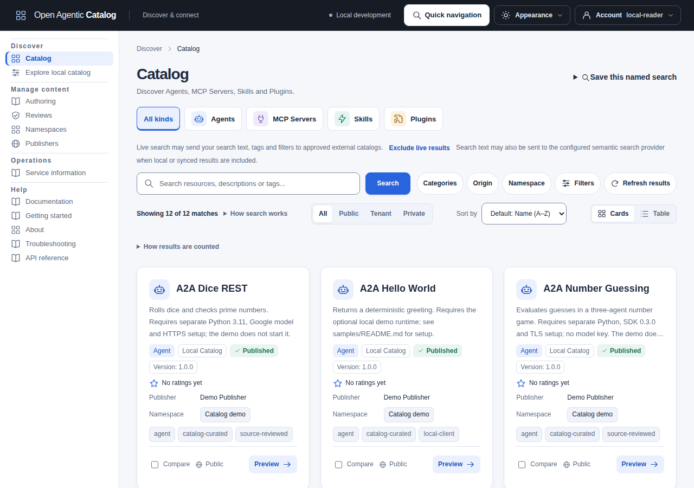

import ManualEdition from "../../components/ManualEdition.astro";

import CatalogOverview from "../../components/architecture/CatalogOverview.astro";
import WelcomeDeployment from "../../components/architecture/WelcomeDeployment.astro";
import ClientComparison from "../../components/ClientComparison.astro";

Open Agentic Catalog is a standalone Go service backed by PostgreSQL. It governs metadata for Agents, MCP Servers, Skills and Plugins. Its REST API and optional [Catalog UI](guides/catalog-ui.mdx) support authoring, versioning, review, publication and search. Administrators manage access, federation sources, webhooks and audit records.

Clients use [Agentic Resource Discovery (ARD)](reference/standards.mdx#discover-resources-with-ard) to discover resources. The Catalog also supports AI Catalog compatibility documents. Plugin discovery uses a Catalog-specific media-type mapping; ARD does not standardize that mapping.

<ManualEdition />

## Catalog at a glance

<CatalogOverview />

Local listings pass through review and publication. Administrator-approved sources contribute federated results with their source provenance intact. Discovery returns metadata; it does not grant permission to install, deploy or execute a resource.

## Explore the Catalog UI

Browse Agents, MCP Servers, Skills and Plugins. The screenshot shows the curated sample Catalog with twelve published resources. Follow [Browse and manage with the UI](guides/catalog-ui.mdx) to try search, filters, previews and administration.

## Choose a setup

| You want to | Run | State and configuration | Start here |
| --- | --- | --- | --- |
| Try a disposable local Catalog | `make run` combines the API and worker in memory. | Development identities; state clears when the process exits. | [Local quickstart](guides/local-development.mdx#start-the-service) |
| Develop with persistent local data | `make compose-up` starts PostgreSQL, migrations, API and worker. | Development identities; the PostgreSQL volume survives `make compose-down`. | [Persistent local setup](guides/local-development.mdx#start-the-service) |
| Operate a production deployment | Separate `catalogd api` and `catalogd worker` processes use external PostgreSQL 18. | Operators supply the database, identity configuration, credentials and infrastructure. | [Installation](operations/maintenance.mdx#first-installation), [deployment](operations/deployment.mdx) and [security prerequisites](operations/security.md) |

## Choose your starting point

| Sidebar section | You want to | Start here |
| --- | --- | --- |
| Get started | Connect to an existing service or try your own | [Reader quickstart](guides/reader-quickstart.mdx), [concepts and lifecycle](guides/concepts.md), [local quickstart](guides/local-development.mdx) and [glossary](reference/glossary.md) |
| Use the Catalog | Browse, manage and publish resources | [Search cookbook](guides/search-cookbook.mdx), [result evidence](guides/understand-results.mdx), [Catalog UI](guides/catalog-ui.mdx), [add and update resources](guides/resource-authoring.mdx), [review and publication](guides/publishing.mdx), [scoped access](guides/access-management.mdx), [Agent Plugins](guides/agent-plugins.mdx) and [private feedback](guides/feedback.mdx) |
| Build integrations | Connect clients and understand discovery formats | [SDK overview](../../../../sdk/README.md), [VS Code client](../../../../extensions/vscode/README.md), [Catalog MCP server](guides/mcp-server.mdx), [client integration](guides/integrating.mdx), [API conventions](reference/api-conventions.md), [contracts and examples](../../../../api/README.md) and [standards](reference/standards.mdx) |
| Deploy and operate | Install, configure, monitor and recover the service | [Operations overview](operations/overview.md), [installation and upgrades](operations/maintenance.mdx), [configuration](reference/configuration.mdx), [troubleshooting](operations/troubleshooting.md) and [backup and restore](operations/backup-restore.mdx) |
| Architecture | Understand the design and accepted decisions | [System context](architecture/overview.mdx), [design principles](architecture/design.mdx) and [architecture decisions](architecture/decisions/index.md) |
| Develop and contribute | Build, test and maintain the project | [Contribution workflow](../../../../CONTRIBUTING.md), [tests and quality checks](contributing/testing.md) and [documentation maintenance](contributing/documentation.mdx) |
| Reference | Look up a command, endpoint, request or response | [CLI reference](reference/commands.md), [API conventions](reference/api-conventions.md), [contracts and examples](../../../../api/README.md) and <a href={`${import.meta.env.BASE_URL}api/`}>HTTP API reference</a> |

## Choose a client

Start with the [reader quickstart](guides/reader-quickstart.mdx), then use the [search cookbook](guides/search-cookbook.mdx) for a known query. The interfaces below share Catalog contracts but provide different workflows. Every protected action still requires current permission and any enforced OAuth [scope](reference/glossary.md#scope).

<ClientComparison>

| Task | Web UI | `catalogctl` | Generated SDKs | VS Code client |
| --- | --- | --- | --- | --- |
| Discover resources | Local browse and facets; authorized Search across local, indexed and live results | `remote search`; read-only MCP tools | Control and ARD operations for application code | Control browsing requires current Catalog access. Published/ARD browsing follows the host's anonymous or authenticated access mode. |
| Inspect documents and copy references | Previews, full local/indexed records and verified retained-document downloads | `remote record`, selected `export`, export preview/batch | Authorized record/artifact operations; caller manages exact bytes | Inspect documents; export exact bytes or metadata; save references |
| Create or import drafts | Guided Resource/version/listing forms, native document input and reusable JSON import/export | Offline `import preview`; API `apply`/`resume` with private receipt; native or reusable JSON export | Primitive authoring operations; no ready-made import/receipt workflow | No authoring or draft import |
| Review and release | Independent review, release publication and disposition controls | No general interactive review/release commands; development seed/smoke are fixture workflows | Review/release operations; application supplies command keys, ETags and decisions | No review or release administration |
| Activate discovery documents for a host | Candidate inspection, activation, rollback and withdrawal controls | No general host-publication command | Publication operations; generating a candidate does not activate it | Reads an already configured active publication |
| Administer federation | Inspect, register, configure, test and synchronize approved sources | Selected private trust-assessment commands; no general source-management CLI | Source/revision/Job operations; no automatic onboarding workflow | Discovery consumer; no source administration |
| Connect to a discovered MCP Server | Preview and download one supported remote client configuration | CLI exports one supported remote client configuration; Catalog MCP tools only read metadata | Catalog operations do not implement resource connections | Explicit native MCP selection; supported exact endpoint/package and separate target credentials/runner |
| Talk to a discovered A2A Agent | View metadata and copy resource references | No Agent invocation | Catalog SDKs do not implement A2A invocation | Explicit text conversation, task read/cancel and supported streaming; separate target credentials |
| Install a complete Skill | View metadata and copy resource references | Exports retained documents/references; does not install complete packages | No installer | Explicit complete immutable Git/OCI package installation in a trusted writable Linux, Windows or macOS workspace |
| Install and activate a Plugin | View metadata and copy resource references | Exports retained documents/references; does not install packages | No installer | Installs disabled; separate consent enables a supported native package path |

</ClientComparison>

See [web UI workflows](guides/catalog-ui.mdx), [CLI commands](reference/commands.md), [SDK installation and operation examples](../../../../sdk/README.md), [Catalog MCP tools](guides/mcp-server.mdx) and the [VS Code guide](../../../../extensions/vscode/README.md) for detailed prerequisites. Generated SDK method coverage is not an interactive workflow or automatic orchestration.

For a terminal assistant, Python graph, [Rust inventory report](../../../../examples/rust-catalog-report/README.md), password-based tutorial or webhook receiver, [choose an integration example](guides/integrating.mdx#choose-an-integration-example).

VS Code resource use needs a trusted window and current Catalog evidence. Skill/Plugin installation additionally needs complete immutable package evidence, supported acquisition tools and a writable Linux, Windows or macOS filesystem workspace. [Package prerequisites](../../../../extensions/vscode/README.md#git-oci-and-package-trust) explain exact commits/manifests, inventory checks and anonymous package acquisition.

Automated tests cover VS Code 1.141.0 on Linux amd64. They also test a limited Remote SSH connection on the same Linux machine, using a browser controlled by the test. Native Windows/macOS, other remote providers, OS browser associations and production keychains remain unqualified. No Marketplace, binary-download or SDK registry release is assumed.

`GET /api/v1/capabilities` reports deployment feature state. `/api/v1/me` reports current caller permission hints and any OAuth ceiling. Neither makes a browser/client authoritative for backend access decisions. Disabled or unavailable capabilities remain explicit. Optional semantic search requires operator setup; core discovery does not. The optional [LangGraph assistant](../../../../examples/langgraph/README.md) searches local releases only.

## Standards and interoperability

Open Agentic Catalog brings together standards for discovering, describing and packaging resources:

- **Discovery:** [Agentic Resource Discovery (ARD)](reference/standards.mdx#discover-resources-with-ard) lets clients find resources across catalogs. AI Catalog documents provide a separate compatibility format for resource entries.
- **Agents and tools:** [Agent2Agent (A2A)](https://a2a-protocol.org/) Agent Cards describe agents' capabilities and interfaces. [Model Context Protocol (MCP)](https://modelcontextprotocol.io/) metadata describes servers exposing tools, data and prompts. The Catalog validates Agent Cards, MCP Registry `server.json` and experimental MCP Server Cards; it does not invoke agents or tools.
- **Reusable packages:** [Agent Skills](https://agentskills.io/specification) contain `SKILL.md` instructions and supporting files. [Agent Plugins 1.0.0](https://agent-plugins.org/specification) can bundle Skills, MCP configuration and client extensions. The Catalog inspects supported packages without executing their contents.

Support follows pinned specification versions and formats. See [Standards and interoperability](reference/standards.mdx) for upstream links, examples and validation/publication limits.

## Availability and deployment boundaries

This logical view separates the optional browser client and Go host from backend processes and the Catalog data store. The frame identifies the Catalog service, not a host or OCI image.

<WelcomeDeployment />

API and worker containers use the same backend image and share PostgreSQL. The optional UI has its own image and accesses the API, without database access. Optional embedding inference runs as a separate local service or hosted provider; the API and workers call it, and the Catalog stores vectors in PostgreSQL. See [logical applications and data](architecture/deployment.mdx#logical-applications-and-data), then the [Compose](architecture/deployment.mdx#docker-compose) or [Helm](architecture/deployment.mdx#kubernetes-through-helm) deployment view for concrete placement.

PostgreSQL 18 with `pgcrypto` stores Catalog data. Core exact, lexical, filtered, faceted and federated discovery works without embeddings.

[Webhooks](operations/webhooks.mdx) and [OTLP tracing](operations/observability.mdx#distributed-tracing) are available and disabled by default. Prometheus-format metrics are available without a collector; the optional [monitoring chart](operations/helm-monitoring.md) adds Prometheus, Grafana and dashboards. [Optional hybrid search](operations/hybrid-search.mdx) combines keyword and semantic matches through one configured embedding endpoint and pgvector, with keyword fallback during indexing or provider outages.

Managed-media providers and scanner integrations remain unavailable; enabling those flags fails startup.

Container images support Linux AMD64 and ARM64. Helm charts require Kubernetes 1.34+. Local Compose enables webhooks for testing; set `LOCAL_WEBHOOKS=off` to disable them. Follow the [deployment guide](operations/deployment.mdx) to configure PostgreSQL, authentication, credentials and network access for your installation.

License: [Apache License 2.0](../../../../LICENSE)
