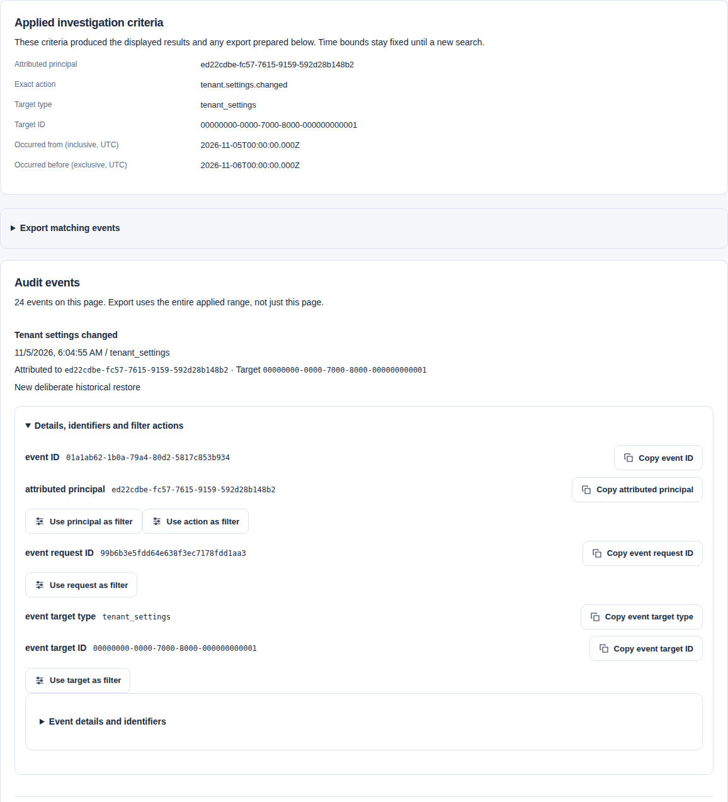

Use this runbook to investigate one tenant, export a bounded audit range, verify the file and compare it with an isolated PostgreSQL restore. A file stored beside its database cannot detect an owner who rewrites both.

## Access and evidence model

`GET /api/v1/audit-events` requires current `audit.read` permission; `POST /api/v1/audit-exports` requires `audit.export`. The Security Reviewer and Tenant Administrator templates include these permissions. When OAuth ceilings are enabled, the matching OAuth scope is also required. Authentication, current permissions, tenant isolation and OAuth checks apply before export replay.

Each version-1 record identifies a stable Catalog membership, service executor or database login. Interactive actors use the internal membership UUID, not an external subject or issuer. Unversioned records and incomplete attribution are rejected. No pre-release audit format is supported.

Keep reasons concise because they become durable evidence. Do not include credentials, tokens, URLs, raw queries, documents, source responses or other sensitive payloads.

Each successful audit investigation or export creates its own audit record. It never copies the returned events or unrestricted filter values. Investigation records the page count and deterministic page digest. Export records the half-open time range, row count and event-array digest. If this access record cannot commit, the service withholds the result. These actions create no notification.

A separately classified public transition must bind its notification to the exact mutation and audit record. This includes schema-owner identity provisioning and realm changes. The notification reference permits only the reviewed action, target, digest and applicable host. These values must match the notification expected for the committed operation. The normalized notification time must match the audit record's event time.

Source inspection, source test and administrator diagnostic live search record evidence only after reaching the hardened outbound boundary. The record identifies only configured sources that reached it. Earlier refusals for paused, stale, invalid or referral-only sources do not count as contacts. The operation succeeds when its complete result contains only accepted results, valid empty results or both. Records exclude queries, URLs, remote entries and response bodies.

With webhooks enabled, endpoint changes, signing rotation, committed delivery outcomes and delivery-page reads create audit-only records. Changes and outcomes bind the exact committed row. Access records bind the visible page count and digest, excluding the pagination sentinel. These records contain no receiver URL, key or response body.

A failed evidence write rolls back the local change or withholds the private page. It cannot recall a request already sent. Encryption-key maintenance while runtimes are stopped separately records verified and changed counts under `repair.webhook_secrets.reencrypted`. It does not rotate receiver signing secrets. See [webhook operations](webhooks.mdx) for key handling and deployment limits.

Tenant settings saves and resets record `tenant.settings.changed` against the tenant. The record includes before/after revisions, override values and explicit presence flags. The save and required audit commit together. Exact command replay creates no second change record or notification. See [live tenant settings](../reference/configuration.mdx#live-tenant-settings).

## Investigate one tenant

PostgreSQL applies exact filters before limiting the audit page. Combine `actor`, `action`, `requestId`, paired `targetType` and `targetId`, inclusive `occurredFrom`, and exclusive `occurredBefore` as needed. Results sort newest first by occurrence time and event UUID. A page contains at most 100 rows. Its opaque, short-lived cursor binds the current authorization, exact filters and page size.

```sh
curl -fsS 'http://127.0.0.1:8080/api/v1/audit-events?action=resource.created&occurredFrom=2026-09-03T08%3A00%3A00Z&occurredBefore=2026-09-03T09%3A00%3A00Z&limit=50' \
  -H 'Authorization: Bearer local-admin'
```

Use the returned `actor` value for an exact actor filter. Supply both target fields or neither. Return `nextCursor` unchanged with the same filters and limit. Restart if these inputs or the actor's authorization change. Each retained record must fit within 64 KiB. Malformed or oversized records fail closed without an access-success event; investigate corruption rather than skipping evidence.

### Investigate and export in the UI

The heading's **Audit investigation guide** link opens this procedure in the bundled manual. **Audit events pagination** identifies the current result pager; it keeps the applied absolute interval and exact criteria. Settings' **Settings history pagination** is a separate read and cursor. Restarting either after a stale continuation does not change the other page's draft or prepare a command.

Audit events first show action, time, actor and target summaries. Expand an event for exact references and filter-staging controls. **Export matching events** is beside the applied criteria; it exports the selected range, not only the visible page.

In Audit, start with Last 24 hours and All activities, then select Search audit events. Choose Last hour, Last 7 days or a custom range to narrow the investigation. Common actions have readable choices; Other exact action accepts an action copied from event details. Advanced filters match exact principal, request and object identifiers, not names.

Results show the time, activity, a short reason when present and principal. Expand **Details, identifiers and filter actions** for exact references and filter controls. **Event details and identifiers** retains the complete authorized evidence. The selected range is fixed at search time for consistent pagination and export. Searching again reloads results, even if custom filters are unchanged. A new search asks before discarding an unfinished export reason.

**Named-template access granted/revoked** selects `identity.role_assignment.granted` or `.revoked`. **Role or group access assigned/revoked** selects `authorization.assignment.granted` or `.revoked`. These are separate exact actions; neither choice includes both families. Role definitions, groups, memberships, Settings, feedback and ratings have their own choices. Unknown historical actions retain a readable fallback and remain selectable through **Other exact action**. **Audit events read** and **Audit exported** describe access to evidence, separately from the changes under investigation.

Copy an event ID, principal, request ID or target reference with its adjacent copy control. If clipboard access fails, select the displayed reference manually. **Use principal/action/request as filter** stages that exact value. **Use target as filter** stages both target type and ID. These actions switch to **Custom range** and preserve the applied absolute time bounds in your local-time inputs. They do not reread evidence. Select **Search audit events** to apply them. Choosing a new relative range deliberately captures fresh bounds on the next Search.

The **Applied audit criteria** panel shows active optional filters and the fixed absolute UTC interval: From is inclusive and Before is exclusive. Editing the form shows an unsubmitted-change notice; it does not change those results, their continuation or an independently prepared export. Search and export remain explicit. Private criteria stay in tab memory.



The synthetic search shows exact filters and one matching event. Export requires an interval that ends in the past. [Open the full-size screenshot](../../../../assets/catalog-ui/audit-investigation.png).

Unchanged staged bounds preserve their exact UTC instants, including the repeated hour when daylight saving time ends. Editing a time control uses your browser's local-time interpretation. Check the applied UTC interval after Search.

Export requires both range boundaries and a reason. With OAuth scope enforcement, reading and exporting each require their matching permission and scope. Exports must end in the past; the server rejects future end times. Download the exact returned bytes for verification with `catalogctl audit verify-export`. A broad range can exceed the backend limit. Narrow it rather than treating a partial result as a complete export.

A same-identity access refresh clears loaded events, their continuation and any downloaded file without rereading evidence. It retains an unfinished export reason and any prepared request with its captured criteria. New sends wait for current export permission and scope. An uncertain command keeps **Retry same command**, which reuses its exact body and key through current backend authorization. A file arriving after access changes is cleared even if the previous access returns. Search again explicitly for current events; changing identity or ending the session clears the private draft and recovery request.

### Investigate an acknowledged administration change

Settings, access administration, namespace/Publisher changes, feedback moderation, rating moderation and semantic reindex acknowledgements retain safe command references. The receipt shows the exact operation, target and returned revision when available. These describe the acknowledged command; use a fresh read for current state. A failed readback does not turn a known successful command into an uncertain one.

With current `audit.read` permission and its scope, select **Investigate change**. The link stages the exact operation and target in Audit through private tab memory. It supplies a five-minute interval ending at acknowledgement time and shows the UTC bounds. Adjust the local-time inputs if needed, then select **Search audit events**. No private criteria enter the URL, history state or persistent browser storage. Reloading or changing identity/access clears the handoff. Opening the link in another tab opens Audit without transferring criteria.

**HTTP attempt request ID** identifies the response you received. A replay can return an old mutation with a new attempt ID. The handoff therefore omits request and principal filters. An old replay can also fall outside the initial time interval; widen it deliberately. Use the original event's request ID only when you have retained it independently. Several changes can match one action and target: compare event IDs, time and recorded revisions. A matching audit row does not establish current target state.

Without audit-read authority, you can still copy the command references from the receipt. It does not request audit evidence or supply additional permissions. Receipts contain no command reason, private response text or signing material. After an uncertain response, recover the exact command first with **Retry same command**.

## Export one bounded range

Export runs synchronously in one repeatable-read PostgreSQL snapshot and requires an idempotency key. Events sort oldest first by `(at,id)`. The response includes normalized filters, first and last positions, count, cutoff, generation time and encoding profile. It also includes the SHA-256 digest of the exact encoded events array. Export creates no stored export object, Job or separate evidence store.

These examples use the disposable local profile. Choose the intended past interval and a fresh command key for a real investigation. The fixed example dates select a historical range.

Create a private directory under ignored output. Keep its variable in the same shell for later verification. Each invocation gets a separate directory to avoid overwriting evidence or committing it:

```sh
umask 077
mkdir -p output/audit
AUDIT_EVIDENCE_DIR="$(mktemp -d output/audit/export.XXXXXXXX)"
curl -fsS -X POST http://127.0.0.1:8080/api/v1/audit-exports \
  -H 'Authorization: Bearer local-admin' \
  -H 'Content-Type: application/json' \
  -H 'Idempotency-Key: audit-export-20260903-0800-0900' \
  --data @api/examples/audit-export-request.json \
  --output "$AUDIT_EVIDENCE_DIR/audit-export.json"
```

Supply both `occurredFrom` and `occurredBefore` in increasing order. The range includes its start and excludes its end. Its end cannot exceed the server cutoff. Range values, positions, cutoff and generation time use UTC microseconds, matching PostgreSQL timestamp precision. Optional exact filters match investigation; target fields remain paired. Supply the required non-secret reason.

Each export permits at most 1,000 rows, 64 KiB per encoded record and 8 MiB total. For `AUDIT_EXPORT_RANGE_TOO_LARGE`, narrow the range or add exact filters. Malformed or oversized records fail closed. The service never silently skips them.

An identical authenticated request with the same idempotency key returns the exact retained response. It adds no second export-access record. Protect the file as tenant evidence, even though new audit records exclude raw content, external subjects and unrestricted queries.

## Verify an export file

The offline verifier needs no database or network. It rejects duplicate or unknown JSON members, noncanonical event bytes, invalid order or filters, and missing positions. It also rejects changed counts or digests, malformed version-1 rows and exceeded size limits.

```sh
catalogctl audit verify-export --file "$AUDIT_EVIDENCE_DIR/audit-export.json"
```

A valid result proves the bounded file is structurally self-consistent. It does not prove completeness or detect an owner who rewrote both database and file.

## Bind and check a recovery point

Use this sequence with the [backup and restore runbook](backup-restore.mdx). Audit commands neither orchestrate nor authenticate the backup:

1. Stop new ordinary API and worker writes, drain in-flight work, and keep those writers quiesced. Permit only the controlled audit-export operation below through an operator-restricted API path during capture.
2. Choose an explicit export range whose exclusive end falls inside the interval without ordinary writes. Request the export. Save its exact bytes. Run `verify-export`.
3. Obtain the backup system's opaque recovery-point identifier for the database point that will be captured in this same quiesced interval.
4. Bind the verified manifest to that identifier: `catalogctl audit bind-manifest --file "$AUDIT_EVIDENCE_DIR/audit-export.json" --recovery-point '<recovery-point-id>' > "$AUDIT_EVIDENCE_DIR/trusted-audit-manifest.json"`. Retain this small file separately in the operator's trusted evidence system; keeping it beside the export is only a local staging step, not independent provenance.
5. Capture the PostgreSQL backup or checkpoint and retain external provenance showing that it and the trusted manifest belong to the same quiesced interval. Do not resume writers until that relationship is established.
6. Restore into an isolated environment with product traffic, federation, ordinary worker claims, and webhook delivery disabled. Apply no repair before verification.
7. Retrieve the separately trusted manifest. Follow the [restore connection checks](backup-restore.mdx#select-source-and-restore-connections), including environment overrides. Compare the exact range: `catalogctl audit compare-restore --file '<trusted-manifest-path>' --recovery-point '<recovery-point-id>' --config '<restore-config.json>'`.
8. Accept the audit range only when the command returns `valid: true`; otherwise preserve the restore, reject it for service, and investigate the mismatch.

Comparison runs in a repeatable-read, read-only transaction. It applies the trusted tenant and filters, rebuilds the bounded manifest, and requires an exact match. The recovery-point identifier is an external provenance label, not a signature or backup integration.

A timestamp alone cannot bind the captures. A transaction can commit an earlier audit timestamp after the export snapshot. Drain writers before both captures to close this race. The export's own audit and idempotency rows fall outside the compared range.

## Migration and upgrade boundary

The database requires version-1 audit records with complete attribution. Incompatible development state is rejected without rewriting attribution. The audit format version is independent of the migration number. Follow the [current schema and grant requirements](deployment.mdx#release-sequence).

Drain API and worker writers before contract migrations. Reconcile both roles and start only matching binaries. Earlier migrations are immutable history, not supported predecessor contracts. Workers can insert narrowly classified audit records but cannot read them.

## Core operation classification

Personal library commands record `personal.item.created`, `personal.item.updated` and `personal.item.removed`, targeting `personal_item` and its exact item ID. Safe facts contain the resulting revision, without labels, references or query text. Required audit commits with the preference change; these actions create no public outbox notification. Audit access does not grant access to another person's saved items. My work uses exact retained transition attribution without requiring `audit.read` or returning audit records.

[ADR-0021](../architecture/decisions/0021-logging-observability-and-audit.md) defines operational diagnostics and their separation from audit. Log levels and trace sampling never control required audit writes. The logging policy adds no audit-retention setting or telemetry copy of private evidence. Ordinary authentication failures create no tenant audit row.

The table below defines which operations create audit and outbox records. "Audit only" means no notification row. Retained internal repair notifications are non-deliverable history; current idempotency repair creates audit only. Webhook-specific behavior is described above. Add an internal event only for a concrete post-commit consumer.

| Operation | Durable audit | Outbox classification | Required safe facts beyond the common envelope |
| --- | --- | --- | --- |
| Personal library save, update and removal | One record in the preference transaction | Audit only | Exact item ID, human membership/realm and resulting revision; no label, saved target or query text |
| Existing Catalog lifecycle, observation adoption, identity, realm, provisioning, and idempotency repair writes | Enrich new records; preserve old audit and outbox rows unchanged | Keep each reviewed public classification; idempotency repair is audit-only; retained internal outbox rows are non-deliverable | Stable v1 actor-principal ID, applicable versioned before and after state digests, evidence or release IDs, and both database identities for schema-owner commands; schema-owner provisioning and realm changes use the same exact action, target, time, and closed-reference binding as runtime commands; omit external identity subjects or issuers, request or key digests, target subjects, and unbounded child-ID arrays |
| Source inspection | One record for each successful retained inspection and one safe outcome when an authorized attempt reaches the outbound boundary but no inspection is retained | Audit only | Generate the inspection or attempt ID before outbound work; retain outcome class, policy and configuration digests, expiry when present, and public or named-private origin class; no URL or response body |
| Source change-preview creation | One record for each successfully retained update or removal preview; the preview itself performs no new outbound request | Audit only | Preview and source IDs, source revision, explicit intent, proposed-state or configuration digest, preview digest, expiry, matched and excluded counts, and whether the proposed configuration sends queries upstream; removal excludes every currently matched observation |
| Source connection and reviewed configuration update | One record in the source transaction | Public `source.connected` or `source.revision.activated`, targeting the source ID | Inspection or preview ID, source revision, before and after configuration digest, retrieval and update mode, and policy digest |
| Source test | One record after the authorized operation reaches the outbound boundary, including a safe policy, transport, HTTP, parse, or negative result; a successful test that advances source policy evidence records the revision change atomically | Audit only when no revision advances; additionally public `source.revision.activated`, targeting the source ID, when the revision advances | Before and after source revision, safe outcome and HTTP class when known, policy and body digest, bounded capability names, credential revision, and whether state changed |
| Source pause, resume, or removal | One record in the source transaction; reject a no-op lifecycle command without changing revision or evidence, and require the current matching removal-preview digest for removal | Public `source.paused`, `source.resumed`, or `source.removed`, targeting the source ID, so a removal remains self-describing when the current-source read returns not found | Before and after state and revision; removal preview ID and digest; removal marks retained observations historical without listing their content |
| Manual source synchronization request | One record whether a new Job is enqueued or an equivalent live Job is reused | Audit only | Source revision, returned Job ID, request trigger, and deduplication outcome; the retained Job trigger must match a stable Catalog-membership initiator or the code-owned automatic maintainer; no Job payload |
| ANS assessment request | One `source.trust.requested` record when a Job is admitted or existing work is reused; exact command replay creates no additional record | Audit only | Source and Job IDs, source revision, exact entry digest, authority-policy digest and deduplication outcome; no selected entry or query text |
| ANS assessment completion | One `source.trust.completed` record commits with the retained successful assessment under the source and lease fences | Audit only | Source and Job IDs, source revision, entry/policy/result digests, current-registration outcome, Job kind/attempt and initiator; no signed evidence bytes |
| Private ANS assessment read | One `source.trust.read` record before disclosure; audit failure withholds the response | Audit only | Job ID, exact retained-result digest and size; no result contents or signed evidence |
| Manual or automatic source synchronization outcome | One record for every distinct committed complete, incomplete, or failed snapshot; a rejection before any snapshot commit remains in durable Job state and redacted operations signals | Public `source.sync.completed` for complete or `source.sync.failed` for incomplete or failed, targeting the snapshot ID | Service executor, Source and snapshot IDs, source revision, Job ID and retained initiator, attempt and trigger, state, policy digest, safe counts, and failure class; no findings body, payload, token-era authorization, or remote content |
| Publication candidate build, including a worker Job | One record in the candidate transaction | Audit only | Host, audience, generation, snapshot ID, profile IDs, document digests, bounded entry and exclusion counts, and either the direct request actor or both the worker Job ID and its retained initiator |
| Publication activation or rollback | One record in the pointer transaction; rollback remains distinguishable in audit | Public `publication.activated`, targeting the activated snapshot ID and binding the normalized host in its closed reference | Host, activated snapshot and generation, replaced snapshot when present, profiles, and document digests |
| Explicit unpublish or an automatic safety withdrawal caused by publisher-domain revocation, release retirement, supersession or revocation, or blocked external-representation revalidation | One record for each host whose active pointer is actually withdrawn, in the originating command transaction; an already inactive host adds no withdrawal record | Public `publication.unpublished`, targeting each retired snapshot ID and binding the normalized host in its closed reference | Host, retired snapshot and generation, originating command and target, stable cause, and validated document digests when available; a structurally suspect active snapshot still records conservative withdrawal without inventing a digest |
| Job cancel or retry | One record for each successful operator command, including a no-op cancel of an already terminal Job | Audit only | Job kind, before and after state, parent or replacement Job ID, cancellation-requested flag, and safe failure class; a replacement Job retains the retrying audit principal as its initiator; no payload or error cause |
| Applied tenant search-projection repair batch | One record in each non-empty batch transaction; an empty batch creates none | Audit only | `session_user`, `current_user`, optional operator label, reason, selected ID range, processed count, bounded `hasMore` result, and before and after search generation whose delta equals the rebuilt-row count; no normalized observation bytes |
| Exact private VersionRevision, authenticated Catalog document content, retained source-inspection, raw-observation, audit-page, and audit-export reads | One record only after the requested object or bounded event slice is successfully prepared and before bytes are returned | Audit only | Stable object IDs and content digest; for an audit page use the canonical ordered event-slice digest and result count rather than HTTP bytes or its cursor; for export use its manifest digest and exact range; never copy returned content, URLs, or unrestricted filter values |
| Administrator diagnostic live search | One record after the authorized reason-bearing idempotent command reaches the outbound boundary, including a policy refusal, partial result, or safe failure | Audit only | Diagnostic operation ID, reason, only source IDs and policy digests for configured sources that actually reached the fetch boundary, safe aggregate outcome, result and diagnostic counts, partial flag, and original request ID; pre-boundary rejections are not represented as contacts, and a complete mix of accepted and valid empty source results remains successful rather than partial; no raw query, query digest, or remote entries |
| Every authorized API read not named in the sensitive-read row, including API-safe governed, identity, source, source-snapshot, publication, Job, and capability projections; Catalog, indexed, federated, or ARD search; public discovery and public documents; health, readiness, version, and metrics; authentication, authorization, malformed, not-found, stale, or other pre-outbound-boundary failures; Job leases and heartbeats; automatic maintenance admission; internal document reads during validation or publication | No durable audit row | None | Bounded redacted operational signals may record outcomes without creating durable audit history |

## Maintained verification

Package and HTTP tests cover permissions, filters, cursor binding, deterministic bytes, tamper rejection, bounds, replay and tenant non-disclosure. They also check public-event membership, Job attribution, discovery-failure precedence, outbound evidence and database-principal audit construction.

`make test-integration` checks migrations, RLS, indexes, repeatable snapshots, atomic access records and current-format rejection against disposable PostgreSQL 18. It also checks read-only restore comparison. `make test-functional` checks investigation, export, replay, cross-tenant and permission denials in an isolated Compose stack. It verifies files offline and compares a provenance-bound restored range before selective repair.

## Feedback privacy

The `feedback.created`, `feedback.edit`, `feedback.address`, `feedback.reopen`, `feedback.withdraw` and `feedback.remove` actions retain membership, record, state and revision. They exclude comment and response text and create no outbox notification. Feedback text is mutable current state. Withdrawal and removal clear live fields without erasing prior backups. See [private feedback](../guides/feedback.mdx).

## Rating commands

Rating submit, withdraw, remove, permit and audience-sharing changes are audit-only actions. Their safe facts identify revision/state or enabled state. Individual scores, consent and private principal hashes are excluded. Moderation and sharing changes require a bounded reason. No rating webhook or notification event is generated.
