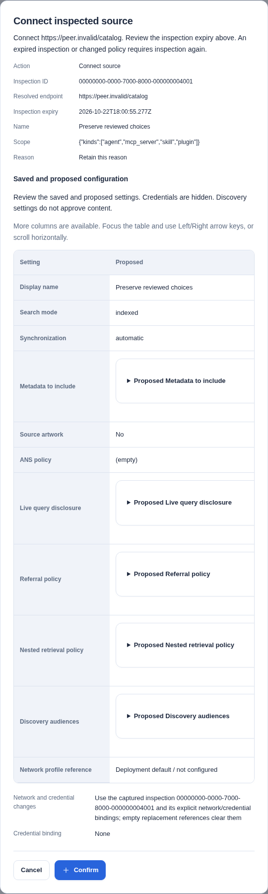
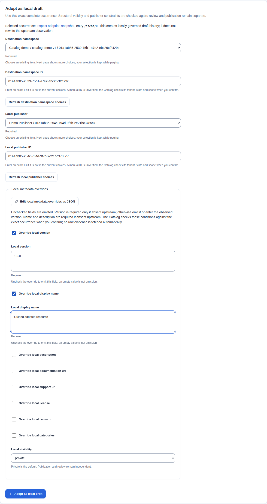
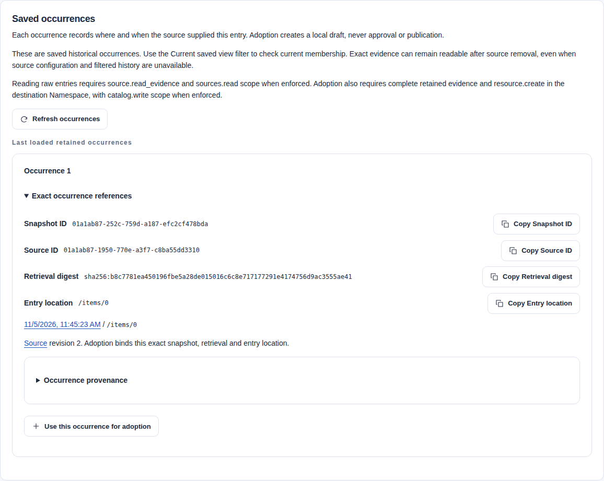
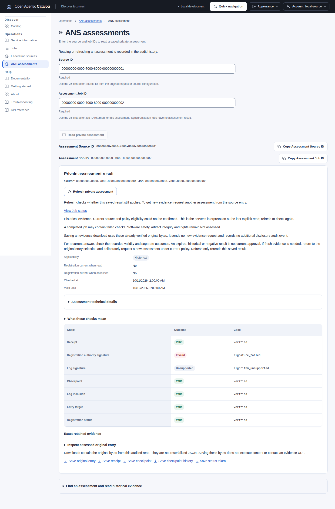

import ARDQueryModes from "../../../components/architecture/ARDQueryModes.astro";
import ANSAssessment from "../../../components/architecture/ANSAssessment.astro";

Connect an upstream Catalog A to a downstream Catalog B. B can retain external observations, query approved upstream discovery, or return approved referral metadata. Each Catalog keeps its own database, identity policy and publication authority.

This procedure starts with indexed synchronization of A's active ARD manifest. Later steps enable live queries, review source changes and adopt one observation deliberately. See [federation architecture](../architecture/federation.mdx) for traversal, limits and withdrawal authority.

For a complete local setup with user passwords, separate A/B databases and an installed editor, follow the [two-Catalog federation tutorial](../guides/two-catalog-federation.mdx). This runbook owns the reusable source lifecycle and policy details.

## Prepare both Catalogs

On A, publish the intended Resources through independent review and release publication. Generate and activate a discovery snapshot for the exact upstream host. Follow [resource publication](../guides/publishing.mdx), including publisher-domain approval and host/audience selection. A published release alone does not create a discoverable manifest.

Choose the audience deliberately. A's anonymous host exposes eligible public releases. Its authenticated host exposes eligible public and tenant releases to an authorized member of A's tenant. That member needs tenant-wide `discovery.read`, such as a Discovery reader grant, plus `catalog.read` when A enforces OAuth scopes. Neither audience exposes drafts or private releases. B's source authority does not grant access to A. An authenticated upstream needs a credential accepted by A, not B's administrator token.

On B, prepare the following inputs with the deployment operator:

| Input | Required decision |
| --- | --- |
| Upstream HTTPS origin | Select the exact scheme, hostname and port. Preserve the intended HTTP Host through ingress; strip `Forwarded`, `X-Forwarded-Host` and `X-Original-Host`. |
| Outbound policy | Permit that origin through the public allowlist, or assign a named private profile to B's tenant. API and worker must receive the same policy bytes. |
| Network boundary | Permit the reviewed route in deployment firewalls and network policy. Preserve DNS, address and redirect checks. |
| TLS trust | Use public certificate trust, or mount the private profile's reviewed CA bundle. Keep certificate-chain and hostname verification enabled. |
| Upstream credentials | If required, enable credential resolution in B's API and worker. Mount an origin-bound, tenant-bound credential generation under an opaque binding name. |
| Downstream discovery | For live/referral participation, configure the exact B discovery host and its audience. Assign the source to that host and audience explicitly. |

See [outbound policy](../reference/configuration.mdx#outbound-egress-policy), [credential bindings](../reference/configuration.mdx#federated-source-credential-bindings) and [discovery hosts](../reference/configuration.mdx#discovery-host-configuration) for the owning configuration. The default empty public allowlist permits no source fetch. Ordinary Source Administrators cannot change deployment policy.

For a private network, use exact origins, bounded permitted private ranges and the assigned profile. Do not add loopback or broad address exceptions to reach a fixture. A private-profile source cannot participate in anonymous discovery.

Authenticate to B's control API in the intended tenant with Source administrator authority. The exact Source administrator template supplies source inspection, management, synchronization, evidence and family-specific Job permissions. When OAuth ceilings are enabled, source reads need `sources.read`, source commands need `sources.manage`, and Job reads need `catalog.read`. Ordinary Catalog Search needs `federation.discover` and `catalog.read` for external results. See [access management](../guides/access-management.mdx).

## Manage sources in the UI

**Synchronization** controls scheduling. **Manual synchronization** starts on an explicit request. **Automatic source updates** schedules the same governed ingestion path. Neither provides a source-change approval queue or local publication approval.

Forms show examples and short instructions beside technical fields. About buttons open additional help with a mouse, keyboard or touch. The essential instructions, consent and warnings remain visible. Help does not submit forms, change settings or load records. Advanced JSON and investigation filters are kept in expandable sections.

Choosing an existing object keeps its ID out of the normal workflow. Paginated selectors retain your choice while browsing further pages.

Federation source reads require `source.read`. Inspection and **Test source** require `source.inspect`. Configuration, Pause and Resume require `source.manage`. Synchronization requires `source.sync`. When OAuth scopes are enforced, reads need `sources.read` and commands need `sources.manage`.

Inspect a URL before connecting it. Review the resolved endpoint, profile, policy and expiry. **Network policy reference** selects an optional deployment policy. **Credential reference** names an optional configured credential binding; enter its reference, never a password or token.

Choose **Search mode**: **Indexed metadata**, **Live queries**, or **Indexed and live**. Set **Synchronization** and **Metadata to include** separately. Live query and anonymous-disclosure acknowledgements remain explicit.

**Only participate as an approved referral** excludes the source from initial live selection. Referral contact still requires administrator approval. **Do not follow referrals** under **Referral traversal** prevents traversal; it does not turn off live queries. **Follow approved referrals** retains independent source and topology checks.

Open **Advanced source participation** to add up to sixteen exact host/audience assignments. Manual host entry remains available without publication-host inventory access. With that separate permission, **Load configured host choices** reads configuration, not health or consent. Select each audience explicitly. **Edit topology as JSON** preserves supported referral, nesting and assignment values. Normalized duplicate host/audience pairs are rejected; these controls do not activate a source.

Inspection shows the endpoint, profile, **Entries found** and **Inspection expires** before technical evidence. Source detail groups the endpoint, configured state, search mode, synchronization and last complete snapshot. Inspection does not connect the source or authorize disclosure. The last finished synchronization attempt can have failed or been incomplete. Its timestamp alone does not establish a complete or current upstream view.

Use the separate last-complete snapshot link and retained findings to check the outcome.

Source rows show **Last sync attempt finished** and the separate **Last complete snapshot**. **Synchronization history** opens source detail. Choose **Sync history** for paged attempts or **Overview** for the source facts and selected action. An attempt can have failed.

A missing timestamp means no recorded synchronization, not an outage. These fields are not peer availability, process uptime or proof that the source view is current.

Open **Preview configuration change or removal** on source detail. Under **Change type**, choose **Update configuration** or **Remove source**. Both require an impact preview followed by reason-bearing confirmation. The summary shows current/proposed matching observations, exclusions, query disclosure and preview expiry. Editing after preview requires a fresh preview. The backend verifies its source revision, configuration, observation set and expiry.

Test, sync, pause and resume are separate actions. Synchronization queues a Job. Inspect that Job and its source snapshot for completion. A source test returns diagnostics without synchronizing observations.

The synchronization response contains `job` and a required `existing` boolean. False acknowledges newly queued work; true acknowledges an existing Job reused for the same synchronization. Neither means completion. The UI checks the current tenant and `source.sync` kind before accepting this receipt. Public Job metadata does not prove the private source binding. A malformed successful response keeps **Retry same command** available with the captured source, revision and idempotency key.

### Find configurations and retained evidence

Use **Source name (exact match)** and **Source status**, then select **Apply source filters**. Names match their stored case and spaces. Duplicate names retain separate Source IDs. **Clear source filters** restores all nonremoved sources. The server applies filters before paging; no peer is contacted. The configured **Active**, **Paused** and **Error** states are separate from connectivity; Active does not prove availability. **Exact Source ID** opens one configuration directly. Missing, foreign and removed configurations remain unavailable.

The optional diagnostic source picker also accepts an exact name before paging. Apply or clear its choice filter explicitly. Existing selected IDs remain selected even when the filtered choices omit them. Filtering does not submit a discovery query.

Observation filters are staged independently. Enter an optional **Source ID (optional)**, choose **Show entries**, then select **Apply observation filters**. **Clear observation filters** restores current observations across sources. **Current saved view** means retained membership, not live availability. **Current and historical entries** also includes earlier occurrences. Occurrences describe history; one historical occurrence does not prove current membership. Absent, present-empty and nonempty versions remain distinct. Present-empty versions cannot use the current contribution-group route.

Source-restricted observations and snapshot history require a current nonremoved Source. Exact retained Observation and Snapshot reads have separate admission and can remain available after removal. If parent navigation fails, clear the restriction or use **Exact Observation ID** or **Exact Snapshot ID**. A missing parent does not establish evidence deletion. Copy the shown Source, Observation, Snapshot, retrieval and entry-location references for investigation. Raw entry reads remain explicit and audited; opening a reference does not adopt or publish it.

See the [exact occurrence example](#select-and-read-the-exact-retained-occurrence) for the retained reference tuple.

### Review test results and prepared changes

**Test source** shows the recorded succeeded/failed outcome, tested time, HTTP status or **No HTTP response**, safe diagnostic, entry count and advertised capabilities. Full policy/profile evidence remains under **Command result**. A failed retrieval result is different from API admission refusal or an unknown command outcome. The UI checks the exact Source and returned revision before displaying a receipt. Success activates refreshed policy evidence and returns the requested revision plus one. A returned failed retrieval keeps the requested revision. Reload before another command. Testing does not synchronize observations or establish future availability.

Connection, preview and apply confirmations show the captured target and complete prepared settings. Compare **Search mode**, **Synchronization**, **Metadata to include**, artwork, live disclosure, referral/nesting policy and discovery audiences. Network and credential changes identify the inspection and replacement intent; credential values remain withheld. Apply and removal repeat the preview identity, digest, expiry, affected counts and disclosure consequences. Adoption confirms the exact occurrence, destination and supplied local metadata. Artwork confirmation distinguishes version presence, inherit/replace/suppress choices and revision.

Exact Source reads must match the requested Source and current tenant before management actions appear. An unexpected reply leaves those actions unavailable; use **Reload source** to retry the read. The UI accepts a preview only when its Source, tenant, revision and intent match the captured request. It checks fingerprint formats and impact fields, then carries the server digest unchanged. The backend still checks the current configuration, observation set, policy, revision and expiry. A malformed successful reply preserves **Retry same command** with the original body and key; it does not enable Apply.

Inspection and preview expiry update locally while the page is idle. An open confirmation also refuses a new send after local expiry. Use **Reinspect the same interface** to request fresh evidence for the resolved endpoint with its captured deployment bindings. Confirm that request explicitly, then review the fresh summary; the connection settings and reason remain in the form. For an expired change preview, choose **Revise configuration and discard preview** and request another preview with your retained choices.

The browser clock supplies guidance only. Exact-key recovery of an already uncertain command remains available after local expiry; no new source contact or replacement command starts automatically.

[](../../../../assets/catalog-ui/source-confirmation.png)

This synthetic confirmation follows an explicit reinspection. Cancelling it sends no connection request. Displayed network and credential bindings are deployment references, not credentials.

### Troubleshoot source tests, commands and retained evidence

| Observation | Next action | What it establishes |
| --- | --- | --- |
| A returned test result says failed | Read its safe diagnostic and HTTP outcome. Reload the Source before another command. | Retrieval failed on that attempt. It is different from API refusal or an uncertain send. |
| Inspection expires while editing | Choose **Reinspect the same interface**, confirm, then review the fresh evidence and retained choices. | A new explicit inspection; no connection or synchronization occurs automatically. |
| A change preview expires or the Source revision changes | Choose **Revise configuration and discard preview**, reload when needed, and preview the intended change again. | New confirmation uses current evidence. Explicitly discard an obsolete draft before replacing it. |
| A command reply is lost or malformed | Use **Retry same command** with its unchanged captured input/key. | Recovery asks about the original command, including after local preview expiry. It does not assume failure. |
| An acknowledged command is followed by failed readback | Keep its receipt and last-loaded state; retry **Reload source** or **Reload job**. | Readback is independent from command acceptance and never repeats the mutation. |
| A Source configuration is removed | Use exact retained Observation, Snapshot or assessment references, with current evidence permissions. | Configuration removal does not erase retained history or stop its separate retention policy. |

Cancelling an unsent confirmation prevents its command. It cannot recall a peer request already sent. A failed or partial synchronization keeps the last complete snapshot; check that reference separately from the last finished attempt. Source observation counts, Catalog indexing counts and public discovery snapshot counts describe different populations.

Use the [Job detail example](observability.mdx#investigate-one-retained-job) to inspect state, attempts and retry references.

### Use delegated Operations access

Custom roles need each permission's required companions. OAuth scopes form an additional ceiling when enforcement is enabled; they grant no Catalog permissions.

| Task | Permission | Enforced OAuth scope |
| --- | --- | --- |
| Read Source configurations, snapshot history and observation metadata | `source.read` | `sources.read` |
| Inspect a destination or test an existing Source | `source.inspect` with `source.read` | `sources.manage` |
| Queue synchronization | `source.sync` with `source.read` | `sources.manage` |
| Connect, change, pause, resume or remove a Source | `source.manage` with `source.read` and `source.inspect` | `sources.manage` |
| Read exact private observation evidence | `source.read_evidence` with `source.read` | `sources.read` |
| Use indexed/live diagnostics | `source.read` and `federation.discover` | `sources.read` |

Source readers retain observation and history links. They do not receive inspection, configuration or diagnostic links without the corresponding authority. A direct inspection route shows its access requirement without mutation fields. An inspector with only the write scope can open `/sources/new` under the UI base path without a Source-directory read. Keep the returned Inspection ID for an authorized handoff when its detail cannot be read.

The Source action selector starts with a permitted, eligible action. A paused Source requires Resume before synchronization. Testing a paused Source still needs its independent inspection permission. Error Sources can be tested, synchronized or paused with the corresponding authority. These choices reflect loaded state; the API checks current revision, policy and eligibility. Removed, foreign and unknown Source configurations remain unavailable through the same not-found response. There is no restore action.

Adoption needs private source-evidence access and `resource.create` in the exact destination Namespace, including its `namespace.read` companion. Its command needs `catalog.write`; metadata reads retain their separate scopes. A create-only delegate can enter exact Namespace and Publisher IDs without local Resource reads or unrelated directory grants. The destination selector remains usable before an authorized Namespace is chosen. A read-only delegate cannot open an adoption editor.

### Read current state deliberately

**Reload source** and **Reload job** read current metadata without repeating the acknowledged command. The page labels its retained state **Last loaded**. After a command acknowledgement, a notice asks for a new read. An acknowledgement can be a historical replay; it is not a current state observation. A failed read keeps the acknowledgement and last-loaded facts. Retry the read explicitly, including after a successful pause, resume, configuration change or cancellation.

Reloading a Source with edited configuration requires explicit discard before replacing that draft.

If you edit while reload is pending, the returned response requires another discard decision before replacing that input. Declining keeps your input and the previous source revision; new commands remain blocked until a successful reload. Recovery of an already uncertain command keeps its exact original request and key.

Snapshot history keeps its own cursor when the Source is reloaded. **Refresh snapshots**, **Reload snapshot**, **Refresh observations**, **Refresh occurrences**, **Reload contributions** and **Refresh indexed results** read their own selected metadata. A successful-page refresh keeps its current criteria and cursor; recovery after a rejected continuation starts at the first page with the same criteria.

Refreshing occurrences preserves the selected exact occurrence and adoption draft. It does not repeat an open raw-evidence read. **Reload indexed record** rereads the applied identifier and version presence, after any required draft discard. None of these controls starts a source test, synchronization, live query or private ANS disclosure. Private evidence and remote actions retain their separate explicit controls.

Snapshot history and detail show state, entry counts, **All entries enumerated** and **Withdrawal authority** separately. Only a complete snapshot with withdrawal authority can mark absent earlier entries withdrawn. A complete Registry List reconciliation can remove missing entries from current results without proving upstream withdrawal. Failed or incomplete synchronization preserves the prior complete view and retained evidence.

Observations expose paginated metadata, exact occurrences and current conflict groups. Read exact raw entry is an explicit audited read. Each occurrence links its source and exact snapshot and shows the source revision and entry location. Adoption selects one complete occurrence and a local namespace/Publisher, creating a draft that still requires review and publication.

It does not rewrite upstream history. The form links the selected adoption snapshot. Adoption requires source evidence permission and creation permission in the exact destination; it does not require resource editing or metadata reads. A present-empty version remains inspectable as exact observation evidence but has no contribution-comparison link. Indexed diagnostic search and deliberately confirmed live diagnostic queries are separate from ordinary Catalog Search. Live diagnostics can contact only configured sources.

Callers with `federation.discover` can reopen an eligible indexed result without raw-evidence or source-administration access. The `catalog.read` OAuth scope is also required when scopes are enforced. Removed, paused, excluded or withdrawn indexed records no longer resolve. An eligible external record can remain readable when a local copy exists. Indexed-only Search can return that external record; combined Search may prefer a matching local release. Live results have no persistent record link.

Federation diagnostics requires both `source.read` and `federation.discover`, with `sources.read` when scopes are enforced. **Search indexed observations** submits the current text, selected kinds and exact tag rows. It pages retained observations independently of live commands. Submitting again starts a fresh first-page read, even when the criteria are unchanged. Editing fields alone does not change a submitted page or rerun a live command. Each row shows its exact identity/version, optional native kind, score, source, freshness, completeness and structural/native compatibility. Open the existing observation or source page for investigation. The complete **Indexed results** JSON remains available.

The UI displays unknown support and missing native kinds explicitly. Structural validity does not establish trust or execution permission.

Live diagnostics disclose the query and advanced filters/context to administrator-configured sources only after reason-bearing confirmation. **Choose configured sources** opens one 25-row source page. **Next page**, **First page** and **Refresh source choices** are explicit reads, never a live query. Select at most eight unique IDs across pages or keep using the exact-ID field.

Blank selects the approved topology. Listed status, participation and live settings describe configuration, not health or guaranteed eligibility. The API rechecks policy at execution, so a selected source may fail or become ineligible. A failed picker read leaves manual IDs and prepared command input intact.

**Transient live results** show exact identifiers/versions, scores, source IDs and declared source/type when supplied as text, without inferring a native kind or local compatibility assessment from an arbitrary entry.

Source diagnostics explain successful queries and response-wide limits. When eligible sources exceed fan-out limits, the diagnostic has no source ID. A query that stops before all eligible peer requests finish can also produce a diagnostic without a source ID. Diagnostics contain at most 32 entries. If truncation is needed, the final entry reports omitted diagnostics without a source ID.

No live result has an adoption action or durable bookmark. The API can follow bounded peer pages when the operator raises the [default-one page limit](../reference/configuration.mdx#live-peer-pages). The browser does not request peer continuations itself. Empty and partial results remain explicit.

Raw **Live results and diagnostics** JSON retains unknown fields. Malformed successful command responses leave an uncertain outcome: use **Retry same command** to preserve the original body and idempotency key, rather than creating a different command or assuming it failed.

In **Federation diagnostics**, the shared **Query** appears before indexed and live sections. Kind and observation-tag choices apply only to indexed search. Enter text before choosing **Query live sources**. **Advanced live options (JSON)** accepts only `filter`, `@context` and `pageSize`, for example `{"pageSize":10}`. Confirmation sends the captured text and options to approved sources. Do not enter sensitive information.

### Set source scope in the UI

**Metadata to include** uses one exact value per row. It selects metadata; it does not replicate PostgreSQL or confer trust. The API field remains `scope`. Source scopes reject duplicate, empty, surrounding-whitespace and over-limit values rather than splitting or normalizing evidence. Remove the last row to omit that filter. At least one other filter must remain.

Each entry must match every configured inclusion filter; identifiers, versions, kinds and publishers match any listed value, while all tags must match. Publishers are AIR publisher domains, such as `remote.example`. Excluded identifiers always take precedence. Open **How scope filters match** for this explanation in the editor.

Identifier scopes allow 1,000 values. Versions, publishers and tags allow 100. Kinds allow the four supported kinds. Per-value limits are 512 code points per identifier, 128 per version, 255 per publisher and 80 per tag. Each excluded identifier also permits 512 code points.

These scope limits count Unicode code points, not UTF-8 bytes. AIR identifiers retain their separate ASCII syntax and 512-byte parser limit. Search publisher and text inputs retain their separate byte limits. See [identifier and version limits](../reference/api-conventions.md#identifier-and-version-lengths).

## Set the request inputs

The example uses these replacement values:

| Example | Replace with |
| --- | --- |
| `https://catalog-a.example.com/.well-known/ard.json` | A's active manifest URL. |
| `partner-catalogs` | B's operator-assigned private profile, when required. |
| `catalog-a-reader` | B's opaque credential binding for A's authenticated origin, when required. |
| `catalog-b.example.com` | B's configured authenticated discovery host, for later live participation. |

For a public-origin source, omit `networkProfile`. For an anonymous upstream, omit `credentialBinding`. Use the same connectivity choices in inspection and connection. Never put a token, certificate or private key in a source request.

Every mutation below uses `Authorization: Bearer <B access token>`, `Content-Type: application/json` and a distinct `Idempotency-Key`. Keep response bodies and headers. Existing-source commands also require the current source ETag in `If-Match` where shown. Reuse the exact key, body and ETag only when retrying the same uncertain command. See [request and replay rules](../reference/api-conventions.md#request-rules).

Prepare B's private curl header file through [protected credential conversion](oidc-keycloak.md#prepare-private-http-credentials). Set `CATALOG_B_HEADERS_FILE` to that file path and `CATALOG_B_API_URL` to B's API origin. The file contains an Authorization header, not login JSON or a bare token. Create a private working directory under ignored output:

```sh
umask 077
mkdir -p output/federation
FEDERATION_REQUEST_DIRECTORY="$(mktemp -d output/federation/source.XXXXXXXX)"
```

Save the inspection body below as `$FEDERATION_REQUEST_DIRECTORY/inspection-request.json`. Keep this shell open for later commands. Set `FEDERATION_COMMAND_KEY` to a new key for this command. Run:

```sh
curl --fail-with-body --silent --show-error \
  --connect-timeout 5 --max-time 30 \
  --header "@$CATALOG_B_HEADERS_FILE" \
  -H 'Content-Type: application/json' \
  -H "Idempotency-Key: $FEDERATION_COMMAND_KEY" \
  --data-binary "@$FEDERATION_REQUEST_DIRECTORY/inspection-request.json" \
  --dump-header "$FEDERATION_REQUEST_DIRECTORY/inspection-response.headers" \
  --output "$FEDERATION_REQUEST_DIRECTORY/inspection-response.json" \
  "$CATALOG_B_API_URL/api/v1/federation/source-inspections"
```

Choose a new key for each new command. Keep later request bodies, responses and headers in this private directory too. Apply the same request pattern to the following methods, paths and bodies. For revision commands, add `-H "If-Match: $SOURCE_ETAG"` with the exact quoted response ETag. For PATCH, also add `--request PATCH`. Inspect the HTTP status and JSON result before continuing.

## Inspect and connect A

Send `POST /api/v1/federation/source-inspections` with:

```json
{
  "url": "https://catalog-a.example.com/.well-known/ard.json",
  "networkProfile": "partner-catalogs",
  "credentialBinding": "catalog-a-reader"
}
```

The `201` response is the inspection object itself. Review `requestedUrl`, `resolvedUrl`, `sourceType`, `profileId`, `mediaType`, `bodyDigest`, `capabilities` and warnings. Check its policy identity and credential revision. A manifest with an advertised Registry Search interface can be classified as `hybrid`; that source type does not force hybrid retrieval.

Inspection discovers and probes bounded interfaces. It does not approve a source or contact every observed referral. Do not infer trust, publisher rights or execution permission from a successful inspection. See [the distinction between validation and approval](../guides/concepts.md#from-authoring-to-discovery).

Use the returned `id` before its `expiresAt`. Inspections expire after 15 minutes. If the approved endpoint, discovered format profile or Registry interface changes, inspect and connect a new Source identity. PATCH cannot replace that interface on an existing Source. Its retained observations keep their original provenance.

Send `POST /api/v1/federation/sources` with:

```json
{
  "inspectionId": "00000000-0000-7000-8000-000000000201",
  "displayName": "Catalog A",
  "retrievalMode": "indexed",
  "scope": {
    "kinds": ["agent", "mcp_server", "skill", "plugin"]
  },
  "updateMode": "manual_review",
  "networkProfile": "partner-catalogs",
  "credentialBinding": "catalog-a-reader",
  "reason": "Connect the reviewed Catalog A inventory"
}
```

Replace the illustrative UUID with the inspection ID. Keep the inspected connectivity choices unchanged. Review the complete scope before confirming. This example includes all four supported kinds; an explicit list does not expand when another kind is added. You can further constrain identifiers, versions, publishers or tags with exact values.

The `201` response is the source object itself. Save its `id`, `endpoint`, `profileId`, `revision` and ETag. Connection creates reviewed configuration; it has not yet synchronized any inventory. In the UI, use **Federation sources** to inspect, connect and open that source.

## Test, synchronize and inspect the result

1. Send `POST /api/v1/federation/sources/{sourceId}:test` with `{}`, a new idempotency key and the current source ETag.
2. Check the `200` result's `status`. Continue only when it is `succeeded`; HTTP `200` alone does not mean the test passed.
3. Save `sourceRevision` and the returned ETag. A successful exact-interface test advances the source revision.
4. Send `POST /api/v1/federation/sources/{sourceId}:sync` with `{}`, a new key and that updated ETag.
5. Save the `202` response's `job.id`. The response is `{ "job": ..., "existing": ... }`, not a snapshot.
6. Read `GET /api/v1/jobs/{jobId}` until the Job reaches a terminal state, within your operational deadline.

`existing: true` means the request reused an admitted Job for that source revision. Do not request synchronization again simply because the Job in the first response is still running. Inspect `queued`, `running` and `waiting` as progress states. Treat `failed`, `cancelled` and `dead_letter` as unsuccessful terminal outcomes.

For a succeeded source Job, read `result.snapshotId`. Fetch `GET /api/v1/federation/snapshots/{snapshotId}`. Check its `sourceId`, `sourceRevision`, `state`, `enumerationComplete`, `withdrawalAuthority`, counts and retrieval evidence. A complete run uses `state: "complete"` and `enumerationComplete: true`.

Read the source again. Confirm `lastCompleteSnapshotId` identifies the complete snapshot. List attempt summaries through `GET /api/v1/federation/sources/{sourceId}/snapshots`; follow `nextCursor` rather than assuming the first page contains all attempts.

Read `GET /api/v1/observations?sourceId={sourceId}&freshness=current&limit=20`. Its `items` are metadata summaries with exact identifiers, version presence, kind, compatibility, freshness and digests. Follow `nextCursor` with unchanged filters and limit.

For a selected observation, read `GET /api/v1/observations/{observationId}/occurrences`. Match an occurrence to the complete snapshot and inspect `sourceRevision`, `retrievalDigest`, `entryLocation`, `exactEntryDigest` and `evidenceComplete`. Read the exact observation or its authorized raw-entry export only when you need retained content. Raw evidence requires separate `source.read_evidence`.

B's indexed results remain external. Synchronization creates no locally governed Resource, release or publication. Search can find admitted external metadata without giving a client installation or execution authority.

Use the [Job detail example](observability.mdx#investigate-one-retained-job) to inspect state, attempts and retry references.

## Choose indexed, live and referral participation

<ARDQueryModes />

The diagram shows caller ARD Search modes. The tables below distinguish these modes from administrator retrieval settings. Control API Search has no caller ARD mode switch; its continuation is explained in [Search pagination](../guides/integrating.mdx#choose-a-discovery-interface).

| Setting | Behavior |
| --- | --- |
| `retrievalMode: "indexed"` | Durable Jobs enumerate a manifest or supported Registry List and retain observations. Ordinary queries do not refetch that inventory. |
| `retrievalMode: "live"` | Eligible discovery queries with nonblank text use the inspected Registry Search interface. Live results remain transient. |
| `retrievalMode: "hybrid"` | Retain indexed observations and permit live Search. Both interfaces must be supported by the inspection. |
| `updateMode: "manual_review"` | An administrator requests indexed synchronization explicitly. This is not an approval queue for remote changes. |
| `updateMode: "automatic"` | Workers admit the same durable synchronization Jobs for due enumerable sources. Search-only Registries cannot supply indexed inventory. |
| Referral policy | Approve bounded edges to independently inspected and connected Registry sources. An observed referral URL does not grant contact authority. |

To enable live queries, use the source-change procedure below. Set `retrievalMode` to `hybrid`, `live.enabled` to `true`, and `live.queryPrivacyAcknowledged` to `true`. Assign the source to B's exact authenticated host. Use `live.federationMode: "none"` for one direct upstream without referral traversal.

This disclosure acknowledgement permits query text and supported filters to leave B. Anonymous live participation requires separate source-origin disclosure acknowledgement. Private profiles cannot receive anonymous assignments. See [federation privacy](../architecture/federation.mdx#safety-and-privacy-rules).

Referral edges require `referrals.enabled`, bounded `maxHops` and `approvedSourceIds`. Every target must already be connected, advertise Registry Search and overlap the same discovery host/audience assignment. The approved graph must remain acyclic. A live policy can set `referralOnly` to exclude a source from direct root selection.

Caller ARD Search modes are separate from these administrator settings:

| Caller `federation` value | Host-bound ARD Search |
| --- | --- |
| `none` | Read only the current host's active local publication snapshot. |
| `referrals` | Return local results and eligible approved Registry descriptors without an upstream Search contact. |
| Omitted or `auto` | Query only eligible approved live sources for this host and audience, within configured limits. |

The administrator's `live.federationMode` controls the mode sent upstream; it accepts `none` or `referrals`. Ordinary callers cannot supply source URLs or override topology. Control API Catalog Search merges local releases, indexed observations and eligible live results. It has no caller ARD `federation` switch or source selector.

Core Search can continue an unchanged window of up to 50 live candidates. Each continuation that needs live results repeats the approved peer traversal. The token keeps its initial 15-minute expiry. Changed evidence requires a new search; temporary replay failure permits retry with the same token. Ordinary durable continuation makes no peer calls.

Hybrid Search preserves the exact durable ranking. Live results follow those matches. Live-only Control Search pages the same bounded window without durable or embedding calls.

Federation diagnostics keeps **Applied indexed criteria** separate from **Applied live query**. The live summary captures disclosed query text and requested source IDs when the command is prepared. Editing shared inputs marks results as belonging to earlier criteria; it does not rerun either search.

Source observation lists show the applied exact Source ID restriction. **All sources** clears that restriction, retains freshness and restarts paging. Group rows show exact Source IDs, compatibility, completeness and occurrence counts alongside opaque source keys. The same identifier/version can have the same source key at two independent sources; that key is not a source identity. The selected absent or nonempty version remains explicit. Normalized variants and same-source conflicts remain separate facts.

## Preview a source change

Read `GET /api/v1/federation/sources/{sourceId}` and retain its current ETag. Preview the exact proposed fields before PATCH. For the live upgrade, send `POST /api/v1/federation/sources/{sourceId}/change-previews` with:

```json
{
  "intent": "update",
  "retrievalMode": "hybrid",
  "live": {
    "enabled": true,
    "queryPrivacyAcknowledged": true,
    "federationMode": "none"
  },
  "discoveryAssignments": [
    {"host": "catalog-b.example.com", "audience": "authenticated"}
  ]
}
```

Check the `200` preview's affected counts, disclosure consequences and `expiresAt`. Save its `digest`. Send `PATCH /api/v1/federation/sources/{sourceId}` with the current ETag, a new key and:

```json
{
  "retrievalMode": "hybrid",
  "live": {
    "enabled": true,
    "queryPrivacyAcknowledged": true,
    "federationMode": "none"
  },
  "discoveryAssignments": [
    {"host": "catalog-b.example.com", "audience": "authenticated"}
  ],
  "changePreviewDigest": "sha256:0000000000000000000000000000000000000000000000000000000000000000",
  "reason": "Enable reviewed live queries to Catalog A"
}
```

Replace the illustrative digest with the returned preview digest. Save the updated source and ETag. The proposed fields must match the preview.

Use the same preview/PATCH sequence for scope, scheduling, referrals, nesting and audience changes. Changing network or credential bindings requires a new matching `inspectionId` for the same existing interface.

Open **Replace network or credential references**. Use **Reinspect existing interface** to open explicit inspection, then inspect the same endpoint with the required references. Copy the returned ID into **Replacement inspection ID** and enter the proposed references.

Reinspection can replace the network profile and credential binding, but cannot change Source type, resolved endpoint, discovered format profile or Registry interface. Those interface changes require a new Source identity. Review exact origins before enabling nested traversal.

The preview binds current matched observation IDs and digests, as well as source configuration. A concurrent sync can invalidate it even when the source ETag stays unchanged. For a rejected or expired preview, reread, review the current consequences and create a fresh preview. Do not blindly replace the digest or ETag.

## Exclude entries from one source

Use **Excluded identifiers** in the source form, or set `scope.excludedIdentifiers` through the preview/PATCH workflow. Keep at least one positive scope filter:

```json
{
  "scope": {
    "kinds": ["agent", "mcp_server", "skill", "plugin"],
    "excludedIdentifiers": ["urn:air:partner.example:tools:retired-item"]
  }
}
```

The list permits 1,000 unique identifiers, with 512 Unicode code points per value. Do not add surrounding whitespace or NUL. Valid AIR identifiers retain their ASCII syntax and normalize publisher casing. Namespaces and names remain case-sensitive; other identifiers match exactly. Duplicate normalized identifiers are rejected.

An exclusion overrides positive filters for every version and kind from this source. It applies immediately to indexed and live discovery and new adoption. Existing local resources, another source's copy and administrative evidence remain unchanged. A scope edit does not delete history or start synchronization automatically.

Select **Clear excluded identifiers**, send an empty list, or omit the field in the replacement scope to clear the exclusions. Eligible retained current entries can return immediately. Entries absent from current evidence need a complete synchronization or a fresh live query. Keep the other scope fields when replacing the scope.

Preview counts describe retained current observations. **Within proposed scope** and **outside proposed scope** refer to that retained set, not the upstream inventory. They do not forecast live results or count only the rules added in this edit.

The exclusion list stays in local source configuration. It is not sent upstream or included in ARD output. Each approved referral source applies its own scope. Exclusions do not prevent upstream enumeration, nested requests or direct client calls to a referred peer.

### Exclude source identifiers in the UI

Use **Excluded identifiers** in the shared connect or edit form. Add one exact identifier per row. Exclusions apply to all versions from that source and override its inclusion filters. Keep at least one inclusion filter.

Select **Clear excluded identifiers** to clear the list. Preview and confirm the change with the current source revision. The preview counts only retained current observations. Clearing a rule can require synchronization or a fresh live query when the entry is absent from current evidence.

Existing local adoptions and administrative evidence remain available. See [source exclusions](../operations/federation.mdx#exclude-entries-from-one-source) for limits and referral behavior.

## Maintain publication and synchronization

When A publishes replacement content, activate a new snapshot for the same upstream host and audience. On B, request another manual sync or wait for automatic admission. Confirm a new complete source snapshot and read the changed observation occurrence. An unchanged `304` can create new retrieval evidence; it does not mean a child document cannot change.

Automatic admission uses the tenant interval override or `worker.sourceMaintenanceInterval`, which defaults to `15m`, plus deterministic source spread and bounded scans. It is not an exact per-source schedule or freshness guarantee. Configure the worker cadence through the [configuration reference](../reference/configuration.mdx#automatic-source-maintenance). Source policy changes take effect through reviewed API updates. [Tenant operational overrides](../reference/configuration.mdx#live-tenant-settings) apply without restart. Worker deployment changes require the normal rollout.

| Result | Interpretation and next check |
| --- | --- |
| Complete authoritative manifest traversal | Its membership can justify withdrawal of previously observed entries that are now absent. Check `withdrawalAuthority`. |
| Complete Registry List enumeration | It updates the current projection and marks unseen prior evidence stale. The pinned List profile does not prove withdrawal. |
| Incomplete or failed synchronization | Preserve the last complete membership. Read the attempt findings, Job state and source `lastError`; do not interpret missing partial entries as withdrawal. |
| Upstream unavailable or unpublished | A fetch failure cannot establish an empty inventory. Restore A's reachable active snapshot, then confirm a later complete sync. |
| Source paused | Scheduled synchronization, indexed search participation and live participation stop. Retained observations remain evidence. Resume with the current ETag when the reviewed route is ready. |

:::note[A failed sync is not an empty catalog]
Missing entries in a partial result do not withdraw the last complete inventory.
:::

For a deliberate pause, send `POST /api/v1/federation/sources/{sourceId}:pause` with the current ETag and `{"reason":"Pause the partner during planned maintenance"}`. Resume through `:resume` with a new key, current ETag and reason. A manual sync while paused can return an accepted Job, then fail as `invalid_input` before any fetch. Do not use it to bypass pause.

Inspect non-current observations with `freshness=all`. `stale` means current evidence no longer establishes freshness; it is not a remote deletion claim. `withdrawn` records authoritative absence. `source_removed` records the end of current participation after source removal. Retained history and adopted drafts remain separate from current external discovery.

To remove a source, preview with `{"intent":"remove"}`. Review the consequences, then send `POST /api/v1/federation/sources/{sourceId}:remove` with its current ETag, the returned `changePreviewDigest` and a reason. Success returns `204`. Removal preserves historical snapshot/observation evidence and adopted local Resources. Removed source and parent-history routes return `404`; authorized exact evidence reads remain available.

## Correct an unwanted successful synchronization

A complete synchronization can import valid metadata that you did not intend to expose. This differs from a failed or incomplete synchronization. A later failure preserves the last complete state, even when that state contains the unwanted update.

Use the following sequence with one indexed ARD source. For a local exercise, use the [owned two-Catalog setup](../guides/two-catalog-federation.mdx). Change only its upstream publication and downstream source. Do not use a shared or external Catalog for the exercise.

| Manifest generation | Meaning | Downstream result |
| --- | --- | --- |
| Baseline A | The upstream serves the intended entries. | A complete sync establishes the baseline observations. |
| Unwanted B | The upstream serves a valid but unwanted replacement. | A complete sync makes B current. A's retained evidence is not a rollback command. |
| Correction C | The upstream serves the reviewed correction. | A later complete sync makes C current under the selected source scope. |

These labels describe the exercise. Record the actual identifiers and digests from each run.

### Contain the unwanted metadata

1. Block downstream consumer access through your existing ingress or equivalent deployment controls. Keep an administrative route available.
2. Read the exact Source. Save its current ETag.
3. Pause the Source with a reason and a new idempotency key.
4. Read the Source again to confirm its current paused state.
5. Inspect any queued or running synchronization Jobs. Use supported cancellation when needed. Read their terminal outcomes.

Keep consumer access blocked until the corrected generation passes the checks below. This procedure does not select temporary exposure of B. Ingress isolation belongs to deployment infrastructure; pause does not provide an isolated staging mode. Pause cannot recall metadata already returned to clients.

Include direct API clients and live-discovery clients in that boundary. For the local exercise, stop consumer clients and restrict downstream ports to the operator.

Use current `source.manage` permission for Pause and Resume, and `source.sync` for synchronization. Configuration changes require their own reviewed preview. Evidence reads need the [separate permissions](#use-delegated-operations-access). Source-sync Job reads require `job.read` and `source.read`, plus `catalog.read` when OAuth scopes are enforced. Cancellation requires separate `job.cancel` and `source.manage` authority. Command scope ceilings still apply.

The consumer Search check requires `federation.discover` and enforced `catalog.read`. Source administration alone does not grant that discovery permission.

| Command | Body | Required headers |
| --- | --- | --- |
| `POST /api/v1/federation/sources/{sourceId}:pause` | `{"reason":"Contain an unwanted upstream update"}` | Current `If-Match` and a new `Idempotency-Key` |
| `POST /api/v1/federation/sources/{sourceId}:resume` | `{"reason":"Synchronize the reviewed upstream correction"}` | Current `If-Match` and a new `Idempotency-Key` |
| `POST /api/v1/federation/sources/{sourceId}:sync` | `{}` | Current `If-Match` and a new `Idempotency-Key` |

An accepted manual sync of a paused Source can fail later as `invalid_input`, before any upstream fetch. It cannot stage C. Resume can immediately make retained B eligible for indexed discovery. Live participation can also resume before C completes. Keep the consumer boundary closed through both transitions.

Exclusions can hide selected identifiers from this Source. Synchronization excludes those identifiers from the current indexed view. The same exclusions apply to live discovery and new adoption. An excluded entry from C does not appear in current indexed results. Clearing an exclusion can immediately expose eligible retained B; it does not validate C. Keep consumer isolation in place when changing temporary exclusions.

### Inspect the retained evidence

Record the Source ID, tenant, source revision, configuration and current `lastCompleteSnapshotId`. Keep the accepted synchronization Job ID separately from its later result. A command receipt can be an idempotent replay; it is not a fresh state read.

1. Read the exact Job and follow `result.snapshotId` after successful completion.
2. Read that source Snapshot and confirm its `sourceId`, `sourceRevision`, completion state and retrieval evidence.
3. Page through the Source's snapshot history to locate the baseline and unwanted runs.
4. List observations with `sourceId={sourceId}&freshness=all` and follow every continuation page.
5. Read the relevant observation occurrences and match them to each Snapshot.
6. Record the actual Observation IDs, version presence, retrieval digests, entry locations and exact-entry digests.

Use the [existing evidence routes](#test-synchronize-and-inspect-the-result) for these reads. Request raw evidence only with current `source.read_evidence` permission. Keep retained bytes and provenance unchanged. A historical occurrence does not establish current membership or authorize its restoration.

See the [exact occurrence example](#select-and-read-the-exact-retained-occurrence) for the retained reference tuple.

### Apply the correction and reopen access

1. Correct the upstream content. Activate the reviewed manifest C for the same host and audience.
2. Review the downstream scope, deployment policy and credential binding.
3. Apply required source configuration changes through the [preview and PATCH workflow](#preview-a-source-change).
4. Clear temporary exclusions needed for C, while consumer access remains blocked.
5. Test the exact Source again when its policy or credentials require refreshed evidence.
6. Read the Source and its current ETag after each successful change or test.
7. Resume the Source with that ETag, a reason and a new command key.
8. Read the Source again. Request synchronization with its current ETag and a new key.
9. Follow the accepted Job to its terminal outcome.
10. Inspect its exact Snapshot and the freshly read Source's `lastCompleteSnapshotId`.
11. Verify the expected C entries, version presence, digests, current occurrences and authorized indexed Search results.
12. Reopen consumer access only after those checks pass.

An automatic source can admit work after Resume. Inspect an `existing: true` receipt rather than assuming your request created a separate Job. Retry the original request after a lost response. Keep its body, `If-Match` header and idempotency key unchanged. If the server rejects a stale ETag or preview, reload and review before preparing a new command.

C must complete before it replaces the last complete state. If C fails or remains incomplete, keep access isolated; B can remain the last complete generation. A succeeded Job alone is insufficient: verify the snapshot's completion, current pointer and expected contents. Narrow exclusions can produce a complete scoped result without the entries you meant to restore.

If another complete run changes the current pointer, inspect that run before reopening access. Do not rely on the earlier command receipt.

Changing the resolved endpoint, source type, profile or Registry interface requires a replacement Source. Use [inspection and connection](#inspect-and-connect-a) instead of attempting an in-place interface change. Review the replacement's distinct identity and participation before reopening access.

For live or hybrid sources, an indexed correction does not freeze live upstream responses. Review live participation separately before reopening it. A local Resource adopted from B also remains unchanged by later source synchronization. Correct that local copy through its own authoring, review and publication workflow.

### Choose the correction for the affected object

| Affected object | Supported procedure |
| --- | --- |
| External indexed metadata | Correct upstream content or reviewed source configuration, then complete a new sync as described above. |
| Local content or an adopted Resource | Create the appropriate [corrective revision or Version](../guides/publishing.mdx#correct-or-update-content), then review and publish it. |
| A local release that must leave discovery | Use [release disposition and withdrawal](../guides/publishing.mdx#change-release-disposition-or-withdraw-discovery). Retired, superseded and revoked releases cannot return to published. |
| An eligible earlier public discovery snapshot | Use the guarded [publication snapshot rollback](../guides/publishing.mdx#change-release-disposition-or-withdraw-discovery). It does not restore a federation source's current pointer. |
| A software fix is required before resynchronization | Follow [coordinated application maintenance](maintenance.mdx#coordinated-release-deployment), then continue with the reviewed source correction. |
| Database loss or corruption | Follow [isolated database recovery](backup-restore.mdx#verify-an-isolated-database-restore), including its separate recovery-point and access review. |

Do not move source pointers with SQL, rewrite sealed history or restore the whole database to undo one source update. There is no supported action to reactivate a historical source Snapshot. Forward correction is the selected procedure here; it requires no new reactivation feature.

## Adopt one observation as a local draft

Select a supported observation and a complete current occurrence deliberately. In the UI, use the exact observation's adoption controls. Supply B's destination namespace and Publisher, then review provenance and optional local overrides before confirmation.

The API command is `POST /api/v1/observations/{observationId}:adopt`. Copy `snapshotId`, `retrievalDigest` and `entryLocation` from the selected occurrence. Supply existing `namespaceId` and `publisherId`. For an unversioned observation, also supply a local `version`. Supply name and description when the observation has no usable values. The [adoption contract](../reference/api-conventions.md#observation-provenance-and-adoption) owns the exact body and evidence conditions.

For a versioned observation with usable name and description, send:

```json
{
  "snapshotId": "00000000-0000-7000-8000-000000000204",
  "retrievalDigest": "sha256:0000000000000000000000000000000000000000000000000000000000000000",
  "entryLocation": "/entries/0",
  "namespaceId": "00000000-0000-7000-8000-000000000205",
  "publisherId": "00000000-0000-7000-8000-000000000206"
}
```

Replace the first three values with the exact occurrence tuple. Replace the destination UUIDs with B's retained IDs. Use a new idempotency key; adoption creates new records and does not use `If-Match`.

Use an actor with tenant-wide `source.read_evidence` and `resource.create` in the destination namespace, including their required read companions. OAuth ceilings require `catalog.write` for the command. Source Administrator alone does not grant local authoring authority.

The `201` response contains `resource`, `version`, `versionRevision`, `evidence`, `listing` and `listingRevision`. Check `versionRevision.adoption` against the selected occurrence. The new draft defaults to private visibility. Subsequent upstream synchronization does not overwrite this captured local revision. Follow the independent [review and publication procedure](../guides/publishing.mdx) to release it.

Adoption does not reuse source credentials or the source's private route for resource content. A declared HTTPS representation uses the ordinary public fetch boundary. Review its permitted origin and package requirements separately, especially for Plugins. Adoption never installs or executes the resource.

### Adopt an observation in the UI

After selecting a complete retained occurrence, **Local metadata overrides** provides labelled optional version, name, description, category, documentation/support/terms URL and license controls, plus visibility. Unchecked overrides are omitted. Enabled empty categories submit `[]`. Disabling the category override omits that field.



The form is ready to create a private draft. Creation still requires confirmation; review and publication follow separately. [Open the full-size screenshot](../../../../assets/catalog-ui/source-adoption-preparation.png).

An empty license is an explicit value. Full license declarations are not restricted to the compact card's 256-character presentation budget. Normal editor and request bounds still apply. URLs must be credential-free HTTPS.

Names, descriptions and reasons count Unicode code points, including supplementary characters. Name and description forms allow the full API character budget and reject over-limit values before confirmation. Moderation, sharing and release reasons use the shared character counter. Live diagnostic text allows 500 code points; indexed diagnostic text has a separate 500-byte UTF-8 limit.

Category, text and Unicode limits still apply. Visibility starts private. You can also omit visibility to use the backend's private default.

The occurrence response contains provenance, not upstream name, description or version metadata. Version must be supplied only when absent upstream, or equal the observed version if supplied. Name and description must be supplied when no usable upstream value exists. The Catalog checks these conditions against the exact observation.

The form does not silently read audited raw evidence to infer them. Use the existing explicit evidence action if needed. **Edit local metadata overrides as JSON** accepts only the documented override fields and edits the same draft as the guided controls. Invalid advanced input cannot silently become a different guided value.

A guided update exceeding the existing JSON editor limit is rejected with a local message while preserving the previous draft. Correct the input or use a smaller declaration. Confirmation captures the exact occurrence, destination, overrides and idempotency key. An uncertain response uses **Retry same command**.

Adoption creates a local draft, with independent review and publication still required.

### Continue from the two-Catalog tutorial

Use the [two-Catalog tutorial](../guides/two-catalog-federation.mdx#read-observations-and-discover-as-bs-reader) through B's first complete synchronization. You can finish its VS Code check first. Start this continuation before changing A's Listing or removing B's source. Keep both Catalogs, the same shell and the tutorial's `api`, `field`, `etag` and `complete_sync` helpers. These commands use the private `FEDERATION_RESULTS` directory and the original `FEDERATION_RUN_ID`.

This example adopts `urn:air:tutorial.catalog.example:agents:federation-demo`, version `1.0.0`. Its primary representation is the inline Agent Card already reviewed on A. Do not select A's Registry self-entry, a transient live result or a different Agent created by another tutorial.

#### Prepare B's namespace, Publisher and people

Reuse the provider's `catalog-author` and independent `catalog-reviewer` accounts and their retained `AUTHOR_SUBJECT`/`REVIEWER_SUBJECT` UUIDs. Their A memberships grant nothing on B. B's administrator creates separate memberships and exact-namespace grants below.

| Responsibility | B authority | B credential or session |
| --- | --- | --- |
| Administrator | Create the namespace, Publisher and assignments; approve the AIR publisher domain; generate and activate B's snapshot. | Existing `b/admin.headers`; administrator session at `https://browse-b.test:9445` |
| Adopting author | Tenant `source.read` and `source.read_evidence`; Contributor and Publisher in B's destination namespace. | New `b/author-b.json`, derived `b/author.headers`; `catalog-author` in B's UI |
| Independent reviewer | Reviewer in that destination namespace; a subject different from the submitting author. | New `b/reviewer-b.json`, derived `b/reviewer.headers`; `catalog-reviewer` in B's UI |
| Ordinary Reader | Existing Reader and Discovery reader assignments on B. | Existing `b/reader.headers`; `catalog-reader` in B's UI |

Contributor supplies `resource.create` and its `namespace.read` companion, plus the local edit, validation and submission permissions. Publisher separately supplies `release.publish`. The custom evidence role below supplies only the two tenant source reads. It grants no source management or synchronization authority. Source Administrator alone cannot create a Resource in B's destination namespace.

Create the destination and a B-local Publisher:

```sh
test "$AUTHOR_SUBJECT" != "$REVIEWER_SUBJECT"
api adopt-b-admin-self GET "$CATALOG_TUTORIAL_DIRECTORY/b/admin.headers" "$B_ORIGIN" \
  /api/v1/me '' '' 200
test "$(field adopt-b-admin-self tenantId)" = 00000000-0000-7000-8000-000000000002
python3 - "$FEDERATION_RESULTS" "$FEDERATION_RUN_ID" <<'PY'
import json, sys
from pathlib import Path
d = Path(sys.argv[1])
requests = {
    "adopt-namespace-request": {
        "slug": "adopt-" + sys.argv[2], "displayName": "Adopted federation Agent"},
    "adopt-publisher-request": {
        "displayName": "B adoption Publisher", "domains": ["tutorial.catalog.example"]},
    "adopt-domain-request": {"reason": "Permit this AIR domain for the owned B adoption"},
    "adopt-evidence-role-request": {
        "name": "Tutorial adoption evidence",
        "permissions": ["source.read", "source.read_evidence"],
        "reason": "Read retained source evidence without source administration"},
}
for name, body in requests.items():
    (d / (name + ".json")).write_text(json.dumps(body))
PY
api adopt-namespace POST "$CATALOG_TUTORIAL_DIRECTORY/b/admin.headers" "$B_ORIGIN" \
  /api/v1/namespaces "$FEDERATION_RESULTS/adopt-namespace-request.json" '' 201
B_ADOPT_NAMESPACE_ID=$(field adopt-namespace id)
api adopt-publisher POST "$CATALOG_TUTORIAL_DIRECTORY/b/admin.headers" "$B_ORIGIN" \
  /api/v1/publishers "$FEDERATION_RESULTS/adopt-publisher-request.json" '' 201
B_ADOPT_PUBLISHER_ID=$(field adopt-publisher id)
api adopt-domain POST "$CATALOG_TUTORIAL_DIRECTORY/b/admin.headers" "$B_ORIGIN" \
  "/api/v1/publishers/$B_ADOPT_PUBLISHER_ID/publication-domains/tutorial.catalog.example:approve" \
  "$FEDERATION_RESULTS/adopt-domain-request.json" "$(etag adopt-publisher)" 200
```

Adoption preserves A's AIR identifier; the command has no identifier override. Therefore B approves `tutorial.catalog.example` on its own Publisher. Approving only `tutorial-b.catalog.example` does not approve this Agent's domain. The configured `catalog-b.test` host and its Registry domain remain unchanged. A host's Registry domain identifies its self-entry, not a restriction that every resource use that domain. This local approval establishes publication eligibility, not external ownership, software trust or legal rights.

Grant Contributor and Publisher to the author, then Reviewer to the other subject:

```sh
grant_b_adoption_role() {
  python3 - "$2" "$3" "$B_ADOPT_NAMESPACE_ID" "$FEDERATION_RESULTS/$1-request.json" <<'PY'
import json, sys
json.dump({"subject": sys.argv[1], "actorType": "human", "role": sys.argv[2],
           "namespaceId": sys.argv[3], "reason": "Scoped B adoption responsibility"},
          open(sys.argv[4], "w"))
PY
  api "$1" POST "$CATALOG_TUTORIAL_DIRECTORY/b/admin.headers" "$B_ORIGIN" \
    /api/v1/role-assignments "$FEDERATION_RESULTS/$1-request.json" '' 201
}
grant_b_adoption_role adopt-author-contributor "$AUTHOR_SUBJECT" contributor
B_ADOPT_AUTHOR_MEMBERSHIP_ID=$(field adopt-author-contributor membershipId)
grant_b_adoption_role adopt-author-publisher "$AUTHOR_SUBJECT" publisher
grant_b_adoption_role adopt-reviewer "$REVIEWER_SUBJECT" reviewer
api adopt-evidence-role POST "$CATALOG_TUTORIAL_DIRECTORY/b/admin.headers" "$B_ORIGIN" \
  /api/v1/access/roles "$FEDERATION_RESULTS/adopt-evidence-role-request.json" '' 201
python3 - "$(field adopt-evidence-role id)" "$B_ADOPT_AUTHOR_MEMBERSHIP_ID" \
  "$FEDERATION_RESULTS/adopt-evidence-grant-request.json" <<'PY'
import json, sys
json.dump({"roleDefinitionId": sys.argv[1], "membershipId": sys.argv[2],
           "reason": "Allow the B author to inspect and adopt retained evidence"},
          open(sys.argv[3], "w"))
PY
api adopt-evidence-grant POST "$CATALOG_TUTORIAL_DIRECTORY/b/admin.headers" "$B_ORIGIN" \
  /api/v1/access/assignments "$FEDERATION_RESULTS/adopt-evidence-grant-request.json" '' 201
```

Omitting `namespaceId` on that final assignment is deliberate: source evidence permissions are tenant-wide. The three subject grants name B's exact namespace. Check the returned B membership IDs and **My access**; A's assignments do not carry across.

Obtain separate B credentials with the [existing human login procedure](oidc-keycloak.md#prepare-private-http-credentials). Select the named person at each login; use separate browser profiles to avoid reusing the administrator's SSO session. Keep A's credential files:

```sh
unset CATALOG_REMOTE_TOKEN CATALOG_REMOTE_TOKEN_FILE
for person in author reviewer; do
  case "$person" in
    author) set -- --scope catalog.read --scope catalog.write --scope catalog.publish --scope sources.read ;;
    reviewer) set -- --scope catalog.read --scope catalog.review ;;
  esac
  catalogctl auth login \
    --issuer https://identity.test:8447/realms/catalog --client-id catalog-cli-b \
    --base-url "$B_ORIGIN" "$@" \
    --issuer-ca-file "$CATALOG_TUTORIAL_CA" --ca-file "$CATALOG_TUTORIAL_CA" \
    --file "$CATALOG_TUTORIAL_DIRECTORY/b/$person-b.json"
  python3 examples/tutorials/local-oidc/credential-files.py \
    "$CATALOG_TUTORIAL_DIRECTORY/b/$person-b.json" "$B_ORIGIN" \
    "$CATALOG_TUTORIAL_DIRECTORY/b/$person"
done
api adopt-author-self GET "$CATALOG_TUTORIAL_DIRECTORY/b/author.headers" "$B_ORIGIN" /api/v1/me '' '' 200
api adopt-reviewer-self GET "$CATALOG_TUTORIAL_DIRECTORY/b/reviewer.headers" "$B_ORIGIN" /api/v1/me '' '' 200
test "$(field adopt-author-self subject)" = "$AUTHOR_SUBJECT"
test "$(field adopt-reviewer-self subject)" = "$REVIEWER_SUBJECT"
test "$(field adopt-author-self tenantId)" = 00000000-0000-7000-8000-000000000002
test "$(field adopt-reviewer-self tenantId)" = 00000000-0000-7000-8000-000000000002
```

These credentials use B's client `catalog-cli-b`, API audience `open-agentic-catalog-b`, origin and CA. If a selected file already exists, log out that file before a new login. Do not copy an A access token into B's header file.

The main fixture leaves OAuth scope enforcement off. The requested scopes also cover this CLI continuation when enforcement is enabled. Configure the [corresponding UI scopes](oidc-keycloak.md#configure-scopes-and-catalog-membership) before using its browser branch. Source reads need `sources.read`; adoption needs `catalog.write`; local reads need `catalog.read`; decisions need `catalog.review`; release/snapshot commands need `catalog.publish`. The administrator additionally needs the access/Publisher scopes for its setup commands. A scope never supplies a missing Catalog permission.

#### Select and read the exact retained occurrence

Read B's source and current observations as the author. Select the exact Agent identity and version:

```sh
api adopt-source GET "$CATALOG_TUTORIAL_DIRECTORY/b/author.headers" "$B_ORIGIN" \
  "/api/v1/federation/sources/$SOURCE_ID" '' '' 200
B_ADOPT_SNAPSHOT_ID=$(field adopt-source lastCompleteSnapshotId)
test "$B_ADOPT_SNAPSHOT_ID" = "$LAST_COMPLETE_SNAPSHOT_ID"
api adopt-snapshot GET "$CATALOG_TUTORIAL_DIRECTORY/b/author.headers" "$B_ORIGIN" \
  "/api/v1/federation/snapshots/$B_ADOPT_SNAPSHOT_ID" '' '' 200
api adopt-observations GET "$CATALOG_TUTORIAL_DIRECTORY/b/author.headers" "$B_ORIGIN" \
  "/api/v1/observations?sourceId=$SOURCE_ID&freshness=current&limit=100" '' '' 200
python3 - "$FEDERATION_RESULTS" "$TUTORIAL_IDENTIFIER" "$SOURCE_ID" <<'PY'
import json, sys
from pathlib import Path
d = Path(sys.argv[1])
page = json.loads((d / "adopt-observations.json").read_text())
assert not page.get("nextCursor"), "Page through observations before selecting the exact Agent"
matches = [o for o in page["items"] if o.get("identifier") == sys.argv[2]
           and o["versionPresent"] is True and o.get("version") == "1.0.0"]
assert len(matches) == 1
observation = matches[0]
assert observation["sourceId"] == sys.argv[3] and observation["kind"] == "agent"
assert observation["freshness"] == "current" and observation["completeness"] == "complete"
assert observation["compatibility"]["structural"] == "valid"
assert observation["compatibility"]["support"] == "supported" and observation["rawEntryAvailable"]
(d / "adopt-selected-observation.json").write_text(json.dumps(observation))
PY
B_ADOPT_OBSERVATION_ID=$(field adopt-selected-observation id)
api adopt-occurrences GET "$CATALOG_TUTORIAL_DIRECTORY/b/author.headers" "$B_ORIGIN" \
  "/api/v1/observations/$B_ADOPT_OBSERVATION_ID/occurrences?limit=100" '' '' 200
python3 - "$FEDERATION_RESULTS" "$B_ADOPT_SNAPSHOT_ID" <<'PY'
import json, sys
from pathlib import Path
d = Path(sys.argv[1])
snapshot = json.loads((d / "adopt-snapshot.json").read_text())
observation = json.loads((d / "adopt-selected-observation.json").read_text())
page = json.loads((d / "adopt-occurrences.json").read_text())
assert snapshot["id"] == sys.argv[2] and snapshot["state"] == "complete"
assert snapshot["enumerationComplete"] is True and snapshot["sourceId"] == observation["sourceId"]
matches = [o for o in page["items"] if o["snapshotId"] == snapshot["id"]]
assert len(matches) == 1, "Read further occurrence pages if the exact complete snapshot is not here"
occurrence = matches[0]
assert occurrence["observationId"] == observation["id"] and occurrence["evidenceComplete"] is True
assert occurrence["sourceId"] == observation["sourceId"]
assert occurrence["sourceRevision"] == snapshot["sourceRevision"]
for key in ["exactEntryDigest", "normalizedEntryDigest"]:
    assert occurrence[key] == observation[key]
(d / "adopt-selected-occurrence.json").write_text(json.dumps(occurrence))
PY
api adopt-raw GET "$CATALOG_TUTORIAL_DIRECTORY/b/author.headers" "$B_ORIGIN" \
  "/api/v1/observations/$B_ADOPT_OBSERVATION_ID/raw" '' '' 200
python3 - "$FEDERATION_RESULTS" <<'PY'
import hashlib, json, sys
from pathlib import Path
d = Path(sys.argv[1])
raw = (d / "adopt-raw.json").read_bytes()
observation = json.loads((d / "adopt-selected-observation.json").read_text())
assert "sha256:" + hashlib.sha256(raw).hexdigest() == observation["exactEntryDigest"]
entry = json.loads(raw)
assert entry["identifier"] == observation["identifier"] and entry["version"] == "1.0.0"
assert entry["type"] == "application/a2a-agent-card+json" and isinstance(entry["data"], dict)
PY
```

Inspect the private raw file and occurrence before proceeding. `retrievalDigest` names the containing retrieval; `exactEntryDigest` names the selected entry. They are not interchangeable. A Search card does not contain this complete selection or authorize the audited raw read.

For the same inspection in B's UI, open **Source observations**, select the exact identifier/version, then inspect **Saved occurrences**. Expand **Exact occurrence references** for its precise retained identifiers. Follow its snapshot link and confirm complete enumeration. Select **Read exact raw entry** deliberately; this private read is audited. **Use this occurrence for adoption** selects the exact displayed tuple. The browser does not fetch raw evidence automatically. If evidence-read access is revoked, open raw evidence is removed. After access returns, choose **Read exact raw entry** again; it is not reloaded automatically.



These references identify a saved source entry. The source may have changed or become unavailable since retrieval. Saving an entry does not publish it locally. [Open the full-size screenshot](../../../../assets/catalog-ui/source-retained-occurrence.png).

Continue with [private draft preparation](#adopt-an-observation-in-the-ui).

#### Create one B draft and retain its returned IDs

This command supplies deliberate B-local name, description, categories, license and tenant visibility. It preserves the observed version and native Agent Card. Tags and representative queries come from the normalized observation; the adoption body does not accept overrides for them.

```sh
python3 - "$FEDERATION_RESULTS" "$B_ADOPT_NAMESPACE_ID" "$B_ADOPT_PUBLISHER_ID" <<'PY'
import json, sys
from pathlib import Path
d = Path(sys.argv[1])
occurrence = json.loads((d / "adopt-selected-occurrence.json").read_text())
body = {key: occurrence[key] for key in ["snapshotId", "retrievalDigest", "entryLocation"]}
body.update({
    "namespaceId": sys.argv[2], "publisherId": sys.argv[3],
    "displayName": "Federation Agent adopted on B",
    "description": "B's governed copy of the federation tutorial Agent, with retained A provenance.",
    "categories": ["development", "examples"], "license": "Apache-2.0", "visibility": "tenant"})
(d / "adopt-request.json").write_text(json.dumps(body))
PY
api adopt-created POST "$CATALOG_TUTORIAL_DIRECTORY/b/author.headers" "$B_ORIGIN" \
  "/api/v1/observations/$B_ADOPT_OBSERVATION_ID:adopt" "$FEDERATION_RESULTS/adopt-request.json" '' 201
B_ADOPT_RESOURCE_ID=$(field adopt-created resource.id)
B_ADOPT_VERSION_ID=$(field adopt-created version.id)
B_ADOPT_REVISION_ID=$(field adopt-created versionRevision.id)
B_ADOPT_LISTING_ID=$(field adopt-created listing.id)
B_ADOPT_LISTING_REVISION_ID=$(field adopt-created listingRevision.id)
```

The empty ETag argument is deliberate: adoption creates records and sends no `If-Match`. The helper uses key `$FEDERATION_RUN_ID-adopt-created`. Preserve the actor, route, body file and key for an uncertain response. Do not change the namespace, Publisher or overrides during replay.

| External record | Required local input |
| --- | --- |
| Version `1.0.0` is present | Omit `version`, as above, or supply exactly `1.0.0`. A different local version is invalid. |
| Version is absent | Supply a deliberate non-empty `version`; the resulting local label is not an upstream version claim. |
| Name or description is absent/unusable | Supply `displayName` or `description`, respectively. Empty text does not provide either value. |
| No visibility override | The backend creates a private ListingRevision. This continuation deliberately supplies `tenant` for B's authenticated host. |

Use either the API command above or the existing [UI adoption form](#adopt-an-observation-in-the-ui), once. Its exact inputs are **Destination namespace** `Adopted federation Agent`, **Local publisher ID** `$B_ADOPT_PUBLISHER_ID`, the local display name/description above, categories `development` and `examples`, license `Apache-2.0`, and visibility `tenant`. Leave **Override local version** unchecked. Contributor has no tenant Publisher read, so enter the returned UUID instead of expecting a Publisher picker. Review the captured command before confirmation. Success shows **Local draft created.**, **Open adopted resource** and expandable **Adoption result**. If you use the UI, retain its returned IDs instead of running the API adoption too.

Inspect the returned content and provenance:

```sh
python3 - "$FEDERATION_RESULTS" "$TUTORIAL_IDENTIFIER" "$B_ADOPT_NAMESPACE_ID" \
  "$B_ADOPT_PUBLISHER_ID" "$AUTHOR_SUBJECT" <<'PY'
import json, sys
from pathlib import Path
d = Path(sys.argv[1])
adopted = json.loads((d / "adopt-created.json").read_text())
occurrence = json.loads((d / "adopt-selected-occurrence.json").read_text())
observation = json.loads((d / "adopt-selected-observation.json").read_text())
entry = json.loads((d / "adopt-raw.json").read_text())
assert adopted["resource"]["canonicalIdentifier"] == sys.argv[2]
assert adopted["resource"]["namespaceId"] == sys.argv[3] and adopted["resource"]["kind"] == "agent"
assert adopted["version"]["version"] == "1.0.0"
assert adopted["version"]["resourceId"] == adopted["resource"]["id"]
assert adopted["listing"]["candidateRevisionId"] == adopted["listingRevision"]["id"]
assert not adopted["listing"].get("currentReleaseId")
assert adopted["listingRevision"]["publisherId"] == sys.argv[4]
assert adopted["listingRevision"]["visibility"] == "tenant"
revision = adopted["versionRevision"]
provenance = revision["adoption"]
for key in ["observationId", "sourceId", "sourceRevision", "snapshotId", "retrievalDigest",
            "entryLocation", "exactEntryDigest", "normalizedEntryDigest"]:
    assert provenance[key] == occurrence[key]
assert provenance["normalizationProfile"] == observation["normalizationProfile"] == "catalog-observation-v1"
assert provenance["adoptedBy"] == sys.argv[5] and provenance["adoptedAt"]
assert adopted["evidence"]["state"] == "complete"
assert adopted["evidence"]["subjectDigest"] == revision["contentSetDigest"]
primary = next(r for r in revision["representations"] if r["role"] == "primary")
assert primary["mediaType"] == "application/a2a-agent-card+json"
assert primary["validationState"] == "valid" and primary["data"] == entry["data"]
assert 2 <= len(adopted["listingRevision"]["representativeQueries"]) <= 5
PY
```

The file checks above use the API branch's response. For a separate UI run, compare the same fields in **Adoption result**. Review the actual findings too; HTTP `201` alone does not establish valid evidence. The response contains a new B Resource/Version/Listing lineage, validation evidence and immutable adoption provenance. It has no release. Open B's `/resources/$B_ADOPT_RESOURCE_ID`, `/version-revisions/$B_ADOPT_REVISION_ID` and `/listings/$B_ADOPT_LISTING_ID` through its UI. Inspect **Representation metadata** for `adoption` and compare the retained tuple with the selected occurrence.

For the API branch, verify exact replay without creating another Resource:

```sh
cp "$FEDERATION_RESULTS/adopt-created.json" "$FEDERATION_RESULTS/adopt-created-first.json"
api adopt-created POST "$CATALOG_TUTORIAL_DIRECTORY/b/author.headers" "$B_ORIGIN" \
  "/api/v1/observations/$B_ADOPT_OBSERVATION_ID:adopt" "$FEDERATION_RESULTS/adopt-request.json" '' 201
python3 - "$FEDERATION_RESULTS" <<'PY'
from pathlib import Path
import sys
d = Path(sys.argv[1])
assert (d / "adopt-created.json").read_bytes() == (d / "adopt-created-first.json").read_bytes()
assert any(line.lower().strip() == "idempotency-replayed: true"
           for line in (d / "adopt-created.headers").read_text().splitlines())
PY
```

For an uncertain UI response, use **Retry same command**. Replays still require the current actor and permissions. A new key is a new adoption attempt, not recovery of the original command.

Before submitting any review, check the Reader, duplicate and deletion refusals:

```sh
api adopt-reader-raw GET "$CATALOG_TUTORIAL_DIRECTORY/b/reader.headers" "$B_ORIGIN" \
  "/api/v1/observations/$B_ADOPT_OBSERVATION_ID/raw" '' '' 403
api adopt-reader-denied POST "$CATALOG_TUTORIAL_DIRECTORY/b/reader.headers" "$B_ORIGIN" \
  "/api/v1/observations/$B_ADOPT_OBSERVATION_ID:adopt" "$FEDERATION_RESULTS/adopt-request.json" '' 403
api adopt-duplicate POST "$CATALOG_TUTORIAL_DIRECTORY/b/author.headers" "$B_ORIGIN" \
  "/api/v1/observations/$B_ADOPT_OBSERVATION_ID:adopt" "$FEDERATION_RESULTS/adopt-request.json" '' 409
api adopt-unused-resource GET "$CATALOG_TUTORIAL_DIRECTORY/b/author.headers" "$B_ORIGIN" \
  "/api/v1/resources/$B_ADOPT_RESOURCE_ID" '' '' 200
printf '{"reason":"Verify adoption provenance prevents unused-draft deletion"}\n' \
  > "$FEDERATION_RESULTS/adopt-delete-request.json"
api adopt-delete-denied POST "$CATALOG_TUTORIAL_DIRECTORY/b/author.headers" "$B_ORIGIN" \
  "/api/v1/resources/$B_ADOPT_RESOURCE_ID:delete" "$FEDERATION_RESULTS/adopt-delete-request.json" \
  "$(etag adopt-unused-resource)" 409
test "$(field adopt-delete-denied code)" = CONFLICT
```

The deletion check runs before review or release history exists. Its refusal therefore checks adoption provenance, rather than a later lifecycle dependency.

To check current evidence permission, revoke only the custom assignment, then replay the original adoption command. Restore the reviewed assignment before continuing:

```sh
printf '{"reason":"Check current evidence permission during adoption replay"}\n' \
  > "$FEDERATION_RESULTS/adopt-revoke-request.json"
api adopt-evidence-revoked POST "$CATALOG_TUTORIAL_DIRECTORY/b/admin.headers" "$B_ORIGIN" \
  "/api/v1/access/assignments/$(field adopt-evidence-grant id):revoke" \
  "$FEDERATION_RESULTS/adopt-revoke-request.json" "$(etag adopt-evidence-grant)" 200
api adopt-created POST "$CATALOG_TUTORIAL_DIRECTORY/b/author.headers" "$B_ORIGIN" \
  "/api/v1/observations/$B_ADOPT_OBSERVATION_ID:adopt" "$FEDERATION_RESULTS/adopt-request.json" '' 403
api adopt-evidence-restored POST "$CATALOG_TUTORIAL_DIRECTORY/b/admin.headers" "$B_ORIGIN" \
  /api/v1/access/assignments "$FEDERATION_RESULTS/adopt-evidence-grant-request.json" '' 201
api adopt-created POST "$CATALOG_TUTORIAL_DIRECTORY/b/author.headers" "$B_ORIGIN" \
  "/api/v1/observations/$B_ADOPT_OBSERVATION_ID:adopt" "$FEDERATION_RESULTS/adopt-request.json" '' 201
```

The original response remains in `adopt-created-first.json`. Check that the restored replay returns those same IDs. Refresh **My access** and restart any permission-bound continuation after the assignment changes.

The [browser adoption example](#adopt-an-observation-in-the-ui) shows the equivalent private draft fields.

#### Review and publish B's local copy

Continue with [independent browser review](../guides/publishing.mdx#review-the-browser-submission) and [release/publication](../guides/publishing.mdx#release-and-publish-the-browser-agent). Start from B's existing adopted Listing; skip that guide's Resource, Version and Listing creation steps. Use B's UI origin, B's author/reviewer sessions and the IDs returned above.

1. As B's author, inspect the adopted candidate's exact VersionRevision and complete validation evidence. Submit `$B_ADOPT_LISTING_ID` with **Submit for review**. Retain its actual submission ID.
2. As the independent B Reviewer, select **Inspect submitted evidence**. Compare `$B_ADOPT_REVISION_ID`, `$B_ADOPT_LISTING_REVISION_ID`, the bound evidence ID/digest, local metadata and adoption provenance before deciding. The author cannot approve their own submission.
3. As B's author with the separate namespace Publisher grant, use **Publish approved listing**. Retain the new B release ID. B's ordinary Reader can now find `Federation Agent adopted on B` using Local only and inspect its full record.
4. As B's publication administrator, select configured host `catalog-b.test`. Generate and inspect a candidate with audience `authenticated`. Require an entry for the original AIR/version and the new B release ID, not A's release ID. Confirm eligible inline native content, tenant visibility, two to five representative queries and B's approved AIR domain. Activate that inspected candidate with its current ETag and a reason.
5. Read B's authenticated `/.well-known/ard.json` with `b/reader.headers` and the tutorial CA. Match the AIR/version, local display name, B release metadata and inline Agent Card. An A token and an anonymous request do not authorize this host.

Only B's local release belongs in B's snapshot. The separately indexed A entry remains external. It is not silently re-exported. Private visibility or missing B domain approval can leave a locally readable release absent from the candidate; inspect membership as well as exclusions before activation.

Verify the ordinary Reader's local result and B's active manifest through the same protected HTTP helper:

```sh
printf '{"origins":["local"],"text":"Federation Agent adopted on B","kinds":["agent"],"limit":10}\n' \
  > "$FEDERATION_RESULTS/adopt-local-query.json"
api adopt-b-local POST "$CATALOG_TUTORIAL_DIRECTORY/b/reader.headers" "$B_ORIGIN" \
  /api/v1/catalog/search "$FEDERATION_RESULTS/adopt-local-query.json" '' 200
python3 - "$FEDERATION_RESULTS" "$TUTORIAL_IDENTIFIER" "$B_ADOPT_RESOURCE_ID" <<'PY'
import json, sys
from pathlib import Path
d = Path(sys.argv[1])
page = json.loads((d / "adopt-b-local.json").read_text())
matches = [i for i in page["items"] if i["identifier"] == sys.argv[2]
           and i["versionPresent"] is True and i["version"] == "1.0.0"]
assert len(matches) == 1 and matches[0]["type"] == "local"
assert matches[0]["local"]["resource"]["id"] == sys.argv[3]
(d / "adopt-local-release.json").write_text(json.dumps({"id": matches[0]["local"]["release"]["id"]}))
PY
B_ADOPT_RELEASE_ID=$(field adopt-local-release id)
api adopt-b-record GET "$CATALOG_TUTORIAL_DIRECTORY/b/reader.headers" "$B_ORIGIN" \
  "/api/v1/catalog/resources/$B_ADOPT_RELEASE_ID" '' '' 200
api adopt-b-manifest GET "$CATALOG_TUTORIAL_DIRECTORY/b/reader.headers" "$B_ORIGIN" \
  /.well-known/ard.json '' '' 200
python3 - "$FEDERATION_RESULTS" "$TUTORIAL_IDENTIFIER" "$B_ADOPT_RELEASE_ID" <<'PY'
import json, sys
from pathlib import Path
d = Path(sys.argv[1])
record = json.loads((d / "adopt-b-record.json").read_text())
manifest = json.loads((d / "adopt-b-manifest.json").read_text())
entry = next(e for e in manifest["entries"] if e["identifier"] == sys.argv[2]
             and e.get("version") == "1.0.0")
assert entry["metadata"]["catalogReleaseId"] == record["release"]["id"] == sys.argv[3]
assert entry["displayName"] == record["listingRevision"]["displayName"] == "Federation Agent adopted on B"
primary = next(r for r in record["versionRevision"]["representations"] if r["role"] == "primary")
assert entry["data"] == primary["data"]
assert record["versionRevision"]["adoption"]["observationId"]
PY
```

#### Change A and check the retained B copy

Resume [A's Listing update and synchronization](../guides/two-catalog-federation.mdx#change-listing-metadata-and-synchronize-again). Keep the selected old occurrence and B's IDs. That step changes A's description, independently reviews/releases it, activates A's replacement snapshot and completes another B sync.

Search B using **Indexed external** only. Expect **Imported here** with **Source entry has changed since import**. Follow **Imported here** to the same B Resource. Combined Local+Indexed Search can prefer the local identity, so it is not the comparison query.

```sh
api adopt-after-change-indexed POST "$CATALOG_TUTORIAL_DIRECTORY/b/reader.headers" "$B_ORIGIN" \
  /api/v1/catalog/search "$FEDERATION_RESULTS/indexed-query.json" '' 200
api adopt-after-change-content GET "$CATALOG_TUTORIAL_DIRECTORY/b/author.headers" "$B_ORIGIN" \
  "/api/v1/version-revisions/$B_ADOPT_REVISION_ID" '' '' 200
api adopt-after-change-listing GET "$CATALOG_TUTORIAL_DIRECTORY/b/author.headers" "$B_ORIGIN" \
  "/api/v1/listing-revisions/$B_ADOPT_LISTING_REVISION_ID" '' '' 200
api adopt-after-change-current-listing GET "$CATALOG_TUTORIAL_DIRECTORY/b/author.headers" "$B_ORIGIN" \
  "/api/v1/catalog-listings/$B_ADOPT_LISTING_ID" '' '' 200
api adopt-after-change-manifest GET "$CATALOG_TUTORIAL_DIRECTORY/b/reader.headers" "$B_ORIGIN" \
  /.well-known/ard.json '' '' 200
python3 - "$FEDERATION_RESULTS" "$TUTORIAL_IDENTIFIER" "$B_ADOPT_RESOURCE_ID" "$B_ADOPT_RELEASE_ID" <<'PY'
import json, sys
from datetime import datetime
from pathlib import Path
d = Path(sys.argv[1])
old = json.loads((d / "adopt-created-first.json").read_text())
page = json.loads((d / "adopt-after-change-indexed.json").read_text())
item = next(i for i in page["items"] if i["identifier"] == sys.argv[2]
            and i["versionPresent"] is True and i["version"] == "1.0.0")
assert item["type"] == "indexed"
assert item["importedHere"] == {"resourceId": sys.argv[3], "changedEntry": True}
content = json.loads((d / "adopt-after-change-content.json").read_text())["revision"]
listing = json.loads((d / "adopt-after-change-listing.json").read_text())
assert content["contentSetDigest"] == old["versionRevision"]["contentSetDigest"]
assert content["representations"] == old["versionRevision"]["representations"]
assert content["adoption"] == old["versionRevision"]["adoption"]
assert {k: v for k, v in listing.items() if k != "createdAt"} == {
    k: v for k, v in old["listingRevision"].items() if k != "createdAt"
}
assert datetime.fromisoformat(listing["createdAt"]) == datetime.fromisoformat(
    old["listingRevision"]["createdAt"]
)
current = json.loads((d / "adopt-after-change-current-listing.json").read_text())
assert current["currentReleaseId"] == sys.argv[4]
assert (d / "adopt-after-change-manifest.json").read_bytes() == (d / "adopt-b-manifest.json").read_bytes()
PY
```

The final assertion uses the API branch's retained first response. For UI adoption, compare the same fields against its saved **Adoption result**. Confirm B's approved release/submission and active snapshot still bind B's original revisions. New upstream metadata changes B's external observation, not B's content, local description, approval or release. A later local update requires B's ordinary authoring and independent review workflow.

Try a new adoption key against the old observation after that complete sync:

```sh
api adopt-old-observation-denied POST "$CATALOG_TUTORIAL_DIRECTORY/b/author.headers" "$B_ORIGIN" \
  "/api/v1/observations/$B_ADOPT_OBSERVATION_ID:adopt" "$FEDERATION_RESULTS/adopt-request.json" '' 412
test "$(field adopt-old-observation-denied code)" = PRECONDITION_FAILED
```

This selection is stale because A's entry changed and B completed reconciliation. An older source revision in an otherwise current, complete occurrence is not itself a refusal reason. The original successful command remains replayable with current authorization.

#### Recognize refusals and clean up the owned fixture

Use new keys for deliberate negative requests. Preserve the original adoption body and key for replay. These cases must not create an extra local Resource:

| Condition | Expected result and next step |
| --- | --- |
| B's ordinary Reader reads `/observations/{id}/raw` or submits adoption | `403 FORBIDDEN`; discovery permission does not grant private evidence or destination creation. |
| The author loses the tenant evidence assignment or the destination Contributor grant | `403 FORBIDDEN`, including an original-key replay. Recheck B's current access and OAuth ceiling; do not use A's credential. |
| A versioned observation is adopted with a different `version` | `400 INVALID_ARGUMENT`. Preserve the observed label. |
| A new key adopts an identifier already present anywhere in B's tenant | `409 CONFLICT`; a second namespace does not avoid the tenant-wide identity constraint. Inspect the existing Resource. Adoption does not update it. |
| The retained selection is no longer current/complete/supported, or current source scope excludes it | `412 PRECONDITION_FAILED`. Reread current observations and exact complete occurrences; do not patch a digest into the old selection. |
| The selected source has conflicting current normalized entries for the same identifier/version | `409 CONFLICT`. Review the source contributions rather than choosing an arbitrary variant. |
| A synchronization fails or retains an incomplete snapshot | Keep the last complete snapshot. Do not select the new incomplete occurrence. An eligible current occurrence from the prior complete snapshot can remain usable. |
| A response is lost after confirmation | Retry the same captured command. The original key returns the original IDs; a changed body with that key is refused. |

For the exclusion check, select the new current Agent observation/complete occurrence first. As B's administrator, use [the source preview/PATCH procedure](#preview-a-source-change) with `scope: {"kinds":["agent"],"excludedIdentifiers":["urn:air:tutorial.catalog.example:agents:federation-demo"]}`. Keep that positive kind filter, review the preview and use its digest with the current source ETag. A new-key adoption of the excluded current occurrence returns `412` before any local duplicate check. Clear the exclusion through a fresh preview/PATCH before continuing the source lifecycle. A scope change does not rewrite B's adopted Resource or erase retained evidence.

After the tutorial's source exclusion/removal exercises, B's local Resource and provenance still exist. Ordinary unused-draft deletion refuses a Resource with adoption provenance, even before review. Do not remove provenance or bypass database guards to clean up. Retain private evidence until review is complete, then use the [owned fixture cleanup](../guides/two-catalog-federation.mdx#clean-up-only-this-project). It removes this tutorial's disposable project and state, not shared Catalog data.

## Qualify two local peers separately

The optional [two-Catalog qualification](../contributing/testing.md#test-boundaries) exercises real publication, HTTPS discovery, API approval, worker synchronization and recovery. Run from a source checkout with Go, Python 3, curl, Docker and Compose:

```sh
make test-federation-peers
```

The supervisor creates two independent PostgreSQL-backed Catalogs and an invocation-owned TLS frontend. It runs the journey and cleans its own containers, volumes, network and generated inputs. It is not an interactive startup recipe or database replication.

Its mapping for this procedure is A's `private-a.test:8443` authenticated origin, B's `peer-catalog` private profile and `peer-reader` credential binding. B's authenticated discovery assignment is `private.catalog.test`. The fixture also tests A's anonymous `peer-a.test:8443` origin without a credential. These hostnames, CA trust and synthetic identities belong only to the owned test deployment.

The maintained journey starts with indexed/manual sources, then verifies live/referral participation, publication replacement, withdrawal, outages, adoption, automatic refresh, pause/resume and removal. Inspect its report and cleanup result; an earlier successful phase does not prove recovery completed. Run it only when selecting that qualification, not as an installation prerequisite.

Its indexed update checks compare three complete generations. Historical raw entry bytes, Snapshots and occurrence provenance must remain unchanged after correction. Separate checks preserve adopted Resources, unrelated local releases and downstream publication. Domain and PostgreSQL tests cover incomplete-generation preservation and stale-worker rejection. These tests do not qualify an operator's ingress isolation or replace the correction checks for that deployment.

## Publisher artwork and local overrides

A source's `artworkEnabled` setting defaults to `false`. Enable it only when your media policy permits requests to image origins declared by the source. The setting allows recognized publisher artwork and eligible native A2A or MCP icons. It does not approve an image host or permit resource invocation.

Each image origin needs an exact `listingMedia.allowedOrigins` binding. An optional network profile supplies existing tenant-assigned private routing and server trust. Source credentials never reach images. See [listing media configuration](../reference/configuration.mdx#listing-artwork).

Source administrators can replace, suppress or inherit the icon and screenshot slots independently. Local overrides work even when `artworkEnabled` is false; that setting controls publisher and native inheritance. These private tenant overrides preserve the remote document and source attribution. They do not require adoption or another publication workflow. Source readers can explicitly open the current override and its bounded history in the external-entry panel. These retained reads require `source.read` and, when enforced, `sources.read`; they do not require current discovery eligibility or a current source generation. Image delivery retains its separate discovery and `catalog.read` checks. Writes require `Idempotency-Key`; updates require the current artwork ETag.

### Change a consuming Catalog's artwork

The editor requires `source.manage`, plus `sources.manage` when OAuth scopes are enforced. Reading the current override also requires `sources.read` when scopes are enforced. Live-receipt edits additionally require `federation.discover` and current receipt/source-policy evidence. Opening the containing record or preview retains its own discovery admission.

1. Open the indexed record or the federated result preview.
2. Select **Manage local artwork**.
3. Select an **Artwork contribution source** if several indexed sources contribute to the result.
4. Select **Icon behavior** and **Screenshot behavior** independently.
5. Enter replacement image details under **Icon and screenshots** when you select **Use local replacement**.
6. Enter an **Artwork override reason**.
7. Prepare and confirm **Save local artwork override**.
8. Refresh Catalog results to view the change.

**Inherit from source** uses eligible publisher or native artwork when `artworkEnabled` is true. **Hide artwork** deliberately hides that slot. **Reset both choices to inherit** prepares a reset; enter a reason and save it to apply the change. Open **Artwork override history** to inspect retained revisions. A reset preserves that history.

### Source changes and peer exchange

An override names the source identity and generation, exact AIR identifier, kind and version presence. Routine synchronization preserves it. The current API requires a replacement Source when its type, resolved endpoint, profile or Registry interface changes; a source patch and reinspection cannot migrate that interface. The replacement has a new source identity and does not inherit overrides. Retained generation guards also prevent an override from being reused across an interface change. Discovery and image delivery still check pause, withdrawal, current permissions and local release shadowing. Retained override evidence has separate source-read admission. An override cannot restore an unavailable resource.

Indexed groups choose a deterministic eligible source for presentation. Only that source's override applies. The browser artwork editor offers the bounded actual source contributions explicitly; selecting another contribution loads its current policy and generation, and edits that source without changing the displayed source ordering. Live results carry a five-minute signed receipt for the exact target and selected descriptor. The browser sends the receipt in an authenticated POST body, never an image URL. Use **Refresh live artwork** in the preview to refresh an expired receipt explicitly while preserving the override draft. Only the same exact source generation and entry can supply the replacement proof. Source, policy, credential, authorization and override changes can require a new result.

Publisher artwork can pass between Catalog peers through the optional [artwork extension](../reference/standards.mdx#optional-artwork-extension). A receiving Catalog applies its own source and network policy. Unknown extension versions remain evidence and do not enable rendering. Public snapshots omit private-route image locations and never export consuming-tenant overrides.

Adoption does not copy source artwork or a consuming-tenant override. After deliberately adopting an occurrence, open the created local Listing and create a new revision. Enter the chosen image URLs, alternative text and your rights declaration using the artwork fields. The normal local validation, review and publication workflow applies.

## Ratings and import indicators

Foreign items show local **Ratings here** separately from optional publisher-reported summaries. Neither count is an installation count. A source authority replacement starts a new local target. **Imported here** appears only for an authorized exact provenance match. See [ratings and source identity](../guides/ratings.mdx#understand-the-version-and-source).

## Request an ANS registration assessment

Enable [ANS verification](../reference/configuration.mdx#ans-registration-verification) on the API and worker. Supply the same named policies and public-key files to both processes. Select that policy through the source's `trustVerificationPolicy` setting. Normal source updates require `If-Match` and an idempotency key.

<ANSAssessment />

Assessment results remain private. A successful Job does not mean that its registration checks passed. Ordinary discovery does not start this workflow.

The [administrator UI](#request-an-ans-assessment-in-the-ui) provides policy selection and explicit indexed/live assessment requests. Policy changes use the normal source preview and apply workflow. Assessment requests bind `sourceRevision` in their body; they do not use `If-Match`. Read private results through the [ANS assessments page](#read-a-private-ans-assessment), API or CLI. Browser reads and refreshes are explicit audited actions. Exact Source/Job lookup remains independent of the current source configuration and generic Job navigation.

Use administrator live Search to select an entry from the approved source. Its private results include `sourceRevision` and `exactEntryDigest`. The digest covers original entry bytes, including whitespace and JSON escapes. Do not calculate it from the displayed JSON. These two fields are not public ARD fields.

Submit the selection to `POST /api/v1/federation/sources/{sourceId}/trust-assessments`. Include a reason and a new idempotency key. For an indexed source, supply an exact current `observationId`. For a live source, supply `text` instead. Include the expected source revision, identifier, version presence/value, media type, delivery form and exact entry digest.

Live selection queries only the selected source, within its existing search budgets. It does not follow referrals. Selection finishes before the enqueue transaction starts. A missing or changed entry requires a new selection. Replay of an accepted command returns the same Job without peer or evidence requests.

The requester needs tenant-level `source.manage`, `source.read_evidence` and `federation.discover`. Result reads also require `job.read`. OAuth scope checks apply when configured. The Source Administrator and Tenant Administrator templates supply the required permissions.

Read the Job through the normal Jobs API. A successful `source.trust_verify` Job means the assessment finished. It does not mean that the registration passed. Read the private result through `GET /api/v1/federation/sources/{sourceId}/trust-assessments/{jobId}`. Pending, cancelled and failed Jobs do not return an empty assessment. Each successful private read retains an audit event before disclosure. A failed audit write prevents the response.

| Result field | Meaning |
| --- | --- |
| `result.assessment` | Separate signature, producer, log, checkpoint, inclusion, target and status checks. Each check has a fixed state and reason code. |
| `result.evidence` | Exact selected entry and signed evidence, encoded as base64. This contains private source evidence. |
| `result.policyDigest` | The operator configuration and loaded-key generation used by the worker, as `sha256:` plus hex. |
| `result.assessment.policyDigest` | The offline verifier policy, as plain SHA-256 hex. Verifier entry digests and key fingerprints also use plain hex. |
| `current` | Whether this successful assessment still applies to the source, loaded policy and signed validity period. |
| `applicability` | `current`, `historical`, `expired` or `negative_or_insufficient`. Historical checks remain available under current authorization. |

Keep API and worker clocks synchronized.
A read returns `applicability: expired` if its clock precedes the assessment's `checkedAt` time, even before `validUntil`.

The complete encoded evidence bundle is at most 1 MiB. The retained result has an additional 32 KiB for its fixed summary. Configured evidence limits can be smaller. Generic Job responses omit the bundle and assessment summary. Job retention deletes the private result with its Job; audit evidence remains subject to audit retention. Validity expiry does not delete evidence.

Invalid signatures, unsupported formats and insufficient evidence produce terminal assessment results. Transport failures, HTTP 429 and transient server errors use the existing Job retry policy. Each attempt acquires fresh evidence. Exhausted retries leave a failed or dead-letter Job without a successful assessment. Use existing Job cancellation and retry commands. Completed assessments require a new request, not a retry of a successful Job.

The worker rechecks the source, loaded policy, mounted credential generation and owned lease before each evidence request. Source changes, pause, removal or policy changes stop subsequent work. Completion holds the source fence and commits the result with its audit record. A request already in flight cannot be recalled. No evidence request carries source credentials.

A changed credential generation or egress approval returns HTTP 412 for a new request. During execution, it ends the Job with `policy_denied` without automatic retry. Inspect the source and select the entry again. Dependency outages remain retryable.

A latest receipt can refer to a newer ANS event than the selected entry's `metadata.logId`. The assessment reports a target mismatch and preserves completed checks. Select the entry again; the Catalog does not replace it or scan the log.

Disabling verification refuses new requests on that API process. Roll out the worker configuration or cancel work to stop queued attempts. Loaded configuration can differ temporarily during a rollout. Removed sources and changed keys leave retained results historical. Ordinary discovery, publication, ordering and resource adoption remain unchanged. Software trust, artifact integrity and rights remain `not_assessed`.

See [remote commands](../reference/commands.md#remote-catalog-reads) for CLI request and result examples.

The separately selected [local ANS qualification](../contributing/testing.md#real-local-ans-assessment-qualification) tests these commands against owned API/worker/PostgreSQL and native ANS services. It covers private results, replay, key changes, cancellation and dependency recovery. Its synthetic development identities do not prove public-domain ownership.

### Request an ANS assessment in the UI

Set **ANS verification policy** when connecting a source or previewing a source configuration change. If no policy is selected, **Change source configuration** opens the existing configuration form when your permissions permit it. Use the name supplied by your operator. Leave the field blank to clear the selection. Policy editing needs `source.manage` and, when enforced, `sources.manage` scope. Keys and verification activation remain [deployment settings](../reference/configuration.mdx#ans-registration-verification).

Open the source's **ANS registration** tab. Choose **Choose indexed entry**, then select a current entry. Selection reads private raw evidence and records an audit event. It does not request an assessment. The server checks membership in the current complete snapshot when you submit.

For a live entry, run a query in **Federation diagnostics**. Choose **Select for ANS assessment** on a result with complete selection fields. Preparing the command sends no assessment request. Confirmation sends the original query text to that source again, without the diagnostic query's optional filters or context. The server requires one exact match to the original entry digest, version, native type and delivery form.

Enter a reason, choose **Request ANS assessment**, and confirm the selection. Requests require `source.manage`, `source.read_evidence` and `federation.discover`, plus `sources.manage` scope when enforced. The UI does not infer activation from a selected policy; the server can report unavailable verification.

If the selection is stale, reload the source or start a new live query before selecting again. If the outcome is unknown, use **Retry same command**. This retains the original request and idempotency key.

The UI shows the accepted Job ID and a link to **Open private assessment** when your access permits it. A completed Job can contain negative checks; it does not mean that the registration is valid. These checks do not approve software, grant rights or change publication eligibility.

### Read a private ANS assessment

Open **ANS assessments** under Operations, or follow the accepted request's link. Enter the exact **Source ID** and **Assessment Job ID**. Malformed IDs show associated UUID-format errors and prevent Read. Choose **Read private assessment** explicitly. Opening the page does not read evidence. Each successful read or **Refresh private assessment** action records a disclosure audit event.

The accepted request shows both IDs with labelled copy controls. Its assessment link carries both references. Its **View Job status** link preserves the Source reference for the return to private lookup. A generic Job opened without that context explains the missing Source ID; it does not expose private payloads or search all assessments. Copy the original Source ID from its configuration or request. Source names and synchronization Job IDs cannot replace the exact assessment references.

Refresh rereads saved evidence and reevaluates whether it still applies; it does not acquire fresh evidence. Request a new assessment when fresh evidence is needed. Open **What these checks mean** for an explanation of signatures, log inclusion, entry matching and signed registration status.

Reads require `job.read` and `source.read_evidence`, plus `sources.read` scope when enforced. They do not require source management or the generic Jobs page's `catalog.read` scope. Historical lookup does not load the current source. It can remain available after source removal, policy changes or verification disablement, subject to current permissions and Job retention.

The result shows receipt, registration authority signature, log signature, checkpoint, inclusion, entry target and registration status separately. Check **Applicability**, **Registration current when read**, **Registration current when assessed** and signed validity. **Assessment technical details** retains the source revision and policy digests. Historical or expired evidence does not establish a current registration. **Negative or insufficient evidence** is a completed assessment, not a failed Job. Software safety, artifact integrity and rights remain **Not assessed** (`not_assessed`).

Expand **Inspect assessed original entry** to read the already-audited, checksum-verified bytes as inert text, without another evidence request. The viewer starts collapsed, preserves original numeric tokens and is limited to 128 KiB of valid UTF-8. Larger or non-text entries remain downloadable. Formatting does not alter copying or exact downloads. A checksum failure provides neither viewer nor evidence links. Registration subject and Catalog identity remain distinct.

Use **Save original entry**, **Save receipt** or the other evidence links to download the original retained bytes. Downloads reuse the explicit read and do not contact evidence URLs. The UI checks the original entry's SHA-256 digest before showing the result. It does not repeat server-side signature verification.

Saving a download sends no new evidence request and records no additional disclosure audit event. Generic ANS Job status requires `job.read` and `source.read_evidence`, plus `catalog.read` scope when enforced. The private assessment read instead uses `sources.read` scope. Source metadata remains a separate read. For a historical, expired or negative result, inspect the recorded validity and separate outcomes. Request fresh evidence deliberately from an eligible entry if needed; refresh only rereads the saved result.

Pending, failed and cancelled Jobs have no completed assessment. A failed audit or service read shows no evidence. Retry the read explicitly after resolving that failure. Refresh or a change to either ID clears previous evidence. Sign-out, identity and access changes clear private results and their temporary download links.

[](../../../../assets/catalog-ui/ans-assessment.png)

The illustration uses synthetic evidence. It shows the screen layout, not a verified real registration.

## Remove request credentials

After the final command, remove the private request-header file you created for this procedure:

```sh
rm -f -- "$CATALOG_B_HEADERS_FILE"
```

This removes the local B command credential only. It does not replace or revoke the separately mounted upstream source credential generation.
