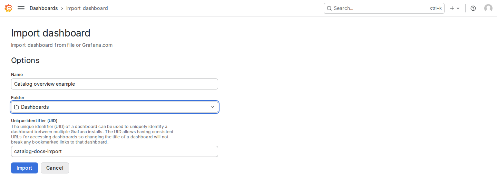

import MonitoringDeployment from "../../../components/architecture/MonitoringDeployment.astro";

Use [Prometheus](https://prometheus.io/docs/introduction/overview/) to collect Catalog metrics and [Grafana](https://grafana.com/docs/grafana/latest/) to display them. The API and worker emit metrics without either tool. Choose the setup that fits your infrastructure:

| Your setup | Procedure |
| --- | --- |
| Existing Prometheus and Grafana | [Configure collection](#connect-existing-prometheus-and-grafana), then [import](#import-the-dashboard) or [provision](#provision-the-dashboard-from-files) the dashboard. |
| Kubernetes without an existing monitoring stack | [Install the optional companion chart](#package-and-install). It supplies Prometheus, Grafana and the shared 32-panel dashboard. |
| An existing OpenTelemetry Collector | Use its [Prometheus receiver and metrics pipeline](observability.mdx#collector-integration). The shared dashboard requires a Prometheus-compatible query backend. |

Run repository commands from a checkout of Open Agentic Catalog. The files under `deployments/monitoring/` supply the dashboard, scrape example and provisioning configuration. Use these existing files for your deployment.

## Signals and access

Metrics, logs, traces and audit records have separate purposes and configuration:

| Signal | Catalog output | Operator setup |
| --- | --- | --- |
| Metrics | Prometheus text at API and worker `/metrics` endpoints. | Configure collection and select the intended data source in Grafana. |
| Logs | Service logs on stdout; CLI diagnostics on stderr. | Use the deployment's log collector and configure [level and format](../reference/configuration.mdx#logging-configuration). Collection, access, retention and rotation belong to that system. |
| Traces | Optional OTLP/HTTP protobuf export, disabled by default. | Configure a trace backend or Collector through the [trace-export procedure](observability.mdx#distributed-tracing). |
| Audit records | Retained PostgreSQL records for governed actions. | Use the [audit procedures](audit.md). Logs and sampled traces do not replace these records. |

API metrics and worker operations require no bearer token. Restrict them through platform network rules and ingress routing. Do not expose `/metrics` through a public application ingress. The UI host does not forward metrics. The worker's `operations` port is absent from the application Service and Ingress.

| Connection | Required access |
| --- | --- |
| Kubernetes scraper to the Kubernetes API | Authenticated discovery of Pods in the selected Catalog namespace. |
| Scraper to Catalog | Direct API and worker metrics ports on each selected process. |
| Grafana to Prometheus | The query endpoint, reachable from the Grafana server. |
| Operators to Grafana or Prometheus | The chart's loopback port-forward, or an operator-managed authenticated HTTPS route. |
| API and worker to a trace receiver, when enabled | The approved OTLP/HTTP endpoint and configured credential/trust inputs. |

The optional companion chart uses the request paths below. The frames identify Helm releases; the application and monitoring releases can use different namespaces. The ports shown are defaults.

<MonitoringDeployment />

Prometheus discovers and scrapes each API and worker Pod, including Running Pods that are unready. Grafana queries Prometheus from its server network. Monitoring is independent of application readiness.

Private ClusterIP Services do not enforce a network access policy. Configure the required network rules for your deployment. Shared HTTPS access, certificates and browser authentication remain operator responsibilities; the companion chart has no ingress or single sign-on settings.

Enable tracing separately when you need it. Configure the full OTLP/HTTP endpoint, usually ending in `/v1/traces`; the exporter does not support OTLP/gRPC. Review [sampling and receiver failures](observability.mdx#sampling-and-collector-failures) and the [trace settings](../reference/configuration.mdx#optional-tracing-configuration). Keep credentials and trust files in supported mounted inputs. Restart affected replicas after changes because the exporter reads these inputs at startup.

The monitoring chart does not enable tracing, install a trace backend, collect infrastructure metrics or configure alert delivery. Use the [dashboard walkthrough and screenshot](../guides/performance-and-monitoring.md#read-the-grafana-dashboard) to navigate the dashboard and interpret its panels.

## Connect existing Prometheus and Grafana

Use your current collector and Grafana data source. Configure one scrape target per API or worker process:

| Process | Default endpoint | Required dashboard label |
| --- | --- | --- |
| API | Named Pod port `http`, TCP 8080, path `/metrics`. | `catalog_role=api` |
| Worker | Named Pod port `operations`, TCP 9090, path `/metrics`. | `catalog_role=worker` |

These are the chart's container ports. Outside Kubernetes, use the address and published port that your collector can reach. Assign one stable, unique `catalog_deployment` value to the installation. Keep a distinct `instance` for each target. Do not scrape through a load-balanced application Service: it can hide replicas and mix their counters.

### Kubernetes discovery

Use `deployments/monitoring/kubernetes-scrape.example.yaml` as the starting point. Merge its `scrape_configs` entry into your collector configuration. Preserve unrelated scrape jobs. Replace these example settings together:

| Example setting | Your value |
| --- | --- |
| `kubernetes_sd_configs[].namespaces.names` | The namespace containing Catalog API and worker Pods. |
| Release-selection `relabel_configs[].regex` | The application Helm release's `app.kubernetes.io/instance` label. |
| `catalog_deployment` replacement | A stable label unique to this Catalog installation, such as `cluster-a/catalog-system/catalog`. |

Keep the component/named-port filter `api;http|worker;operations`. It selects the API and worker ports and excludes migration Jobs. Retain the `Running` phase filter without adding a readiness filter. Running but unready processes must remain visible during dependency failures. Preserve the discovered Pod IP and port as `instance`.

Provide the scraper's own Kubernetes credentials and narrow discovery permissions. Its identity needs `get`, `list` and `watch` on Pods in the selected namespace. It does not need access to Catalog Secrets or database credentials. Kubernetes [RBAC](https://kubernetes.io/docs/reference/access-authn-authz/rbac/) cannot restrict those Pod reads by label; relabel rules restrict the resulting targets. The example supplies scrape configuration, not a ServiceAccount, Role or RoleBinding. Allow the scraper to reach the Kubernetes API and both metrics ports.

Assign each endpoint to one collector. Identical Collector replicas can collect the same samples repeatedly; configure sharding in the collector deployment. If you already use Prometheus Operator, configure your own PodMonitor for the selected ports and labels. Catalog does not install that Operator or its custom resource definitions (CRDs).

Check syntax and apply the configuration through your collector's normal deployment process. See [Prometheus configuration](https://prometheus.io/docs/prometheus/latest/configuration/configuration/#kubernetes_sd_config) for discovery credentials and scrape settings. Keep credentials out of tracked files. The [Collector integration guide](observability.mdx#collector-integration) explains how to use the same scrape configuration in a Collector metrics pipeline.

### Static targets outside Kubernetes

For a fixed two-process deployment, use a configuration such as this:

```yaml
scrape_configs:
  - job_name: catalog
    scrape_interval: 10s
    scrape_timeout: 4s
    metrics_path: /metrics
    scheme: http
    scrape_protocols: [PrometheusText0.0.4]
    static_configs:
      - targets: [catalog-api.example.internal:8080]
        labels:
          catalog_role: api
          catalog_deployment: production/catalog-a
      - targets: [catalog-worker.example.internal:9090]
        labels:
          catalog_role: worker
          catalog_deployment: production/catalog-a
    sample_limit: 10000
    label_limit: 16
    label_name_length_limit: 128
    label_value_length_limit: 256
    body_size_limit: 1MB
```

Replace the example addresses, ports and deployment label. Add each replica as a separate target, or use your platform's discovery mechanism when addresses change. Prometheus assigns each target address to `instance`. These HTTP endpoints require private network access. Configure authentication and verified TLS separately if your deployment places a proxy in front of them.

Validate the complete Prometheus configuration with `promtool check config <your-config.yaml>` before you apply it. The example uses finite sample, label and response-size bounds from the maintained Kubernetes example. Exceeding a bound makes the scrape fail; inspect target errors before changing those budgets.

### Check collection

Open Prometheus **Target health** at `/targets`. Confirm one target for each expected API and worker process. Check the deployment and role labels, distinct instances and successful scrapes. Use your actual deployment label in these queries:

```text
up{catalog_deployment="production/catalog-a", catalog_role=~"api|worker"}
```

```text
open_agentic_catalog_process_uptime_seconds{catalog_deployment="production/catalog-a", catalog_role=~"api|worker"}
```

The first query shows scrape success, not application readiness. The second should contain a sample from each process and advance on successive scrapes. An absent series is not a healthy zero. Inspect readiness and component state through the [health and observability procedures](observability.mdx#readiness-degradation-and-drain).

Select your Prometheus data source and deployment in Grafana. Use `deployments/monitoring/dashboards/catalog.json` for the shared dashboard. The [walkthrough](../guides/performance-and-monitoring.md#inspect-prometheus-collection) explains target inspection; the [panel guidance](../guides/performance-and-monitoring.md#interpretation-and-troubleshooting) explains rates, percentiles and worker-global gauges. Do not sum repeated worker backlog values across replicas.

Use the [operator query examples](observability.mdx#choose-monitoring-queries-and-alerts) to select signals and alert responses. They explain unavailable data, repeated worker snapshots and operator-selected thresholds.

See the [Prometheus target example](../guides/performance-and-monitoring.md#inspect-prometheus-collection) for the two local scrape jobs.

## Import the dashboard

Use manual import when Grafana stores your dashboards through its browser interface. File-managed installations can use [provisioning](#provision-the-dashboard-from-files) instead. Both methods use `deployments/monitoring/dashboards/catalog.json` from your repository checkout.

Ask your Grafana administrator for permission to create or update dashboards in the chosen folder. Use an existing Prometheus data source, or ask an administrator to configure one. Grafana's server must reach its query endpoint. A browser's loopback URL does not identify Prometheus inside a different container or Pod. Use the collector's reachable network address, such as its cluster Service URL.

Check the data source with **Save & test**, or its supported connection check. Match its **Scrape interval** to the collector's actual interval. The supplied stack uses 10 seconds. Keep authentication values in Grafana's supported secret settings, not dashboard JSON. See [Prometheus data-source configuration](https://grafana.com/docs/grafana/latest/datasources/prometheus/configure/) for connection, TLS and credential settings.

Import the existing file:

1. Open **Dashboards** in Grafana.
2. Open **New**, then **Import**.
3. Upload `deployments/monitoring/dashboards/catalog.json`.
4. Choose a folder that you can manage.
5. Set the dashboard name.
6. Check the dashboard's **Unique identifier (UID)** before you proceed.
7. Use **Change uid** if `catalog-overview` belongs to an unrelated dashboard in this Grafana organization.
8. Wait for Grafana to check the UID.
9. Confirm the displayed UID before you click **Import** for a new dashboard.
10. Select your data source in the dashboard's **Prometheus** selector.
11. Select your `catalog_deployment` label in **Deployment**.
12. Select **All**, **api** or **worker** in **Role**.

The JSON has no import-time data-source mapping (`__inputs`). Do not expect a data-source prompt in the import form. Its saved defaults are `catalog-prometheus` and `local`; they are supplied-stack values, not requirements for your installation. The dashboard's selectors control all panel queries. Check these selectors after each import, including when their defaults appear valid. See Grafana's [dashboard import guide](https://grafana.com/docs/grafana/latest/visualizations/dashboards/build-dashboards/import-dashboards/) for the general procedure.

A UID identifies a dashboard within one Grafana organization. Keep `catalog-overview` if you own that dashboard. One dashboard can select several Catalog installations through **Deployment**; you do not need one copy per installation. Change the UID for a separate operator-owned dashboard.

A different title or folder alone does not protect an existing UID from replacement. Grafana shows **Import (Overwrite)** when the selected UID already exists. Use it only to update a dashboard you own. Do not replace a file-provisioned dashboard through manual import.

The project JSON sets `editable: false`. You can use selectors and view panels, but normal editing controls are disabled. These controls do not determine Grafana access permissions. Keep the project dashboard read-only; maintain custom panels under a separate title and UID. Use Grafana's export/copy procedure and deliberately enable editing only in that operator-owned copy.



This import was cancelled. The unused UID preserves the provisioned dashboard. Select Prometheus afterward; this form has no data-source mapping prompt. [Open the full-size screenshot](../../../../assets/monitoring/grafana-dashboard-import.png).

## Provision the dashboard from files

Use file provisioning when your deployment manages Grafana configuration from source control. Start from these repository files:

The paths below are relative to `deployments/monitoring/`:

- `dashboards/catalog.json`: The dashboard, selectors and 32 panel expressions. Mount this existing source read-only.
- `provisioning/datasources/catalog.yaml`: A Prometheus connection for the supplied stack. Adapt it to your data source.
- `provisioning/dashboards/catalog.yaml`: A file provider for the dashboard. Adapt its name, folder and mounted path.
- `kubernetes-scrape.example.yaml`: Collection configuration for the scraper, not Grafana. Use it through [Kubernetes discovery](#kubernetes-discovery).

Create operator-owned copies of the two provisioning YAML files in your existing deployment configuration. Preserve unrelated Grafana providers and data sources. Adapt these fields before deployment:

| File and field | Required choice |
| --- | --- |
| Data source: `name`, `uid` | A unique name and UID, such as `Production Prometheus` and `production-prometheus`. Reuse an existing data source instead of provisioning it twice. |
| Data source: `url` | A query endpoint reachable from the Grafana server. `http://prometheus:9090` is the supplied Compose network address. |
| Data source: `isDefault` | Set `false` unless this connection should become your organization's default. Preserve an existing shared default. |
| Data source: `jsonData.timeInterval` | The actual scrape interval, such as `10s`. Review the supplied query timeout against your collector. |
| Data source: `editable` | Keep `false` for a connection managed through provisioning. |
| Provider: `name`, `folder` | An unused provider name and the intended Grafana folder. |
| Provider: `options.path` | The absolute path where Grafana can read the dashboard JSON. The supplied path is `/etc/grafana/catalog-dashboards`. |
| Provider: `allowUiUpdates`, `editable` | Keep both `false` for source-managed dashboards. The JSON also disables editing. |
| Provider: `updateIntervalSeconds` | Keep `30` for polling, including mounts that do not propagate file-watch events. |
| Provider: `disableDeletion` | Keep `true` to retain the stored dashboard if its source file disappears. Remove retired dashboards deliberately. |

Use your deployment's secret inputs for data-source authentication. Grafana provisioning supports secret values through `secureJsonData` and environment substitution. Do not commit credentials in either YAML or JSON. See [Grafana data-source provisioning](https://grafana.com/docs/grafana/latest/administration/provisioning/#data-sources) for the supported fields.

Mount the existing JSON directory directly. For an existing Docker Compose deployment, add mounts such as these to its Grafana service:

```yaml
services:
  grafana:
    volumes:
      - ./deployments/monitoring/dashboards:/etc/grafana/catalog-dashboards:ro
      - ./monitoring-config/datasources/catalog.yaml:/etc/grafana/provisioning/datasources/catalog-project.yaml:ro
      - ./monitoring-config/dashboards/catalog.yaml:/etc/grafana/provisioning/dashboards/catalog-project.yaml:ro
```

This snippet assumes the Compose project directory is the repository root. `monitoring-config/` holds your adapted YAML files, created before deployment. It is not a new Catalog setting or a shipped directory. For another project location, use absolute host paths. Grafana must have read access to the mounts. Preserve its existing credentials, state volume, network access and other provisioning files. Use the equivalent mounts or configuration resources in your deployment tooling.

Check UID ownership before you deploy the provider. The JSON uses `catalog-overview`. If that UID already identifies an unrelated dashboard, generate an operator-owned deployment file with a different UID. Generate it from the repository JSON each time; do not maintain another set of panel expressions. You can also set selector defaults in that generated file for your data-source UID and deployment label. Keep the source JSON unchanged.

Apply the configuration through your Grafana deployment process. Data-source/provider changes need a Grafana restart or its supported administrative reload. Existing providers poll dashboard files every 30 seconds. Open the chosen folder and select your **Prometheus**, **Deployment** and **Role** values. A custom data-source UID works through the selector; it does not require panel-query changes.

Grafana stores provisioned dashboards in its database, but the source files control their contents. Browser changes do not write back to those files. With `allowUiUpdates: false`, Grafana rejects attempts to save changes to a provisioned dashboard. See [dashboard provisioning](https://grafana.com/docs/grafana/latest/administration/provisioning/#dashboards) for ownership and update behavior.

## Update and troubleshoot the dashboard

Update the repository checkout to the intended release before you update its dashboard. Keep a record of local customizations separately.

| Deployment method | Update procedure |
| --- | --- |
| Manual import | Import the new `deployments/monitoring/dashboards/catalog.json`. Select the UID you already own and confirm replacement only for that dashboard. Check the folder and selectors again. |
| File provisioning | Update the mounted repository JSON, or regenerate your operator-owned deployment file from it. Keep the owned UID and provider path stable. Verify the update after a polling interval. |
| Optional companion chart | Package the selected checkout, then follow [Package and install](#package-and-install) with the existing release and values. |

File provisioning replaces the stored dashboard from its source, regardless of the JSON's `version` value. It can overwrite browser changes when UI updates are permitted. Do not use a higher JSON version as a protection against updates. With the supplied `disableDeletion: true`, removing the file leaves the last stored dashboard; it is not a removal procedure.

Check empty or unexpected panels in this order:

1. Check each expected target in Prometheus **Target health**.
2. Check `catalog_deployment`, `catalog_role` and each target's distinct `instance`.
3. Query process uptime directly through [Check collection](#check-collection).
4. Check Grafana's data-source connection and its server's access to Prometheus.
5. Select the intended **Prometheus**, **Deployment** and **Role** values.
6. Check the time range and configured scrape interval.
7. Allow successive successful scrapes before you expect rate or percentile results.
8. Check whether the selected process has emitted the observations that the panel requires.

If Prometheus logs a forbidden Pod-list error, check the RoleBinding in the target Catalog namespace. The binding must reference the Prometheus ServiceAccount in the monitoring namespace. An existing discovery watch can remain open after permission removal. Check current authorization and recent scrape times, because historical metrics remain available during discovery failures.

An API-only selection can leave worker panels empty. An unused feature can have no observations. A failed scrape is different from an idle service. Do not replace missing samples with a constant zero. The [panel interpretation guide](../guides/performance-and-monitoring.md#interpretation-and-troubleshooting) explains server-error rates, bucket-based percentiles and repeated worker-global gauges. These values are operational evidence, not billing, trace correlation or a production-capacity guarantee.

## Prerequisites and permissions when enabled

The separate `open-agentic-catalog-monitoring` chart defaults to `enabled: false`. It renders no monitoring resources and needs no target or Grafana credentials while disabled. Set `--set enabled=true`, or use `make monitoring-install`, to deploy both Prometheus and Grafana. The application chart has no monitoring flag or dependency. Monitoring failure, disablement or removal does not change Catalog readiness, migrations or operation.

The companion chart requires Kubernetes 1.34 or later. Use the [cluster prerequisites](deployment.mdx#kubernetes-prerequisites) to check your context and tools before installation.

- Select the Kubernetes context, monitoring namespace and Catalog namespace/release explicitly. Both namespaces must already exist. Installation never creates a namespace.
- Provide a Secret in the monitoring namespace with `admin-user` and `admin-password` keys through your normal secret-management process. There is no generated/default password, anonymous Grafana access or password value in the chart. The key names are configurable.
- The installing identity needs ordinary chart-resource permissions in the monitoring namespace and permission to create the Pod-reader Role and RoleBinding in the target Catalog namespace. Prometheus can get/list/watch Pods in that namespace, not Secrets, nodes or other namespaces. Kubernetes RBAC cannot restrict this Pod-read permission by label; scrape selection additionally restricts the Catalog release and API/worker components. Grafana mounts no service-account token.
- Allow Prometheus to reach the Kubernetes API and Catalog Pod metrics ports (API `http`, worker `operations`), and Grafana to reach Prometheus. Existing application NetworkPolicies may require operator-provided ingress rules. The chart installs no NetworkPolicy, ingress, Operator, CRD, exporter or cluster-wide RBAC. ClusterIP services are private service endpoints, not network access controls.

Both workloads run one container with a read-only root filesystem, dropped capabilities, no privilege escalation, non-root execution and `RuntimeDefault` seccomp. The chart has no root init container to repair volume ownership. Numeric user, group and filesystem-group defaults are `65534`: Prometheus's image declares a named `nobody` user, which Kubernetes cannot otherwise verify with `runAsNonRoot`. For admission-assigned identities such as OpenShift, explicitly clear these defaults:

```yaml
podSecurityContext:
  runAsUser: null
  runAsGroup: null
  fsGroup: null
```

Alternatively supply permitted nonzero IDs. Clearing them requires an admission controller to supply a usable numeric identity; it is not a default plain-Kubernetes profile. The storage driver must provide writable data directories for the selected identity.

## Package and install

Build the archive locally. Packaging does not publish it or fetch upstream charts:

```sh
make monitoring-package
```

The output is `output/helm-monitoring/open-agentic-catalog-monitoring-0.1.0.tgz`. It includes the templates, project license, shared digest-pinned image references, dashboard and Grafana provisioning assets. Install this archive rather than the incomplete source directory. Images are pulled separately by Kubernetes; they are not bundled in the archive. The default Prometheus and Grafana pins come from `deployments/monitoring/images.json`, also used by Compose.

Create a values file with non-secret inputs, such as `monitoring-values.yaml`:

```yaml
target:
  namespace: catalog-system
  release: catalog
  deploymentLabel: cluster-a/catalog-system/catalog
grafana:
  adminSecret:
    name: catalog-monitoring-admin
```

`target.release` matches the application Helm release label, not a Pod or Service name. An empty `target.namespace` means the monitoring release namespace. Choose a stable, unique `deploymentLabel` to distinguish installations in dashboards. Each API and worker Pod retains its own Prometheus `instance`; scraping does not load-balance through the application Service or drop running but unready processes.

Install or upgrade the independent monitoring release with Helm:

```sh
helm upgrade --install catalog-monitoring \
  output/helm-monitoring/open-agentic-catalog-monitoring-0.1.0.tgz \
  --kube-context my-context --namespace monitoring \
  --values monitoring-values.yaml --set enabled=true --wait --timeout 5m
```

The equivalent wrapper explicitly sets `enabled=true` after loading the values file. It requires explicit context and namespace and refuses to operate on an existing release of a different chart:

```sh
make monitoring-install MONITORING_CONTEXT=my-context \
  MONITORING_NAMESPACE=monitoring MONITORING_VALUES=monitoring-values.yaml
make monitoring-status MONITORING_CONTEXT=my-context MONITORING_NAMESPACE=monitoring
make monitoring-access MONITORING_CONTEXT=my-context MONITORING_NAMESPACE=monitoring
```

`MONITORING_RELEASE` defaults to `catalog-monitoring`. Access binds only to `127.0.0.1`. Grafana uses `http://127.0.0.1:13000` by default. Authenticate with the existing Secret's credentials.

To inspect Prometheus, use `MONITORING_COMPONENT=prometheus MONITORING_PORT=19090`. Stop the foreground port-forward with Ctrl-C. Failed installation leaves the selected release available for diagnosis; there is no automatic namespace or storage cleanup.

Open **Dashboards**, then **Catalog** and **Catalog overview**. Select the provisioned **Catalog Prometheus** data source and your configured `target.deploymentLabel`. Follow [Check collection](#check-collection) through the Prometheus port-forward when samples are missing. Use your deployment label in the queries.

## Configuration

The chart's closed `values.schema.json` rejects unknown settings, root identity overrides and unpinned image overrides. Useful settings are deliberately limited:

| Input | Default and purpose |
| --- | --- |
| `enabled` | `false`; set `true` to deploy Prometheus, Grafana and the shared dashboard. |
| `target.namespace`, `target.release`, `target.deploymentLabel` | Explicit Catalog selection and dashboard identity; release and label are required when enabled. |
| `prometheus.image`, `grafana.image` | Empty uses the packaged pin; overrides must contain a SHA-256 digest, including mirrored references. |
| `imagePullSecrets` | Existing registry Secrets in the monitoring namespace; empty by default. |
| `prometheus.scrapeIntervalSeconds`, `scrapeTimeoutSeconds` | 10 and 4 seconds; timeout must not exceed interval. |
| `prometheus.retentionTime`, `retentionSize` | `24h` and `512MB`; the first retention limit reached removes old samples. |
| Each component's `resources.requests` and `resources.limits` | 100m CPU/128Mi requested, 1 CPU/512Mi limited; evaluation starting points, not a capacity promise. |
| Each component's `storage.existingClaim` | Empty uses ephemeral storage; otherwise mount an independently provisioned claim. |
| Each component's `storage.emptyDirSizeLimit` | Prometheus `1Gi`, Grafana `256Mi`; used only without a claim. |
| `grafana.adminSecret.name`, `userKey`, `passwordKey` | Existing Secret name is required when enabled; default keys are `admin-user` and `admin-password`. |
| `podSecurityContext` | User/group/filesystem group default to `65534`; set permitted nonzero IDs or explicitly null all three for admission assignment. Security hardening remains enforced. |

Existing Secret and PVC references accept [Kubernetes DNS subdomain names](https://kubernetes.io/docs/concepts/overview/working-with-objects/names/#dns-subdomain-names), including dots, up to 253 characters. Namespace values retain the 63-character DNS label limit.

Prometheus also keeps the Compose query bounds: 10-second timeout, four concurrent queries, one million samples per query and 32 web connections. These are reviewed template defaults, not additional values. Configuration and dashboard changes roll workloads through a checksum. Each component uses one replica and `Recreate` to prevent simultaneous writers on a single data directory. Expect a brief collection/viewing gap during upgrades. The chart has no monitoring HA, alert routing, infrastructure collection or deployment-wide retention policy.

## Storage and credential maintenance

Default `emptyDir` data is lost when its Pod is replaced, including configuration upgrades. To retain history and Grafana state, provision two distinct persistent-volume claims (PVCs) in the monitoring namespace. Select their storage class, size and backup policy. Then set:

```yaml
prometheus:
  storage:
    existingClaim: catalog-prometheus-data
grafana:
  storage:
    existingClaim: catalog-grafana-data
```

The chart never creates or owns these claims, so Helm uninstall does not delete them. Namespace deletion, operator PVC deletion and storage-provider policy can still destroy data. Select a filesystem and permissions that the images and storage driver support. Allow space beyond Prometheus's retention size for its head, WAL and compaction; an `emptyDir` limit is not a substitute for monitoring node/volume capacity. Changing storage selection does not migrate data. Reducing retention can delete samples and cannot be undone by a Helm rollback.

Grafana's Secret configures the initial administrator. See [Grafana configuration](https://grafana.com/docs/grafana/latest/setup-grafana/configure-grafana/) for the initial password setting. Once its database exists, changing the Secret alone does not change the stored account password. Rotate through Grafana's supported account/admin procedure, update the corresponding Secret, and restart Grafana if needed to read changed configuration. Do not reset persistent state as a credential-rotation mechanism. Secret updates do not trigger a checksum rollout, and Secret contents are never read by Helm templates.

Turn monitoring off while retaining the Helm release and its selected values:

```sh
helm upgrade catalog-monitoring \
  output/helm-monitoring/open-agentic-catalog-monitoring-0.1.0.tgz \
  --kube-context my-context --namespace monitoring \
  --reuse-values --set enabled=false --wait --timeout 5m
```

This removes the chart's workloads, services, configuration and discovery permissions. Helm still retains its own release record. Ephemeral history is lost; external PVCs and the admin Secret remain. Re-enable with the same command and `--set enabled=true`, or use `make monitoring-install` with the same retained-storage values file. The Make install command always enables the stack; use the explicit Helm flag to retain a disabled release.

Alternatively, remove only the monitoring release:

```sh
make monitoring-uninstall MONITORING_CONTEXT=my-context MONITORING_NAMESPACE=monitoring
```

This leaves Catalog, PostgreSQL, the external admin Secret and external claims alone. Reinstall with the same claims and credentials to resume collection with retained history. There is no reset-history target: deleting retained state requires a separate, deliberate operation on the exact claims. Production backups, monitoring availability and retention objectives remain operator responsibilities.

## Verification and reuse

`deployments/monitoring/images.json` selects Grafana 13.2.4. The [dependency reference](../reference/dependencies.md#optional-local-monitoring-tools) explains why this pin is retained. Owned Compose, Minikube and browser checks pass for this image on linux/amd64.

`make helm-check` tests default-disabled empty renders, enabled required/invalid settings, standalone packaging, private resources, Pod-only RBAC, hardening, existing claims and application-chart independence. `make deploy-check` validates the enabled Kubernetes objects. `make test-minikube-monitoring` uses an owned disposable cluster to exercise a disabled install without credentials, enablement, four API/worker targets, dashboard queries, workload samples, Pod replacement, missing-Secret isolation, flag-based disable/re-enable and removal/reinstallation with externally retained storage. It never connects to an existing monitoring system; its fixture claims and credentials are destroyed with its owned cluster.

The same gate also installs the collector in a separate namespace. It verifies Pod-only discovery permissions, isolated credentials, excluded decoys and fresh metrics from all four current Catalog Pods. Collection continues while API Pods run with an unsatisfied readiness gate. The gate also tests discovery permission loss/recovery, disable/re-enable and uninstall across both namespaces. Catalog readiness and retained reads stay intact; external monitoring credentials and claims remain.

For existing Grafana, use [manual import](#import-the-dashboard) or [file provisioning](#provision-the-dashboard-from-files). Do not install this companion chart merely to obtain the dashboard. Preserve unrelated dashboards and data sources in your Grafana organization.
