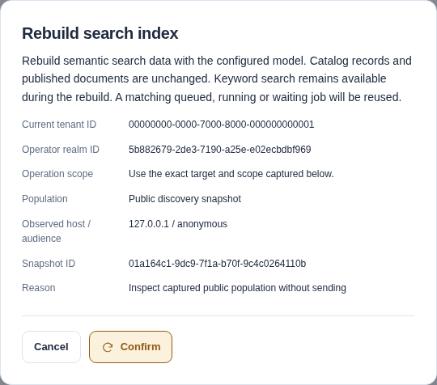

import SearchContinuation from "../../../components/architecture/SearchContinuation.astro";

import SemanticGeneration from "../../../components/architecture/SemanticGeneration.astro";

Hybrid search combines keyword and semantic matches from one configured embedding model. It is disabled by default. Core search, exact identifiers, filters, List and browse work without a model or [pgvector](https://github.com/pgvector/pgvector). Catalog never executes resources or sends their code, artifacts, feedback, identity records or audit data to inference.

## Data sent to the provider

Semantic search sends permitted data to one operator-configured endpoint.

:::note[Permitted fields can contain sensitive text]
Metadata and queries can contain sensitive information. The Catalog does not redact sensitive text in permitted fields.
:::

Review the provider's hosting, retention and training policies before enabling it.

| Input | Selected content |
| --- | --- |
| Local indexed metadata | Display name, description, tags and representative queries from the current published or deprecated release's listing revision. Unpublished listing revisions are excluded. |
| Federated indexed metadata | The same four fields from currently eligible approved source observations. The identifier is used when the display name is absent. Transient live-federation results are not embedded. |
| Public indexed metadata | The same four fields from entries in the active immutable audience-scoped publication, including its Registry self-entry. Published ARD entries require display names. Indexing does not substitute current private metadata. Public and Control vectors have separate disclosure keys. |
| Search and Explore queries | The submitted query text when hybrid retrieval is eligible, plus the configured query prefix. Filters, identity claims and internal scope IDs are not appended to that text. Both authenticated and public discovery queries can reach the provider. |

Metadata uses the fixed `Name`, `Description`, `Tags` and `Representative queries` template. Names and descriptions are trimmed; tags are sorted and deduplicated. Representative queries retain their order. The client adds `documentPrefix` to metadata and `queryPrefix` to queries. Both count toward `maxInputBytes`.

Requests include the model identifier, float encoding selection and any requested dimensions. A provider token supplies endpoint-bound authentication, never model input. Catalog does not forward incoming client credentials.

Embedding fields exclude representations, package contents, endpoints, capabilities, extension maps, validation evidence, feedback, audit and identity data. Sensitive text copied into an allowed field is still sent as that field's content. This includes identifiers used when display names are absent. The field allowlist is not a content classifier or secret filter.

Disabled semantic search makes no inference calls. `excludedTenants` prevents indexing and query inference for named tenant UUIDs, including public snapshot queries. UUID case does not change this rule. Apply matching API and worker configuration, then restart both.

Exclusion controls future requests. It neither recalls an in-flight request nor deletes content already sent to the provider. Another deployment can still process already public metadata under its own policy.

Empty queries, exact AIR identifiers, lexical continuations and unready indexes use model-free paths. Public queries with no filtered candidates or too many candidates also avoid inference. A fresh query can use keyword fallback after provider failure. Keyword results alone do not prove that no query was sent.

Diagnostics exclude query text, response bodies and vectors. Metrics use fixed operation/outcome labels. Derived semantic tables retain digests, vectors and membership, without copies of embedding text. Original Catalog evidence remains retained under its own contracts.

## Configuration

Enable `semanticSearch` in both API and worker configuration, or use the `CATALOG_SEMANTIC_SEARCH` JSON override. Both roles must use the same model profile. If using `.env.example`, replace its default `{"enabled":false}` override. Environment settings take precedence over JSON files.

The provider must support the [OpenAI embedding API](https://developers.openai.com/api/reference/resources/embeddings) subset with indexed float vectors. Catalog has no runtime model allowlist or per-query provider selector.

```json
{
  "enabled": true,
  "endpoint": "https://embeddings.example.com/v1/embeddings",
  "model": "deployment-model",
  "profileRevision": "reviewed-model-revision-1",
  "dimensions": 384,
  "tokenFile": "/etc/open-agentic-catalog/embeddings/token",
  "similarityCutoff": 0.5
}
```

| Setting | Default and meaning |
| --- | --- |
| `enabled` | `false`; disabled mode creates no inference client or indexing loop. |
| `endpoint` | Required when enabled; one canonical HTTPS URL including its path. No URL credentials, query string, fragment or redirects. |
| `model`, `profileRevision` | Required bounded identifiers. Change the revision when weights or deployment preprocessing change, including behind a hosted alias. |
| `dimensions` | Required expected response dimension, 1-4096. Vectors must be finite, nonzero and dimension-correct; the client normalizes them. |
| `responseModel` | Optional expected response model identifier when the provider returns a different canonical name. |
| `requestedDimensions` | `0` omits request-side dimension reduction. If selected, it must equal `dimensions`; qualify provider support first. |
| `queryPrefix`, `documentPrefix` | Empty. Model-specific text prefixes; each at most 1024 UTF-8 bytes. |
| `maxInputBytes` | `8192`, range 64-32768 including the prefix. A document prefix must leave at least 64 bytes for metadata. Provider token limits remain independent. |
| `batchSize` | `16`, range 1-32. Metadata calls are separate from query calls. |
| `queryTimeout` | `2s`, range 100ms-10s and more than 250ms below the API request timeout. Equality is rejected. Query inference also reserves half the remaining request deadline for fallback. |
| `batchTimeout` | `10s`, range 1s-20s and strictly below half the worker Job lease. |
| `queryConcurrency`, `batchConcurrency` | `4` and `1`, ranges 1-32 and 1-8 per process. Account for replica counts when sizing inference. |
| `similarityCutoff` | `0.5`, range -1 to 1. Eligible semantic matches at or above this cosine cutoff join the keyword candidates before deterministic reciprocal rank fusion (RRF60). This is not a confidence or approval score. |
| `excludedTenants` | Empty; at most 256 distinct tenant UUIDs. Excludes both metadata indexing and query inference, including public discovery for those tenants. |
| `tokenFile`, `caFile` | Optional mounted bearer token and additional private CA bundle. Credentials and trust do not change vector identity. Never place token values in configuration. |
| `allowedAddressPrefixes` | Empty; explicitly permit up to 16 canonical address prefixes for private providers. The endpoint remains fixed. |
| `allowHttp` | `false`. Private HTTP requires explicit private prefixes and forbids bearer credentials; use HTTPS for authenticated endpoints. |

Model, dimensions, prefixes, input limit or template changes create a new embedding profile. A changed ranking cutoff changes cursor compatibility without re-embedding unchanged metadata. Credentials and transport trust are separate from model identity. A hosted alias does not prove immutable model weights.

## Database setup

1. Provision PostgreSQL 18 with pgvector 0.8.7 using the database administrator's normal extension procedure.
2. Drain API and worker processes before changing their exact privilege manifests.
3. Run `make migrate-semantic-plan`, then `make migrate-semantic-apply` with the selected schema-owner connection. These targets apply the separate checksummed optional schema and reconcile restricted API/worker privileges under the existing migration lock. They never call inference.
4. Start API and worker roles with matching enabled configuration. They validate optional storage and privileges but never run DDL.

For an existing extension, drain the API and worker first. Ask the database administrator to run `ALTER EXTENSION vector UPDATE TO '0.8.7'` before semantic setup. Installing updated extension files does not update an existing database's extension. Catalog commands do not upgrade pgvector or rewrite the applied semantic schema.

Core migrations do not require vector installation. A model outage does not fail liveness or make a usable PostgreSQL-backed Catalog unready. Invalid configuration or missing optional schema prevents startup. The service does not pretend hybrid search is available.

## Local Compose and Helm

`make embeddings-install` downloads the pinned MiniLM model and [Text Embeddings Inference](https://huggingface.co/docs/text-embeddings-inference/index) fixture image. `make compose-up LOCAL_EMBEDDINGS=on` adds an offline model service with bounded CPU and memory. It uses UID/GID 10001 and a verified read-only cache. Cache files and parent directories must permit that identity to read and traverse them. No inference port is published.

Starting the model does not enable semantic search or apply its database schema. `compose-down` preserves model caches and database volumes.

After database setup, this single-line `.env` setting enables the pinned MiniLM fixture on the default Compose subnet:

```text
CATALOG_SEMANTIC_SEARCH={"enabled":true,"endpoint":"http://embeddings:80/v1/embeddings","model":"sentence-transformers/all-MiniLM-L6-v2","profileRevision":"1110a243fdf4706b3f48f1d95db1a4f5529b4d41","dimensions":384,"allowHttp":true,"allowedAddressPrefixes":["172.30.255.0/24"]}
```

Run `make compose-up LOCAL_EMBEDDINGS=on` to recreate API and worker containers with the selected configuration. Private HTTP is credential-free; use HTTPS for an authenticated provider. If `CATALOG_COMPOSE_SUBNET` changes, change the permitted prefix too. Stopping inference produces observable keyword fallback; it does not disable the Catalog's configured capability.

The Helm chart accepts `semanticSearch` plus `existingSecret`. Mount token and CA files under `/etc/open-agentic-catalog/embeddings/`. Only enabled API and worker Pods receive the Secret. UI Pods receive neither provider secrets nor database credentials. Migration Pods receive optional-schema selection, not model credentials.

Use [coordinated deployment](maintenance.mdx#coordinated-release-deployment) to drain runtimes before schema or grant changes. Raw Helm migration hooks do not drain old workloads.

The chart does not deploy a model. Use a separately operated compatible endpoint. The local Minikube qualification harness builds a fixture-only image from verified cached weights, preloads it and creates two model replicas behind one ClusterIP Service. This fixture is not a production storage or GPU deployment recipe.

## Indexing and recovery

<SemanticGeneration />

A replacement generation becomes usable only after every eligible member has a vector or permanent rejection and the current lease/source checks pass. Rejected inputs remain keyword-only. Inference runs outside SQL transactions. Temporary provider failure retries work without changing authoritative metadata or replacing the old usable generation.

Workers select eligible local releases, approved indexed-source metadata and active public snapshots for bounded `semantic.reindex` Jobs. Public and private-control vectors stay separate, even for identical text. New metadata remains available to keyword search. Publication never waits for inference.

The local `make test-semantic-restore` test restores a separate database with the original stopped. It checks restored search before worker startup, then requests a supported reindex. Results and permission restrictions must remain correct. Resource records and published documents must remain unchanged. See [semantic backup and restore](backup-restore.mdx#optional-semantic-state) for setup and scope.

Automatic indexing and administrator reindex use `jobs.maxAttempts` when creating Jobs, unless the tenant sets `newJobMaxAttempts`. Configure matching deployment defaults in API and worker. The [tenant override](../reference/configuration.mdx#live-tenant-settings) applies without restart. Existing Jobs and explicit retry children retain their stored limit. `jobs.retryCeiling` caps future automatic jitter windows.

Provider 429/503 `Retry-After` sets a minimum delay for the failed Job, followed by bounded jitter. Valid hints are seconds or a future HTTP date, measured at response receipt, through 24 hours. Missing, zero, malformed, past, negative or excessive hints use ordinary backoff. Total delay cannot exceed 24 hours; a maximum hint leaves no jitter room. The minimum can exceed `jobs.retryCeiling`, which limits only the jitter window.

Inference does not retry response statuses or wait again inside a request. Failed query inference falls back immediately. Scheduling affects the Job, not every request to the provider. See the [durable Job policy](../reference/configuration.mdx#durable-job-retry-policy).

Each index build binds its tenant, profile, source generation and current Job lease. Compatible vectors are reused. Permanently rejected items remain keyword-only and have separate counts. Temporary outages retry the Job without marking metadata invalid. Authentication or invalid-response failures terminate the Job; correct the cause before deliberate retry. They do not classify metadata as rejected.

A replacement generation becomes usable only after accounting for every eligible member. Bounded cleanup removes retired generations and unused vectors. It never rewrites authoritative records or published documents.

The indexer checks metadata size before inference and reserves bytes for `documentPrefix`. The client checks the final prefixed length again. A provider rejection splits the pending batch until valid subsets succeed and rejected items are isolated.

For `n` distinct pending inputs, each page and attempt uses at most `2*n-1` document-inference calls. That means at most 31 calls at default batch size 16, or 63 at maximum size 32. Reused and duplicate inputs reduce the work; no pending inputs means no inference. This is not a whole-Job retry or network-request budget: local rejection sends no HTTP request.

A dependency failure or cancellation stops the page without saving partial results. Previously saved pages remain available for resume.

Callers need current tenant-scoped `operations.reindex` permission for administrator reindex. The Tenant Administrator template includes it. Use Service information in the UI or this remote command:

```sh
catalogctl remote reindex --reason "Rebuild search metadata" --idempotency-key reindex-2026-09-14-01
catalogctl remote job --id JOB_UUID
```

The CLI uses its normal API URL/token inputs, never a database connection. Add `--snapshot-id SNAPSHOT_UUID` for a currently active public snapshot. Retrying the same HTTP command key returns the original Job; matching active work is deduplicated. Existing Job inspection, cancellation and retry controls apply. Use a new command key for a new deliberate rebuild.

In the UI, open **Operations > Search indexing**. The navigation marks that destination current and focuses the indexing section. Choose **Catalog search** or **Public discovery snapshot**. For a public rebuild, choose **Choose active snapshot**, select a configured **Publication host**, then select **Read active snapshot**. Choose **Use observed snapshot for reindexing** to fill its exact ID. The picker reads one active summary for that host; it does not scan snapshot history.

Snapshot choices require independent `publication.read` permission and, when enforced, `catalog.read` scope. They do not grant reindex authority. The **Active snapshot ID** field remains available without publication-read permission, or when choices fail. The server rechecks active eligibility when the command runs. Enter a reason and inspect the captured population, Snapshot ID and any observed host/audience before confirmation.

The accepted request keeps that captured population beside its Job reference until the page closes. When you enter an ID manually, the UI has not checked its host or audience. Reload does not reconstruct the request from private Job data. Current Catalog indexing counts do not measure a public snapshot rebuild. Switching back to **Catalog search** omits any hidden Snapshot ID from the new request.

[](../../../../assets/catalog-ui/search-indexing-confirmation.png)

The illustration uses a disposable Catalog's active snapshot and a controlled enabled-capability response. It shows captured command input, not a completed rebuild or a healthy inference provider.

### Check a rebuild outcome

1. Check the requested population before confirming. **Catalog search** includes eligible local and indexed-source metadata; it does not synchronize a source. **Public discovery snapshot** targets one active published snapshot.
2. Retain the accepted Job ID and population. Use **View indexing Job** when authorized, or hand the exact reference to a Job reader.
3. Use **Reload job** until you observe a terminal state. A queued acknowledgement, progress value or reused active Job is not completion.
4. For a succeeded Job, inspect its recorded generation and **Accounted inputs**. Accounting includes reused vectors and failed inputs; it does not count only new successful embeddings.
5. Read current Service information and test an authorized query against the intended population. Catalog counts do not describe a public snapshot's readiness, and a recorded generation need not remain active.

Reindex permission requires tenant-wide `operations.reindex`; enforced command scopes require `tenant.admin`. Following the generic Job also needs `job.read` and enforced `catalog.read`. A publication reader can choose a snapshot without gaining reindex permission. An indexing delegate can enter an exact active Snapshot ID without publication inventory access. Scope values never supply missing Catalog permissions.

If command delivery is uncertain, keep **Retry same command** and its captured body/key. If an unsubmitted snapshot becomes inactive, select the current active snapshot and review a fresh command. A lost acknowledgement does not justify silently changing its target. After a failed rebuild, correct the reported cause before a deliberate retry. Retained Job records can expire; use the [Job investigation procedure](observability.mdx#investigate-one-retained-job) rather than assuming an absent result means no work occurred.

After a model/profile change or restore, workers reconcile missing or stale derived state. Search uses keyword fallback until the configured generation is ready. Disabling semantic search preserves derived state but makes no provider calls; re-enabling reconciles it. Do not delete Catalog data or reset a retained database to repair embeddings.

## Search behavior and monitoring

<SearchContinuation />

This diagram describes authenticated Control API Search. Cursors bind the caller, query, generation, ranking profile and query-vector fingerprint. Public discovery follows the same continuation principle with separate snapshot inputs and limits, described below.

| Request or condition | Required behavior |
| --- | --- |
| Fresh query; classified indexing, provider or work-limit failure | Use keyword fallback. Do not report truncated hybrid success. |
| Existing lexical cursor; provider changes | Keep lexical continuation, including after provider recovery. |
| Existing hybrid cursor; dependency unavailable | Retry the same cursor or restart the query. Do not switch its ranking to keyword search. |
| Changed binding, profile, generation or metadata | Restart pagination with the submitted query and filters. Access denial requires correcting permission, not bypassing it through a new query. |
| Unclassified database error or caller cancellation | Return the error. These conditions do not permit keyword fallback. |

Authenticated Search combines local and indexed candidates; Control Explore covers local releases only. Public ARD Search/Explore use the active audience-scoped snapshot. Explicit filters apply before matching. Independent keyword and semantic candidates are deduplicated before rank fusion; durable totals and facets cover the full matching set, not a top-k approximation.

Live results form a separate bounded tail after durable hybrid results. They are not re-embedded. A signed cursor continues an unchanged live window; a changed window or generation requires a new search. Retry the same cursor after a temporary replay failure.

Authenticated hybrid matching permits at most 100,000 candidate identities per request. Exceeding that bound makes a fresh query use keyword fallback, never truncated hybrid success. Index-count inspection has a separate 100,000-member bound.

Public comparison permits 1,000 filtered entries, including a matching Registry self-entry. More candidates produce `work_limit` keyword fallback before inference on a fresh query. A snapshot with 1,000 resources plus its Registry entry therefore remains searchable. An existing hybrid continuation cannot change to keyword ranking. Narrow filters to remain within the comparison bound.

These safeguards and the 1,000-item test are not capacity guarantees for larger semantic deployments.

Search and Explore report actual `tier`, `profile`, optional `fallbackReason` and `partialIndex`. The UI labels the returned result, not just configured capability. Public ARD bodies remain unchanged. Headers `Catalog-Search-Tier`, `Catalog-Search-Fallback` and optional `Catalog-Search-Partial-Index: true` report mode without counts or provider identity. Successful empty hybrid results remain empty.

The UI's restart action preserves submitted criteria. A hybrid continuation never silently becomes keyword-ranked during an outage.

Capabilities report configuration and the API process's last observed provider state without an inference probe. Callers with current `operations.reindex` permission also receive control-index counts and a Job link. These counts are private operational information. Check Job state and `semantic_maintainer` health for worker progress.

`open_agentic_catalog_embedding_request_duration_seconds` measures bounded query and batch attempts by fixed outcome. `open_agentic_catalog_search_retrieval_total` records actual retrieval and fallback outcomes. Labels exclude tenants, queries, models, URLs and resources. Disabled processes create no model scrape targets.

## Verification

| Target | Scope |
| --- | --- |
| `make embeddings-check` | Service-free fixture checks. |
| `make test-embeddings` | Production HTTP adapter against the real local model. |
| `make test-semantic` | Owned Compose indexing, Search/Explore, public continuation, administrator reindex/replay, CLI, browser journeys and outage recovery. |
| `make test-semantic-restore` | Small same-model logical restore, exact search and permission checks before worker startup, then a supported index rebuild. |
| `make test-minikube-semantic` | Optional Helm configuration with multiple API, worker, UI and model replicas. |

The Compose test also seeds 1,000 searchable releases and checks counts, filters, facets and pagination. It measures concurrent search and saves read-only SQL plans and container samples. Runtime targets clean owned resources and retain the verified model cache. These are functional and small-load checks, not 100,000-item capacity tests. Relevance experiments remain separate from functional and deployment checks.
