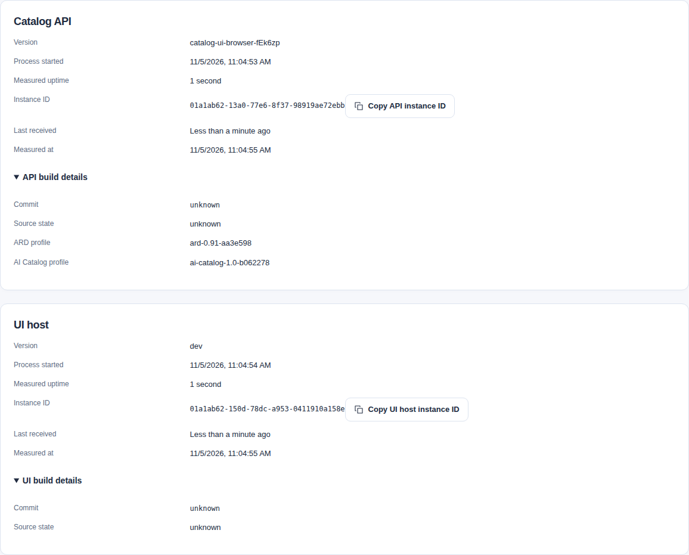
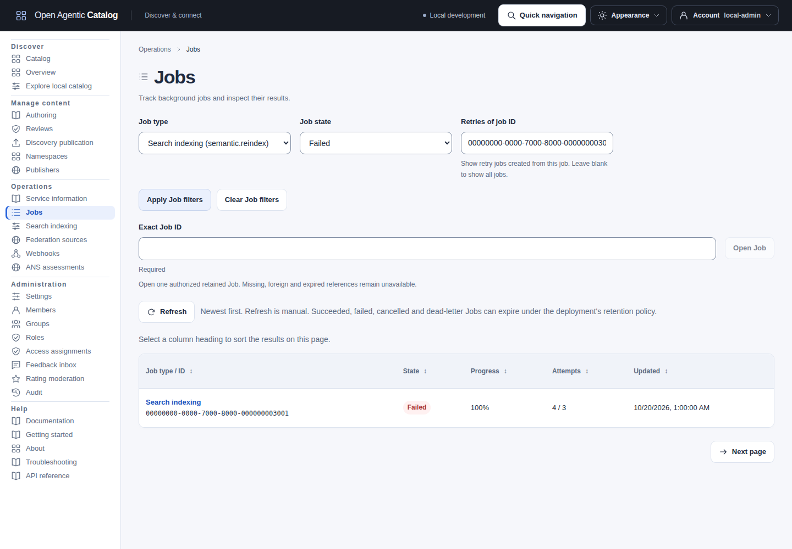
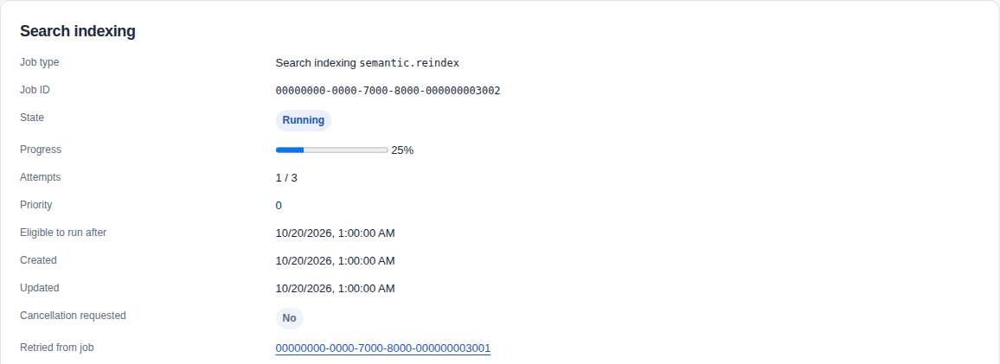
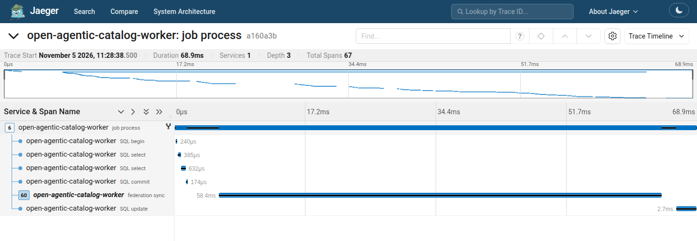
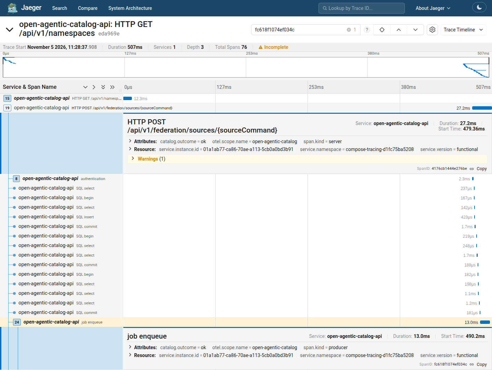

import JobLifecycle from "../../../components/architecture/JobLifecycle.astro";

import TelemetryPaths from "../../../components/architecture/TelemetryPaths.astro";
import TraceCausality from "../../../components/architecture/TraceCausality.astro";

Use application signals to diagnose a Catalog process and its bounded persisted work. Use audit evidence for governed history. These signals do not provide tenant reports, backup monitoring or a universal availability objective.

## Listener boundaries

The optional [Catalog dashboard](../guides/performance-and-monitoring.md#interpretation-and-troubleshooting) is reusable with operator-supplied scrape labels `catalog_deployment` (one installation) and `catalog_role` (`api` or `worker`), plus `job` and a distinct `instance` per process. Select the intended Prometheus data source and deployment before interpreting traffic. These labels belong to scrape configuration, not the application metric schema or a required Kubernetes discovery mechanism. The local fixture supplies them. Production collectors, access controls and retention remain operator-owned.

Dashboard rates are gated by each reporting target before aggregation. A healthy replica cannot validate stale counters from a failed replica. Worker global snapshots remain separate per instance, and worker-only panels intentionally have no samples under API-only selection. Runtime per-metric availability and worker snapshot availability control values independently of HTTP scrape success.

No observations means no histogram percentile. Healthy observed in-scope traffic can establish zero errors. Do not use a blanket zero fallback. Pool-wait seconds/second, SQL-client duration by operation, housekeeping failure rate and last-success age use existing metrics. The pinned expression tests cover these semantics without a production monitoring dependency.

The API listener serves `/livez`, `/readyz`, `/version`, `/metrics`, and the embedded OpenAPI beside its product routes. These endpoints require no bearer token, so ingress must expose only the ones intended for clients and keep metrics on the platform network.

Each worker-capable process also serves an operations-only listener selected by `worker.operationsAddress` or `CATALOG_WORKER_OPERATIONS_ADDRESS`. Its default is `127.0.0.1:9090`; Compose and Helm bind `0.0.0.0:9090` inside the workload. Compose publishes no worker port, and the Helm Service and Ingress expose no `operations` port. Restrict direct Pod access with the deployment's platform-network controls.

The worker listener has exactly these unauthenticated `GET` routes and accepts no query string:

| Route | Meaning | Dependency I/O |
| --- | --- | --- |
| `/startupz` | The worker completed configuration and dependency construction far enough to serve its operations listener. The body also reports its current lifecycle. | None. |
| `/livez` | The process and operations listener are alive, including while draining or while PostgreSQL is unavailable. | None. |
| `/readyz` | The lifecycle is running and a two-second configured-repository check succeeds. Maintained split-role deployments use the exact worker PostgreSQL role, admit only read/write-capable runtime connections, and check the acquired session's `transaction_read_only` state without a canary write; the combined in-memory development role has no external dependency, and intentionally read-only operator connections use a separate generic path. | PostgreSQL when configured. |
| `/status` | Bounded lifecycle, readiness, degradation, fixed component states, last checked dependency state, build and current-process identity, startup/observation times, uptime, and the effective housekeeping interval, retention values, and fixed batch limit. It returns HTTP 200; clients must inspect `ready` and `degraded`. | PostgreSQL readiness while running; enabled webhook-delivery aggregates may also be collected during drain. |
| `/metrics` | Deterministic Prometheus text for this process and, on a PostgreSQL worker, deadline-bounded global operational aggregates. | PostgreSQL aggregates on the worker only. |
| `/version` | Worker build version and commit with current lifecycle. | None. |

No `/api/v1`, ARD, publication, document, or OpenAPI route is registered on the worker listener. Every response is `no-store` and receives restrictive content and framing headers.

Kubernetes probes the named worker `operations` container port directly. Compose uses `catalogctl probe`, a scratch-image-safe client restricted to literal loopback HTTP, numeric nonzero ports, `/startupz`, `/livez`, or `/readyz`, a 2.5-second deadline, 4 KiB response limit, no proxy, no credentials, and no redirects. It is a local health helper, not a general HTTP client.

The optional UI has its own root `/livez` and `/readyz`, even when its pages use a base path. These check the browser host's process and drain state without contacting the API or issuer. UI readiness alone does not prove sign-in or browsing works. Verify those through the authorized user path. The UI does not forward API metrics or worker operations. See [UI deployment](deployment.mdx#optional-catalog-ui).

### Read a running worker's status

Run this host command when the worker's listener is locally reachable on port 9090:

```sh
curl --noproxy '*' --fail --silent --show-error \
  --connect-timeout 2 --max-time 5 http://127.0.0.1:9090/status
```

Compose publishes no worker port, so this host request cannot reach its worker directly. The scratch image has no curl or shell. Its `catalogctl probe` accepts health paths only, not `/status`.

For Helm, use an operator account authorized to read and list Pods. The account must also permit Pod port forwards. The host must reach that context's Kubernetes API. Set the existing context, namespace and release before listing worker Pods:

```sh
CATALOG_KUBE_CONTEXT='my-cluster'
CATALOG_NAMESPACE='catalog-system'
CATALOG_RELEASE='catalog'
kubectl --context="$CATALOG_KUBE_CONTEXT" --namespace="$CATALOG_NAMESPACE" \
  --request-timeout=10s get pods \
  -l "app.kubernetes.io/instance=$CATALOG_RELEASE,app.kubernetes.io/component=worker" \
  -o wide
```

Choose the intended running Pod from that list. Replace the placeholder below with its exact name. Choose an unused local port; this example uses 19091. Keep the following command running in this terminal:

```sh
CATALOG_WORKER_POD='REPLACE_WITH_SELECTED_WORKER_POD'
kubectl --context="$CATALOG_KUBE_CONTEXT" --namespace="$CATALOG_NAMESPACE" \
  port-forward --address=127.0.0.1 --pod-running-timeout=30s \
  "pod/$CATALOG_WORKER_POD" 19091:9090
```

Run the status request in another terminal after the forward reports that it is listening:

```sh
curl --noproxy '*' --fail --silent --show-error \
  --connect-timeout 2 --max-time 5 http://127.0.0.1:19091/status
```

HTTP 200 means the report is readable. Inspect `status`, `ready`, `degraded`, `components` and `dependencies`. `not_ready` means the lifecycle or required dependency prevents readiness. A degraded optional component can leave `ready: true`. A component marked `running` does not prove that fresh work completed.

Record the Pod name, `instanceId` and `observedAt` when comparing reports. Read each intended replica separately. A replacement Pod needs a new forward. Press Ctrl-C in the forwarding terminal when you finish. Keep the operations port private; this procedure changes no Service or ingress.

The separate [`catalogctl diagnostics` procedure](#operator-diagnostics) constructs another runtime. It does not inspect this worker's process state.

## Current-process startup information

Read `GET /api/v1/service-information` on the API with normal authentication. No additional role or OAuth scope is required. Its handler reads only process memory. Normal authentication and middleware still apply; this is not an anonymous health endpoint.

The response contains build version, commit, source state and supported profiles. It also contains `role`, `instanceId`, `startedAt`, `observedAt` and `uptimeSeconds`. The role is `api`, or `all` for the combined development process. These values describe one execution and arrive in one response with `Cache-Control: no-store`.

The UI host exposes its own build and timing through `/_status`, under the configured base path. This read uses the same origin controls as `/_build`. It requires the `X-Catalog-Request: 1` header and does not contact the API or issuer. Its role is `ui`. The authenticated browser displays the API and UI observations separately on [Service information](#inspect-service-information-in-the-ui).

The worker adds the same timing fields to its existing private `/status` response. That route retains its readiness checks and optional bounded operational aggregates. The timing fields themselves require no database or provider work. Public API `/version`, UI `/_build` and private worker `/version` keep their existing build contracts.

`startedAt` is UTC wall time captured during process initialization. `uptimeSeconds` is whole elapsed seconds from a monotonic clock. A clock correction can move `observedAt` before `startedAt`; do not derive uptime by subtracting these wall times. An instance ID changes after a restart and exists with tracing disabled. Enabled backend traces use the same ID as `service.instance.id`.

A load-balanced read reports only the responding replica. Refresh can change its ID and startup time. There is no node inventory, persistent startup history or claim that startup time is the latest deployment time. No setting, database migration or Helm value is required for these fields.

Prometheus exposes `open_agentic_catalog_process_start_time_seconds`, a Unix startup timestamp, beside the existing `open_agentic_catalog_process_uptime_seconds` gauge. API and worker metrics use the same process state as their timing responses. Scrape each process directly to compare replicas. Use deployment target labels; the metrics do not add per-execution ID labels. The UI host has no Prometheus endpoint.

See the [browser process observations](#inspect-service-information-in-the-ui) for the separate API and UI displays.

### Inspect service information in the UI

Service information shows separate **Catalog API** and **UI host** sections. Each section includes its version, commit, source state, startup time, uptime and instance ID. The instance ID identifies one process execution. It changes after a restart, even when the build version stays the same.

**Measured uptime** is elapsed time when the server answered. **Measured at** shows when it answered. **Last received** measures time since the browser received that response. It updates locally; it does not fetch new data. Select **Refresh** to read current values.

The Catalog API section describes the API process that answered. A later read can reach a different replica. The sections do not list all nodes or retain startup history. Startup time is not an upgrade date: the same image can restart without an upgrade. Uptime uses a monotonic clock, so a system clock correction does not alter elapsed time.



These values describe the responding API and UI host. They do not show all replicas or establish health. [Open the full-size screenshot](../../../../assets/catalog-ui/service-information-processes.png).

A failed read clears its section and offers **Reload**. It does not hide a successful section from the other process. Sign-out or an identity change clears prior responses. These sections are not health checks.

This page also shows supported standards profiles, configured limits with units, optional feature states and degradations. Authenticated users can view it without an additional product role or OAuth scope. Enabled means configured availability; disabled means turned off; unavailable means the deployment does not offer the capability. A degraded provider observation can indicate keyword fallback. Unknown or missing provider state does not establish health. These observations neither probe the provider nor grant permission. Tenant indexing counts require `operations.reindex` and, when enforced, `tenant.admin` scope.

Use **Copy API instance ID** or **Copy UI host instance ID** for an already displayed process reference. **Support details preview** and **Copy support details** reuse the bounded build projection from Troubleshooting. They include build identifiers and safe read-failure correlation, without credentials, process topology or another service request. Follow the contextual Service observations and Search indexing guides for operator procedures.

This page does not expose worker operations, raw metrics or deployment administration.

## Read API request statistics

Enable the [deployment setting](../reference/configuration.mdx#service-activity-disclosure) before reading `GET /api/v1/service-activity`. The route defaults off and returns 404 while disabled. Current active membership and tenant-wide `access.manage` are required. GET and implicit HEAD also require `tenant.admin` when OAuth scope enforcement is enabled.

The response describes one API process and combines its traffic across tenants. It contains no tenant, user, resource or query identifiers. Existing Service information remains available under its separate access rules. The [Activity view](../guides/catalog-ui.mdx#read-live-api-activity) displays these statistics at `/overview?view=activity`.

The response includes execution identity, start and observation times, precise elapsed seconds, completed requests, active Catalog requests and summed durations. Fourteen fixed families separate Catalog requests from probes, metrics, activity polling and auxiliary traffic. Search outcomes describe Control Catalog Search only. MCP outcomes overlap HTTP counts; they are not another request total.

Counters use decimal strings through the uint64 maximum. Preserve their exact values when calculating differences. Divide summed duration by its matching completion count for a mean. An empty denominator has no measured mean. The current activity request completes after its sample; previous activity reads appear in the observer family. Polling adds authenticated HTTP traffic, but it does not increase the displayed Catalog request count. Each open Activity tab makes its own reads.

The read accepts no query parameters or body. Responses use `Cache-Control: no-store` and remain within 64 KiB. The handler copies process memory without querying providers, readiness, PostgreSQL statistics or collectors. Authentication and current permission checks retain their normal database dependencies. The read creates no audit or outbox event.

A process restart resets counters. A later request can reach another replica. Calculate rates only between compatible samples from the same execution using increasing monotonic elapsed time. Do not combine replicas or infer unique users, connections, tenant usage or deployment totals. Use Prometheus and Grafana for retained history and deployment monitoring.

## Readiness, degradation, and drain

Liveness does not check PostgreSQL or an optional receiver. In maintained PostgreSQL-backed deployments, PostgreSQL loss or a default read-only runtime session, including one on a hot standby, makes both API and worker readiness unavailable while their processes stay live. Supervised worker components report degraded and retry dependency-class failures. Every new physical runtime connection is subject to the same read/write admission rule, the readiness check observes session capability without issuing a canary write, and recovery needs no process restart after an acceptable connection becomes available.

This does not apply to intentionally read-only restore and audit operators. The combined in-memory development role has no PostgreSQL readiness dependency. A webhook receiver failure is handled through durable retry and does not create a liveness restart loop.

Worker components retry classified dependency outages using independent [bounded restart windows](../reference/configuration.mdx#worker-dependency-restarts), separate from healthy polling. The safe warning includes the sampled numeric `retry_delay_ms`. Effective settings appear in `catalogctl diagnostics --role worker`. A `running` component has entered its callback and may still fail. After database readiness recovers, check component recovery and completion of fresh work. A readiness response alone does not establish worker recovery.

On `SIGTERM`, the process enters `draining`, API readiness is disabled, workers stop new claims and housekeeping begins no new class operation through context cancellation, and in-flight HTTP servers drain within `http.shutdownTimeout`. The worker operations listener remains available until other components finish so `/readyz`, `/status`, and metrics can report the drain. An abandoned Job or outbox lease remains recoverable after its lease expires, while an interrupted housekeeping transaction rolls back or was already committed atomically.

## Collector integration

Collection is optional. Catalog emits metrics without [Prometheus](https://prometheus.io/docs/introduction/overview/), [Grafana](https://grafana.com/docs/grafana/latest/) or an OpenTelemetry backend. The owned `make test-monitoring` fixture checks exact configured API/worker scrape identities, an authorized retained Resource read while both collectors are stopped, and fresh underlying application sample timestamps for both roles after restart. Collector readiness and instant-query evaluation time alone do not prove collection recovered.

Metrics use pull-based Prometheus text at `/metrics`. Optional distributed tracing independently exports OTLP/HTTP protobuf spans. Direct OTLP metrics/log export and arbitrary `OTEL_*` environment configuration are not supported. Follow [Monitoring with Prometheus and Grafana](helm-monitoring.md) for existing-collector setup, static targets, access controls or the optional Helm stack.

<TelemetryPaths />

Prometheus can scrape the endpoints directly. An operator-owned [OpenTelemetry Collector Prometheus receiver](https://github.com/open-telemetry/opentelemetry-collector-contrib/tree/main/receiver/prometheusreceiver) can instead scrape them and pass the metrics through its configured export pipeline. The receiver accepts Prometheus `scrape_configs` under `receivers.prometheus.config`. Select a Collector distribution containing that receiver and connect it to the metrics pipeline. This metrics bridge is separate from the application's OTLP trace exporter. Collector configuration, credentials, TLS and operation remain deployment-owned.

On Kubernetes, use each API Pod's named `http` port and each worker Pod's named `operations` port, with namespace/release and role selectors. The [Helm collection guide](../../../../../deployments/helm/open-agentic-catalog/README.md#optional-metrics-collection) and [scrape example](../../../../../deployments/monitoring/kubernetes-scrape.example.yaml) describe the existing chart interface. Neither installs collectors, CRDs or monitoring RBAC. Retain unready but running targets for degradation visibility, preserve per-process identity and assign each endpoint to one scraper. Multiple identical Collector replicas otherwise scrape the same targets repeatedly. Sharding belongs to the collector deployment.

Outside Kubernetes, configure the same two role endpoints through the deployment's discovery or static-target mechanism. No Kubernetes metadata is required by the application. Reusing the provided Grafana dashboard requires a Prometheus-compatible data source and the documented labels. Other telemetry backends may require their own query/dashboard mapping.

## Manage Jobs in the UI

<JobLifecycle />

Automatic attempts keep the same Job. Manual retry creates a child only from failed or dead-letter work. Running cancellation requests a cooperative stop; it does not undo completed effects. Cancelling terminal work is an audited no-op.

Jobs lists bounded pages of retained background work, newest first. Open a Job for progress, attempts, safe failure information and result references. Source synchronization, ANS registration assessment, Discovery snapshot generation and Search indexing have readable labels. The exact Job kind remains visible.

Use **Job type**, **Job state** and **Retries of job ID**, then select **Apply Job filters**. Choose a known type or enter another exact kind code. Unknown codes remain valid filters and can return no matches. The parent filter finds immediate retry children without reading their parent. A parent can itself be a retry; **Retried from job** links to that immediate parent. Filters apply before page limits and remain in the URL. **Clear Job filters** returns to the first unfiltered page. To inspect one retained Job, enter its UUID in **Exact Job ID** and select **Open Job**.

If a continuation is refused, select **Reload** to restart the applied selection. Recovery preserves unsent filter edits; select **Apply Job filters** to submit them.

[](../../../../assets/catalog-ui/jobs-filtered.png)

This illustration uses synthetic Job replies to show the controls. The displayed progress is a worker report, even for a failed Job.

Refresh manually to check its current state. The UI does not poll in the background. Terminal jobs can disappear after their retention window.

The Jobs menu requires tenant `job.read` and permission for at least one Job family. Those permissions are `source.read`, `source.read_evidence`, `publication.read` or `operations.reindex`. With OAuth scope enforcement, it also requires `catalog.read`. A direct Job link explains missing family access without requesting records. An authorized empty page means no accessible Jobs appear on that page. Family permission alone does not guarantee readable targets exist; the API checks each Job.

Cancellation/retry requires `job.cancel`/`job.retry`, enforced `catalog.write` and the actual family authority. Source synchronization uses `source.manage`; publication generation uses `publication.generate`; search indexing uses `operations.reindex`. ANS Jobs require `source.read_evidence`, `source.manage` and `federation.discover` together. Source-route scopes do not replace Job scopes. Tenant Administrator cannot bypass scopes.

ANS cancellation does not require current assessment enqueue eligibility. Retry rechecks the current source, verification policy and credential eligibility on the server. Job status never includes private ANS evidence; [read the assessment explicitly](../operations/federation.mdx#request-an-ans-registration-assessment).

Eligible jobs offer a reason-bearing Cancel job or Retry job action. Cancellation of running work is cooperative and does not undo completed side effects. A retry creates a new queued Job linked to the original. Follow Open retry job to see its progress.

An accepted retry is not a completed result.

Queued Jobs await a compatible worker. Running Jobs hold a worker lease; cancellation is cooperative until a terminal state commits. Waiting Jobs are eligible no earlier than **Eligible to run after**; that time does not promise a worker start. Failed and dead-letter Jobs can offer a manual retry after the underlying issue is resolved. Dead-letter means automatic retries are exhausted. Cancelled work does not undo committed side effects.

Progress is a worker report. Even 100 percent does not establish a committed terminal result. Expired-lease reclaims can exceed the ordinary attempt limit. The page explains unavailable actions from loaded permissions, OAuth scopes and state. The API still checks the current target and policy before every command.

Succeeded, failed, cancelled and dead-letter Job records can expire under the deployment's retention policy. Do not rely on the Jobs list as permanent audit history.

If a command response is lost or malformed, its outcome is unknown. **Retry same command** keeps the captured target, reason and idempotency key. Do not start a different command to recover that outcome.

Known source Jobs show their Source/Snapshot IDs and completion state. Incomplete or failed source snapshots do not replace the last complete snapshot. Known publication Jobs show host, generation, Snapshot ID and recorded state. A recorded active state does not prove current activation. Follow a result link when your current permission and OAuth ceiling permit it; rendering the Job never prefetches that destination.

A succeeded search-indexing Job can show a recorded generation ID and **Accounted inputs**, including zero. The count includes reused vectors and inputs recorded with failures. It is not the number of new or successful embeddings. It does not establish the current active generation, current readiness or model quality. Unsupported or malformed retained results omit the summary; the UI receives no raw execution result or payload.

Cancellation acknowledgements must match the original Job, tenant and kind. Retry acknowledgements must identify a distinct child with the same kind and captured parent. A malformed successful reply leaves the outcome unknown and preserves exact-key recovery. Validated command receipts offer **Investigate change** when you have separate audit access; navigation stages criteria without searching automatically.

### Investigate one retained Job

1. Copy the accepted Job ID from the source, publication or indexing request. Open **Jobs**, enter **Exact Job ID**, then select **Open Job**.
2. Check the kind, state, attempt limit, **Eligible to run after** and reported progress. Use **Reload job** to obtain a current observation.
3. For a manual retry, open the returned child. Use **Retries of job ID** on the list to find its retained siblings.
4. Follow an authorized result link to inspect its own current state. A Job receipt and its recorded result can describe an earlier state.
5. If a reference no longer resolves, check access and retention with an administrator. Missing Job metadata does not prove its effects were undone.

Opening a Job never repeats its operation. **Reload job** preserves an acknowledgement and last-loaded metadata if the new read fails. A replayed acknowledgement can describe a previously accepted command; refresh the Job separately. Generic Job responses omit private payloads, private ANS results and unsupported results. There is no raw-result JSON fallback.



This indexing Job illustrates the common detail view. Reported progress does not establish completion. [Open the full-size screenshot](../../../../assets/catalog-ui/job-detail-recovery.png).

For a read-only delegate, assign `job.read` plus the required family permission and its template companions. Add `catalog.read` to the token when scope enforcement is enabled. A source reader does not gain indexing, publication or ANS access. Cancellation and retry add their own Job permission, family command authority and `catalog.write` ceiling; they do not follow from read access. Use [Membership and access](../guides/access-management.mdx) to manage assignments and [delegated source access](federation.mdx#use-delegated-operations-access) for source-specific recipes.

### Search indexing in the UI

Catalog Search and Explore use meaning-based search when it is configured and available. Catalog column sorting uses keyword matches. With search text, the result status says **Keyword search** or **Keyword and meaning-based search** and explains temporary fallback. A stale continuation offers Start a new search while preserving the submitted query and filters. There is no model or search-tier selector.

**How search works** is a native disclosure that works with keyboard and touch as well as a pointer. Ranking is not confidence or approval.

Choose **Operations > Search indexing** to open the indexing section of the existing Service information page. It uses the same capability read, with explicit disabled, unavailable and failed-read states. Current indexing state and counts describe derived search data. They are not public snapshot counts.

A rebuild requires semantic search to be enabled, tenant-wide `operations.reindex` permission and `tenant.admin` when scopes are enforced. **Search index** selects Catalog search or one active public discovery snapshot. Rebuild search index accepts a reason and optionally an active public snapshot ID from Discovery publication. If the same rebuild is already queued or running, the Catalog uses that Job. Review the confirmation and keep the returned Job ID; View indexing Job appears only with separately authorized Job-read access. This rebuilds derived metadata only.

Your entered input and prepared request stay in the tab if access or capabilities change. A new rebuild needs current permission and a successful capability read. Use **Retry same command** for an unknown outcome. Choosing **Refresh** and accepting a discard clears the old preparation; input entered while the refresh is pending is kept.

It does not republish listings. Ordinary readers have no rebuild control. See [hybrid-search operations](../operations/hybrid-search.mdx).

## Optional search telemetry

The shared dashboard includes embedding query/batch operation rate and outcomes, mean operation duration, effective search/fallback outcomes and pending semantic Jobs. `open_agentic_catalog_embedding_request_duration_seconds` is a histogram with fixed `operation` and `outcome` labels. `open_agentic_catalog_search_retrieval_total` counts actual retrieval modes and classified fallback. `open_agentic_catalog_semantic_pending_jobs` is a database-global gauge repeated by each reporting worker.

Do not sum worker replicas. Missing observations remain unavailable, not zero latency. No model endpoint scraping or tenant/model/query labels are required. See [hybrid search](hybrid-search.mdx).

## Distributed tracing

Tracing is off by default and needs no external account. Each enabled `catalogd` process owns one official [OpenTelemetry](https://opentelemetry.io/docs/) SDK provider. It exports protobuf spans asynchronously through OTLP/HTTP. Send traces directly to an OTLP-compatible backend or through an operator-owned Collector. There is no required Collector sidecar, Operator, Grafana integration, trace database or Kubernetes metadata dependency. Existing stdout logs and Prometheus metrics continue independently.

For a public-CA HTTPS backend, set `CATALOG_TRACING` to `{"enabled":true,"endpoint":"https://telemetry.example.com/v1/traces","installation":"catalog-production"}`. For a private Collector, also provide its approved network CIDR, for example `"allowedAddressPrefixes":["10.20.0.0/16"]`, and `"caFile":"/etc/open-agentic-catalog/tracing/ca.pem"` if private PKI is used. A Collector's OTLP HTTP receiver typically listens on port 4318 and requires its traces pipeline to be connected to the desired exporter. Port 4317 is gRPC and is not supported by this application exporter. Neither address is the Prometheus scrape endpoint.

Authentication uses a deployment-mounted `headersFile`, containing a JSON string map such as `{"Authorization":"Bearer <deployment-injected-token>"}`. Do not place the real token in tracked files or chart values. Optional mTLS uses paired client certificate/key files. TLS verification is mandatory for HTTPS, requests use the isolated hardened outbound transport, redirects and ambient proxies are refused, and trace headers are not attached to exporter traffic.

Inputs are read only at startup. Change the Secret, then restart affected replicas. The [configuration reference](../reference/configuration.mdx#optional-tracing-configuration) lists every bound and setting.

Use a dedicated client certificate with the `clientAuth` extended key usage for mTLS export. Configure the collector to verify client certificates against its approved CA bundle. Requiring certificate presentation alone does not verify the client. Missing, untrusted, expired, not-yet-valid or wrong-purpose certificates must fail before the collector processes OTLP data.

For replacement, first allow the old and new client authorities at the collector. Deliver a complete certificate/key pair. Restart affected API and worker processes. Verify collector receipt using the replacement identity. Remove the old authority only after all affected clients move. Removing a shared CA can also block other clients.

Renewing a certificate or deleting its old file does not revoke it. The exporter does not add CRL or OCSP checks.

For a collector server CA change, deploy an old/new bundle through `caFile`. Restart clients before switching the server certificate. After the transition, remove the old CA from the file. Restart the clients again. Test new TLS connections at each step. Follow [credential rotation](maintenance.mdx#rotate-credentials-and-trust).

The application Helm chart accepts `configEnv.CATALOG_TRACING` as a JSON string and optional `secrets.tracingInputs.name` referencing an existing Secret. When enabled, only API and worker Pods mount that Secret read-only at `/etc/open-agentic-catalog/tracing`. Migrations do not. Public-CA, unauthenticated export needs no Secret.

The chart does not deploy a trace backend. Compose forwards the same JSON override. Use an explicit Compose override with read-only credential/trust mounts for remote authenticated export. The local trace viewer is a separate development workflow, not a production deployment requirement.

### Causality and replicas

OpenTelemetry resources identify each process with `service.name` and an opaque `service.instance.id` regenerated at every start. The `service.name` values are `open-agentic-catalog-api`, `open-agentic-catalog-worker` and development-only `open-agentic-catalog-all`. The resources identify the configured installation as `service.namespace` and include the build version. Replicas do not need sticky sessions or shared in-memory trace state. Inspect metrics per process or aggregate compatible counters deliberately. Worker state gauges can describe the same shared database and must not be summed as independent work.

A valid incoming [W3C Trace Context](https://www.w3.org/TR/trace-context/) `traceparent` becomes the parent of a new HTTP server span. SQL, authentication, meaningful search/version/publication/federation work and hardened outbound calls are local children. Registered route templates and fixed outcomes are recorded. They exclude SQL, raw paths/URLs, query text, credentials, private documents or exception text. Health, scrape, empty polling and lease-heartbeat traffic are excluded.

Approved browser origins may send `traceparent`. Malformed or duplicate context is ignored. No new response header, tenant trace lookup API or backend authorization is introduced.

Each new Job or relevant outbox row retains only the validated, private context of the span that created it. Every Job or webhook dispatch attempt starts a fresh trace with a link to that retained cause. Retries and worker replacement retain the link but receive new attempt IDs. Explicit operator retry creates new work from the operator request.

A replay on another API is a separate HTTP operation and does not overwrite the original creation context. Existing rows and work created while tracing is disabled have no cause to reconstruct. Linked asynchronous traces are not one long-lived parent/child span. Viewers may present links separately.

A missing sampled cause is not proof of missing work.

<TraceCausality />

`tracestate` and baggage are discarded. No propagation headers are injected into federation, artifact or webhook destinations: the outbound span is local, and receiver-side continuity is outside this feature. Trace IDs are untrusted correlation, not tenant boundaries or authentication. Deployment operators control backend access and retention. Sampled telemetry is neither an audit trail nor evidence of exactly-once execution.

### Sampling and collector failures

The default ratio is 10%. For untrusted incoming context, the server samples with fresh randomness. Caller-selected trace IDs and sampled bits do not control this decision. Local children inherit that decision.

`trustRemoteSampling` is appropriate only behind ingress that strips or replaces untrusted tracing headers and prevents bypass. A ratio is not a rate limit or fleet quota, and head sampling cannot guarantee recording every error. Tail sampling belongs to the deployment's backend.

Each process has a bounded queue, batch, retry window and export timeout. Queue saturation drops spans without blocking requests or Jobs. Unavailable, rejecting or partially accepting collectors do not change liveness/readiness, create durable retry records or fail product shutdown. HTTP 200 partial acceptance is not retried. Retryable failures follow the SDK's bounded policy and Retry-After handling. Shutdown drains useful work first, then flushes only within the remaining existing shutdown deadline.

`open_agentic_catalog_trace_export_batches_total` counts submitted batches, `open_agentic_catalog_trace_export_spans_total` counts spans submitted to the exporter, and `open_agentic_catalog_trace_export_failures_total` counts failed or partially accepted batches. These are per-process counters, not proof of backend storage. The SDK does not expose exact queue-drop accounting through this wrapper. Absence of export errors is not a lossless-delivery claim.

Repeated export diagnostics are sanitized and rate-limited. With tracing enabled, request and Job diagnostics carry active local trace/span IDs and `trace_sampled`. Disabled request logs retain admitted incoming trace-ID correlation. Job diagnostics remain independent of tracing.

Tracing does not add a success log for every HTTP request.

Use `make test-tracing` for isolated Compose export/causality tests and `make test-minikube-tracing` for explicit two-API routing, linked worker replacement and scoped Helm Secret/trust wiring. These tests decode real OTLP data and require neither the optional monitoring chart nor a shared telemetry service.

Domain spans distinguish partial Search/enumeration outcomes from failures without recording private diagnostics. SQL spans represent statement execution, not pool acquisition or raw query text. Use existing pool metrics and query-count/EXPLAIN tests for those investigations.

### View traces locally

Use only synthetic development data. The local [Jaeger](https://www.jaegertracing.io/docs/) viewer has no authentication. It retains at most 5,000 traces in memory. It has a 512 MiB container limit. Start the viewer with Docker Compose available:

```sh
make trace-viewer-up
```

In a second terminal, start the in-memory Catalog with tracing enabled:

```sh
make run CATALOG_TRACING='{"enabled":true,"endpoint":"http://127.0.0.1:14318/v1/traces","installation":"local-viewer","sampleRatio":1,"allowHttp":true,"allowedAddressPrefixes":["127.0.0.1/32"]}'
```

Exercise the API with local test identities or `make smoke`. Open `http://127.0.0.1:16686`. Select `open-agentic-catalog-all`. Synchronous work appears in one trace. Asynchronous attempts link to their creating trace. A linked trace may be absent because of sampling or retention.

Stop the development process. Run `make trace-viewer-down` to remove the viewer and discard its in-memory traces. This does not remove Catalog data, other Compose projects, images or shared Docker cache. If ports are occupied, set `TRACE_VIEWER_UI_PORT` and `TRACE_VIEWER_OTLP_PORT` on the viewer startup command and use the corresponding browser URL and Catalog tracing endpoint. Do not stop unrelated services to free ports.

### Verify a real Job handoff

Start the viewer with `make trace-viewer-up`, then run:

```sh
make test-tracing TRACING_VIEWER=on
```

This selected check creates a temporary Catalog, PostgreSQL database and local federation source. It does not use your retained development stack. A real source-sync Job completes under full sampling. The test validates captured OTLP batches through the existing privacy check, then relays those unchanged bytes to the owned Jaeger viewer. It queries Jaeger for the actual HTTP request, enqueue, worker attempt and federation-sync spans. Stored IDs, links, installation and original process identities must match.

A replay uses a different incoming trace without another enqueue. Incorrect installation and service filters must return no results. Correct filters must find the exact request and attempt traces.

Read `tracingViewer` in the reported `output/functional/run-<id>/report.json` for the trace IDs and viewer URL. Follow the actual link in the browser:

1. Open `backend.queryUrl` from that report.
2. Select `open-agentic-catalog-worker` under Service.
3. Enter `service.namespace=<installation>` under Attributes, using the report's installation value.
4. Click Find Traces.
5. Open the result that matches `spans.attempt.traceId`.
6. Click the link icon beside the `job process` row.
7. Check that the new tab highlights `spans.enqueue.spanId` in trace `spans.enqueue.traceId`.
8. Expand the enqueue's parent HTTP POST span.
9. Check its ID against `spans.request.spanId`.

A trace can contain several requests, and its title can name another request. The enqueue's parent identifies the creating request. The worker attempt remains a separate root. Its link refers to the original enqueue, not the replay. Sampling, eviction or retention limits can make a linked cause unavailable.



The source-sync attempt has its own trace. Its link opens the original enqueue cause. [Open the attempt screenshot at full size](../../../../assets/monitoring/jaeger-job-attempt.png).



The highlighted enqueue and parent span IDs match the test report. An unrecorded incoming parent produces the Incomplete warning. [Open the cause screenshot at full size](../../../../assets/monitoring/jaeger-job-cause.png).

The [tracing harness](../../../../../test/tracing/README.md#query-a-real-job-handoff-in-jaeger) explains filter controls, assertions and local evidence. Without `TRACING_VIEWER=on`, the ordinary tracing tests do not require Jaeger.

Run `make trace-viewer-down` after inspection. It discards the viewer's in-memory traces. Use a new run when you need fresh evidence.

### Verify and troubleshoot tracing

Use the same non-secret `installation` value across one installation's replicas and select the corresponding `service.namespace` and role-specific `service.name` in the backend. Exercise a permitted product read, not a health or metrics request. Inspect each process's export counters and the backend result. Sampling can omit an individual request, and export counters alone do not confirm storage. Use full sampling only for a bounded diagnostic window when its additional cost and data exposure are acceptable.

| Symptom | Check |
| --- | --- |
| Enabled process refuses to start | Check strict JSON settings, unsupported nonempty `OTEL_*` variables, mounted-file readability, header limits and the CA/client-key pair. Configuration inspection does not open those files. Correct inputs before restarting; do not expose their contents in diagnostics. |
| Export failures increase while the application remains ready | Check the full OTLP/HTTP traces URL, collector pipeline, DNS/CIDR policy, TLS hostname/private trust, credentials and deployment egress. The fixed application warning intentionally omits remote error bodies; inspect authorized collector-side diagnostics. Do not disable TLS verification or widen unrelated federation policy. |
| No trace appears and no export failure is reported | Confirm tracing is enabled on the process receiving traffic, the backend namespace/service filters and sampling ratio. Check backend ingestion and retention. Unsampled requests, queue drops and a missing stored cause do not necessarily increment export failures. |
| Credentials changed but export still fails | Restart affected API and worker replicas after changing mounted files. Secret projection updates alone do not reload tracing inputs. |

To disable export, set `CATALOG_TRACING='{"enabled":false}'` through the deployment's configuration mechanism and restart the affected processes. Disabled startup does not read tracing inputs or require a collector. Disablement does not remove private causal columns, rewrite existing Job/outbox records or delete data already sent to a backend. Apply the normal [schema and runtime deployment sequence](deployment.mdx#release-sequence) when changing binaries or migrations. Toggling tracing alone requires no schema migration.

## Metrics contract

Both listeners render Prometheus text in a deterministic order with a hard 1 MiB output ceiling. Every role reports process-local HTTP and workflow signals. A PostgreSQL-backed process also reports safe database statement classes and pool signals. The worker additionally reads fixed aggregate counts and ages through its existing `BYPASSRLS` role under a two-second context. The API role does not receive cross-tenant aggregate authority, and the in-memory development role emits no invented PostgreSQL series. A failed worker aggregate collection sets `open_agentic_catalog_operational_snapshot_available` to zero and increments its failure counter without changing process liveness.

| Family | Implemented signals |
| --- | --- |
| Process | `open_agentic_catalog_process_start_time_seconds`, `open_agentic_catalog_process_uptime_seconds`, lifecycle state, and fixed component state. |
| Required dependency | Last checked PostgreSQL readiness when PostgreSQL is configured. It is not a continuous platform database monitor. |
| HTTP | Total and active requests, registered route template and method, status class, response bytes, and duration histogram. |
| Workflows | Bounded success, partial, rejected, failed, or idle outcomes for Catalog and observation Search, live Search, validation, source synchronization, publication construction or transition, outbox processing, and readiness. |
| Job execution | Process-local active attempts, completed attempt outcomes and persisted retry-delay histograms under `source_sync`, `publication_generate`, `semantic_reindex`, or `other`. |
| Housekeeping | Fair-cycle and fixed-class operation outcomes and duration; reclaimed and prospectively marked rows; saturated bounded operations; age observed in the latest bounded successful selection; and last-success timestamps. Classes are fixed to replay, preview, inspection, source coordination, terminal Job, webhook delivery and acknowledged outbox state. |
| PostgreSQL client | Safe statement class and outcome, cumulative duration, connection pool state, acquisitions, cancellation, and empty-pool wait. SQL and error text are discarded. |
| Persisted worker state | Job states, bounded Job kinds, oldest runnable age, current source states, retained synchronization outcomes and latest successful-complete age, publication states and oldest active age, outbox state and oldest pending age. |

Labels are fixed vocabularies. They do not contain tenant IDs, membership or resource IDs, publisher names, raw paths, URLs, query text, request or trace IDs, credentials, DSNs, SQL, or error text. Do not add one of those values to obtain per-tenant dashboards. Use an authorized bounded API or an explicitly reviewed sampled log instead.

Webhook sender-call observations use `open_agentic_catalog_webhook_attempt_duration_seconds` with only `mode=test|worker` and `outcome=accepted|retryable_response|terminal_response|transport_error|canceled`. Its histogram count is the process attempt count and is independent of later database commit. Database-global gauges are `open_agentic_catalog_webhook_dispatchable_events`, `open_agentic_catalog_webhook_oldest_dispatchable_age_seconds`, `open_agentic_catalog_webhook_waiting_retries`, `open_agentic_catalog_webhook_last_attempt_failed_receivers`, `open_agentic_catalog_webhook_reconciliation_tenants`, `open_agentic_catalog_webhook_capacity_lost_events` and `open_agentic_catalog_webhook_terminal_lost_deliveries`. Do not sum global gauges across replicas.

Failed snapshots omit those series, rather than report zero. Loss gauges retain cumulative database history, not an unacknowledged queue. Restore can move the counters backward.

When enabled, the fixed `webhook_delivery` component on worker status/metrics derives degradation from the latest retained non-test failed receiver observation under current endpoint configuration, or unavailable observation. This is not an active receiver availability probe. A newer success, configuration change or eligible evidence cleanup changes the observation. No receiver call is made by these routes.

Liveness and required readiness do not collect delivery state or depend on receivers. Use the authorized reconciliation read and current-state refresh procedure in the [webhook runbook](webhooks.mdx), not metric labels containing tenant or endpoint identity. No webhook Prometheus/Grafana installation or alert policy is required.

Housekeeping includes the fixed `webhook_delivery` class. It uses the existing cadence, bounds and acknowledged-outbox retention value. See the [housekeeping runbook](housekeeping.md).

The PostgreSQL dependency series exists only when a process actually opened the PostgreSQL system of record. The combined in-memory development role still exercises readiness, but it does not manufacture a PostgreSQL dependency label.

The service does not emit PostgreSQL replica, backup, storage, ingress, CDN, node, or cluster health. SRE obtains those signals from the system that owns them and selects the collector, scrape interval, dashboard, alert policy, and retention. Housekeeping deliberately does not count a whole-table backlog: saturation means one operation reached its fixed selected-row ceiling, and the age gauge describes only the latest bounded successful selection. Do not treat an empty Catalog, a zero age, or a process-local counter reset after restart as an incident by itself.

### Choose monitoring queries and alerts

Start with these expressions from the shipped dashboard. They select deployment `local` and a one-minute rate window without Grafana variables. Replace the deployment label with your installation's value. Select a window that contains enough scrapes for your collection interval.

Keep availability visible alongside dependent measurements. Every dependent query below checks the reporting target's scrape result. Database-global Job and outbox queries also require that worker's available snapshot. One healthy replica cannot validate another replica's missing collection.

**Check scrape availability.** A value of 0 means the latest scrape failed. An absent target is missing data; compare against your expected target inventory.

```promql
up{catalog_deployment=~"local",catalog_role=~"api|worker"}
```

**Check worker snapshot availability.** A value of 0 means the worker cannot collect its database snapshot. A successful scrape alone does not establish snapshot availability.

```promql
(open_agentic_catalog_operational_snapshot_available{catalog_deployment=~"local",catalog_role=~"api|worker",catalog_role="worker"}) and on (job,instance,catalog_deployment,catalog_role) (up{catalog_deployment=~"local",catalog_role=~"api|worker"} == 1)
```

**Investigate sustained product failures.** This is a per-second rate of product 5xx responses across successfully scraped processes. Observed traffic without 5xx responses produces zero. Missing traffic remains unavailable.

```promql
(sum by (catalog_deployment,catalog_role) (rate(open_agentic_catalog_http_responses_total{catalog_deployment=~"local",catalog_role=~"api|worker",status_class="5xx",route!~"/(metrics|livez|readyz|startupz|status|version|openapi.*)"}[1m]) and on (job,instance,catalog_deployment,catalog_role) (up{catalog_deployment=~"local",catalog_role=~"api|worker"} == 1))) or on (catalog_deployment,catalog_role) (0 * (sum by (catalog_deployment,catalog_role) (rate(open_agentic_catalog_http_responses_total{catalog_deployment=~"local",catalog_role=~"api|worker",route!~"/(metrics|livez|readyz|startupz|status|version|openapi.*)"}[1m]) and on (job,instance,catalog_deployment,catalog_role) (up{catalog_deployment=~"local",catalog_role=~"api|worker"} == 1))))
```

**Check database pool wait.** Each result is a pool wait rate in seconds per second for one process. Compare it with request deadlines and pool capacity.

```promql
(rate(open_agentic_catalog_postgresql_pool_empty_acquire_seconds_total{catalog_deployment=~"local",catalog_role=~"api|worker"}[1m])) and on (job,instance,catalog_deployment,catalog_role) (up{catalog_deployment=~"local",catalog_role=~"api|worker"} == 1)
```

Also inspect increases in `open_agentic_catalog_postgresql_pool_acquire_canceled_total` for the same healthy process. Cancellation can follow a caller cancellation or deadline; it does not establish pool exhaustion by itself. Compare both signals with the [connection and work budgets](database-roles.md#replica-and-dependency-budget).

**Check the oldest runnable Job.** This database-global age is repeated by reporting workers. Keep the per-worker results; do not sum them. Increasing age can indicate stalled eligible work.

```promql
(open_agentic_catalog_job_oldest_runnable_age_seconds{catalog_deployment=~"local",catalog_role=~"api|worker",catalog_role="worker"}) and on (job,instance,catalog_deployment,catalog_role) (open_agentic_catalog_operational_snapshot_available{catalog_deployment=~"local",catalog_role=~"api|worker",catalog_role="worker"} == 1) and on (job,instance,catalog_deployment,catalog_role) (up{catalog_deployment=~"local",catalog_role=~"api|worker"} == 1)
```

**Check pending notification age.** This is the age of the oldest unacknowledged outbox event. Check worker progress and delivery configuration before treating age alone as a receiver failure.

```promql
(open_agentic_catalog_outbox_oldest_pending_age_seconds{catalog_deployment=~"local",catalog_role=~"api|worker",catalog_role="worker"}) and on (job,instance,catalog_deployment,catalog_role) (open_agentic_catalog_operational_snapshot_available{catalog_deployment=~"local",catalog_role=~"api|worker",catalog_role="worker"} == 1) and on (job,instance,catalog_deployment,catalog_role) (up{catalog_deployment=~"local",catalog_role=~"api|worker"} == 1)
```

**Investigate housekeeping failures.** This rate counts failed cleanup batches by class and reporting worker. Read the class outcome and safe diagnostics before changing retention.

```promql
(rate(open_agentic_catalog_housekeeping_batches_total{catalog_deployment=~"local",catalog_role=~"api|worker",catalog_role="worker",outcome="failed"}[1m])) and on (job,instance,catalog_deployment,catalog_role) (up{catalog_deployment=~"local",catalog_role=~"api|worker"} == 1)
```

**Check housekeeping freshness.** This measures time since each reporting worker last completed a successful class check. Never-observed success has no age value. A successful check can reclaim zero rows.

```promql
((time() - open_agentic_catalog_housekeeping_last_success_timestamp_seconds{catalog_deployment=~"local",catalog_role=~"api|worker",catalog_role="worker"}) and (open_agentic_catalog_housekeeping_last_success_timestamp_seconds{catalog_deployment=~"local",catalog_role=~"api|worker",catalog_role="worker"} > 0)) and on (job,instance,catalog_deployment,catalog_role) (up{catalog_deployment=~"local",catalog_role=~"api|worker"} == 1)
```

Rates are calculated before process aggregation so counter resets retain their meaning. Keep database-global gauges per reporting worker, or use a separately reviewed deduplication rule. Missing data is not an observed zero. Failed snapshots omit their database-global series.

Choose alert thresholds and persistence windows from your workload, collection cadence and operational objectives. Define who responds and which runbook they use. A short failure spike and a sustained unavailable dependency need different responses. These examples install no alert rules or notification service.

Use infrastructure monitoring for filesystem space, PostgreSQL replication/WAL and backup success. Review [storage planning](maintenance.mdx#plan-storage-growth) and the [backup contract](backup-restore.mdx#backup-contract) with their owners. The [monitoring setup](helm-monitoring.md#check-collection) explains target discovery and collection checks.

### Operational metering boundaries

Use these observations for operations. They do not provide tenant billing, unique-user accounting or authoritative transaction history. Process counters restart at zero. Label-specific series can be absent until first observation.

Apply `rate`/`increase` per process before aggregation, and gate rates on a current successful scrape. Do not fill unavailable data with unconditional zero. The dashboard separates refused API requests and failed trace-export batch fractions. No submissions means an unavailable fraction, not a healthy collector.

| Measurement | Observation point and unit | Scope, absence and safe interpretation |
| --- | --- | --- |
| HTTP responses, bytes and duration | Listener handler completion; count, bytes accepted by its response writer, elapsed seconds including middleware. | Process-local; route series appear when observed. Bytes are not client receipt, request bytes or tokens. Status does not prove a business transition committed. Operational routes are excluded from product dashboard rates. |
| Security refusals | Final `UNAUTHENTICATED` or `FORBIDDEN` API problem; response count. | Process-local, two zero-initialized reasons. Worker registries expose zero values but do not classify product refusals; the panel selects API roles. Not unique callers, tenants or attacks. |
| Job executions | End of each claimed attempt, including interruptions; count and active gauge. | Process-local, repeated attempts are separate. Metrics alone do not distinguish persisted terminal state from an interrupted attempt; use the `committed` log field and authorized retained state. |
| Job/webhook retry delay | Successfully persisted waiting transition; count, sum and histogram of scheduled seconds. | Process-local, absent before observation. Not actual wall-clock wait or an attempted sender call; use observation-weighted means across healthy replicas. |
| Embedding operations | Completion of query/batch entry; operation count and duration including local admission and input rejection. | Process-local, absent before observation. `admission` means cancellation/deadline before dispatch and preserves prior provider state. `cancelled` after contact also does not establish provider failure; actual transport/deadline failures can mark degradation. No provider-only request, token-usage or cost measurement exists. |
| Webhook sender attempts | Sender call finishes; count and elapsed seconds by fixed mode/outcome. | Process-local and independent of later persistence. Receiver acceptance differs from dispatch processing, durable delivery state and exactly-once execution. |
| Trace export | SDK submits a batch to the observed exporter; submitted batch/span counts and failed batch count. | Process-local and zero-initialized even when tracing is disabled. Exporter retries are not additional wrapper submissions. No proof of retained spans, exact SDK queue-drop count or healthy-collector gauge. |
| PostgreSQL client activity | Statement callback and pool sampling; broad statement counts, seconds and connections. | Process-local client observations, not query text or committed transaction counts. Aggregate rates per process; retain per-pool gauges. |
| Persisted Jobs, outbox, deliveries and semantic backlog | Bounded worker database snapshot; counts, ages and availability. | Database-global values repeat on each worker. Do not sum replicas; use one healthy reporting snapshot or a reviewed deduplicating query. Unavailable snapshots omit data; restore/cleanup can move values backward. |

### Retry signals

| Boundary | Signals and interpretation |
| --- | --- |
| Source and semantic Jobs | `open_agentic_catalog_job_executions_total` records attempt outcomes, including `waiting` and terminal states. `open_agentic_catalog_job_retry_delay_seconds{kind="source_sync"}` and the corresponding `semantic_reindex` series observe successfully persisted waiting transitions. Authorized Job reads retain attempt limits, failure classification and `notBefore`. |
| Webhook delivery | Sender outcome/duration is separate from `open_agentic_catalog_webhook_retry_delay_seconds`, which records only persisted waiting deliveries. Existing waiting, receiver degradation and loss gauges provide durable state; successful, exhausted or terminal attempts and the one-shot API test do not add retry observations. |
| Worker dependency restarts | Existing safe warnings record the sampled numeric `retry_delay_ms`, error code and error type. Fixed component state reports degraded while waiting and running when the callback is reentered; running alone does not prove recovery. |
| UI manual retry | Existing HTTP status/request signals and bounded on-screen advice apply. The browser adds no automatic retry loop, telemetry request or repeated console log. Manual command replay retains existing idempotency and audit behavior. |

The two retry histograms measure saved due time minus saved attempt-completion time. This includes accepted upstream hints and jitter. Their `_count` is the process-local number of observed scheduling decisions, and `_sum / _count` gives their average scheduled delay. They do not measure queue residence, actual sleep, receiver downtime or time until success.

Finite buckets are 0, 1, 5, 15, 30, 60, 300, 900, 3,600, 10,800, 21,600 and 86,400 seconds. Jobs admit delays through 24 hours. Webhooks retain their one-hour maximum.

Families remain absent until this process observes a retry. After the first Job observation its four fixed kinds include zero-valued series. Unknown Job kinds collapse to `other`. No tenant, Job, delivery, endpoint, URL, payload, raw header or error text becomes a label.

Persistence failure, lease loss, cancellation, terminal outcomes and polling an existing wait add no new observation. A later webhook outbox-deferral failure does not erase an already persisted recipient schedule. Process termination between commit and observation can lose a sample, and restart resets counters: use retained Job/delivery evidence for authoritative history. These operational observations create no new audit or public outbox events and add no per-attempt logs.

The shared dashboard provides Job and webhook retry-rate and mean-delay panels. Rates can be summed across reporting processes. Database-global backlog gauges cannot. Queries exclude failed/stale scrapes and omit the mean when no scheduling decisions were observed in the interval. Missing series stay unavailable rather than being converted to zero. No alert threshold or recovery-time promise is supplied.

Select the deployment and worker role before interpreting these panels:

| Observation | Interpretation and next check |
| --- | --- |
| Retry rate is positive | The worker persisted new waiting transitions. Compare completed-attempt outcomes and dependency/component state; this is not the number of Jobs or recipients currently waiting. |
| Retry rate is zero | A previously observed series has no new scheduling decisions in the interval. Existing retries may still be waiting; inspect due times and backlog separately. |
| Mean scheduled delay increases | Accepted hints or the sampled backoff increased. The mean is weighted by scheduling decisions across healthy processes, not an average of worker means or a recovery-time estimate. |
| Panels show unavailable | Check scrape health and worker selection. A healthy process that has not observed a retry legitimately has no series; a newly started process needs enough scrapes for a rate. |

For a delayed operation, inspect its authorized Job or webhook-delivery history first: attempt count/limit, retained failure classification, state and due time. Then compare worker component state and readiness. A due operation that is not progressing can indicate worker or database trouble even when the last saved delay looks normal. Dependency restart warnings record numeric `retry_delay_ms` in both formats.

Enabled [asynchronous tracing](#distributed-tracing) links attempt traces and reports waiting or terminal outcomes. It does not make these metrics an authoritative attempt ledger. Use the [configuration reference](../reference/configuration.mdx#durable-job-retry-policy) for retry settings and the [webhook runbook](webhooks.mdx) for receiver recovery.

## Go runtime metric inventory

Instrumentation is always available; `LOCAL_MONITORING` controls optional Compose collectors, not metric emission. The [performance and monitoring guide](../guides/performance-and-monitoring.md#configure-trials-and-review-fixed-limits) lists Compose controls. The [optional Helm monitoring guide](helm-monitoring.md) covers the independent companion release, namespace-scoped discovery, storage and owned Minikube qualification. No collector setting is a Catalog runtime JSON field or a production alert policy.

Every API and worker scrape samples a fixed standard-library `runtime/metrics` allowlist without forcing GC, adding a profiler or holding the registry update lock. The following families are process-local, have no application labels, and reset with the process. Values are samples, not an atomic runtime snapshot. No optional collector is required to emit them.

| Metric | Type and unit | Go source and meaning |
| --- | --- | --- |
| `open_agentic_catalog_go_heap_bytes` | Gauge, bytes | `/memory/classes/heap/objects:bytes`; live or not-yet-freed objects, not RSS. |
| `open_agentic_catalog_go_heap_objects` | Gauge, objects | `/gc/heap/objects:objects`; live or unswept objects. |
| `open_agentic_catalog_go_last_gc_live_heap_bytes` | Gauge, bytes | `/gc/heap/live:bytes`; marked live heap at the last completed GC. |
| `open_agentic_catalog_go_allocated_bytes_total` | Counter, bytes | `/gc/heap/allocs:bytes`; cumulative allocations, not retained memory. |
| `open_agentic_catalog_go_goroutines` | Gauge, goroutines | `/sched/goroutines:goroutines`; current live goroutines. |
| `open_agentic_catalog_go_gc_cycles_total` | Counter, cycles | `/gc/cycles/total:gc-cycles`; completed GC cycles. |
| `open_agentic_catalog_go_gc_pause_seconds` | Histogram, seconds | `/sched/pauses/total/gc:seconds`; GC stop-the-world pauses, cumulative buckets and count. There is no exact runtime sum, so `_sum` is intentionally absent rather than fabricated. |
| `open_agentic_catalog_go_metric_available` | Gauge, 0 or 1 | One fixed `metric` label per family above; unexpected/missing samples emit zero availability and omit the affected value, not a false zero measurement. |

Runtime histogram upper bounds are exclusive. Exposition maps finite bounds to the preceding representable float for Prometheus's inclusive `le`. Shape, increasing bounds, negative observations and cumulative overflow are checked, with at most 512 source buckets. The empty negative-duration bucket is omitted. Use rates before aggregating counters and preserve histogram bucket labels. Do not infer an exact pause mean without an observation sum.

## Optional local collection and dashboards

The dashboard selects a Prometheus data source, deployment and API/worker role. Scrapers supply `catalog_deployment` and `catalog_role`. These are portable integration labels, not new app-emitted or Kubernetes-specific labels. Every expression scopes targets before aggregation and gates availability per instance.

Observed healthy zero is distinct from absent/stale samples, failed worker snapshots and role-inapplicable panels. Retain per-worker database-global values instead of summing duplicate snapshots. The monitoring fixture tests all shipped expressions, including process-counter resets, weighted retry means and per-replica scrape failure. The [guide](../guides/performance-and-monitoring.md) explains operator adaptation.

The product [Overview](../guides/catalog-ui.mdx#read-the-content-overview) shows tenant records under the viewer's current permissions. Its counts are separate from service metrics. Overview makes no live-source, embedding-provider or archive requests. It does not establish peer health, runtime availability or notification dispatch backlog.

The [local monitoring tools](../guides/performance-and-monitoring.md) provide default-off Compose Prometheus/Grafana, a provisioned overview, Go runtime metrics and bounded read/mixed/one-hour workloads. Follow the [Grafana walkthrough](../guides/performance-and-monitoring.md#read-the-grafana-dashboard) for dashboard selectors, a screenshot and panel interpretation. Use [Prometheus target inspection](../guides/performance-and-monitoring.md#inspect-prometheus-collection) when collection is missing. The [dependency inventory](../reference/dependencies.md#optional-local-monitoring-tools) records image pins, licenses and routine update guidance. Production operators configure discovery, RBAC, infrastructure collectors, retention, alert routing and monitoring availability. Catalog provides metric semantics, private endpoints, reusable queries and runbook guidance.

## Logs and trace correlation

SQL counters show broad statement classes, not individual queries or per-request spans. Use isolated exact-role query-count tests for deterministic N+1 detection and packaged workload metrics for user-visible impact. The [Search diagnostics](../guides/performance-and-monitoring.md#focused-search-code-diagnostics) provide fixture-only query-plan inspection. Neither `pg_stat_statements` nor `auto_explain` is a runtime dependency or required production setting. Do not widen runtime grants, add SQL/request/tenant metric labels, or infer exact queries per request from mixed-workload totals. Keep detailed diagnostic runs separate from repeatable baseline measurements.

### Configuration and output

[ADR-0021](../architecture/decisions/0021-logging-observability-and-audit.md) defines the logging strategy. Safe command output, HTTP fallback logging, owned-goroutine panic containment and startup level/format controls are implemented. Logs include common process fields, backend severity/correlation and bounded warning summaries. The dashboard provides the associated operational signals. UI dependency/session events use the same privacy, filtering and bounded-warning policy.

Backend and UI service logs use standard Go `slog`, defaulting to INFO structured text. JSON is an explicit `logFormat` choice. Both handlers carry the same fields and privacy rules. [Configuration](../reference/configuration.mdx) documents startup settings, precedence and launcher inputs. DEBUG admits all standard levels; INFO omits DEBUG; WARN admits WARN/ERROR; ERROR admits ERROR only.

The filter does not alter metrics, traces, audit, retries or command results. Event severities are described below. An injected `BuildOptions.Logger` owns its handler, filtering and destination. Composition derives a child with safe process fields without mutating the parent.

Runtime configuration reports cannot establish that handler's behavior.

| Process or signal | Current output |
| --- | --- |
| `catalogd` application logger | Selected text/JSON with UTC `time`, `level`, `msg`, bounded `service`, `role`, `environment`, `version`, and code-owned `event`/`component`. Startup/drain and verified readiness recovery are INFO; required dependency/terminal domain failures are WARN; internal, persistence and panic failures are ERROR. Routine rejection, successful Job attempts and ordinary dependency waiting are DEBUG. |
| `catalogd` terminal failure | One ERROR in the configured format on stderr (fixed text before configuration is trusted) and a nonzero exit, with a fixed stage/code/type and reviewed guidance. Private dependency chains are retained internally but are not printed. |
| `catalogctl` | Command data/help on stdout and reviewed stage/code guidance on stderr. The remote client preserves its bounded JSON error shape. Runtime diagnostics use stderr in the selected format and do not start tracing. |
| UI host | Selected text/JSON lifecycle, dependency and session diagnostics on stdout; terminal failures on stderr. Independent level/format settings; no tracing provider or browser collector. |
| Browser | No Catalog telemetry collector or error-reporting endpoint. Render failure recovery is local; browser/framework console output is not a server log. |

The startup INFO event `process.logging_configured` reports selected `log_level`, `log_format`, `logger_source`, bounded service/build version and commit, role and environment. WARN/ERROR thresholds suppress it. It confirms configuration/composition, not listener readiness. `catalogctl config validate` and `diagnostics` report their own selected configuration, not another running process.

Diagnostics constructs its own runtime. Injected handlers retain their behavior. Bare UI builds report dev/unknown. Managed Make/image builds derive VERSION, full commit and clean/modified/unknown source state.

The API and worker version reads carry that state; Service information separates API and UI-host identity. See the [build policy](../contributing/build-and-release.md#application-version-and-release-checks). For startup time and uptime, see [current-process startup information](#current-process-startup-information). Retained instance history remains unavailable.

All normal service levels use stdout. Terminal errors use stderr. Capture these streams through an operator-owned service manager or container log driver with restricted access, rotation, retention and forwarding. For a private manual capture, use `umask 077` before shell redirection.

Redirection alone provides no rotation. There is no application file sink, log reload or collector. Standard handlers write synchronously: slow consumers can delay callers, and write failures can lose diagnostics. Logging neither retries failed writes nor recursively logs sink failures.

It has no delivery/durability guarantee and does not roll back business work. Keep credentials, private documents and raw dependency causes out of both formats at every level.

There is no log for every successful HTTP request. Route metrics and optional traces supply request observations. A final classified error, including middleware refusal, gets one owner: DEBUG for routine rejection, WARN for effective dependency/deadline failures, and ERROR for unexpected internal failure. Panic, encoding and idempotency repair diagnostics own their specialized event rather than duplicating the common HTTP event.

The fixed `operation_stage=authorization.assignment.time_regression` identifies a revocation whose attempted transition time precedes the retained grant time. The companion `authorization.group.time_regression` identifies a group change that precedes its retained update. In-memory deployments also use `authorization.group_member.time_regression` for a member revocation that precedes its retained addition. These remain routine `409 CONFLICT` responses, logged only at DEBUG.

These stages contain no object identities or timestamps. A command's start time is a separate observation; it does not establish the mutation's comparison. Keep the original command outcome and inspect current state before a deliberate further action. This diagnostic changes no chronology guard or retry behavior.

Response-write failures are DEBUG. Duration fields are numeric with explicit units, such as `retry_delay_ms` and `interval_ms`. Process metadata does not serialize configuration or secrets.

Security refusal counts use `open_agentic_catalog_security_refusals_total{reason="unauthenticated|forbidden"}` once per final classified Control/protected-discovery response, including each replayed refusal. Replay classification reads only the status and fixed refusal code from the already retained Control problem. It preserves the response and does not reconstruct an error or log private response contents. Unclassified 401/403 statuses and `SOURCE_POLICY_DENIED` do not count.

Each reason has a first WARN summary, then at most one on subsequent occurrences after a minute, with `suppressed` counting intervening occurrences. DEBUG retains safe request detail when selected. No identity, IP or destination is a suppression key, and no timer emits idle summaries. Fixed readiness, HTTP dependency, partial-federation, supervisor and exporter warning sites use independent windows.

Filtering/suppression does not change counters, spans, audit or retry policy. Worker readiness reports state/metrics without per-probe logs; API readiness emits one INFO recovery only after a failed probe is followed by a successful probe. Reentering a supervised callback does not claim dependency recovery.

### Inspect application logs

Use the [logging configuration examples](../reference/configuration.mdx#logging-configuration) for direct processes and local Make/Compose launchers, or the [chart logging values](../../../../../deployments/helm/open-agentic-catalog/README.md#logging) for Kubernetes. Change the selected settings and restart or roll the affected processes. Log verbosity and format are not live controls.

For the retained local Compose project, follow its last 100 lines and subsequent output with:

```sh
make compose-logs LOCAL_UI=on
```

Select the same `COMPOSE_PROJECT` and optional overlays used to start the environment. This command includes infrastructure logs; Catalog settings do not configure PostgreSQL, the identity provider or collectors. A service log stream can include terminal stderr as well as normal stdout.

For Helm, set these shell variables to the existing context, namespace and release you intend to inspect. Read every API replica through the chart's stable labels:

```sh
kubectl --context="$KUBE_CONTEXT" --namespace="$CATALOG_NAMESPACE" logs \
  -l "app.kubernetes.io/instance=$CATALOG_RELEASE,app.kubernetes.io/component=api" \
  --all-containers=true --prefix --tail=100
```

Use component `worker` or `ui` for those workloads. For a restarted container, inspect its specific Pod with `kubectl logs --previous`, retaining the same explicit context and namespace. Kubernetes/Compose display prefixes are presentation metadata. Ingest the container's original records when parsing JSON rather than assuming every displayed line is a JSON document.

At INFO or DEBUG, check `event=process.logging_configured` (or the JSON `event` field) for `log_level`, `log_format`, role and build identity after startup. At WARN or ERROR the startup event is deliberately filtered. Inspect the selected deployment inputs and rollout state instead. A startup record establishes logger configuration, not application readiness.

`catalogctl config validate` only reports its own resolved backend inputs, and the optional UI has no remote logging-configuration endpoint. Unexpectedly quiet logs can also reflect normal successful traffic, a suppression window or a collector problem. Compare readiness, metrics and trace-export counters before attributing silence to missing work.

### UI host events

The UI reuses the startup logger. `process.draining` occurs once; `process.stopped` means the listener returned successfully. Startup configuration is reported once and does not establish readiness. Health probes, assets and routine successful requests remain quiet.

`dependency.unavailable` is WARN for API/issuer transport failures, 429/5xx, refused redirects, non-200 issuer discovery/key reads and invalid required API/discovery responses. Each of `ui_api` and `ui_issuer` has a fixed warning window: first immediately, then at most once per minute on further failures, with the suppressed count. Expected login/state refusals and canceled requests are DEBUG `ui.request_failed`. Successful login is DEBUG `ui.session_established`.

Unexpected internal failures are ERROR. Local admission and oversized-session failures use a separate bounded WARN window. Setting ERROR filters dependency warnings without changing responses or session behavior.

`dependency.recovered` is one INFO event after a failed dependency produces a successful observed response. An API 401/403 establishes that it responded, not that the user is authorized. Successful issuer discovery does not certify its token/JWKS endpoints. These observations are operation-scoped, not readiness checks. Browser status contracts remain unchanged: an issuer/JWKS outage can still reject the callback with 401 while producing a dependency WARN. Caller cancellation does not degrade dependency state.

Events contain common process fields, fixed route families, status/code and a local request ID. The host admits exactly one 1-128-character ASCII ID containing letters, digits, dots, underscores or hyphens. Otherwise it generates one. A separately admitted API response ID is `upstream_request_id`. No raw path/query, user identity, token, cookie, OAuth value, session contents or upstream body is recorded. The host has no new retry, metrics listener, tracing provider or login-state persistence.

### Correlation and signal ownership

Command entry points replace unstructured Go standard-logger output with a fixed `dependency.diagnostic` WARN. The first warning is immediate. Further warnings occur at most once per minute and include a suppressed count. This includes Go HTTP/1 unsolicited-response diagnostics, whose raw upstream bytes are not retained.

After startup the event follows the configured logger's format, threshold and stream. Bootstrap uses safe structured text on stderr. The event supplies no request/dependency identity or health classification because the source text is discarded. `slog.Default` is unchanged.

Direct writes to stderr and the runtime crash limits below remain separate.

Structured API diagnostics use a validated or generated request ID, a registered route template or `unmatched`, a bounded method, stable service error code, and Go error type when an error occurred on the current attempt. These application call sites exclude raw paths, query strings, request bodies, headers, bearer tokens, cookies, source responses, complete queries, DSNs, credentials and wrapped error text. Ordinary command-reservation rejection for key reuse or changed authorization uses the same final-response policy, without repair identifiers. Persistence, unexpected-cause and joined cleanup failures retain dedicated diagnostics. Narrow idempotency repair messages additionally retain tenant/reservation identifiers or a key digest. Restrict access to logs as private operational metadata.

With tracing disabled, exactly one valid nonzero W3C version-00 `traceparent` supplies a trace ID for log correlation without creating or exporting spans. Parenting and logging share admission: duplicate fields, comma-joined values, zero IDs, malformed and unsupported versions are ignored. Reserved wire flag bits are normalized to the sampled bit. With [distributed tracing](#distributed-tracing) enabled, diagnostics prefer the active local server span's trace/span IDs and add `trace_sampled`.

Retained causal metadata and incoming IDs alone do not acquire `trace_sampled`. Neither an admitted ID nor sampling proves backend storage. Trace context is untrusted correlation, not authentication or audit evidence.

Job diagnostics come from the owning attempt observer, independent of trace configuration or sampling. `job.attempt_completed` includes fixed kind, outcome, failure class and `committed=true` only after successful final-state persistence. Terminal non-internal failures are WARN. Internal failures are ERROR even when the Job will retry.

Ordinary waiting/success/cancellation is DEBUG. `job.attempt_interrupted` is DEBUG with `committed=false`. Persistence/heartbeat errors and process-fatal panics propagate to the supervisor or terminal reporter for their actionable diagnostic. Logs omit Job payloads, actors, tenant/Job IDs and error text.

Job metrics are updated before logging and outside the logger's lock scope.

The tracing provider creates spans without a second background completion log. Job `dead_letter` and `unsupported` outcomes set span status Error, as do failed/internal/dependency outcomes. Webhook dispatch spans describe processing/persistence; `ok` does not establish receiver acceptance. Sender metrics and retained delivery records own that result, and processing failures propagate to the supervisor/terminal boundary. The UI returns only a validated backend response request ID, otherwise its validated/generated local ID. It forwards neither browser request IDs nor trace context to the API or issuer and creates no UI trace.

Application logs are not sent through the trace exporter or copied into span events. There is no OpenTelemetry logs bridge/exporter, exception-event recorder or application log collector. Operators may collect stdout/stderr through their existing log pipeline and correlate IDs. Prometheus metrics, sampled traces, transactional audit evidence and public outbox notifications remain separate. Changing logging or sampling must not change durable evidence or notification delivery.

### Current safety and interpretation limits

Terminal reporters do not print unreviewed dependency errors or recovered panic values. Configuration and usage failures retain reviewed guidance. Unknown causes use a fixed message while internal `errors.Is`/`errors.As` classification remains available. Flag errors cannot print supplied values through the standard flag package, and help omits potentially private environment-derived defaults. Malformed PostgreSQL connection strings, including unterminated quoted passwords and invalid URI/options, are covered by compiled-command regressions. Keep logs access-controlled because even safe operational metadata can be private.

API, worker operations and UI listeners explicitly sanitize standard HTTP fallback diagnostics. The API keeps its existing safe problem response, request correlation, command abort and late-response handling. Other host requests abort the connection on panic. An already committed response is not completed with a misleading second error body.

Intentional `http.ErrAbortHandler` aborts do not generate duplicate diagnostics. These controls contain injected faults. They do not establish a remotely triggerable handler panic.

Command entry points, process components, concurrent Job claims and lease heartbeats contain recoverable panics locally. Fatal panic classification takes precedence over simultaneous cancellation or dependency failures. The process cancels siblings, drains within its existing bound, closes resources and exits unsuccessfully. Job handlers stop and join heartbeats.

Panic unwinding does not manufacture a terminal Job transition or ordinary retry. Deferred webhook observations report failure. A real PostgreSQL regression verifies rollback and lease recovery after expiry. Request recovery remains distinct from process-fatal background work.

Recovery applies only in the panicking goroutine. Initialization, fatal runtime conditions, OOM, signals and dependency-owned goroutines can bypass these guards. `GOTRACEBACK=none` does not hide panic values. Crash output still needs restricted handling. This is not a guarantee that every possible runtime failure is sanitized or that uncooperative code can be made to stop gracefully.

## Operator diagnostics

Run diagnostics as a separate one-shot process with the exact role-specific configuration and DSN:

```sh
catalogctl diagnostics --config config/postgres.json --role api
catalogctl diagnostics --config config/postgres.json --role worker
```

The command constructs and validates a new process for the selected role. It does not inspect a running Pod's memory. Its process lifecycle and component fields therefore describe the newly constructed diagnostic process, while the top-level status reports whether required initialization, ping, and worker aggregate collection succeeded. Output is capped at 256 KiB and includes only build identity, embedded schema and runtime privilege manifest versions, profile bundle identity, redacted configuration, fixed component and dependency state, pool state, and worker-only global aggregates.

It omits private record bodies/identifiers, user queries, source/receiver URLs, DSNs, tokens and cryptographic keys. The configuration report retains operator-configured public origins, issuer/audience, listener/CORS settings, dedicated tenant ID and discovery-host tenant/domain mappings. Review and redact that deployment topology before external sharing. This is secret redaction, not anonymization.

Treat a degraded worker diagnostic or `open_agentic_catalog_operational_snapshot_available 0` as a collection failure first: verify PostgreSQL reachability, exact worker role privileges, query deadline, and pool pressure. For the `housekeeper` component, inspect `open_agentic_catalog_housekeeping_cycles_total`, the per-class batch outcomes, last-success timestamp, saturation, and bounded observed age together. A protected reference or lock can legitimately delay one row. Repeated class failure or sustained saturation requires checking database health, the current exact runtime privilege manifest, lock pressure, and eligibility blockers. Treat increasing oldest runnable Job or pending outbox age in context with workload arrival, component state, process-local outcomes, and the deployment's measured objectives. The Catalog deliberately provides no universal alert thresholds.

## Local verification

`make test-functional` proves API and worker startup, liveness, PostgreSQL outage and forced read-only runtime-role readiness loss, recovery without process restart, automatic startup housekeeping over disposable and protected fixtures, complete stack recreation, and bounded in-flight plus idle SIGTERM behavior in an isolated Compose project. Real PostgreSQL tests separately prove normal and later-connection admission, forced read-only rejection, generic operator acceptance, UTC setup, housekeeping concurrency and lifecycle guards, and recovery. These tests do not prove replication, promotion, multi-host reconnection or point-in-time restore. See the [writer-routing boundary](deployment.mdx#postgresql-writer-routing-and-failover) and [backup procedure](backup-restore.mdx). Unit and PostgreSQL tests also cover lifecycle semantics, route isolation, output bounds, redaction, safe SQL classification, pool projection, aggregate queries, housekeeping class ordering and cancellation, listener startup failure, and cancellation. Helm and container gates prove the named probe port stays out of the product Service and that the scratch image contains the bounded probe command.

Use the applicable complete gates after changing this boundary:

```sh
make check
make verify
make test-integration
make compose-check
make container-verify
make helm-check
make deploy-check
make test-functional
make security
```

## MCP request measurements

When HTTP MCP is enabled, `open_agentic_catalog_mcp_requests_total` counts finite requests by fixed operation and outcome. Operations are `protocol`, `discover`, `list` and `call`. Outcomes are `completed`, `rejected`, `failed`, `tool_error`, `busy` and `cancelled`. Protocol completion does not establish a successful resource read; an HTTP 200 tool refusal uses `tool_error`. Existing Search measurements count each shared domain read once.

Debug completion events include correlation, operation and outcome. Contained request panics produce a fixed error event. Authentication dependency warnings are bounded. These events omit caller identities, bearer credentials, tool arguments, descriptions and raw SDK failures. See [HTTP MCP limits](../guides/mcp-server.mdx#http-limits-and-diagnostics). Ingress or gateway configuration owns sustained per-client request rates.
