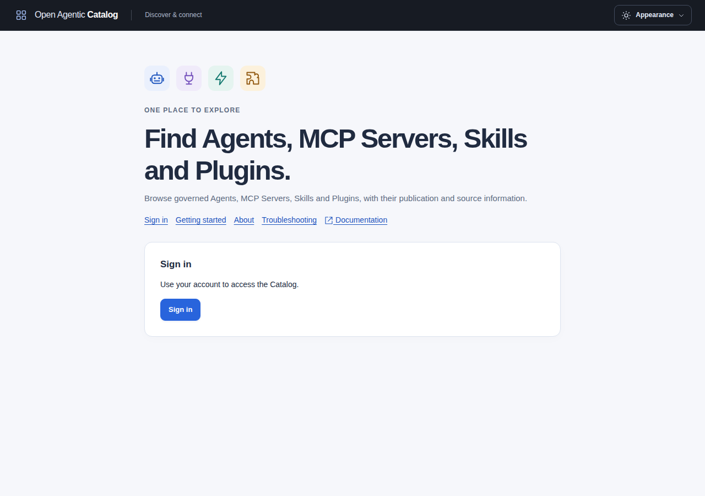
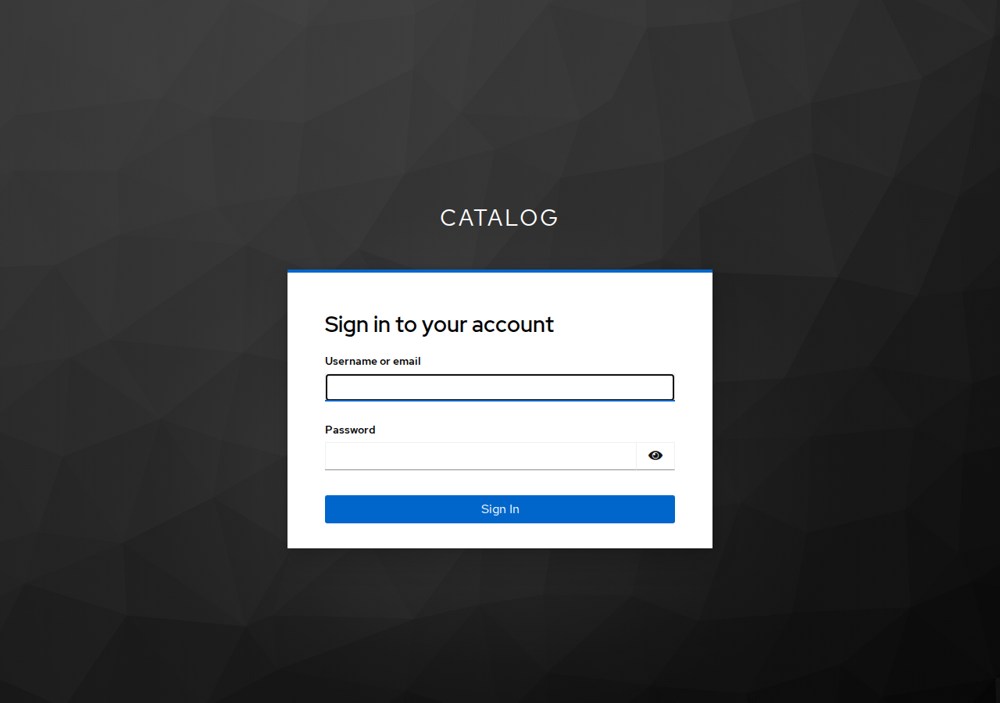

Use [Keycloak](https://www.keycloak.org/documentation) to issue Catalog API tokens and support browser and human CLI login. Catalog's maintained OIDC tests use a pinned, local Keycloak image. Keycloak remains operator-managed infrastructure, not a Catalog runtime dependency or chart component.

Complete the [shared authentication procedure](sign-in.md) alongside this guide. The example uses [issuer](../reference/glossary.md#issuer) `https://identity.example.com/realms/catalog`, [API audience](../reference/glossary.md#audience-and-visibility) `open-agentic-catalog`, and UI origin `https://browse.example.com`.

## Start one local Catalog with passwords

Use this setup to test username/password sign-in without changing the passwordless developer stack. Passwords stay in local Keycloak.

The setup starts one Catalog API, worker, UI, PostgreSQL, Keycloak and a TLS frontend. It creates no second Catalog. All published ports bind to `127.0.0.1`. PostgreSQL has no published port.

### Prepare images and browser access

Install Docker Compose, Python 3, OpenSSL and Make. Use a local Docker Unix socket. Remote Docker engines are refused.

Build the application images explicitly:

```sh
make container-build
make ui-container-build
```

Acquire the pinned test infrastructure images explicitly:

```sh
docker pull pgvector/pgvector:pg18@sha256:2358fcba361ed2233a5ed81b5fe4ca779ccb304120ce531a3bf51c0ed7e2bc11
docker pull quay.io/keycloak/keycloak:26.8.1@sha256:a78d6b79572168cb25886b80a8b5b8d4ed4390743e3eecb810538683e209dd6b
```

The launcher builds the small TLS frontend with the tutorial's pinned Go image. Docker can acquire that build image if needed. The launcher does not build the API or UI, install tools, or pull runtime images.

Reserve ports `8443`, `8447` and `9443`. The default network is `172.29.245.0/24`. Choose an unused private subnet if this range conflicts with an existing network.

Add these names to your host's name-resolution configuration:

```text
127.0.0.1 identity.test catalog-a.test browse-a.test
```

The launcher does not edit host files or system trust.

### Start and sign in

Select a private directory outside the checkout and report folders. The default is `$HOME/.local/share/open-agentic-catalog/local-auth`. Use the same directory for later commands:

```sh
make local-auth-up LOCAL_AUTH_DIRECTORY="$HOME/.local/share/open-agentic-catalog/local-auth"
```

Use `IMAGE` and `UI_IMAGE` on the first invocation to select other existing application images. Prepared inputs retain those image names. Later invocations reuse them. For another subnet, invoke the helper directly on the first startup:

```sh
python3 examples/tutorials/local-oidc/local_auth.py up \
  --directory "$HOME/.local/share/open-agentic-catalog/local-auth" \
  --subnet 172.29.246.0/24 --frontend-address 172.29.246.10
```

Import `trust/ca.pem` from that directory into your browser's trusted certificate authorities. Trust only this local test CA. Open `https://browse-a.test:9443/`. Select the sign-in button and enter a Keycloak account's credentials.

The Catalog shows a regular sign-in screen. Select **Sign in** to open Keycloak.



Enter your Keycloak username and password in the provider form. The Catalog does not receive your password.



| Account | Initial password file | Catalog access |
| --- | --- | --- |
| `catalog-admin` | `catalog-admin-initial-password` | Tenant Administrator in tenant `00000000-0000-7000-8000-000000000001`. |
| `catalog-reader` | `catalog-reader-initial-password` | None until an administrator grants membership. |
| `bootstrap-admin` | `bootstrap-password` | Keycloak administration only, at `https://identity.test:8447/admin/`. |

Read passwords locally from the selected directory. Do not copy them into commands, reports or screenshots. The two Catalog account files have mode `0600`. Mounted secrets remain protected by the enclosing `0700` directory.

`accounts.json` contains each Catalog account's exact subject UUID. The issuer is `https://identity.test:8447/realms/catalog`. Use that issuer and subject for membership management. Usernames and Keycloak roles do not grant Catalog permissions.

The Reader cannot open a Catalog session yet. Follow [membership management](sign-in.md#decide-where-to-manage-an-account) to grant access. Keep passwords and account recovery in Keycloak. Initial password files become stale after a password change.

Both Catalog processes and the UI use OIDC. No development identities or fixture tokens are supplied. The API origin is `https://catalog-a.test:8443`. Human CLI login uses client `catalog-cli` and the same issuer. Supply `trust/ca.pem` for both CLI issuer and API trust. Follow [human CLI registration](#register-the-human-cli-client). For an installed `catalogctl`, select the prepared paths explicitly:

```sh
catalogctl auth login \
  --file "$HOME/.local/share/open-agentic-catalog/local-auth/cli-login.json" \
  --issuer https://identity.test:8447/realms/catalog --client-id catalog-cli \
  --base-url https://catalog-a.test:8443 \
  --issuer-ca-file "$HOME/.local/share/open-agentic-catalog/local-auth/trust/ca.pem" \
  --ca-file "$HOME/.local/share/open-agentic-catalog/local-auth/trust/ca.pem"
```

Open the printed authorization URL and sign in as `catalog-admin`. Keep the generated login file private.

Startup checks images, ports, network conflicts and certificate expiry. It waits for PostgreSQL and verified issuer discovery. It stops the selected API, then worker, before applying migrations. It bootstraps only an absent administrator membership. It preserves existing suspended memberships and revoked grants. Success requires API and worker readiness, plus UI availability.

Keycloak availability does not become a Catalog readiness dependency.

Preserve the partial directory if preparation fails before any containers start. Select a new private directory for a fresh setup. The launcher refuses incomplete inputs instead of replacing passwords or keys.

For a missing-image error, build or pull the documented image. For an occupied-port error, stop the process that owns that port. For expired certificates, use the renewal procedure below.

Inspect only this project's logs if startup fails after preparation. Retry with the same directory. Restore missing metadata for a retained setup. Use a new directory only when you intend to create another setup.

Read the project name from `compose.env`. Use its generated file for scoped diagnostics:

```sh
# Replace PRIVATE_DIRECTORY and PROJECT with the prepared directory and project name.
docker compose --project-name PROJECT --file PRIVATE_DIRECTORY/compose.single.json ps
docker compose --project-name PROJECT --file PRIVATE_DIRECTORY/compose.single.json logs --tail 100 api-a worker-a identity
```

### Grant Reader access and add another person

1. Sign in to the Catalog as `catalog-admin`.
2. Open **Administration > Members**. Expand **Add Catalog member**.
3. Copy the Reader's subject from the private `accounts.json` file into **Subject**.
4. Select **Human**, **Reader**, and **Tenant-wide** assignment scope.
5. Enter an audit reason. Review the selected role permissions.
6. Select **Add Catalog member** to prepare the command. Inspect its confirmation. Select **Confirm**.
7. Open a separate browser profile for `catalog-reader`. Trust the local CA there.
8. Select **Sign in** and enter the Reader's Keycloak credentials.
9. Open **My access**. Check the subject, human identity type and tenant ending `0001`.

This grants the exact Reader template. It permits local reads and eligible own ratings, without authoring, publication or external discovery companions. An empty Catalog has no published results. Follow [access management](../guides/access-management.mdx#manage-access-in-the-ui) for groups and scoped grants.

To add another person, open the Keycloak administrator console. Select the **catalog** realm, then **Users > Add user**. Enter a unique username, first name, last name and email address. Keep the user enabled. Set a private password under **Credentials**. The user details contain its UUID; the prepared subject mapper uses that value as the access-token `sub`.

Repeat the Members procedure with that subject and the required role. Verify the actual subject on **My access** after login. Accounts are bound to this exact issuer realm, not a familiar username. Do not reimport the realm or restart services to add a person.

Use **Access assignments** for later specialist or custom grants to existing members. Keep provider groups and roles separate from Catalog permissions. Restarting this setup does not restore a revoked assignment.

### Change passwords and remove access

The prepared passwords are non-temporary. Keycloak does not force an initial change.

Open `https://identity.test:8447/realms/catalog/account/` to change your own password. Select **Account security > Signing in**. Select **Update** in the **Password** section. Enter the new password and its confirmation. Select **Submit**. The saved initial password file no longer contains your current password.

Open **catalog > Users** in the Keycloak administrator console for an administrator reset. Select the user. Open **Credentials** and set a new private password.

Enable **Temporary** only when the person must change that password at the next provider login. Select **Save**. Confirm with **Save password**. This reset needs no email service.

Email recovery is optional. Configure **Realm settings > Email** and enable **Forgot password** under **Realm settings > Login** before offering email reset. Follow the [provider account procedure](#create-provider-accounts-and-change-an-initial-password) for details.

Disable the user in Keycloak to prevent new provider logins. A password reset or issuer disablement does not immediately invalidate every issued JWT. For immediate Catalog access removal, open **Members**, inspect the membership, then suspend it with a reason. Current requests and existing UI sessions must pass the Catalog's membership checks. Follow [membership suspension](../guides/access-management.mdx#suspend-or-offboard-a-membership).

### Sign out, switch users and sign in again

Use the Catalog account menu's **Sign out** action to end this UI session. It does not end Keycloak SSO or another browser profile's session. The next provider redirect can therefore select the same user without another password prompt.

Use separate browser profiles for different test accounts. To switch within one profile, sign out of the Catalog and the Keycloak account console. Return to the Catalog and select **Sign in**.

The prepared realm issues human access tokens for 30 minutes. The UI session expires with that token. Its one-hour cookie limit cannot extend token validity. Activity does not extend the session. The UI retains no refresh token. Sign in again when the Catalog reports that the session expired.

The [CLI login above](#start-and-sign-in) uses a separate protected credential file and browser code/PKCE flow. UI sign-out does not delete CLI credentials. Use `catalogctl auth logout --file PATH` to remove a selected CLI login. Never pass human passwords as CLI arguments or use password grants.

### Stop, restart and renew certificates

Stop only the selected setup:

```sh
make local-auth-down LOCAL_AUTH_DIRECTORY="$HOME/.local/share/open-agentic-catalog/local-auth"
```

Shutdown removes its containers and network. It retains the PostgreSQL and Keycloak volumes, account subjects, passwords and all prepared keys. Run `local-auth-up` with the same directory to restart. Startup does not reset changed passwords or restore revoked grants. The passwordless developer stack and its databases remain separate.

Certificates expire after seven days. Startup checks the CA and the four active server certificates. It ignores unused backup certificates. Renew them with the selected deployment stopped:

```sh
python3 examples/tutorials/local-oidc/local_auth.py renew \
  --directory "$HOME/.local/share/open-agentic-catalog/local-auth"
```

Renewal stops this project and replaces only its TLS certificates and CA. It removes stopped containers to refresh file mounts. It preserves database volumes, account passwords, subjects, cursor keys and UI session keys.

Remove the old browser CA. Import the new `trust/ca.pem`. Run `local-auth-up` with the same directory. Rerun `renew` before startup if renewal is interrupted. Do not delete volumes to repair expired certificates.

For deliberate disposal, select the exact project and generated file. Add `--volumes` to its Compose `down` command. This deletes the selected Catalog and Keycloak data. Do not use it for a normal stop or certificate renewal.

This Keycloak `start-dev` setup is for local testing. Use the production provider and [production deployment settings](sign-in.md) for production.

## Prepare the realm and API audience

1. Deploy Keycloak with a stable HTTPS hostname. Follow its [production configuration guide](https://www.keycloak.org/server/configuration-production). Configure proxy and certificate trust before registering clients.
2. Create an enabled realm named `catalog`. Use its exact realm URL as the Catalog issuer. Do not use the administration URL or the token endpoint.
3. Create a client scope named `catalog-api`. Add an **Audience** protocol mapper under its **Mappers** tab.
4. Set **Included Custom Audience** to `open-agentic-catalog`. Enable **Add to access token** and disable **Add to ID token**.
5. Assign this scope as a **Default** client scope to each client that obtains Catalog API tokens. Keep the built-in `basic` scope attached.

The audience mapper identifies the target API. It grants no Catalog permission. A default scope avoids an extra audience-selection parameter in the Catalog clients. Keycloak's [audience and client-scope documentation](https://www.keycloak.org/docs/latest/server_admin/index.html#_audience) explains the mapper and evaluation controls.

The `basic` scope supplies the access-token `sub` mapper in current Keycloak versions. An ID token can contain `sub` while the access token omits it. Check both tokens when evaluating client scopes. Do not enable lightweight access tokens that omit required Catalog claims.

## Register the browser client

Create an OpenID Connect client with these settings:

| Setting | Value |
| --- | --- |
| Client ID | `catalog-ui` |
| Client authentication | On; confidential client |
| Standard flow | On |
| PKCE code challenge method | `S256` |
| Direct access grants and implicit flow | Off |
| Service account roles | Off for this human client |
| Valid redirect URIs | Exactly `https://browse.example.com/auth/callback` |
| Default client scopes | `basic` and `catalog-api`; add `profile` or `email` only if needed |

For a UI at `/catalog`, register `https://browse.example.com/catalog/auth/callback` instead. Do not use a wildcard redirect. The Go UI host exchanges the code; the React client does not hold the client secret. Browser token-endpoint CORS access is not required by this host flow.

Copy the client secret from Keycloak's client credentials page into the protected file selected by `clientSecretFile`. Configure the UI's issuer and client ID separately from backend authentication. Use the [shared deployment values](sign-in.md#deliver-the-configuration) for Helm secret mounts and independent trust inputs.

Keep the ID token audience as `catalog-ui`. Put the Catalog API audience in the access token only. Use the same stable subject in both tokens; custom subject mappers must not break that agreement.

## Register the human CLI client

Create a second OpenID Connect client:

| Setting | Value |
| --- | --- |
| Client ID | `catalog-cli` |
| Client authentication | Off; public client with no secret |
| Standard flow | On |
| PKCE code challenge method | `S256` |
| Direct access grants, implicit flow and service accounts | Off |
| Valid redirect URIs | `http://127.0.0.1/oauth/callback` for Keycloak's variable loopback port matching |
| Default client scopes | `basic` and `catalog-api` |
| Optional client scopes | `offline_access` for offline refresh, when required |

The port-free loopback registration supports the CLI's default random port. Alternatively, register an exact port and use `--listen 127.0.0.1:49152`. Keep the `/oauth/callback` path. Do not register the browser callback for this client.

For offline refresh, grant the user Keycloak's `offline_access` realm role and permit that client scope. Follow Keycloak's [offline access controls](https://www.keycloak.org/docs/latest/server_admin/index.html#_offline-access). This role grants no Catalog permission. The UI rejects `offline_access` and does not retain refresh tokens.

Keycloak can also issue a regular refresh token without `offline_access`. Its validity follows the provider's client and session policies. The CLI saves an issued refresh token in its private credential file. Use `catalogctl auth status --file PATH` to check `canRefresh`.

After Catalog membership is provisioned, use a private credential directory. Clear inherited manual bearer inputs before selecting the saved login:

```sh
unset CATALOG_REMOTE_TOKEN CATALOG_REMOTE_TOKEN_FILE
mkdir -m 700 "$HOME/.catalog-login"
catalogctl auth login \
  --issuer https://identity.example.com/realms/catalog \
  --client-id catalog-cli \
  --base-url https://catalog.example.com \
  --file "$HOME/.catalog-login/work.json" \
  --scope offline_access
catalogctl remote capabilities \
  --base-url https://catalog.example.com \
  --login-file "$HOME/.catalog-login/work.json"
```

Open the displayed authorization URL in a browser on the CLI machine. Omit `--scope offline_access` when you do not need offline access. This omission does not disable regular refresh tokens. See [CLI login](../reference/commands.md#human-cli-login) for private CA files, expiry, status and logout.

## Configure scopes and Catalog membership

Set backend `auth.issuer` to the exact realm URL and `auth.audience` to `open-agentic-catalog`. Start with dedicated tenancy for one Catalog tenant. Follow [initial identity provisioning](database-roles.mdx#initial-catalog-identity-provisioning) with the Keycloak user's UUID as `--subject`. Verify that it is the actual access-token `sub`, not the username or email address.

To enforce an OAuth ceiling, define the required Catalog scope names in Keycloak. Assign them to the intended clients as permitted default or optional scopes. Request optional scopes through UI `scopes` or repeated CLI `--scope` flags. Verify the resulting whitespace-separated `scope` claim before enabling `auth.enforceScopes`.

Use the [API permission and scope matrix](../reference/api-conventions.md) to select names such as `catalog.read` or `tenant.admin`. Scope names do not create roles or grants. Keycloak groups and realm roles do not create Catalog assignments.

For shared tenancy, emit one stable organization string through an access-token mapper. Set `auth.organizationClaim` to that exact claim name and provision its Catalog organization mapping. Do not derive tenant authority from an unreviewed username or group list.

## Run the interactive local tutorial

This procedure runs a disposable password-based Catalog on your machine. It uses [Keycloak 26.8.1](https://www.keycloak.org/server/containers), pinned to the same digest as the maintained OIDC fixture. The prepared files also support the [two-Catalog federation tutorial](../guides/two-catalog-federation.mdx). They do not use the retained developer Compose stack.

### Prepare tools, names and trust

Run commands from the repository root. Install [Docker Engine](https://docs.docker.com/engine/install/) with [Compose v2](https://docs.docker.com/compose/install/), Python 3.12-3.14, [OpenSSL 3](https://docs.openssl.org/3.0/man1/openssl-req/), curl, Make and the repository's [Go/build prerequisites](../contributing/build-and-release.md). The PostgreSQL image supplies the PostgreSQL 18 operator client used below. Use a browser and, for the desktop steps, [VS Code](https://code.visualstudio.com/download). Image and tool acquisition need network access and disk space. The selected API/worker do not need embeddings or a model.

Keep ports `8443`, `8445`, `8447`, `9443` and `9445` free. Check `docker network ls` and your existing network configuration before selecting the private subnet. The example uses `172.29.245.0/24`, with the TLS frontend at `172.29.245.10`. If it conflicts, pass both `--subnet` and `--frontend-address` to the preparation command. Do not change another project's network.

Use a new absolute directory outside the checkout. Its resolved path can contain ASCII letters, digits, slash, dot, underscore and hyphen. Preparation refuses spaces, non-ASCII characters and other shell metacharacters. If your home path contains these characters, select another owned location with an accepted path:

```sh
export CATALOG_TUTORIAL_DIRECTORY="$HOME/.catalog-tutorials/passwords-01"
export CATALOG_TUTORIAL_CA="$CATALOG_TUTORIAL_DIRECTORY/trust/ca.pem"
make build
make container-build IMAGE=open-agentic-catalog:docs-tutorial
make ui-container-build UI_IMAGE=open-agentic-catalog-ui:docs-tutorial
export PATH="$PWD/bin:$PATH"
python3 examples/tutorials/local-oidc/prepare.py \
  --directory "$CATALOG_TUTORIAL_DIRECTORY" \
  --backend-image open-agentic-catalog:docs-tutorial \
  --ui-image open-agentic-catalog-ui:docs-tutorial
```

Preparation creates the directory with mode `0700` and refuses an existing destination or a location inside the checkout. It generates independent random passwords, client secrets and keys. Nothing secret is committed. Its [source assets](../../../../../examples/tutorials/local-oidc/README.md) contain the complete Compose and TLS frontend recipe. The frontend accepts only four fixed host/port pairs, preserves Host and removes forwarding headers rejected by discovery. Its private HTTP upstreams are local Compose services; issuer, database, API-client and browser-facing connections use verified TLS.

Preparation can fail after creating the destination, including during OpenSSL certificate generation. It does not resume or remove partial inputs. Continue only after it prints `Prepared` and exits successfully; the presence of `compose.env` alone does not prove completion. Follow [Recover from failed preparation](#recover-from-failed-preparation) after a failed attempt.

| Prepared input | Consumer |
| --- | --- |
| `compose.env` | Explicit project name, image names and private-network addresses; no secret values. |
| `a/owner.json`, `a/api.json`, `a/worker.json` | Complete profiles derived from `config/production.example.json`, with distinct database identities and dedicated OIDC tenancy. |
| `a/owner.dsn`, `a/api.dsn`, `a/worker.dsn` | Separate private database credentials, selected through `CATALOG_DATABASE_DSN_FILE`. All use `verify-full` and `/trust/ca.pem`. |
| `a/bootstrap.sql`, `a/postgres-password`, `a/pg_hba.conf` | Fresh PostgreSQL 18 initialization, three existing Catalog roles, isolated owner/extension authority and TLS-only TCP admission. |
| `a/cursor.key` | Base64 for 32 random bytes; mounted into A's API/worker only through `CATALOG_CURSOR_SIGNING_KEY_FILE`. |
| `a/ui.json`, `a/ui-client-secret`, `a/ui-keys.json` | Required UI configuration, confidential client secret and independent hex cookie key pair. No development users file. |
| `catalog-realm.json`, `bootstrap-password` | Client/scope import and temporary Keycloak bootstrap administrator; human users are created below. |
| `trust/ca.pem`, named server certificates/keys | Explicit database, issuer and frontend trust. Server SANs name the exact destinations. The private CA key is never mounted. |
| Corresponding `b/` inputs | Independent B database, runtime keys, UI cookie name and audience. B's exact outbound policy and empty credential directory exist before startup. |

Container-mounted secret leaves are readable by their non-root consumer beneath the host's private `0700` parent. Do not copy those leaves into a shared directory. Host-only automation secrets and derived token/header files use mode `0600`. A's cursor key is not mounted into owner commands or the UI. Keep each key stable across that deployment's restarts/replicas, and do not set the direct key variable too.

Add one local name-resolution entry through your system's normal hosts-file editor:

```text
127.0.0.1 identity.test catalog-a.test catalog-b.test browse-a.test browse-b.test
```

This entry is for the host browser, native CLI and editor. Compose maps the same names to its private services. In particular, B resolves `catalog-a.test` to the approved frontend address, never host-side loopback. Do not substitute container-only names in the browser issuer URL.

Create a separate browser profile for this tutorial. For Firefox, open **Settings > Privacy & Security > Certificates > View Certificates > Authorities > Import**. Select `trust/ca.pem` and allow it to identify websites. Other browsers have equivalent certificate-authority controls. Import only this generated CA; do not bypass certificate or hostname verification. Native CLI requests use the explicit CA flags below. The extension uses its explicit `caFile`. These client settings do not configure backend issuer trust or the UI's separate issuer/API trust selections.

The local CA and server certificates expire after seven days. Follow [Replace expired tutorial certificates](#replace-expired-tutorial-certificates) before preparing another project. Stopping services retains the old network allocation. Do not overwrite existing inputs or bypass verification.

### Select the prepared project and start dependencies

The generated `compose.env` binds one private input directory to one random `catalog-docs-` project name and this source checkout. `--env-file` alone does not pin a Compose project: an exported `COMPOSE_PROJECT_NAME` takes precedence. The checked-in `compose.py` launcher validates that metadata and passes the project explicitly. It also supplies the prepared interpolation values, so ambient `CATALOG_TUTORIAL_*` settings cannot change its mounts, images or network.

The equivalent Docker command is:

```text
docker compose --project-name GENERATED_PROJECT --env-file PREPARED_DIRECTORY/compose.env --file examples/tutorials/local-oidc/compose.yaml COMMAND [ARGS...]
```

The launcher reads generated metadata without shell evaluation. It refuses missing, malformed, unprotected or mismatched inputs before invoking Docker. Forwarded `--project-name`/`-p`, `--env-file`, `--file`/`-f` and `--project-directory` selectors, including attached forms, are refused. Keep the metadata unchanged; select another prepared directory when changing projects.

Define this shell convenience function. Project selection remains in the checked-in launcher, which the federation tutorial reuses:

```sh
tutorial_compose() {
  python3 examples/tutorials/local-oidc/compose.py \
    --directory "$CATALOG_TUTORIAL_DIRECTORY" "$@"
}
tutorial_compose --show-project
tutorial_compose build frontend
tutorial_compose up -d postgres-a postgres-b identity frontend
tutorial_compose ps
curl --fail --silent --show-error --max-time 15 \
  --cacert "$CATALOG_TUTORIAL_CA" \
  https://identity.test:8447/realms/catalog/.well-known/openid-configuration
```

`--show-project` validates the selection and prints only its generated name; it does not invoke Docker. Confirm that name before startup or cleanup. Wait for both databases to be healthy and discovery to return issuer `https://identity.test:8447/realms/catalog`. A failed first curl is a readiness check, not a reason to weaken trust. Inspect only this project's safe startup status. The environment stays running for interaction.

### Create provider accounts and change an initial password

Open `https://identity.test:8447/admin/` in the tutorial browser profile. Sign in as `bootstrap-admin`. Read its generated password through your private password manager or local protected-file viewer; do not paste it into command arguments or reports.

Replace this temporary provider administrator before normal use. In the **master** realm, create a permanent provider administrator, set a password and grant its master-realm `admin` role through **Role mapping**. Sign out, verify the new administrator can sign in, then delete `bootstrap-admin` from **master > Users**. Keycloak does not remove bootstrap accounts automatically. See its [bootstrap administrator procedure](https://www.keycloak.org/server/bootstrap-admin-recovery). This provider administrator is separate from a Catalog Tenant Administrator and the PostgreSQL schema owner.

Select the imported **catalog** realm. In **Users > Add user**, create `catalog-admin` and `catalog-reader`. Supply first/last names and example email addresses so the normal user profile is complete. Under each user's **Credentials**, set a unique initial password with **Temporary** enabled. Store passwords privately. Copy each user's UUID from its user details; the default subject mapper uses that UUID. Retain the values in this terminal:

```sh
export ADMIN_SUBJECT=REPLACE_WITH_CATALOG_ADMIN_USER_UUID
export READER_SUBJECT=REPLACE_WITH_CATALOG_READER_USER_UUID
```

Replace both values with the actual user IDs. A username or email address does not substitute for `sub`. Custom subject mapping requires the actual mapped access-token subject instead.

The imported clients have these settings:

| Client | Selected settings |
| --- | --- |
| `catalog-ui` | Confidential; standard flow and S256; exact `https://browse-a.test:9443/auth/callback`; password/implicit/service-account flows off. |
| `catalog-cli` | Public; standard flow and S256; `http://127.0.0.1/oauth/callback`, with Keycloak's variable loopback-port matching; no client secret. |
| `catalog-vscode` | Public; standard flow and S256; `vscode://open-agentic-catalog.open-agentic-catalog/oidc/*`; no client secret. |
| `catalog-automation-a` | Separate confidential service client; default `catalog.read`; no human login or callback. |

Every human client has the `basic` subject mapper and an access-token audience mapper for `open-agentic-catalog`. The mapper has `access.token.claim=true` and `id.token.claim=false`; ID-token audiences remain the login clients. UI and CLI do not send an extra audience parameter. VS Code's configured audience must still match this mapper. A/B use separate clients and API audiences.

VS Code can append `?windowId=N` to its native callback through `asExternalUri`. Keycloak 26.8.1's [redirect matcher](https://github.com/keycloak/keycloak/blob/26.8.1/services/src/main/java/org/keycloak/protocol/oidc/utils/RedirectUtils.java) supports this with the fixed scheme/authority and `/oidc/*` path registration. That registration admits the base `/oidc`, its query and descendant paths at the provider; the extension accepts only its exact native callback path with the pending state and PKCE binding. A query wildcard such as `?windowId=*` is not supported. Keep the UI client's HTTPS callback exact.

The selected human tokens last 30 minutes, with no requested offline refresh. The UI retains no refresh token, rejects `offline_access`, and does not extend session expiry with activity. CLI/extension refresh remains an optional separate configuration described above. A new human login requires a new CLI credential file; log out the selected old file before replacement. The UI's 3,600-byte ceiling applies to the encoded cookie value. A and B have separate cookie names and keys because cookies are not port-scoped.

### Migrate and bootstrap the first Catalog administrator

The fresh database initializer creates `catalog_owner` as a non-superuser schema/database owner with `BYPASSRLS`. It creates distinct `catalog_api` (`NOBYPASSRLS`) and `catalog_worker` (`BYPASSRLS`) logins, all `NOINHERIT`, with no role membership. It installs `pgcrypto` and assigns its function-grant authority to the isolated owner, following [owner preparation](database-roles.mdx#prepare-an-isolated-non-superuser-owner). Initialization runs only for fresh volumes; editing the SQL does not rerun it against existing data.

Check those identities, then apply every pending migration and reconcile both runtime manifests:

```sh
tutorial_compose exec -T postgres-a psql -X -v ON_ERROR_STOP=1 -U postgres -d catalog_a \
  -c "SELECT rolname,rolcanlogin,rolsuper,rolinherit,rolbypassrls FROM pg_roles WHERE rolname IN ('catalog_owner','catalog_api','catalog_worker') ORDER BY rolname" \
  -c "SELECT count(*) AS catalog_role_memberships FROM pg_auth_members WHERE roleid IN (SELECT oid FROM pg_roles WHERE rolname LIKE 'catalog_%') OR member IN (SELECT oid FROM pg_roles WHERE rolname LIKE 'catalog_%')"
tutorial_compose run --rm owner-a migrate plan --config /inputs/a/owner.json
tutorial_compose run --rm owner-a migrate apply --config /inputs/a/owner.json \
  --api-role catalog_api --worker-role catalog_worker
tutorial_compose run --rm owner-a identity provision --config /inputs/a/owner.json \
  --tenant 00000000-0000-7000-8000-000000000001 --tenant-name "Tutorial A" \
  --issuer https://identity.test:8447/realms/catalog --tenancy-mode dedicated \
  --subject "$ADMIN_SUBJECT" --roles tenant_admin \
  --operator docs-tutorial --reason "Initial tutorial administrator"
tutorial_compose up -d --wait api-a worker-a ui-a
curl --fail --silent --show-error --cacert "$CATALOG_TUTORIAL_CA" \
  https://catalog-a.test:8443/readyz
```

Expect the three role rows described above, zero role memberships, and successful reconciliation for API and worker. Migration validates existing roles; it does not create them. The owner service has only its owner DSN and required profile/trust inputs. It has no cursor key or UI secrets. The runtimes use their own DSNs and never migrate automatically.

Open `https://browse-a.test:9443/` and choose **Sign in**. Sign in as `catalog-admin` with its initial password. Keycloak displays **Update password**. Choose a new private password, complete the change and return to the Catalog. Open **My access** and confirm the administrator UUID, tenant ending `0001` and human actor type. A fresh database contains no releases.

### Prepare the administrator CLI session

The generated `a/` directory already belongs to you with mode `0700`. Store its administrator login there:

```sh
umask 077
unset CATALOG_REMOTE_TOKEN CATALOG_REMOTE_TOKEN_FILE
catalogctl auth login \
  --issuer https://identity.test:8447/realms/catalog --client-id catalog-cli \
  --base-url https://catalog-a.test:8443 \
  --issuer-ca-file "$CATALOG_TUTORIAL_CA" --ca-file "$CATALOG_TUTORIAL_CA" \
  --file "$CATALOG_TUTORIAL_DIRECTORY/a/admin-login.json"
catalogctl remote capabilities --base-url https://catalog-a.test:8443 \
  --login-file "$CATALOG_TUTORIAL_DIRECTORY/a/admin-login.json" \
  --issuer-ca-file "$CATALOG_TUTORIAL_CA" --ca-file "$CATALOG_TUTORIAL_CA"
python3 examples/tutorials/local-oidc/credential-files.py \
  "$CATALOG_TUTORIAL_DIRECTORY/a/admin-login.json" https://catalog-a.test:8443 \
  "$CATALOG_TUTORIAL_DIRECTORY/a/admin"
curl --fail --silent --show-error --cacert "$CATALOG_TUTORIAL_CA" \
  --header @"$CATALOG_TUTORIAL_DIRECTORY/a/admin.headers" \
  https://catalog-a.test:8443/api/v1/me
```

Open the CLI authorization URL in the administrator's browser profile. Issuer SSO can skip the password prompt. Confirm the CLI's selected subject and `/api/v1/me` agree with `ADMIN_SUBJECT` before mutating anything. Capabilities confirms connectivity; it is not the identity document. The credential conversion command above creates the header file; the UI cookie alone cannot authorize curl.

### Grant Reader, test access and reset a password

Create the ordinary Reader assignment using the administrator's current credential:

```sh
python3 - "$READER_SUBJECT" > "$CATALOG_TUTORIAL_DIRECTORY/a/reader-grant.json" <<'PY'
import json, sys
json.dump({"subject": sys.argv[1], "actorType": "human", "role": "reader",
           "reason": "Read tutorial releases"}, sys.stdout)
PY
curl --fail --silent --show-error --cacert "$CATALOG_TUTORIAL_CA" \
  --header @"$CATALOG_TUTORIAL_DIRECTORY/a/admin.headers" --header 'Content-Type: application/json' \
  --header "Idempotency-Key: $(python3 -c 'import uuid; print(uuid.uuid4())')" \
  --data-binary @"$CATALOG_TUTORIAL_DIRECTORY/a/reader-grant.json" \
  --output "$CATALOG_TUTORIAL_DIRECTORY/a/reader-assignment.json" \
  https://catalog-a.test:8443/api/v1/role-assignments
```

Expect `201`. Save the returned `id`, `membershipId` and `revision`. Omitting `namespaceId` makes this Reader grant tenant-wide. It gives exactly the Reader template, including local metadata reads; it does not grant source administration or federated discovery.

Use a separate browser profile for `catalog-reader`, with the tutorial CA trusted. Sign in at A's UI and complete its first **Update password** prompt. Confirm the reader UUID and tenant on **My access**. Sign in to the CLI separately:

```sh
catalogctl auth login \
  --issuer https://identity.test:8447/realms/catalog --client-id catalog-cli \
  --base-url https://catalog-a.test:8443 \
  --issuer-ca-file "$CATALOG_TUTORIAL_CA" --ca-file "$CATALOG_TUTORIAL_CA" \
  --file "$CATALOG_TUTORIAL_DIRECTORY/a/reader-login.json"
python3 examples/tutorials/local-oidc/credential-files.py \
  "$CATALOG_TUTORIAL_DIRECTORY/a/reader-login.json" https://catalog-a.test:8443 \
  "$CATALOG_TUTORIAL_DIRECTORY/a/reader"
curl --fail --silent --show-error --cacert "$CATALOG_TUTORIAL_CA" \
  --header @"$CATALOG_TUTORIAL_DIRECTORY/a/reader.headers" --header 'Content-Type: application/json' \
  --data '{"origins":["local"],"limit":10}' \
  https://catalog-a.test:8443/api/v1/catalog/search
curl --silent --show-error --cacert "$CATALOG_TUTORIAL_CA" \
  --header @"$CATALOG_TUTORIAL_DIRECTORY/a/reader.headers" \
  --output "$CATALOG_TUTORIAL_DIRECTORY/a/reader-denial.json" --write-out '%{http_code}\n' \
  https://catalog-a.test:8443/api/v1/memberships
```

Open the authorization URL in the reader's browser profile. Verify the resulting subject is `READER_SUBJECT`, not the administrator selected by an existing issuer session. Search returns `200` with an empty `items` array. The membership read returns `403` / `FORBIDDEN`. The first exact release read comes after the [federation tutorial's publication step](../guides/two-catalog-federation.mdx#publish-the-first-agent-on-a).

Now exercise an administrator reset. In Keycloak **catalog > Users > catalog-reader > Credentials**, set another password with **Temporary** enabled. Sign out of the reader's UI and issuer session, then sign in with that temporary password. Complete **Update password** again. This path needs no SMTP. Email reset is optional: enable **Realm settings > Login > Forgot password** and configure **Realm settings > Email**, including Host and From. Follow Keycloak's [password administration](https://www.keycloak.org/docs/latest/server_admin/index.html#_user-credentials) and optional [OTP configuration](https://www.keycloak.org/docs/latest/server_admin/index.html#_otp_policies). Resetting a password does not immediately revoke all issued access tokens.

### Revoke and restore access

In the administrator's **Administration > Access assignments**, find the saved Reader assignment. Select **Manage assignment**, enter a reason, then select **Revoke access assignment** and **Confirm**.

The equivalent API command is `POST /api/v1/role-assignments/{id}:revoke`, with a new `Idempotency-Key`, current `If-Match: "rev-N"` and `{"reason":"Exercise reader grant removal"}`. Replace `{id}` and `N` with that assignment's current values.

The reader can still authenticate, but `/api/v1/me` loses Resource-read permissions. Direct local Search returns `200` over the remaining authorized population, with empty `items` and `durableTotal: 0` here. Recreate the Reader grant through the same grant procedure with a new idempotency key. Do not reuse the old revoked assignment revision.

Open **Administration > Members** and select the saved reader membership. Choose **Suspend** in **Membership action** and enter a reason. Select **Change membership state**, then **Confirm**.

Read the current membership first if using the API. Send `POST /api/v1/memberships/{membershipId}:suspend`, a new idempotency key, that membership's current ETag and a reason.

The reader's existing JWT now receives `401`, including on `/api/v1/me`.

Refresh the administrator's membership view, then select **Reactivate** in **Membership action** with its new revision and a reason. Select **Change membership state**, then **Confirm**. The equivalent API suffix is `:reactivate`.

The same unexpired reader token works again; its retained Reader assignment becomes effective. Leave Reader regranted and the membership active for the later tutorials. [Terminal offboarding](../guides/access-management.mdx#suspend-or-offboard-a-membership) is a separate optional procedure.

### Connect the desktop client

The prepared `catalog-vscode` and `catalog-vscode-b` clients use the native callback registration above. If you prepared this fixture with only the bare `/oidc` URI, update each client's **Valid redirect URIs** in the Catalog realm before sign-in. Editing the generated import file does not update an existing realm. For another desktop or remote environment, register its actual VS Code mapping separately.

Install the [VS Code extension](../../../../../extensions/vscode/README.md#install-the-local-package) through its maintained VSIX procedure. Add this connection, replacing the absolute CA path with the generated file's actual path:

```json
{
  "id": "tutorial-a",
  "label": "Tutorial A",
  "origin": "https://catalog-a.test:8443",
  "mode": "control",
  "auth": "oidc",
  "caFile": "/home/you/.catalog-tutorials/passwords-01/trust/ca.pem",
  "oidc": {
    "issuer": "https://identity.test:8447/realms/catalog",
    "clientId": "catalog-vscode",
    "audience": "open-agentic-catalog",
    "scopes": ["openid", "catalog.read"],
    "refresh": false
  }
}
```

Use **Catalog: Sign In** and select the reader in its browser profile. Then run **Catalog: Test Connection** and verify the reader identity. The fresh Catalog is empty. VS Code SecretStorage, human CLI JSON and UI cookies are separate credentials. The [federation tutorial](../guides/two-catalog-federation.mdx) adds actual releases and B's independent connection.

### Stop or remove only this environment

`tutorial_compose ps` shows status. `tutorial_compose stop` preserves containers, network, volumes and private inputs. To restart a completed environment, start its dependencies first:

```sh
tutorial_compose --show-project
tutorial_compose up -d postgres-a postgres-b identity frontend
tutorial_compose ps
curl --fail --silent --show-error --max-time 15 \
  --cacert "$CATALOG_TUTORIAL_DIRECTORY/trust/ca.pem" \
  https://identity.test:8447/realms/catalog/.well-known/openid-configuration
```

Wait for both databases to be healthy and discovery to return issuer `https://identity.test:8447/realms/catalog`. The API performs issuer discovery during startup. Starting all services together can leave the API exited before the issuer is ready. After these checks succeed, start Catalog A:

```sh
tutorial_compose up -d --wait api-a worker-a ui-a
```

If Catalog B already completed its separate migration and bootstrap, also start its services:

```sh
tutorial_compose up -d --wait api-b worker-b ui-b
```

Check API readiness as described in [Catalog startup](#migrate-and-bootstrap-the-first-catalog-administrator), then open the existing UI. Do not repeat preparation, initialization or bootstrap for a completed environment. Existing volumes retain database and issuer state; initialization SQL and realm import do not rewrite it.

When finished with this disposable tutorial, remove its services and volumes explicitly:

```sh
tutorial_compose --show-project
tutorial_compose ps -a
catalogctl auth logout --file "$CATALOG_TUTORIAL_DIRECTORY/a/admin-login.json"
catalogctl auth logout --file "$CATALOG_TUTORIAL_DIRECTORY/a/reader-login.json"
tutorial_compose down --volumes --remove-orphans
```

Remove only the tutorial's derived `.headers`/`.token`/response files, private input directory and local frontend image once you no longer need them. Remove the exact hosts entry and imported tutorial CA from its browser profiles. Log out other tutorial login files separately. Do not delete unrelated login files or Catalog data. The local backend/UI images and build outputs remain until you choose to remove them.

## Recover from failed preparation

Use the attempt's exit status and your recorded actions to distinguish these states. A directory or metadata file alone cannot establish that preparation or startup completed.

| State | Next action |
| --- | --- |
| Preparation refused the path before creating it | Select an accepted absolute path outside the checkout, then prepare a new destination. |
| Preparation failed after creating the directory | Correct the OpenSSL or filesystem prerequisite. Select a fresh private destination and run preparation again. Keep the partial directory until you verify its ownership and that no environment uses it. |
| Preparation completed, but services have never started | Validate the project with `--show-project`, then continue from [dependency startup](#select-the-prepared-project-and-start-dependencies). |
| Services are stopped with retained data | Use the existing prepared directory and [restart procedure](#stop-or-remove-only-this-environment). Do not rerun preparation or initialization. Check certificate expiry first. |
| Containers were removed with `down`, and named volumes remain | Use the same prepared directory/project to recreate its services. Existing database and issuer volumes retain their state; initialization does not run again. |

Remove an abandoned partial directory only after confirming that you own it and no environment uses its inputs. Do not overwrite completed inputs, weaken private modes, delete another project's files or treat this preparation script as resumable. The launcher refuses an incomplete metadata selection; a later preparation failure can still leave valid metadata with missing service inputs.

## Replace expired tutorial certificates

This procedure starts a fresh tutorial with a new CA. It retains the old named volumes unless you explicitly dispose of them. It does not migrate the old database or issuer state into the new project.

First save the old directory and confirm its project while that selection is still available:

```sh
export CATALOG_TUTORIAL_OLD_DIRECTORY="$CATALOG_TUTORIAL_DIRECTORY"
tutorial_compose --show-project
tutorial_compose ps -a
tutorial_compose down
```

`down` removes only the selected project's containers and network; named volumes remain. `stop` retains containers, volumes and the network allocation. If you keep the old project stopped instead, select a different free private subnet and frontend address with both preparation flags. The default subnet cannot overlap the retained network. Do not start both projects on the same published ports.

Prepare a different private directory with the existing local backend/UI images:

```sh
export CATALOG_TUTORIAL_DIRECTORY="$HOME/.catalog-tutorials/passwords-02"
export CATALOG_TUTORIAL_CA="$CATALOG_TUTORIAL_DIRECTORY/trust/ca.pem"
python3 examples/tutorials/local-oidc/prepare.py \
  --directory "$CATALOG_TUTORIAL_DIRECTORY" \
  --backend-image open-agentic-catalog:docs-tutorial \
  --ui-image open-agentic-catalog-ui:docs-tutorial
tutorial_compose --show-project
```

Add `--subnet` and `--frontend-address` when retaining the old network. If this new path already exists, choose another accepted fresh path. Preparation never replaces it.

Remove the old CA from the dedicated browser profiles and import the new `trust/ca.pem`. Keep hostname verification enabled. Continue from [dependency startup](#select-the-prepared-project-and-start-dependencies), including building this project's frontend. Repeat account creation, migrations, initial administrator provisioning and login. Capture the new subjects and generate fresh CLI, HTTP, automation and source credentials through their owning procedures. Do not copy old login files, tokens, source generations, DSNs or client secrets into the fresh environment. Update VS Code's CA path and sign in separately to its new connections.

Keep the old private directory while retaining its data; it contains the old project's credentials and project name. Expired certificates still prevent verified connections to the old environment. When you deliberately dispose of those volumes, validate that old selection explicitly:

```sh
python3 examples/tutorials/local-oidc/compose.py \
  --directory "$CATALOG_TUTORIAL_OLD_DIRECTORY" --show-project
python3 examples/tutorials/local-oidc/compose.py \
  --directory "$CATALOG_TUTORIAL_OLD_DIRECTORY" down --volumes --remove-orphans
```

Remove only that old environment's private inputs after confirming disposal. Keep any needed non-secret verification summary separately. Do not prune Docker globally or reset the developer stack.

## Prepare private HTTP credentials

The UI session is not a shell credential. `a/admin-login.json` and `a/reader-login.json` contain private CLI JSON for `remote --login-file`; they are not bare-token files. Curl reads `a/admin.headers` with `--header @PATH`. Native import/export and `remote --token-file` accept a bare `accessToken`, with no JSON or `Bearer` prefix.

The tutorial's [credential converter](../../../../../examples/tutorials/local-oidc/credential-files.py) explicitly reads the selected current CLI JSON. It checks the owning user, `0600` file, `0700` directory, `apiOrigin` and unexpired `expiresAt`. It writes protected header/token files without printing the token. Its core conversion is:

```python
expiry = datetime.datetime.fromisoformat(credential["expiresAt"].replace("Z", "+00:00"))
if credential["apiOrigin"] != expected_origin or expiry <= datetime.datetime.now(datetime.timezone.utc):
    raise SystemExit("Refresh or sign in to the intended Catalog first.")
token = credential["accessToken"]
# The checked converter writes these values atomically as 0600 files.
header_contents = "Authorization: Bearer " + token + "\n"
bare_token_contents = token + "\n"
```

Run the credential converter. Add `--token` only when the next command needs that format:

```sh
python3 examples/tutorials/local-oidc/credential-files.py \
  "$CATALOG_TUTORIAL_DIRECTORY/a/author-login.json" https://catalog-a.test:8443 \
  "$CATALOG_TUTORIAL_DIRECTORY/a/author" --token
```

This explicitly uses the current private CLI file format; it is not an automatic SDK credential discovery or a public token-export feature. Run it after any supported refresh, with no concurrent login/refresh operation. Derived files do not refresh automatically. Recreate them after token renewal and remove them during cleanup. Use `accessToken`, never `idToken` or `refreshToken`. Do not print the contents, enable shell tracing or put tokens in command arguments.

## Enable OAuth scope enforcement

The main recipe validates signed tokens and current Catalog permissions with `auth.enforceScopes=false`. The imported optional scopes let you test OAuth scope enforcement separately. Leave the reader active with Reader granted.

Set A's private API/worker profiles to `enforceScopes=true`. Set the UI to request only `catalog.read`:

```sh
python3 - "$CATALOG_TUTORIAL_DIRECTORY" <<'PY'
import json, sys
from pathlib import Path
root = Path(sys.argv[1]) / "a"
for name in ("api.json", "worker.json"):
    path = root / name
    value = json.loads(path.read_text())
    value["auth"]["enforceScopes"] = True
    path.write_text(json.dumps(value, indent=2) + "\n")
path = root / "ui.json"
value = json.loads(path.read_text())
value["scopes"] = ["catalog.read"]
path.write_text(json.dumps(value, indent=2) + "\n")
PY
tutorial_compose up -d --wait --force-recreate api-a worker-a ui-a
```

These files are startup inputs, so recreation is required. Sign out of the UI, then sign in again to obtain a token with `catalog.read`. Changing requested scopes does not alter an issued JWT or invalidate the existing cookie. The reader can browse. Its current `ratings.own` permission cannot enable rating commands without `ratings.write`.

Use the original, still-unexpired reader CLI token, which requested no Catalog scopes, for the same Search request. Expect `403` with detail `OAuth scope catalog.read is required`; `/api/v1/me` still succeeds with `scopeEnforcement:true` and empty `scopes`. If it has expired, sign in without a Catalog scope to a new private file first. Then obtain a fresh scoped reader session:

```sh
catalogctl auth logout --file "$CATALOG_TUTORIAL_DIRECTORY/a/reader-login.json"
catalogctl auth login \
  --issuer https://identity.test:8447/realms/catalog --client-id catalog-cli \
  --base-url https://catalog-a.test:8443 --scope catalog.read \
  --issuer-ca-file "$CATALOG_TUTORIAL_CA" --ca-file "$CATALOG_TUTORIAL_CA" \
  --file "$CATALOG_TUTORIAL_DIRECTORY/a/reader-login.json"
python3 examples/tutorials/local-oidc/credential-files.py \
  "$CATALOG_TUTORIAL_DIRECTORY/a/reader-login.json" https://catalog-a.test:8443 \
  "$CATALOG_TUTORIAL_DIRECTORY/a/reader"
```

Repeat `/api/v1/me` and Search with the regenerated header file. Expect `scopes:["catalog.read"]`, current Reader permissions and successful Search. An administrator session needs `tenant.admin` for access administration; explicitly request that scope in addition to `catalog.read`. Granting a Catalog role does not add any OAuth scope to an issued JWT. Before continuing the main federation recipe, set `enforceScopes=false` and UI `scopes:[]` in those same private files, recreate A's three services and sign in again. B's selected main profile remains unchanged.

## Give a service account access

Use a separate confidential client with service accounts enabled for automation. Attach the API audience scope and any permitted OAuth scopes. Follow Keycloak's [OIDC endpoint guide](https://www.keycloak.org/securing-apps/oidc-layers) for client credentials.

The interactive recipe registers `catalog-automation-a` with client authentication and service accounts enabled. Standard/password/implicit flows are disabled. Its audience mapper supplies `open-agentic-catalog`, and its default scope is `catalog.read`. This client has no browser callback, ID-token requirement or UI cookie keys. Its generated `a/automation-client-secret` is a host-only `0600` file. For an existing issuer, create the same separate client under **Clients**, select **Service accounts roles**, and deliver its credential from **Credentials** through your protected-file mechanism.

### Obtain a protected token and its actual subject

Install the [Python SDK](../../../../../sdk/python/README.md#install-the-sdk) before acquiring the short-lived token:

```sh
python3 -m venv "$CATALOG_TUTORIAL_DIRECTORY/sdk-env"
"$CATALOG_TUTORIAL_DIRECTORY/sdk-env/bin/python" -m pip install ./sdk/python
python3 examples/tutorials/local-oidc/service-token.py \
  --issuer https://identity.test:8447/realms/catalog \
  --client-id catalog-automation-a --audience open-agentic-catalog \
  --secret-file "$CATALOG_TUTORIAL_DIRECTORY/a/automation-client-secret" \
  --ca-file "$CATALOG_TUTORIAL_CA" \
  --output-stem "$CATALOG_TUTORIAL_DIRECTORY/a/automation"
```

The [acquisition helper](../../../../../examples/tutorials/local-oidc/service-token.py) makes a bounded HTTPS `POST` to `/realms/catalog/protocol/openid-connect/token`. Its form contains `grant_type=client_credentials`, the client ID and the secret read from that protected file. It verifies issuer TLS, refuses redirects and ignores ambient proxies. Credentials remain out of arguments and output. It writes `automation.token` (bare access token), `automation.headers` (curl Authorization header) and `automation.claims.json` (subject, issuer, selected audience, expiry and scope), all `0600` under A's private directory.

The claim inspection checks expected issuer/audience and a future expiry; decoding alone is not signature verification. The Catalog independently validates the signed token when you call the API below. Read only the non-secret `subject` from the claim projection:

```sh
export AUTOMATION_SUBJECT="$(python3 - "$CATALOG_TUTORIAL_DIRECTORY/a/automation.claims.json" <<'PY'
import json, sys
print(json.load(open(sys.argv[1]))["subject"])
PY
)"
```

The actual service-account UUID is not the client ID `catalog-automation-a`. This token is not accepted before its exact subject has a Catalog membership.

### Grant only the required Catalog access

Use the existing human administrator's header file. If that login expired, log out its selected CLI file, sign in again, and regenerate its derived headers. Do not use the schema owner to bootstrap ordinary automation as an administrator.

First grant `service_client`, then grant Reader through the normal API:

```sh
for role in service_client reader; do
  python3 - "$AUTOMATION_SUBJECT" "$role" > "$CATALOG_TUTORIAL_DIRECTORY/a/service-grant.json" <<'PY'
import json, sys
json.dump({"subject": sys.argv[1], "actorType": "service", "role": sys.argv[2],
           "reason": "Allow the tutorial automation metadata read"}, sys.stdout)
PY
  curl --fail --silent --show-error --cacert "$CATALOG_TUTORIAL_CA" \
    --header @"$CATALOG_TUTORIAL_DIRECTORY/a/admin.headers" \
    --header 'Content-Type: application/json' \
    --header "Idempotency-Key: $(python3 -c 'import uuid; print(uuid.uuid4())')" \
    --data-binary @"$CATALOG_TUTORIAL_DIRECTORY/a/service-grant.json" \
    --output "$CATALOG_TUTORIAL_DIRECTORY/a/service-$role-assignment.json" \
    https://catalog-a.test:8443/api/v1/role-assignments
done
curl --fail --silent --show-error --cacert "$CATALOG_TUTORIAL_CA" \
  --header @"$CATALOG_TUTORIAL_DIRECTORY/a/automation.headers" \
  https://catalog-a.test:8443/api/v1/me
```

Expect `201` for each new grant. `/api/v1/me` must return `actorType:service`, the captured `AUTOMATION_SUBJECT`, tenant ending `0001`, current `resource.read` and no `access.manage`. With scope enforcement enabled, it must also return `catalog.read`. The Service client template grants no product permission. The explicit Reader assignment supplies the local metadata authority.

This example omits `namespaceId` and grants tenant-wide reading. The SDK helper below checks tenant-wide `resource.read`; it does not accept a namespace-only Reader grant. For a namespace-only variant, grant Reader in an existing namespace. Change the helper to request that exact namespace from `/api/v1/me`, check its `namespaceGrants` entry and include the same namespace in Search.

### Verify CLI, SDK and refusal

Run the actual CLI Search using the bare token file:

```sh
catalogctl remote search --base-url https://catalog-a.test:8443 \
  --token-file "$CATALOG_TUTORIAL_DIRECTORY/a/automation.token" \
  --ca-file "$CATALOG_TUTORIAL_CA" --origin local --limit 10
"$CATALOG_TUTORIAL_DIRECTORY/sdk-env/bin/python" \
  examples/tutorials/local-oidc/service-read.py \
  --origin https://catalog-a.test:8443 \
  --token-file "$CATALOG_TUTORIAL_DIRECTORY/a/automation.token" \
  --claims-file "$CATALOG_TUTORIAL_DIRECTORY/a/automation.claims.json" \
  --ca-file "$CATALOG_TUTORIAL_CA"
curl --silent --show-error --cacert "$CATALOG_TUTORIAL_CA" \
  --header @"$CATALOG_TUTORIAL_DIRECTORY/a/automation.headers" \
  --output "$CATALOG_TUTORIAL_DIRECTORY/a/service-denial.json" --write-out '%{http_code}\n' \
  https://catalog-a.test:8443/api/v1/memberships
```

Search succeeds, with no local releases before the publication tutorial or the currently readable releases afterward. The [SDK example](../../../../../examples/tutorials/local-oidc/service-read.py) uses the maintained generated My access and Catalog Search APIs. It verifies the actual service subject and tenant-wide Reader permission before its metadata read. The administrative membership read returns `403` / `FORBIDDEN`. Scope enforcement can supply the first denial through the absent `tenant.admin`; current Catalog access remains non-administrative in either mode. Service identities cannot submit human-only feedback/ratings or establish a human UI session, even if a broader role includes those permission names.

The script reads the bare token and the captured claims file from `service-token.py`. The claims file must contain a nonempty string named `subject`. Unreadable files, malformed claims and missing subjects fail before any API request. Claims that exceed the JSON parser's nesting limit also fail safely. Identity or Reader-permission checks that fail prevent Search. With no enforced `catalog.read` scope, `/api/v1/me` remains readable but Search returns `403`.

Success prints one fixed message and exits `0`. File, identity, permission and API failures exit `1` without private values or tracebacks. Argument errors exit `2`. The script keeps verified HTTPS and explicit CA trust. It does not obtain or refresh tokens.

Contributor verification uses `make sdk-check SDK_LANGUAGE=python`. The existing gate runs the actual script through both clean wheel and sdist installations. Owned HTTPS tests cover service and human identities, tenant and namespace grants, invalid inputs, scope denial and untrusted certificates. Injected OAuth claims exercise scope enforcement. Existing OIDC tests cover JWT verification separately.

### Observe expiry and replace the token

This automation client issues five-minute access tokens. Save its original bearer/header privately if you need to verify that the expired token is refused. Wait until the projected expiry before the refusal check:

```sh
python3 - "$CATALOG_TUTORIAL_DIRECTORY/a/automation.claims.json" <<'PY'
import datetime, json, sys, time
expiry = datetime.datetime.fromisoformat(json.load(open(sys.argv[1]))["expiresAt"])
while True:
    remaining = (expiry - datetime.datetime.now(datetime.timezone.utc)).total_seconds() + 1
    if remaining <= 0:
        break
    time.sleep(min(remaining, 30))
PY
curl --silent --show-error --cacert "$CATALOG_TUTORIAL_CA" \
  --header @"$CATALOG_TUTORIAL_DIRECTORY/a/automation.headers" \
  --output "$CATALOG_TUTORIAL_DIRECTORY/a/service-expired.json" --write-out '%{http_code}\n' \
  https://catalog-a.test:8443/api/v1/me
```

Expect `401` / `UNAUTHENTICATED` from the same token which previously succeeded. Repeat the exact `service-token.py` acquisition command to replace the protected token/header/claim files, then rerun the CLI and SDK reads. The new signed token has a future expiry and the same service subject/current Reader assignment. No Catalog restart or role regrant is required.

For a client-secret change, regenerate the secret in **Clients > catalog-automation-a > Credentials**. Replace only `a/automation-client-secret` through your protected-file editor, retain mode `0600`, and acquire a fresh token again. The acquisition helper reads that file on each invocation. A replaced secret does not immediately revoke every JWT already issued with it; Catalog membership suspension and token expiry have separate effects. Restarting Keycloak does not re-import a changed client over its existing realm.

Manual bearer clients take one token and do not refresh it automatically. A Python SDK `token_provider` remains application-owned, synchronous and bounded; it must return a current token without blocking. Human `catalogctl auth login` is a separate code/PKCE flow and does not acquire service-account credentials. [Remote CLI credentials](../reference/commands.md#remote-catalog-reads) and [SDK credential rules](../../../../../sdk/python/README.md#credentials-tls-and-limits) own those client limits.

The [federation tutorial](../guides/two-catalog-federation.mdx#give-bs-source-a-credential-for-a) uses a separate `catalog-source-b-to-a` client and the same issuer/audience/subject rules. Its token becomes B's origin-bound source credential generation, not a general API token file. Do not copy this automation token into an arbitrary source binding. Remove the tutorial's automation secrets, tokens, headers and private response files during its owned cleanup. Do not change another application's client or credential files.

## Verify and troubleshoot

Follow the [deployment checks](sign-in.md#verify-your-deployment), including a denied action. A valid Keycloak login alone does not prove API access.

| Symptom | Likely setting to inspect |
| --- | --- |
| API rejects a token without `sub` | Restore the `basic` client scope and its subject mapper. |
| API rejects the audience | Attach the API audience mapper to the client that obtained the token. |
| CLI reports an invalid login identity | Keep the CLI ID token audience restricted to `catalog-cli`; check subject, nonce and client settings. |
| Redirect URI is rejected | Check origin, base path and callback. For CLI login, check loopback port matching or `--listen`. |
| Refresh token is absent | Check optional `offline_access`, the user's realm role and the client's refresh policy. |
| UI reports `session_token_too_large` | Remove unnecessary access-token role/group claims. The encrypted cookie has a 3,600-byte limit. |

## Run the local qualification

Install the [functional and browser prerequisites](../contributing/testing.md), including the container engine and pinned Chromium. Run these targets serially from the repository root:

```sh
make test-functional-oidc
make test-ui-oidc
```

Each target creates and removes its own local services, synthetic accounts and private TLS inputs. It does not convert the retained developer Compose stack to OIDC. The API target checks dedicated/shared mappings, signed tokens, membership/realm changes, scope ceilings and issuer outages. The browser target checks packaged UI code/PKCE, root/subpath callbacks, human membership, session failures, CLI login and refresh.

The exact test image and realm inputs live in [the functional harness](../../../../../test/functional/README.md) and [the UI test matrix](../../../../../catalog-ui/tests/README.md). These tests qualify that configuration; operators still verify their own realm, proxy, trust and client policies.
