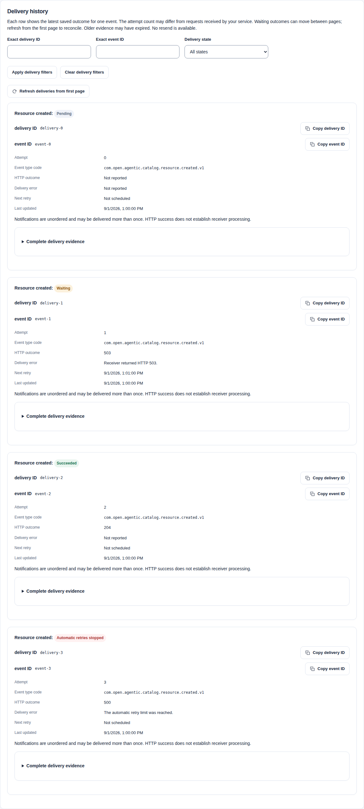
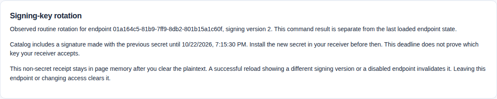

import WebhookOutcomes from "../../../components/architecture/WebhookOutcomes.astro";

Administrators can configure optional webhooks for notifications. PostgreSQL remains authoritative. Webhooks need no external event account, broker or schema-registry service.

Runtime configuration and Helm leave webhooks off by default. The local `make compose-up` launcher enables them with `LOCAL_WEBHOOKS=on`. Set `LOCAL_WEBHOOKS=off` to keep the local feature disabled. Explicit `CATALOG_WEBHOOKS_ENABLED` overrides this local default.

Development uses the existing stable development-only encryption key unless a key is explicitly injected. This fallback is not a production secret. The launcher does not register receivers or relax outbound policy. The launcher builds images before stopping services, so a failed build leaves the running stack available.

Recreating an existing local stack then stops the API before the worker and starts the updated services without overlapping enabled and disabled workers. Database volumes are retained.

Webhooks support signing, retry, private routing, key rotation, bounded delivery queues, reconciliation, retention and delivery metrics. Receivers must verify signatures and handle duplicate or out-of-order notifications as described below.

## Enable or disable safely

Leave webhooks disabled by default, or set `CATALOG_WEBHOOKS_ENABLED=false`. Disabled startup omits webhook routes, key loading, storage adapters, sender construction and dispatch. Every classified public outbox event a covered workflow creates while the capability is disabled is already terminal or is cleared by the disabled worker's no-network drainer, so turning webhooks on later cannot deliver that event. An audit-only operation creates no outbox row and therefore no notification.

The flag is startup-only. Before enabling, run this version with `webhooks.enabled=false` in API and worker until the pending outbox is empty. Replace every disabled worker through a maintenance or staged rollout. Then start an enabled API.

Do not let an enabled API overlap a disabled drainer. When disabling, stop new enabled API writes first. Let enabled workers finish the pending outbox. Then replace them with disabled workers.

The chart does not automate this transition ordering. When enabling, supply exactly one of `CATALOG_WEBHOOK_ENCRYPTION_KEY` and `CATALOG_WEBHOOK_ENCRYPTION_KEY_FILE` to both roles.

## Setup and recovery

Use this procedure to connect one tenant to an HTTPS receiver. Use the existing [owned webhook qualification](../../../../../test/functional/README.md) for a complete local exercise without registering a hosted account:

```sh
make test-functional-webhooks CATALOG_ENV_FILE=/dev/null
```

Install the [functional prerequisites](../../../../../test/functional/README.md) first. The command builds matching binaries and images, creates a private PostgreSQL/HTTPS fixture, exercises delivery and removes its own stack. Its report identifies each completed case and cleanup result.

Do not run individual fixture controls against a retained Catalog. The test receiver verifies real signatures but keeps only volatile, bounded acceptance evidence. It is not a deployable receiver or a durable inbox. The [verifier outline](../../../../../examples/webhookreceiver/README.md#connect-and-operate-a-receiver) explains the validation and storage functions a custom receiver must supply.

Use the [Go publication report](../../../../../examples/publication-report/README.md) for a runnable HTTPS receiver. Its PostgreSQL inbox is separate from the Catalog database. It refreshes current publication state through the Go SDK and reconciles periodically.

Use the [MCP Scanner integration](../guides/mcp-scanner.mdx) to inspect tool definitions after release publication. Its external receiver stores private reports. It does not invoke tools or change release approval.

### 1. Prepare the runtime and receiver

Start with an independently configured API, worker and PostgreSQL 18 deployment. Apply the [ordered enablement procedure](#enable-or-disable-safely). Supply these inputs to both runtime roles:

| Input | Value and responsibility |
| --- | --- |
| `CATALOG_WEBHOOKS_ENABLED` | `true` in both roles. The API owns explicit test sends; the worker owns normal notifications. |
| `CATALOG_WEBHOOK_ENCRYPTION_KEY_FILE` | A mounted file containing the same standard-base64 random 32-byte deployment key. Supply exactly one key input, independently of endpoint signing secrets. Preserve it with backups. |
| `CATALOG_WEBHOOKS_POLICY_FILE` | A mounted webhook policy with the receiver's exact HTTPS origin, assigned tenant and permitted address ranges. Public delivery uses the separately configured public policy. |
| Receiver certificate trust | A public certificate chain or the selected profile's `trustBundleFile`. The file path must exist inside both containers. Do not disable hostname verification. |

For example, this private policy permits only tenant `00000000-0000-7000-8000-000000000001` to use an operator-owned receiver on `10.42.0.0/24`. Replace the origin, network and tenant with the actual deployment inputs:

```json
{
  "schemaVersion": 1,
  "policyId": "tenant-receiver",
  "revision": 1,
  "public": {"mode": "disabled"},
  "privateProfiles": [{
    "name": "receiver",
    "origins": ["https://receiver.internal:8443"],
    "addressRanges": ["10.42.0.0/24"],
    "assignedTenantIds": ["00000000-0000-7000-8000-000000000001"],
    "trustBundleFile": "/config/webhooks/receiver-ca.pem",
    "transportRef": "direct"
  }]
}
```

The Compose webhook overlay mounts policy and public CA files at `/config/webhooks`; Helm uses `/etc/open-agentic-catalog/webhooks`. Adjust the policy's CA path for that mount. The receiver separately owns its HTTPS certificate/private key and durable acceptance store. Neither belongs in the Catalog's policy ConfigMap. Validate each selected runtime profile with `catalogctl config validate --config /etc/catalog/config.json --role api` and `--role worker`. Then verify actual runtime readiness; static validation does not test connectivity.

### 2. Grant only the required access

Provision the exact human or service membership using [authentication setup](sign-in.md#give-automation-api-access). An identity-provider account or a broad token scope alone grants no Catalog access. A permitted access administrator creates a custom role in **Administration > Roles**, then assigns it to the member at tenant scope in **Access assignments**. Use these exact permission sets:

| Task | Role permissions |
| --- | --- |
| Inspect configuration | `webhook.read` |
| Register, update, disable or replace | `webhook.read`, `webhook.manage` |
| Send an explicit test | `webhook.read`, `webhook.test` |
| Rotate an endpoint signer | `webhook.read`, `webhook.rotate` |
| Inspect deliveries and reconciliation | `webhook.read`, `webhook.read_evidence` |

Combine the sets only when the same operator needs several tasks. The built-in Webhook Administrator template contains all five permissions. Role/assignment administration needs `access.manage` and, when enforced, the `tenant.admin` OAuth scope. Those are separate from receiver operations.

If OAuth scope enforcement is enabled, obtain an access token containing `webhooks.manage` for every webhook operation. That ceiling does not grant the permissions above. Use `/api/v1/me` and My access to check current effective access before proceeding.

Resource refresh uses a separate identity or additional grants: `resource.read` at the required tenant/namespace scope and `catalog.read` when OAuth scopes are enforced. Reading immutable representation content additionally needs `resource.read_content`; other history or administration reads retain their own permissions. A webhook role grants none of these. See [minimum permission recipes](../guides/access-management.mdx) and [service-account setup](oidc-keycloak.md#give-a-service-account-access).

### 3. Register and install the one-time signer

In Webhooks, choose **Create webhook**. Enter a name, the exact receiver HTTPS URL and `namespace.created` in **Advanced subscriptions** for this example. Confirm creation. Registration saves configuration without contacting the receiver. The response contains the endpoint ID, revision, signing version and a one-time `whsec_` secret.

Install that exact string and version in the receiver's protected configuration. Do not decode the string or substitute the deployment encryption key. Configure signature verification, tenant-bound event validation, atomic `(source, id)` deduplication and durable acceptance before acknowledging 2xx. The [receiver outline](../../../../../examples/webhookreceiver/README.md) identifies the validation and storage functions your application supplies. Save the material before clearing it from the Catalog page. Do not copy it into logs, screenshots or tickets.

For an API client, the equivalent creation is `POST /api/v1/webhooks` with a new `Idempotency-Key` and this body:

```json
{"name":"Tenant notifications","url":"https://receiver.internal:8443/events","eventTypes":["namespace.created"]}
```

Use the existing [protected HTTP credential procedure](oidc-keycloak.md#prepare-private-http-credentials). Capture the creation response in an owner-only file rather than terminal output. Reads omit the secret. Subsequent mutations use a distinct command key and the exact returned ETag; preserve both after an uncertain response. The [HTTP reference](../reference/api-conventions.md#request-rules) owns those command rules.

### 4. Test once, then verify worker delivery

Open the endpoint and choose **Send test**. Confirm the real send. Expect a readable `succeeded` receipt for a receiver 2xx response. Verify the receiver's accepted event independently. The test ignores subscriptions and makes one attempt through the API; it proves neither a worker send nor completed receiver processing. A completed receiver 503 yields API HTTP 200 with `dead_letter`. An API `503 WEBHOOK_TEST_BUSY` sends nothing: deliberately prepare a later test with a fresh key. Other uncertain outcomes require the original exact command, not a new test.

Next, use an independently authorized Namespace administrator to create one synthetic Namespace in the same tenant. This produces `com.open.agentic.catalog.namespace.created.v1`. It requires separate `namespace.read`/`namespace.create` permissions and the `tenant.admin` OAuth ceiling when enforced. Endpoint registration must precede the event. Copy the signed CloudEvent's `id` from the receiver and apply **Exact event ID** in Deliveries. Compare its signed target reference with current Namespace state through the authorized API. Require a worker-created `succeeded` row and receiver acceptance for the same event. An empty subscription match, stopped worker or disabled endpoint cannot be diagnosed by a successful test alone.

See the [delivery-history example](#manage-endpoints-in-the-ui) for the displayed states and attempt fields.

### 5. Rotate and retire safely

Reload the endpoint before a new action. Choose routine rotation, confirm its captured revision, and install the new returned signing version/key before `previousSecretExpiresAt`. Send another deliberate test after installation.

During overlap, the receiver may verify its configured old version through the previous-signature header. After expiry it must use the new version. A second routine rotation during overlap is refused. Use emergency rotation only for an explicit revocation decision; remove compromised receiver keys separately. See [signing rotation](#rotate-endpoint-signing-secrets).

To retire the receiver, reload and explicitly disable the endpoint. Disable is permanent. Use **Create replacement** only after reading the disabled record; confirm its new configuration and install its new signer. A replacement has a different ID and no historical backfill. Neither disable nor rotation can recall a send already in flight. Deployment encryption-key replacement is separate [stopped-runtime maintenance](#deployment-encryption-key-replacement).

### 6. Reconcile notifications after delivery loss or a database restore

Persist the receiver's `(source, id)` acceptance ledger and its last reconciliation checkpoint in the integration's own durable store. Save `capacityLossCount` and `deliveryLossCount` from `GET /api/v1/webhooks/reconciliation`. Read them again after an outage, disable interval or database restore. An increase signals loss; a decrease invalidates the checkpoint after restore. Neither an unchanged counter nor a successful delivery proves that business processing completed.

Refresh the complete currently authorized Resource scope through paginated API reads, with the separate permissions above. Apply current records rather than old event order. If counters change during refresh, repeat reconciliation. Preserve periodic reconciliation even with stable counters: disabled writes do not backfill or increment loss. Handle deleted or unavailable records without treating notification possession as authority. Reconciliation reads do not reset counters, replay events or bypass retention.

After a restore, reload endpoint metadata, capabilities and counters before preparing another command. Discard stale revisions and continuations. Restore retained ciphertext with its matching deployment key while sends are disabled; follow encryption maintenance before re-enabling. If the receiver lost an endpoint signing key, a metadata read cannot recover it. Recover an uncertain original command exactly, or inspect current state before deliberately rotating and reinstalling a known new key.

### Troubleshoot the two send paths

| Observation | Check next |
| --- | --- |
| Registration succeeds but sends fail | Registration does not probe the receiver. Check exact origin, tenant assignment, DNS/address range, network egress, CA and hostname in the API and worker independently. |
| Test works but normal delivery does not | Check worker enablement, matching encryption key, policy/CA mounts, current subscriptions, endpoint status and event creation after registration. |
| Worker works but a test fails | Check the API's own policy, CA/key files and network path. The worker's trust configuration does not configure the API sender. |
| Coarse transport error | Inspect safe runtime diagnostics and the receiver's own observations. The API deliberately does not reveal remote bodies or precise internal network errors. Never use insecure TLS or broad private-network permissions as a shortcut. |
| 403, 404 or stale revision | Check current Catalog grants, OAuth ceiling, tenant, capability state and ETag. Refresh deliberately; do not retry a changed command under its old key. |
| No row after an uncertain response | The receiver might have accepted before persistence failed. Preserve exact-command recovery and receiver deduplication; absence of a row does not prove no send. |

## Register an endpoint and verify notifications

Webhook endpoints use current tenant-scoped permissions. Creation and updates require `webhook.manage`; reads require `webhook.read`. Tests require `webhook.test`, rotation requires `webhook.rotate`, and delivery evidence requires `webhook.read_evidence`. The Tenant Administrator and Webhook Administrator templates include these permissions.

The optional `webhooks.manage` OAuth scope remains an additional ceiling. Registration accepts an HTTPS URL and one to sixty-four exact event types or `*`. Short filters such as `resource.created` are normalized to the versioned CloudEvents type `com.open.agentic.catalog.resource.created.v1`. The service returns a `whsec_` signing secret only on creation or rotation.

Store it in the receiver's protected secret configuration. No external secret-management account is required. Reads and lists do not return plaintext or encrypted secret material.

Deliveries use JSON [CloudEvents 1.0](https://cloudevents.io/) with `Content-Type: application/cloudevents+json`. This format requires no external account. Retain the raw request body. Verify `X-Catalog-Signature` as HMAC-SHA256 over `X-Catalog-Timestamp + "." + rawBody`.

Use the exact returned `whsec_` secret string as the HMAC key. The header value is `v1,kid=<secret-version>,sha256=<lower-case hex HMAC>`. During routine rotation, `X-Catalog-Previous-Signature` carries the same format and input signed by the predecessor. The main header always uses the current key.

`X-Catalog-Webhook-ID` identifies the configured endpoint and `X-Catalog-Delivery-ID` identifies the attempt lineage. Verify the CloudEvent ID, a bounded timestamp age, and replay uniqueness before processing the body. The [standard-library verification example](../../../../../examples/webhookreceiver/README.md) includes current and overlapping-key verification and explains the receiver's separate durable acceptance and reconciliation responsibilities.

Delivery uses at-least-once retry semantics. Notifications can be duplicate, delayed or out of order. Finite retries do not guarantee receipt of every notification. Treat the payload as a notification, deduplicate by `(source, id)` as specified by [CloudEvents 1.0](https://github.com/cloudevents/spec/blob/v1.0.2/cloudevents/spec.md#id), and retrieve current authorized state from the Catalog API when processing depends on the latest resource revision.

Event types use the service-owned `com.open.agentic.catalog.*.v1` namespace. `dataschema` is `https://github.com/open-agentic-catalog/open-agentic-catalog/schemas/event/v1`, and `source` is `https://github.com/open-agentic-catalog/open-agentic-catalog/tenants/<tenant-id>`. These are stable identifiers, not endpoints to fetch or a requirement to contact GitHub. The event schema is bundled with the API. Notifications contain references, not resource documents or credentials.

### Choose events and read their targets

The table lists exact short selectors. Each expands to `com.open.agentic.catalog.<selector>.v1`. Use `data.targetId` for `{id}` in a read path. Each read checks current Catalog authority and any enforced OAuth scope. Receiving an event grants no access.

| Selectors | Trigger | `data.targetType` | Follow-up read |
| --- | --- | --- | --- |
| `namespace.created`, `namespace.updated` | The Catalog creates a namespace or changes its metadata. | `namespace` | `GET /api/v1/namespaces/{id}`. |
| `publisher.created`, `publisher.updated`, `publisher.publication.domain.approved`, `publisher.publication.domain.revoked` | The Catalog creates a Publisher, changes its metadata or changes domain approval. | `publisher` | `GET /api/v1/publishers/{id}`. |
| `resource.created`, `resource.deleted`, `observation.adopted` | An author creates or deletes an eligible draft, or adopts an exact source observation. | `resource` | `GET /api/v1/resources/{id}`. Deleted drafts are unavailable. |
| `resource.version.created`, `resource.version.revised` | An author creates a version or appends a content revision. | `resource_version` | `GET /api/v1/resource-versions/{id}`. |
| `version.revision.validated` | Explicit version validation records new evidence. | `version_revision` | `GET /api/v1/version-revisions/{id}`. |
| `catalog.listing.created`, `catalog.listing.revised` | An author creates a listing or appends a listing revision. | `catalog_listing` | `GET /api/v1/catalog-listings/{id}`. |
| `review.submission.created`, `review.decision.recorded` | A contributor submits exact evidence, or an independent reviewer records a decision. | `review_submission` | `GET /api/v1/review-submissions/{id}`. |
| `listing.release.published`, `listing.release.deprecated`, `listing.release.retired`, `listing.release.superseded`, `listing.release.revoked` | A publisher creates an approved release or changes its lifecycle. | `listing_release` | `GET /api/v1/listing-releases/{id}`. |
| `source.connected`, `source.paused`, `source.resumed`, `source.removed`, `source.revision.activated` | An administrator connects, pauses, resumes or removes a source. Approved updates and tests that renew policy evidence activate revisions. | `federation_source` | `GET /api/v1/federation/sources/{id}`. Removed sources are unavailable. |
| `source.sync.completed`, `source.sync.failed` | A complete snapshot emits `source.sync.completed`. An incomplete or failed snapshot emits `source.sync.failed`. | `source_snapshot` | `GET /api/v1/federation/snapshots/{id}`. The target is the snapshot, not its Source. |
| `publication.activated`, `publication.unpublished` | Activation, including rollback, selects a snapshot. Explicit unpublish or an automatic safety withdrawal clears an active publication. | `publication_snapshot` | `GET /api/v1/publication/snapshots/{id}?host=HOST`, using the event's `data.host`. |
| `identity.membership.provisioned`, `identity.membership.suspended`, `identity.membership.reactivated`, `identity.membership.offboarded` | The schema owner provisions a membership, or suspension, reactivation or offboarding commits. | `tenant_membership` | `GET /api/v1/memberships/{id}`. |
| `identity.role.assignment.granted`, `identity.role.assignment.revoked` | An `/api/v1/role-assignments` command grants or revokes an assignment. | `role_assignment` | Page `GET /api/v1/access/assignments` and match its ID. There is no exact-ID assignment read. |
| `identity.realm.suspended`, `identity.realm.reactivated` | A schema-owner command suspends or reactivates a realm. | `tenant_identity_realm` | No Control API read exists. An authorized schema owner can page `catalogctl identity realms list`. |
| `webhook.test` | An explicit test send uses a synthetic event. It ignores the endpoint's subscriptions. | `webhook_endpoint` | `GET /api/v1/webhooks/{id}` reads endpoint configuration, not receiver processing state. |

Public `identity.role.assignment.*` selectors differ from audit `identity.role_assignment.*` actions. General access assignments, custom role changes and group administration are audit-only. This includes built-in templates assigned through `/api/v1/access/assignments`. These notifications do not report every change to access. See [access administration](../guides/access-management.mdx#prepare-an-administrator-session) and [audit classification](audit.md#core-operation-classification).

Follow the [realm inventory procedure](database-roles.mdx#identity-realm-administration) for owner-only reads. Use the [API reference](../../../../../api/openapi/control-v1.yaml) for each target's read requirements. Read current state instead of applying notifications as ordered changes. A later read can return a newer revision or a safe refusal. Preserve [deduplication and reconciliation](#receiver-outages-capacity-and-reconciliation) when deliveries repeat, arrive late or are lost.

### Manage endpoints in the UI

In Webhooks, create a receiver using its HTTPS endpoint and choose common event checkboxes. **More public event types** contains the remaining supported choices. Each choice shows a readable label and its exact versioned selector. **Advanced subscriptions** edits the same list and accepts documented lowercase short aliases such as `resource.created`. The UI checks the 1-64 selector input bound before normalizing aliases, removing duplicates and sorting the canonical types. Unknown or wrongly cased names are refused before confirmation. Save the signing secret in the receiver when it is shown after creation or rotation.

**All events** (`*`) includes every supported public notification, including future public event types. Combining it with specific choices does not narrow that coverage. Unchecking it preserves the other explicit choices. Private audit and internal events remain unavailable. Tenant settings changes are audit-only and do not produce webhook notifications.

Local `make compose-up` enables webhooks by default. Use `LOCAL_WEBHOOKS=off` to disable them. An explicit `CATALOG_WEBHOOKS_ENABLED` setting takes precedence. No receiver is registered or contacted simply by enabling the feature.

Runtime and Helm configuration retain disabled defaults. The UI's **Deployment and receiver checklist** distinguishes startup enablement, tenant registration and receiver key installation. API and worker need matching enablement, encryption keys and applicable policy/trust inputs. Normal delivery requires a worker; a synchronous test uses the API sender. Use container-local mounted paths, exact tenant-assigned private routes and separate certificate trust as described under [private routing](#configure-private-routing-and-deployment-inputs). Registration, reads and signing rotation do not contact the receiver.

The UI links to this runbook and the receiver example when it uses the bundled manual. An external documentation override remains its exact configured destination. Disabled documentation omits these links. The checklist does not read private deployment policy or edit operator settings; follow the [ordered transition procedure](#enable-or-disable-safely) and separate [encryption-key maintenance](#deployment-encryption-key-replacement).

Webhook inventory requires `webhook.read`. Commands require their own webhook action permissions. When OAuth scopes are enforced, these operations need `webhooks.manage`. The page distinguishes a capability that is turned off from one that is unavailable.

Inventory has **Webhook name (exact match)** and **Status** filters. Names use exact, case-sensitive saved spelling and can match several endpoints. Apply or clear filters explicitly; they run before the page limit and reset continuation. Each result shows its receiver, subscriptions and stable endpoint ID. Use **Exact endpoint ID** and **Open endpoint** to read one authorized endpoint independently of inventory filters. UUID entry accepts either letter case.

Endpoint details show the exact ID, revision, signing version and creation/update times from the last successful read. Metadata-only delegates see saved facts and an access explanation without empty mutation fields. **Webhook action** starts on a permitted action: `webhook.test` for a real test send, `webhook.rotate` for a new signer, or `webhook.manage` for permanent disable. Each requires its `webhook.read` companion and the OAuth ceiling above. Delivery evidence remains separately protected by `webhook.read_evidence`; no Resource read or administrator grant is needed for endpoint labels.

Open **Webhook setup and receiver guides** for deployment and receiver instructions. It starts expanded on the creation page; inventory and endpoint facts come first on other pages. Enabled deployments support endpoint creation/update/disable, signing-key rotation, test delivery, paginated delivery status and reconciliation counters. Signing secrets are shown only after creation or rotation, remain in page memory, and have explicit reveal/copy/clear controls. Save them securely before leaving; endpoint reads omit them. An uncertain command retains its exact key, body and any captured ETag for deliberate recovery. Do not start another rotation to discover the first command's outcome.

Each returned signer starts masked, with fresh copy state. Before another rotation or replacement creation can overwrite uncleared signing material, save it and select the acknowledgement, or use **Clear secret from this page**. A delayed clipboard result for an earlier signer does not acknowledge the new one. The page cannot cancel an operating-system clipboard write already in progress: clear your clipboard when finished, including after a replacement or page change. Endpoint, identity and access changes discard page-held signing material. Copying or clearing does not confirm receiver installation.

**Update webhook** compares saved and proposed name, receiver URL and subscriptions with the captured endpoint ID and ETag. An unchanged selection needs no update. Pending delivery rechecks the eligible endpoint's current receiver and subscriptions immediately before sending, so edits can affect already queued notifications. An in-flight send cannot be recalled.

**Disable endpoint** is permanent and retains configuration and evidence. It offers no re-enable or historical replay. To replace a disabled endpoint with `webhook.manage`:

1. Successfully reload the disabled endpoint, then choose **Create replacement**. This copies only its authorized non-secret configuration into a private draft and sends no request.
2. Review the proposed name, HTTPS receiver and subscriptions. **Cancel replacement** retains changed input if you decline its discard confirmation.
3. Choose **Create replacement webhook**, review the original ID and no-backfill warning, then confirm. Only successful explicit creation returns the new endpoint's signing key. The original endpoint and key remain unchanged; events created before the replacement are not backfilled.

After update, rotation or disable succeeds, use **Reload endpoint** before another operation. Adjacent controls cannot reuse the superseded revision. Reload keeps your local draft and signing secret for comparison; **Edit endpoint again** or **Prepare another webhook action** starts the next command deliberately. A failed read does not resend the acknowledged change.

**Notification counters** shows **Events awaiting delivery**, **Maximum count shown**, **Notifications suppressed by capacity limits** and **Final delivery failures**. Loss timestamps remain separate. Pending work is not a receiver acknowledgement. At the reporting limit, **At least 1000** is a lower bound; **Maximum count shown** limits reporting, not queue capacity. Loss counters exclude synthetic tests. **Refresh counters** rereads these values without clearing losses or replaying events.

Compare them with receiver checkpoints.

Delivery history shows readable event and state names before **Complete delivery evidence**. Exact event codes, attempt, available HTTP status, safe error, next retry and update time remain separate facts. **Automatic retries stopped** (`dead_letter`) can reflect a terminal response or an exhausted retry policy. Copy the exact delivery or event ID for internal investigation. **Exact delivery ID**, **Exact event ID** and **Delivery state** intersect before the page limit within the selected endpoint. Applying or clearing these filters starts at the first page without clearing endpoint drafts, signing material or reconciliation counters. A cursor is bound to its filters, endpoint, tenant and current authorization; after a stale-cursor refusal, use **Reload** or **Refresh deliveries from first page**.

Each row is the latest retained outcome for one endpoint/event lineage, not every external send. Waiting outcomes can move between pages as they change; reconcile from the first page. Evidence may have expired under retention. Persisted attempts do not count receiver requests, and there is no resend or historical replay control. Missing HTTP/retry fields remain explicit. A successful HTTP outcome is not proof of receiver processing; notifications remain unordered and at least once.



These controlled examples illustrate delivery states. They do not demonstrate a real receiver delivery. [Open the full-size screenshot](../../../../assets/catalog-ui/webhook-delivery-history.png).

**Send test** makes one synchronous attempt, ignores the subscriptions and does not prove normal worker delivery. The readable **Test delivery result** shows state, attempt, receiver HTTP outcome, safe error, update time and exact delivery/event references. It remains visible if later endpoint readback fails. A completed test whose receiver returns HTTP 503 has API HTTP 200 and delivery state `dead_letter`. This is not a test-slot admission refusal.

An API HTTP 503 with `WEBHOOK_TEST_BUSY` means the process already has a test in progress and sent nothing for this command. Return to the form and deliberately prepare a later test with a fresh idempotency key; replaying the refused key retains that refusal. Other 503 or lost/malformed responses do not establish whether the receiver was contacted. Recover that original command with its exact key and captured input. Receiver acceptance can remain uncertain even without a committed delivery row. Do not automatically repeat a send. Coarse transport failures can reflect policy, certificate trust or network problems; the safe error does not diagnose which one. Receiver bodies and internal addresses are not disclosed.

## Durable delivery and audit

Worker delivery results and their audit evidence commit only while the exact tenant/event claim is still owned, unfinished, and unexpired. PostgreSQL locks that outbox row and checks current time after acquiring the lock and again after writes that might wait on other database locks. The service clock is read inside the protected operation, and PostgreSQL also uses its actual wall clock, not transaction-start time. A refused commit leaves the previous delivery and audit history unchanged.

HTTPS is outside that transaction. If a terminal result committed before acknowledgement was lost, recovery skips it without resending or re-auditing. A receiver can still see duplicates after accepting a request whose result did not commit. Synchronous HTTP test sends deliberately use a separate persistence path because their synthetic events have no leased outbox row.

Migration 000019 and runtime privilege manifest v5 add durable outbox deferral: a waiting event is not claimable before its next dispatch time, so a failing receiver does not force immediate reclaim of the oldest event. A dispatch slice selects at most eight pending eligible endpoints plus one continuation sentinel in PostgreSQL. Terminal deliveries are excluded before selection. An unfinished slice yields through durable deferral, retaining the outbox event until the remaining eligible deliveries are terminal.

Drain old runtimes before migration and grant reconciliation. Do not downgrade a live dispatcher that ignores the schedule. Migrations 000023-000025 add delivery retention and atomic notification admission with corrected write authority under manifest v10. Stop and drain both roles before applying them, reconcile exact grants, and restart matching binaries.

The measured two-worker scenario makes progress for a competing tenant with a slow receiver without a shared endpoint/tenant limiter. The eight-endpoint slice alone is not a global concurrency or storage bound.

Endpoint creation, update, disable, and signing-secret rotation commit audit-only lifecycle evidence with the endpoint change. Test and worker delivery outcomes commit audit-only evidence with their delivery row. They do not generate recursive webhook notifications. Facts contain only exact endpoint/event identifiers, revision and signing-key version, status, attempt number, and HTTP outcome where applicable. They exclude destination URLs, names, keys, or response bodies.

API actions use the stable Catalog membership. Worker attempts use the code-owned worker principal. Delivery-page access records the count and digest of the exact returned page, excluding the continuation sentinel, in the same read/write transaction. Failure to commit that evidence withholds the page.

An external send cannot be rolled back if its subsequent database or audit write fails. The receiver must still deduplicate a recovered attempt.

## Rotate endpoint signing secrets

Endpoint creation requires `Idempotency-Key` and returns the new endpoint ETag. It has no existing revision and does not require `If-Match`. Changes to an existing endpoint, secret rotation, and test sends require both `If-Match` and `Idempotency-Key`. Routine rotation with an empty body or `{}` advances the endpoint revision, returns the new secret and `previousSecretExpiresAt`, and signs with both keys for exactly 15 minutes.

Install the new receiver key before that deadline. Another routine rotation during the overlap returns conflict instead of silently cutting short the window. For compromise, send `{"revokePrevious":true}` to rotate without retaining either prior signer and immediately replace the receiver's accepted key. An in-flight request cannot be recalled.

The overlap controls which signatures the Catalog sends. The receiver controls which keys it accepts. Rotation does not update the receiver's keys automatically. Save the returned secret and configure your receiver before clearing the one-time secret from the UI.

The UI retains a non-secret rotation receipt for the exact endpoint and returned signing version after plaintext is cleared. Routine guidance uses only the returned `previousSecretExpiresAt`. A successful endpoint reload showing the same active signing version preserves that known deadline, including after a failed read. A different signing version or disabled endpoint invalidates it. Leaving the endpoint, reloading the whole page or changing access clears page-held receipts. Endpoint reads omit predecessor deadlines and secrets: an unknown deadline remains unknown, and `updatedAt` is not evidence of an active overlap.



The synthetic rotation delegate retains the returned signing version and overlap deadline after clearing the one-time secret. The receipt is separate from last-loaded endpoint metadata. The image contains no signing secret. [Open the full-size image](../../../../assets/catalog-ui/webhook-rotation.png).

If a rotation's outcome is uncertain, recover the original command with its exact key and captured inputs. Do not start another rotation to determine that outcome. If a known-success signing key was discarded and original command recovery is unavailable, inspect current endpoint state first. Prepare a deliberately new rotation with its current ETag. An active routine overlap may refuse that request: wait for expiry or explicitly choose emergency rotation. The UI never switches to emergency automatically. Install the resulting key in the receiver separately; the Catalog cannot inspect receiver acceptance.

Disable or isolate the receiver while containing a compromise if necessary. Disabled endpoints cannot rotate. Both supported write formats use authenticated encryption: endpoint creation encrypts the single `whsec_` secret, while rotation writes a version-1 current/optional-previous bundle. Both formats are valid current state.

Maintenance must read and verify both current storage formats. Keep API and worker on matching supported configuration and the same deployment key.

The deployment encryption key is separate from the endpoint signing secret and its signature `kid`. Replacing it requires the stopped-runtime maintenance procedure below. Merely changing `CATALOG_WEBHOOK_ENCRYPTION_KEY` or its file makes retained secrets undecryptable. The AES-GCM format deliberately remains unchanged: authenticated decryption and signing-material validation identify already migrated rows during maintenance, so no runtime key ring, encryption-key registry, or external provider is needed.

If a rotation fails, preserve its body, `Idempotency-Key` and `If-Match` while inspecting the authoritative command outcome and endpoint state. A 503 alone does not establish whether a change committed. Replaying a completed command returns its recorded response. It does not attempt another rotation.

Issue a new command only after establishing the previous outcome and refreshing the endpoint revision. Rotation does not contact the receiver, so receiver downtime cannot explain a rotation's database failure. PostgreSQL rejects backdated endpoint changes and invalid revision or secret-version/ciphertext transitions atomically. Preserve those guards during investigation.

A failed endpoint update can log the fixed `operation_stage=webhook.endpoint.time_regression` on `http.request_failed`. It means PostgreSQL rejected the lifecycle transition and the attempted update time was earlier than the locked endpoint row. No timestamp, secret or SQL is exposed. Check time synchronization on the API host and database infrastructure before issuing another command. Do not bypass the guard or automatically replay the mutation with a new key. This diagnostic does not identify why a clock regressed.

## Retry and terminal outcomes

<WebhookOutcomes />

The diagram follows one recipient. A receiver can accept a request whose local outcome does not commit, so recovery can repeat the send. Disabled draining can acknowledge the parent without successful delivery; reconcile current state instead of assuming receipt or backfill.

HTTP 408, 425, 429, and 5xx responses except 501 and 505 retry, as do network failures. Other non-2xx responses are terminal. Redirects are not followed. After failed attempt `a`, the backoff window is `min(5s * 3^(a-1), webhooks.retryCeiling)`, calculated with bounded arithmetic.

Stable delivery-ID/attempt jitter selects a delay from the upper half of this window. The configured cap is applied before jitter, so a low ceiling still spreads deliveries. The five-second initial window, multiplier of three and jitter strategy are fixed policy. They are not measured optimal values for every workload.

Only retryable HTTP responses can supply `Retry-After`, accepting HTTP-date and non-negative integer seconds. Missing, malformed, or past values are ignored. The next delay is the greater of jittered backoff and valid receiver delay, with the receiver delay separately capped at `webhooks.retryCeiling`. It starts at response completion, not request start.

A receiver's `Retry-After` value can still align retries when it exceeds the jittered backoff, especially at the cap. This cap is Catalog policy, not a promise to wait indefinitely for a receiver. Polling and worker capacity can delay execution beyond the stored next-attempt timestamp.

| Setting | Default and bounds | Environment override |
| --- | --- | --- |
| `webhooks.maxAttempts` | `5`; integers `1..20`, including the initial send. A limit of one permits no automatic retry after failure. | `CATALOG_WEBHOOKS_MAX_ATTEMPTS` |
| `webhooks.retryCeiling` | `1h`; `5s..1h`, including fractional durations such as `5.5s`. Caps the backoff window and receiver hint. | `CATALOG_WEBHOOKS_RETRY_CEILING` |

Settings are read at startup. Changing them requires worker replacement. The next failed attempt uses the replacement dispatcher's settings. Existing waiting timestamps are preserved, and a higher attempt limit does not revive a dead letter. Receiver acceptance followed by lost local acknowledgement can repeat a send, so the attempt limit is not an absolute lifetime count of receiver requests. The API endpoint test always makes one send regardless of the worker limit.

A delivery becomes `dead_letter` on a terminal response or after `webhooks.maxAttempts`. The outbox event is then terminal for that endpoint while delivery evidence is retained. Inspect `GET /api/v1/webhooks/{webhookId}/deliveries`. Correct and test the receiver, then retrieve current state through the Catalog API. Do not mutate delivery rows or assume that historical notifications will be replayed.

See the [delivery-history example](#manage-endpoints-in-the-ui) for the displayed states and attempt fields.

## Configure private routing and deployment inputs

Outbound requests use the same safe-fetch controls as federation and do not follow redirects, so a signed payload cannot be forwarded beyond the registered endpoint. Without `webhooks.policyFile`, only public HTTPS is permitted. A separate webhook policy file reuses the bounded federation-policy document format but none of federation's configured permissions, credentials, or trust. Every webhook origin must use HTTPS, including test profiles.

An exact private origin and tenant assignment select its operator-owned profile automatically. Clients cannot submit a profile name or credential binding. Ambiguous tenant/origin assignments fail startup. DNS/IP rules, hostname and certificate verification, redirects, deadlines, and response limits remain enforced.

Any private CA applies only to that profile's transport. Policy and CA bytes are loaded at startup and their digest appears in safe diagnostics. Restart both roles after policy changes, and configure the corresponding network egress separately.

For Helm, optionally set `webhooks.egressConfigMap` to one existing non-secret ConfigMap containing `policy.json` and its referenced CA files. When webhook enablement is true, the chart projects that map read-only into both runtime roles at `/etc/open-agentic-catalog/webhooks` and sets the fixed policy path. Migration Pods and disabled runtime profiles do not mount it. Use that directory for policy CA references, and a versioned ConfigMap name to trigger both rollouts.

Keep CA certificates, not private keys or receiver signing secrets, in the map. For Compose, the opt-in `compose.webhooks.yaml` overlay mounts `CATALOG_COMPOSE_WEBHOOK_DIRECTORY` at `/config/webhooks`, reads its `policy.json`, and enables both roles. Use matching container-local CA paths in that file. Follow the enable/disable ordering above before applying either mechanism.

Neither automates a safe transition.

## Send bounds

Each worker process has one serial dispatcher: one claimed event, at most eight sequential recipients per slice and at most one HTTPS send in flight. Each API process admits one synchronous test operation through send and delivery/audit persistence. A second authorized, current-revision test returns HTTP 503 `WEBHOOK_TEST_BUSY` without sending or retaining delivery evidence. Authentication, tenant isolation and revision errors take precedence.

A test command can replay its retained `503 WEBHOOK_TEST_BUSY` response. After that refusal, use a fresh `Idempotency-Key` for a later deliberate test. Preserve the original command for other uncertain outcomes. Outer command completion follows normal idempotency rules after the permit is released.

With W live/draining worker processes and A API processes the application-side bound is W+A simultaneous sender calls, including rollout overlap. This is not an RPS or receiver-side processing guarantee: a timed-out receiver may still be processing an earlier request. Ingress limits and replica budgets belong to the deployer. The owned two-worker/slow-receiver/competing-tenant test observes two concurrent calls and bounded progress in its fixed workload.

It does not establish universal fairness or throughput. There is no endpoint-registration quota, parallel sender, distributed limiter or new component. Test sends create operational delivery and audit evidence. Admission and delivery retention do not cap authoritative audit growth.

## Receiver outages, capacity, and reconciliation

The fixed safety ceiling is 1,000 pending public outbox events per tenant, including claimed and deferred events. It counts events, not recipients, retained delivery rows, authoritative records or database bytes. A bounded count and a per-tenant database row-write serialization point enforce admission in the actual outbox insert trigger, covering Catalog, identity, publication, federation and classified operator producers across replicas. Internal events and already-acknowledged disabled writes are excluded.

Completion releases capacity. Existing excess pending work is drained, not rewritten by migration. The bounded read reports at most 1,000 until it falls below the ceiling.

At capacity, an otherwise valid mutation still commits its domain, audit and required classified outbox record atomically. The new public event is immediately acknowledged. It is not queued. A coalesced tenant loss counter advances in the same transaction.

There is no separate missed-event row or silent discard. Genuine database/evidence failures still abort the mutation. The tenant serialization row and bounded count are not a distributed rate limiter. Stale repeatable-read/serializable writers retain normal PostgreSQL serialization failure semantics rather than bypassing the bound.

`GET /api/v1/webhooks/reconciliation` requires current tenant-wide `webhook.read_evidence` and the `webhooks.manage` OAuth scope when scope enforcement is enabled. The Webhook Administrator template and permitted custom roles can supply this permission. Its bounded aggregate contains `pendingEvents`, `pendingEventLimit`, `capacityLossCount`, optional `lastCapacityLossAt`, `deliveryLossCount`, and optional `lastDeliveryLossAt`. Capacity loss counts retired events. Delivery loss counts first terminal recipient failures, including exhausted retries, and excludes synthetic tests.

One event failing at two endpoints counts twice. Counters survive runtime restart and delivery cleanup but follow the restored database recovery point. They are cumulative history, not an acknowledgement queue. There is no reset, acknowledgement or replay API.

This aggregate metadata read does not return private delivery evidence or manufacture an audit event.

Save the observed loss counters as part of the integration's own checkpoint. On an increase, after a restore, or after an intentionally disabled interval, reconcile the full currently authorized scope needed by that integration through the normal paginated API. A decrease after restore also invalidates the checkpoint. Refresh again if counters change during the refresh.

Retain periodic reconciliation because disabled operation intentionally has no loss increment or backfill. Counter stability does not prove downstream business completion. Delivery metrics expose no tenant labels and cannot replace this authorized read.

A retained `waiting` delivery is not necessarily dispatchable: endpoint disable, filter removal or disabled draining can acknowledge its parent. Webhook-delivery housekeeping retains every recipient under an unfinished parent. After a matching parent is acknowledged and unleased, housekeeping can mark eligible delivery evidence for future cleanup. Exact terminal synthetic tests are eligible without a same-tenant parent. Arbitrary orphans are not.

The worker rechecks eligibility under delivery-row locks and uses the existing `worker.acknowledgedOutboxRetention` (default `24h`, range `1h`-`720h`) for this evidence too. Endpoints and audit remain retained. Parent-outbox cleanup follows only after all delivery references are gone, with its own full interval. Do not bypass these guards with manual deletion.

Process sender outcome/latency histograms distinguish tests from worker calls and measure the HTTP attempt independently of later database commit. Database-global gauges report genuinely dispatchable events/age, eligible waiting retries, latest retained failed receiver observations, and coalesced loss history. Do not sum these global gauges across workers. Unavailable snapshots are not zero.

The fixed `webhook_delivery` component in worker status/metrics degrades on retained receiver failures or unavailable observation, while liveness and required readiness remain independent of receivers. A successful later attempt or endpoint configuration change clears the previous receiver observation. It is not an active availability probe. See [Observability](observability.mdx) and [Housekeeping](housekeeping.md).

After a missed or exhausted notification, repair receiver connectivity or key configuration and rebuild or refresh the receiver's state from the Catalog API using its current authorization. Deduplicate later deliveries by `(source, id)` and do not apply an older notification as proof of current state. A test-send success proves request acceptance, not completed downstream business processing. Disabled operation does not backfill history on re-enablement, and no generic retry-all or historical replay facility is promised. Integrations need periodic or operator-triggered reconciliation.

<a id="remaining-work-and-qualification-scope"></a>

## Qualification scope

The maintained tests cover the application boundaries below. No external account, broker, cache, collector or rate-limiter service is needed. See the [testing guide](../contributing/testing.md) for commands and test prerequisites.

| Boundary | Implemented evidence and qualification |
| --- | --- |
| Admission | One test operation per API process, serial worker sends, authorization/revision precedence and fixed two-worker competing-tenant scenario. No RPS promise. |
| Capacity and reconciliation | Migrations 000024/000025 apply admission at every public outbox insert; concurrent and ceiling-crossing multi-row exact-role inserts, genuine saturated mutations, evidence rollback, restart and stale-snapshot denial are covered in PostgreSQL. Reconciliation requires current tenant-wide `webhook.read_evidence` and remains bounded and tenant-isolated. Runtime state writes, including from temporary triggers, are denied; only the two fixed owner-authorized trigger functions can update it. |
| Retention | Migration 000023 extends the existing worker loop with prospective parent-aware delivery cleanup, protected unfinished recipients, exact synthetic tests, tenant-inclusive eligibility and retained audit. |
| Signals | Fixed sender outcomes/latency and global dispatchable/retry/loss observations; receiver degradation stays separate from required health. |
| Compose | Twelve owned enabled cases cover signed delivery, duplicates/out-of-order reconciliation, retry/throttle/terminal loss and health, PostgreSQL outage and dispatcher recovery without process replacement, both signing rotations, test admission, worker loss, stopped-runtime encryption replacement and old backup, two workers, saturation, retention and default-off transition. |
| Helm | The existing basic Minikube flow adds distinct Secret/ConfigMap mounts, Service DNS and private TLS, API/worker senders, restart, denied origin and default-off rollout. Broader three-node topology is a separate gate and does not duplicate this delivery matrix. |

`make test-functional` runs three independently owned profiles. `make test-functional-default-off` runs the 16-phase core baseline; `make test-functional-webhooks` runs startup, shipped smoke and the enabled journey with all twelve fixed webhook cases; `make test-functional-oidc` separately runs three phases and eight independent-provider cases. Each binds source/configuration/contract/image identity, has bounded execution and cleanup, and retains secret-free reports under ignored `output/functional/`. These are packaged functional phases, separate from isolated unit tests. A single profile is not the complete aggregate or production certification. Do not edit source during a run.

Use lower-level real TLS, parser, PostgreSQL, retry/lease and key-batch tests for their existing fault matrices. Do not duplicate every fault in Kubernetes. The controlled receiver uses our verifier but only bounded volatile fixture deduplication: it is not a deployable integration or a substitute for the receiver's durable acceptance store. Production backup/PITR, key custody, monitoring integration and on-call remain operator-owned.

The owned worker-crash qualification holds the response to one verified signed event, kills the worker after observing acceptance, and checks that neither a delivery outcome nor parent acknowledgement was committed. After natural lease expiry, a restarted worker redelivers the same event payload and commits delivery success and acknowledgement. The receiver sees two copies even though the lost first outcome means only delivery attempt one is persisted. This is why receivers must deduplicate by event source and ID and cannot infer external execution counts from Catalog delivery attempts.

The test also preserves the originating namespace/audit and a known other-tenant control. Stale-owner fencing remains covered by separate real PostgreSQL races. See the [packaged testing guide](../contributing/testing.md#functional-coverage-inventory) for scope and report interpretation.

## Deployment encryption-key replacement

Stop all runtimes before replacing the deployment encryption key. Migration 000020 allows only the directly authenticated Catalog table owner to rewrap ciphertext without changing endpoint revision, signing-secret version, timestamps, status, filters, or destination. Runtime roles cannot take that exception. Endpoint signing secrets do not change, so receivers need no configuration change for an encryption-only replacement. An encryption-key compromise can expose retained signing secrets. Rotate those separately using emergency revocation after containment.

1. Inventory every tenant with retained endpoints, including disabled endpoints. Save a recoverable database backup and retain the old encryption key separately under the deployment's secret and backup controls. Generate a distinct random 32-byte replacement key.

   The old-key file contains the existing deployment key and the new-key file contains the replacement. Each file uses standard base64 encoding, exactly as runtime key files do. Maintenance key files must be regular files of at most 1024 bytes. Symlinks to regular mounted secrets are supported.

   FIFO inputs are rejected without waiting for a writer. Do not put either key on the command line or in logs.
2. Stop and drain all API and worker processes, including disabled drainers, and prevent their restart. Confirm no sends remain in flight before changing the key. The command's required `--runtimes-stopped` flag is an operator attestation, not automatic process discovery. Its short table lock prevents concurrent endpoint writes only during a batch and cannot stop a worker from sending.
3. With the Catalog schema-owner database identity, run the command below for each inventoried tenant. It has a one-minute invocation deadline and verifies at most 100 endpoints in one transaction. A changed batch and its audit-only evidence commit together. It creates no public outbox row. A malformed secret, unknown key, database error, or audit-write failure aborts that batch.
4. When `hasMore` is true, repeat with `--after` set to the committed `afterId`. An interrupted or ambiguously completed batch may be repeated with its previous cursor. Rows already authenticated under the replacement key are verified without rewriting them.

   Do not skip a failed row. Keep both input keys and all runtimes stopped throughout partial completion. To undo a partial replacement, run the same complete tenant traversal with old and new key files exchanged, then verify all rows before returning to the old runtime key.
5. After every tenant completes, repeat the traversal from the beginning with the same old/new inputs and require `changed=0` throughout. Install the replacement key consistently in API and worker deployment inputs, remove stale runtime replicas, and restart matching binaries. Test a controlled receiver and check delivery evidence before ending maintenance. Retain the audit IDs and safe progress output. Do not include plaintext keys in progress output.
6. A pre-replacement backup requires the old key. A backup taken during maintenance may require both. Keep historical keys for as long as their backups must remain recoverable, or retire those backups under the deployment's retention policy. Restore in isolation with webhook delivery disabled, verify and complete re-encryption before enabling sends. Re-encryption cannot revoke leaked plaintext or repair compromised backups.

```sh
catalogctl repair webhook-secrets --config config/production.example.json --runtimes-stopped --tenant 00000000-0000-7000-8000-000000000001 --reason "Replace deployment encryption key" --old-key-file /run/secrets/webhook-old --new-key-file /run/secrets/webhook-new --limit 100
```

Lower-level tests cover authenticated plaintext preservation, routine-overlap preservation, wrong keys, bounded traversal, repeated batches, exact runtime-role denial, disabled endpoints, unchanged history, tenant scope, and rollback on audit failure. The owned Compose profile also proves shipped-command replacement/repetition, old-backup key requirements and successful delivery after both runtime roles restart.

## Read overview summaries

Open **Overview > Operations** for enabled webhook summaries. Endpoint counts require `webhook.read`. Retained delivery summaries and notification counters require `webhook.read_evidence` with its companion permission. Enforced OAuth requires `webhooks.manage`. No `catalog.read` scope is required.

Counts describe stored production deliveries, including rows for disabled endpoints or acknowledged events. Test sends do not count. The failure table selects the latest retained attempted row since each active endpoint's current update. A newer retained success hides an older failure. Retention can remove newer outcomes, and failures can precede an HTTP request.

Endpoint status links preserve their directory selection. Delivery links apply the exact retained ID and recorded state. Filters survive Reload and Back/Forward. A later retry or retention can remove the match; clear the filters to inspect current history.

These summaries do not establish receiver health, lifetime delivery order or eligible dispatch backlog. See [webhook summary definitions](../guides/catalog-ui.mdx#read-webhook-summaries) for independent limits, timestamps and notification counter units.
