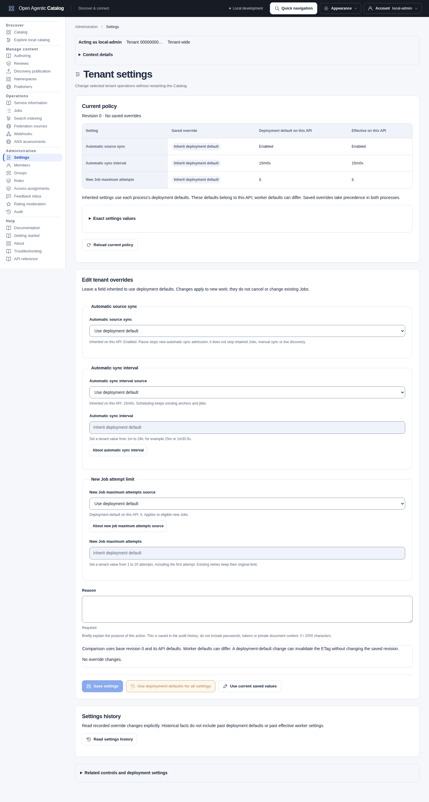

import { Badge } from "@astrojs/starlight/components";

The service starts with built-in safe defaults. It merges one optional JSON baseline selected by `--config`, then applies allowlisted environment overrides. Finally, it validates the result for the selected process role. `--config` is optional, so Kubernetes can use environment injection alone.

The JSON parser rejects duplicate keys, unknown or wrongly cased fields, and explicit `null` values. It also rejects malformed UTF-8, unpaired surrogate escapes, invalid durations and trailing JSON values. Validation rejects unsafe combinations before startup.

Precedence is fixed: built-in defaults, optional JSON, environment, then validation. Discovery host, tenant, mode and publisher-domain mappings identify the deployment. They have no compiled fallback. An empty map disables every discovery route. The binaries do not discover or parse `.env` files. These deployment inputs are startup-only; shared changes require a coordinated API and worker rollout. The [live tenant settings](#live-tenant-settings) below use a separate API.

For response-size and validation tuning, start with [payload and client limits](#payload-and-client-limits). That section distinguishes configurable admission, diagnostic and client budgets from fixed collection and metadata contracts, and shows how to retrieve full retained objects.

## Configuration delivery and precedence

Launchers prepare deployment inputs before a process starts. Live tenant settings use the separate API described below. The backend and UI then validate their own configuration. The table below defines each entry point's delivery and precedence rules.

Select inputs for the process you intend to validate or replace. Backend JSON merges with defaults; omitted nested fields keep their baseline. Scalar environment overrides replace individual fields. `CATALOG_DISCOVERY_HOSTS` replaces the host array; tracing and semantic overrides merge with their typed objects. Explicit empty overrides fail. When you switch authentication modes, remove settings forbidden by the selected mode.

| Entry point | Resolution and ownership |
| --- | --- |
| Direct backend binary | Defaults -> optional `--config` JSON -> allowlisted process environment -> selected-role validation. It never reads `.env`, neighboring profiles or Helm values. Relative development file paths resolve from the process working directory. |
| Make runtime targets | `CATALOG_ENV_FILE` selects a trusted Make-compatible file (default `.env`); command-line Make assignments override ordinary file assignments, which override inherited values. The runtime allowlist is exported only to `run`, `config-check`/`env-check`, `diagnostics` and `compose-up`. Database operator targets export the selected pool policy and their separate operator DSN. Unrelated recipes do not receive runtime secrets simply because the file was included. |
| Local Compose launcher | Make-selected inputs reach the launcher; it invokes Compose with `--env-file /dev/null`, preventing a second implicit dotenv overlay. Supported values overlay the selected JSON inside each container, but Compose pins PostgreSQL, role DSNs, container listener addresses and mounted policy paths. Host paths and ports use the documented `CATALOG_COMPOSE_*` inputs. `LOCAL_WEBHOOKS=on` supplies `true` only when `CATALOG_WEBHOOKS_ENABLED` is absent. |
| Sample launcher | `make demo-up` carries its effective workflow-file selection and supported project, deployment and sample inputs through recursive Make calls. The same precedence applies to environment, workflow-file and command-line inputs. Runtime settings reach the Compose stage; validation and loading keep their separate inputs. API/archive origin checks run before preparation or startup. See the [owned sample procedure](../guides/sample-catalog.mdx#start-the-catalog-with-compose-and-load-sample-data). |
| Helm | Selected values render closed non-secret `configEnv` into ConfigMaps and scoped existing Secret references into Pods. Chart-owned listeners, role/database inputs, optional semantic configuration and mount paths are pinned by templates. API, worker and migration receive different inputs; a local shell override is not automatically a chart value. Rendered configuration still passes Go validation at startup. |
| Independent UI | The host loads its own required strict JSON file, with defaults only for logging. It reads no backend configuration or runtime environment overrides. Local launchers render their documented UI inputs into that file; Helm renders `ui.config` and scoped UI Secret references. Backend changes do not configure the UI. |

`CATALOG_ENV_FILE=/dev/null` skips Make's workflow file; direct binaries and runtime Make targets can still receive inherited allowlisted overrides. Use only trusted workflow files: they are executable Make syntax, including expansion, rather than a general-purpose dotenv format. Measurement and isolated-test targets select their own env-file isolation. See [workflow variables](#workflow-only-variables), [configuration validation](#validation-and-diagnostics), [UI configuration](ui-host-configuration.md#host-configuration) and [chart configuration](../../../../../deployments/helm/open-agentic-catalog/README.md#configuration-and-tenancy).

Select one workflow file, not a filename pattern. Make refuses `*`, `?` or an opening `[` anywhere in its path before loading it. These characters can select another file through GNU Make's wildcard expansion. Rename such a file or parent directory before selecting it.

`demo-up` requires an existing selected workflow file to be readable and regular. An absent default `.env` remains optional. The launcher refuses filenames with a literal backslash immediately before a space or tab because Make cannot preserve that selection. It also refuses API/archive origin mismatches before preparation or startup. Unset runtime settings stay unset; an explicit empty value retains the backend's validation behavior.

Unknown environment names are ignored by the backend configuration loader, including misspelled `CATALOG_*` names and launcher-only names. Their values are not reported. Enabled tracing separately rejects non-empty `OTEL_*` runtime inputs so they cannot override its explicit exporter settings. The explicitly removed object-store names are rejected even if empty. Unknown JSON members and unknown chart `configEnv` keys are rejected. Review the [runtime override inventory](#environment-overrides) when an intended override appears ineffective; no general environment typo detector or automatic field-to-variable mapping is implemented.

## Live tenant settings

Tenant settings are the exception to startup-only configuration. Open **Administration > Settings** or use `/api/v1/tenant-settings` to read and save them. No API or worker restart is required.

| Override | Inherited default | Accepted values | Effect |
| --- | --- | --- | --- |
| `automaticSourceSyncEnabled` | `true` | Boolean | False stops new automatic source sync admissions for this tenant. |
| `automaticSourceSyncInterval` | `worker.sourceMaintenanceInterval`, normally `15m` | Go duration string from `1m` through `24h`; fractions are supported | Rechecks the next due time using existing anchors and jitter. |
| `newJobMaxAttempts` | `jobs.maxAttempts`, normally `5` | Integer from 1 through 20, including the first attempt | Applies to new default-budget source sync, ANS assessment and semantic reindex Jobs. |

An omitted field inherits. Explicit false pauses; null is invalid. Saving replaces the complete overrides object. Send `{}` as `overrides` to reset all fields. To reset one field, omit it and preserve the others.

Interval strings accept at most 64 Unicode characters. The settings endpoint caps request bodies at 8 KiB or the lower configured HTTP limit.

The response separates saved overrides, this API's deployment defaults and effective values. Each worker uses its own fallback when an override is absent. Keep shared API and worker deployment defaults consistent. Saved overrides take precedence and survive restarts and ordinary deployments. Helm values and environment changes affect inherited defaults; they do not overwrite saved overrides. Static diagnostics report startup inputs. Use the settings API for the active tenant view.

Read access requires tenant-wide `settings.read`; save access requires `settings.manage` and read permission. Both also require `tenant.admin` when OAuth ceilings are enabled. Ordinary namespace assignments do not grant these actions. Only Tenant Administrator includes them by default.

Read first and retain the returned ETag. Save with that exact `If-Match`, a new `Idempotency-Key` and a reason. The initial revision is zero and already has an ETag. A stale save returns 412 without changing policy. After a lost response, retry the exact body, key and validator before preparing another command.

Each successful save increments the revision and records `tenant.settings.changed` audit evidence. Exact replay does not repeat that change. Reset advances the revision instead of deleting the row. To reverse a change, save the earlier overrides with a current validator and a new reason; do not rewrite history. An audit failure rolls back the settings save.

A pause does not cancel retained Jobs, disable sources or prevent manual sync and live discovery. Changes to attempts preserve explicit internal limits, deduplicated work and retry-child budgets. They do not change retry spacing, jitter, lease rules or webhook delivery budgets.

Database, authentication, credentials, network policy, logging and capability settings remain deployment-owned. These fields are not accepted in the tenant settings API. See [ADR-0025](../architecture/decisions/0025-tenant-operational-settings.md) for transaction and authorization rules.

### Manage settings in the UI

Open **Administration > Settings** with tenant-wide `settings.read` and the required OAuth scope. A custom read-only delegate can inspect policy without save controls. Saving also requires `settings.manage`.

Administration pages show the current tenant and operator realm as copyable IDs. These identify your session, separately from an inspected member's realm or an assignment's namespace. Settings, membership lifecycle and role/assignment inventories are tenant-wide. Group inventories and operations stay in the operator's realm. A namespace assignment does not narrow a tenant-only command. Labels do not supply authorization.

The page shows the current revision and a table of saved overrides, effective values and this API's deployment defaults. Select **Use deployment default** or **Set a tenant value** for interval and attempts. The sync switch also distinguishes inheritance, enabled and paused. An explicit value equal to the default remains a saved override. Returning one field to inheritance preserves the other overrides. Durations retain fractional precision, for example `1m30.123456789s`.

Each control shows its inherited value on this API. Workers can have different deployment defaults; this page does not report every process configuration. Pause stops new automatic source-sync admission, while retained Jobs, manual sync and live discovery remain available. Interval changes keep existing scheduling anchors and jitter. Maximum attempts applies to eligible new default-budget source-sync, ANS and semantic Jobs. Existing Jobs, retry children, deduplicated work, explicit budgets and webhook retries keep their separate behavior.

In **Edit tenant overrides**, choose **Use deployment default** or **Set a tenant value** for each setting. Review its before/after effective value before selecting **Save settings**. Confirmation captures the complete base ETag, revision, proposed values and reason together. **Use deployment defaults for all settings** removes all overrides through an audited save and shows the reset comparison. Save and Reset require a non-empty reason of at most 2,000 Unicode code points. Reset validates its submitted reason and ignores override inputs it discards. **Restore previous overrides to draft** prepares the prior values from this page session; it does not save them automatically. Replacing a changed draft with previous overrides or current saved values asks before discarding your edits.

After a conflict, return to the form and select **Reload current policy**. The page retains your draft and its original comparison base. A deployment-default change can invalidate the ETag without advancing the saved revision. **Keep draft and adopt current base** deliberately uses the newly read defaults and validator while preserving your inputs. **Use current saved values** deliberately replaces them. After a lost reply, select **Retry same command** to recover the original result before another read or save.

While a policy reload is pending or has failed, the last read remains visible. Both adoption controls stay disabled until a successful read. Your draft and any confirmed save remain intact.

### Read history and restore overrides to a draft

**Configuration documentation** opens this reference. The Settings task directory groups access controls, content ownership, moderation, sources and assessments, publication and sharing, notifications, operational work and evidence. It links only destinations permitted by current permissions and OAuth scopes. It grants none of those actions. Pager controls for Settings history are named **Settings history pagination** and affect only that history read. Passwords and issuer users/groups belong at the identity provider; database HA, backups, secret injection, startup configuration and capability activation remain operator procedures, not tenant overrides.

Select **Read settings history** to read recorded changes. History requires current `audit.read` permission and its matching OAuth scope, in addition to Settings read access. Settings authority alone does not grant history. Export-only OAuth access does not permit browsing it.

The page requests bounded audit pages for exact action `tenant.settings.changed`, target type `tenant_settings` and this tenant ID. Use **Next page** or **First page** without changing those criteria. Each change shows actor, time, reason, revisions and before/after overrides. **Original settings audit evidence** retains the authorized record. Incomplete, unknown or inconsistent facts remain inspectable but do not enable Restore. Missing presence flags never imply inheritance.

With `settings.manage`, select **Use revision N values in draft** beside the desired before or after revision. Confirm replacement of any existing draft and reason. The UI first reads current Settings and captures its ETag, revision and API deployment defaults. A failed read leaves the draft unchanged. Restoration stages only historical overrides, including explicit false values and values equal to defaults. It sends no save command.

Review the proposed comparison against that freshly read base. Historical evidence does not contain past deployment defaults or historical effective worker settings. The preview uses current API defaults; worker defaults can differ. Enter a new reason, select **Save settings**, then confirm. A concurrent policy or default change still causes the normal ETag conflict. A successful restore creates a new revision and audit record; it never replays an old command or rewrites history.

After saving, **Acknowledged change** retains the operation, tenant target, returned revision and HTTP attempt reference. **Investigate change** stages an explicit [Audit investigation](../operations/audit.md#investigate-an-acknowledged-administration-change). A replay attempt ID can differ from the original mutation's audit request ID.

Expand **Related controls and deployment settings** for membership/access, content ownership, moderation, federation/ANS, publication/sharing, webhooks, Jobs/indexing and Audit. Links use the same permission and OAuth checks as navigation, including read-only Webhooks, rating-sharing and export-only Audit access. Capability evidence distinguishes reported disabled/unavailable states from a failed read with unknown enablement. No directory is loaded just to obtain a label. Deployment-only topics link to their owning instructions. Settings authority does not grant access to any linked action.



The page separates current policy from the overrides you can save. [Open the full-size Settings image.](../../../../assets/catalog-ui/tenant-settings.png)

## Capability activation and retained state

All backend optional flags below default to off in built-in defaults and shipped JSON profiles. The local Compose launcher's webhook default is the explicit exception above. Changing deployment settings requires replacement of every affected process; shared backend policy requires consistent API and worker settings. Configuration reports show which capabilities are configured. They do not prove connectivity or downstream authorization.

| Capability | Enabled requirements and supported behavior | Disabled behavior and retained state |
| --- | --- | --- |
| `semanticSearch.enabled` | Supported with PostgreSQL, separately applied semantic schema/grants, one endpoint/model and matching API/worker settings. Optional token/CA files are loaded by the provider client. | No inference provider or provider files required; core lexical discovery remains available. Disabling preserves derived vectors/schema/grants; re-enabling a changed profile follows [reindex operations](../operations/hybrid-search.mdx). |
| `webhooks.enabled` | Supported with an encryption key in production, worker dispatcher and optional separate HTTPS policy/trust. Non-production has a development key fallback. | No webhook routes, sender, key or selected policy requirement. Endpoints/evidence remain retained. Disabled writes acknowledge notification records; enabling does not backfill them. Follow [ordered enable/disable](../operations/webhooks.mdx#enable-or-disable-safely) for pending work. |
| `credentialResolution.enabled` | Supported with one absolute clean mounted directory; runtime checks the directory and resolves tenant/origin-bound credential generations per request. | No credential resolver; retaining a directory while disabled is rejected. Stored opaque source bindings are preserved and confer no credential or network authority. |
| `tracing.enabled` | Supported with an explicit OTLP/HTTP endpoint, installation identity, bounded export settings and any selected authentication/trust files. | No exporter, collector or selected exporter-file requirement; business data and audit remain unchanged. Export failure is observable degradation, not a business readiness dependency. |
| `trustVerification.enabled` | Supported with named authority policies, local public keys, approved evidence origins and matching API/worker settings. Administrators explicitly request private source-entry assessment Jobs. | No verification-key loading or new assessment admission. Retained results remain readable with current authorization. Ordinary discovery makes no evidence requests in either mode. See [ANS verification](#ans-registration-verification). |
| `mcp.enabled` | Exposes six read-only tools on the API's existing `/mcp` route, with current membership, scopes and explicit origin/size/concurrency bounds. | MCP and its protected-resource metadata routes are absent; the Control API and local CLI stdio tools remain independent. See [HTTP MCP](#optional-http-mcp). |
| `managedMedia.enabled`, `softwareAssessment.enabled` | <Badge text="Unavailable" variant="caution" /> Enabled service configuration fails before runtime construction. Declaring a provider cannot implement either capability. | No media/scanner provider requirement; API capability responses report `unavailable`. Existing retained representation evidence is independent of these flags. |

Discovery is controlled by host mappings rather than an `enabled` flag: the built-in empty list and per-host `disabled` mode expose no discovery routes for that host and do not delete retained snapshots. Shipped evaluation profiles supply example mappings; replace or remove them deliberately. Federation outbound policy defaults to deny all destinations; approving sources or mounting credentials alone does not enable network access. `auth.enforceScopes` defaults false and is an implemented OIDC-only ceiling on existing Catalog permissions; disabling it preserves memberships and grants, while development authentication rejects OIDC-only settings.

The chart's `ui.enabled` defaults false. Enabling deploys the independent host with its own fixed API origin, selected development/OIDC login inputs and session keys; disabling removes chart-owned UI resources, preserving backend records and externally managed secrets.

`demoArchives` has no `enabled` flag: a configured origin selects a development-only, exact allowlisted HTTPS fixture and requires its local allowlist/trust files. Removing that configuration removes the fixture fetch route without deleting retained governed records or evidence. Monitoring/model/demo launchers are deployment tools, not backend capability flags. Their presence does not change semantic enablement, install artifacts or grant invocation authority. Secret replacement/rotation procedures remain in [maintenance](../operations/maintenance.mdx#rotate-credentials-and-trust) and capability-specific runbooks.

## PostgreSQL pool settings

Each API, worker and database-using `catalogctl` process owns a separate pgx connection pool. A pool keeps reusable PostgreSQL connections. Configure the following `database` fields or their explicit environment overrides:

| JSON field | Environment variable | Default | Behavior |
| --- | --- | --- | --- |
| `maxConnLifetime` | `CATALOG_DATABASE_MAX_CONN_LIFETIME` | `30m` | Age after which a connection becomes eligible for recycling. |
| `maxConnIdleTime` | `CATALOG_DATABASE_MAX_CONN_IDLE_TIME` | `5m` | Idle age after which maintenance can close a connection, subject to the DSN minimum pool size. |
| `healthCheckPeriod` | `CATALOG_DATABASE_HEALTH_CHECK_PERIOD` | `30s` | Interval between checks of idle pool connections. This is not the HTTP readiness interval or a database query deadline. |

Values are positive [Go duration strings](https://pkg.go.dev/time#ParseDuration), such as `250ms`, `30s`, `5m` or `1h30m`. The representable range is `1ns` through `2562047h47m16.854775807s`; numbers, null, empty strings, zero, negative values and overflow are rejected. Omission keeps the default. There are no imposed ordering relationships between these three durations. Very short durations increase maintenance work and connection churn; choose settings using measured pool pressure and infrastructure idle limits.

Precedence is environment, then JSON, then the service default. The resolved settings override valid DSN `pool_max_conn_lifetime`, `pool_max_conn_idle_time` and `pool_health_check_period` values, including when no explicit JSON/environment setting is supplied. The DSN must still parse successfully. Other DSN settings, including lifetime jitter, minimum connections, TLS, connection timeout and session routing, retain their existing behavior. `maxConnections` still accepts 0-500: positive values override `pool_max_conns`; zero leaves the parsed DSN/pgx size. The default is 12, or 20 in the production sample and application chart.

These are startup settings. Restart each affected process; Helm configuration changes roll API and worker Pods and also reach migration hooks. Set `configEnv.CATALOG_DATABASE_MAX_CONN_LIFETIME`, `configEnv.CATALOG_DATABASE_MAX_CONN_IDLE_TIME` and `configEnv.CATALOG_DATABASE_HEALTH_CHECK_PERIOD` in Helm. Existing Make launchers and Compose forward the same allowlisted variables. `catalogctl config validate` and diagnostics include the resolved timings without the DSN. Remote CLI reads and the optional UI do not open database pools.

Recycling follows [pgx pool lifecycle rules](https://pkg.go.dev/github.com/jackc/pgx/v5@v5.10.0/pgxpool#Config), not an exact wall-clock eviction deadline. An acquired connection or active transaction is not interrupted solely because its lifetime expires. Replacement connections retain UTC initialization, query cancellation recovery and API/worker read/write admission; intentionally read-only operator inspection remains supported. Required role privileges, tenant RLS and readiness checks are unchanged. Pool settings apply per process, so size and replica counts need a deployment-wide PostgreSQL connection budget; these durations do not establish a capacity guarantee.

For a JSON baseline, merge these fields into the existing database object, retaining its driver, DSN source and pool size:

```json
{
  "database": {
    "maxConnLifetime": "45m",
    "maxConnIdleTime": "3m",
    "healthCheckPeriod": "15s"
  }
}
```

For Helm, merge the equivalent values into the deployment's existing values file:

```yaml
configEnv:
  CATALOG_DATABASE_MAX_CONN_LIFETIME: "45m"
  CATALOG_DATABASE_MAX_CONN_IDLE_TIME: "3m"
  CATALOG_DATABASE_HEALTH_CHECK_PERIOD: "15s"
```

Validate a local Make override without starting a listener or contacting PostgreSQL:

```sh
make config-check CATALOG_DATABASE_MAX_CONN_LIFETIME=45m \
  CATALOG_DATABASE_MAX_CONN_IDLE_TIME=3m CATALOG_DATABASE_HEALTH_CHECK_PERIOD=15s
```

The response's `configuration.database` object reports canonical duration strings (`45m0s`, `3m0s`, `15s`) and `dsnConfigured`, without the connection string. Direct binaries use `catalogctl config validate --config <path> --role api|worker|migration`; they receive overrides from their process environment. Migration/repair/restore Make targets forward only the pool policy and their separately selected operator DSN.

## Logging configuration

Backend and UI logging default to structured text at INFO. Set JSON `logLevel` to `debug`, `info`, `warn` or `error`. Set `logFormat` to `text` or `json`.

Defaults apply only to omitted fields; explicit empty, null, wrongly cased and unsupported values fail startup.

Backend `CATALOG_LOG_LEVEL` and `CATALOG_LOG_FORMAT` override the JSON baseline; present-but-empty overrides are rejected. `LOG_LEVEL` has no effect. Migration validation checks these common settings without requiring a service listener or providers.

The independent UI accepts the same fields in its strict JSON file; it does not consume backend overrides. `make ui-dev` and `make compose-up LOCAL_UI=on` render `CATALOG_UI_LOG_LEVEL` and `CATALOG_UI_LOG_FORMAT` into that file, defaulting to `info`/`text`. These two variables are launcher inputs, not environment overrides read by the UI binary.

Helm uses backend `configEnv.CATALOG_LOG_LEVEL`/`CATALOG_LOG_FORMAT` and independent `ui.config.logLevel`/`logFormat`; see the [chart logging values](../../../../../deployments/helm/open-agentic-catalog/README.md#logging). Restart affected processes after changes. See [logging output, levels and collection limits](../operations/observability.mdx#configuration-and-output) and [ADR-0021](../architecture/decisions/0021-logging-observability-and-audit.md#startup-configuration).

UI host events use these settings without separate logging controls. File storage, rotation and forwarding are deployment responsibilities.

For example, merge these fields into the selected backend or UI JSON configuration; this fragment does not replace required deployment, identity or UI settings:

```json
{
  "logLevel": "info",
  "logFormat": "json"
}
```

Use existing Make launchers for local changes:

```sh
# Validate backend settings without starting listeners or contacting a database.
make config-check CATALOG_LOG_LEVEL=debug CATALOG_LOG_FORMAT=json

# Run the memory-backed backend with DEBUG JSON diagnostics.
make run CATALOG_LOG_LEVEL=debug CATALOG_LOG_FORMAT=json

# Run the independent UI with INFO JSON diagnostics against the local API.
make ui-dev CATALOG_UI_LOG_LEVEL=info CATALOG_UI_LOG_FORMAT=json

# Apply INFO JSON to both backend roles and the enabled UI in local Compose.
make compose-up LOCAL_UI=on CATALOG_LOG_LEVEL=info CATALOG_LOG_FORMAT=json \
  CATALOG_UI_LOG_LEVEL=info CATALOG_UI_LOG_FORMAT=json
```

`make config-check` resolves the selected `CATALOG_CONFIG_FILE`/`CATALOG_CONFIG_ROLE` and current environment; it does not inspect another running process or validate the independent UI file. `CATALOG_ENV_FILE=/dev/null` omits Make's workflow env file, not inherited process overrides. Direct backend binaries receive `CATALOG_LOG_LEVEL`/`CATALOG_LOG_FORMAT` through their process environment. Direct UI binaries read the fields from `--config`; use the launchers to generate that file when selecting UI environment inputs.

## Sample profiles

The checked-in profiles are examples with different purposes:

| Profile | Purpose | State |
| --- | --- | --- |
| [config/local.json](../../../../../config/local.json) | Fast local API and worker evaluation. | In-memory metadata and bounded documents; all state resets when the process exits. |
| [config/postgres.json](../../../../../config/postgres.json) | Local Compose and PostgreSQL evaluation. | Durable PostgreSQL metadata and bounded documents, with the same smoke identities as the local profile. |
| [config/production.example.json](../../../../../config/production.example.json) | Example production configuration with only core capabilities. | All optional capabilities are disabled. Replace example endpoints and identities, supply scoped secrets and qualify the deployment's actual database, issuer and network inputs before use. |

## Configuration groups

| Group | Current contract |
| --- | --- |
| `environment` | `development`, `test`, or `production`. Production activates fail-closed deployment rules. |
| `profile` | Stable deployment profile name. `local` is forbidden in production. |
| `validation` | Budgets for new diagnostics; see [validation diagnostic limits](#validation-diagnostic-limits). |
| `logLevel`, `logFormat` | Startup minimum severity and output format; defaults `info` and `text`. Independent of tracing/sampling. |
| `serviceName` | Service identity used in diagnostics and development key derivation. |
| `tracing` | Default-off OTLP/HTTP protobuf tracing, installation identity, sampling/export bounds and file references for isolated TLS/authentication inputs. See [optional tracing configuration](#optional-tracing-configuration). |
| `http` | Listener, one public origin, positive socket read/write/idle and process-shutdown timeouts, one cooperative API-role `requestTimeout` defaulting to 10 seconds within a 1-20 second range, body limit from 1 KiB through 64 MiB, and optional exact CORS origins. Production origins must use HTTPS. The request deadline covers authenticated Control API and host-bound public-discovery work. Probes, metrics, version, OpenAPI, CORS preflight, unmatched routes and worker operations retain their narrow local or transport bounds. A fixed five-second command-cleanup allowance and one-second response margin remain internal. Validation requires both `writeTimeout` and `shutdownTimeout` to be at least their sum with `requestTimeout`. |
| `database` | `memory` or `postgres`, one role-selected DSN, a pool size up to 500, and [positive pool timings](#postgresql-pool-settings). API and worker runtimes plus mutating migration, identity, and repair commands require the applicable writer endpoint; migration or repair planning, realm listing, isolated audit comparison, and `catalogctl restore verify` may deliberately inspect a read-only endpoint. Schema migrations always run through `catalogctl`; `migrateOnStart: true` is rejected for every driver. PostgreSQL API and worker pool construction applies PostgreSQL's standard read/write-session acceptance rule to every physical runtime connection and checks that same capability for readiness without changing intentionally read-only operator commands. |
| `auth` | `development` token mappings or an OIDC issuer, Catalog audience, `dedicated` or `shared` tenancy mode, mode-specific tenant or organization setting, and optional scope-ceiling enforcement. Production requires OIDC. Token role and tenant claims do not create Catalog authority. An optional OIDC-only `trustBundleFile` adds bounded private trust to the dedicated verifier transport; public roots remain the default. |
| `jobs` | Shared creation default `maxAttempts` (5, range 1-20 including the initial attempt) and `retryCeiling` (1h, range 5s-1h) for the automatic jitter window. Applies to API and worker producers; retained limits and schedules remain unchanged. |
| `worker` | Positive poll interval and lease duration with concurrency from 1 through 128; dependency restart windows satisfying `1s <= dependencyRetryInitialDelay <= dependencyRetryCeiling <= 5m` (defaults `1s`/`30s`); `sourceMaintenanceInterval` from 1 minute through 24 hours; `housekeepingInterval` from 1 minute through 1 hour; `terminalJobRetention` from 24 through 2,160 hours; `acknowledgedOutboxRetention` from 1 through 720 hours; and one role-specific `operationsAddress`. The operations listener serves health, status, effective housekeeping policy, version, and metrics but no product API. |
| `federation` | Positive per-fetch and end-to-end live-query timeout, bounded response bytes, redirects, fanout, hops, and an optional path to one strict versioned outbound egress-policy document shared by federation and external representation retrieval. The built-in policy denies every origin. |
| `discovery` | Zero through 64 exact canonical lower-case DNS names or canonical IP addresses. Each unique host maps to one internal tenant UUID, `disabled`, `anonymous`, or `authenticated` mode, and canonical publisher domain. Ports, trailing dots, wildcards, aliases, and duplicate hosts are rejected. An empty list is the disabled default. |
| `publication` | The active pinned `ard-0.91-aa3e598` and `ai-catalog-1.0-b062278` output profiles. Other profile labels are rejected because the executable embeds and implements only these profiles. Each discovery host carries its own tenant, audience, and publisher-domain binding; that domain is an administrative publication scope and self-entry value, not external publisher-authority evidence. The removed legacy `namespace` field is rejected as unknown because it had no runtime meaning. |
| `webhooks` | Optional signed delivery enablement, retry count and delay ceiling, request timeout, poll interval and a separate optional HTTPS egress-policy file. The timeout must be shorter than the worker lease. Disabled mode has no key, route, sender, dispatcher, receiver, or readiness dependency. |
| `semanticSearch` | Optional hybrid retrieval configuration. Disabled by default; enabled mode requires an endpoint/model and the separately applied semantic schema. See [settings and limits](#optional-hybrid-search). |
| `listingMedia` | Optional external artwork origin/profile bindings and bounded validation/delivery; empty origins deny fetching. See [listing artwork](#listing-artwork). |
| `managedMedia` | Optional managed listing-media flag. `false` is supported; `true` fails startup until the distinct media adapter is implemented. |
| `softwareAssessment` | Optional scanner-backed assessment flag. `false` is supported; `true` fails startup until policy and provider behavior are implemented. |
| `credentialResolution` | Optional mounted-file source-credential resolver. Disabled mode requires no directory. Enabled mode requires one absolute clean directory and resolves bounded bearer, API-key, or mTLS bindings just in time for their exact tenant and origin. |

Durations use Go duration strings such as `250ms`, `10s`, or `2m`. URL fields require a canonical lower-case DNS name or IP literal, reject wildcard hosts and invalid ports, and reject user information, query strings, and fragments where the field represents an origin. CORS never accepts `*`.

Disabled capabilities require no provider declaration. Startup rejects an enabled capability without an implementation. Semantic search, credential resolution and webhooks report `disabled` or `enabled` from deployment configuration; managed media and software assessment remain `unavailable`. Bounded textual representation documents follow [ADR-0005](../architecture/decisions/0005-object-storage-modes.md) and are authoritative in PostgreSQL, independently of the unavailable managed-media capability. The `objects` group and former object-provider environment inputs are unsupported and rejected.

`semanticSearch` is disabled by default. Enabling it requires the optional database schema and an explicitly configured embedding endpoint and model. See [optional hybrid search](#optional-hybrid-search) for settings and prerequisites.

Validation depends on the selected role:

- `api` validates the product listener and authentication. It does not construct Job, outbox, source-maintenance or housekeeping workers.
- `worker` validates polling, leases, concurrency, maintenance intervals, operational retention and its operations-only listener. It does not initialize OIDC or a product listener.
- `all` validates both listeners and rejects conflicting addresses. It supports only memory-backed development. Its housekeeping adapter does nothing because process-local memory has no durable storage pressure.
- `migration` validates common identity, logging, diagnostic-budget and demo-declaration fields, plus PostgreSQL settings. It does not require HTTP, authentication, publication, provider or cryptographic-key configuration.

Development may select port zero for a direct disposable process. Production requires a nonzero port.

Public HTTPS trust is compiled into both scratch-image executables through the pinned Go fallback root package and has no runtime setting. A private federation profile may add one bounded deployment-mounted PEM trust bundle for only that profile, and an origin-bound credential binding may supply one mTLS client certificate and key. Neither mechanism replaces hostname verification, lowers TLS below 1.2, embeds trust in the image, or provides a global certificate-verification bypass.

### HTTP deadlines and worker execution

These settings take effect at process startup. Replace configuration through the [documented deployment procedure](#configuration-delivery-and-precedence). They are separate from [live tenant settings](#live-tenant-settings).

Duration values are strings such as `250ms`, `10s` or `1m`. The defaults below belong to the application; deployment profiles can override them.

The HTTP settings apply to the API. `http.shutdownTimeout` also controls worker shutdown.

| JSON field | Environment override | Default; accepted values |
| --- | --- | --- |
| `http.readTimeout` | `CATALOG_HTTP_READ_TIMEOUT` | `10s`; positive duration |
| `http.requestTimeout` | `CATALOG_HTTP_REQUEST_TIMEOUT` | `10s`; `1s` through `20s` |
| `http.writeTimeout` | `CATALOG_HTTP_WRITE_TIMEOUT` | `30s`; positive duration |
| `http.idleTimeout` | `CATALOG_HTTP_IDLE_TIMEOUT` | `60s`; positive duration |
| `http.shutdownTimeout` | `CATALOG_HTTP_SHUTDOWN_TIMEOUT` | `20s`; positive duration |

`readTimeout` bounds socket reads and also sets the header read timeout. `requestTimeout` is the cooperative deadline for Control and host-bound discovery work. `writeTimeout` bounds socket writes. `idleTimeout` bounds the wait for the next request on a keep-alive connection. `shutdownTimeout` bounds process shutdown.

The worker settings apply to idle Job/outbox polling, claim leases and concurrent Job handlers, respectively. Job concurrency does not size the database pool.

| JSON field | Environment override | Default; accepted values |
| --- | --- | --- |
| `worker.pollInterval` | `CATALOG_WORKER_POLL_INTERVAL` | `250ms`; positive duration |
| `worker.leaseDuration` | `CATALOG_WORKER_LEASE_DURATION` | `30s`; positive duration |
| `worker.concurrency` | `CATALOG_WORKER_CONCURRENCY` | `4`; integer, `1` through `128` |

The memory-only `all` role uses both sets of settings. The Helm chart supplies `CATALOG_WORKER_CONCURRENCY=16`; that is a deployment override of the application's default of 4.

Socket timeouts bound connection reads or writes. The cooperative request deadline cancels application work. API validation requires both write and shutdown timeouts to allow `requestTimeout + 5s + 1s`. The fixed five seconds permit command cleanup; the final second permits response completion. Raising a socket timeout does not extend the work deadline.

The worker operations listener has fixed five-second read, header-read and write timeouts, plus a thirty-second idle timeout. The API socket settings do not change those bounds. `http.shutdownTimeout` still controls worker process shutdown.

Workers renew active leases during execution. A thirty-second lease is not a thirty-second total Job deadline. Handler, outbound-request and retry budgets retain their separate limits. Use the [work and deadline worksheet](../operations/database-roles.mdx#record-the-other-work-and-deadline-budgets) before changing concurrency or timeouts.

Enabled features add timing constraints. For hybrid API queries, `semanticSearch.queryTimeout + 250ms` must be shorter than `http.requestTimeout`. Hybrid worker batches require `semanticSearch.batchTimeout` shorter than half of `worker.leaseDuration`. On workers, `webhooks.timeout` must be shorter than `worker.leaseDuration` when webhooks are enabled. Worker ANS acquisition requires `trustVerification.timeout + 5s` no greater than that lease. Follow the [hybrid search](../operations/hybrid-search.mdx) and [ANS verification](#ans-registration-verification) procedures when selecting these budgets.

### Service activity disclosure

`http.serviceActivityEnabled` defaults to `false`. Set `CATALOG_HTTP_SERVICE_ACTIVITY_ENABLED=true` to enable the API read at startup. Helm uses `configEnv.CATALOG_HTTP_SERVICE_ACTIVITY_ENABLED: "true"`; Compose forwards the same environment input. Restart the API after changing this setting. Worker and migration roles expose no activity route.

Enabling this read shares process traffic across tenants with current tenant administrators. GET and implicit HEAD require active membership and tenant-wide `access.manage`. Enforced OAuth scopes also require `tenant.admin`. A tenant cannot enable disclosure through Tenant settings. `optionalCapabilities.serviceActivity` reports configured availability, not permission or health.

See [request statistics](../operations/observability.mdx#read-api-request-statistics) for fields, limits and reset behavior. The UI offers an Activity tab in Overview when the gate and current administration permission permit it.

### Validation diagnostic limits

`validation.maxFindings` defaults to **128**, accepts **1-512**, and limits each representation's finding array and each aggregate revision/evidence finding array separately. `validation.maxDiagnosticBytes` defaults to **65536 bytes (64 KiB)** and accepts **1024-262144 bytes**. It measures the compact JSON array, including escaping, brackets and separators. Both bounds apply; neither guarantees that every finding fits. A count of one can retain the exhaustion finding.

Plugin component diagnostics are bounded independently before aggregate validation. Neither setting limits raw representation documents or all parser/schema execution work.

Paths are limited to 1024 UTF-8 bytes, messages to 2048 bytes and finding codes to 128 bytes. These fixed safety limits have no environment override. When any diagnostic bound is exhausted, validation retains a bounded prefix with one error-severity `VALIDATION_DIAGNOSTICS_EXHAUSTED` finding. It blocks approval and publication even if the omitted findings would have been warnings. Correct invalid input in a new revision or raise a deliberately restrictive budget within the hard ceiling. Explicit revalidation still respects immutable representation state and inspection metadata; if those change, create a new revision.

The existing maximum of 16 representations means the representation, revision and evidence arrays in one version envelope contribute at most 18 times the configured diagnostic byte budget: 1.125 MiB by default or 4.5 MiB at the hard ceiling. Retained raw documents and Plugin inspection metadata contribute additional bytes. This is not a guarantee that a whole response fits every client's transport ceiling.

Override with `CATALOG_VALIDATION_MAX_FINDINGS` and `CATALOG_VALIDATION_MAX_DIAGNOSTIC_BYTES`. Make launchers and Compose forward these variables. Helm uses `configEnv.CATALOG_VALIDATION_MAX_FINDINGS` and `configEnv.CATALOG_VALIDATION_MAX_DIAGNOSTIC_BYTES`; configuration changes roll the API and worker Deployments. Restart directly managed processes. Capabilities and the redacted configuration report expose the effective values.

Budgets govern newly generated diagnostics. Lowering them does not rewrite retained findings, change evidence digests, invalidate completed evidence, restrict ordinary authorized detail reads or alter stored command replay. Revalidation produces a new evidence run under the current budget. PostgreSQL projects a safe error instead of transferring an individual historical findings array larger than **32 MiB of JSONB text**; such pathological pre-change reports return `WORK_LIMIT_EXCEEDED`. This fixed historical-read guard is independent of admission budgets. It does not remove stored evidence, provide a new export path, or resolve the separate large-document collection/client limits.

### Listing artwork

`listingMedia` configures optional external icons and screenshots. Every shipped profile starts with `allowedOrigins: []`, which denies media retrieval. The single `CATALOG_LISTING_MEDIA` JSON override overlays the selected configuration; duplicate, unknown, wrongly cased and null members fail validation. API and worker roles validate the group; migration commands do not acquire a media dependency.

Each of at most **128** origin bindings has an exact HTTPS `origin` and optional `networkProfile`. Public bindings must already be admitted by the federation public policy. A private binding must name an existing private profile containing that origin; its current tenant assignment, address ranges and scoped trust also apply at delivery. No wildcard, source-origin exception or metadata-selected profile is allowed. The media allowlist narrows federation authority even when federation uses `any_public_https`.

For example, merge the following into a deployment whose federation policy already permits these routes:

```json
{
  "listingMedia": {
    "allowedOrigins": [
      {"origin": "https://images.example.com"},
      {"origin": "https://images.internal.example", "networkProfile": "internal-media"}
    ],
    "limits": {"maxScreenshots": 4, "fetchTimeout": "3s"}
  }
}
```

Only the operator's binding selects a profile. Image requests carry no source credentials, cookies or client certificates and refuse redirects. Public snapshots omit descriptors using private-route locators, nonpublic literal addresses or denied public origins. Publication does not resolve DNS; delivery checks every resolved address. Source administrators separately opt in to publisher/native artwork; that opt-in cannot expand deployment egress. Media outages display the normal fallback and do not affect readiness or resource discovery.

All `limits` fields below accept lower positive values up to the hard ceiling; `maxScreenshots` also accepts zero. Limits govern new validation and delivery without rewriting immutable reviewed facts. Unicode description limits count code points. URL and descriptor limits count UTF-8/encoded JSON bytes.

| `listingMedia.limits` field | Default | Hard ceiling |
| --- | --- | --- |
| `maxScreenshots` | 4 | 8 |
| `maxUrlBytes` | 2,048 | 2,048 |
| `maxAltRunes` | 160 | 256 |
| `maxCaptionRunes` | 256 | 512 |
| `maxAttributionRunes` | 512 | 1,024 |
| `maxDescriptorBytes` | 16 KiB | 32 KiB |
| `maxIconBytes` | 256 KiB | 1 MiB |
| `maxScreenshotBytes` | 1 MiB | 2 MiB |
| `maxIconEdge` / `maxIconPixels` | 512 / 262,144 | 1,024 / 1,048,576 |
| `maxScreenshotEdge` / `maxScreenshotPixels` | 2,048 / 2,097,152 | 4,096 / 4,194,304 |
| `fetchTimeout` | `3s` | `5s` |
| `validationTimeout` | `8s` | `15s` |
| `maxConcurrent` | 4 | 8 |

Each fetch also respects the stricter federation timeout/response ceiling and caller deadline. Explicit validation leaves 250 ms within the caller deadline for response completion. Admission is bounded without an unbounded wait queue or automatic retries. Image decoding is bounded by encoded bytes, dimensions and pixels; the standard decoders cannot be interrupted mid-call. PNG animation chunks and malformed/trailing data are rejected. Missing/generic response types require successful PNG/JPEG detection and full decode; contradictory concrete types are refused. SVG, WebP, HTTP and data references remain native evidence but are not rendered.

Local selections bind reviewed descriptors to exact SHA-256 bytes. Changed bytes require a new revision. Opted-in native icons are current, mutable display hints with source attribution. Neither mode verifies legal rights. Media delivery is transient, with no image byte cache, transformation, database blob or managed upload.

Make and Compose forward `CATALOG_LISTING_MEDIA`; Helm accepts the same JSON through `configEnv.CATALOG_LISTING_MEDIA` and its configuration checksum rolls API/worker workloads. Private trust remains in the existing federation mounts. Restart directly managed processes after policy changes. Configuration reports expose only work limits, origin/private-binding counts and a policy digest, without the origins or profile names. The distinct `managedMedia` capability remains unavailable.

For a Helm deployment, put the media override in your values file. This example assumes federation egress already permits `https://images.example.com`:

```yaml
configEnv:
  CATALOG_LISTING_MEDIA: >-
    {"allowedOrigins":[{"origin":"https://images.example.com"}],"limits":{"maxScreenshots":4}}
```

For local Make launchers or Compose, put the same JSON in the selected workflow `.env` file:

```dotenv
CATALOG_LISTING_MEDIA={"allowedOrigins":[{"origin":"https://images.example.com"}],"limits":{"maxScreenshots":4}}
```

Use the same effective media policy for API and worker processes. Apply changes through the normal [deployment procedure](../operations/maintenance.mdx#coordinated-release-deployment). The UI host needs no image-origin setting because it forwards authenticated image reads to the API. Do not add external image hosts to the browser CSP.

### ANS registration verification

`trustVerification` prepares optional verification against an operator-selected ANS authority. It defaults to `enabled: false`. The `CATALOG_TRUST_VERIFICATION` JSON override overlays this group. Unknown, duplicate, wrongly cased and null fields fail validation. The override is limited to 64 KiB of JSON.

:::note[Current implementation]
The offline verifier, startup policy loading and bounded acquisition adapter are available. [Administrator assessment commands](../operations/federation.mdx#request-an-ans-registration-assessment) use durable Jobs and private retained results. Sources select a named policy through `trustVerificationPolicy`. No policy is selected by default. Enablement loads local keys; it does not assess entries or change discovery behavior.
:::

An enabled API or worker requires at least one named policy. Use the fixed `ans-registration-v1` profile for the pinned ANS V1/V2 event formats. Supply public P-256 SPKI PEM keys from an independently accepted authority. Neither evidence nor a remote key endpoint can add trusted keys. Catalog needs no signing private key, ANS deployment or hosted verification service.

```json
{
  "trustVerification": {
    "enabled": true,
    "policies": [{
      "name": "company-ans",
      "profile": "ans-registration-v1",
      "registrationAuthority": "company-ra",
      "logOrigin": "company-log",
      "evidenceOrigin": "https://ans.example.com",
      "publisherDomains": ["publisher.example.com"],
      "registrationKeys": [{
        "id": "ra-signer",
        "file": "/etc/open-agentic-catalog/trust-verification/ra.pem"
      }],
      "logKeyFiles": ["/etc/open-agentic-catalog/trust-verification/log.pem"]
    }]
  }
}
```

The registration key ID must match the producer's signed key ID. `logOrigin` is the signed checkpoint name, not an HTTP URL. `evidenceOrigin` is one exact HTTPS origin without a path, query or credentials. `publisherDomains` contains exact domains; it does not permit wildcards or prove domain ownership.

A policy can set `networkProfile` to an existing tenant-assigned private federation route. The selected route must separately admit the origin, address ranges and TLS roots. Verification policies cannot expand network access.

| Field | Default | Allowed values |
| --- | --- | --- |
| `enabled` | `false` | Boolean |
| `policies` | Empty | At most 16 unique names, each at most 63 lowercase slug characters |
| `timeout` | `15s` | `1s` through `1m`, for the complete acquisition attempt |
| `maxRequests` | `4` | 1-4 GETs; a smaller value can prevent complete acquisition |
| `maxStatusAge` | `1h` | `1s` through `24h`, also bounded by signed expiry |
| `futureSkew` | `1m` | `0s` through `1m`; zero permits no future issuance skew |
| `limits.receiptBytes` | 262,144 | 1,024-262,144 |
| `limits.checkpointBytes` | 32,768 | 1,024-32,768 |
| `limits.historyBytes` | 262,144 | 1,024-262,144 |
| `limits.statusBytes` | 65,536 | 1,024-65,536 |
| `limits.bundleBytes` | 1,048,576 | 1,024-1,048,576, including entry bytes and JSON/base64 overhead |

Each policy permits at most 64 publisher domains, eight registration keys and eight log keys. Each key file must use a clean absolute path and contain at most 4,096 bytes. Its opened target must be a regular file. Kubernetes ConfigMap projection symlinks are supported. Private keys, other algorithms, repeated keys and ambiguous key hints are rejected.

API and worker load keys at startup without network calls. Worker acquisition must leave at least five seconds within `worker.leaseDuration`. The migration role does not load verification keys or validate verification timing.

Acquisition follows one exact receipt reference and fixed authority endpoints. It allows one exact-size checkpoint-history lookup when the log has advanced. It refuses redirects, credentials, remote key discovery and nested retries. Each request also obeys the stricter federation transport bounds and caller deadline.

An entry that cannot fit the complete bundle limit is refused before any evidence request. Failed acquisition does not return an oversized partial bundle. A missing historical checkpoint is unavailable evidence; an invalid signed checkpoint is invalid evidence. An ANS outage does not affect startup, readiness or ordinary discovery.

Make forwards `CATALOG_TRUST_VERIFICATION` only to runtime/configuration targets. Compose mounts `CATALOG_COMPOSE_TRUST_VERIFICATION_DIRECTORY` read-only into API and worker. Its default directory contains no keys. Use the container paths shown above. The UI and migration owner receive no verification-key mount.

For Helm, set `configEnv.CATALOG_TRUST_VERIFICATION` to the group JSON. Set `trustVerification.publicKeysConfigMap` to an existing ConfigMap containing public PEM files. The chart mounts it only when verification is enabled. It does not create an ANS server, keys or network permissions. Configuration changes roll API and worker Pods; external ConfigMap content changes require an explicit rollout. See [authority activation and rotation](../operations/security.md#ans-verification-authorities) for safe replacement and disablement.

Configuration reports contain enablement, policy count, limits and a policy digest. They omit policy names, domains, origins, file paths and key bytes. The digest binds loaded key fingerprints, authority rules, route selection, budgets and federation policy identity.

### OIDC private trust

The OpenID Connect (OIDC) verifier uses embedded public certificate roots by default. For an issuer with private certificate trust, set `auth.trustBundleFile` or `CATALOG_AUTH_TRUST_BUNDLE_FILE`. The file is a PEM certificate bundle capped at 4 MiB, is loaded only when the API or combined role initializes OIDC, and is appended to the current public pool only on the dedicated OIDC discovery and discovered-key transport. Development authentication rejects it; production requires an absolute clean path; missing, empty, malformed, certificate-free, or oversized input fails startup. The setting preserves normal certificate-chain and hostname verification, so a bundle does not make a certificate for another hostname valid. It does not lower TLS, configure client certificates, replace issuer pinning, require the discovered JWK Set to be same-origin, affect federation or webhook clients, or establish a general process trust store.

The Helm chart accepts one `auth.trustBundleConfigMap` reference to an existing ConfigMap with a fixed `ca.pem` key. It projects only that key read-only at `/etc/open-agentic-catalog/oidc/trust/ca.pem` and sets the path directly on the API; arbitrary `configEnv` cannot override it. A separate configurable key is unnecessary for this single-file contract. The worker, migration hook, canonical development Compose stack, and shipped image receive no identity-provider CA. The isolated OIDC tests cover private HTTPS discovery, missing-bundle rejection, real HTTPS tokens and dedicated/shared production mappings. Operators must still qualify their selected issuer.

Safe diagnostics expose configured presence and, after OIDC initialization, the SHA-256 digest of the exact loaded file, never the path or PEM bytes. `catalogctl config validate` validates the configuration shape but does not load the bundle or contact the issuer.

Trust loads once at startup: replace it through a reviewed API rollout, preferably using a new ConfigMap name so the API configuration checksum changes. Changing an external ConfigMap's content in place requires an explicit API restart; neither Helm nor the service hot-reloads or hashes an external ConfigMap's unseen contents.

### Outbound egress policy

ADR-0008's structured deployment policy replaces the removed global `federation.allowPrivateNetworks` switch and is also the deployment-owned route policy for HTTPS representation bytes. It has a public mode of `disabled`, `allowlist`, or `any_public_https`, exact public origins when allowlisted, additional exact origin or CIDR denials, and named private profiles with exact origins, private address ranges, tenant assignments, an optional trust-bundle path, and the initial `direct` transport.

Production and the built-in fallback use `allowlist` with an empty list, so omitting a policy permits neither source inspection nor HTTPS representation retrieval. Source or Tenant Administrators can use the private profiles assigned to their tenant for governed federation. Contributors cannot select a route for representation content: URL representations always use the anonymous public route, never resolve a credential binding, and require the public allowlist to contain their exact normalized origin unless an operator deliberately selected `any_public_https`. A private range must be wholly contained in RFC 1918 or IPv6 unique-local space; default routes, link-local, metadata and special-use destinations remain denied. Only `environment: "test"` also admits exact loopback host prefixes (`/32` or `/128`) for owned fixtures; development and production reject them, and tenant, origin, TLS and additional denial rules still apply. SRE must additionally deny its deployment-specific control-plane origins and addresses and enforce the corresponding independent network boundary. No API role can edit deployment policy.

The main JSON configuration may set `federation.policyFile`, and `CATALOG_FEDERATION_POLICY_FILE` overrides that path. The variable contains a path. It cannot contain JSON or credentials. The file is limited to 1 MiB and rejects duplicate keys, unknown fields, nulls, trailing values, wildcards, ambiguous origins, duplicate normalized values, and over-broad private profiles before startup. Compose mounts a selected host policy at a fixed in-container path; Helm either creates a ConfigMap from the reviewed document or references an existing ConfigMap. API and worker roles must receive the same bytes.

This example permits one public partner and one private corporate Catalog:

```json
{
  "schemaVersion": 1,
  "policyId": "production-eu",
  "revision": 3,
  "public": {
    "mode": "allowlist",
    "origins": [
      "https://catalog.partner.example:443"
    ]
  },
  "additionalDeniedOrigins": [
    "https://kubernetes.default.svc:443"
  ],
  "additionalDeniedAddressRanges": [
    "10.0.0.1/32"
  ],
  "privateProfiles": [
    {
      "name": "corporate-catalogs",
      "origins": [
        "https://catalog.internal.example:443"
      ],
      "addressRanges": [
        "10.42.16.0/24"
      ],
      "assignedTenantIds": [
        "00000000-0000-7000-8000-000000000001"
      ],
      "trustBundleFile": "/etc/open-agentic-catalog/network-profiles/corporate-ca.pem",
      "transportRef": "direct"
    }
  ]
}
```

`policyId`, positive `revision`, and the SHA-256 digest of the normalized document plus the exact referenced trust-bundle bytes identify the loaded policy. Policy IDs and profile names are lower-case slugs of at most 63 characters.

Origins are normalized to lower-case scheme, ASCII hostname, and effective port; wildcards are unsupported. A document supports at most 256 public or denied origins, 256 additional denied ranges, 32 private profiles, 64 exact origins and ranges per private profile, and 128 assigned tenants per profile. Address ranges constrain every resolved private address but do not create DNS or routes.

`assignedTenantIds` controls which tenants may select a profile. `trustBundleFile` is an absolute clean read-only mount path whose PEM content must contain at least one certificate and is limited to 4 MiB per file and 16 MiB across the policy. The validated bytes used in the digest are the bytes loaded into the scoped transport, so a trust rotation changes the active policy digest.

`transportRef` must currently be `direct`; proxy and custom-DNS adapters remain deployment-specific future work. Built-in hard denials always apply, while the additional denial fields can only narrow access.

Policy and private trust load only on process start. A document or trust-bundle change therefore uses a reviewed workload rollout.

Pause affected sources before a restrictive emergency change. Roll out the API and worker roles. Verify that safe diagnostics report the same policy ID, revision and digest. Retest each source before resuming it. Synchronization and live search fail closed when a source carries an older policy digest; the last complete indexed snapshot is retained.

Existing URL-backed VersionRevisions also fail current-evidence and publication checks after the policy digest changes until a contributor records a new successful validation run through the newly approved public route. The immutable retained bytes and any active snapshot are not silently rewritten by a policy rollout. The service does not hot-reload policy or private trust.

### Federated-source credential bindings

`credentialResolution.enabled` is false by default. When true, `credentialResolution.directory` must be an absolute clean directory that exists when the API or worker runtime starts. PostgreSQL, source configuration, jobs, inspections, tests, and diagnostics retain only the opaque binding name and the non-secret resolved revision; raw secrets, private keys, and complete metadata are never returned. Public and otherwise unauthenticated federation continues to work when the resolver is disabled.

The mounted-file adapter resolves `<binding>.json` on every outbound request. Projected-file rotation or revocation therefore needs no Catalog restart. Binding and referenced leaf names use only ASCII letters, digits, period, underscore, and hyphen and are limited to 128 characters. Metadata and token files are limited to 64 KiB; certificate and private-key files are limited to 1 MiB. Metadata uses strict duplicate-key-safe JSON, rejects nulls, unknown fields, trailing values, another tenant, another origin, invalid revisions, and an expired optional RFC 3339 timestamp. Token and API-key files contain one non-empty valid UTF-8 value with no control characters and at most one final newline.

Treat one metadata file and every leaf it references as one immutable projected generation. Every secret, certificate, key, type, tenant, origin, or expiry change must use a new never-reused non-secret `revision`, and the provider must publish the complete generation atomically. The resolver rereads metadata after loading its referenced files. It fails the operation if the metadata changed. It cannot detect changes to a referenced file when the provider improperly reuses a revision. A federation operation that observes different revisions across its requests also fails closed, so retry begins with one consistent generation.

For mTLS, metadata `expiresAt` and certificate validity are separate limits. Expired metadata stops resolution before network contact, even if the certificate is valid. A future metadata expiry does not extend a certificate's validity. The resolver parses the certificate/key pair; the remote peer must verify the certificate's chain, purpose and dates during TLS.

Stage new certificate and key files before publishing the successor metadata. Keep the old files unchanged while existing work uses that generation. The next request resolves the new revision without a Catalog restart. Changing the private server CA bundle still requires a policy rollout, as described above. Use a Source test and synchronization to verify the accepted revision and retained snapshot.

This non-secret metadata example selects a bearer token stored in a separate projected file:

```json
{
  "schemaVersion": 1,
  "tenantId": "00000000-0000-7000-8000-000000000001",
  "revision": "partner-reader-7",
  "origin": "https://catalog.partner.example:443",
  "type": "bearer",
  "secretFile": "partner-reader.token"
}
```

`type` may be `bearer`, which sends `Authorization: Bearer ...`; `api_key`, which sends `X-Api-Key`; or `mtls`, which replaces `secretFile` with `certificateFile` and `privateKeyFile`. A binding is accepted only for its exact tenant and normalized origin. Credentialed requests reject every origin-changing redirect before contacting its target. Missing, revoked, expired, malformed, or unavailable bindings fail only the affected operation with a redacted error. The directory is a provider-neutral deployment boundary: Kubernetes Secrets, a CSI projection, an external-secret controller, or another SRE-managed system may supply the files without making that product a Catalog dependency.

### Discovery-host configuration

Each configured discovery hostname or IP address selects one internal tenant UUID, mode and publisher domain. It also selects an isolated in-memory manager over a tenant-scoped durable snapshot store. Modes are `disabled`, `anonymous` and `authenticated`. One tenant may have separate anonymous and authenticated hosts. A token cannot change a host's audience. Query, body, path, arbitrary headers, token-supplied internal UUIDs and forwarded hosts cannot select the tenant.

Anonymous mode serves local discovery content from an active immutable snapshot of eligible approved `public` releases. Authenticated mode uses the ADR-0006 signed JWT verifier, requires the resolved Catalog membership tenant to match the host tenant, and serves local content from an active immutable snapshot of eligible approved `tenant` and `public` releases. ARD Search may additionally return separately approved live results or referrals under the same host and audience assignment, as described below. Namespace-private records remain on the complete Catalog query API. Disabled, unknown, malformed, forwarded, conflicting and inactive hosts return no discovery data. Candidate, activate, rollback, history, and unpublish control requests must name one exact configured host.

The JSON field is `discovery.hosts`. `CATALOG_DISCOVERY_HOSTS` replaces the complete array with one strict duplicate-key-safe JSON array; unlike the separate `CATALOG_TRACING` object override, it does not merge individual entries. The map requires no external product control plane. An ingress may add transport controls, but authenticated discovery still requires the Catalog-audience token.

The current application rejects `Forwarded`, `X-Forwarded-Host`, and `X-Original-Host` on discovery routes because trusted-proxy configuration is not implemented; an ingress must preserve the intended HTTP `Host` and strip those fields before forwarding. The deployment-owned host map together with the service-wide publication profiles is the complete v1 publication configuration.

Verify ingress and cache behavior with the deployment's actual routing. Trusted-proxy support, configurable cache bounds, or anonymous CDN configuration are added only if the selected release environment demonstrates a need; curated per-host membership would require a separate product and design change.

Follow [Change discovery hosts and audiences](../operations/maintenance.mdx#change-discovery-hosts-and-audiences) before replacing an established mapping. Configuration changes preserve retained snapshots; a changed host, audience or domain needs the publication steps described there.

### Federation execution

Deployment configuration and Catalog administration have separate responsibilities. Site reliability engineering (SRE) supplies the permitted network boundary, direct fan-out and request limits. It does not enumerate connected Catalogs.

A Source Administrator or Tenant Administrator creates versioned source configuration. This identifies the exact inspected endpoint, indexed/live/hybrid retrieval and resource scope. It also selects live/referral participation and discovery-host audiences. Query disclosure and anonymous source-origin disclosure require separate acknowledgements.

The host-bound ARD Search endpoint uses active administrator configuration for live and referral participation. It accepts no source URL or source-set override. `none` stays local. `referrals` returns only a bounded eligible configured set. Omitted or explicit `auto` contacts only eligible live sources for the exact discovery host and audience. The service validates and re-scopes remote results after retrieval.

A referral hop must meet three conditions. Its independently connected source ID must be approved on the current source revision. It must overlap the same discovery assignment. The upstream response must advertise a valid descriptor for its exact endpoint.

Each request tracks visited source IDs, canonical endpoints and advertised Registry identifiers. These checks, configured hop limits and fan-out limits prevent loops, duplicates and amplification.

Authenticated Control API Catalog Search uses the same tenant-owned topology. It adds bounded indexed and live results to local releases. Core Search can continue an unchanged live window. Hybrid Search preserves the exact durable order. Live results follow those matches.

The administrator diagnostic live-search operation may select configured source IDs. Ordinary Catalog callers cannot select a source, URL, topology, provider, model or tier.

The default live federation budget permits three total Registry contacts and at most two approved referral hops. One two-second deadline covers the complete query. A deployment may lower these values. Validation rejects more than twelve total contacts, more than two hops or a deadline above five seconds. Direct root selection has a separate ceiling of eight.

#### Shared fetch limits

These startup settings bound the shared hardened fetcher. They apply to API and worker operations that use it, including federation and external representations.

| JSON field | Environment override | Default | Accepted values |
| --- | --- | --- | --- |
| `federation.maxResponseBytes` | `CATALOG_FEDERATION_MAX_RESPONSE_BYTES` | `2097152` bytes, 2 MiB | Integer, `1024` through `67108864` bytes |
| `federation.maxRedirects` | `CATALOG_FEDERATION_MAX_REDIRECTS` | `3` redirects | Integer, `0` through `10`; zero refuses redirects |

Replace these inputs through the [startup configuration procedure](#configuration-delivery-and-precedence). Individual operations can require smaller responses or refuse redirects entirely. Artwork retains its [separate media limits](#listing-artwork). Increasing a shared ceiling grants no origin, credential or private route and cannot override an operation's redirect policy. The [federation execution limits](#federation-execution) and [live page limits](#live-peer-pages) still bound the complete query.

#### Live peer pages

`federation.maxLivePagesPerSource` defaults to `1` and accepts integers from `1` through `5`. The first request counts as page one. Set it to `3` to permit deeper peer searches:

```dotenv
CATALOG_FEDERATION_MAX_LIVE_PAGES_PER_SOURCE=3
```

Use this environment override with direct processes or Compose. In Helm, set `configEnv.CATALOG_FEDERATION_MAX_LIVE_PAGES_PER_SOURCE: "3"`. The setting appears in the safe configuration report. Changes require process replacement; Helm's configuration checksum triggers a rollout.

The Catalog follows a peer's token only while that peer supplies fewer accepted distinct identifier/version results than the requested page size. Scope exclusions, empty pages and duplicate-only pages can therefore lead to another request. Each selected peer receives its first request before extra pages. Newly admitted approved referrals also take priority. Extra pages then proceed one per eligible peer per round.

Pages do not count as additional peers or referral hops. The maximum Search calls are `maxFanout * maxLivePagesPerSource`. Defaults allow three calls; a page limit of three allows nine with the default fan-out. The largest supported combination allows 60 calls. All calls share the same deadline and cancellation signal. No extra retry loop is added.

Each page has at most 50 results and 64 referrals. Peer Search tokens are limited to 4,096 bytes. This is a Catalog input limit, not an ARD limit. An older peer with a 2 KiB limit might reject a large Catalog token. Each response obeys the smaller of the fetch policy's byte limit and the 8 MiB live ceiling. Accumulated response bodies from one peer cannot exceed 8 MiB. Paging stops when less than 1 KiB remains.

Continuation requests use the unchanged query and approved endpoint. Tokens remain private to the request; redirects are refused before a token can be forwarded. If the first response ends at another endpoint, the Catalog does not fetch its next page. Source authority and credential/policy evidence must remain valid across pages. A changed source loses its contribution; healthy peers remain available.

A remaining token produces `continuation_unavailable` and a partial result. A token consumed through a terminal page does not produce that warning. Failures and omitted results can still make the response partial. Core client continuations replay a fresh approved traversal while live candidates remain. Hybrid and live-only continuation retain their existing limits. Deeper peer paging does not promise a full final page, exhaustive results or stability across peer updates.

Core Search uses a fixed 50-candidate live window before client slicing. Each continuation that still needs live results repeats this traversal. The original 15-minute expiry is unchanged. Small client pages can therefore increase peer traffic. The live-window size and token expiry are fixed. See the [core continuation contract](api-conventions.md#core-live-continuation) for failure and restart behavior.

### Durable Job retry policy

`jobs.maxAttempts` defaults to `5` and accepts `1..20`, including the initial attempt. It supplies the creation default for manual source sync, ANS assessments and semantic reindex plus automatic source and semantic maintenance. Set `CATALOG_JOBS_MAX_ATTEMPTS` identically for API and worker producers. A value of one permits only the initial attempt. Existing Jobs retain their stored limit. Explicit retry children inherit their parent's limit. Live deduplication never rewrites it.

Publication builds remain synchronous.

`jobs.retryCeiling` defaults to `1h` and accepts `5s..1h`, including fractional durations, through `CATALOG_JOBS_RETRY_CEILING`. The automatic window starts at five seconds and triples per attempt. It stops increasing at the configured cap before random sampling. Jobs use full jitter, including zero. A valid source or embedding-provider 429/503 `Retry-After` becomes an upstream minimum, not an exact retry time: from attempt completion, the next delay is `hint + random(0, min(automatic window, 24h - hint))`.

A valid minimum may exceed `jobs.retryCeiling`; the total cannot exceed 24 hours. The parser accepts seconds and future HTTP dates. It measures dates when it receives the response. Missing, zero, malformed, past, negative or excessive hints use automatic backoff. A 24-hour minimum leaves no jitter room.

If random number generation fails, the service uses the window midpoint.

Only retryable failures receive a schedule. Cancellation and exhausted attempt budgets take precedence over retry hints. Terminal input, policy, authentication and permanent source failures do not become retryable because they carry a hint. Polling and queue capacity may delay actual execution beyond `notBefore`. Inspect the Job's attempt, limit, failure class and retained due time when diagnosing delays; source `error` status alone does not determine retryability.

The tenant `newJobMaxAttempts` override replaces the creation default for new default-budget admissions without restart. See [live tenant settings](#live-tenant-settings). The retry ceiling remains deployment-owned.

These startup settings follow the normal defaults/JSON/environment precedence and require process replacement to change. A new ceiling affects future failure decisions, not an existing `notBefore`. A changed creation limit affects new Jobs, not existing ones. API, worker and combined roles validate both settings; migration semantic validation remains independent. Lease recovery can repeat work and increase attempts beyond the normal failure budget, and later maintenance can admit fresh Jobs, so this is not a lifetime cap on external calls.

Source maintenance intervals, semantic admission cooldowns, request deadlines, leases, concurrency and webhook retry policy remain separate controls. Provider hints schedule the failed Job; they do not pause every request to that provider or delay query-time lexical fallback.

### Browser retry advice

The UI's 429/503 `Retry-After` display uses fixed client safety rules: a 128-character header bound, integer seconds or an HTTP date interpreted at response receipt, and a future-time ceiling of 24 hours. Errors retain an absolute local date/time; invalid or expired advice is omitted. Reload and command replay remain explicit user actions with no automatic backoff, lockout or retry count. These presentation rules have no operator setting and are separate from the configurable Job, webhook and worker-supervisor schedules.

### Worker dependency restarts

Worker-capable roles share two startup-only settings: `worker.dependencyRetryInitialDelay` defaults to `1s` and `worker.dependencyRetryCeiling` defaults to `30s`. Set `CATALOG_WORKER_DEPENDENCY_RETRY_INITIAL_DELAY` and `CATALOG_WORKER_DEPENDENCY_RETRY_CEILING` through the explicit environment overrides, Compose pass-through or Helm `configEnv`. Fractional durations are accepted within `1s <= initial <= ceiling <= 5m`. These bounds apply to `worker` and `all`. API and migration ignore worker-only bounds, but still reject malformed configuration syntax.

Safe configuration and worker diagnostics include both values. Changes require a process rollout; Helm's shared configuration checksum rolls API and worker workloads.

The Job worker, outbox dispatcher or disabled-webhook drainer, source maintainer, housekeeper and optional semantic maintainer each keep an independent restart window. After a classified dependency failure, the first window uses the initial value. Each subsequent short failed run doubles the window, up to the ceiling. The supervisor samples the retry delay uniformly from the window's inclusive upper half.

Defaults produce windows of 1, 2, 4, 8, 16 and 30 seconds, so the first wait is 0.5-1 second and saturated waits are 15-30 seconds. If randomness fails, the wait is the upper half's midpoint.

A callback that runs for at least 60 seconds resets its failure window to the initial value. Retry waits do not count. Nanosecond arithmetic rounds down where needed.

Classified dependency outages retry until cancellation, without a finite restart budget or persisted restart state. Nil returns, policy errors, configuration errors and invariant failures remain terminal. Once observed, cancellation prevents another callback. Safe logs record the actual sampled numeric `retry_delay_ms`. A running component has entered its callback. This state does not prove a successful database cycle. Readiness and completed fresh work are separate recovery evidence.

Healthy polling and maintenance cadence, durable Job attempts and scheduled due times, individual webhook delivery retries and HTTP clients retain their own policies.

### Automatic source maintenance

`worker.sourceMaintenanceInterval` controls automatic source admission cadence. It defaults to `15m`, accepts `1m` through `24h`, appears in the redacted configuration diagnostics, and supplies the API-reported fallback and worker admission cadence. API and worker-capable roles validate its bounds. `CATALOG_WORKER_SOURCE_MAINTENANCE_INTERVAL` supplies the same value to direct processes, Compose, or Helm. Admitted Jobs use the shared [durable Job retry policy](#durable-job-retry-policy). Changing the deployment default requires a coordinated rollout. A saved tenant interval takes precedence without restart; see [live tenant settings](#live-tenant-settings). No per-source cron expression is supported.

The interval is a minimum. It does not specify an exact execution time. PostgreSQL time, a deterministic source-and-revision jitter of less than ten percent, and the later of the latest successful complete synchronization or automatic admission marker determine when a source becomes due. A new eligible revision receives only its initial deterministic spread.

The worker rescans often enough to discover bounded due work. Request count, decoded bytes, entries, findings, nesting, due-page size and live automatic-Job capacity remain fixed safety limits in code. These limits cannot be configured.

Only active or error-state current revisions marked `automatic` with an enumerable `indexed` or `hybrid` interface and current egress-policy evidence are selected. Registry enumeration additionally requires an exact List endpoint established by a successful inspection probe. Paused, removed, manual, stale-policy, and Search-only Registry sources are not scheduled. The classified Job failure determines immediate retry behavior; the source's `error` state itself does not mean retryable. Missing or revoked credential material fails the affected Job through that normal classified path without becoming process liveness or global readiness failure.

Manual and automatic requests share the same source-revision deduplication key and durable `source.sync` handler. Cross-replica admission, the Job insert or discovery of an existing live Job, and the source-revision admission marker commit together in one short transaction; execution never occurs under that lock. Job retry and leases recover transient upstream failure and worker loss, while the next maintenance interval can revisit an otherwise eligible source after a permanent upstream failure. This is deliberately not a general scheduler, leader election, schedule table, or callback system.

### Automatic housekeeping

The PostgreSQL worker runs one independently supervised bounded housekeeping cycle immediately after startup and then every `worker.housekeepingInterval`. The setting defaults to `5m` and accepts `1m` through `1h`; `CATALOG_WORKER_HOUSEKEEPING_INTERVAL` is its explicit environment override. One serial cycle gives each fixed class one opportunity before waiting again.

Every selection phase handles at most 100 rows. Terminal-Job, webhook-delivery and outbox classes may each mark one page. They may also delete one page whose stored cleanup time has passed. Source coordination divides one page between its two state tables. The batch ceiling, class order, two-second SQL statement timeout, and 250-millisecond lock timeout are code-owned safety limits rather than deployment knobs.

Housekeeping reclaims only operational state eligible for automatic deletion:

- Expired replay rows that are completed or explicitly released.
- Expired previews.
- Expired inspections never referenced by a source revision.
- Obsolete per-revision retrieval-validator and automatic-admission state with no live exact synchronization Job.

Reads and commands enforce expiry themselves, so delayed cleanup never extends authorization or changes command correctness. Pending replay reservations, inspections referenced by source revisions, immutable retrieval evidence, Catalog or publication history, source provenance, and audit evidence remain retained.

Terminal Jobs and acknowledged outbox events first receive an immutable cleanup marker. The marker records database time plus the effective retention interval. Deletion requires that time to have passed and all references to remain clear.

`worker.terminalJobRetention` defaults to `168h` and accepts `24h` through `2160h`; `worker.acknowledgedOutboxRetention` defaults to `24h` and accepts `1h` through `720h`. Their overrides are `CATALOG_WORKER_TERMINAL_JOB_RETENTION` and `CATALOG_WORKER_ACKNOWLEDGED_OUTBOX_RETENTION`. These minimum eligibility periods start when housekeeping first observes an unmarked row. They do not specify exact deletion times. A changed value applies to later markers. Existing markers do not move.

Job retry parents remain until their children are removed leaf first, and eligible webhook-delivery evidence uses the acknowledged-outbox retention value too. Its parent receives a separate full interval only after delivery references disappear. Unfinished-parent recipients and arbitrary orphans remain protected.

All three settings are service-wide, startup-only worker policy. Change them through the normal coordinated worker rollout. There is no cleanup enable switch, per-tenant period, class toggle, cron expression, concurrency control, manual API, or hot reload. See the [housekeeping runbook](../operations/housekeeping.md) and [ADR-0015](../architecture/decisions/0015-operational-housekeeping-and-retention.md).

### Optional HTTP MCP

The API can expose six read-only Catalog tools at `/mcp`. It is disabled by default. The [MCP guide](../guides/mcp-server.mdx#connect-over-http) explains protocols, OAuth resource discovery, tool permissions and limits.

```json
{
  "mcp": {
    "enabled": false,
    "allowedOrigins": [],
    "maxToolBytes": 262144,
    "maxConcurrency": 4
  }
}
```

| Setting | Environment override | Validation |
| --- | --- | --- |
| `mcp.enabled` | `CATALOG_MCP_ENABLED` | Boolean; API listener only. |
| `mcp.allowedOrigins` | `CATALOG_MCP_ALLOWED_ORIGINS` | JSON array of up to 64 unique exact HTTP(S) origins, HTTPS in production. No wildcard or path. |
| `mcp.maxToolBytes` | `CATALOG_MCP_MAX_TOOL_BYTES` | 1024 to 1048576 bytes; complete encoded tool results. |
| `mcp.maxConcurrency` | `CATALOG_MCP_MAX_CONCURRENCY` | 1 to 16 simultaneous protocol requests; no waiting queue. |

The configured public origin is allowed in addition to the explicit MCP origins. Reuse `http.publicBaseUrl` for the MCP resource and OAuth metadata URLs. Reuse `http.requestTimeout` for work cancellation. There is no second audience, timeout, listener or session store. Restart the API after a setting changes. The chart accepts these non-secret inputs through `configEnv`; Compose forwards explicitly set runtime inputs. Optional `api.ingress` routes the two MCP paths to the existing API Service over an operator-provided TLS ingress. Its host must match the configured public HTTPS origin. See the [chart setup](../../../../../deployments/helm/open-agentic-catalog/README.md#read-only-mcp-runtime-inputs). Set no `MCPGODEBUG` overrides.

## Publisher domain verification

`publisherDomainVerification` configures optional DNS TXT evidence for exact declared Publisher domains. The defaults are `mode: "disabled"`, `challengeTTL: "24h"`, `proofMaxAge: "720h"` and `lookupTimeout: "5s"`. Use `CATALOG_PUBLISHER_DOMAIN_VERIFICATION` for the equivalent closed JSON override. The existing Helm `configEnv` and Compose environment delivery accept this override.

| Setting | Accepted values | Effect |
| --- | --- | --- |
| `mode` | `disabled`, `optional`, `required_for_approval` | Disable verification, permit optional evidence, or require fresh evidence for new approval commands. |
| `challengeTTL` | 5 minutes through 7 days | Set the lifetime of a newly issued challenge. Existing deadlines do not change. |
| `proofMaxAge` | 1 hour through 365 days | Set the maximum proof age. A shorter current value also restricts existing proof. A longer value never extends its recorded expiry. |
| `lookupTimeout` | 100 milliseconds through 10 seconds | Bound each explicit resolver call. An earlier request deadline takes precedence. |

The API uses the system resolver. Clients cannot choose a resolver, provider, port or URL. Checks use `_open-agentic-catalog-challenge.<domain>.` and an exact `open-agentic-catalog-verification=<value>` TXT value. The standard resolver joins strings within one TXT record. Separate records remain separate. Ordinary DNS delegation is permitted.

The backend accepts at most 64 records and 8 KiB of aggregate TXT content after resolution. These are acceptance limits, not DNS wire or allocation limits. Four checks can run concurrently per API process. The resolver can perform its own retries or TCP fallback within the request budget. Catalog adds no retry loop or background checks.

The Publisher page and all four SDKs expose verification commands. See [Publisher approval and DNS evidence](../guides/publishing.mdx#publisher-approval-and-dns-evidence) for access rules and command behavior. Disabled mode retains status reads but refuses new challenge reads and commands with HTTP 404. Required mode rejects a new approval without fresh stored proof. It does not revoke existing approvals or withdraw publications when proof expires. Approval remains an administrative decision; DNS evidence records control through this method at one time. Resolver trust, caches and propagation affect observations. No DNSSEC or continuous-control guarantee is provided.

The policy loads at startup. Use coordinated replacement when changing it across replicas. Workers need no verifier, DNS readiness check or verification-table access. Startup, health, ordinary reads, publication and federation discovery perform no verification queries.

### Enable Publisher DNS verification

1. Select `optional` to collect evidence without requiring it for approval.
2. Select `required_for_approval` only when new approvals must require fresh proof.
3. Configure the same policy on every API replica.
4. Allow each API process to reach its system DNS resolver over UDP and TCP.
5. Restart the runtimes through the deployment's coordinated maintenance workflow.
6. Check `governance.publisherDomainVerification` in `GET /api/v1/capabilities`.

The Catalog uses the resolver configuration supplied to its container or process. It does not accept a tenant-selected DNS endpoint.
Check container DNS and network policies if lookups fail. A healthy API does not establish DNS availability for a challenge.
Workers parse the shared policy but do not issue verification queries. They need no extra DNS credentials or private keys.

For a local Compose deployment, pass the JSON override through the existing workflow:

```sh
make compose-up LOCAL_UI=on \
  CATALOG_PUBLISHER_DOMAIN_VERIFICATION='{"mode":"optional","challengeTTL":"24h","proofMaxAge":"720h","lookupTimeout":"5s"}'
```

For Helm, add the same override to the selected values file:

```yaml
configEnv:
  CATALOG_PUBLISHER_DOMAIN_VERIFICATION: '{"mode":"optional","challengeTTL":"24h","proofMaxAge":"720h","lookupTimeout":"5s"}'
```

Apply the values through [coordinated deployment](../operations/maintenance.mdx#coordinated-release-deployment).
Helm does not create DNS records or a DNS provider. Operators supply the resolver and any required network access.
Set `mode` to `disabled` to stop new verification commands. Disabling does not delete retained proof or revoke approved domains.
Follow [the Publisher procedure](../guides/publishing.mdx#check-dns-evidence-in-the-publisher-page) to create the exact TXT record and check its result.

## Optional hybrid search

Core PostgreSQL exact, lexical, filtered, faceted, List, browse and federated discovery work without semantic search. A core configuration has semantic search disabled and requires neither pgvector nor an embedding provider declaration. Compose installs pgvector; the maintained Minikube dependency profile reuses the same capable image but creates only core `pgcrypto`. An installed extension alone would not enable semantic search or install a model.

The [provider contract](../architecture/decisions/0011-search-and-embedding-tiers.md#provider-api-and-deployment-boundary) selects one exact OpenAI-compatible endpoint, model identifier, expected dimensions and versioned preprocessing profile, with bounded requests and scoped credentials/private trust. Configure the closed `semanticSearch` JSON group or its `CATALOG_SEMANTIC_SEARCH` override; the override merges fields with defaults. Enabled API and worker roles require PostgreSQL and the explicitly installed optional schema. Disabled mode reads no provider files and makes no inference calls. Search requests accept no provider, model, weights, index or tier override. See [hybrid search setup and recovery](../operations/hybrid-search.mdx) for every setting, Compose/Helm examples, reindexing and observable fallback.

<a id="accepted-event-delivery-target"></a>

### Optional webhook delivery

The PostgreSQL transactional outbox retains notifications in the same transaction as the change. Signed HTTPS webhooks provide optional external delivery. No broker, broker adapter, or schema-registry service is configured. When `webhooks.enabled` is false, no webhook endpoint, webhook key, dispatcher, external receiver, or webhook readiness dependency is required. Every classified public outbox event a covered workflow creates while disabled is already terminal or is cleared by the disabled worker's no-network drainer; audit-only operations create no outbox row and therefore no notification.

When enabled, the deployment supplies the webhook encryption key and the implemented retry settings. Delivery is at least once and unordered; receivers deduplicate by CloudEvents `(source, id)` and retrieve authoritative current state from the Catalog API. Routine signing overlap, emergency revocation, classified bounded retries, durable dispatch deferral, and stopped-runtime encryption-key maintenance are implemented. Endpoint lifecycle, signing rotation, delivery outcomes, and exact delivery-page reads have audit-only evidence. Worker delivery/audit commits are fenced by the live owned outbox claim, including expiry after database lock waits.

The implementation provides one API test slot per process, serial worker bounds, a code-defined 1,000 pending public events per tenant, bounded reconciliation, delivery-specific signals and parent-aware delivery retention using the existing acknowledged-outbox retention value. Reconciliation requires current tenant-wide `webhook.read_evidence` and `webhooks.manage` when OAuth scopes are enforced. No new runtime setting is needed. Saturation preserves valid mutations and required evidence while explicitly counting retired notifications; it does not cap authoritative records or database bytes. The maintained enabled Compose and Helm scenarios test these application controls.

An optional independent webhook policy file adds exact tenant-assigned private HTTPS routes and scoped private roots without borrowing federation or issuer trust; see the webhook runbook for Helm and Compose projection.

## Environment overrides

### Optional tracing configuration

`tracing` is disabled by default. `CATALOG_TRACING` accepts one duplicate-free, closed JSON object of at most 16 KiB that overlays the selected profile's tracing settings. Omitted fields retain the selected profile's values; set `enabled` explicitly when changing state. It contains non-secret settings only; it is not an automatic mapping of OpenTelemetry environment variables. Enabled `catalogd` rejects any nonempty `OTEL_*` environment variable before constructing the SDK. `catalogctl` may inspect an enabled configuration without starting an exporter or reading tracing credentials; successful configuration inspection does not verify mounted tracing files or collector connectivity.

| Field | Default and bounds |
| --- | --- |
| `enabled` | `false`; disabled processes require no endpoint, files or collector. |
| `endpoint` | Full signal-specific URL, normally `https://collector.example.com:4318/v1/traces`. Its path is used as supplied, not appended. Absolute, canonical unescaped path, at most 2048 bytes; no userinfo, query or fragment. |
| `installation` | Required when enabled, 1-128 bytes. Stable non-secret installation label, exported as `service.namespace`. Do not use tenant identifiers. |
| `sampleRatio` | `0.1`, inclusive range 0-1. Local roots and untrusted ingress use the local policy; local children inherit their parent's decision. |
| `trustRemoteSampling` | `false`. Set true only when ingress replaces untrusted external context and direct untrusted access is prevented. Authentication alone does not establish this trust. |
| `allowedAddressPrefixes` | Empty. Up to 16 canonical CIDRs for explicitly approved collector networks. Required for private/loopback targets. When supplied, every resolved address must match a prefix, including public addresses; mixed allowed/denied DNS answers reject the connection. Special-use address denials still apply. This does not change federation or webhook policy. |
| `allowHttp` | `false`. Plain HTTP additionally requires private/loopback-only CIDRs and forbids authentication headers and client certificates. Use only within an operator-approved local/private transport boundary. |
| `headersFile` | Optional regular file containing a non-empty JSON string map, at most 16 KiB and eight headers. Header names are at most 64 bytes; values are 1-2048 bytes. No values in profiles, Helm values, environment JSON or logs. Duplicate keys, case-duplicate names, invalid header characters, propagation and transport-reserved names are rejected. |
| `caFile` | Optional regular PEM file, at most 4 MiB, containing only certificates. Extends public roots only for this export transport. Hostname verification remains enabled. |
| `clientCertificateFile`, `clientKeyFile` | Optional paired PEM files, each at most 1 MiB. Both are required together; invalid pairs fail startup. |
| `queueSize` | 2048, range 16-8192 spans per process. Full queues drop rather than block useful work. |
| `batchSize` | 256, range 1-512 and no greater than the queue. The SDK uses a one-second batch timer. Queued batches and exports already in progress can delay delivery; this is not a one-second end-to-end latency guarantee. |
| `exportTimeout` | `5s`, range `1s`-`10s`; bounds an export and its retry window. Requests are capped at 1 MiB and decoded responses at 64 KiB. |

Projected Secret symlinks are supported. Inputs are loaded once at process startup; update the Secret and perform a rolling restart for endpoint credentials or trust changes. See [tracing operations](../operations/observability.mdx#distributed-tracing) for examples, causality, sampling and failure interpretation.

### Local `.env` workflow

For local Make-driven development, copy the safe template and validate the resulting configuration:

```sh
test -e .env || cp .env.example .env
make env-check
make run
```

Ordinary Make targets load `.env` when it exists; the isolated measurement and cleanup targets listed in the `CATALOG_ENV_FILE` row below skip it before parsing, including recursive Search benchmark invocations. Use `CATALOG_ENV_FILE=/path/to/development.env make env-check` to select another file. Runtime variables are exported only to configuration-consuming targets such as `run`, `config-check`, diagnostics, and Compose startup, while test DSNs and smoke tokens are exported only to their exact provider or client targets.

A developer profile or client credential therefore cannot silently change or enter lint, unrelated unit-test, coverage, build, migration, or repair subprocesses. The runtime export list is shared with the application loader; unsupported `CATALOG_*` names are not mapped into configuration.

Migration and focused repair targets instead receive only `CATALOG_POSTGRES_CONFIG_FILE`, their dedicated `CATALOG_MIGRATION_DATABASE_DSN` projected as the operator DSN, the selected [pool settings](#postgresql-pool-settings), and the applicable explicit repair inputs, preventing an API DSN or `_FILE` input from entering the operator process.

Every Make-owned Compose wrapper disables Compose's separate automatic `.env` loading and selects an explicit file and project, so `CATALOG_ENV_FILE` remains the sole Make workflow file rather than being mixed with a second implicit input. The template also controls the JSON profiles used by `make run`, migration and repair commands, and `make container-run`, plus the persistent local Compose project, host ports, and subnet.

Keep the file to simple Make-compatible `KEY=value` assignments. Do not add `export`, shell commands, command substitution, or multiline values. `.env` and `.env.*` are ignored, `.env.example` is the only tracked exception, and all env files are excluded from the container build context.

`catalogd` and `catalogctl` never search the filesystem for `.env`. Direct binary execution, containers, automation, and production deployments must inject process variables explicitly. Production credentials and cryptographic material use supported environment or mounted-file inputs supplied by the deployment. Do not put them in a local env file.

For direct Docker runs, use `--env-file /path/to/runtime.env`, `-e NAME=value` or `-e NAME` for an exported host variable. Explicit `-e` values override the env file. Docker env files do not use Make or Compose interpolation; keep assignments unquoted and comments on separate lines. Do not pass the repository workflow `.env` wholesale. Select only the runtime settings for that role, use in-container file paths and mount each required secret separately. See [Docker environment delivery](../operations/docker.mdx#send-settings-to-docker) for the complete example, precedence and replacement behavior.

The Helm chart restricts `configEnv` to non-secret runtime keys through `values.schema.json`. Pods receive those settings through `envFrom`. The chart pins internal listeners, the PostgreSQL driver, OIDC mode, policy paths and the enabled credential directory. These settings must agree with the split workloads, probes and mounts. Optional CORS settings are absent by default.

A shared-tenancy overlay supplies the mode and `CATALOG_AUTH_ORGANIZATION_CLAIM`. Rendering omits the inherited dedicated tenant ID. Dedicated rendering omits any inactive organization claim. The chart creates a default-deny federation-policy ConfigMap or references an existing one. API and worker receive the same policy and optional public trust ConfigMap. Only enabled credential resolution mounts its existing credential Secret.

Three distinct Secret references supply the role-specific database inputs. The shared cursor Secret reaches only API and worker. The webhook Secret appears only when its flag is `true`. API, worker and migration have independently configurable ServiceAccounts without chart-created permissions or token automount.

A chart-managed migration account is a lower-weight hook, so it exists before the migration Job. The account does not use the namespace default identity. Helm can remove the account after its hook succeeds, even when the later migration Job fails. A coordinated retry recreates required hooks.

The chart supports immutable image selection with `image.digest` and existing `imagePullSecrets`. Migration execution is bounded. Service annotations are non-secret, and API and worker have separate disruption budgets. The shared termination grace must exceed HTTP drain plus endpoint-removal time. Operators cannot replace chart-owned configuration or policy checksums through `podAnnotations`. Service and ServiceAccount annotations cannot inject Helm hook or retention lifecycles.

Compose uses `config/postgres.json` for its structured development-token map. It forwards allowlisted runtime variables except the database DSN pair. It then pins container listeners, the public URL, PostgreSQL driver, role DSNs and federation mount paths. Neither binary requires Helm, Compose or Make at runtime.

### Runtime variables

`CATALOG_TRACING` supplies the optional tracing JSON object described above. Like the other runtime overrides, it is forwarded explicitly by Make, Compose and Helm, never loaded by the binaries from `.env`.

Only the following variables override runtime configuration. The loader maps each name explicitly. A similarly named or misspelled variable has no effect. Every set value must be non-empty; booleans are exactly `true` or `false`, integer fields use base 10, durations use Go syntax, and CORS origins are a comma-separated list of exact origins.

| Group | Variables and fields |
| --- | --- |
| Logging | `CATALOG_LOG_LEVEL` -> `logLevel`; `CATALOG_LOG_FORMAT` -> `logFormat`. |
| Identity | `CATALOG_ENVIRONMENT` -> `environment`; `CATALOG_PROFILE` -> `profile`; `CATALOG_SERVICE_NAME` -> `serviceName`. |
| Validation | `CATALOG_VALIDATION_MAX_FINDINGS` -> `validation.maxFindings`; `CATALOG_VALIDATION_MAX_DIAGNOSTIC_BYTES` -> `validation.maxDiagnosticBytes`. |
| Ratings | `CATALOG_RATINGS_SHARING_ENABLED` -> `ratings.sharingEnabled`; `CATALOG_RATINGS_MINIMUM_SHARED_COUNT` -> `ratings.minimumSharedCount`. See [resource ratings](#resource-ratings) for defaults and bounds. |
| Publisher domain verification | `CATALOG_PUBLISHER_DOMAIN_VERIFICATION` overlays `publisherDomainVerification` with one closed JSON object. See [Publisher domain verification](#publisher-domain-verification) for modes and bounds. |
| Development archives | `CATALOG_DEMO_ARCHIVES` supplies the closed `demoArchives` object. See [development demo archives](#development-demo-archives) for the development-only fixture and restart requirements. |
| MCP HTTP | `CATALOG_MCP_ENABLED`, `CATALOG_MCP_ALLOWED_ORIGINS`, `CATALOG_MCP_MAX_TOOL_BYTES` and `CATALOG_MCP_MAX_CONCURRENCY` map to `mcp.*`. Origins use a JSON string array. |
| HTTP | `CATALOG_HTTP_ADDRESS`, `CATALOG_PUBLIC_BASE_URL`, `CATALOG_HTTP_READ_TIMEOUT`, `CATALOG_HTTP_REQUEST_TIMEOUT`, `CATALOG_HTTP_WRITE_TIMEOUT`, `CATALOG_HTTP_IDLE_TIMEOUT`, `CATALOG_HTTP_SHUTDOWN_TIMEOUT`, `CATALOG_HTTP_MAX_BODY_BYTES`, `CATALOG_HTTP_SERVICE_ACTIVITY_ENABLED`, and `CATALOG_HTTP_CORS_ORIGINS` map to the corresponding `http` fields. |
| Database | `CATALOG_DATABASE_DRIVER`, `CATALOG_DATABASE_MAX_CONNECTIONS`, `CATALOG_DATABASE_MAX_CONN_LIFETIME`, `CATALOG_DATABASE_MAX_CONN_IDLE_TIME` and `CATALOG_DATABASE_HEALTH_CHECK_PERIOD` map to the corresponding `database` fields. See [pool settings](#postgresql-pool-settings) for defaults and duration bounds. The DSN inputs are described below. |
| Authentication | `CATALOG_AUTH_MODE`, `CATALOG_AUTH_ISSUER`, `CATALOG_AUTH_TRUST_BUNDLE_FILE`, `CATALOG_AUTH_AUDIENCE`, `CATALOG_AUTH_TENANCY_MODE`, `CATALOG_AUTH_DEDICATED_TENANT_ID`, `CATALOG_AUTH_ORGANIZATION_CLAIM`, and `CATALOG_AUTH_ENFORCE_SCOPES` map to the corresponding `auth` fields. Structured development-token mappings remain JSON-only. Dedicated mode requires the tenant ID and forbids the organization claim; shared mode requires the organization claim and forbids the dedicated tenant ID. |
| Jobs | `CATALOG_JOBS_MAX_ATTEMPTS` and `CATALOG_JOBS_RETRY_CEILING` override the corresponding `jobs` fields. Supply the same intended defaults to API and worker processes; restart to apply changes. |
| Worker | `CATALOG_WORKER_DEPENDENCY_RETRY_INITIAL_DELAY`, `CATALOG_WORKER_DEPENDENCY_RETRY_CEILING`, `CATALOG_WORKER_POLL_INTERVAL`, `CATALOG_WORKER_LEASE_DURATION`, `CATALOG_WORKER_CONCURRENCY`, `CATALOG_WORKER_SOURCE_MAINTENANCE_INTERVAL`, `CATALOG_WORKER_HOUSEKEEPING_INTERVAL`, `CATALOG_WORKER_TERMINAL_JOB_RETENTION`, `CATALOG_WORKER_ACKNOWLEDGED_OUTBOX_RETENTION`, and `CATALOG_WORKER_OPERATIONS_ADDRESS` map to the corresponding `worker` fields. Source maintenance defaults to `15m` within `1m`-`24h`; housekeeping defaults to `5m` within `1m`-`1h`; terminal-Job retention defaults to `168h` within `24h`-`2160h`; and acknowledged-outbox retention defaults to `24h` within `1h`-`720h`. The operations address defaults to `127.0.0.1:9090`; Compose and Helm explicitly bind `0.0.0.0:9090` inside the workload while keeping the port off the product Service and host publication. |
| Federation | `CATALOG_FEDERATION_REQUEST_TIMEOUT`, `CATALOG_FEDERATION_MAX_RESPONSE_BYTES`, `CATALOG_FEDERATION_MAX_REDIRECTS`, `CATALOG_FEDERATION_MAX_FANOUT`, `CATALOG_FEDERATION_MAX_HOPS`, and `CATALOG_FEDERATION_MAX_LIVE_PAGES_PER_SOURCE` map to the corresponding `federation` fields. `CATALOG_FEDERATION_POLICY_FILE` selects the strict mounted policy document. See [live peer pages](#live-peer-pages) for the default-one page limit. |
| Discovery | `CATALOG_DISCOVERY_HOSTS` replaces `discovery.hosts` with one strict JSON array no larger than 64 KiB. It rejects duplicate keys, unknown fields, nulls, trailing values, duplicate hosts, and invalid mapping values. |
| Publication | `CATALOG_PUBLICATION_ARD_PROFILE` and `CATALOG_PUBLICATION_AI_CATALOG_PROFILE` select the implemented output profiles. Tenant, audience, and publisher domain come from the exact discovery-host mapping. There is no publication namespace override; the former `CATALOG_PUBLICATION_NAMESPACE` name is outside the allowlist and has no effect. |
| Webhooks | `CATALOG_WEBHOOKS_ENABLED`, `CATALOG_WEBHOOKS_MAX_ATTEMPTS`, `CATALOG_WEBHOOKS_TIMEOUT`, `CATALOG_WEBHOOKS_POLL_INTERVAL`, `CATALOG_WEBHOOKS_RETRY_CEILING`, and `CATALOG_WEBHOOKS_POLICY_FILE` map to the corresponding `webhooks` fields. When enabled, `webhooks.maxAttempts` defaults to `5` and accepts `1..20`, including the initial send. `webhooks.retryCeiling` defaults to `1h`, accepts `5s` through `1h` including fractional durations, and caps the exponential window before jitter plus the receiver-requested delay. These startup settings govern future failure decisions without rewriting retained retry timestamps or reviving dead letters; see [retry policy](../operations/webhooks.mdx#retry-and-terminal-outcomes). Optional `webhooks.policyFile` selects a separate operator-owned HTTPS policy with exact tenant/private-origin assignments and transport-scoped CA inputs; empty means public HTTPS only. Disabled mode does not read it. |
| ANS registration verification | `CATALOG_TRUST_VERIFICATION` supplies a closed partial override of `trustVerification`; omitted settings retain their defaults. |
| Listing artwork | `CATALOG_LISTING_MEDIA` supplies a closed partial override of `listingMedia.allowedOrigins` and `listingMedia.limits`; omitted fields retain configured defaults. |
| Optional capabilities | `CATALOG_SEMANTIC_SEARCH` supplies the closed semantic configuration group. `CATALOG_MANAGED_MEDIA_ENABLED`, `CATALOG_SOFTWARE_ASSESSMENT_ENABLED`, and `CATALOG_CREDENTIAL_RESOLUTION_ENABLED` map to their top-level `enabled` fields. When credential resolution is enabled, `CATALOG_CREDENTIAL_RESOLUTION_DIRECTORY` supplies its required absolute mounted directory; disabled mode rejects a retained directory. |

Secret-bearing values support either a direct variable or a mounted-file variable. The two forms in one row are mutually exclusive. Direct and file-backed values are bounded to 64 KiB. A mounted file contains one non-empty line and may end in one newline. Secret values are never included in the diagnostics report.

| Direct variable | Mounted-file variable | Contract |
| --- | --- | --- |
| `CATALOG_DATABASE_DSN` | `CATALOG_DATABASE_DSN_FILE` | Overrides `database.dsn`; it must identify the role required by the selected process or command. It routes to a writer endpoint for a NOBYPASSRLS `catalogd api` role, a BYPASSRLS `catalogd worker` role, or a schema-owner mutation such as migration apply, identity provisioning or transition, and repair apply. Read-only migration or repair planning and realm listing may inspect an operator-selected endpoint; `catalogctl audit compare-restore` and `catalogctl restore verify` point only at the isolated restore they inspect and follow the same non-runtime principle. The restore verifier loads only migration-role configuration and therefore does not resolve federation policy, credentials, or optional providers. An operator-managed read/write Service or managed-database writer endpoint is the normal runtime choice; a multi-host DSN may additionally use `target_session_attrs=read-write`. Equivalent read/write acceptance is mandatory inside API and worker pool construction even when the protected DSN omits that optional selector. |
| `CATALOG_CURSOR_SIGNING_KEY` | `CATALOG_CURSOR_SIGNING_KEY_FILE` | Base64 for exactly 32 independently generated bytes. Required for production API and worker roles. |
| `CATALOG_WEBHOOK_ENCRYPTION_KEY` | `CATALOG_WEBHOOK_ENCRYPTION_KEY_FILE` | Base64 for exactly 32 independently generated bytes. Read and required only when webhooks are enabled. |

Development derives deterministic process keys when neither direct nor file input is present. Those keys are not suitable for shared or production deployments. Cursor-key rotation intentionally invalidates outstanding short-lived cursors, which expire within 15 minutes. Enabled webhook deployments use the separate signing-secret overlap and encryption-key replacement procedures in the [webhook runbook](../operations/webhooks.mdx).

Removed pre-release object settings are rejected: the JSON `objects` group and the former `CATALOG_OBJECT_*` inputs are no longer supported. Remove them from launch inputs; do not reset existing data implicitly. Catalog documents use PostgreSQL (or the in-memory development repository), not an object provider.

### Remote client variables

Remote CLI commands, online import and export read only `CATALOG_REMOTE_BASE_URL`, `CATALOG_REMOTE_TOKEN`, `CATALOG_REMOTE_TOKEN_FILE` and `CATALOG_REMOTE_CA_FILE`, with the explicit flag precedence and bounds in [remote commands](commands.md#remote-catalog-reads). These are direct client inputs, not runtime configuration or Make workflow exports. There are no default credentials, database settings, automatic login or `.env` loading. No Helm or Compose service setting is needed to enable the client.

### Smoke client variables

`catalogctl smoke` is an API client, not service runtime configuration. It reads `CATALOG_SMOKE_BASE_URL` and the role-specific `CATALOG_SMOKE_ADMIN_TOKEN`, `CATALOG_SMOKE_CONTRIBUTOR_TOKEN`, `CATALOG_SMOKE_REVIEWER_TOKEN`, `CATALOG_SMOKE_PUBLISHER_TOKEN`, `CATALOG_SMOKE_READER_TOKEN`, and `CATALOG_SMOKE_OTHER_TENANT_TOKEN` variables. The defaults match `config/local.json`. Use environment variables instead of token flags when credentials are sensitive, and run the command only against a disposable or deliberately selected deployment because it creates governed records and activates a public snapshot.

### Workflow-only variables

`TRACE_VIEWER_UI_PORT` (16686) and `TRACE_VIEWER_OTLP_PORT` (14318) configure only `make trace-viewer-up` loopback ports. They are not runtime configuration and do not select a remote telemetry service. Override them when another local service already owns a port.

These variables configure Make, Compose, or validation workflows and are not read by the service binaries:

| Variable | Default | Purpose |
| --- | --- | --- |
| `CATALOG_ENV_FILE` | `.env` | Optional Make-compatible environment file; `test-load-smoke`, `test-load`, `test-scale`, `test-soak`, `test-monitoring`, `bench`, `bench-search`, `bench-search-plans`, both Search `-dsn` variants and `perf-clean` ignore it before parsing and require a single Make goal. |
| `CATALOG_CONFIG_FILE` | `config/local.json` | Optional baseline passed by `make run`, `make config-check`, `make env-check`, and `make diagnostics`. |
| `CATALOG_CONFIG_ROLE` | `all` | Role passed by `make config-check` and `make env-check`; use `api` or `worker` when validating a PostgreSQL profile. |
| `CATALOG_POSTGRES_CONFIG_FILE` | `config/postgres.json` | Profile used by migration and focused repair targets. |
| `CATALOG_CONTAINER_CONFIG_FILE` | `config/local.json` | Read-only profile mounted by `make container-run`. |
| `CONTAINER_PLATFORM` | Current Linux host architecture | Image target for `make container-build`; supported release values are `linux/amd64` and `linux/arm64`. |
| `ARTIFACT_OUTPUT` | `output/artifacts` | Destination for extracted image licenses, local-image SPDX SBOMs and versioned Helm packages. Existing outputs are preserved; choose another directory or chart version to regenerate. |
| `CHART_VERSION` | `0.1.0` | SemVer for both independent archives from `make helm-package`, including prereleases and build metadata. Tracked chart sources are not rewritten. |
| `APP_VERSION` | `$(VERSION)` | Catalog application version recorded by chart packaging, independent of chart version. See [build and release](../contributing/build-and-release.md) for image tags and digest precedence. |
| `CATALOG_MIGRATION_DATABASE_DSN` | Local Compose migration identity | Dedicated Catalog schema-owner DSN used only by migration and focused repair Make targets. |
| `CATALOG_DATABASE_API_ROLE`, `CATALOG_DATABASE_WORKER_ROLE` | `catalog_api`, `catalog_worker` | Existing distinct role names passed by `make migrate-apply` for exact grant reconciliation; these are non-secret workflow selectors, not service runtime configuration or credentials. |
| `REPAIR_TENANT_ID`, `REPAIR_RESERVATION_ID` | Empty | Explicit tenant and, for idempotency repair, opaque reservation targets for the applicable repair command. |
| `REPAIR_REASON`, `REPAIR_PLAN_DIGEST` | Empty | Per-invocation reviewed reason and exact plan digest; pass these on the Make command line rather than retaining incident data in `.env`. |
| `REPAIR_LIMIT` | `50` | Pending-reservation inventory limit from 1 through 100. |
| `SEARCH_PROJECTION_REPAIR_LIMIT` | `500` | Derived indexed-search rows rebuilt in one tenant transaction; accepted values are 1 through 1,000. |
| `RESTORE_TENANT_ID`, `RESTORE_RECOVERY_POINT`, `RESTORE_CURSOR` | Empty | Exact tenant, bounded non-secret recovery label, and optional preceding continuation passed only to `make restore-verify`; pass recovery-specific values on the command line rather than retaining them in `.env`. |
| `RESTORE_VERIFY_LIMIT` | `100` | Maximum retained rows inspected by one restore-verification invocation; accepted values are 1 through 1,000. |
| `COMPOSE` | `docker compose` | Compatible Compose v2 command or wrapper used by static validation, the local stack, and disposable test harnesses. |
| `COMPOSE_PROJECT` | `open-agentic-catalog` | Explicit persistent development project used by every `make compose-*` lifecycle command; choose another value only to isolate intentionally concurrent local stacks. |
| `LOCAL_DEMO_ARCHIVES` | `off` | Closed `off`/`on` retained Compose selector; `on` requires prepared private fixture files, includes `compose.demo.yaml` and sets the exact API/worker fixture route. Never seeds records. Existing fixtures are included for stop/down/inspection; relaunch must explicitly keep `on`. |
| `DEMO_ARCHIVE_DIR`, `DEMO_ARCHIVE_IP`, `DEMO_ARCHIVE_PORT` | `output/demo/archives`, `172.30.255.41`, `18443` | Selected private prepared directory, free private IPv4 inside the Compose subnet and loopback fixture port (1024-65535). Preserve custom inputs across preparation/lifecycle commands. UID/GID come from the non-root launcher user. |
| `LOCAL_UI` | `off` | `on` adds the independent development UI to `compose-up`. Stop/down/ps include an existing UI even when this selector is omitted. Not read by service binaries or Helm. |
| `LOCAL_WEBHOOKS` | `on` | Enables webhooks in the local Compose launcher; `off` disables them. Explicit `CATALOG_WEBHOOKS_ENABLED` takes precedence. Uses the existing development-only key fallback unless a key is injected; no receiver or outbound-policy exception is created. Raw Compose, Helm and runtime configuration retain disabled defaults. |
| `UI_IMAGE` | `open-agentic-catalog-ui:dev` | Local UI image selected by Compose, `ui-container-build`, `ui-container-inspect`, `ui-sbom` and `ui-container-scan`; `CONTAINER_PLATFORM` selects AMD64 or ARM64 for builds and inspection. |
| `CATALOG_UI_PORT` | `4180` | UI loopback port, 1024..65535. Sets both the Compose binding and exact browser origin. Choose a free port if a local UI is already running. |
| `DEMO_BASE_URL` | `http://127.0.0.1:8080` | Owned loopback API origin for `demo-seed`/`demo-up`, derived from `CATALOG_COMPOSE_HTTP_PORT` or 8080. The hostname must match a configured discovery host; maintained local profiles use `127.0.0.1`. |
| `DEMO_STATE_FILE` | `output/demo/catalog-demo-v1.json` | Private receipt for this exact instance; configured bindings retain dataset/entry/parent identity, while legacy receipts retain their original dataset IDs. Retain the adjacent private progress file after interruption. |
| `DEMO_ARCHIVE_ORIGIN` | `https://172.30.255.41:8443` | Selected fixture origin written into Plugin inputs. It must exactly match the independently configured API route; this variable does not enable that route. Defaults to the selected private `DEMO_ARCHIVE_IP` on internal 8443; use an explicit loopback origin for memory/manual fixtures. |
| `DEMO_DATA_FILE` | `samples/catalog.yaml` | Shared YAML/native-asset source for preview, preparation and API loading. CLI `--data-file` defaults to the identical embedded inventory when omitted. |
| `DEMO_SAMPLE_SET` | `curated` | Manifest profile: curated has fourteen Resources/twelve published releases, minimal preserves five original Resources/three releases, expanded preserves fourteen original synthetic Resources/twelve releases. CLI `--sample-set` also supports declared custom profiles. |
| `DEMO_ARCHIVE_TRUST_FILE` | `$(DEMO_ARCHIVE_DIR)/cert.pem` | Public CA for fixed-origin preflight before API mutations; CLI `--archive-trust-file`. Completed verified reruns require neither this file nor archive availability. |
| `DEMO_EXTEND` | `false` | Explicitly adopt a verified original receipt or append new unchanged-input stable keys. Changes/removals/collisions are refused; completed configured receipts are verified read-only. |
| `DEMO_TIMEOUT` | `5m` | Whole seed/recovery deadline, positive and at most 10m. Direct CLI equivalent is `--timeout`. |
| `LOCAL_MONITORING` | `off` | Closed `off`/`on` selector for retained developer Compose only; not read by service binaries. Disposable `test-monitoring` selects its own enabled profile. Kubernetes uses the independently installed [companion chart](../operations/helm-monitoring.mdx), not this selector. |
| `MONITORING_CONTEXT`, `MONITORING_NAMESPACE` | Empty | Required explicit cluster context and monitoring namespace for the companion-chart install/status/access/uninstall wrappers. |
| `MONITORING_RELEASE`, `MONITORING_VALUES` | `catalog-monitoring`, empty | Selected companion release and non-secret values file; install requires the file and explicitly sets the companion chart's `enabled=true`. Plain Helm defaults to `enabled: false`. |
| `MONITORING_COMPONENT`, `MONITORING_PORT` | `grafana`, `13000` | Loopback access selection; component is `grafana` or `prometheus`, port is 1024-65535. |
| `CATALOG_MONITORING_PROMETHEUS_PORT`, `CATALOG_MONITORING_GRAFANA_PORT` | `19090`, `13000` | Retained Compose loopback collector ports, 0-65535; zero requests an assigned port, and nonzero values must differ. Exported for every monitoring lifecycle command from the selected Make `.env`, environment or command line. |
| `CATALOG_MONITORING_RETENTION_HOURS`, `CATALOG_MONITORING_RETENTION_MB` | `6`, `512` | Retained Compose Prometheus block retention, 1-24 hours and 128-2048 MB. Not a disk quota. Recreate to apply changes; reduced retention can expire history. Disposable tests use fixed defaults. |
| `PERF_DURATION_SECONDS` | Empty: smoke/scale `30`, load `60`, monitoring `120`, soak `3600` | Measured seconds per phase: smoke/load 30-180, monitoring 120-180; soak fixed at 3600. Scale starts at 30 and additionally requires `17 * (duration + warmup + 15) <= 880`, allowing at most 31 with the default warm-up. Command line/environment only; measurement targets skip `.env`. Closed-loop developer diagnosis, not offered-rate capacity. |
| `PERF_WARMUP_SECONDS`, `PERF_WORKERS` | `5`, `2` | Short profiles allow 0-10 warm-up seconds and 1-8 readers; soak fixes 5 seconds and 2 readers. Reports retain effective controls; ownership, resource, request and target-specific total deadlines are not caller overrides. See the [performance guide](../guides/performance-and-monitoring.md#configure-trials-and-review-fixed-limits). |
| `PERF_RUN_ID` | Empty | Exact 24-hex ownership record selected only by `perf-clean`; not an arbitrary project, URL, DSN or filesystem path. |
| `PERF_ITEMS` | `1000` | `test-scale` only: 1000, 10000 or 100000 searchable items in a fresh owned database. Scale defaults to 30 measured seconds per case; the complete case table also enforces a finite total-phase budget. No external DSN, host resource or database-budget override. See [scale trials](../guides/performance-and-monitoring.md#scale-trials). |
| `MINIKUBE_PRELOAD_ARCHIVE` | Empty | Optional absolute path to an already-present Kubernetes 1.35.9 Docker/containerd amd64 Minikube preload archive copied into the invocation-owned Minikube home; the harness never downloads one. |
| `MINIKUBE_TIMEOUT` | `25m` for basic; `40m` for topology, monitoring, tracing, UI, replicas, semantic and PgBouncer | Optional overall local cluster deadline from 5 minutes through 1 hour; phase waits and cleanup remain separately bounded. |
| `CATALOG_COMPOSE_HTTP_PORT` | `8080` | Loopback host port for the Compose API. |
| `CATALOG_COMPOSE_POSTGRES_PORT` | `55432` | Loopback host port for Compose PostgreSQL. |
| `CATALOG_COMPOSE_SUBNET` | `172.30.255.0/24` | Narrow private subnet for the persistent development Compose project; changing it also requires an exact matching range in the selected federation policy. The functional harness forces a separate test-only value and generates its matching private policy and trust bundle. |
| `CATALOG_COMPOSE_FEDERATION_POLICY_FILE` | `config/federation-policy.local.json` | Host policy file mounted read-only at Compose's fixed in-container policy path. |
| `CATALOG_COMPOSE_WEBHOOK_DIRECTORY` | Unset | Required only by `compose.webhooks.yaml`; host directory containing `policy.json` and its optional CA files, mounted read-only at `/config/webhooks` into API and worker. The overlay deliberately enables both roles; follow the webhook transition runbook first. |
| `CATALOG_COMPOSE_FEDERATION_CREDENTIALS_DIRECTORY` | Non-secret placeholder directory | Protected host directory mounted read-only for credential metadata and values; keep it outside the repository when enabled. |
| `CATALOG_COMPOSE_FEDERATION_TRUST_DIRECTORY` | Non-secret placeholder directory | Host directory of reviewed PEM CA bundles mounted read-only for private profiles. |
| `VERSION`, `COMMIT`, `IMAGE` | Derived build version, full Git commit, `open-agentic-catalog:dev` | Make derives build identity from root `VERSION` and Git. Explicit version or commit overrides mark source state unknown. |
| `COVERAGE_MIN`, `CORE_COVERAGE_MIN`, `CRITICAL_PACKAGE_COVERAGE_MIN` | `90`, `93`, `90` | Broad-local, local excluding database source, and independently enforced selected critical-package statement floors. |
| `POSTGRES_COVERAGE_MIN` | `95` | Independent real-PostgreSQL coverage floor; it does not change or merge with service-free coverage. |
| `UNIT_COVERAGE_MIN`, `UNIT_CRITICAL_PACKAGE_COVERAGE_MIN` | `90`, `90` | Isolated Go application aggregate and each package selected by `CRITICAL_COVERAGE_PACKAGES`. `coverage-unit` bypasses workflow env files; use environment or Make arguments. |
| `FULL_COVERAGE_MIN` | `95` | Deduplicated Go application union; the separate 80% per-file requirement remains fixed. `coverage-full` bypasses workflow env files and forwards command-line floor overrides to its constituent gates. See [coverage accounting](../contributing/testing.md#coverage-accounting) for exact scopes and validation. |
| `FUZZ_TIME` | `10s` | Per-target fuzz duration. |
| `ARD_MANIFEST_URL`, `ARD_PUBLISHER_URL`, `ARD_REGISTRY_URL` | Local public URLs | Manifest, publisher, and Registry endpoints checked by `make conformance-live`. |
| `CATALOG_SMOKE_BASE_URL`, `CATALOG_SMOKE_*_TOKEN` | Local URL and development tokens | Running API selected by `make smoke`; role-specific tokens are consumed by `catalogctl`, not `catalogd`. |

Disposable performance targets do not honor `CATALOG_COMPOSE_SUBNET` or caller policy paths. They reserve invocation-owned `/28` networks from the test-only `172.31.0.0/16` space, generate the exact matching non-secret fixture policy and retain reserved subnets in their report. This is a harness isolation boundary, not a new service setting; see the [performance guide](../guides/performance-and-monitoring.md#disposable-tests).

## UI documentation

The optional UI image includes the public manual at `/docs/`. Empty `documentationUrl` selects this bundle. An explicit credential-free HTTPS URL overrides the navigation destination; it must contain no query or fragment. The host does not fetch that URL or use its availability for readiness. Missing source bundles are allowed; malformed present bundles fail startup.

| Delivery | Setting | Application |
| --- | --- | --- |
| Direct Go UI host | JSON `documentationUrl` | Read at startup. Restart the host after a change. |
| Helm | `ui.config.documentationUrl` | Written to UI JSON; its checksum rolls UI Pods. |
| Source or Compose launcher | `CATALOG_UI_DOCUMENTATION_URL` | Written to UI JSON. Explicit Make arguments override inherited environment and workflow env-file settings. Restart or recreate the UI. |
| Source launcher only | `UI_DOCUMENTATION_DIRECTORY` | Optional prepared output from `make docs-build DOCS_BASE=/docs/`. `ui-dev` copies admitted files to private temporary assets. |

The Go host does not load these environment variables itself. Ordinary source runs and tests need no manual build. See [UI startup and Help](../guides/catalog-ui.mdx#open-the-manual-and-api-reference) for commands and browser behavior. Reserve `/docs` and its descendants from the UI base path. A proxy must preserve `/docs/` and the configured UI path without stripping either prefix.

## Authentication and Catalog identity

Follow [authentication and sign-in](../operations/sign-in.md) for the setup sequence and [scoped access management](../guides/access-management.mdx) for retained grants.

The [provider guides](../operations/sign-in.md#choose-an-identity-provider) cover Keycloak, Microsoft Entra ID, Auth0, Okta, [IBM Security Verify](../operations/oidc-ibm-security-verify.md) and Amazon Cognito. Check their token and client restrictions before selecting a deployment. OIDC support alone does not establish compatibility with the built-in browser or CLI login.

Development tokens define `subject`, tenant UUID and local fixture assignments. An omitted or empty presentation label falls back to the subject in the UI launchers. Use either legacy `roles` (with their explicit bootstrap companion bundles) or `roleTemplates` (exact built-in keys, without companion expansion); they are mutually exclusive within one declaration. The shipped bundles use explicit `roleTemplates`; ordinary grants do not add companions. `roleTemplates` accepts at most fourteen distinct current built-in templates, including `discovery_reader`, `publisher_creator`, `publication_admin`, `webhook_admin`, `feedback_member` and `library_member`. Optional `namespaces` maps existing same-tenant namespace UUIDs to Reader, Contributor, Reviewer or Publisher grants. Namespace-only and mixed global/scoped declarations are supported. Scoped grants receive no tenant-wide companions. Optional `actorType` selects `human` or `service` explicitly and does not change the selected grants. Without it, an explicitly configured `service_client` template or legacy role retains its nonhuman inference. Other declarations default to Human. The empty template itself confers no product actions.

A declaration without any global or namespace grants receives one empty `service_client` assignment in both stores. Classification uses the original declaration, so omission remains Human; an explicit `actorType` can select Service. Namespace-only declarations receive no added global template. For a clearly stated Human membership-only profile, select `actorType: "human"` with `roleTemplates: ["service_client"]`. See the [membership-first procedure](../guides/access-management.mdx#add-a-membership-before-specialist-grants). Existing memberships retain their type; a conflicting declaration fails rather than converting one.

Aliases of the same tenant/development realm/exact subject share one deduplicated assignment union, including each alias's explicit bootstrap companions. They are not separate permission ceilings. Conflicting actor types fail validation before memory construction or owner execution. Subjects and issuer/organization mappings remain exact; UUID spelling does not establish another tenant. See the [fresh and retained assignment examples](../guides/access-management.mdx#development-provisioning-and-retained-grants).

Optional `label` (100 UTF-8 bytes) and `description` (300 UTF-8 bytes) supply readable development chooser text. Omit them for the subject-label fallback/no description. Leading/trailing whitespace, control characters and oversized presentation strings fail backend configuration validation; these are public display strings and must contain no credentials or private information. The generated UI users file carries the opaque alias, display strings and server-side token; `/auth/options` excludes the token. The UI host validates display bounds and controls independently, and the browser checks the consumed option fields before use. Neither display text nor an alias grants permission.

Optional `profileGroup` (`bundle` or `template`) supplies explicit chooser grouping. Omission uses Other configured identities. Optional boolean `elevated` and `separateTenant` supply visible administrative-intent and separate-tenant captions; both default false. These public fields describe configured seed intent, never current permissions or identity. The maintained profiles mark six workflow bundles, fourteen exact templates and their administrator/other-tenant choices. Local launchers copy these fields explicitly to the host's private user file; the host exposes only their public presentation. Unknown groups, wrong types and explicit nulls fail validation. See [UI user-file fields](ui-host-configuration.md#file-inputs).

For example, add an entry under `auth.developmentTokens` in the selected development profile:

```json
{
  "local-template-publication-admin": {
    "subject": "local-template-publication-admin",
    "tenantId": "00000000-0000-0000-0000-000000000001",
    "roleTemplates": ["publication_admin"],
    "label": "Publication administrator (exact template)",
    "description": "Manage discovery snapshots; releasing content needs independent authority."
  }
}
```

The memory runtime seeds equivalent Catalog identity state directly. Compose runs `catalogctl identity provision-development` after migrations and before API or worker startup so fixed tokens resolve through durable realms, memberships and assignments. Exact-template and namespace-seed provisioning are restricted to that explicit development command/issuer; production `identity provision --roles` is unchanged. All aliases are normalized and validated before owner execution; each principal then commits in its own transaction. A missing or foreign namespace rolls back that principal's writes. The result reports exact global references in `templateAssignments` and legacy/scoped references in `assignments`. Repeating provisioning reuses active assignments; editing or removing declarations neither removes other assignments nor resets Catalog data. Explicit reprovisioning can restore a previously revoked configured grant with a new assignment ID while preserving revoked history.

After editing a development profile, restart the memory backend and UI launcher. For an owned local Compose deployment, `make compose-up LOCAL_UI=on` coordinates the existing owner-side provisioning and regenerates the host's user inputs before starting the API/worker/UI. Preserve owner authority and the selected deployment scope; no runtime process gains provisioning rights. Custom launchers must regenerate the mounted users file and restart the host, and PostgreSQL deployments must explicitly run the development provisioning command with the selected owner DSN before advertising new choices.

Existing sessions keep their identity; use **Refresh My access** for current hints, or sign out and choose another identity.

Production rejects development authentication; OIDC and operator-supplied identities retain their existing configuration and behavior. See [the default development chooser and role handoffs](../guides/catalog-ui.mdx#development-identities-and-role-handoffs).

OIDC mode validates a compact signed JWT access token through provider discovery. Tokens are bounded to 32 KiB, header and payload JSON reject duplicate keys, asymmetric algorithms are explicitly allowlisted, and successful discovery and key responses are duplicate-key safe and bounded to 1 MiB. RSA JWK moduli must not exceed 4096 bits. For an HTTPS issuer, discovery, redirects and signing-key retrieval cannot downgrade to HTTP. A known signing key can bridge an identity-provider outage within the fixed 15-minute verifier cache. After that bound, refresh failure rejects the token.

The token must contain:

- `iss`: the exact configured issuer.
- `aud`: the configured Catalog audience.
- `sub`: a bounded non-empty subject matching an active Catalog membership.
- `iat` and `exp`: valid issued-at and expiry times; optional `nbf` must also be valid.
- The configured organization claim as one bounded string in shared mode. Dedicated mode does not read a tenant selector from the token.
- `scope`: an optional whitespace-separated OAuth scope ceiling, enforced only when `auth.enforceScopes` is true.

The ceiling does not read `scp`, array-valued scopes, provider `permissions` or role claims. Enabling it without the required string `scope` denies operations that require OAuth scopes. Disabling it leaves current Catalog permission checks in place.

Dedicated mode resolves the configured tenant and exact issuer realm. Shared mode resolves the exact issuer plus external organization mapping. Unknown realms, organizations and subjects fail closed. Suspended memberships and ambiguous selectors also fail closed. None of these cases self-provision. Token-carried tenant UUIDs, roles, groups, and namespace assignments are ignored for authorization.

Authentication resolves the active principal without hydrating its assignments. Protected operations evaluate current permissions from Catalog state; an optional OAuth scope narrows but never expands that authority.

Custom roles, groups and assignments are policy data administered through the API or UI, not environment variables or Helm values. Their changes take effect without a process restart; use Refresh My access to reload browser hints. Repeat development provisioning preserves retained custom policy. See [API conventions](api-conventions.md) for the permission and scope matrix and [database roles](../operations/database-roles.mdx) for initial provisioning.

JSON Web Token (JWT) encoding alone does not establish token purpose or provider compatibility. Use an access token intended for this Catalog; a cloud workload credential or JWT-SVID is not automatically interchangeable. Catalog does not consume the SPIFFE Workload API or verify SVIDs as a native authentication profile. A JWT that satisfies the checks above can pass ordinary authentication without additional proof semantics being enforced.

DPoP request proofs, certificate-bound `cnf` claims and delegated `act` chains are not verified. Do not rely on those claims to enforce possession or delegation at this backend. The issuer-specific HTTPS CA setting protects provider discovery/key retrieval; it is not inbound mutual TLS or SPIFFE peer validation. See [credential enforcement limits](../operations/security.md#credential-and-authorization-limits) and the [workload read flow](../guides/integrating.mdx#example-a-workload-reads-the-control-api).

## Production gate

The executable validator requires a non-local production profile, HTTPS public and CORS origins, PostgreSQL, OIDC for the API role, and explicit dedicated or shared tenancy settings.

Federation defaults to an empty exact-origin allowlist. A selected policy must be valid. Production federation policy rejects HTTP origins and requires absolute clean policy and private-trust paths. Enabled webhook policies use the same path rules. OIDC private trust also requires an absolute clean path in production. Enabled credential resolution always requires an absolute clean directory. Discovery is disabled unless at least one mapping is supplied; every mapping is validated even when its mode is disabled. The obsolete document object bridge is unsupported.

The API and worker each require a cursor key. Webhooks and credential resolution may remain disabled with no corresponding key or directory; enabled webhooks require the independent webhook key, while enabled credential resolution requires the mounted directory. Scanner and managed-media declarations are not core requirements and remain unavailable.

Semantic search is independently optional; enabling it validates the provider configuration and optional schema.

Every environment rejects PostgreSQL application-startup migrations and the combined PostgreSQL `all` role. API and worker require a directly authenticated LOGIN runtime identity and reject assumed roles. Startup verifies effective attributes, absence of role memberships, safe future-object defaults and the exact Catalog-schema privilege manifest.

Before an OIDC token can authenticate, the schema owner must provision its exact realm and tenant or organization mapping. The owner must also provision the subject membership and initial Catalog roles. The service has no released predecessor. [ADR-0017](../architecture/decisions/0017-first-release-baseline.md) defines the current-format baseline without predecessor conversion or backfill. Do not reset existing data implicitly.

Offline validation checks configuration shape, not dependency reachability or production readiness. Startup and role-specific readiness check required dependencies. Operators must qualify their database, identity and network configuration.

## Validation and diagnostics

Validate the fully resolved configuration and required key inputs without opening a database, contacting OIDC or serving traffic:

```sh
go run ./cmd/catalogctl config validate --config config/local.json --role all
go run ./cmd/catalogctl config validate --role api
go run ./cmd/catalogctl profiles verify
```

The second form is environment-only and needs sufficient explicit authentication inputs; defaults alone do not supply API identities. Valid roles are `api`, `worker`, `all`, and `migration`. `make config-check` and `make env-check` statically validate the selected profile and its required keys. API, worker and combined checks read selected federation policies and their trust bundles, plus a selected webhook policy when that capability is enabled and selected demo-archive allowlist/trust files when configured. Migration checks still strictly decode JSON and every supplied allowlisted override, including DSN file selection, and validate common logging, diagnostic budgets, demo declaration shape, environment/profile/service identity and database settings. They skip service-only semantic checks, outbound policy/demo file loading and runtime keys.

Static checks do not load OIDC, semantic-provider or tracing trust/credential files, inspect the credential directory or individual source credentials, or test dependency connectivity.

Validation has three boundaries: strict shape and role/cross-field rules; selected local files that the loader and required-key check actually read; then runtime construction and dependency admission. A valid file path can still be missing or unusable at startup when its consumer is outside the static check.

Neither validation success nor an `enabled` report proves database exact-role admission, semantic schema availability, issuer connectivity, collector acceptance or receiver delivery.

Use the shipped partial JSON profiles, this field reference and `catalogctl config validate` while editing backend configuration. There is no shipped editor-facing backend runtime JSON Schema; the typed Go loader is authoritative. Helm's `values.schema.json` validates chart values, including closed keys and basic shape, rather than arbitrary backend JSON or mounted Secret contents. `make helm-check` adds render contracts and runtime validation of representative environments; it does not contact a cluster. No second hand-maintained configuration schema is required.

Diagnostics are a separate deeper check that constructs role dependencies:

```sh
go run ./cmd/catalogctl diagnostics --config config/local.json --role api
```

Diagnostics open the selected role's configured dependencies and print at most 256 KiB of explicit safe fields. Both roles report build identity, embedded schema and runtime-privilege manifest versions, profile IDs and bundle digest, process and required-dependency state, PostgreSQL pool state when used, and the redacted configuration report. Worker diagnostics additionally read deadline-bounded global queue, source, publication, and outbox aggregates through the existing cross-tenant worker role; API diagnostics never gain that authority. The report omits DSNs, development token mappings, cryptographic keys, source/receiver URLs, private records and user queries. It intentionally retains deployment configuration such as the public origin, listener addresses, CORS origins, issuer/audience, dedicated tenant ID and discovery-host tenant/domain mappings. Redacted does not mean anonymous: review these topology and identity fields, along with counts and profile data, before sharing support evidence.

For PostgreSQL diagnostics, supply the exact DSN for the selected API or worker role; bootstrap uses the API DSN. Migration plan and apply commands instead require the dedicated migration DSN. A superuser, schema owner, or BYPASSRLS connection is rejected by API startup even when table policies use `FORCE ROW LEVEL SECURITY`; a worker connection without BYPASSRLS is also rejected because it cannot safely claim cross-tenant leases.

For PostgreSQL, review and apply forward-only migrations separately:

```sh
go run ./cmd/catalogctl migrate plan --config config/postgres.json
go run ./cmd/catalogctl migrate apply --config config/postgres.json --api-role catalog_api --worker-role catalog_worker
```

The apply command requires both selected roles to exist, validates them before committing a schema change, holds one migration advisory lock through forward migration and exact grant reconciliation, and prints bounded `runtimePrivileges` reports. Role names accept 1 through 63 non-whitespace bytes without NUL and must be distinct. Use deployment-specific names when necessary; do not place role passwords or DSNs in these flags.

After migration and before production API startup, provision the first active tenant administrator with the same schema-owner credential:

```sh
go run ./cmd/catalogctl identity provision --config config/production.example.json --tenant 00000000-0000-7000-8000-000000000001 --tenant-name "Example tenant" --issuer https://identity.example.com --tenancy-mode dedicated --subject initial-admin --roles tenant_admin --operator release-operator --reason "Initial tenant bootstrap"
```

For shared mode, omit the dedicated tenant setting from runtime configuration, set `organizationClaim`, and add `--tenancy-mode shared --external-organization <exact-value>` to provisioning. You can repeat the command safely with the same tenant, realm, subject, actor type and roles. The command refuses conflicting mappings or suspended records. It requires the table-owning operator role and records audit plus outbox evidence. It deliberately requires `tenant_admin` for the initial subject. Later Tenant Administrators use the idempotent `/api/v1/role-assignments` API to grant or revoke global or exact-namespace roles; revoking the final active tenant administrator is rejected.

Never edit a migration that has been applied to any environment.

## Payload and client limits

These limits apply at different boundaries. Changing an admission limit does not rewrite retained records, reduce their detail response, or change a digest. Backend and UI settings are independent startup settings; restart affected processes after changing them.

CLI flags apply to one invocation.

| Boundary | Default and range | Configuration and behavior |
| --- | --- | --- |
| Backend request body | 2 MiB; 1,024-67,108,864 bytes | `http.maxBodyBytes`, overridden by `CATALOG_HTTP_MAX_BODY_BYTES`; Helm `configEnv.CATALOG_HTTP_MAX_BODY_BYTES`. Over-limit input is rejected; this is not a response limit. |
| UI forwarded request | 2 MiB; 1-67,108,864 bytes | UI JSON `requestBytes`; Helm `ui.config.requestBytes`. Increase together with backend admission when intentionally accepting a larger request. |
| UI API response | 16 MiB; 1-67,108,864 bytes | UI JSON `responseBytes`; Helm `ui.config.responseBytes`. An over-limit response returns a safe gateway error, never a partial object. |
| Remote CLI response | 8 MiB by default | Only `catalogctl remote record` accepts `--max-response-bytes`, from 1 through 67,108,864 bytes. Other remote commands retain 8 MiB. Headers remain limited to 32 KiB. |
| Catalog collections | At most 100 items | Fixed API contract; per-request `limit` chooses a smaller page. Local browse/Search use bounded metadata, with full display text retained and no document bodies. |
| Retained textual documents | 16 MiB per VersionRevision | Fixed exact-text/fetched-document budget. Inline JSON is admitted through request limits; the text budget is not a universal full-record response ceiling. Skill/Plugin inspection has its own structural and byte limits. |
| Validation diagnostics | 128 findings / 64 KiB per new array | See [validation diagnostic limits](#validation-diagnostic-limits). These limits bound generated diagnostics, not retained input or all detail fields. |
| Job reads | Fixed metadata and optional result-reference contract | List/Get omit execution payloads and embedded snapshots. Follow the result's snapshot ID to its authorized detail endpoint; there is no setting to inline the complete Job result. |
| Observation group preview | At most 100 contributions | Fixed contract with `contributionsTruncated`; complete conflict checks still include members outside that prefix. No group-page-size setting or group continuation is implemented. |
| Observation occurrence history | At most 100 items per page | Per-request `limit` and `nextCursor` traverse retained history. Metadata and parent checks omit raw/normalized documents; exact raw reads and adoption retain their evidence. |

The UI defaults in the table are supplied by Helm and the local launchers. An independently managed UI JSON file must explicitly supply `requestBytes` and `responseBytes`; omitted or zero values fail startup. `make ui-dev` and the optional Compose UI generate the stated defaults. Backend environment overrides do not change those UI values; use an operator-managed UI JSON file or Helm to select different transport budgets.

### Configure diagnostic and transport budgets

Merge this fragment into the selected backend JSON profile to retain the standard diagnostic and request limits. The fragment is not a complete deployment configuration:

```json title="Backend JSON fragment"
{
  "validation": {
    "maxFindings": 128,
    "maxDiagnosticBytes": 65536
  },
  "http": {
    "maxBodyBytes": 2097152
  }
}
```

Validate an alternative backend policy without starting listeners or contacting dependencies:

```sh title="Validate backend environment overrides"
make config-check CATALOG_ENV_FILE=/dev/null \
  CATALOG_CONFIG_FILE=config/local.json CATALOG_CONFIG_ROLE=api \
  CATALOG_VALIDATION_MAX_FINDINGS=256 \
  CATALOG_VALIDATION_MAX_DIAGNOSTIC_BYTES=131072 \
  CATALOG_HTTP_MAX_BODY_BYTES=33554432
```

For a Helm deployment needing that diagnostic budget and larger exact-record reads, merge these values into the deployment's own values file. Keep smaller defaults when they suffice. These settings do not enable the optional UI or supply its required identity, session, URL or trust inputs:

```yaml title="Helm values fragment: backend and UI limits"
configEnv:
  CATALOG_VALIDATION_MAX_FINDINGS: "256"
  CATALOG_VALIDATION_MAX_DIAGNOSTIC_BYTES: "131072"
  CATALOG_HTTP_MAX_BODY_BYTES: "33554432"
ui:
  config:
    requestBytes: 33554432
    responseBytes: 67108864
```

Backend ConfigMap changes roll the API and worker Deployments through their configuration checksum; UI configuration changes roll the UI separately. Restart directly managed processes. Compose forwards the backend environment overrides to its backend roles; it does not reinterpret them as UI settings. `catalogctl diagnostics` reports resolved backend settings for its own new process, not an existing service. Authenticated `/api/v1/capabilities` reads expose the running API's diagnostic and request limits. Inspect the independent UI's selected configuration for its transport budgets.

File values alone do not show what an already running process loaded.

Accepting a request does not prove its expanded response fits the client. Choose admission, findings and UI response budgets for the intended workflow. Changing one budget never silently increases the others. The [diagnostic-limit section](#validation-diagnostic-limits) explains exhaustion, immutable evidence and the separate historical-read guard. The fixed Job/observation contracts above have no additional Helm, environment or JSON settings.

### Retrieve full retained objects

| Full object | Authorized retrieval |
| --- | --- |
| Current governed release | `GET /api/v1/catalog/resources/{catalogRecordId}`, using the ListingRelease UUID. The UI preview/detail and `catalogctl remote record --id ...` use this route. |
| Retained VersionRevision and validation evidence | `GET /api/v1/version-revisions/{revisionId}`; available independently of the current release. Representations include exact inline JSON or retained-document references. |
| Retained textual document, including standalone Skill Markdown | `GET /api/v1/artifacts/{artifactId}/content`; the UI handoff verifies the exact byte digest before download. This avoids wrapping the document in the full record. |
| Inspected Skill package files | Use the immutable external Git or OCI handoff retained in the VersionRevision. Catalog retains the inspected inventory and digests; it does not retain or serve package file bytes. |
| Plugin inspection | The full VersionRevision/record contains the retained manifest/component documents and inventory. Archive bytes remain external and are not served by the Catalog. |
| Full ListingRevision | `GET /api/v1/listing-revisions/{revisionId}`; includes relationships and extensions omitted from collections. |
| Source synchronization result | `GET /api/v1/federation/snapshots/{snapshotId}` using the Job result reference. |
| Retained publication snapshot | `GET /api/v1/publication/snapshots/{snapshotId}?host={host}`; supply the exact configured discovery host. |
| Exact source observation | `GET /api/v1/observations/{observationId}/raw`; requires tenant-wide `source.read_evidence` with `source.read`, plus `sources.read` when OAuth scopes are enforced. Metadata presence is not a fresh digest verification. |

`POST /api/v1/publication/snapshots` builds a candidate synchronously. It returns HTTP 201, the snapshot, its ETag and a Location that includes the required host query. This HTTP command does not enqueue a Job. Follow [build and activate a snapshot](../guides/publishing.mdx#build-and-activate-discovery-separately) for the complete procedure.

Separately retained `publication.generate` Jobs contain a snapshot result reference after successful completion. Use the returned `result.snapshotId` and `result.host` for the snapshot read above. Job inspection does not create work or activate a candidate. See [Job permissions and results](../guides/publishing.mdx#when-another-operation-returns-a-job).

A local 100-item metadata page remains below the CLI's default limit even with maximum legal display fields and JSON escaping. This does not bound arbitrary live upstream entries or promise that every possible full record fits 64 MiB. Large inline JSON, listing extensions, repeated retained facts, or pathological old diagnostics can exceed that existing client ceiling. Exact routes preserve their full output and authorization; they do not silently truncate. For supported larger records within 64 MiB, select sufficient UI `responseBytes` or the record-only CLI option. For an exceptional response beyond that ceiling, use the authorized component/content routes with a suitably bounded HTTP client; the UI and remote CLI do not implement streaming or field selection.

## Development demo archives

`demoArchives` defaults to an empty object (disabled). `CATALOG_DEMO_ARCHIVES` replaces this complete closed object with at most 4 KiB of duplicate-free JSON; only `origin`, `trustBundleFile` and `allowlistFile` are accepted. An enabled route requires both `environment: development` and development authentication, a canonical literal private/loopback HTTPS origin without path, query, fragment or credentials, a bounded PEM trust bundle and the prepared allowlist. Restart affected API/worker processes when changing it.

Changes to origin, trust or allowlist alter outbound policy identity; existing immutable active snapshots remain readable, while a new publication requires current external validation evidence. Use the existing authorized version-revision revalidation workflow for stale external evidence before attempting a new snapshot, preserving immutable history.

Explicit `POST /api/v1/version-revisions/{revisionId}:validate` is a governed mutation. Blocked external validation withdraws affected active snapshots. Check archive readiness/identity before selecting that operation. Disabled mode reads neither input file and adds no dependency. Diagnostics expose only `demoArchivesEnabled`, not origin or input paths.

This is an exact synthetic-data fixture exception, not a general private artifact route. Only the fixed development tenant and exact paths, SHA-256 values and sizes from the prepared allowlist are admitted. The closed JSON file is at most 32 KiB, has `format: 1`, `tenantId: 00000000-0000-7000-8000-000000000001` and sorted unique `entries` of `path`, `digest`, `size` (at most 64). Each archive remains at most 64 KiB. Missing, malformed or mismatched identities fail closed; allowlist content participates in policy identity with origin and trust.

Requests are anonymous GET with identity encoding; redirects, cookies, credential bindings and caller-selected network profiles are rejected. The hardened fetcher pins the origin's single IP, validates TLS and bounds response bytes to 64 KiB. Ordinary representations still use the existing public route, and federation/webhooks do not acquire fixture authority.

Effective representation policy identity binds ordinary policy, fixture origin, loaded trust digest and the complete prepared allowlist. Enabling, disabling or changing this setting changes that identity; existing URL representations may need explicit revalidation before future publication. Active snapshots and retained evidence are not automatically rewritten or reset.

Prepare trust with `make demo-archives-prepare`, then keep `make demo-archives` running in a separate terminal. For an in-memory development process, use:

```sh
CATALOG_DEMO_ARCHIVES='{"origin":"https://127.0.0.1:18443","trustBundleFile":"output/demo/archives/cert.pem","allowlistFile":"output/demo/archives/allowlist.json"}' make run
```

The fixture tool keeps its TLS identity in the private `output/demo/archives` directory, never in source or images. It refuses partial, linked, expired or insecure TLS files instead of silently replacing trust; inspect the selected owned directory before deliberately regenerating it, then restart consumers using the new trust. `DEMO_ARCHIVE_DIR` and `DEMO_ARCHIVE_ADDRESS` select the fixture's directory and listener.

Certificates cover loopback and exactly one selected private IPv4 fixture address. `DEMO_ARCHIVE_IP` defaults to the reserved local Compose address `172.30.255.41`; select another canonical private IPv4 address when using a different subnet and a separate private TLS directory. This is not a general hostname/certificate generator.

The address must be free and must agree with the selected origin and certificate.

The explicitly selected root `compose.demo.yaml` overlay mounts only the public certificate and prepared allowlist into API/worker and the private prepared fixture directory into the non-root fixture process. Its `DEMO_ARCHIVE_UID`/`DEMO_ARCHIVE_GID` must match the directory owner/group, `DEMO_ARCHIVE_IP` must fit the selected Compose subnet, and `DEMO_ARCHIVE_PORT` selects the loopback published port.

The fixture tool refuses root execution. Select `LOCAL_DEMO_ARCHIVES=on` with `make compose-up` to include this overlay, or explicitly select it in raw Compose. The launcher validates prepared files and supplies non-root UID/GID; raw Compose requires those inputs explicitly.

The default is off and no automatic Catalog loading occurs. Helm deliberately accepts only the disabled `CATALOG_DEMO_ARCHIVES: '{}'` value; Kubernetes/production demo provisioning is outside this facility.

`make demo-check` validates the selected YAML inventory locally; `make demo-archives-prepare` prepares immutable objects and atomically publishes its allowlist. `DEMO_DATA_FILE` defaults to `samples/catalog.yaml` for preview/preparation/API loading; `DEMO_SAMPLE_SET` selects the profile. The server snapshots verified prepared bytes. To add paths, prepare the archives again. Then restart the fixture, API and worker.

Preparation preserves previously admitted paths, including those omitted by the current profile; their identities cannot change. The repository's `samples/README.md` defines contributor manifest fields, native package layout and local byte budgets. Follow [sample setup and receipt recovery](../guides/sample-catalog.mdx#receipts-and-reruns) for loading and reruns. `make demo-up` explicitly sequences validation/preparation, Compose UI/archive startup, bounded readiness and loading; plain Compose startup never seeds.

### Local demo runtime launcher settings

These settings are scoped Make/Compose inputs, not `catalogd` configuration or runtime environment overrides. The optional owned development peers are separate from the Catalog API, worker and Helm chart.

| Make setting | Default | Meaning |
| --- | --- | --- |
| `LOCAL_DEMO_RUNTIMES` | `off` | Explicitly add the two reviewed local Hello World/Everything peers. Requires non-root development environment/authentication and installed locked tools. |
| `DEMO_RUNTIME_DIR` | `output/demo/runtimes` | Private prepared TLS/key/binary/Card inputs. Use separate directories for independent deployments and preserve them across restarts. |
| `DEMO_A2A_PORT` | `19443` | Published host-loopback HTTPS Agent port, 1024-65535. |
| `DEMO_MCP_PORT` | `19444` | Published host-loopback HTTPS MCP port, 1024-65535, distinct from the Agent port. |

Use the same values for preparation/start/test/stop/down. Changing ports requires matching selected native Cards before loading; YAML does not choose images, commands or mounts. `make demo-runtimes-prepare` fails on missing/stale tools or unsafe existing inputs, preserves TLS and the separate synthetic MCP client key and never seeds records. `make compose-up LOCAL_DEMO_RUNTIMES=on` checks readiness without invoking tasks/tools; `make demo-runtimes-test` performs the explicitly requested real exchanges. See the [sample guide](../guides/sample-catalog.mdx#start-and-test-the-two-local-peers) for trust lifetime, separate client credentials, bounded state and cleanup. No production setting or Helm peer deployment is introduced.

Preparation reads the selected `DEMO_STATE_FILE` only as bounded unverified hints. A known original receipt can preserve exact embedded original Plugin archive URLs when archives are first prepared in an existing TLS-only fixture directory. API adoption still independently verifies retained state. A Plugin-free configured receipt binds no archive origin and requires no archive service or trust until an explicit first-Plugin extension.

## Optional database pooler and private trust

PgBouncer is a deployment option, not a new runtime configuration section or required dependency. API/worker keep their distinct `CATALOG_DATABASE_DSN` Secret inputs and configurable pgx pool bounds; operator commands keep their direct owner DSN. The Helm chart's disabled-by-default `pgbouncer` values control its separate component. `databaseTrustBundleConfigMap` mounts only public `ca.pem` in API, worker and migration at `/etc/open-agentic-catalog/database/ca.pem`, which an explicitly configured DSN references using `sslrootcert` with `sslmode=verify-full`. Enabling does not rewrite Secret contents. Follow the [pooling runbook](../operations/database-roles.mdx#connection-pooling-boundary) for all supported chart settings, both TLS hops, connection budgets, startup timeout limitations and explicit rollout/disablement; unrelated auth/federation trust remains separate.

## Resource ratings

Human ratings use the existing API and PostgreSQL. No separate service is required. These settings control optional publication sharing, not local opinion submission.

| Setting | Environment override | Default | Accepted values |
| --- | --- | --- | --- |
| `ratings.sharingEnabled` | `CATALOG_RATINGS_SHARING_ENABLED` | `false` | `true`, `false` |
| `ratings.minimumSharedCount` | `CATALOG_RATINGS_MINIMUM_SHARED_COUNT` | `5` | Integer 5-1,000 |

Restart API and worker processes after changing these settings. Use identical settings for replicas and publication workers. Compose passes the same environment variables. Helm accepts them under `configEnv` and validates their string values against the chart schema. Its defaults remain `"false"` and `"5"`.

```yaml
configEnv:
  CATALOG_RATINGS_SHARING_ENABLED: "true"
  CATALOG_RATINGS_MINIMUM_SHARED_COUNT: "5"
```

Sharing also requires audited administrator opt-in for the configured tenant, publication host and audience. Every included opinion requires individual consent. Local and peer-reported ratings remain separate. Ordinary publication captures consented summaries; changing these settings does not recall existing snapshots.

```json
{
  "ratings": {
    "sharingEnabled": false,
    "minimumSharedCount": 5
  }
}
```

For OIDC scoring, request `catalog.read` and `ratings.write` through UI `scopes` or Helm `ui.config.scopes`. Moderation and sharing additionally need `tenant.admin`. The issuer must allow these scopes. Catalog permissions remain separately required.

The [ratings guide](../guides/ratings.mdx) explains target identity, withdrawal, privacy and sharing.

## CLI login inputs

Human CLI login uses explicit `catalogctl auth login` flags, not backend or UI configuration. The issuer, public client ID, API origin, callback, scopes and private credential file belong to that CLI invocation. Use separate issuer and API CA files. No client secret, database credential or server configuration is required. Remote commands, online import and export use saved credentials only with `--login-file`. See [CLI login](commands.md#human-cli-login) for precedence, deadlines and refresh limits.
