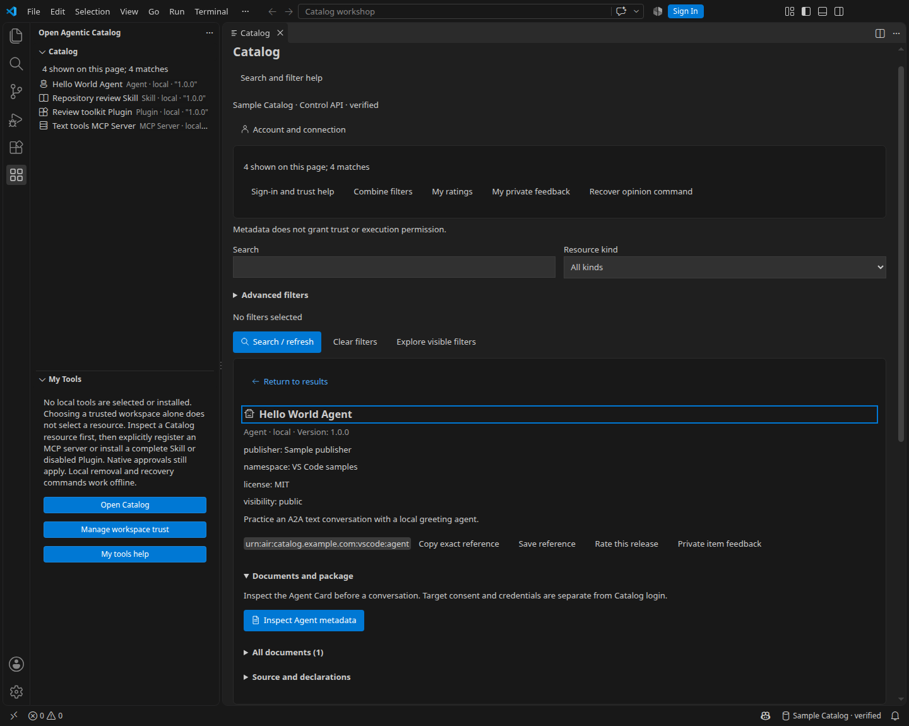
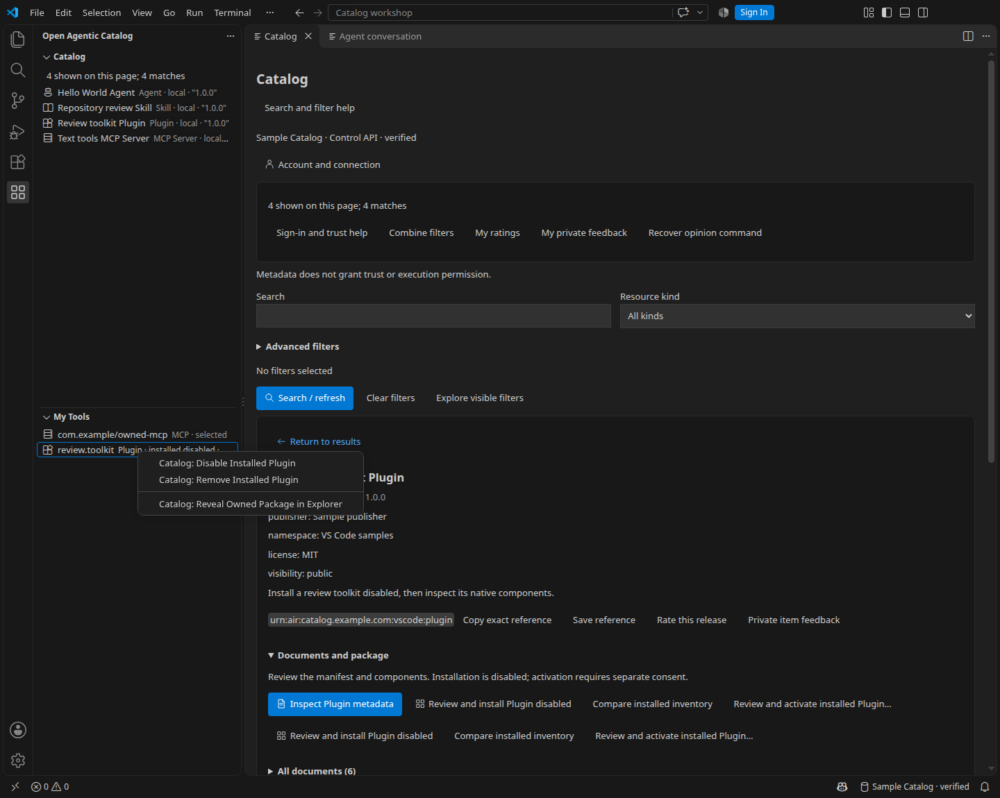
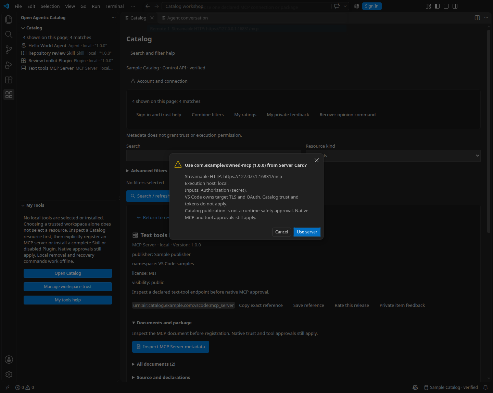
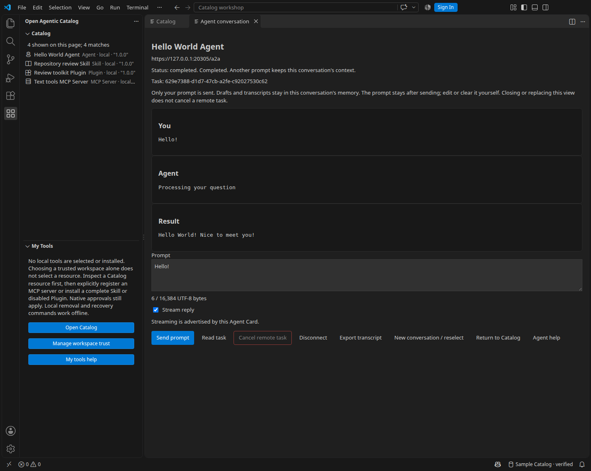

# VS Code Catalog client

Browse Open Agentic Catalog from VS Code. Inspect Agents, MCP Servers, Skills and Plugins, then choose which resources to use. This optional extension uses the Catalog's TypeScript SDK. It supports native MCP selection, complete Skill installation, separate Plugin activation and direct A2A text conversations.

The extension is a discovery and consumption client. Use the Catalog UI or API for authoring, review, publication and administration. Catalog access never grants permission to execute a resource.

## First use and command index

1. [Install the local VSIX](#install-the-local-package), then open the **Open Agentic Catalog** activity.
2. [Add your API connection](#add-a-connection), select it and [sign in](#sign-in-and-sign-out) when required.
3. [Load the first page](#browse-the-catalog). Enter search text and filters, then select **Search / refresh**.
4. Select a result, [inspect its exact evidence](#inspect-and-export) and [save a reference](#save-a-reference) if needed.
5. Review the resource's own requirements before choosing an MCP, Agent, Skill or Plugin action.
6. Use [My tools](#manage-my-tools) for local lifecycle controls. Catalog sign-out does not stop native processes or remove packages.

For daily use, select your connection, test it and reopen a saved reference or start a new search. Edit filters before submitting. **Next page** continues the submitted search; **Load First Page / Restart Search** starts it again. Approve each requested peer query deliberately. Partial results can omit unavailable live sources.

Run **Catalog: Help (Offline)** to choose a section of this installed guide. Setup's question button, **Search and filter help**, **My tools help** and **Agent help** open fixed sections. Help needs no sign-in, network access or trusted workspace. External specification links still need a network connection.

| Task | Command Palette entry |
| --- | --- |
| Set up or change a connection | **Catalog: Add Connection**, **Select Connection**, **Edit Connection** |
| Check access or transport | **Catalog: Account and Connection**, **Test Connection**, **Transport Settings** |
| Sign in, sign out or recover an interrupted login | **Catalog: Sign In**, **Sign Out**, **Recover Catalog Login** |
| Browse or restart | **Catalog: Open Catalog**, **Load First Page / Restart Search**, **Search**, **Filter Resource Kind** |
| Combine search filters | **Catalog: Combine Discovery Filters** |
| Manage personal opinions | **Catalog: Rate Selected Local Release**, **Send Private Item Feedback**, **My Ratings**, **My Private Feedback**, **Recover Opinion Command** |
| Remember MCP choices | **Catalog: Saved MCP References**, **Forget All MCP References** |
| Manage package authentication | **Catalog: Manage Package Source Credentials**, **Forget All Package Source Credentials** |
| Inspect the selected result | **Catalog: Inspect Exact Resource** |
| Reopen exact evidence | **Catalog: Open Saved Reference**, **Open Copied Exact Reference** |
| Review local state | **Catalog: Refresh My Tools**, **Compare Selected Package Inventory** |
| Find removal and recovery instructions | **Catalog: Help (Offline)**, then **My tools, package updates and recovery** |

## Before you start

Obtain the extension's `.vsix` file and your Catalog API origin. Ask your administrator for reader access and either an access token or the extension's OIDC client settings. Signing in does not create Catalog membership. The extension does not need the Catalog UI, its cookies or a model subscription to browse resources.

Use the API origin, such as `https://catalog.example.com`. Do not use the UI address or append `/api/v1`. For the default local setup, the API is `http://127.0.0.1:8080`; the UI is `http://127.0.0.1:4180`. If you need a Catalog first, see **Get started > Local quickstart and API walkthrough** in the companion manual. The default local UI serves that manual at `http://127.0.0.1:4180/docs/`.

Browsing needs no workspace. MCP use and A2A conversations require a trusted VS Code window and refuse virtual workspaces. Skill and Plugin installation require a writable filesystem workspace on Linux, Windows or macOS. Resource credentials and package tools are separate from Catalog authentication.

For a complete password login and indexed discovery exercise across independent Catalogs, see **Deploy and operate > Two-Catalog federation tutorial** in the companion manual. It prepares the operator inputs and a reader connection before the editor steps.

<!-- manual-link: [Open the two-Catalog federation tutorial](../../documentation/src/content/docs/guides/two-catalog-federation.mdx) -->

## Install the local package

The extension is distributed as a local VSIX, with no automatic Marketplace publication. Download `open-agentic-catalog-<version>.vsix` from a maintainer-published GitHub Release, obtain it from your maintainer or [build it from source](#develop-and-test). Download the release assets and `SHA256SUMS` into one directory. Run `sha256sum -c SHA256SUMS` there before installation.

1. Open the Command Palette in VS Code.
2. Run **Extensions: Install from VSIX**.
3. Select `open-agentic-catalog-<version>.vsix`.
4. Reload VS Code if prompted.

For a local build, the file is under `output/artifacts/vscode/`. You can also install an existing file with the VS Code CLI:

```sh
code --install-extension "/path/to/open-agentic-catalog-<version>.vsix"
```

Replace the path and `<version>` with your package's actual name. The package includes its SDK and runtime dependencies. Installation needs no repository checkout, separate Node installation, Go or npm.

The package requires VS Code 1.139.1 or a later compatible 1.x version. Automated desktop tests cover VS Code 1.141.0 on Linux amd64. Empty windows, single-folder workspaces and multi-root workspaces are tested. A real Linux Remote SSH connection over loopback is qualified separately. Windows/macOS support is implemented but has no native execution qualification. Web-only editors, other remote providers and forks are not qualified.

### Verify and replace a local build

From a source checkout, run `make -C extensions/vscode verify` before installation. It checks the package digest and its current source, SDK and tool inputs against `output/artifacts/vscode/manifest.json`. A mismatch requires a new package. When receiving a VSIX from a maintainer, compare `sha256sum` with their independently supplied digest; a matching local manifest is not a signature or trust endorsement.

For an intentional same-version development replacement, close the extension's active work, then run:

```sh
code --install-extension "/path/to/open-agentic-catalog-<version>.vsix" --force
```

Reload the window. Check the installed version in the Extensions view and test the connection. Root `VERSION` identifies the intended release; development builds with that same version can have different bytes. Keep the package digest with your installation record. Install a deliberately selected previous local package the same way to roll back code. The tested transitions use the current data format; they do not promise compatibility with an older released format.

Connection settings, credentials, saved references and an installed Skill survive the qualified update/replacement transitions. MCP selections are temporary and need reselection after reload. Transcripts are not restored. Uninstall can retain editor data; sign out of each connection before uninstalling. Installed resource files, Plugin settings and saved exports need their [separate removal controls](#uninstall-the-extension). Reinstallation does not grant access or automatically enable resources.

The extension declares workspace-host placement for remote connections. A loopback URL, tool executable, trust file, proxy and installation path refer to that execution host. See [platform and remote setup](#platform-and-remote-setup).

## Add a connection

Run **Catalog: Add Connection** from the Command Palette. The numbered native prompts collect the ID, name, connection security, root API origin, mode and authentication method. Use Back to change an answer or Escape to cancel without saving. IDs must be unique; names permit up to 80 Unicode characters. Review the definition before saving. Setup does not contact an issuer or enter credentials.

Choose browser login for OIDC/PKCE, token entry for an existing access token, or anonymous access for a permitted publication. OIDC adds issuer, public client, audience, optional refresh and scope prompts. Customize transport to enter a CA file, proxy and request limits. File buttons select paths on the execution host. No connection or credentials are active by default.

Use **Catalog: Select Connection** to select, add or edit a definition. **Catalog: Edit Connection** changes a saved definition while keeping its ID. The wizard rereads settings before saving and preserves unrelated connections. Changed definitions invalidate their old credential binding. Native settings have no atomic compare-and-swap operation; avoid simultaneous edits in other windows. An unconfirmed write needs inspection before another save.

- **control** reads governed releases, local facets and authorized indexed or live results. It requires a manual access token or OIDC login.
- **published** reads the ARD manifest, List, Search and Explore endpoints. Select anonymous access only if that publication host permits it. Manual tokens and OIDC remain explicit alternatives.

The extension does not change modes or retry anonymously after refusal. A token does not create Catalog membership or grant permissions. The backend enforces current access.

Use the question button during setup to open this section without saving or discarding the current answers. **Catalog: Help (Offline)** also opens the guide without a Catalog connection.

Connections use the native machine-scoped `openAgenticCatalog.connections` setting. The wizard and user/remote settings edit that same list. Workspace overrides are refused. VS Code does not sync machine-scoped connections. Never put tokens in settings.

```json
{
  "openAgenticCatalog.connections": [
    {
      "id": "my-catalog",
      "label": "My Catalog",
      "origin": "https://catalog.example.com",
      "mode": "control",
      "auth": "manual"
    }
  ]
}
```

Replace the example origin. HTTPS is the default. Literal loopback HTTP needs explicit `allowLoopbackHTTP: true`; use synthetic development credentials only. Non-loopback HTTP and credential-bearing URLs are refused.

For the default local development Catalog, use these user settings:

```json
{
  "openAgenticCatalog.connections": [
    {
      "id": "local-catalog",
      "label": "Local Catalog",
      "origin": "http://127.0.0.1:8080",
      "mode": "control",
      "auth": "manual",
      "allowLoopbackHTTP": true
    }
  ]
}
```

Select **Catalog: Select Connection**, then **Catalog: Sign In**. Enter `local-reader` only for the default development identity configuration. This synthetic token is not a production credential. Settings edits must preserve any other connections you need.

## Sign in and sign out

Run **Catalog: Sign In**. Manual mode prompts for an access token with hidden input. VS Code SecretStorage owns credentials on this host. There is no plaintext fallback.

**Catalog: Test Connection** verifies the selected mode with cancellable native progress. The Catalog header and status bar show the connection, mode and current state, including pending login and verification. **Catalog: Account and Connection** shows the execution host, origin and verified identity, with Select/Edit/Test/Sign In/Sign Out actions. A successful Catalog read does not establish resource runtime health.

OIDC sign-in shows native progress while waiting for the browser callback, within the existing five-minute login deadline. Cancel stops that pending login. A late callback cannot consume a different pending login. Ordinary browsing also verifies saved credentials. Account-only updates preserve the current search fields.

Use **Catalog: Transport Settings** to reach the exact native setting for Catalog connections, package tools or Agent transport. Package tools expose Git/ORAS executable paths, a separate CA file and a 1,000-300,000 millisecond acquisition timeout. Agent settings expose separate CA/proxy inputs, a 1,000-120,000 millisecond request timeout and a 1,000-300,000 millisecond stream timeout. File selectors also permit validated absolute manual paths. Native MCP owns its own TLS and OAuth settings. Catalog, package and Agent trust inputs do not replace each other; there is no package proxy setting.

Changing connections or signing out cancels an open token prompt or browser handoff. Start sign-in again for the intended connection. A canceled operation cannot store or send credentials to another connection.

For OIDC, register a separate public client with your issuer. Configure Authorization Code with S256 PKCE, the Catalog audience and the extension redirect URI. Stable VS Code starts from `vscode://open-agentic-catalog.open-agentic-catalog/oidc` and can add a window-routing query through `asExternalUri`. Register the actual mapped redirect for your desktop or remote environment.

For the local Keycloak setup, register `vscode://open-agentic-catalog.open-agentic-catalog/oidc/*` to admit that mapped query. The extension checks its exact callback path and pending login state. See **Deploy and operate > Authentication and sign-in > Keycloak > Connect the desktop client** in the companion manual for the complete setup.

<!-- manual-link: [Open the Keycloak desktop setup](../../documentation/src/content/docs/operations/oidc-keycloak.md#connect-the-desktop-client) -->

```json
{
  "id": "oidc-catalog",
  "label": "Work Catalog",
  "origin": "https://catalog.example.com",
  "mode": "control",
  "auth": "oidc",
  "oidc": {
    "issuer": "https://identity.example.com/realms/catalog",
    "clientId": "catalog-vscode",
    "audience": "catalog",
    "scopes": ["openid", "catalog.read"],
    "refresh": false
  }
}
```

The extension uses the configured issuer's discovery and public keys. OIDC requires signed JWT access tokens with RS256, ES256 or EdDSA signatures. Token responses must include a positive `expires_in` of at most 86,400 seconds. Its authorization, token and key endpoints must have the same origin as the issuer. It verifies signatures, issuer, audience, expiry, state, nonce and subject. It does not use UI cookies, a client secret or an ID token as API credentials.

An ID token can name only the configured client as its audience. A refresh response may omit the ID token or its nonce. Any returned nonce must match the original login. Once an ID token supplies an authentication time, a later claim must retain that time. The extension retains this private login context in SecretStorage. These checks follow [OpenID Connect token validation](https://openid.net/specs/openid-connect-core-1_0.html#IDTokenValidation) and [refresh response rules](https://openid.net/specs/openid-connect-core-1_0.html#RefreshTokenResponse).

Refresh is opt-in. Set `refresh: true` only when the issuer supports refresh tokens for this client. The extension requests `offline_access` with explicit consent. Refresh occurs before a request when expiry is within 60 seconds and a refresh token is available. Otherwise, the access token remains usable until its actual expiry. Concurrent callers in one window share renewal; canceling a reader does not cancel that shared renewal. An API refusal never triggers command replay.

Editor windows on the same execution host serialize credential writes and renewal for each connection. A busy window reports `credential_in_use` without spending the old refresh token or deleting the shared login. A private generation hash prevents another window's delayed SecretStorage cache from repeating the previous refresh. Automatic cleanup also checks that an invalid cached credential is still current before deleting it. `credential_update_pending` identifies a delayed cache or interrupted renewal. Let an active update finish, then select the connection and retry; recover a persistent interruption as described below. A genuine refused or unsafe refresh clears its credential when the owner can establish that it remains current.

An abandoned renewal lock or interrupted generation is never reset automatically. Close all other Catalog windows on that host, then run **Catalog: Recover Catalog Login** for the affected connection. Confirm recovery, then sign in again. Recovery clears that connection's uncertain credentials before releasing its private lock. Do not recover while another window is using the connection.

**Catalog: Sign Out** deletes the active Catalog credentials and clears private connection state. Changing connection settings invalidates pending work and credential binding. **Catalog: Remove Connection** deletes its settings and owned Catalog credentials. Existing resource installations retain their ownership records for local removal.

The extension stores a random, non-secret identifier in `connection-host-id` under its VS Code global storage directory. Credential keys include this identifier, the host type and the storage path. Hosts with identical paths do not automatically share credentials. Do not copy this directory between hosts. Tokens remain in SecretStorage.

The same private directory holds empty `.credential-<hash>.lock` files during writes and 64-character `.credential-<hash>.state` generation hashes. These files contain no tokens or login documents. Delayed native reads cannot replace the login accepted from a completed write. A real credential replacement or deletion cancels pending work. Cleared generations prevent a delayed window from renewing a deleted credential. Recovery is connection-specific; do not delete these files to bypass it.

Global storage must permit private file writes and atomic hard-link creation. Invalid or unavailable storage stops activation with `host_storage_unavailable`. Restore access to the storage directory; do not bypass this check. Deleting the identifier requires fresh sign-in and does not delete old SecretStorage entries.

## Browse the Catalog

Open the **Open Agentic Catalog** activity. **Catalog** appears first; **My tools** shows selected MCP servers and owned Skill or Plugin installations.

The empty Catalog view offers **Add connection**, **Select connection** and **Sign-in help** before search controls. Setup and Help work without authentication or a trusted workspace. After selecting a connection, use **Sign in** when required, then **Load first page**. Activation does not open a setup tab, contact a Catalog or install a tool.

Select a resource to inspect its details. Choose an explicit resource action from the table below.

| Resource | What you can do | Requirements beyond Catalog access |
| --- | --- | --- |
| Agent | [Talk to an Agent](#talk-to-an-agent) through a declared A2A interface. | A reachable A2A 1.0 JSONRPC endpoint and any separate agent credential. |
| MCP Server | [Select an MCP server](#use-an-mcp-server), then use native VS Code controls. | A supported endpoint or exact package, its target credentials and any required runner. |
| Skill | [Install a complete Skill](#install-a-complete-skill) into `.agents/skills/`. | Complete inspected evidence, a trusted supported filesystem workspace and Git or ORAS for the selected source. |
| Plugin | [Install disabled, then activate](#install-and-activate-an-agent-plugin) after a separate review. | Complete inspected evidence, a trusted supported filesystem workspace and supported native components. |

Not every resource supports these actions. Document rows offer Agent or MCP actions only for their native document families. Inspect-only explanations identify unsupported transports, interfaces, authentication or package declarations when those details are present. Package controls explain missing complete evidence, workspace trust and supported filesystem platforms. MCP package notices name the required runner; install that runner separately. These explanations do not fetch remote documents. A listing is not a running service.



The disposable Sample Catalog contains an Agent, MCP Server, Skill and Plugin. The selected Hello World Agent exposes its exact release and retained Agent Card. [Open the Catalog screenshot at full size](media/catalog-preview.png) to read the controls. These sample names illustrate the walkthrough below; your Catalog supplies its own releases.

Run **Catalog: Load First Page / Restart Search**, **Catalog: Search** or **Catalog: Filter Resource Kind** to populate the resource tree. Select a resource to inspect it. **Catalog: Open Catalog** opens cards, filters and details in an editor tab. Both views share one search and selection. No workspace is required.

Cards and native views use robot, server, book and extensions icons with readable kind labels. Names, descriptions, tags and exact identifiers wrap within narrow views. Control characters in metadata appear as visible Unicode escapes where needed; document inspection and export preserve their exact values. Select a tag to edit the filter draft, then select **Search / refresh**. **Return to results** restores the selected card and its position. Available publisher, namespace, license, visibility and rating information appears with the resource. Ratings describe human opinions; they do not prove trust or installation counts.

| API mode | Browse and filter behavior |
| --- | --- |
| Control | Local governed releases are the default. Filter by kind, tag, local namespace UUID, publisher, license, category or visibility. Select indexed metadata or live discovery explicitly. |
| Published ARD | An empty search uses List, with kind and publisher filters. Enter search text for tags, license or category filters. Search defaults to local publication with `federation: none`. |

Search and resource kind remain visible. Open **Advanced filters** for exact tag, license, category, publisher, origin, namespace, visibility and page size. **Clear filters** removes selections without issuing a request. Exact filter values containing controls appear as read-only JSON text, so a single-line input cannot change them. Search preserves the original value. Use the adjacent Clear button to type a replacement. Changing origin retains typed filters; correct an incompatible local namespace before submission. A Published empty search explains which filters require search text beside that field.

Namespace filters and Control facet counts cover local releases. Namespace suggestions use labels already returned in authorized results; exact UUID entry remains available. No additional directory permission is needed. **Explore visible filters** uses the current draft and displays the explored filter set. Bucket counts apply only to that authorized local population. Select a supported bucket to edit the draft, then select **Search / refresh**. Counts are not global peer totals. Published type counts describe each exact media type. Selecting a type applies its resource kind, which can include several supported formats. Search and Next page ask for confirmation whenever the query uses live origins or Published `federation: auto`. Queries go only to sources permitted by the Catalog.

The native toolbar keeps Open Catalog, restart and available paging or cancellation actions visible. Its overflow menu contains search, kind, account, settings and Help commands. My tools has separate offline removal and recovery commands. Native row actions target the selected resource or owned installation; the host rechecks access and ownership.

**Next page** and **Catalog: Next Page / Retry Continuation** use the submitted query and the server's opaque cursor. Each request replaces the page, without accumulating a result cache. Editing the form does not change that submitted query. Search starts a new query. Explore, detail, paging and temporarily hiding the tab preserve the draft. Connection or identity changes clear it.

A temporary next-page or optional-read failure clears displayed private results but retains one continuation for an explicit **Retry next page**. No request retries automatically. Access denial, changed evidence and invalid or expired cursors clear the continuation. Restart the search in those cases. An empty page can still have a continuation.

Use **Cancel read** or **Catalog: Cancel Catalog Read** during verification, browse, facet or detail reads. Cancellation clears the read's private presentation and preserves a usable continuation where available. It does not sign out, cancel another reader's shared login renewal, stop package installation or disconnect an Agent. Control Search labels durable matches separately from live results on the current page. Published Search reports page counts without inventing a global total. Partial results and unavailable evidence remain visible.

Pages default to 20 entries and allow 1-100. The editor offers common sizes. The backend can return fewer results or enforce tighter limits. A changed or expired cursor requires a fresh search.

### Keyboard and appearance

Use Tab and Shift+Tab to move between controls. Enter activates a focused button or disclosure; Space toggles a checkbox. **Return to results** restores the selected card and its scroll position. The conversation transcript has a separate keyboard-scrollable region.

Use the editor's **Zoom In** and **Zoom Out** commands to resize the workbench. Forms wrap within narrow views and use the editor's theme colors and visible keyboard-focus outline. Resource kinds keep readable labels beside their icons. Native tree icons follow the selected product-icon theme.

### Combine filters

In Control mode, select **Combine filters** or run **Catalog: Combine Discovery Filters**. Choose one or more origins, up to four kinds, 32 tags and 16 categories. Select **Add exact value** to add a tag/category, or select an existing value to remove it. Select **Use these values** to finish each value list. Finishing the categories step applies the combination and starts the search. Live origins need separate consent before disclosure.

Canceling a wizard picker keeps the current filters and results. Canceling an **Add tag/category** input returns to its value list. **Search / refresh** repeats the applied search.

For example, select local and indexed origins, Agent and MCP Server kinds, and the `support` and `finance` categories. A result can match either selected kind and either origin. It must match every selected tag and every selected category. The server normalizes case and surrounding whitespace for tags/categories; these are whole values, not substring filters. Published ARD retains its existing single-value controls.

Active combinations appear as JSON values above the results. Editing a single kind, tag or category replaces that field's combination. Clear filters clears all combinations. Namespace filters and facets require local-only origins; remove the namespace before including indexed or live origins. Durable counts describe local/indexed matches; live counts describe only the returned page. An unavailable peer can make the result partial.

Every live search, continuation and exact replay needs fresh peer-query consent. The confirmation shows the query before disclosure. Cancel sends no declined peer request. The Catalog chooses allowed sources; the editor cannot select a topology or submit a new source URL.

### Inspect and export

Select a resource before reading its documents. Detail shows an overview, **Documents and package** and **Source and declarations**. Open **All documents** to reach every admitted document, including sparse or numerous entries. Disclosure uses native keyboard controls and does not fetch documents. Available indexed source counts and conflicting declarations help selection; they do not establish trust. Local detail reads the exact visible release. Indexed detail rechecks the exact identifier and version. A missing version and an explicitly empty version remain distinct.

Use **Inspect document** to open a read-only editor tab with a descriptive, sanitized filename. Native JSON and manifests use JSON syntax, Skill Markdown uses Markdown syntax, and package previews use plain text. Inspection does not render untrusted HTML or Markdown. **Export exact bytes** saves a retained document or Plugin component without changes. **Export metadata JSON** saves a JSON projection; it preserves numeric tokens but does not promise original whitespace or signed bytes. The ARD manifest can also be inspected explicitly.

Document reads recheck current access. Switching connections or signing out clears results and redacts open evidence views. A changed verified account also clears private state; sign in again. Exported files remain on your filesystem; protect or delete them as needed. At most 16 evidence tabs can remain open. Closing a tab frees its slot and clears any editor buffer retained for that closed tab.

Sparse external results retain inspection and copy-reference actions. Indexed metadata does not grant access to administrator observation evidence. External document and archive URLs are references only; browsing does not fetch them. **Open link** asks for confirmation and forwards no Catalog token. Only safe HTTPS links can open. Git and OCI declarations remain text when they are not browser links.

Load artwork explicitly through the Catalog's approved image endpoint. The extension checks image type and response digest. It never loads a declared image URL directly. One checked image remains beside the selected detail with its alternative text, caption and attribution. Ordinary redraws preserve it, and selecting the same image reuses its bytes. Selection, connection or identity changes clear it. Icons and screenshots remain transient. No artwork request is made in Published mode without a Control delivery target.

### Save a reference

**Save reference** stores an exact local release or indexed identifier/version reference. Reopening requires current Catalog access. A missing or refused reference never resolves to a similarly named resource.

Native saved-reference labels show the release UUID or exact indexed identifier and version. Missing versions and empty strings have distinct labels. Use the row's removal action or **Catalog: Remove Saved Reference** to remove one confirmed reference. **Catalog: Forget Local Saved References** works without Catalog access: choose an opaque local account binding and its reference count, then confirm forgetting that binding. It preserves other bindings, credentials and installed resources.

To open a reference copied elsewhere, run **Catalog: Open Copied Exact Reference** and paste the complete JSON from **Copy exact reference**. Use a Control connection. Local references require `origin`, `identifier`, `versionPresent: true`, `version` and `releaseId`; indexed references use `origin`, `identifier`, `versionPresent` and `version` only when present. The lookup checks every supplied identity field. URLs, extra or duplicate fields, Published/live references and guessed versions are refused.

Bookmarks retain no result bodies, display names, query history or tokens. They are bound to the connection, host and verified account. The limit is 100 references per account and 20 account bindings per extension host. Remove unused references before adding more. Published and live results support **Copy exact reference**, without a durable bookmark promise.

## Walk through four resource kinds

Use a Catalog where your administrator has published readable examples of all four kinds. The screenshots use the four names below. Select equivalent resources in your own Catalog; names do not establish identity or trust.

1. Open **Catalog: Open Catalog** and select **Load first page**.
2. Enter `Hello World` in Search, choose **Agent** and select **Search / refresh**.
3. Inspect **Hello World Agent**. Review its origin, exact identifier, version, release and retained A2A Card.
4. Select **Save reference**. Reopen it with **Catalog: Open Saved Reference** and confirm that the exact release matches.
5. Choose **Talk to Agent...**, review the declared interface and target authentication, then confirm **Open conversation**.
6. Enter `Hello!`, select **Send prompt** and confirm the destination. Review the reply and [outcome](#agent-outcomes).
7. Return to Catalog, clear filters and select **MCP Server**. Inspect **Text tools MCP Server** and its declared endpoint.
8. Choose **Use MCP server...** and review the exact alternative. Registration adds a My tools row; native startup needs separate approval.
9. Find **Repository review Skill**. Review its complete package inventory, immutable source and license before choosing a trusted workspace and installation.
10. Find **Review toolkit Plugin**. Install it disabled, review the activation preview and enable its native path only when you intend to use it.
11. Open **My tools**. Compare an installed inventory, disable the Plugin and remove only resources you no longer want.

A document-only Skill or sparse peer result can be inspected without offering installation. Unsupported Agent interfaces and MCP alternatives show their reason. Missing access never resolves to another release. Use the exact evidence and supported resource declarations, rather than the display name, to decide what to use.

Use [personal ratings and private feedback](#personal-ratings-and-private-feedback) for your own opinions. Use [private package credentials](#private-package-credentials) for authenticated package sources. These actions remain separate from Catalog administration and resource execution.

## Personal ratings and private feedback

Control mode provides **Rate this release** and **Private item feedback** on exact local governed releases. Published mode is read-only. Indexed/live entries retain separate aggregate claims; they cannot create a new local opinion. **My ratings** and **My private feedback** list your own items in pages of 25 and read their current state before an edit or withdrawal.

### Submit or edit a rating

1. Select the exact local release, then choose **Rate this release**.
2. Choose a score from 1 to 5.
3. Choose **Private** or explicitly allow the publisher summary.
4. Open **My ratings** to read, edit or withdraw your opinion.

New and previously withdrawn ratings default to private. An active rating retains its existing sharing choice unless you change it. Consent permits the Catalog's aggregate sharing rules; it does not publish a signed endorsement or prove trust. Existing foreign-target opinions remain readable and withdrawable through your own list; the editor does not offer them a local submission form.

Submission needs active human membership and current target-scoped `ratings.own`; the Reader template already includes this permission. With OAuth scope enforcement, reads need `catalog.read` and writes need `ratings.write`. The server decides current authority. Own-list reads and withdrawal do not require the target to remain visible or submission permission to remain available.

### Submit or edit private feedback

1. Select the exact local release, then choose **Private item feedback**.
2. Choose a category and enter the comment in the native input.
3. Use its clipboard button for multiline text. It retains the full text, including newlines, in memory.
4. Press Enter to submit. Open **My private feedback** to read an administrator response, edit or withdraw.

A comment permits 1-4000 Unicode code points containing text. The complete request also has a 64-KiB ceiling. The input displays a count when it retains multiline text; typing replaces that text. When editing, the history button keeps the current exact comment. No temporary document or webview receives the comment. Catalog sign-out clears open private evidence buffers; exported copies remain your responsibility.

Only you and authorized feedback moderators can read feedback. A new item requires active human `feedback.own` and `resource.read` for its release. Reads need `catalog.read`; writes need `feedback.write` under OAuth enforcement. There is no `feedback.read` scope. Own reads and withdrawal remain available after resource-read loss. Editing preserves the original item context, reopens the item and clears the moderator's prior response. The extension displays responses but has no response or moderation commands.

### Recover an uncertain personal command

Writes send an idempotency key; edits and withdrawal also send the current revision ETag. A concurrent change returns HTTP 412: reread the item before a new edit. The extension does not repeat a failed mutation automatically.

After a timeout or lost response, first read **My ratings** or **My private feedback**. Run **Catalog: Recover Opinion Command** to replay the identical in-memory body, key and precondition. This is available for ten minutes from the original attempt. A failed recovery does not establish the original outcome. You can explicitly forget the pending command after checking the list; forgetting changes no server state.

Only one personal mutation can be in flight or uncertain per window. Closing the window or changing Catalog identity clears its recovery record. After that, or after expiry, inspect your own list before making a deliberate new command. Private comments and pending bodies are never saved in global state, diagnostics or receipts.

## Manage My tools

My tools lists deliberate MCP selections and owned Skill/Plugin installations. Use its overflow menu for removal/recovery and **Catalog: Help (Offline)** for this section. Its empty state includes a direct **My tools help** link. The list does not inventory arbitrary native tools or claim that a component is running.



The Plugin is installed but disabled. The menu provides inspection and removal controls. [Open the My tools screenshot at full size](media/my-tools-installed.png).

| Goal | Procedure | Access and refusal behavior |
| --- | --- | --- |
| Compare | Select the desired complete release, then run **Catalog: Compare Selected Package Inventory** and choose its workspace. | Requires current Catalog access. It previews inventory changes without acquisition or writes. Unsafe or edited local trees are refused. |
| Update a Skill | Select the new exact complete release and repeat installation. Review the inventory changes before confirmation. | Requires fresh access and an unchanged owned tree. Identical evidence skips acquisition and writes. |
| Update a Plugin | Disable its path, select the new exact release and install it disabled. Review and activate separately. | Local edits or conflicting settings stop replacement. A changed package needs fresh activation consent. |
| Disable a Plugin | Run **Catalog: Disable Installed Plugin** for its exact row. | Works after sign-out, including with local edits. The native host owns shutdown of running components. |
| Remove an MCP selection | Use its row action or **Catalog: Remove MCP Selection**. Stop a running server with native MCP controls. | Works offline. Deletes that selection's owned target secrets; failed deletion remains retryable. |
| Remove a Skill or Plugin | Use the matching **Catalog: Remove Installed Skill/Plugin** command and confirm the exact workspace and package. | Works without Catalog access. Requires trusted storage and unchanged owned files. Plugin removal disables its path first. |
| Recover a Skill | Close competing installation windows, then run **Catalog: Recover Interrupted Skill Operation**. | Checks the exact journal and trees; completes the new tree or restores the old one. Unexpected changes stop recovery. |
| Recover a Plugin | Close competing windows, then run **Catalog: Recover Interrupted Plugin Operation**. Review every listed path. | Disables verified owned/pending paths before recovery. Damaged receipts and unowned trees are preserved. |

Refresh My tools after an operation. If a receipt is unreadable, healthy rows remain manageable beside its diagnostic. Preserve local edits and damaged state for inspection. Do not delete `.oac-catalog/` to force ownership or recovery.

## Use an MCP server

Select an MCP Server and inspect its native document. Choose **Use MCP server...** beside that document, or run **Catalog: Use Selected MCP Server**. Choose one declared endpoint or package. Review the exact URL or arguments, version, execution host, inputs and download requirements. Confirm **Use server** to add that selection.



This preview precedes selection confirmation. It does not invoke the declared MCP target. [Open the MCP selection screenshot at full size](media/mcp-selection-preview.png).

Consumption accepts native documents up to 1 MiB. Inspection keeps its separate documented limits.

The extension keeps Server Cards and Registry `server.json` documents separate. A metadata document URL is not an MCP endpoint. Supported alternatives are:

| Native declaration | Handoff |
| --- | --- |
| Server Card or Registry Streamable HTTP remote | The exact declared HTTP endpoint, with separate target headers. HTTPS is required except for explicitly allowed literal loopback development URLs. |
| Registry npm package | `npx --yes -- package@version`, followed by declared package arguments. The version must be exact. |
| Registry PyPI package | `uvx package==version`, followed by declared package arguments. The version must be exact. |
| Registry OCI image | `docker run --rm -i image@sha256:digest`, with declared environment names and package arguments. |

The preview shows the runner and a JSON array of arguments. Each array item is one argument; spaces inside quotes stay in that argument.

The named runner must already exist on the execution host. The extension does not install Node, uv or Docker. Package runners can download and execute third-party code with your user permissions. A single workspace supplies the working directory. Otherwise, VS Code supplies its default directory. No shell command is constructed.

Unsupported alternatives remain inspect-only. These include legacy SSE, custom runners or registry-base overrides, runtime arguments, unresolved templates, repeated/dynamic arguments and secret command-line arguments. A package with `fileSha256` is refused because these recipes cannot verify the exact downloaded file. Exact package versions do not provide publisher-signature assurance.

**My tools** lists only explicit selections. Registration does not start a server. Open **MCP: List Servers** to start, stop, restart, inspect logs and control tools. VS Code can also request startup during chat, subject to its settings and approvals. Before each new connection, the provider rereads the selected Catalog evidence, requires unchanged bytes and asks for a fresh review. It checks access again after credential prompts. Existing connections remain under native host controls; Catalog access checks do not continuously revoke a running process.

Use **Cancel** on **Preparing Catalog MCP server** to cancel pending preparation, including a document response or credential prompt. Late prompt completions cannot return a definition or save a new credential for that canceled attempt. Fresh startup requires fresh checks. The qualified VS Code 1.141.0 provider token is not cancelable, so native Stop alone does not cancel preparation; use this progress notification. Native MCP controls continue to own already running processes.

Local selections use the exact release. Live and Published selections reread the exact selected result page and require unchanged entry evidence. Every live or Published `federation: auto` replay asks **Revalidate with peers**, including initial MCP/Agent selection, MCP startup checks and Agent send/read/cancel checks. The prompt shows the original query and filters and identifies continuation-page replay without displaying its cursor. Declined or stale consent sends no replay or resource-target request. Changing the selection invalidates initial preparation; a registered consumer keeps its frozen reference while browsing continues. Local and Published non-federated reads need no peer-query prompt. An expired cursor or changed result requires reselection. Indexed reader projections remain inspect-only.

An external native document requires separate consent. The reader sends no Catalog token, cookies, private Catalog CA or proxy settings. It refuses redirects, limits the document to 1 MiB and applies a deadline of at most 30 seconds. The certificate must be trusted by Node on the execution host. No separate private trust setting exists for these document reads; retained Catalog documents avoid that external read. No remote schema or JSON-LD context is fetched.

Target headers and environment credentials belong to the selected server. Enter them in the native hidden-input prompt. Their SecretStorage keys bind the execution host, Catalog connection, account, exact Catalog item, document and alternative. Never paste a Catalog token as a target credential. The extension never reads a Catalog credential to populate target inputs. Stdio children receive a restricted conventional environment plus reviewed target inputs; arbitrary inherited credentials are removed.

VS Code owns target TLS, proxy handling, OAuth and tool approvals. The connection's `caFile` applies only to Catalog and issuer reads. Configure target trust through the [VS Code network settings](https://code.visualstudio.com/docs/setup/network). Certificate and hostname checks remain enabled. Native MCP OAuth is separate from Catalog OIDC; this package does not implement another OAuth client or claim qualification against arbitrary target issuers.

Selections remain in memory, with a limit of 20, including incomplete removals awaiting retry. Sign-out, connection changes or a window reload clear selections. Target secrets can remain in SecretStorage for exact reselection. Use **Catalog: Remove MCP Selection** or the My tools context action to remove a selection and its owned target secrets. This works without Catalog access. Failed deletion retains an explicit retry in the removal picker. An earlier pending secret write cannot recreate removed credentials. Removal does not confirm that a remote server stopped; use the native controls when shutdown is required.

To remove retained secrets after selections were cleared, close other Catalog windows and run **Catalog: Forget All MCP Target Credentials**. This deletes only this extension's exact MCP target keys, across all its Catalog connections/accounts on this SecretStorage host. Catalog login, Agent credentials, other extension data and installed files remain separate. Each batch deletes at most 50 entries; Cancel, failures and remaining entries are reported, with explicit continuation. Another window can retain values in memory or store them again. Forgetting does not revoke credentials or stop native processes.

Restricted Mode permits browsing and inspection but refuses MCP selection and resolution. Virtual workspaces also refuse consumption. Catalog publication is not permission to execute a resource. See the [VS Code MCP guide](https://code.visualstudio.com/docs/agent-customization/mcp-servers) for native trust, tool and lifecycle controls.

This workflow consumes cataloged MCP Servers. The separate Catalog MCP interface exposes Catalog discovery tools to assistants; it does not invoke listed resources.

### Remember an MCP reference

After a deliberate MCP selection, **Catalog: Saved MCP References** lists its inert exact reference, document index, alternative index and evidence digest. Each account binding permits 20 references; one host permits 20 account bindings. Reload restores only these identifiers. It never restores an executable definition, cached document, query, cursor, target inputs or startup.

Choose a Control reference to reselect it. The extension tests current access, rereads the exact document, checks the digest and alternative, then requests fresh native consent. Changed or inaccessible evidence is refused. Published/live references cannot reopen without their old query; select them through a fresh explicit search instead. No query is retained or silently replayed.

Remove one reference from the native list or run **Catalog: Forget All MCP References** offline to forget all inert references on this host. Removing the last reference for an account frees its account slot. This is separate from removing an active selection or forgetting MCP target credentials. The native host still owns startup, authentication and tool approval.

## Talk to an Agent



This conversation uses the pinned Hello World sample executor on an owned loopback endpoint. It needs no hosted model account. The prompt and reply come from a real A2A exchange. [Open the Agent screenshot at full size](media/agent-conversation.png) to read the prompt, reply and actions.

Select an Agent and inspect its retained [A2A Agent Card](https://a2a-protocol.org/latest/specification/). Choose **Talk to Agent...** beside that document, or run **Catalog: Talk to Selected Agent**. Select one declared A2A 1.0 JSONRPC interface and authentication option. Unsupported options show a reason. Confirm the exact destination and execution host before opening the conversation.

The conversation opens without contacting the agent. Enter a prompt and select **Send prompt**. Confirm the prompt and destination in the native dialog. Select **Stream reply** for a streamed response; the checkbox explains when the Card does not advertise streaming. The field shows the actual **16,384 UTF-8 byte** budget, so multibyte characters consume more than one byte. Empty, over-budget, null-containing or incomplete Unicode prompts cannot be sent. Replies appear as plain text; returned HTML or Markdown cannot execute code. The conversation requires no model account or VS Code chat subscription.

The extension sends only your prompt, a message identifier and applicable task/context identifiers. It sends no editor selection, workspace files or local transcript automatically. Further prompts in the same view keep the agent's context. An input-required task can continue with another prompt. After a terminal task, the next prompt starts another task in that context. Choose **New conversation / reselect** for a new context, empty transcript and empty draft. If the original Card is still selected, the extension checks its current evidence again and asks you to choose an interface, target authentication and destination consent. Otherwise it opens Catalog and asks you to select a Card. Declining replacement keeps the current conversation. **Return to Catalog** opens discovery while preserving the conversation. Neither action sends remote cancellation. **Catalog: Talk to Selected Agent** also starts a new conversation.

The prompt and Stream reply selection survive switching editor tabs for the same live conversation. They stay in bounded host memory, never editor state or browser storage. The prompt remains after declined consent, successful sends and failures; edit or clear it yourself before another send. Starting a new conversation, closing the view, signing out or changing account, connection or A2A settings clears this private state. Target credentials and transcripts also stay in memory.

The view keeps the prompt caret and existing transcript entries in place during updates. The transcript has its own keyboard-scrollable region and never jumps to the latest response. A status announcement describes preparing, sending, streaming, task reads and outcomes without repeatedly announcing the entire transcript.

The agent can return a direct Message or a Task. Streaming assembles text artifact parts in order. Completed, failed, rejected, canceled, input-required and authentication-required states remain distinct. **Read task** explicitly requests its current state. There is no background polling. Authentication-required tasks need separate agent authentication; this client does not perform arbitrary OAuth or fetch authenticated extended Cards.

**Cancel remote task** asks the agent to cancel a known nonterminal task. Confirm that separate action for the displayed task. If the task changes during confirmation, the extension refuses the stale action. The view reports canceled only after the agent confirms it. Refusal or a task that finishes first remains visible. **Disconnect** stops local traffic; it does not send cancellation or claim remote shutdown. Closing the view also disconnects and clears its transcript.

A timeout, malformed reply or interrupted send can leave its outcome unknown. The client never retries that prompt automatically. Use **Read task** if an exact task identifier is known. Otherwise, check the agent before starting another conversation. Do not repeat an uncertain prompt blindly.

### Agent outcomes

| Displayed outcome | Next action |
| --- | --- |
| Ready | Enter a prompt, choose streaming if available and confirm **Send prompt**. |
| Working or submitted | Use **Read task** when you want another status check. There is no background polling. |
| Input required | Send another prompt to continue the displayed task. |
| Authentication required | Reselect with a supported separate Agent credential. Arbitrary Agent OAuth is unavailable. |
| Completed | Review the reply. Another prompt keeps the context; **New conversation / reselect** starts fresh. |
| Failed or rejected | Read the reported outcome. Decide whether a new request is appropriate; no automatic retry occurs. |
| Canceled | The Agent confirmed cancellation. **Disconnect** alone does not establish this outcome. |
| Uncertain send | Do not resend blindly. Read a known task or check with the Agent's operator. |
| Disconnected | Local traffic has stopped. Remote work may continue. Reselect deliberately before another send. |

**Agent help** opens this table while keeping the live conversation in memory. Returning to the Agent tab restores its draft. Closing that tab clears it.

### Agent credentials and transport

Anonymous access, declared HTTP bearer and non-reserved header API keys are supported. Enter agent credentials in the hidden native prompt. They stay only in conversation memory and disappear with that conversation. They are not Catalog credentials and are not saved in settings, receipts, transcripts or SecretStorage. Never paste a Catalog token as an agent credential.

The extension uses its separate A2A client transport. Catalog tokens, cookies, OIDC settings, trust and proxy settings are never forwarded. Each operation rechecks Catalog access and the unchanged Card. Sign-out, identity/connection changes and A2A setting changes clear the view and cancel local work. Restricted Mode and virtual workspaces refuse agent contact. No workspace is required for an explicitly approved conversation.

Use the machine-scoped `openAgenticCatalog.a2a` object in user or remote settings. Workspace overrides are refused. Paths and private/loopback destinations refer to the extension execution host.

```json
{
  "openAgenticCatalog.a2a": {
    "timeoutMs": 30000,
    "streamTimeoutMs": 120000,
    "allowLoopbackHTTP": false
  }
}
```

| Setting | Default | Accepted value |
| --- | --- | --- |
| `timeoutMs` | 30,000 milliseconds | 1,000-120,000 milliseconds per send, task read or cancellation |
| `streamTimeoutMs` | 120,000 milliseconds | 1,000-300,000 milliseconds for the complete stream |
| `allowLoopbackHTTP` | `false` | Explicit `true` permits only literal `127.0.0.1` or `[::1]` HTTP |
| `caFile` | Node public roots | Optional absolute PEM trust file on this host, at most 1 MiB |
| `proxyURL` | Direct | Optional credential-free HTTP(S) proxy origin |

Certificate and hostname checks stay enabled. Redirects, endpoint fallback and automatic retries are refused. Restart the conversation after changing trust files. External Card references require separate read consent and use public trust without credentials or the Catalog's private CA. Their response limit is 1 MiB. Private external Card authentication is unsupported; prefer an authorized retained Card.

### Conversation limits and export

| Item | Limit |
| --- | --- |
| Prompt | 16 KiB of UTF-8 text |
| Ordinary response / retained Card | 1 MiB each |
| Stream event | 256 KiB |
| Complete stream | 4 MiB and 1,000 data events |
| In-memory transcript | 2 MiB, 200 messages and 64 artifacts |
| Manual task read cadence | At least one second between reads |
| Parsed response headers | 32 KiB |

A limit failure stops processing and closes local transport; it does not silently truncate a reply. Streams must identify the same task/context and finish in a terminal or interrupted state. A partial stream is not completion. Files, binary parts, push notifications, required protocol extensions, gRPC, HTTP+JSON bindings and arbitrary OAuth flows remain unsupported. Card signatures are not verified by this client. Catalog publication does not establish agent safety or authorization.

**Export transcript** opens an explicit read-only `Agent-transcript.json` document with JSON syntax. Use **File: Save As** to keep it. The export contains prompts, replies, task/context identifiers and text artifacts, but no authentication headers. Sign-out clears open export documents. Protect saved files; sign-out cannot erase a saved copy. Transcripts are not saved automatically or restored after a window reload.

## Trust, proxies and limits

TLS certificate and hostname validation remain enabled. `caFile` adds a bounded PEM trust file to public roots. It must be an absolute path on the execution host. `proxyURL` selects one credential-free HTTP(S) proxy origin. Catalog and issuer exchanges use these connection settings. Ambient proxy settings do not choose another destination. Reload the connection after a trust-file change. Native MCP and package transports have separate qualification requirements.

| Setting | Default | Accepted range |
| --- | --- | --- |
| `timeoutMs` | 30,000 | 1,000-120,000 milliseconds |
| `requestBytes` | 16 MiB | 1,024 bytes-16 MiB |
| `responseBytes` | 8 MiB | 1,024 bytes-32 MiB |
| `headerBytes` | 32 KiB | 1,024 bytes-64 KiB |
| Connections | None | At most 20 |

Issuer exchanges have a 30-second deadline. Metadata and keys are bounded to 256 KiB; token responses are bounded to 64 KiB. Login state expires after five minutes and can be used once. Explicit native document reads have a 16 MiB ceiling; exact detail and manifest reads have a 32 MiB ceiling. Artwork has a 4 MiB ceiling. The configured `responseBytes` limit can lower these ceilings; an operation cannot raise it. Transport errors expose fixed diagnostics, not dependency errors or response bodies.

A 401 requires sign-in or token replacement. A 403 indicates current access restrictions. Check the configured origin, publication availability, trust file and proxy for other failures. Do not disable TLS validation to fix a connection.

## Private package credentials

Run **Catalog: Manage Package Source Credentials** while connected to the intended Catalog account. Select Git over HTTPS, an OCI Skill registry or an HTTPS Plugin archive. Enter the exact HTTPS origin, including its port. Choose **Add or replace**, then enter a username/password or token. HTTPS archives explicitly offer Basic or Bearer. Never reuse a Catalog access token as a package credential.

Credentials reside only in VS Code SecretStorage. Their keys bind the source family and exact HTTPS origin to the current extension host, Catalog connection and verified account. Up to 50 entries can remain on one host. Every private acquisition asks whether to use the matching saved credential or proceed anonymously. Cancel stops acquisition. A credential for one family or origin cannot authorize another source.

Git uses a private, short-lived configuration file for its origin-specific header. Acquisition deletes the file on success, refusal or cancellation. Secrets never enter process arguments, settings, logs, exports or ownership receipts. Ambient Git helpers, Docker logins and SSH agents do not supply package credentials. Temporary work is private; an acquisition interrupted by process termination can require local recovery or inspection of its owned work directory.

Private OCI accepts direct Basic authentication or one same-origin Bearer challenge. Its token request uses the selected username/token and requests only `repository:<selected-repository>:pull`. Token realms on another origin, redirects, additional scopes and unsupported challenge forms are refused. This deliberately excludes registries that require a separate authentication origin. Tokens remain in acquisition memory. Exact manifest, layer digest, inventory, archive and TLS checks still apply.

To replace or forget one entry, rerun **Catalog: Manage Package Source Credentials** with the same account, family and origin. **Catalog: Forget All Package Source Credentials** works offline and removes only package entries, in cancellable batches of at most 50. Close other Catalog windows first. It preserves Catalog login, MCP target credentials and Agent state. Forgetting does not revoke the source credential or cancel an acquisition that already read it. Sign-out and connection removal do not erase package entries; use the offline control before uninstalling or retiring a host.

## Platform and remote setup

The VSIX implements Linux, Windows and macOS filesystem support. Install Git for Git Skill sources and ORAS for anonymous OCI Skill sources on the extension execution host. HTTPS Plugin archives and authenticated OCI reads do not need those executables. Native MCP package recipes require their separate npm/npx, uvx or Docker runtime. The extension never installs a runtime automatically.

Use absolute native executable and CA paths: `/opt/tools/git` on Linux/macOS, `C:\Tools\Git\bin\git.exe` on Windows, or a full UNC path such as `\\server\share\tools\git.exe`. Drive-relative, root-relative and device paths are refused. Configure the path using JSON escaping when editing settings. Windows PATH casing is handled by the native host. macOS Unicode filename normalization is checked separately from canonical archive names.

Install into a writable trusted filesystem workspace. Package paths remain portable archive paths; native separators never relax traversal, reserved-name, collision or link checks. POSIX ownership and private modes protect local records. Windows uses the current user's DACL, rejects reparse points and other writers, and protects new private directories. Windows requires the system PowerShell ACL tools and `taskkill.exe` for owned process-tree cancellation. Inaccessible UNC permissions or tools fail closed. Keep private `.oac-catalog/` records out of source control on every platform.

For Remote SSH, install the extension on the Linux workspace host. Install tools and trust files there, and configure its remote machine settings. Workspace files and installation directories live there. Catalog credentials use VS Code SecretStorage with an additional execution-host binding; do not copy global storage between hosts. The desktop browser handles login and routes the mapped callback to the correct editor session.

Linux qualification uses an actual Remote SSH connection to an owned server over loopback on the same machine. It checks the remote extension process, workspace/tool placement, SecretStorage restoration after reload, wrong-session refusal and a real browser-to-editor callback. The authorization URL is opened explicitly in a fixture-owned browser; the editor's default-browser launcher and your OS associations are not qualified or changed. Native Windows/macOS tests, other remote providers and cross-machine/OS keychain behavior remain untested.

## Install a complete Skill

Open a governed local Skill in the Catalog. Select **Review and install complete Skill**, or run **Catalog: Install Selected Skill**. Choose one filesystem workspace and, when offered, an immutable Git or OCI source. Review the declared license, source, complete file inventory, changes and destination. Confirm **Install Skill**.

The extension installs the complete tree in `.agents/skills/<name>/`. Supporting files and executable markers are preserved. Files are private to your user. The extension does not run package scripts. VS Code can discover the instructions immediately; installation does not establish trust or approval to execute them. Open **Chat: Open Customizations**, then **Skills**, to inspect native discovery. Native agent support and organizational policy still apply.

Installation requires a trusted filesystem workspace on a supported extension host. Linux, Windows and macOS installation paths are implemented. Native package installation is qualified on Linux amd64; Windows/macOS native tests are excluded. Virtual workspaces remain browse-only for installation. Remote Linux uses the selected host filesystem; its separate placement check does not qualify every remote provider or filesystem. Standalone Markdown, mutable sources and external entries without a complete inspected inventory remain inspect-only.

The workspace and installation directories must belong to your user and must not be writable by other users. Selection supports at most 20 filesystem workspace folders.

### Git, OCI and package trust

Install Git for a Git source or [ORAS](https://oras.land/) for an anonymous OCI source. Authenticated OCI acquisition uses the extension's direct HTTPS client and needs no ORAS executable. The extension never downloads these tools. Native commands use argument arrays without a shell. Git reads an exact full commit and subtree without checkout, hooks, filters or submodules.

Both OCI paths verify the exact manifest, then select one archive layer by retained media type, digest and size. A manifest digest is not an archive digest. Private OCI additionally requires an explicitly selected [package credential](#private-package-credentials).

Package acquisition uses anonymous HTTPS unless you explicitly select an origin-bound [package credential](#private-package-credentials). Catalog tokens, issuer credentials, ambient Git/Docker credentials, Catalog proxies and Catalog private CAs are not forwarded. Anonymous OCI acquisition uses ORAS with isolated configuration. Private OCI uses bounded same-origin HTTPS reads and token exchange. Git, private OCI and Plugin archive redirects are refused. Review the selected source before consent.

Configure optional tools in user or remote machine settings. Workspace overrides are refused.

```json
{
  "openAgenticCatalog.packageTools": {
    "gitPath": "/usr/bin/git",
    "orasPath": "/opt/tools/oras",
    "timeoutMs": 60000,
    "caFile": "/home/me/trust/package-sources.pem"
  }
}
```

Omit executable paths to use `git` or `oras` on the extension host's PATH. Omit `caFile` to use the selected tool's normal public trust. A private PEM file applies only to these explicit package sources. TLS validation stays enabled. The acquisition timeout defaults to 60 seconds and accepts 1-300 seconds. User cancellation and connection changes stop acquisition.

| Client limit | Ceiling |
| --- | --- |
| Archive or individual file | 16 MiB |
| Expanded content | 64 MiB |
| Inventory files or archive entries | 1,024 |
| Directory levels below the root | 16 |
| Path or individual path segment | 1,024 or 255 UTF-8 bytes |
| Archive expansion ratio | 100 |
| Work directory | 96 MiB, sampled every 100 milliseconds |
| Command stdout | 2 MiB; OCI manifests use 1 MiB; Git blobs use their retained size, up to 16 MiB |
| Command stderr | 64 KiB |

Extraction accepts portable ZIP and gzip/ustar packages. ZIP64, extended tar headers, links, special files, unsafe names and case collisions are refused. Git verifies the complete retained inventory directly. OCI acquisition accepts schema-2 OCI image manifests with one matching archive layer; indexes and other manifest types are refused. The sampled work threshold is not an operating-system disk quota. Dependency errors use fixed diagnostics.

### Compare an installed package

Select the desired complete Skill or Plugin release, choose **Compare installed inventory** or **Catalog: Compare Selected Package Inventory**, then select its workspace. The read-only preview compares retained inventories and lists added, removed or changed package files. Plugin previews also report native path enablement. A changed or unsafe local tree produces a refusal status; the comparison does not identify local edit paths or show file-content diffs. Comparison requires current Catalog access but acquires no package, writes no installed files and enables nothing.

### Update, remove and recover

See the [My tools example](#manage-my-tools) for installed state and native controls.

Select the new complete release and repeat installation to update a Skill. The read-only text preview lists the full inventory and added, removed or changed files. Signing out, switching connections or changing accounts clears the preview.

An unchanged exact selection performs no package download or write. Existing local changes, permissions changes, damaged receipts and unowned destination collisions stop updates. An update briefly removes the old directory during its two-rename switch. Staging stays outside native discovery.

**My tools** lists installed Skills, Plugins and selected MCP servers. Run **Catalog: Remove Installed Skill** to remove an owned, unchanged tree. Removal works offline, after sign-out or after Catalog access changes. It never removes an unowned tree or local edits. A new install or update requires fresh Catalog access. A changed connection/account binding requires removal before a new installation.

Rows identify their owning workspace. Skill removal uses its inline row action; Plugin disable/removal and **Reveal Owned Package in Explorer** are available from the row context menu. Reveal requires a trusted, unchanged, contained owned tree and executes no resource. A removal confirmation binds the exact receipt and inventory: if another writer replaces the package while the dialog is open, removal refuses it before changing files or Plugin settings. Refresh and select the replacement before another attempt.

Use **Catalog: Refresh My Tools** after a local change or repair. Unreadable receipts and configuration errors appear beside healthy installations with safe filenames/codes and existing recovery actions. Unsupported workspace roots and roots beyond the twenty-root limit are reported. Healthy installations remain manageable beside a damaged receipt; the damaged bytes are never displayed or deleted automatically.

Private ownership receipts and operation journals are under `.oac-catalog/skills/` in the selected workspace. They contain hashes, inventory and ownership bindings, not tokens. Keep this directory out of source control. Installation never writes your home Skill directories or changes Catalog records. At most 100 owned Skills are tracked per workspace.

After an interrupted operation, run **Catalog: Recover Interrupted Skill Operation**. Close other Catalog installation windows for that workspace before confirmation. Recovery checks exact trees and either completes the activated version or restores the old tree. It also deletes abandoned acquisition and staging directories in the private installation state. Recovery stops if the workspace is removed or trust is withdrawn. Unexpected changes cause a refusal. This recovers interrupted application operations; it is not a filesystem backup or a power-loss durability guarantee. A damaged filesystem or unexpected journal needs manual inspection. Orphaned backups are preserved for manual inspection.

## Install and activate an Agent Plugin

Open a governed local Plugin and select **Review and install Plugin disabled**. You can also run **Catalog: Install Selected Plugin Disabled**. Choose a trusted filesystem workspace on Linux, Windows or macOS. Review the exact source, archive digest, complete inventory, declared license, changes and destination. Confirm **Install Plugin disabled**.

This workflow accepts Catalog-inspected [Agent Plugins 1.0.0](https://agent-plugins.org/specification) ZIP or gzip/ustar archives at an exact HTTPS URL. It verifies the archive digest and size, then every retained file's path, digest, size and executable marker. Flat and single-wrapper archives are supported. Installation changes the storage path, not the files. Sparse peer entries and packages without complete inspected evidence remain inspect-only. An Agent Plugin is not a VSIX.

The private destination is `.oac-catalog/plugins/installed/<name>/`. Staging stays outside native discovery. Before the destination appears, the extension registers its absolute path as `false` in `chat.pluginLocations`. Installation runs no package scripts. Catalog browsing and identical installation reruns download no archive.

Archive reads are anonymous unless you explicitly select a saved Basic or Bearer package credential. They receive no Catalog token, cookies, Catalog CA, Catalog proxy or OIDC settings. Redirects are refused. Set `openAgenticCatalog.packageTools.caFile` for a separate package CA; TLS and hostname checks remain enabled. Git and ORAS are not required for these archives. The [package ceilings](#git-oci-and-package-trust) also apply to Plugins: 16 MiB archives, 64 MiB expanded content and 1,024 files.

### Review before activation

Select the exact installed release and run **Catalog: Activate Selected Plugin**. The detail view also offers **Review and activate installed Plugin...**. Review the read-only plain-text preview, then confirm **Activate Plugin**. Access, identity, workspace trust and unchanged installed content are checked again after consent. Final activation shares the workspace lock with replacement and removal. Another Catalog window cannot replace files during that step.

The preview includes the manifest, instructions, native components, hooks, MCP definitions and full inventory. Native text files have a 500,000-byte preview limit; their total has a 2 MiB limit. Oversized previews prevent activation rather than omit content.

Activation enables the whole package. It does not provide independent component switches. Local VS Code ignores hook matchers. A matcher that narrows execution therefore causes refusal. Unresolved runtime placeholders, relative MCP executables, custom MCP working directories, legacy SSE and secret-like package inputs also prevent activation. Nonempty Copilot manifest overrides remain unqualified. Other vendor extensions are disclosed as unavailable through this workflow. Files remain unchanged after any refusal.

Default component locations are supported: `skills/`, `mcp.json`, `com.github.copilot/` and `automations/`. See the [native Plugin guide](https://code.visualstudio.com/docs/agent-customization/agent-plugins) for host capabilities. VS Code owns component collisions, organizational policy, trust prompts, process startup and tool approvals. Catalog approval does not grant execution trust. The qualified harmless component is a native Skill; no model subscription is required to inspect it in **Chat: Open Customizations**.

### Native scope and local controls

See the [My tools example](#manage-my-tools) for installed state and native controls.

`chat.pluginLocations` uses execution-host user/machine settings. An enabled absolute path can affect other windows on that host. It is not a workspace-only permission. Conflicting scopes and aliases of the owned path are refused. **My tools** labels paths as **installed disabled** or **path enabled**; enabled does not mean running.

The extension rereads native settings before each write, preserves unrelated keys and checks the result. VS Code has no atomic compare-and-swap API for configuration. Avoid simultaneous settings edits or Plugin operations in other windows. If enabling has an uncertain outcome or identity changes, the extension attempts to disable its path. A `plugin_disable_required` error means this could not be established. Set that exact path to `false` in `chat.pluginLocations` and inspect the native host before proceeding.

| Action | Behavior |
| --- | --- |
| Update | Disable the path first. Select the new exact package and repeat installation. The replacement stays disabled and needs fresh activation consent. |
| Identical installation | Preserve the current enablement. Skip acquisition and file writes. |
| **Catalog: Disable Installed Plugin** | Set the owned path to `false`, including after local edits or Catalog sign-out. Native hosts own shutdown of existing processes; close affected sessions or reload when necessary. |
| **Catalog: Remove Installed Plugin** | Disable first, then remove only unchanged owned files and the exact registration key. Catalog access is not required. Local edits prevent deletion. |
| **Catalog: Recover Interrupted Plugin Operation** | Close other installation windows. Disable owned and pending paths before journal recovery. Unexpected files or conflicting settings stop recovery. |

Recovery disables independently verified healthy paths even when another receipt is damaged. It can also disable exact validated registrations under the selected private installation directory when installation stopped before creating a receipt or journal. The confirmation lists the exact paths to disable, including pending registrations. Review them before approval. Recovery rechecks its target list and healthy receipts after confirmation. If either changed while the dialog was open, it refuses before changing settings or files; start recovery again to review the current paths.

Registration alone does not grant ownership: recovery preserves unowned trees, damaged receipts, local edits and unrelated or invalid setting keys. Refresh My tools to inspect remaining errors.

Ownership receipts, staging and journals are under `.oac-catalog/plugins/`. Keep `.oac-catalog/` out of source control. Receipts contain inventory and hashed ownership bindings, not credentials. Each workspace supports at most 100 owned Plugins. Local disable, remove and recovery still require a trusted workspace. An interrupted removal can leave a harmless `false` registration after files are gone; inspect that exact key before manual removal.

The packaged installation and native Skill discovery workflow is qualified on Linux amd64 with VS Code 1.141.0. Real Linux Remote SSH placement is checked separately. Native Windows/macOS installation is not tested. Recovery handles interrupted application operations; it is not a filesystem backup or a power-loss guarantee.

## Troubleshoot

| Symptom | Action |
| --- | --- |
| No resources appear | Test the connection, clear filters and select **Search / refresh**. Confirm that your administrator has published readable releases. |
| `sign_in_required` or HTTP 401 | Sign in again with a current Catalog access token or the configured issuer. |
| HTTP 403 | Ask your administrator to check current membership, namespace access and token scopes. Repeated sign-in does not grant access. |
| `invalid_configuration` | Check the root API origin, selected mode and authentication settings. Use `allowLoopbackHTTP` only for literal loopback development addresses. |
| `workspace_settings_refused` | Remove the affected workspace override. Configure connections and package tools in user or remote machine settings. |
| `credential_in_use` or `credential_update_pending` | Let the other window finish, then select the connection and retry. Recover an abandoned login only after closing other Catalog windows. |
| `login_expired` or canceled browser login | Start Sign In again. A canceled or expired login cannot accept its old callback. |
| `settings_write_unconfirmed` | Inspect `openAgenticCatalog.connections` in user/remote settings before another save. A failed confirmation can still leave the definition saved. Select or edit that ID if it exists; preserve unrelated definitions. |
| `connection_removal_incomplete` | Inspect the current connection list; its credentials may already be deleted. Select the remaining definition again, then retry **Catalog: Remove Connection**. Fresh sign-in is needed before further private reads. |
| Certificate or connection failure | Check the execution host, API origin, separate trust settings and proxy. Keep TLS validation enabled. |
| `trusted_workspace_required`, `workspace_trust_required` or `filesystem_workspace_required` | Use a trusted VS Code window. Skill and Plugin installation need a supported filesystem folder. |
| Resource is inspect-only | Read its unavailable-action reason. Complete local package evidence and supported native declarations are required for consumption. |
| `selection_changed` during local removal or recovery | The confirmed package, row or recovery target list changed. Refresh My tools and review a new confirmation. |
| `close_evidence_documents` | Close an existing Catalog evidence tab, then inspect again. Closing the tab frees its slot. |
| `peer_query_cancelled` | No replay or target request was sent by that declined revalidation. Select the exact resource again when you want to approve a new request. |
| `installation_busy_or_interrupted` | Let an active operation finish. For an interrupted Skill or Plugin operation, follow its recovery instructions above. |
| `plugin_disable_required` | Set the exact owned path to `false` in `chat.pluginLocations`. Inspect the native host before another operation. |

Use **Catalog: Help (Offline)** to reopen this guide. Use **Catalog: Sign Out** to clear Catalog credentials and private views. Saved exports and installed packages need their separate local controls.

**Catalog: Copy Connection Diagnostics** copies the last current-session read failure's fixed operation and code, plus admitted HTTP status/request ID when available. It excludes credentials, complete queries, cursor values and response bodies. Share it only through your chosen support process; the extension uploads nothing.

## Uninstall the extension

Disable owned Plugins before uninstalling the extension. Use the [My tools removal controls](#manage-my-tools) for resources you want to remove. Stop running MCP processes through native VS Code controls. Forget saved references, inert MCP references, MCP target credentials and package source credentials as required, then sign out of each Catalog connection. Uninstall **Open Agentic Catalog** from the Extensions view. VS Code can retain extension data; uninstall is not a credential-erasure command.

| State | Window reload | Catalog sign-out | Removal or forgetting |
| --- | --- | --- | --- |
| Connection definitions | Remain in machine-scoped settings. | Remain. | **Remove Connection** removes that definition and its owned Catalog credentials. |
| Catalog login | Remains in host-bound SecretStorage and needs current verification. | Deletes the selected connection's login. | Sign out of each connection before uninstall; do not copy global storage between hosts. |
| Saved exact references | Remain, bound to host, connection and account. | Private display clears; references remain for fresh authorized reopening. | Remove one or use **Forget Local Saved References** for an inaccessible account binding. |
| Inert saved MCP references | Remain without executable definitions or input secrets. | Remain hidden under their account binding. | Use **Saved MCP References** to reselect/remove, or **Forget All MCP References** offline. |
| Package source credentials | Remain in separate host/account-bound SecretStorage. | Remain; no issuer revocation. | Use **Manage Package Source Credentials** for one entry, or **Forget All Package Source Credentials** offline. |
| MCP selections and target secrets | Selections clear; exact target secrets can remain in SecretStorage. | Selections clear; target secrets can remain. | Remove the selection or use **Forget All MCP Target Credentials** after closing other Catalog windows. This does not revoke remote credentials. |
| Agent conversation, draft and target credentials | Clear; they exist only in memory. | Clear. | Close or replace the conversation. Local disconnect does not cancel remote work. |
| Installed Skills and Plugins | Files and ownership records remain. Plugin native path settings remain. | Remain, with local management available. | Disable/remove through My tools before uninstalling. Preserve edited or unowned files. |
| Saved exports | Remain as ordinary files wherever you saved them. | Saved copies remain; open private evidence buffers clear. | Delete your saved files explicitly when appropriate. |

Catalog OIDC, native MCP credentials, Agent credentials and package transport are separate boundaries. Saved package credentials remain in their separate SecretStorage namespace until explicitly forgotten. Catalog sign-out does not clear native host authentication, remove files, revoke remote credentials or establish process shutdown. See [Agent transport](#agent-credentials-and-transport), [package trust](#git-oci-and-package-trust) and [Catalog trust](#trust-proxies-and-limits) for the owning settings.

## Develop and test

Use Linux amd64, GNU Make and Python 3.12-3.14 for the maintained workflow. First obtain a current packaged TypeScript SDK and its matching lock from the checkout maintainer, or build it using the companion manual's SDK setup and lock-refresh procedure.

From the repository root, run each command separately:

```sh
make -C extensions/vscode tools-install
make -C extensions/vscode check
make -C extensions/vscode package
make -C extensions/vscode verify
```

The build installer supplies pinned Node 24.22.1/npm 11.19.1 and locked extension dependencies. Check/build/package need no editor download, Go, ORAS, Chromium, database or running Catalog once the SDK archive is available. They never acquire tools or refresh locks. Only explicit installation uses network access.

Run `make -C extensions/vscode help` for build, watch and scoped cleanup commands. Open `extensions/vscode/` as the editor folder. Use `make debug CATALOG_VSCODE_EXECUTABLE=/absolute/path/to/code`, then F5 **Catalog: Attach to development host** for source-map debugging in separate development storage. Detailed setup, source maps, dependency refresh and package internals belong in **Develop and contribute > Build and release > Optional VS Code package** in the companion manual.

<!-- manual-link: [Extension development and packaging](../../documentation/src/content/docs/contributing/build-and-release.md#optional-vs-code-package) -->

For full local qualification, follow that manual's separate test prerequisites, then run `make -C extensions/vscode test-tools-install` and `make -C extensions/vscode test`. Tests use owned editor profiles and local fixtures. Root `vscode-tools-install`, `vscode-check`, `vscode-package` and `test-vscode` remain available. Packaging alone does not qualify the installed extension.

`extensions/vscode/test/*.unit.test.mjs` owns injected, isolated cases. `*.functional.test.mjs` owns local HTTP/TLS/process cases. Installed-editor journeys live under `test/vscode/`; they exercise the actual package, native consent and rendered webviews. Source Help also runs in a separate development host. Injected host flags and minimal DOMs do not establish platform or layout behavior.

To qualify runtime workflows without Make/watch/cleanup functional fixtures, run this separate selection from the repository root:

```sh
python3 -B test/vscode/runner.py test --scope runtime
```

| Evidence | Location |
| --- | --- |
| Isolated core coverage and source binding | `output/vscode/unit-coverage/manifest.json` and `lcov.info` |
| Local functional core coverage and source binding | `output/vscode/functional-coverage/manifest.json` and `lcov.info` |
| Full qualification | `output/vscode/qualification.json` |
| Runtime selection, excluding Make/tooling fixtures | `output/vscode/runtime-qualification.json` |
| VSIX inventory, digest and source/tool inputs | `output/artifacts/vscode/manifest.json` |

Read the report's status and source binding before using it. Native adapters and renderers are outside the core coverage percentage. A runtime-only pass does not qualify the excluded tooling fixtures.

The artifact is `output/artifacts/vscode/open-agentic-catalog-<version>.vsix`; root `VERSION` owns `<version>`. The build stages and validates a self-contained production package. Its manifest records the actual source and tools; successful editor qualification separately records the same digest. Check both before relying on an older test report.

`make -C extensions/vscode clean-dry-run` previews extension-only cleanup. `clean` removes extension tools, build output and VSIX artifacts while preserving SDK caches, reports, development profiles and installed resources. Stop active builds/watch/tests first. Reinstall tools explicitly afterward. Root `make clean` also removes other repository tools and builds.

### Capture guide screenshots

After explicit test-tool installation, run `make -C extensions/vscode screenshots`. It captures an installed Linux editor with a fresh profile, disposable Catalog and pinned local Hello World executor. It uses normal sample names and descriptions. No retained Catalog, profile, model account or public agent is used.

Review `catalog-preview.png`, `agent-conversation.png`, `mcp-selection-preview.png` and `my-tools-installed.png` under `output/vscode/guide-screenshots/`. Inspect them at full size and at manual reading width. Check connection/search controls, four resource kinds, detail, real prompt/reply, readable text and absence of private paths or unrelated tabs. Check the MCP preview and the installed disabled Plugin with its native context menu. Require zero MCP target calls and one actual HTTPS archive download. Require `manifest.json` to report `status: passed` and `cleanup: passed`.

Copy reviewed images deliberately into `extensions/vscode/media/`, retaining those filenames. Capture never changes maintained images automatically. Rebuild and verify the VSIX after copying because asset bytes change its source binding. Run runtime regressions, source checks and root/subpath manual checks, then build and inspect the local UI/manual image.

Ordinary regression screenshots under `output/vscode/screenshots/` contain malicious metadata and stress cases. They are test evidence, not guide illustrations. Keep their literal-text and no-execution assertions. The same reviewed source images ship in offline Help and the manual; maintain no second copy.
